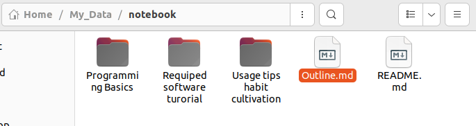
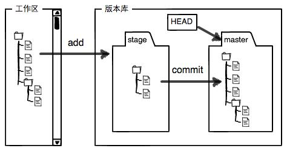
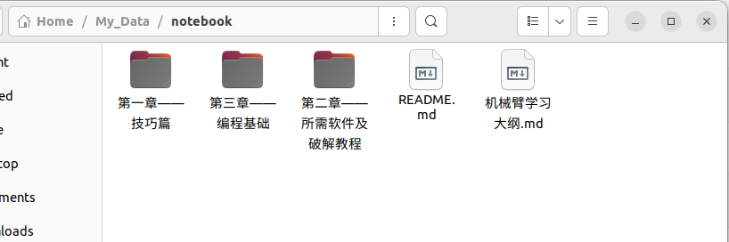
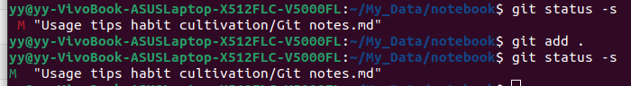
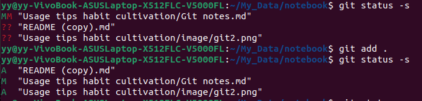
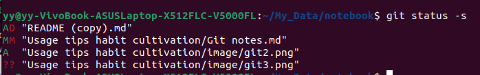
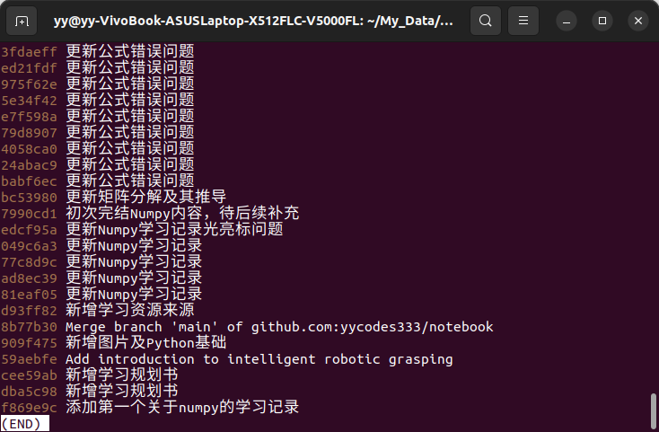

# Git 使用教程

```
学习资源：
		https://hackmd.io/@GDSC-CYCU/Linux-Git-WorkShop
		https://liaoxuefeng.com/books/git/branch/collaboration/index.html
```


## 简介

Git 是一个开源的分布式版本控制系统，用于敏捷高效地处理任何或小或大的项目。Git 是 Linus Torvalds 为了帮助管理 Linux 内核开发而开发的一个开放源码的版本控制软件。

Git 与常用的版本控制工具 CVS, Subversion 等不同，它采用了分布式版本库的方式，不必服务器端软件支持。

## Git安装

这里仅介绍在Linux上安装。首先验证自己是否安装过git。那么输入git即可：

```shell
git
```

若输出以下内容则说明没有安装.

```shell
The program 'git' is currently not installed. You can install it by typing:
sudo apt-get install git
```

Ubuntu Git 安装最新稳定版本命令为：

```shell
sudo apt update
sudo apt install git
```

补充;若已经安装，只升级git,可执行下面命令

```shell
sudo apt install git --only-upgrade
```

接着我们进行验证是否安装成功，若成功输出对应版本，则说明安装成功！

```shell
git --version
git version 2.34.1
```

## Git配置

### 1.全局配置

全局配置，最明显的关键词是**global**，指的是在本台电脑上，当前用户的所有Git仓库，默认提交人是全局配置的用户，若有局部配置，后续会介绍，优先级大于全局配置。

接下来我们进行全局配置，在命令行输入：

```shell
git config --global user.name "你的名字"
git config --global user.email "你的邮箱"
```

配置完成后，输入以下命令检查全局配置信息

```shell
git config --global user.name
git config --global user.email
```

或者查看所有的全局配置

```shell
git config --global --list
```

### 2. 局部配置

如果你的需求是对某个仓库指定特定的用户名和Email地址，你可以采取局部配置。

加入你现在有了一个仓库`A`，进入仓库A，然后执行下列命令

```shell
git config user.name "你的名字"
git config user.email "你的邮箱"
```

并且同样，配置完进行查看配置信息

```shell
git config user.name
git config user.email
```

或者查看所有的局部配置信息

```shell
git config --list
```

## Git 实现笔记记录

### 1. 创建版本库与工作区

工作区（Working Directory）指的就是你在电脑里能看到的目录，比如我的`notebook`文件夹就是一个工作区：



什么是版本库呢？版本库又名仓库（Repository），你可以简单理解成一个目录，这个目录里面的所有文件都可以被Git管理起来，每个文件的修改、删除，Git都能跟踪，以便任何时刻都可以追踪历史，或者在将来某个时刻可以“还原”。

版本库（Repository）工作区有一个隐藏目录`.git`，这个不算工作区，而是Git的版本库。

Git的版本库里存了很多东西，其中最重要的就是称为stage（或者叫index）的暂存区，还有Git为我们自动创建的第一个分支`master`，以及指向`master`的一个指针叫`HEAD`。



第一步是用`git add`把文件添加进去，实际上就是把文件修改添加到暂存区；

第二步是用`git commit`提交更改，实际上就是把暂存区的所有内容提交到当前分支。

因为我们创建Git版本库时，Git自动为我们创建了唯一一个`master`分支，所以，现在，`git commit`就是往`master`分支上提交更改。

你可以简单理解为，需要提交的文件修改通通放到暂存区，然后，一次性提交暂存区的所有修改。

那么我们如何创建版本库呢？这也就是接下来我们要讲到的 **git init**这个命令工具了。

首先，进入的哦阿你想管理的仓库中，这里以我的`notebook`仓库为例。



进入`notebook`终端，然后输入

```shell
git init
```

验证该仓库是否变成版本库

```shell
ls -a
```

若输出 `.git` ，则证明你创建版本库成功！

**说明**：`. git`隐藏文件夹非常重要，它保存了Git的版本记录、分支信息、配置内容等，这也是后边我们逐次讲解会涉及到的。

**`git init` 使用一次**：`git init`什么时候使用呢？只要你的仓库想要实现版本库，在这个仓库下必须就执行一次`git init`即可，并且通过`ls -a`可以查看到这个隐藏文件即可。

### 2. Git 常用命令介绍

#### 1. 查看修改状态及内容

`git status`命令可以让我们时刻掌握仓库当前的状态，但不能看具体修改了的内容，而`git diff`这个命令可以帮我们查看具体修改的内容。

**注意**：在现实内容信息时候如果你的文件或者文件夹是中文会出现乱码问题，所以建议使用`Enhlish`对你的内容命名。

目前我们仓库是已经上传完的，输入`git status`,显示如下。

```shell
On branch main
Your branch is up to date with 'origin/main'.

nothing to commit, working tree clean

```

接着，我们展示如果作出修改这两个命令的作用。

##### 新增内容体现

如果原来我的README.md内容如下：

```
机械臂智能抓取是机器人学、机器视觉、深度学习与工程系统集成的典型交叉方向。对于学习者而言，真正的难点并不只是理解单个概念，而是如何将相机采集、图像处理、目标识别、位姿估计、坐标变换、运动规划与机械执行串联为一个完整闭环。

本规划书结合学习者已有基础，围绕“编程基础 → 机器人学核心 → 机器视觉与相机系统 → ROS2 与 MoveIt2 工程落地 → 深度学习进阶 → 3D 点云与抓取网络 → 综合项目实施”构建系统路线。每个章节均给出学习内容、学习目标、学习价值、学习安排与资源建议，避免仅停留在概念堆叠或代码搬运层面。

本版本特别强调内容完整性。此前版本中部分学习模块存在表达压缩现象，例如 NumPy 学习条目中“向量化运算”“图像矩阵与张量基础”等内容曾被弱化。本最终版已统一恢复为完整表达，确保每一模块都可直接执行和验收。
```

接着作出修改如下：

```
机械臂智能抓取是机器人学、机器视觉、深度学习与工程系统集成的典型交叉方向。对于学习者而言，真正的难点并不只是理解单个概念，而是如何将相机采集、图像处理、目标识别、位姿估计、坐标变换、运动规划与机械执行串联为一个完整闭环。

本规划书结合学习者已有基础，围绕“编程基础 → 机器人学核心 → 机器视觉与相机系统 → ROS2 与 MoveIt2 工程落地 → 深度学习进阶 → 3D 点云与抓取网络 → 综合项目实施”构建系统路线。每个章节均给出学习内容、学习目标、学习价值、学习安排与资源建议，避免仅停留在概念堆叠或代码搬运层面。

本版本特别强调内容完整性。此前版本中部分学习模块存在表达压缩现象，例如 NumPy 学习条目中“向量化运算”“图像矩阵与张量基础”等内容曾被弱化。本最终版已统一恢复为完整表达，确保每一模块都可直接执行和验收。

这里新增内容1
```


执行 `git status`，只能看到修改的文本，但无法看到修改的内容。

```shell
On branch main
Your branch is up to date with 'origin/main'.

Changes not staged for commit:
  (use "git add <file>..." to update what will be committed)
  (use "git restore <file>..." to discard changes in working directory)
	modified:   README.md      #这里是重点，修改的内容对象是READER.md

no changes added to commit (use "git add" and/or "git commit -a")
```

执行 `git diff`

```shell
+这里新增内容1   #最明显特征就是，加号后面是较原来add 存储区版本多的内容
```

即若我将这里的新增内容1删除点，我并没有进行add ，那么最终`git diff`,什么也不会输出。

然后执行 `git add .``接着执行git status`

```shell
yy@yy-VivoBook-ASUSLaptop-X512FLC-V5000FL:~/My_Data/notebook$ git add .
yy@yy-VivoBook-ASUSLaptop-X512FLC-V5000FL:~/My_Data/notebook$ git status 
On branch main
Your branch is up to date with 'origin/main'.

Changes to be committed:
  (use "git restore --staged <file>..." to unstage)
	modified:   README.md#这里告诉我们，将要被提交的修改包括`README.md`，下一步，就可以放心地提交了

yy@yy-VivoBook-ASUSLaptop-X512FLC
```


然后我们此时执行`git diff`会发现也是空的，这时我们就知道了，`git diff`比较的就是存储区（add）之后的状态和当前状态。


##### 删除内容体现

如果原来我的README.md内容如下：

```
机械臂智能抓取是机器人学、机器视觉、深度学习与工程系统集成的典型交叉方向。对于学习者而言，真正的难点并不只是理解单个概念，而是如何将相机采集、图像处理、目标识别、位姿估计、坐标变换、运动规划与机械执行串联为一个完整闭环。

本规划书结合学习者已有基础，围绕“编程基础 → 机器人学核心 → 机器视觉与相机系统 → ROS2 与 MoveIt2 工程落地 → 深度学习进阶 → 3D 点云与抓取网络 → 综合项目实施”构建系统路线。每个章节均给出学习内容、学习目标、学习价值、学习安排与资源建议，避免仅停留在概念堆叠或代码搬运层面。

本版本特别强调内容完整性。此前版本中部分学习模块存在表达压缩现象，例如 NumPy 学习条目中“向量化运算”“图像矩阵与张量基础”等内容曾被弱化。本最终版已统一恢复为完整表达，确保每一模块都可直接执行和验收。

这里新增内容1
```


然后我们删除`“这里新增内容1”`这个内容

```
机械臂智能抓取是机器人学、机器视觉、深度学习与工程系统集成的典型交叉方向。对于学习者而言，真正的难点并不只是理解单个概念，而是如何将相机采集、图像处理、目标识别、位姿估计、坐标变换、运动规划与机械执行串联为一个完整闭环。

本规划书结合学习者已有基础，围绕“编程基础 → 机器人学核心 → 机器视觉与相机系统 → ROS2 与 MoveIt2 工程落地 → 深度学习进阶 → 3D 点云与抓取网络 → 综合项目实施”构建系统路线。每个章节均给出学习内容、学习目标、学习价值、学习安排与资源建议，避免仅停留在概念堆叠或代码搬运层面。

本版本特别强调内容完整性。此前版本中部分学习模块存在表达压缩现象，例如 NumPy 学习条目中“向量化运算”“图像矩阵与张量基础”等内容曾被弱化。本最终版已统一恢复为完整表达，确保每一模块都可直接执行和验收。

这里新增内容1
```

执行`git diff`，输出如下内容：

```shell
-这里新增内容1   #最明显特征就是，减号后面是较原来add 存储区版本少的内容
```


##### 补充

**git diff内容查阅操作**

| `q`       | 退出               |
| --------- | ------------------ |
| `空格`    | 向下翻一页         |
| `b`       | 向上翻一页         |
| `回车`    | 向下滚动一行       |
| `↑` / `↓` | 上下移动           |
| `/关键词` | 搜索关键词         |
| `n`       | 跳到下一个搜索结果 |
| `N`       | 跳到上一个搜索结果 |

**git status 简介版命令**

当我们查阅状态时候发现，内容太多太乱，有很多我们压根儿就不想看的内容出现，我们就像看到是什么文件被修改了以及修改类型我们可以使用 `git status -s`，这个命令只会输出修改文件以及文件修改类型。其中`s`是`short`简称

例如，以下是 `git status`输出

```shell
yy@yy-VivoBook-ASUSLaptop-X512FLC-V5000FL:~/My_Data/notebook$ git status
On branch main
Your branch is up to date with 'origin/main'.

Changes not staged for commit:
  (use "git add <file>..." to update what will be committed)
  (use "git restore <file>..." to discard changes in working directory)
	modified:   Usage tips habit cultivation/Git notes.md
```

如果使用`git status -s`输出如下

```shell
 M "Usage tips habit cultivation/Git notes.md"
```

这就非常简介了，注意到构成结构是 **修改类型+文件**

修改类型如下

| 标记 | 含义                 |
| ---- | -------------------- |
| `??` | 新文件，未追踪       |
| `M`  | 文件被修改           |
| `A`  | 新文件，已加入暂存区 |
| `D`  | 文件被删除           |
| `R`  | 文件被重命名         |

注意到，在修改后没有放到暂存区时候即没有执行 `git add`，是红色的M，执行 `git add`后变成绿色的M



并且在这里也说明 `??`和 `A`关系如下，新添加内容，如果没有进入暂存区显示 `？？`，加入暂存区显示 `A`



如果我将 README.md(copy)删除后，如下显示，可见有顺序，先添加后删除，这里表示为为 `A D`。




#### 2. 查看历史记录

在实际工作中，我们很难单靠记忆回想一个文件每次都修改了什么内容。

因此，Git 提供了查看历史记录的能力。接下来我们就围绕 `git log` 的常见用法，分场景进行说明。

---

##### 2.1 `git log` 的基本作用

首先，我们需要明确：

`git log` 命令用于查看提交历史，并且默认是按照 **从最近到最远** 的顺序显示提交记录。

也就是说，它可以帮助我们快速了解：

- 最近提交了什么
- 是谁提交的
- 每次提交的说明是什么

---

##### 2.2 `git log` 的交互界面操作

接下来要注意的是，执行 `git log` 后，通常会进入一个可滚动查看的界面，这和 `git diff` 类似。

因此，在这个界面中，常用的按键操作如下：

| 按键      | 作用               |
| --------- | ------------------ |
| `q`       | 退出               |
| `空格`    | 向下翻一页         |
| `b`       | 向上翻一页         |
| `回车`    | 向下滚动一行       |
| `↑ / ↓`   | 上下移动           |
| `/关键词` | 搜索关键词         |
| `n`       | 跳到下一个搜索结果 |
| `N`       | 跳到上一个搜索结果 |

**说明：**  
当提交历史较多时，这些快捷键可以帮助我们更方便地浏览内容。

---

##### 2.3 `git log` 的常用参数

除了直接使用 `git log` 之外，我们还可以通过参数来控制输出格式。

常见参数如下：

| 参数         | 作用               |
| ------------ | ------------------ |
| `--oneline`  | 每个提交只显示一行 |
| `--graph`    | 显示分支图         |
| `--decorate` | 显示分支名、标签名 |
| `--all`      | 显示所有分支       |

**说明：**  
这些参数可以单独使用，也可以组合使用。  
在日常学习和查看历史时，最常用的是：

```bash
git log --oneline
```

它可以看作是 `git log` 的简洁版。

---

##### 2.4 查看当前仓库的提交历史

下面我们先从最基础的情况开始：查看当前仓库的历史记录。

###### 2.4.1 使用 `git log`

首先执行：

```bash
git log
```

它会显示每次提交的详细信息，例如：

```bash
commit d13d5c4
Author: yy <2033170479@qq.com>
Date:   Wed May 6 19:04:35 2026 +0800

    更新Git笔记
```

**解释：**  
这种输出方式会显示提交 ID、作者、日期以及提交说明，信息比较完整，但内容也相对较多。

---

###### 2.4.2 使用 `git log --oneline`

如果我们只想快速浏览提交记录，可以使用：

```bash
git log --oneline
```

示例输出如下：

```bash
d13d5c4 更新Git笔记
```

**说明：**  
这种格式会把一条提交压缩成一行，阅读起来更加直观，适合快速查看历史。

---

###### 2.4.3 `git log` 与 `git log --oneline` 的区别

为了更清楚地理解两者差异，可以这样记：

- `git log`：信息完整，适合看详细内容
- `git log --oneline`：信息简洁，适合快速浏览

**结论：**  
如果你只是想大概看看历史，优先使用 `git log --oneline`。

---

##### 2.5 查看某个文件的提交历史

除了查看整个仓库的历史，我们还可以只查看某一个文件的历史记录。

这时，命令格式如下：

```bash
git log --oneline <文件名>
```

例如：

```bash
git log --oneline Outline.md
```

示例输出如下：

```bash
d1765b1 解决中文乱码问题
```

**注意：**  
这里的 `--oneline` 一定要写在文件名前面，否则命令可能无法正常识别。

**说明：**  
这种方式适合我们只关注某一个文件的变化过程，而不关心整个仓库的全部提交。

---

##### 2.6 查看某个文件每次提交具体改了什么

如果我们不只是想知道“提交了什么”，还想知道“每次具体改了哪里”，那就可以使用 `-p` 参数。

命令如下：

```bash
git log --oneline -p <文件名>
```

例如：

```bash
git log --oneline -p README.md
```

输出中会出现类似这样的差异内容：

```bash
diff --git a/README.md b/README.md
index cd47a99..265a378 100644
--- a/README.md
+++ b/README.md
@@ -6,7 +6,5 @@

-我要在这里作出修改。
-
-
+这里作出修改
```

**解释：**

- `-` 表示被删除的内容
- `+` 表示新增的内容

也就是说，上面的例子表示原来的内容被删掉，并替换成了新的内容。

**提示：**  
如果你想精确追踪某个文件的修改过程，这个命令非常有用。

---

##### 2.7  查看最近几次提交

有时候我们并不需要查看全部历史，只想看最近几次提交。

这时可以使用：

```bash
git log --oneline -3
```

其中，`-3` 表示只显示最近 3 次提交。

示例输出如下：

```bash
3d3586a (HEAD -> main, origin/main) 更新Git笔记
d13d5c4 更新Git笔记
8af8375 更新部分Git教学
```

**说明：**  
如果你想看最近 5 次提交，可以改成：

```bash
git log --oneline -5
```

同理，如果要看最近 10 次，就写成：

```bash
git log --oneline -10
```

---

###### 2.7.1 查看某个文件最近几次提交

除了查看整个仓库的最近提交，我们也可以只看某个文件最近几次的记录。

命令如下：

```bash
git log --oneline -3 <文件名>
```

例如：

```bash
git log --oneline -3 README.md
```

示例输出如下：

```bash
ccbc4d0 测试
a279bf3 测试不用管
6438a58 解决中文乱码
```

**说明：**  
这种写法可以帮助我们快速聚焦到某个文件的修改历史，而不必翻看整个项目的提交记录。

---

##### 2.8 查看所有分支的历史

前面我们看到的都是当前分支的历史。

如果我们希望查看所有分支上的提交记录，就可以使用：

```bash
git log --all
```

如果再结合 `--oneline`，会更清晰：

```bash
git log --all --oneline
```

示例输出如下：



**解释：**  
这个命令会把仓库中所有分支的提交都列出来，所以你会看到比普通 `git log` 更全面的内容。

**补充：**  
如果仓库有多个分支，而你又想了解它们的整体演进过程，那么这个命令非常适合。

---

##### 2.9 本节小结

最后，我们把本节内容做一个简要总结：

| 需求                      | 命令                            |
| ------------------------- | ------------------------------- |
| 查看完整提交历史          | `git log`                       |
| 简洁查看提交历史          | `git log --oneline`             |
| 查看某个文件的提交历史    | `git log --oneline <文件名>`    |
| 查看某个文件每次具体修改  | `git log --oneline -p <文件名>` |
| 查看最近 3 次提交         | `git log --oneline -3`          |
| 查看某个文件最近 3 次提交 | `git log --oneline -3 <文件名>` |
| 查看所有分支历史          | `git log --all`                 |
| 简洁查看所有分支历史      | `git log --all --oneline`       |

**总结一下：**  
`git log` 适合看历史，`--oneline` 适合快速浏览，`-p` 适合查看具体改动，而 `--all` 则适合看所有分支的提交记录。


#### 3. 追溯历史版本

Git 中常见的版本回退相关命令主要有三个：

- `git reset`
- `git revert`
- `git reflog`

它们都和“回退版本”有关，但用途不同：

| 命令         | 作用                             | 是否改写历史 | 常见用途                 |
| ------------ | -------------------------------- | ------------ | ------------------------ |
| `git reset`  | 回到某个提交，并移动当前分支指针 | 是           | 本地回退、撤销提交       |
| `git revert` | 新建一个提交，抵消某次提交的改动 | 否           | 已 push 后的安全撤销     |
| `git reflog` | 查看 HEAD 的移动记录             | 否           | 找回误删提交、误操作补救 |

---

##### 1. git reset

`git reset` 用于把当前分支回退到某个历史提交。

基本格式：

```bash
git reset --[模式] <提交ID>
```

例如：

```bash
git reset --hard 37b3361
```

表示回退到上一个提交。

---

###### 1.1 三种常用模式

| 命令                | 是否移动 HEAD | 是否改暂存区 | 是否改工作区 | 说明                        |
| ------------------- | ------------- | ------------ | ------------ | --------------------------- |
| `git reset --soft`  | 是            | 否           | 否           | 撤销 commit，保留暂存区内容 |
| `git reset --mixed` | 是            | 是           | 否           | 撤销 commit 和暂存区        |
| `git reset --hard`  | 是            | 是           | 是           | 彻底回退，工作区也恢复      |

其中：

```bash
git reset <提交ID>
```

默认等价于：

```bash
git reset --mixed <提交ID>
```

---

###### 1.2 git reset --soft

**作用：** 撤销提交，但保留暂存区和工作区内容。

**使用场景：**

- commit 信息写错了
- 想撤销最近一次提交后重新提交
- 想保留已经 `git add` 的内容

**示例：**

```bash
git log --oneline -2
d254929 测试
f6bcc69 上一个版本

git reset --soft f6bcc69
```

执行后：

- `d254929` 这次提交从当前分支历史中移除
- 修改内容仍保留在暂存区
- 可以直接重新 commit

**后续操作：**

```bash
git commit -m "新的提交说明"
```

**注意点：**

- 如果想撤销当前提交，通常要 reset 到它的上一个版本
- 只适合本地未 push 的提交更方便

---

###### 1.3 git reset --mixed

**作用：** 撤销提交，同时取消暂存，但保留工作区代码。

**使用场景：**

- 想撤销 commit
- 也想撤销 `git add`
- 但不想丢失代码修改

**示例：**

```bash
git reset 37b3361
```

执行后：

- `37b3361`提交被撤销
- 暂存区清空
- 修改仍在工作区

**常见操作：**

```bash
git reset HEAD~1
git status
git add .
git commit -m "重新提交"
```

**注意点：**

- 默认 `git reset <提交ID>` 就是 `--mixed`
- 适合本地整理提交内容

---

###### 1.4 git reset --hard

**作用：** 撤销提交，并让暂存区、工作区都回到指定提交的状态。

**使用场景：**

- 本地修改和提交都不要了
- 想彻底恢复到某个稳定版本
- 实验代码全部丢弃

**示例：**

```bash
git reset --hard HEAD~1
```

执行后：

- 最近一次提交被撤销
- 工作区代码也恢复
- `git status` 通常显示工作区干净

**注意点：**

- 这是最危险的 reset 模式
- 工作区未保存的重要修改可能丢失
- 如果误操作，可尝试用 `git reflog` 找回

---

###### 1.5 reset 到指定提交

先查看历史：

```bash
git log --oneline
```

例如：

```bash
f3a91c2 修改登录页面样式
a8c72d1 添加用户注册功能
92bc31e 初始化项目
```

回退到 `a8c72d1`：

```bash
git reset --hard a8c72d1
```

执行后，当前分支会回到这个提交。

**注意点：**

- 指定 ID 之后的提交会从当前分支历史中移除
- 这些提交不一定立刻彻底消失，通常还能通过 `git reflog` 找回
- 如果远程还保留这些提交，也可能重新 fetch / pull 回来
- 如果你 force push 改写了远程历史，普通 pull 就拉不回来了

---

###### 1.6 reset 的使用建议

| 场景                  | 是否推荐 |
| --------------------- | -------- |
| 本地提交，还没 push   | 推荐     |
| 已经 push，只有自己用 | 谨慎使用 |
| 已经 push，多人协作   | 不推荐   |

**原因：**

`git reset` 会改写历史。  
如果已经 push 到远程，尤其是多人协作分支，不建议随意使用后再强推。

---

##### 2. git revert

`git revert` 用于撤销某次提交的改动，但不会删除原提交。

它的做法不是回到过去，而是：

> 新建一个反向提交，抵消指定提交带来的修改。

---

###### 2.1 基本用法

```bash
git revert <提交ID>
```

例如：

```bash
git revert f3a91c2
```

执行后 Git 会新建一个提交，例如：

```bash
Revert "修改登录页面样式"
```

历史会变成：

```bash
d82ac91 Revert "修改登录页面样式"
f3a91c2 修改登录页面样式
a8c72d1 添加用户注册功能
```

**说明：**

- 原提交不会消失
- 会多一个新的 revert 提交
- 代码效果上撤销了原提交的改动

---

###### 2.2 使用场景

适合：

- 已经 push 到远程的提交
- 多人协作项目
- 不想改写历史
- 线上代码需要安全回退

---

###### 2.3 revert 的效果

例如历史：

```bash
A --- B --- C
```

执行：

```bash
git revert C
```

会变成：

```bash
A --- B --- C --- D
```

其中：

- `C` 还在
- `D` 是新的反向提交
- 最终代码效果等于撤销了 `C`

---

###### 2.4 revert 是否等于“回到上一个版本”

**不一定。**

更准确地说：

> `git revert <提交ID>` 撤销的是“该提交本身带来的改动”，不一定等于直接回到它的上一个版本。

例如：

```bash
A --- B --- C --- D
```

如果执行：

```bash
git revert C
```

结果是：

```bash
A --- B --- C --- D --- E
```

此时：

- `C` 的改动被撤销
- `D` 的改动仍然保留

所以最终内容不一定等于 `B`。

---

###### 2.5 revert 是否修改工作区

会在执行过程中修改工作区，用来应用“反向改动”。

如果成功自动提交后，工作区通常还是干净的。  
如果发生冲突，则需要手动处理后再提交。

---

###### 2.6 常见用法

撤销最近一次提交：

```bash
git revert HEAD
```

撤销指定提交：

```bash
git revert <提交ID>
```

不打开编辑器，直接使用默认信息：

```bash
git revert --no-edit <提交ID>
```

撤销后推送到远程：

```bash
git push origin <分支名>
```

---

###### 2.7 revert 的注意点

- 不会删除历史
- 会新增一个提交
- 适合已经 push 的提交
- push 之后，远程会多一个 revert 提交，不是把原提交直接删掉

---

##### 3. git reflog

`git reflog` 用于查看 HEAD 的移动记录。

常见用途：

- reset 错了找回提交
- checkout / rebase / merge 后找回之前位置
- 补救误操作

---

###### 3.1 基本用法

```bash
git reflog
```

示例输出：

```bash
a8c72d1 HEAD@{0}: reset: moving to HEAD~1
f3a91c2 HEAD@{1}: commit: 修改登录页面样式
a8c72d1 HEAD@{2}: commit: 添加用户注册功能
```

这里表示：

- `HEAD@{0}`：当前 HEAD
- `HEAD@{1}`：上一次所在位置

---

###### 3.2 找回误 reset 的提交

例如误执行：

```bash
git reset --hard HEAD~1
```

然后发现回退错了。

先查看：

```bash
git reflog
```

找到原来的提交：

```bash
f3a91c2 HEAD@{1}: commit: 修改登录页面样式
```

恢复：

```bash
git reset --hard f3a91c2
```

或者：

```bash
git reset --hard HEAD@{1}
```

---

###### 3.3 注意点

- `reflog` 主要是本地补救工具
- 不是永久保存
- 发现误操作后应尽快查看

---

##### 4. reset、revert、reflog 对比

| 对比项               | git reset | git revert | git reflog     |
| -------------------- | --------- | ---------- | -------------- |
| 是否回退代码         | 是        | 是         | 否             |
| 是否改写历史         | 是        | 否         | 否             |
| 是否新增提交         | 否        | 是         | 否             |
| 是否适合已 push 提交 | 不推荐    | 推荐       | 用于补救       |
| 是否适合多人协作     | 谨慎使用  | 适合       | 补救工具       |
| 核心作用             | 移动 HEAD | 反向提交   | 查看 HEAD 历史 |

---

##### 5. 常见使用情况总结

###### 5.1 本地提交信息写错了，还没 push

推荐：

```bash
git reset --soft HEAD~1
git commit -m "新的提交说明"
```

---

###### 5.2 本地提交想撤销，但代码保留

推荐：

```bash
git reset HEAD~1
```

或者：

```bash
git reset --mixed HEAD~1
```

---

###### 5.3 本地提交和代码都不要了

推荐：

```bash
git reset --hard HEAD~1
```

---

###### 5.4 已经 push 到远程，想安全撤销某次提交

推荐：

```bash
git revert <提交ID>
git push origin <分支名>
```

---

###### 5.5 reset 错了，想找回来

推荐：

```bash
git reflog
git reset --hard <提交ID>
```

---

##### 6. 常用命令速查

| 需求                            | 命令                            |
| ------------------------------- | ------------------------------- |
| 查看提交历史                    | `git log --oneline`             |
| 查看 HEAD 移动历史              | `git reflog`                    |
| 撤销最近一次 commit，保留暂存区 | `git reset --soft HEAD~1`       |
| 撤销最近一次 commit，保留工作区 | `git reset HEAD~1`              |
| 撤销最近一次 commit，并丢弃修改 | `git reset --hard HEAD~1`       |
| 回退到指定提交                  | `git reset <提交ID>`            |
| 强制回退到指定提交              | `git reset --hard <提交ID>`     |
| 撤销某个提交                    | `git revert <提交ID>`           |
| 撤销最近一次提交                | `git revert HEAD`               |
| 撤销指定提交并使用默认信息      | `git revert --no-edit <提交ID>` |

#### 4. 从仓库拉取到本地

`git pull` 用于从远程仓库拉取最新代码，并合并到当前本地分支。

它本质上是两个命令的组合：

```shell
git fetch
git merge
```

也就是说：

> ```shell
> git pull = git fetch + git merge
> ```

------

##### 1. 作用

`git pull` 的主要作用是：

- 从远程仓库获取最新提交
- 把远程更新合并到本地当前分支

适合场景：

- 远程仓库已经有别人提交的新代码
- 你本地想同步最新内容
- 开发前先更新本地代码

------

##### 2. 基本用法

```shell
git pull
```

如果当前分支已经关联远程分支，那么直接执行就可以拉取并合并。

例如：

```shell
git pull origin main
```


表示从 `origin` 的 `main` 分支拉取并合并到本地当前分支。若想拉取其他分支只需**将main改成对应分支即可**！

------

##### 3. 执行后的结果

假设远程仓库和本地仓库原来都是：

```shell
A --- B --- C
```


如果远程新增了一个提交 `D`，本地还是停留在 `C`，执行 `git pull` 后，通常会变成：

```
A --- B --- C --- D
```

如果本地和远程都有各自的新提交，Git 可能会自动生成一次合并提交。

------

##### 4. 常见使用情况

###### 4.1 同步远程最新代码

最常见的场景就是先拉取再开发：

```shell
git pull
```

适合在开始写代码前先更新本地分支。

------

###### 4.2 拉取指定远程分支

```shell
git pull origin main
```

表示把远程 `main` 分支的最新内容拉到本地。

------

###### 4.3 拉取时发生冲突

如果本地修改和远程修改冲突，`git pull` 可能会失败，并提示你先解决冲突。

这时需要：

1. 手动处理冲突文件
2. `git add`
3. `git commit`

------

##### 5. 注意点

- `git pull` 不只是“下载代码”，它还会自动合并
- 如果本地有未提交修改，可能会影响 pull
- 多人协作时，`pull` 前最好先确认本地工作区是否干净。

> 这里的“干净”指的是本地是否还有未 `add`、未 `commit` 或未处理完成的修改，而不是指这些内容是否已经 push 到远程 GitHub。

------

##### 

##### 6. 一句话记忆

> `git pull` 就是把远程最新代码拉到本地，并自动合并到当前分支。


#### 5. 克隆仓库

`git clone` 用于把远程仓库完整复制到本地。

它适合在**本地还没有这个仓库**的时候使用。

---

##### 1. 作用

`git clone` 的主要作用是：

- 把远程仓库下载到本地
- 自动创建项目目录
- 自动关联远程仓库 `origin`
- 自动把默认分支检出到本地

---

##### 2. 基本用法

```bash
git clone <仓库地址>
```

例如：

```bash
git clone https://github.com/user/demo.git
```

或者：

```bash
git clone git@github.com:user/demo.git
```

这两种都可以，区别只是连接方式不同：

- `https`：通过 HTTPS 访问
- `ssh`：通过 SSH 访问

---

##### 3. clone 指定目录名

默认情况下，`git clone` 会使用仓库名作为本地目录名。

例如：

```bash
git clone https://github.com/user/demo.git
```

会生成一个名为 `demo` 的文件夹也就是你克隆的文件名称。

如果想自定义目录名，可以这样写：

```bash
git clone https://github.com/user/demo.git my-demo
```

表示把仓库克隆到 `my-demo` 目录下。

---

##### 4. clone 指定分支

有时不想克隆默认分支，而是直接克隆某个指定分支，可以使用：

```bash
git clone -b <分支名> <仓库地址>
```

例如：

```bash
git clone -b dev https://github.com/user/demo.git
```

表示：

- 克隆远程仓库
- 直接切换到 `dev` 分支

---

###### 4.1 只克隆指定分支

如果你只想拉取某一个分支，而不是所有分支，可以加上 `--single-branch`：

```bash
git clone -b dev --single-branch https://github.com/user/demo.git
```

含义：

- 只克隆 `dev` 分支
- 不克隆其他分支历史

**注意：**

- 适合只关心一个分支的场景
- 一般开发中最常用的是默认克隆全部内容

---

##### 5. 常见使用场景

###### 5.1 第一次加入项目

本地没有项目时，先执行：

```bash
git clone <仓库地址>
```

然后进入目录：

```bash
cd demo
```

---

###### 5.2 直接克隆开发分支

```bash
git clone -b dev <仓库地址>
```

适合项目需要直接从开发分支开始工作。

---

###### 5.3 克隆到自定义目录

```bash
git clone <仓库地址> my-project
```

适合你想控制本地文件夹名字的时候。

---

##### 6. clone 和 pull 的区别

| 命令        | 作用                         |
| ----------- | ---------------------------- |
| `git clone` | 本地没有仓库，先完整复制一份 |
| `git pull`  | 本地已经有仓库，再拉最新改动 |

---

##### 7. 一句话记忆

- `git clone`：本地没有仓库，先完整复制一份
- `git pull`：本地已经有仓库，再拉最新改动


### 3. 关联Github仓库

现在的情景是，你已经在本地创建了一个Git仓库后，又想在GitHub创建一个Git仓库，并且让这两个仓库进行远程同步，这样，GitHub上的仓库既可以作为备份，又可以让其他人通过该仓库来协作，真是一举多得。

首先，我们需要创建SSH Key公钥，在你的终端输入 `ssh-keygen`

接着，终端机会问你几个问题，**全部直接按** `Enter` 接受默认值即可。

- `Enter file in which to save the key...`：直接按 `Enter`。
- `Enter passphrase...`：直接按 `Enter` (不需要密码)。
- `Enter same passphrase again...`：再次按 `Enter`。

指令完成后，画面上会告诉你公钥存储的路径，例如 `/home/你的用户名/.ssh/id_rsa.pub` 或 `id_ed25519.pub`

钥匙有分公钥 (可以给别人) 和私钥 (绝对要自己保管好)。我们要将“公钥”复制到 GitHub。

在终端机输入以下指令来显示公钥内容。请注意，文件名可能是 `id_rsa.pub` 或 `id_ed25519.pub`，这取决于系统默认值，两个都可以。

```shell
cat ~/.ssh/id_rsa.pub
```

**完整复制**画面上出现的所有内容，它应该是以 `ssh-rsa` 或 `ssh-ed25519` 开头。

前往 GitHub 网站，登录你的账号。

点击右上角的个人头像，选择 **Settings**。

在左边的菜单中，找到并点击 **SSH and GPG keys**。

点击绿色的 **New SSH key** 按钮。

**Title**：给这个钥匙取一个好记的名字，例如 `My Ubuntu VM`。

**Key**：将你刚刚复制的公钥内容，完整地粘贴到这个栏位。

最后点击 **Add SSH key**。


然后，登陆GitHub，点击头像选择**Setting**，在左边的菜单找到并点击**SSH and GPG keys**，点击绿色的 **New SSH key** 按钮。

- **Title**：给这个钥匙取一个好记的名字，例如 `yy`。
- **Key**：将你刚刚复制的公钥内容，完整地粘贴到这个栏位。

- 点击 **Add SSH key**。

完成SSH KEY创建后接着创建Github仓库，在右上角找到“Create a new repo”按钮，创建一个新的仓库,在Repository name填入`你的仓库名词`，这里我叫做`notebooktemp`其他保持默认设置，点击“Create repository”按钮，就成功地创建了一个新的Git仓库：

目前，在GitHub上的这个``仓库还是空的，GitHub告诉我们，可以从这个仓库克隆出新的仓库，也可以把一个已有的本地仓库与之关联，然后，把本地仓库的内容推送到GitHub仓库。

现在，我们根据GitHub的提示，在本地的`notebook`仓库下运行命令：

```shell
git remote add origin git@github.com:yycodes333/notebooktemp.git
git branch -M main
git add .
git commit -m "第一次提交内容"
git push -u origin main
```

*(注：git branch -M main将git init时候默认分支修改为main)*

最后输出以下内容说明你关联仓库成功！

```shell
(base) yy@yy-VivoBook-ASUSLaptop-X512FLC-V5000FL:~/My_Data/temp$ git push -u origin main
Enumerating objects: 154, done.
Counting objects: 100% (154/154), done.
Delta compression using up to 8 threads
Compressing objects: 100% (154/154), done.
Writing objects: 100% (154/154), 23.17 MiB | 2.60 MiB/s, done.
Total 154 (delta 1), reused 0 (delta 0), pack-reused 0
remote: Resolving deltas: 100% (1/1), done.
To github.com:yycodes333/notebooktemp.git
 * [new branch]      main -> main
Branch 'main' set up to track remote branch 'main' from 'origin'.

```

把本地库的内容推送到远程，用`git push`命令，实际上是把当前分支`master`推送到远程。

由于远程库是空的，我们**第一次推送`master`分支时，必须加上了`-u`参数**，Git不但会把本地的`master`分支内容推送的远程新的`master`分支，还会把本地的`master`分支和远程的`master`分支关联起来，在以后的推送或者拉取时就可以简化命令，使用`git push origin main(因为这里-M main已经将master改名为main)`即可。

加入后续单独开启新的分支，比如分支dev

```shell
git checkout -b dev
```

*(注：这条命令相当于 `git branch dev` 和 `git checkout dev` 两条命令的结合。现在你已经离开了 `main` 分支，站在了 `dev` 分支上。)*

然后想要将内容（此内容与第一回的main分支区分开可以另建一个本地工作间上传）推送到dev分支上，进行如下操作。

```shell
git add .
git commit -m "在 dev 分支上的第一次提交"
git push -u origin dev#由于是在该分支第一次操作一定要➕u
```

同理，当后续在这个分支操作时候就可以简写成git push 或者 git push origin dev了。


