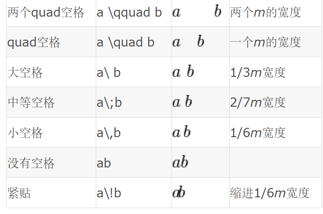

# Latex

```
学习资源：
	https://blog.csdn.net/bennyfun79/article/details/15500575
```

1. 自定义公式序号最右：

   ```math
   \begin{equation*}
   {}^{B}V_Q = \frac{d}{dt}{}^{B}Q = \lim_{\Delta t \to 0} \frac{{}^{B}Q(t+\Delta t) - {}^{B}Q(t)}{\Delta t}
   \tag{5-1}
   \end{equation*}
   ```

