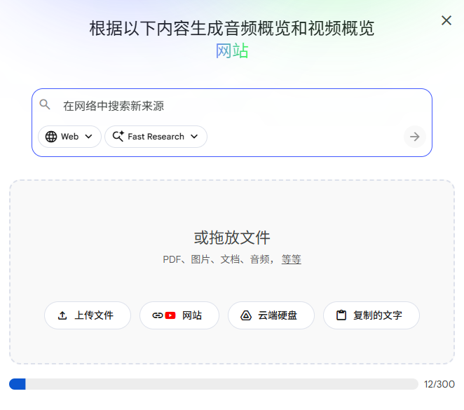
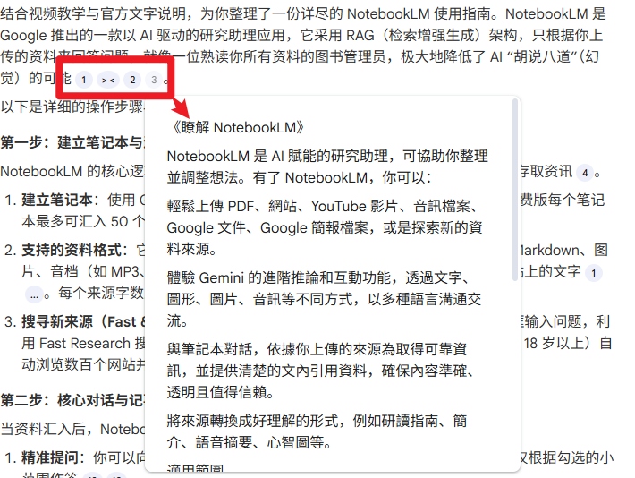
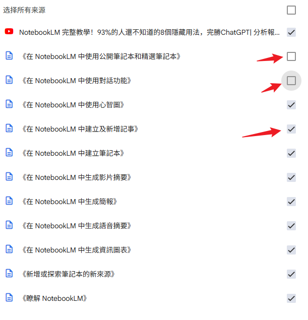
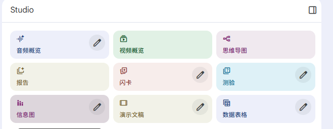
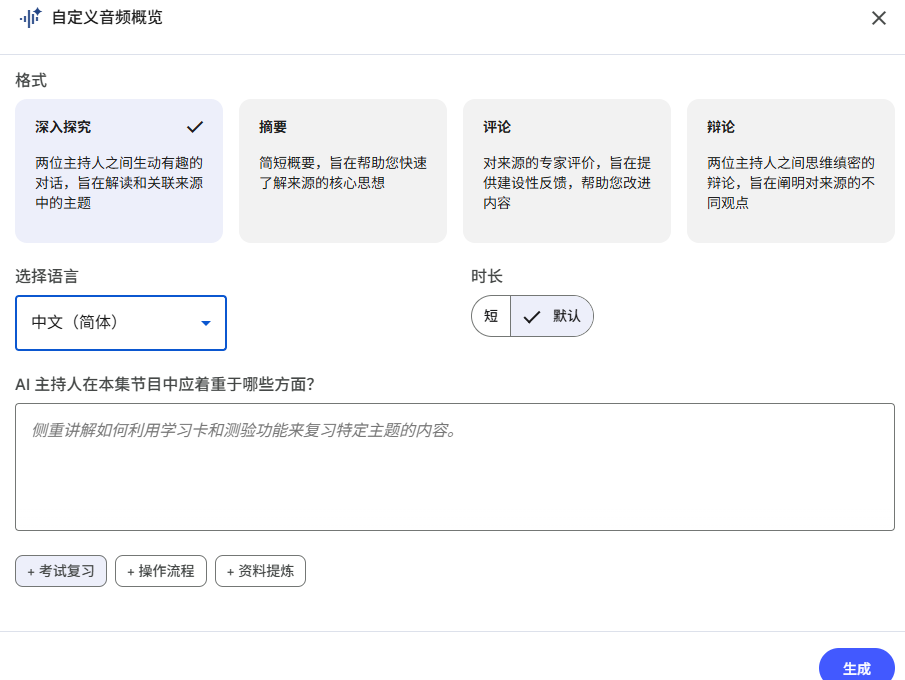
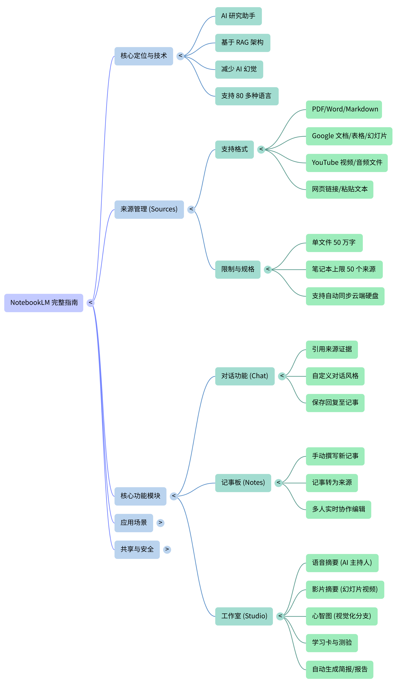

# NotebookLM介绍

## NotebookLM是什么——Google最新的AI笔记助理

NotebookLM 是 Google 推出的 AI 笔记工具，全名为 Notebook Language Model，透过整合 Gemini 大语言模型，协助使用者从大量资料中快速**撷取重点**、**生成摘要**、**提出问题**并引用来源。在 2025 年 5 月 20 日也正式推出行动版 App，包含离线播放音讯摘要、全系统来源新增整合、互动式音讯体验 3 项功能。 		与 ChatGPT 一般生成式 AI 不同，NotebookLM 最大特色在于根据上传的资料内容进行回应，大幅**降低 AI 幻觉问题**。无论是**学生整理报告**、**研究员统整文献**，还是**内容创作者制作资料简报**，都能透过 NotebookLM 提高资讯管理、知识工作的效率。目前使用者只要登入 Google 帐号，即可免费体验 NotebookLM 智慧笔记助理。

## 使用步骤

#### 第一步：建立笔记本与汇入资料

浏览器搜索“NotebookLM ”，使用 Google 账号登录后，点击“新增笔记本”。每个笔记本都是独立的，系统无法跨笔记本存取资讯。

1. **广泛的资料格式支持**：免费版每个笔记本最多可汇入 50 个资料来源，付费版（Pro）可达 300 个。
2. **支持格式**包括 PDF、Google 文件/简报（最多100张）/试算表、Markdown、图片、复制贴上的文字、音档（MP3/WAV 等）以及带有字幕的公开 YouTube 影片连结。每个来源上限为 50 万字或 200 MB。
3. **搜寻新来源**：除了手动上传，你可以使用 **Fast Research** 搜寻网络或 Google 云端硬盘中的资料，或使用 **Deep Research**（限 18 岁以上使用）让 AI 自动浏览数百个网站并生成深度研究报告直接汇入。

#### 第二步：使用“对话”面板互动

**精准提问与引用**：你可以针对资料提问或下达指令（例如要求按“时间序列”整理公司沿革或用表格比较差异）。将鼠标悬停在 AI 回答的引用处，即可查看完整引文并跳转至原文段落。

**锁定资料范围**：可以勾选特定的资料来源，让 AI 仅根据勾选的小范围作答。

#### 第三步：记事功能 (Notes)

**储存与管理想法**：如果 AI 回答得很好，**请务必点选“储存至记事”**，以便日后参考并保留格式，否则NotebookLM会丢弃。你也可以自己撰写笔记。

**资料淬炼**：你可以将“单一条记事”或“所有记事”转换成新的资料来源，赋予笔记本你个人的思考与“灵魂”，成为高浓度的知识库。

#### 第四步：使用“工作室 (Studio)”生成丰富构件 

在工作室面板中，AI 可以将资料转化为多种形式（部分功能限 18 岁以上）：

1. **语音摘要 (Podcast)**：将资料浓缩为两位 AI 主持人对谈的广播节目，可设定格式（深入探索、摘要、评论、辩论）、长度及提示词。互动模式下，你甚至可以点击“加入”直接与 AI 主持人提问讨论（目前仅限英文）。

   

2. **影片摘要**：将来源转换成带有 AI 旁白与图像的解说影片或摘要影片，支持选择经典、白板、动漫风、纸艺等视觉风格。

3. **资讯图表**：将复杂资讯转化为吸引人的单张图表（正方形、直向或横向），并可下载为 PNG 档。

4. **简报**：生成精美的投影片（详细简报或简短投影片），可自定大纲与风格，支援全屏幕播放或下载为 PDF。

5. **心智图**：以树状分支图视觉化呈现资料架构。你可以展开/收合分支，或直接点击节点向 AI 提问。

   

6. **学习卡与测验**：针对备考需求，系统可随机生成学习卡，或产生测验题计算正确率，可自订题目数量与难度。

7. **多国语言报告**：产出学习指南、网志、商业竞争分析等，并支持超过 80 种语言。

8. **等等其他功能，在studio中自行练习使用**

#### 第五步：分享与协作

**权限管理**：可将笔记本分享给其他人并赋予“检视者”或“编辑者”权限。Pro 版用户还可以设定“仅限对话”权限（适合用作客服平台，不让对方看原始资料）。

**公开分享**：个人账号可产生公开连结，分享完整笔记本或单一构件（如影片、图表）给任何人

## **使用过程可能遇到的问题/使用提示**

**资料更新不同步**：如果加入新资料后摘要没有变，可以在空白处点右键选择“重新整理所有的来源”。对于 Google 云端硬盘汇入的档案，NotebookLM 不会自动追踪变更，需要在来源检视器中手动点击“与 Google 云端硬碟保持同步”。

**影片与网页汇入限制**：YouTube 影片必须是公开的且带有字幕，不支援无语音影片，且 72 小时内刚上传的影片可能无法抓取。网页连结不支援有付费墙的网页，且只会抓取文字，不包含图片或巢状网页。

**生成内容的准确性与安全限制**：由于是 AI 生成，生成的简报、图表、影片或语音可能会出现资讯错误、图像错误或音讯不流畅（如出现第三种声音）的情况，切勿将输出内容视为专业的医疗、法律或财务建议。

**安全性标记导致无法回答**：如果上传的来源中含有暴力、情色或猥亵等敏感主题（即使是历史类内容），会触发安全性标记，导致 NotebookLM 拒绝回答。

**指令下达技巧**：遇到 AI 只截取文章前面引言的情况时，请下达更精确的指令，例如“请一定要研读整篇文章，忽略前面的引言或摘要的内容，重新生成”。提问越具体，AI 越能找出相关资讯。

**隐私与机密考量**：公司或学校专用的 Google Workspace 账号资料受到保护，不会用于 AI 模型训练，也不会经过人工审查。但如果公司的会议记录属于极度机密的资料，仍建议斟酌是否上传网络，或改用本机离线 AI 工具。

**移动端会议记录应用**：推荐下载手机版 App，在开会时开启录音，结束后直接分享到 NotebookLM，系统就能自动生成会议摘要，甚至转成 Podcast 方便上下班复习。

## 提问技巧

想让 NotebookLM 给出更深入、有结构又具参考价值的回答？关键在于你的提问方式。

以下整理六种高效提问技巧，帮助你提升互动品质：

1. 技巧一：

   ​		结构化、多层次提问将复杂问题拆解为**多层次子题**，并指定输出结构，例如：「请从历史案例、研究方法、伦理层面分析主题，并依摘要 → 案例 → 现况 → 展望的格式回答。」   

2. 技巧二：

   ​		应用费曼技巧提问请求 NotebookLM 用简单白话解释概念，指出知识盲点，并辅以比喻、练习题与心智图，加强理解。 

3. 技巧三：

   ​		多用分析与比较型问题  比较、优缺点、关联性等问题能引导 NotebookLM 给出更深入的分析。例如：「比较【文件A】与【文件B】的异同」、「列出文件中提出的三种解决方案及其优缺点」。

4. 技巧四：

   ​		明确指定摘要重点  明确要求摘要聚焦于重点、趋势或可行建议。范例：「请摘要本报告的三大趋势与建议」，或「列出此文件关于××的五个关键点」。 

5. 技巧五：

   ​		建立追问循环  根据先前回答进行深化提问，如：「这些趋势对××的影响是什么？」「可预见的新风险有哪些？」   

6. 技巧六：

   ​		创意与多样化输出  请求 NotebookLM 将内容转换为实用或具表现力的格式，例如：生成提案草稿、故事架构、PowerPoint 大纲、心智图、流程图，或使用 Audio Overview 转为语音 Podcast 摘要，适合内容创作、简报制作与教学应用。