# 3.2 Numpy 与矩阵计算

```shell
    学习资源出处：
        https://www.runoob.com/numpy/numpy-ndarray-object.html
        https://blog.csdn.net/TSzero/article/details/123986478
        https://blog.csdn.net/a8598671/article/details/142168239
        https://documentation.help/py-science-zh/numpy_intro.html
		https://www.bilibili.com/video/BV1YB4y1p7eU/?spm_id_from=333.337.search-card.all.click&vd_source=cbdff95f6409c069f7d66d3a07fc742f
		https://zhuanlan.zhihu.com/p/60365398
```

## 3.2.1 Numpy教程引入


​	NumPy(Numerical Python) 是 Python 语言的一个扩展程序库，支持大量的维度数组与矩阵运算，此外也针对数组运算提供大量的数学函数库。

​	NumPy 的前身 Numeric 最早是由 Jim Hugunin 与其它协作者共同开发，2005 年，Travis Oliphant 在 Numeric 中结合了另一个同性质的程序库 Numarray 的特色，并加入了其它扩展而开发了 NumPy。NumPy 为开放源代码并且由许多协作者共同维护开发。

​	NumPy 是一个运行速度非常快的数学库，主要用于数组计算，包含：

- ​	一个强大的N维数组对象 ndarray
- ​	广播功能函数
- ​	整合 C/C++/Fortran 代码的工具
- ​	线性代数、傅里叶变换、随机数生成等功能


## 3.2.2 Numpy应用

​	NumPy 通常与 SciPy（Scientific Python）和 Matplotlib（绘图库）一起使用， 这种组合广泛用于替代 MatLab，是一个强大的科学计算环境，有助于我们通过 Python 学习数据科学或者机器学习。

​	SciPy 是一个开源的 Python 算法库和数学工具包。

​	SciPy 包含的模块有最优化、线性代数、积分、插值、特殊函数、快速傅里叶变换、信号处理和图像处理、常微分方程求解和其他科学与工程中常用的计算。

​	Matplotlib 是 Python 编程语言及其数值数学扩展包 NumPy 的可视化操作界面。它为利用通用的图形用户界面工具包，如 Tkinter, wxPython, Qt 或 GTK+ 向应用程序嵌入式绘图提供了应用程序接口（API）。

## 3.2.3 Numpy安装

```shell
pip install numpy
pip3 install numpy -i https://pypi.tuna.tsinghua.edu.cn/simple
```

验证是否安装成功

```python
import numpy as np
print(np.__version__)

```

最后输出版本号即安装成功！

## 3.2.4 Numpy使用


### 3.2.4.1 ndarray基本操作

1. NumPy 最重要的一个特点是其 N 维数组对象 ndarray，它是一系列同类型数据的集合，`以 0 下标为开始进`行集合中元素的索引。

2. ndarray 对象是用于存放`同类型元素`的多维数组。

3. ndarray 中的每个元素在内存中都有相同存储大小的区域。


ndarray 内部由以下内容组成：

- 一个指向数据（内存或内存映射文件中的一块数据）的指针。
- 数据类型或 dtype，描述在数组中的固定大小值的格子。
- 一个表示数组形状（shape）的元组，表示各维度大小的元组。
- 一个跨度元组（stride），其中的整数指的是为了前进到当前维度下一个元素需要"跨过"的字节数


创建一个 ndarray 只需调用 NumPy 的 array 函数即可：

```python
numpy.array(object, dtype = None, copy = True, order = None, subok = False, ndmin = 0)
```

**参数说明：**

| 名称   | 描述                                                      |
| :----- | :-------------------------------------------------------- |
| object | 数组或嵌套的数列                                          |
| dtype  | 数组元素的数据类型，可选                                  |
| copy   | 对象是否需要复制，可选                                    |
| order  | 创建数组的样式，C为行方向，F为列方向，A为任意方向（默认） |
| subok  | 默认返回一个与基类类型一致的数组                          |
| ndmin  | 指定生成数组的最小维度                                    |

接下来对重点可能需要的参数作进一步说明：

#### 1. object

这是**唯一必填**的参数。它代表你要转换成 NumPy 数组的核心数据。可以是 Python 的列表 (List)、元组 (Tuple)，甚至是另一个嵌套的列表（用于创建多维数组）。

```python
import numpy as np

# 传入一维列表
list_1d = [1, 2, 3, 4]
arr_1d = np.array(object=list_1d)
print("1D Array:\n", arr_1d)

# 传入嵌套列表（创建二维数组）
list_2d = [[1, 2], [3, 4]]
arr_2d = np.array(object=list_2d)
print("\n2D Array:\n", arr_2d)

```

输出如下：

```shell
1D Array:
 [1 2 3 4]

2D Array:
 [[1 2]
 [3 4]]
```


#### 2.dtype

默认情况下，NumPy 会根据你传入的 `object` 自动推断数据类型（例如全是整数就推断为 `int`，有小数就推断为 `float`）。但你可以使用 `dtype` 强制指定类型，这在深度学习中控制显存（比如将 `float64` 转为 `float32`）时非常有用。

```python
import numpy as np

# 默认推断为 int
arr_auto = np.array([1, 2, 3])
print("默认类型:", arr_auto.dtype)

# 强制指定为 float32
arr_float = np.array([1, 2, 3], dtype=np.float32)
print("指定类型:", arr_float.dtype)
print("数组内容:", arr_float)
#强制指定为 complex
arr_complex = np.array([1,  2,  3], dtype = complex)  
print("指定类型:", arr_complex.dtype)
print("数组内容:", arr_complex)

```

输出如下：

```
默认类型: int64
指定类型: float32
数组内容: [1. 2. 3.]
指定类型: complex128
数组内容: [1.+0.j 2.+0.j 3.+0.j]
```


#### 3.copy

这个参数决定了新创建的数组是在内存中重新开辟一块空间（深拷贝），还是共享原有数据的内存（浅拷贝）。

- copy=True（默认）：总是创建一个新的副本。修改原数据不会影响新数组。

- copy=False：如果传入的对象已经是 ndarray，则尽可能共享内存。

```python
import numpy as np

original_arr = np.array([10, 20, 30])

# copy=True (复制)
arr_copied = np.array(original_arr, copy=True)
# copy=False (不复制，共享内存)
arr_shared = np.array(original_arr, copy=False)

# 修改原数组
original_arr[0] = 999

print("修改原数组后：")
print("原数组:", original_arr)
print("copy=True 的数组:", arr_copied)   # 不受影响
print("copy=False 的数组:", arr_shared)  # 跟着变了！
```

输出如下：

```
修改原数组后：
原数组: [999  20  30]
copy=True 的数组: [10 20 30]
copy=False 的数组: [999  20  30]
```


#### 4.order

这涉及到计算机底层如何在内存中存储多维数组。

- **'C' (C语言风格)**：按行存储（行优先）。
- **'F' (Fortran风格)**：按列存储（列优先）。
- **'A' (默认)**：如果原对象是 'F' 风格就用 'F'，否则用 'C'。

在日常使用中，你通常不需要改动这个参数，除非你在做非常底层的性能优化或与 C/Fortran 代码交互。*因此这里不做过多介绍。


#### 5.subok

NumPy 中除了基础的 `ndarray`，还有一些子类（比如用于线性代数的 `matrix`）。

- `subok=False`（默认）：强制把结果降级为基础的 `ndarray` 类型。
- `subok=True`：保留原来的子类类型。

```python
import numpy as np

# 创建一个 matrix (ndarray 的子类)
mat = np.matrix('1 2; 3 4')
print("原对象类型:", type(mat))

# subok=False (默认)
arr_default = np.array(mat)
print("subok=False 返回类型:", type(arr_default))

# subok=True
arr_subok = np.array(mat, subok=True)
print("subok=True 返回类型:", type(arr_subok))
```

输出如下：

```
原对象类型: <class 'numpy.matrix'>
subok=False 返回类型: <class 'numpy.ndarray'>
subok=True 返回类型: <class 'numpy.matrix'>
```

#### 6.ndmin

​	这在处理深度学习模型输入或者矩阵运算时非常实用。有时你的数据是一维的，但算法要求输入必须是二维（比如形状为 `1 x N`）。设置 `ndmin=2` 就可以自动帮你把一维数组嵌套一层，变成二维。

```python
import numpy as np

simple_list = [1, 2, 3]

# 默认维度
arr_normal = np.array(simple_list)
print("默认维度:", arr_normal.ndim)
print("默认形状:", arr_normal.shape)
print("数组内容:", arr_normal)

print("-" * 20)

# 强制最小维度为 2
arr_2d_min = np.array(simple_list, ndmin=2)
print("ndmin=2 维度:", arr_2d_min.ndim)
print("ndmin=2 形状:", arr_2d_min.shape)
print("数组内容:", arr_2d_min)
```

输出如下：

```
默认维度: 1
默认形状: (3,)
数组内容: [1 2 3]
--------------------
ndmin=2 维度: 2
ndmin=2 形状: (1, 3)
数组内容: [[1 2 3]]
```


### 3.2.4.2 Numpy基本数据类型

numpy 支持的数据类型比 Python 内置的类型要多很多，基本上可以和 C 语言的数据类型对应上，其中部分类型对应为 Python 内置的类型。下表列举了常用 NumPy 基本类型。

| 名称       | 描述                                                         |
| :--------- | :----------------------------------------------------------- |
| bool_      | 布尔型数据类型（True 或者 False）                            |
| int_       | 默认的整数类型（类似于 C 语言中的 long，int32 或 int64）     |
| intc       | 与 C 的 int 类型一样，一般是 int32 或 int 64                 |
| intp       | 用于索引的整数类型（类似于 C 的 ssize_t，一般情况下仍然是 int32 或 int64） |
| int8       | 字节（-128 to 127）                                          |
| int16      | 整数（-32768 to 32767）                                      |
| int32      | 整数（-2147483648 to 2147483647）                            |
| int64      | 整数（-9223372036854775808 to 9223372036854775807）          |
| uint8      | 无符号整数（0 to 255）                                       |
| uint16     | 无符号整数（0 to 65535）                                     |
| uint32     | 无符号整数（0 to 4294967295）                                |
| uint64     | 无符号整数（0 to 18446744073709551615）                      |
| float_     | float64 类型的简写                                           |
| float16    | 半精度浮点数，包括：1 个符号位，5 个指数位，10 个尾数位      |
| float32    | 单精度浮点数，包括：1 个符号位，8 个指数位，23 个尾数位      |
| float64    | 双精度浮点数，包括：1 个符号位，11 个指数位，52 个尾数位     |
| complex_   | complex128 类型的简写，即 128 位复数                         |
| complex64  | 复数，表示双 32 位浮点数（实数部分和虚数部分）               |
| complex128 | 复数，表示双 64 位浮点数（实数部分和虚数部分）               |

### 3.2.4.3 数组属性

本章节我们将来了解 NumPy 数组的一些基本属性。

NumPy 数组的维数称为秩（rank），秩就是轴的数量，即数组的维度，一维数组的秩为 1，二维数组的秩为 2，以此类推。

在 NumPy中，每一个线性的数组称为是一个轴（axis），也就是维度（dimensions）。比如说，二维数组相当于是两个一维数组，其中第一个一维数组中每个元素又是一个一维数组。所以一维数组就是 NumPy 中的轴（axis），第一个轴相当于是底层数组，第二个轴是底层数组里的数组。而轴的数量——秩，就是数组的维数。

很多时候可以声明 axis。axis=0，表示沿着第 0 轴进行操作，即对每一列进行操作；axis=1，表示沿着第1轴进行操作，即对每一行进行操作。

NumPy 的数组中比较重要 ndarray 对象属性有：

| 属性               | 说明                                                         |
| :----------------- | :----------------------------------------------------------- |
| `ndarray.ndim`     | 数组的秩（rank），即数组的维度数量或轴的数量。               |
| `ndarray.shape`    | 数组的维度，表示数组在每个轴上的大小。对于二维数组（矩阵），表示其行数和列数。 |
| `ndarray.size`     | 数组中元素的总个数，等于 `ndarray.shape` 中各个轴上大小的乘积。 |
| `ndarray.dtype`    | 数组中元素的数据类型。                                       |
| `ndarray.itemsize` | 数组中每个元素的大小，以字节为单位。                         |
| `ndarray.flags`    | 包含有关内存布局的信息，如是否为 C 或 Fortran 连续存储，是否为只读等。 |
| `ndarray.real`     | 数组中每个元素的实部（如果元素类型为复数）。                 |
| `ndarray.imag`     | 数组中每个元素的虚部（如果元素类型为复数）。                 |
| `ndarray.data`     | 实际存储数组元素的缓冲区，一般通过索引访问元素，不直接使用该属性。 |

详细介绍：

```python
import numpy as np 
 
a = np.arange(24) #（start:int=0 ,stop:int,step:int=1 ） 这里指的是0-23数字共24个
print ("a的维度",a.ndim)             # a 现只有一个维度
print ("a的形状",a.shape) 
print ("a的元素个数",a.size) 
print ("a的类型",a.dtype) 
# 现在调整其大小
b = a.reshape(2,4,3)  # b 现在拥有三个维度
print ("b的维度",b.ndim)
print ("b的形状",b.shape) 
print ("b的元素个数",b.size) 
print ("b的类型",b.dtype) 
```

输出如下：

```
a的维度 1
a的形状 (24,)
a的元素个数 24
a的类型 int64
b的维度 3
b的形状 (2, 4, 3)
b的元素个数 24
b的类型 int64
```

### 3.2.4.4 Numpy数组创建

#### 1. 全0全1仿0仿1填充full数组创建

这部分较简单使用，直接以代码进行讲解。

```python
import numpy as np 
 
zero_all = np.zeros(shape=(3,2),dtype=float)
print("全0创建的维度:",zero_all.ndim)
print("全0创建的形状:",zero_all.shape)
print("全0创建的类型:",zero_all.dtype)
print("全0创建:",zero_all)
print('-'*20)
one_all = np.ones(shape=(3,2),dtype=float)
print("全1创建的维度:",one_all.ndim)
print("全1创建的形状:",one_all.shape)
print("全1创建的类型:",one_all.dtype)
print("全1创建:",one_all)
print('-'*20)
temp_arr = [[1,2,3],[4,5,6]]


zero_like = np.zeros_like(a=temp_arr,dtype=np.float32)
print("仿0创建的维度:",zero_like.ndim)
print("仿0创建的形状:",zero_like.shape)
print("仿0创建的类型:",zero_like.dtype)
print("仿0创建:",zero_like)
print('-'*20)


one_like = np.ones_like(a=temp_arr,dtype=np.float32)
print("仿1创建的维度:",one_like.ndim)
print("仿1创建的形状:",one_like.shape)
print("仿1创建的类型:",one_like.dtype)
print("仿1创建:",one_like)
print('-'*20)
full_like = np.full_like(a=temp_arr,dtype=np.float32,fill_value=10)
print("仿full创建的维度:",full_like.ndim)
print("仿full创建的形状:",full_like.shape)
print("仿full创建的类型:",full_like.dtype)
print("仿full创建:",full_like)

```

输出如下：

```
全0创建的维度: 2
全0创建的形状: (3, 2)
全0创建的类型: float64
全0创建: [[0. 0.]
 [0. 0.]
 [0. 0.]]
--------------------
全1创建的维度: 2
全1创建的形状: (3, 2)
全1创建的类型: float64
全1创建: [[1. 1.]
 [1. 1.]
 [1. 1.]]
--------------------
仿0创建的维度: 2
仿0创建的形状: (2, 3)
仿0创建的类型: float32
仿0创建: [[0. 0. 0.]
 [0. 0. 0.]]
--------------------
仿1创建的维度: 2
仿1创建的形状: (2, 3)
仿1创建的类型: float32
仿1创建: [[1. 1. 1.]
 [1. 1. 1.]]
--------------------
仿full创建的维度: 2
仿full创建的形状: (2, 3)
仿full创建的类型: float32
仿full创建: [[10. 10. 10.]
 [10. 10. 10.]]
```


#### 2. arange范围创建

numpy 包中的使用 arange 函数创建数值范围并返回 ndarray 对象，函数格式如下：

```python
numpy.arange(start=0, stop, step=1, dtype)
```

根据 start 与 stop 指定的范围以及 step 设定的步长，生成一个 ndarray。

参数说明：

| 参数    | 描述                                                         |
| :------ | :----------------------------------------------------------- |
| `start` | 起始值，默认为`0`                                            |
| `stop`  | 终止值（不包含）                                             |
| `step`  | 步长，默认为`1`                                              |
| `dtype` | 返回`ndarray`的数据类型，如果没有提供，则会使用输入数据的类型。 |

```python
import numpy as np
x = np.arange(10,20,2)  
print (x)
```

输出如下：

```
[10  12  14  16  18]
```


#### 3. linspace等差数组创建

numpy.linspace 函数用于创建一个一维数组，数组是一个等差数列构成的，格式如下：

```
np.linspace(start, stop, num=50, endpoint=True, retstep=False, dtype=None)
```

参数说明：

| 参数       | 描述                                                         |
| :--------- | :----------------------------------------------------------- |
| `start`    | 序列的起始值                                                 |
| `stop`     | 序列的终止值，如果`endpoint`为`true`，该值包含于数列中       |
| `num`      | 要生成的等步长的样本数量，默认为`50`                         |
| `endpoint` | 该值为 `true` 时，数列中包含`stop`值，反之不包含，默认是True。 |
| `retstep`  | 如果为 True 时，生成的数组中会显示间距，反之不显示。         |
| `dtype`    | `ndarray` 的数据类型                                         |

```python
import numpy as np 

# 定义参数1
s, e, n = 1, 10, 10
end_p = True
ret_s = False
dt = float

a = np.linspace(start=s, stop=e, num=n, endpoint=end_p, retstep=ret_s, dtype=dt)


print("起始：%d, 终点:%d, 总共数量:%d, 是否包含最后的终点:%s, 是否输出间距:%s, 数据类型:%s,数据如下:\n" 
      % (s, e, n, end_p, ret_s, a.dtype),a)
print('-'*20)
# 定义参数2
s, e, n = 1, 10, 10
end_p = False
ret_s = False
dt = float
a = np.linspace(start=s, stop=e, num=n, endpoint=end_p, retstep=ret_s, dtype=dt)
print("起始：%d, 终点:%d, 总共数量:%d, 是否包含最后的终点:%s, 是否输出间距:%s, 数据类型:%s,数据如下:\n" 
      % (s, e, n, end_p, ret_s, a.dtype),a)
print('-'*20)
# 定义参数3
s, e, n = 1, 10, 10
end_p = True
ret_s = True
dt = float
a ,spacing= np.linspace(start=s, stop=e, num=n, endpoint=end_p, retstep=ret_s, dtype=dt)
print("起始：%d, 终点:%d, 总共数量:%d, 是否包含最后的终点:%s, 是否输出间距:%s, 数据类型:%s,间距:%d,数据如下:\n" 
      % (s, e, n, end_p, ret_s, a.dtype,spacing),a)

```

输出如下：

```
(base) yy@yy-VivoBook-ASUSLaptop-X512FLC-V5000FL:~/My_Data/demo_study$ /usr/bin/python3 /home/yy/My_Data/demo_study/src/Python_demo/numpy_demo.py
起始：1, 终点:10, 总共数量:10, 是否包含最后的终点:True, 是否输出间距:False, 数据类型:float64,数据如下:
 [ 1.  2.  3.  4.  5.  6.  7.  8.  9. 10.]
--------------------
起始：1, 终点:10, 总共数量:10, 是否包含最后的终点:False, 是否输出间距:False, 数据类型:float64,数据如下:
 [1.  1.9 2.8 3.7 4.6 5.5 6.4 7.3 8.2 9.1]
--------------------
起始：1, 终点:10, 总共数量:10, 是否包含最后的终点:True, 是否输出间距:True, 数据类型:float64,间距:1,数据如下:
 [ 1.  2.  3.  4.  5.  6.  7.  8.  9. 10.]
```


#### 4.logspace等比数组创建

numpy.logspace 函数用于创建一个于等比数列。格式如下：

```
np.logspace(start, stop, num=50, endpoint=True, base=10.0, dtype=None)
```

base 参数意思是取对数的时候 log 的下标。

| 参数       | 描述                                                         |
| :--------- | :----------------------------------------------------------- |
| `start`    | 序列的起始值为：  $base^{start}$                             |
| `stop`     | 序列的终止值为：  $base ^{stop}$  。如果`endpoint`为`true`，该值包含于数列中 |
| `num`      | 要生成的等步长的样本数量，默认为`50`                         |
| `endpoint` | 该值为 `true` 时，数列中中包含`stop`值，反之不包含，默认是True。 |
| `base`     | 对数 log 的底数。                                            |
| `dtype`    | `ndarray` 的数据类型                                         |

```python
import numpy as np 

# --- 示例 1：常用底数 10 (默认) ---
# 目标：生成从 10^1 到 10^2 的 10 个数
s, e, n = 1.0, 2.0, 10
end_p = True
ba = 10.0
dt = float

a = np.logspace(start=s, stop=e, num=n, endpoint=end_p, base=ba, dtype=dt)

print("起始(指数)：%.1f, 终点(指数):%.1f, 总数:%d, 底数:%d, 数据类型:%s" 
      % (s, e, n, ba, a.dtype))
print("实际起始值(base^start): %d, 实际终点值(base^stop): %d" % (ba**s, ba**e))
print("数据如下:\n", a)
print('-'*20)

# --- 示例 2：二进制底数 2 (常用于计算机科学) ---
# 目标：生成 2^0 到 2^9 的 10 个数（即 1 到 512）
s, e, n = 0, 9, 10
end_p = True
ba = 2.0
a = np.logspace(start=s, stop=e, num=n, endpoint=end_p, base=ba, dtype=dt)

print("起始(指数)：%d, 终点(指数):%d, 总数:%d, 底数:%d, 数据如下:\n" 
      % (s, e, n, ba), a)
print('-'*20)

# --- 示例 3：不包含终点 (endpoint=False) ---
# 观察在对数空间下不包含终点的分布情况
s, e, n = 1, 3, 3  # 10^1, 10^2, 10^3
end_p = False
ba = 10.0
a = np.logspace(start=s, stop=e, num=n, endpoint=end_p, base=ba, dtype=dt)

print("起始：10^%d, 终点:10^%d, 总数:%d, 包含终点:%s, 数据如下:\n" 
      % (s, e, n, end_p), a)
```

输出如下：

```shell
起始(指数)：1.0, 终点(指数):2.0, 总数:10, 底数:10, 数据类型:float64
实际起始值(base^start): 10, 实际终点值(base^stop): 100
数据如下:
 [ 10.          12.91549665  16.68100537  21.5443469   27.82559402
  35.93813664  46.41588834  59.94842503  77.42636827 100.        ]
--------------------
起始(指数)：0, 终点(指数):9, 总数:10, 底数:2, 数据如下:
 [  1.   2.   4.   8.  16.  32.  64. 128. 256. 512.]
--------------------
起始：10^1, 终点:10^3, 总数:3, 包含终点:False, 数据如下:
 [ 10.          46.41588834 215.443469  ]
```


### 3.2.4.5 切片和索引

#### 1. 基本索引

ndarray对象的内容可以通过索引或切片来访问和修改，与 Python 中 list 的切片操作一样。

ndarray 数组可以基于 0 - n 的下标进行索引，切片对象可以通过内置的 slice 函数，并设置 start, stop 及 step 参数进行，从原数组中切割出一个新数组。

```python
import numpy as np
 
a = np.arange(10)
s = slice(2,7,2)   # 从索引 2 开始到索引 7 停止，间隔为2
print (a[s])
```


输出结果为：

```
[2  4  6]
```

以上实例中，我们首先通过 arange() 函数创建 ndarray 对象。 然后，分别设置起始，终止和步长的参数为 2，7 和 2。

我们也可以通过冒号分隔切片参数 **start:stop:step** 来进行切片操作：

```python
import numpy as np  a = np.arange(10)   b = a[2:7:2]   # 从索引 2 开始到索引 7 停止，间隔为 2 print(b)
```

输出结果为：

```
[2  4  6]
```

多维数组同样适用上述索引提取方法：

```python
import numpy as np
 
a = np.array([[1,2,3],[3,4,5],[4,5,6]])
print(a)
# 从某个索引处开始切割
print('从数组索引 a[1:] 处开始切割')
print(a[1:])#相当于[1::,::]指的是第一行开始到最后一行，而对于列是所有列->[行，列]
```

输出结果为：

```
[[1 2 3]
 [3 4 5]
 [4 5 6]]
从数组索引 a[1:] 处开始切割
[[3 4 5]
 [4 5 6]]
```

切片还可以包括省略号 **…**，来使选择元组的长度与数组的维度相同。 如果在行位置使用省略号，它将返回包含行中元素的 ndarray。

```python
import numpy as np
 
a = np.array([[1,2,3],[3,4,5],[4,5,6]])  
print (a[...,1])   # 第2列元素   等价于a[::,1]
print (a[1,...])   # 第2行元素
print (a[...,1:])  # 第2列及剩下的所有元素
```

输出结果为：

```
[2 4 5]
[3 4 5]
[[2 3]
 [4 5]
 [5 6]]
```

#### 2.  高级索引

NumPy 比一般的 Python 序列提供更多的索引方式。

除了之前看到的用整数和切片的索引外，数组可以由整数数组索引、布尔索引及花式索引。

NumPy 中的高级索引指的是使用整数数组、布尔数组或者其他序列来访问数组的元素。相比于基本索引，高级索引可以访问到数组中的任意元素，并且可以用来对数组进行复杂的操作和修改。

##### 2.1 整数数组索引

```python
import numpy as np 

#一维数组只有一个轴 axis = 0，所以一维数组就在 axis = 0 这个轴上取值
arr_1 = np.arange(9)
print("一维展示索引:",arr_1)
out_arr_1 = arr_1[[0,6]]
print("一维展示索引提取0和6位置元素结果:",out_arr_1[0],"和",out_arr_1[1])
print("-"*20)
#多维数组,按照arr[行，列]方法使用
arr_2 = np.arange(32).reshape(8,4)
print("多维展示索引:\n",arr_2)

print("一般使用提取个别元素")
out_arr_2 = arr_2[[0,1,2,3],[0,1,2,3]]
print(out_arr_2)
print("-"*20)
print("一般使用提取个别元素输出二维形式")
out_arr_2 = arr_2[[[0,1],[2,3]],[[0,1],[2,3]]]
print(out_arr_2)
print("-"*20)
print("提取所有行多列元素")
out_arr_2 = arr_2[...,[0,1]]
print(out_arr_2)
print("-"*20)
print("提取多行所有列元素")
out_arr_2 = arr_2[[0,1]]#等价于arr_2[[0,1],::]
print(out_arr_2)
"""
    np.ix_ 函数就是输入两个数组，产生笛卡尔积的映射关系。

        笛卡尔乘积是指在数学中，两个集合 X 和 Y 的笛卡尔积（Cartesian product），又称直积，
        表示为 X × Y ，第一个对象是X的成员而第二个对象是 Y 的所有可能有序对的其中一个成员。
            例如 A={a,b}, B={0,1,2}，则：

                A×B={(a, 0), (a, 1), (a, 2), (b, 0), (b, 1), (b, 2)}
                B×A={(0, a), (0, b), (1, a), (1, b), (2, a), (2, b)}

"""
print("-"*20)
print("输出笛卡尔积元素")
out_arr_2 = arr_2[np.ix_([1,5,7,2],[0,3,1,2])]
print(out_arr_2)
#笛卡尔积运算等价于以下花式索引
print("输出等价于笛卡尔积元素的花式索引")
out_arr_2 = arr_2[[[1],[5],[7],[2]],[0,3,1,2]]
print(out_arr_2)
#笛卡尔积运算等价于以下子矩阵索引
print("输出等价于笛卡尔积元素的子矩阵索引")
out_arr_2 = arr_2[[1,5,7,2],:][:,[0,3,1,2]]
print(out_arr_2)
```

输出如下：

```shell
一维展示索引: [0 1 2 3 4 5 6 7 8]
一维展示索引提取0和6位置元素结果: 0 和 6
--------------------
多维展示索引:
 [[ 0  1  2  3]
 [ 4  5  6  7]
 [ 8  9 10 11]
 [12 13 14 15]
 [16 17 18 19]
 [20 21 22 23]
 [24 25 26 27]
 [28 29 30 31]]
一般使用提取个别元素
[ 0  5 10 15]
--------------------
一般使用提取个别元素输出二维形式
[[ 0  5]
 [10 15]]
--------------------
提取所有行多列元素
[[ 0  1]
 [ 4  5]
 [ 8  9]
 [12 13]
 [16 17]
 [20 21]
 [24 25]
 [28 29]]
--------------------
提取多行所有列元素
[[0 1 2 3]
 [4 5 6 7]]
输出笛卡尔积元素
[[ 4  7  5  6]
 [20 23 21 22]
 [28 31 29 30]
 [ 8 11  9 10]]
 输出等价于笛卡尔积元素的花式索引
[[ 4  7  5  6]
 [20 23 21 22]
 [28 31 29 30]
 [ 8 11  9 10]]
 输出等价于笛卡尔积元素的子矩阵索引
[[ 4  7  5  6]
 [20 23 21 22]
 [28 31 29 30]
 [ 8 11  9 10]]
```


##### 2.2 布尔索引

我们可以通过一个布尔数组来索引目标数组。

布尔索引通过布尔运算（如：比较运算符）来获取符合指定条件的元素的数组。

以下实例获取大于 5 的元素：

```python
import numpy as np 

x = np.array([[  0,  1,  2],[  3,  4,  5],[  6,  7,  8],[  9,  10,  11]])  
print ('我们的数组是：')
print (x)
print ('\n')
# 现在我们会打印出大于 5 的元素  
print  ('提取大于 5 的元素是：')

print (x[x >  5])
"""
	 mask = x>5 =[
	 				 [False False False]
                     [False False False]
                     [ True  True  True]
                     [ True  True  True]
                 ]
   		最终输出是大于5的元素
"""
#一般使用是对布尔索引后的数组对应位置元素经行修改，可以通过以下方式输出经过布尔索引对数组作出改变的后的数组,比如操作是置0
#法一：
print  ('小于 5 的元素置0之法一：')
x[x<5] = 0
print (x)
#法二（推荐）
print  ('小于 5 的元素置0之法二：')
x = np.where(x>5,x,0)
print(x)
```

输出结果为：

```
我们的数组是：
[[ 0  1  2]
 [ 3  4  5]
 [ 6  7  8]
 [ 9 10 11]]


提取大于 5 的元素是：
[ 6  7  8  9 10 11]
小于 5 的元素置0之法一：
[[ 0  0  0]
 [ 0  0  5]
 [ 6  7  8]
 [ 9 10 11]]
小于 5 的元素置0之法二：
[[ 0  0  0]
 [ 0  0  0]
 [ 6  7  8]
 [ 9 10 11]]
```

### 3.2.4.6 Numpy广播机制

广播(Broadcast)是 numpy 对不同形状(shape)的数组进行**数值计算**的方式， 对数组的算术运算通常在相应的元素上进行。

如果两个数组 a 和 b 形状相同，即满足 **a.shape == b.shape**，那么 a*b 的结果就是 a 与 b 数组对应位相乘。这要求维数相同，且各维度的长度相同。

```python
import numpy as np 
 
a = np.array([1,2,3,4])  #（1,4）
b = np.array([10,20,30,40]) #（1,4）
c = a * b #右对齐发现对应维度数相等
print (c)
```

输出结果为：

```
[ 10  40  90 160]
```

当运算中的 2 个数组的形状不同时，numpy 将自动触发广播机制。如：

```python
import numpy as np 
 
a = np.array([[ 0, 0, 0],
           [10,10,10],
           [20,20,20],
           [30,30,30]])#形状(4,3)
b = np.array([0,1,2])#形状(1,)
print(a + b)#右对齐 
#4,3
# ,1
#3和1有一个是1满足，4和空满足有空
```

输出结果为：

```
[[ 0  1  2]
 [10 11 12]
 [20 21 22]
 [30 31 32]]
```

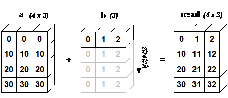

**广播的规则:**

- 让所有输入数组都向其中形状最长的数组看齐，形状中不足的部分都通过在前面加 1 补齐。
- 输出数组的形状是输入数组形状的各个维度上的最大值。
- 如果输入数组的某个维度和输出数组的对应维度的长度相同或者其长度为 1 时，这个数组能够用来计算，否则出错。
- 当输入数组的某个维度的长度为 1 时，沿着此维度运算时都用此维度上的第一组值。

**简单理解：**对两个数组，将形状进行**右对齐**，分别比较他们的每一个维度（若其中一个数组没有当前维度则忽略），满足：

- 比较对应的维度的值相等。
- 比较对应的维度的值有一个是 1。
- 比较对应的维度的值有一个空。

满足其一即可，否则抛出 **"ValueError: frames are not aligned"** 异常。

举个反例：

```python
# 下面是报错案例
A = np.zeros((2,5,3,4))
B = np.zeros((3,3))
print((A+B).shape)
报错：
ValueError: operands could not be broadcast together with shapes (2,5,3,4) (3,3)
#为啥呢？因为最后一维的大小A是4，B是3，不一致。
```

```python
# 下面是报错案例
A = np.zeros((2,5,3,4))
B = np.zeros((2,4,1,4))
print((A+B).shape)
ValueError: operands could not be broadcast together with shapes (2,5,3,4) (2,4,1,4)
#为啥报错？因为A和B的第2维不满足定律。并且都不等于1.
```


### 3.2.4.7 数组操作

Numpy 中包含了一些函数用于处理数组，大概可分为以下几类：

- 修改数组形状
- 翻转数组
- 修改数组维度
- 连接数组
- 分割数组
- 数组元素的添加与删除

`Tips`:在数组操作中经常会使用axis/axes即轴的操作，一般应用运算操作是我们这样理解：

- 轴 0 (Axis 0)：垂直方向（从上到下）操作。 代表行（Row）的堆叠方向。
- 轴 1 (Axis 1)：水平方向（从左到右）操作。 代表列（Column）的堆叠方向。

也就是axis=0对应列方向，例如添加append、拼接等直接在**列上操作**。对于涉及到**索引**例如切割、插入、删除，0代表**沿着列的方向**即横向切割、插入、删除。axis=1同理。

#### 1. 修改数组形状

| 函数      | 描述                                               |
| :-------- | :------------------------------------------------- |
| `reshape` | 不改变数据的条件下修改形状                         |
| `flat`    | 数组元素迭代器                                     |
| `flatten` | 返回一份数组拷贝，对拷贝所做的修改不会影响原始数组 |
| `ravel`   | 返回展开数组                                       |

##### 1.1 reshape

numpy.reshape 函数可以在不改变数据的条件下修改形状，格式如下：

```python
numpy.reshape(arr, newshape, order='C')
```

- `arr`：要修改形状的数组
- `newshape`：整数或者整数数组，新的形状应当兼容原有形状
- order：'C' -- 按行，'F' -- 按列，'A' -- 原顺序，'k' -- 元素在内存中的出现顺序。

```python
import numpy as np
 
a = np.arange(8)
print ('原始数组：')
print (a)
print ('\n')
 
b = a.reshape(4,2)
print ('修改后的数组：')
print (b)
```

输出如下：

```
原始数组：
[0 1 2 3 4 5 6 7]

修改后的数组：
[[0 1]
 [2 3]
 [4 5]
 [6 7]]
```


##### 1,2 flat

- **本质：** 它返回的根本不是一个 NumPy 数组（`ndarray`），而是一个**迭代器对象**（`numpy.flatiter`）。
- **工作原理：** 你可以把它想象成一个按顺序指着数组每个元素的指针。它允许你用 `for` 循环像遍历一维数组一样去遍历多维数组，但它**不会真正在内存中生成一个新的一维数组**。
- **修改影响：** 如果你通过 `flat` 修改元素（例如 `arr.flat[0] = 100`），**原始数组会被改变**。

numpy.ndarray.flat 是一个数组元素迭代器，代码如下:

```python
import numpy as np
 
a = np.arange(9).reshape(3,3) 
print ('原始数组：')
for row in a:
    print (row)
 
#对数组中每个元素都进行处理，可以使用flat属性，该属性是一个数组元素迭代器：
print ('迭代后的数组：')
for element in a.flat:
    print (element)
```

输出如下：

```
原始数组：
[0 1 2]
[3 4 5]
[6 7 8]
迭代后的数组：
0
1
2
3
4
5
6
7
8
```

##### 1.3 flatten

**本质：** 返回一个全新的一维 NumPy 数组。

**工作原理：** 正如图片描述所说，它是真正的**深拷贝 (Copy)**。它会在计算机内存中重新开辟一块空间，把原始数据原封不动地“复印”过去。

**修改影响：** **绝对不会影响原数组**。你在新数组上怎么折腾，原始数组都安全无恙。代价是，如果数据量很大，它会消耗双倍的内存。

 numpy.flatten返回一份数组拷贝，对拷贝所做的修改不会影响原始数组，格式如下：

```python
ndarray.flatten(order='C')
```

参数说明：

- order：'C' -- 按行，'F' -- 按列，'A' -- 原顺序，'K' -- 元素在内存中的出现顺序。

```python
import numpy as np
 
a = np.arange(8).reshape(2,4)
 
print ('原数组：')
print (a)
print ('\n')
# 默认按行
 
print ('展开的数组：')
print (a.flatten())
print ('\n')
 
print ('以 F 风格顺序展开的数组：')
print (a.flatten(order = 'F'))
```

输出如下：

```
原数组：
[[0 1 2 3]
 [4 5 6 7]]


展开的数组：
[0 1 2 3 4 5 6 7]


以 F 风格顺序展开的数组：
[0 4 1 5 2 6 3 7]
```

##### 1.4 ravel

**本质：** 返回一个一维 NumPy 数组。

**工作原理：** 它的设计初衷是“能省内存就省”。只要条件允许（原数组在内存中是连续存放的），它就会返回原始数组的一个**视图 (View)**。也就是说，它没有开辟新内存，只是换了个“一维的视角”去看原来的数据。只有在极少数无法生成视图的情况下，它才会退化成复制。

**修改影响：** **通常会改变原数组**。因为你操作的实际上还是同一块内存里的数据。

numpy.ravel() 展平的数组元素，顺序通常是"C风格"，返回的是数组视图（view，有点类似 C/C++引用reference的意味），修改会影响原始数组。

该函数接收两个参数：

```
numpy.ravel(a, order='C')
```

参数说明：

- order：'C' -- 按行，'F' -- 按列，'A' -- 原顺序，'K' -- 元素在内存中的出现顺序。

```python
import numpy as np
 
a = np.arange(8).reshape(2,4)
 
print ('原数组：')
print (a)
print ('\n')
 
print ('调用 ravel 函数之后：')
print (a.ravel())
print ('\n')
 
print ('以 F 风格顺序调用 ravel 函数之后：')
print (a.ravel(order = 'F'))
```

##### 1.5 总结

Tip：对于压扁成一维数组时候推荐使用`reshape(-1)`和`ravel`节省空间，如果不想对原数据作出单独开辟需要使用flatten，针对遍历则需要flat。

| **函数**        | **返回类型**      | **内存分配机制**          | **修改返回值，原数组会变吗？** | **适用场景**                                                 |
| --------------- | ----------------- | ------------------------- | ------------------------------ | ------------------------------------------------------------ |
| **`flat`**      | 迭代器 (Iterator) | 指向原内存                | **会**                         | 只需要遍历元素（比如写 `for` 循环），不想生成新数组时。      |
| **`flatten()`** | 数组 (ndarray)    | **深拷贝** (开辟新内存)   | **绝对不会**                   | 需要一个独立的一维数组进行修改，且必须保证原数据不被污染时。 |
| **`ravel()`**   | 数组 (ndarray)    | **视图** (尽可能共用内存) | **通常会**                     | 需要一维数组参与后续计算，且对内存消耗比较敏感（不想复制大数据）时。 |


#### 2. 翻转数组

| 函数        | 描述                       |
| :---------- | :------------------------- |
| `transpose` | 对换数组的维度             |
| `ndarray.T` | 和 `self.transpose()` 相同 |
| `swapaxes`  | 对换数组的两个轴           |

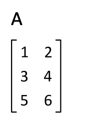

##### 2.1 transpose 

numpy.transpose 函数用于对换数组的维度，格式如下：

```
numpy.transpose(arr, axes)
```

参数说明:

- `arr`：要操作的数组
- `axes`：整数列表，对应维度，通常所有维度都会对换。

```python
import numpy as np
 
a = np.arange(12).reshape(1,3,4)
 
print ('原数组：')
print (a )
print ('\n')
print ('原数组的形状：',a.shape)
b = np.transpose(a,axes=(2,1,0))#指定维度转制即（2.1,0）：(a,b,c)->(c,b,a)  |（2,0,1）：(a,b,c)->(c,a,b) 
print ('对换数组使用transpose数组：')

print (b)
print ('transpose(2,1,0)后数组的形状：',b.shape)
```

输出如下：

```shell
原数组：
[[[ 0  1  2  3]
  [ 4  5  6  7]
  [ 8  9 10 11]]]


原数组的形状： (1, 3, 4)
对换数组使用transpose数组：
[[[ 0]
  [ 4]
  [ 8]]

 [[ 1]
  [ 5]
  [ 9]]

 [[ 2]
  [ 6]
  [10]]

 [[ 3]
  [ 7]
  [11]]]
transpose(2,1,0)后数组的形状： (4, 3, 1)
```

##### 2.2 .T

numpy.ndarray.T 类似 numpy.transpose：

```python
import numpy as np
 
a = np.arange(12).reshape(1,3,4)
print ('原数组：')
print (a )
print ('原数组的形状：',a.shape)
b = a.T#所有维度转制即只能(a,b,c)->(c,b,a)
print ('对换数组使用.T数组：')
print (b)
print ('.T后数组的形状：',b.shape)
```

输出如下：

```python
原数组：
[[[ 0  1  2  3]
  [ 4  5  6  7]
  [ 8  9 10 11]]]
原数组的形状： (1, 3, 4)
对换数组使用.T数组：
[[[ 0]
  [ 4]
  [ 8]]

 [[ 1]
  [ 5]
  [ 9]]

 [[ 2]
  [ 6]
  [10]]

 [[ 3]
  [ 7]
  [11]]]
.T后数组的形状： (4, 3, 1)
```


##### 2.3 swapaxes

numpy.swapaxes 函数用于交换数组的两个轴，格式如下：

```
numpy.swapaxes(arr, axis1, axis2)
```

- `arr`：输入的数组
- `axis1`：对应第一个轴的整数
- `axis2`：对应第二个轴的整数

```python
import numpy as np
 
# 创建了三维的 ndarray
a = np.arange(8).reshape(2,2,2)
 
print ('原数组：')
print (a)
print ('\n')
# 现在交换轴 0（深度方向）到轴 2（宽度方向）
 
print ('调用 swapaxes 函数后的数组：')
print (np.swapaxes(a, 2, 0))
```

输出如下：

```
原数组：
[[[0 1]
  [2 3]]

 [[4 5]
  [6 7]]]


调用 swapaxes 函数后的数组：
[[[0 4]
  [2 6]]

 [[1 5]
  [3 7]]]
```

##### 2.4 总结

| **函数**        | **核心功能**                                                 |
| --------------- | ------------------------------------------------------------ |
| **`ndarray.T`** | 完全倒置维度，例如`(3,1,0)->(0,1,3)`                         |
| **`transpose`** | 按指定顺序重排所有轴，例如若指定`axes(1,0)`那么,`(3,1,0)->(1,3,0)` |
| **`swapaxes`**  | 仅交换指定的两个轴                                           |

我们发现在使用transpose和swapaxes时，参数前者是axes后者是axis，这里作说明如下：

英语角度axis是单数，axes是复数。

具体函数角度：

- **`np.swapaxes(a, axis1, axis2)`** 你看这个函数，它想交换两个轴。所以它的参数叫 `axis1`（单数，第一条轴）和 `axis2`（单数，第二条轴）。你需要分别传入两个整数，比如 `np.swapaxes(a, 0, 1)`。
- **`np.transpose(a, axes)`** 这个函数是全盘接管所有的轴。所以它的参数叫 `axes`（复数，轴的集合）。你需要传入一个整体的顺序表，比如 `np.transpose(a, axes=(1, 0, 2))`。

所以总上，后续学习如果涉及到所有轴使用axes，如果是单个轴由操作使用axis。

#### 3.修改数组维度

| 维度           | 描述                       |
| :------------- | :------------------------- |
| `broadcast_to` | 将数组广播到新形状         |
| `expand_dims`  | 扩展数组的形状             |
| `squeeze`      | 从数组的形状中删除一维条目 |

##### 3.1 broadcase_to

- **本质：** 把一个较小的数组，强制“拉伸”（广播）成一个指定的大形状。它返回的是一个**只读视图（View）**，不会真正在内存里复制数据。
- **效果举例：** 把形状为 `(3,)` 的数组 `[1, 2, 3]` 广播成形状为 `(4, 3)` 的数组，相当于把这一行数据往下复制了 4 行。
- **使用率不高：** 因为 NumPy 的数学运算（如加减乘除）是**自带隐式广播功能**的！你直接写 `A + b` 时，只要形状兼容，NumPy 底层会自动帮你广播，**根本不需要你手动调用这个函数**。
- **应用场景：** 只有在你并不打算做数学运算，而是出于某种特定的 API 要求，必须显式地生成一个扩展后形状的数组（且为了省内存需要用到视图）时，才会用到它。

numpy.broadcast_to 函数将数组广播到新形状。它在原始数组上返回只读视图。 它通常不连续。 如果新形状不符合 NumPy 的广播规则，该函数可能会抛出ValueError。

```
numpy.broadcast_to(array, shape, subok)
```

```python
import numpy as np

# 1. 真实的本体（一维数组）
a = np.array([1, 2, 3])

# 2. 施展幻影分身（广播成 3x3 的视图）
b = np.broadcast_to(a, (3, 3))
print("本体 a:\n", a)
print("\n幻影 b (视图)/对a调用np.broadcast_to:\n", b)

print("\n--- 开始测试 ---")

# 1：试图修改幻影 b，会报错！
try:
    b[0, 0] = 99 
except ValueError as e:
    print("试图修改 b 报错了:", e)

# 2：修改真实的本体 a，幻影 b 会跟着变！
a[0] = 99
print("\n修改本体 a[0]=99 后，本体 a 变成了:\n", a)
print("\n修改本体 a 后，幻影 b 跟着变成了:\n", b)
```

输出如下：

```shell
本体 a:
 [1 2 3]

幻影 b (视图)/对a调用np.broadcast_to:
 [[1 2 3]
 [1 2 3]
 [1 2 3]]

--- 开始测试 ---
试图修改 b 报错了: assignment destination is read-only

修改本体 a[0]=99 后，本体 a 变成了:
 [99  2  3]

修改本体 a 后，幻影 b 跟着变成了:
 [[99  2  3]
 [99  2  3]
 [99  2  3]]
```


##### 3.2 enpand_dims

numpy.expand_dims 函数通过在指定位置插入新的轴来扩展数组形状，函数格式如下:

```
 numpy.expand_dims(arr, axis)
```

参数说明：

- `arr`：输入数组
- `axis`：新轴插入的位置

```python
import numpy as np
 
x = np.array(([1,2],[3,4]))
 
print ('数组 x：')
print (x)
print ('\n')
#默认axis是0轴
y = np.expand_dims(x, axis = 0)
 
print ('数组 y：')
print (y)
print ('\n')
 
print ('数组 x 和 y 的形状：')
print (x.shape, y.shape)
print ('-'*20)
# 在位置 1 插入轴
y = np.expand_dims(x, axis = 1)
 
print ('在位置 1 插入轴之后的数组 y：')
print (y)
print ('\n')
 
print ('x.ndim 和 y.ndim：')
print (x.ndim,y.ndim)
print ('\n')
 
print ('x.shape 和 y.shape：')
print (x.shape, y.shape)
print ('-'*20)
# 在位置 2 插入轴
y = np.expand_dims(x, axis = 2)
 
print ('在位置 2 插入轴之后的数组 y：')
print (y)
print ('\n')
 
print ('x.ndim 和 y.ndim：')
print (x.ndim,y.ndim)
print ('\n')
 
print ('x.shape 和 y.shape：')
print (x.shape, y.shape)
```

输出如下：

```
数组 x：
[[1 2]
 [3 4]]


数组 y：
[[[1 2]
  [3 4]]]


数组 x 和 y 的形状：
(2, 2) (1, 2, 2)
--------------------
在位置 1 插入轴之后的数组 y：
[[[1 2]]

 [[3 4]]]


x.ndim 和 y.ndim：
2 3


x.shape 和 y.shape：
(2, 2) (2, 1, 2)
--------------------
在位置 2 插入轴之后的数组 y：
[[[1]
  [2]]

 [[3]
  [4]]]


x.ndim 和 y.ndim：
2 3


x.shape 和 y.shape：
(2, 2) (2, 2, 1)
```

##### 3.3 squeeze

numpy.squeeze 函数从给定数组的形状中删除一维的条目，函数格式如下：

```
numpy.squeeze(arr, axis)
```

参数说明：

- `arr`：输入数组
- `axis`：整数或整数元组，用于选择形状中一维条目的子集

```python
import numpy as np
 
x = np.arange(9).reshape(1,3,1,3)
 
print ('数组 x：')
print (x)
print ('\n')
y = np.squeeze(x)
 
print ('对x使用squeeze后结果：')
print (y)
print ('\n')
 
print ('数组 x 和 y 的形状：')
print (x.shape, y.shape)
print("-"*20)
y = np.squeeze(x,axis=0)
 
print ('对x使用squeeze并规定axis=0,降维0轴的1后结果：')
print (y)
print ('\n')
 
print ('数组 x 和 y 的形状：')
print (x.shape, y.shape)
print("-"*20)
try:
    y = np.squeeze(x,axis=1)
except Exception as e:

    print ('对x使用squeeze并规定axis=1，降维1轴的后报错：',"由于1轴的形状大小是3不是1,squeeze仅对大小是1操作")

print("-"*20)
y = np.squeeze(x,axis=2)
 
print ('对x使用squeeze并规定axis=2,降维2轴的1后结果：')
print (y)
print ('\n')
 
print ('数组 x 和 y 的形状：')
print (x.shape, y.shape)
print("-"*20)
try:
    y = np.squeeze(x,axis=3)
except Exception as e:

    print ('对x使用squeeze并规定axis=3，降维3轴的后报错：',"由于1轴的形状大小是3不是1,squeeze仅对大小是1操作")

```

输出如下：

```shell
数组 x：
[[[[0 1 2]]

  [[3 4 5]]

  [[6 7 8]]]]


对x使用squeeze后结果：
[[0 1 2]
 [3 4 5]
 [6 7 8]]


数组 x 和 y 的形状：
(1, 3, 1, 3) (3, 3)
--------------------
对x使用squeeze并规定axis=0,降维0轴的1后结果：
[[[0 1 2]]

 [[3 4 5]]

 [[6 7 8]]]


数组 x 和 y 的形状：
(1, 3, 1, 3) (3, 1, 3)
--------------------
对x使用squeeze并规定axis=1，降维1轴的后报错： 由于1轴的形状大小是3不是1,squeeze仅对大小是1操作
--------------------
对x使用squeeze并规定axis=2,降维2轴的1后结果：
[[[0 1 2]
  [3 4 5]
  [6 7 8]]]


数组 x 和 y 的形状：
(1, 3, 1, 3) (1, 3, 3)
--------------------
对x使用squeeze并规定axis=3，降维3轴的后报错： 由于1轴的形状大小是3不是1,squeeze仅对大小是1操作
```

#### 4. 连接数组

| 函数          | 描述                           |
| :------------ | :----------------------------- |
| `concatenate` | 连接沿现有轴的数组序列         |
| `stack`       | 沿着新的轴加入一系列数组。     |
| `hstack`      | 水平堆叠序列中的数组（列方向） |
| `vstack`      | 竖直堆叠序列中的数组（行方向） |

##### 1. concatenate

numpy.concatenate 函数用于沿指定轴连接相同形状的两个或多个数组，格式如下：

```
numpy.concatenate((a1, a2, ...), axis)
```

参数说明：

- `a1, a2, ...`：`相同类型的数组`
- `axis`：沿着它连接数组的轴，默认为 0

 

```python
import numpy as np
 
a = np.array([[1,2],[3,4]])
 
print ('第一个数组及其维度形状：')
print (a,"->",a.shape)
print ('\n')
b = np.array([[5,6],[7,8]])
 
print ('第二个数组及其维度形状：')
print (b,"->",b.shape)
print ('\n')
c = np.array([[9,10],[11,12]])
 
print ('第二个数组及其维度形状：')
print (c,"->",c.shape)
print ('\n')

print ('沿轴 0 堆叠两个数组及最后cat拼接后的形状：')
d = np.concatenate((a,b,c),0)
print (d,"->",d.shape)
print ('\n')
 
print ('沿轴 1 堆叠两个数组及最后cat拼接后的形状：')
d = np.concatenate((a,b,c),1)
print (d,"->",d.shape)
try:
    d = np.concatenate((a,b,c),2)
except Exception as e:
    print ('cat无法指定维度axis>自身的\n',e)


```

输出如下:

```
第一个数组及其维度形状：
[[1 2]
 [3 4]] -> (2, 2)


第二个数组及其维度形状：
[[5 6]
 [7 8]] -> (2, 2)


第二个数组及其维度形状：
[[ 9 10]
 [11 12]] -> (2, 2)


沿轴 0 堆叠两个数组及最后cat拼接后的形状：
[[ 1  2]
 [ 3  4]
 [ 5  6]
 [ 7  8]
 [ 9 10]
 [11 12]] -> (6, 2)


沿轴 1 堆叠两个数组及最后cat拼接后的形状：
[[ 1  2  5  6  9 10]
 [ 3  4  7  8 11 12]] -> (2, 6)
cat无法指定维度axis>自身的
 axis 2 is out of bounds for array of dimension 2
```

##### 2. stack

numpy.stack 函数用于沿新轴连接数组序列，格式如下：

```
numpy.stack(arrays, axis)
```

参数说明：

- `arrays`相同形状的数组序列
- `axis`：返回数组中的轴，输入数组沿着它来堆叠

```python
import numpy as np
 
a = np.array([[1,2],[3,4]])
 
print ('第一个数组及其维度形状：')
print (a,"->",a.shape)
print ('\n')
b = np.array([[5,6],[7,8]])
 
print ('第二个数组及其维度形状：')
print (b,"->",b.shape)
print ('\n')
c = np.array([[9,10],[11,12]])
 
print ('第二个数组及其维度形状：')
print (c,"->",c.shape)
print ('\n')

print ('沿轴 0 堆叠两个数组及最后stack拼接后的形状：')
d = np.stack((a,b,c),0)
print (d,"->",d.shape)
print ('\n')
 
print ('沿轴 1 堆叠两个数组及最后stack拼接后的形状：')
d = np.stack((a,b,c),1)
print (d,"->",d.shape)

print ('沿轴 2 堆叠两个数组及最后stack拼接后的形状：')
d = np.stack((a,b,c),2)
print (d,"->",d.shape)
```

输出如下：

```
第一个数组及其维度形状：
[[1 2]
 [3 4]] -> (2, 2)


第二个数组及其维度形状：
[[5 6]
 [7 8]] -> (2, 2)


第二个数组及其维度形状：
[[ 9 10]
 [11 12]] -> (2, 2)


沿轴 0 堆叠两个数组及最后stack拼接后的形状：
[[[ 1  2]
  [ 3  4]]

 [[ 5  6]
  [ 7  8]]

 [[ 9 10]
  [11 12]]] -> (3, 2, 2)


沿轴 1 堆叠两个数组及最后stack拼接后的形状：
[[[ 1  2]
  [ 5  6]
  [ 9 10]]

 [[ 3  4]
  [ 7  8]
  [11 12]]] -> (2, 3, 2)
沿轴 2 堆叠两个数组及最后stack拼接后的形状：
[[[ 1  5  9]
  [ 2  6 10]]

 [[ 3  7 11]
  [ 4  8 12]]] -> (2, 2, 3)
```


##### 3. hstack

numpy.hstack 是 numpy.stack 函数的变体，它通过水平堆叠来生成数组。

```python
import numpy as np
 
a = np.array([[1,2],[3,4]])
 
print ('第一个数组及其维度形状：')
print (a,"->",a.shape)
print ('\n')
b = np.array([[5,6],[7,8]])
 
print ('第二个数组及其维度形状：')
print (b,"->",b.shape)
print ('\n')
c = np.array([[9,10],[11,12]])
 
print ('第二个数组及其维度形状：')
print (c,"->",c.shape)
print ('\n')

print ('沿轴 1 堆叠两个数组及最后concatenate拼接后的形状：')
d = np.concatenate((a,b,c),1)
print (d,"->",d.shape)
print ('\n')
print("-"*30)
print("hstack等价于cat指定axis=1垂直拼接")
d = np.hstack((a,b,c))
print (d,"->",d.shape)
```

输出如下：

```
第一个数组及其维度形状：
[[1 2]
 [3 4]] -> (2, 2)


第二个数组及其维度形状：
[[5 6]
 [7 8]] -> (2, 2)


第二个数组及其维度形状：
[[ 9 10]
 [11 12]] -> (2, 2)


沿轴 1 堆叠两个数组及最后concatenate拼接后的形状：
[[ 1  2  5  6  9 10]
 [ 3  4  7  8 11 12]] -> (2, 6)


------------------------------
hstack等价于cat指定axis=1垂直拼接
[[ 1  2  5  6  9 10]
 [ 3  4  7  8 11 12]] -> (2, 6)
```

##### 4. vstack

numpy.vstack 是 numpy.stack 函数的变体，它通过垂直堆叠来生成数组。

```python
import numpy as np
 
a = np.array([[1,2],[3,4]])
 
print ('第一个数组及其维度形状：')
print (a,"->",a.shape)
print ('\n')
b = np.array([[5,6],[7,8]])
 
print ('第二个数组及其维度形状：')
print (b,"->",b.shape)
print ('\n')
c = np.array([[9,10],[11,12]])
 
print ('第二个数组及其维度形状：')
print (c,"->",c.shape)
print ('\n')

print ('沿轴 0 堆叠两个数组及最后concatenate拼接后的形状：')
d = np.concatenate((a,b,c),0)
print (d,"->",d.shape)
print ('\n')
print("-"*30)
print("vstack等价于cat指定axis=0垂直拼接")
d = np.vstack((a,b,c))
print (d,"->",d.shape)
```

输出如下：

```
第一个数组及其维度形状：
[[1 2]
 [3 4]] -> (2, 2)


第二个数组及其维度形状：
[[5 6]
 [7 8]] -> (2, 2)


第二个数组及其维度形状：
[[ 9 10]
 [11 12]] -> (2, 2)


沿轴 0 堆叠两个数组及最后concatenate拼接后的形状：
[[ 1  2]
 [ 3  4]
 [ 5  6]
 [ 7  8]
 [ 9 10]
 [11 12]] -> (6, 2)


------------------------------
vstack等价于cat指定axis=0垂直拼接
[[ 1  2]
 [ 3  4]
 [ 5  6]
 [ 7  8]
 [ 9 10]
 [11 12]] -> (6, 2)
```


#### 5. 分割数组

| 函数     | 数组及操作                             |
| :------- | :------------------------------------- |
| `split`  | 将一个数组分割为多个子数组             |
| `hsplit` | 将一个数组水平分割为多个子数组（按列） |
| `vsplit` | 将一个数组垂直分割为多个子数组（按行） |

##### 1.split

numpy.split 函数沿特定的轴将数组分割为子数组，格式如下：

```
numpy.split(ary, indices_or_sections, axis)
```

参数说明：

- `ary`：被分割的数组
- `indices_or_sections`：如果是一个**整数**，就用该数平均切分，如果是一个**数组**，为**沿轴切分的位置**（`左开右闭`）
- `axis`：设置沿着哪个方向进行切分，默认为 0，沿着列的方向，即横向切分。为 1 时，沿着行的方向操作即纵向切分。

```python
import numpy as np

a = np.arange(16).reshape(4, 4)
print('第一个数组：')
print(a)
print('\n')

print("-"*20,"整数划分","-"*20)

print('默认沿水平方向分割即是横向切割：')
b = np.split(a,2)
print(b)

print('沿垂直方向分割即纵向切割：')
c = np.split(a,2,1)
print(c)


print("-"*20,"数组划分","-"*20)
"""
    🔪第一块（第 1 刀之前）：也就是 a[0:1]
    只包含了行索引为 0 的那一行。

    array([[0, 1, 2, 3]])

    🔪 第二块（第 1 刀和第 2 刀之间）：也就是 a[1:3]
    包含了行索引为 1 和 2 的这两行。

    array([[ 4,  5,  6,  7],
        [ 8,  9, 10, 11]])

    🔪 第三块（第 2 刀之后）：也就是 a[3:]
    包含了行索引为 3 的那一行。

    array([[12, 13, 14, 15]])

"""
d = np.split(a,[1,3],axis=0)
print('默认沿水平方向分割即是横向切割：')
print(d)
d = np.split(a,[1,3],axis=1)
print('沿垂直方向分割即纵向切割：')
print(d)
```

输出如下：

```
第一个数组：
[[ 0  1  2  3]
 [ 4  5  6  7]
 [ 8  9 10 11]
 [12 13 14 15]]


-------------------- 整数划分 --------------------
默认沿水平方向分割即是横向切割：
[array([[0, 1, 2, 3],
       [4, 5, 6, 7]]), array([[ 8,  9, 10, 11],
       [12, 13, 14, 15]])]
沿垂直方向分割即纵向切割：
[array([[ 0,  1],
       [ 4,  5],
       [ 8,  9],
       [12, 13]]), array([[ 2,  3],
       [ 6,  7],
       [10, 11],
       [14, 15]])]
-------------------- 数组划分 --------------------
默认沿水平方向分割即是横向切割：
[array([[0, 1, 2, 3]]), array([[ 4,  5,  6,  7],
       [ 8,  9, 10, 11]]), array([[12, 13, 14, 15]])]
沿垂直方向分割即纵向切割：
[array([[ 0],
       [ 4],
       [ 8],
       [12]]), array([[ 1,  2],
       [ 5,  6],
       [ 9, 10],
       [13, 14]]), array([[ 3],
       [ 7],
       [11],
       [15]])]
```

##### 2. hsplit

numpy.hsplit 函数用于水平分割数组，通过指定要返回的相同形状的数组数量来拆分原数组。

```python
import numpy as np

a = np.arange(16).reshape(4, 4)
print('第一个数组：')
print(a)
print('\n')


print('split沿垂直方向分割即是纵向切割：')
b = np.split(a,2,axis=1)
print(b)
print("hsplit切割")
b = np.hsplit(a,2)
print(b)

```

输出如下：

```
第一个数组：
[[ 0  1  2  3]
 [ 4  5  6  7]
 [ 8  9 10 11]
 [12 13 14 15]]


split沿垂直方向分割即是纵向切割：
[array([[ 0,  1],
       [ 4,  5],
       [ 8,  9],
       [12, 13]]), array([[ 2,  3],
       [ 6,  7],
       [10, 11],
       [14, 15]])]
hsplit切割
[array([[ 0,  1],
       [ 4,  5],
       [ 8,  9],
       [12, 13]]), array([[ 2,  3],
       [ 6,  7],
       [10, 11],
       [14, 15]])]
```

##### 3.vsplit

numpy.vsplit 沿着垂直轴分割，其分割方式与hsplit用法相同。

```python
import numpy as np

a = np.arange(16).reshape(4, 4)
print('第一个数组：')
print(a)
print('\n')


print('split沿水平方向分割即是横向切割：')
b = np.split(a,2,axis=0)
print(b)
print("vsplit切割")
b = np.vsplit(a,2)
print(b)

```

输出如下：

```
第一个数组：
[[ 0  1  2  3]
 [ 4  5  6  7]
 [ 8  9 10 11]
 [12 13 14 15]]


split沿水平方向分割即是横向切割：
[array([[0, 1, 2, 3],
       [4, 5, 6, 7]]), array([[ 8,  9, 10, 11],
       [12, 13, 14, 15]])]
vsplit切割
[array([[0, 1, 2, 3],
       [4, 5, 6, 7]]), array([[ 8,  9, 10, 11],
       [12, 13, 14, 15]])]
```


#### 6.数组元素的添加与删除

| 函数     | 元素及描述                               |
| :------- | :--------------------------------------- |
| `resize` | 返回指定形状的新数组                     |
| `append` | 将值添加到数组末尾                       |
| `insert` | 沿指定轴将值插入到指定下标之前           |
| `delete` | 删掉某个轴的子数组，并返回删除后的新数组 |
| `unique` | 查找数组内的唯一元素                     |

##### 1.resize

numpy.resize 函数返回指定大小的新数组。

如果新数组大小大于原始大小，则包含原始数组中的元素的副本。

```
numpy.resize(arr, shape)
```

参数说明：

- `arr`：要修改大小的数组
- `shape`：返回数组的新形状

```python
import numpy as np
 
a = np.array([[1,2,3],[4,5,6]])
 
print ('第一个数组：')
print (a)
print ('\n')
 
print ('第一个数组的形状：')
print (a.shape)
print ('\n')
b = np.resize(a, (3,2))
 
print ('第二个数组：')
print (b)
print ('\n')
 
print ('第二个数组的形状：')
print (b.shape)
print ('\n')
# 要注意 a 的第一行在 b 中重复出现，因为尺寸变大了
"""
    revise 不管它原来是几行几列，它里面一共只有 6 个元素（1、2、3、4、5、6）。
    (3,2)->(3,3)问题：你有 9 个坑要填，但你手里只有 6 个数字，怎么办？
    np.resize 的处理机制是这样的：先把原数据“拉平”成一排，然后按顺序填坑。如果填完了数字不够，就回到原数据的开头，
    重新再抄一遍（也就是你说的包含副本）。

    填坑过程模拟：

    坑位 1 到 6，填入原数据：1, 2, 3, 4, 5, 6

    糟糕，没数字了！但还有 3 个坑位没填。

    回到开头继续抄：1, 2, 3

    所以最终填进 3x3 矩阵的 9 个数字顺序是：1, 2, 3, 4, 5, 6, 1, 2, 3。

    排成 3 行 3 列后，打印出来的 b 就是这样的：

  
    [[1 2 3]
    [4 5 6]
    [1 2 3]]  <-- 这一行就是重复抄来的“副本”


"""
print ('修改第二个数组的大小：')
b = np.resize(b,(3,3))
print (b)
print("-"*30)
print ('第三个数组：')
c = np.resize(a,(3,2))
print (c)
print ('\n')
 
print ('第三个数组的形状：')
print (c.shape)
print ('\n')
"""

    (3,2)->(3,1)问题：你有 3 个坑要填，但你手里只有 6 个数字，怎么办？
    如果填完了数字多了，就直接截断多余数字，
    坑位 1 到 6，填入原数据：1, 2, 3, 4, 5, 6
    填入 1 2 3
    所以最终填进 3x1 矩阵的 3 个数字顺序是：1, 2, 3
    排成 3 行 1 列后，打印出来的 c 就是这样的：

    
    [[1]
    [2]
    [3]] 


"""
print ('修改第三个数组的大小：')
c = np.resize(c,(3,1))
print (c)
```

输出如下：

```
第一个数组：
[[1 2 3]
 [4 5 6]]


第一个数组的形状：
(2, 3)


第二个数组：
[[1 2]
 [3 4]
 [5 6]]


第二个数组的形状：
(3, 2)


修改第二个数组的大小：
[[1 2 3]
 [4 5 6]
 [1 2 3]]
------------------------------
第三个数组：
[[1 2]
 [3 4]
 [5 6]]


第三个数组的形状：
(3, 2)


修改第三个数组的大小：
[[1]
 [2]
 [3]]
```

| **特性 / 函数**      | **reshape (重塑)**                                           | **resize (调整大小)**                                        |
| -------------------- | ------------------------------------------------------------ | ------------------------------------------------------------ |
| **元素总数要求**     | 新形状的元素总数 **必须严格等于** 原数组。                   | 新形状的元素总数 **可以不等于** 原数组。                     |
| **内存与返回值**     | 尽可能返回 **视图 (View)**。速度快，修改返回值通常会改变原数组。 | 强制返回 **深拷贝 (Copy)**。开辟新内存，对新数组的操作与原数组无关。 |
| **坑位变多（变大）** | 直接崩溃，报 `ValueError` 错误。                             | 像复读机一样，**循环重复**原数组的元素来填满新坑位。         |
| **坑位变少（变小）** | 直接崩溃，报 `ValueError` 错误。                             | 直接**截断**，丢弃装不下的多余元素。                         |
| **适用场景**         | 深度学习维度对齐、矩阵运算前的数据准备（日常 99% 的情况使用它）。 | 强制统一不规则数据的尺寸、需要填补空缺值的特殊场景。         |

##### 2. append

numpy.append 函数在数组的末尾添加值。 追加操作会分配整个数组，并把原来的数组复制到新数组中。 此外，输入数组的维度必须匹配否则将生成ValueError。

append 函数返回的始终是一个一维数组。

```
numpy.append(arr, values, axis=None)
```

参数说明：

- `arr`：输入数组
- `values`：要向`arr`添加的值，需要和`arr`形状相同（除了要添加的轴），这里的值一定保持和arr维度相同，**没有广播机制**。
- `axis`：默认为 None。当**axis无定义时**，是横向加成，**返回总是为一维数组**！当axis有定义的时候，分别为0和1的时候。当axis有定义的时候，当**axis=0**时，按列纵向添加，那么对应的**列数一定得相同**。当**axis为1**时，按行横向添加，那么对应的**行数一定得相同**。

```python
import numpy as np
 
a = np.array([[1,2,3],[4,5,6]])
 
print ('第一个数组：')
print (a)
print ('\n')
 
print ('向数组添加元素：')
print (np.append(a, [7,8,9]))
print ('\n')
 
print ('沿轴 0 添加元素：')
print (np.append(a, [[7,8,9]],axis = 0))
print ('\n')
 
print ('沿轴 1 添加元素：')
print (np.append(a, [[5,5,5],[7,8,9]],axis = 1))
```

输出如下：

```
第一个数组：
[[1 2 3]
 [4 5 6]]


向数组添加元素：
[1 2 3 4 5 6 7 8 9]


沿轴 0 添加元素：
[[1 2 3]
 [4 5 6]
 [7 8 9]]


沿轴 1 添加元素：
[[1 2 3 5 5 5]
 [4 5 6 7 8 9]]
```

##### 3.insert

numpy.insert 函数在给定索引之前，沿给定轴在输入数组中插入值。

函数会在指定位置（或位置数组）插入给定的值或数组，然后返回新的数组。被插入的元素可以是标量值，也可以是数组。需要注意的是，插入操作会返回一个新的数组，而不会改变原始数组。

```
numpy.insert(arr, obj, values, axis)
```

参数说明：

- `arr`：输入数组

- `obj`：在其之前插入值的索引

- `values`：要插入的值,注意这里的值若维度不一样，会**触发广播机制**。

- `axis`：沿着它插入的轴，如果未提供，则输入数组会被展开

- ```python
  import numpy as np
   
  a = np.array([[1,2],[3,4],[5,6]])
   
  print ('第一个数组：')
  print (a)
  print ('\n')
   
  print ('未传递 Axis 参数。 在删除之前输入数组会被展开。')
  print (np.insert(a,3,[11,12]))
  print ('\n')
  print ('传递了 Axis 参数。 会广播值数组来配输入数组。')
   
  print ('沿轴 0 广播：')
  print (np.insert(a,1,[11],axis = 0))
  print ('\n')
   
  print ('沿轴 1 广播：')
  print (np.insert(a,1,11,axis = 1))
  ```

  输出如下：

  ```
  第一个数组：
  [[1 2]
   [3 4]
   [5 6]]
  
  
  未传递 Axis 参数。 在删除之前输入数组会被展开。
  [ 1  2  3 11 12  4  5  6]
  
  
  传递了 Axis 参数。 会广播值数组来配输入数组。
  沿轴 0 广播：
  [[ 1  2]
   [11 11]
   [ 3  4]
   [ 5  6]]
  
  
  沿轴 1 广播：
  [[ 1 11  2]
   [ 3 11  4]
   [ 5 11  6]]
  ```

##### 4. delete

numpy.delete 函数返回从输入数组中删除指定子数组的新数组。 与 insert() 函数的情况一样，如果未提供轴参数，则输入数组将展开。

```
Numpy.delete(arr, obj, axis)
```

参数说明：

- `arr`：输入数组
- `obj`：可以被切片，整数（`对应索引位置不是元素`）或者整数数组，表明要从输入数组删除的子数组
- `axis`：沿着它删除给定子数组的轴，如果未提供，则输入数组会被展开

```python
import numpy as np
 
a = np.arange(12).reshape(3,4)
 
print ('第一个数组：')
print (a)
print ('\n')
 
print ('未传递 Axis 参数。 在插入之前输入数组会被展开。')
print (np.delete(a,5))
print ('\n')
 
print ('删除第二列：')
print (np.delete(a,1,axis = 1))
print ('\n')
 
print ('包含从数组中删除的替代值的切片：')
a = np.array([1,2,3,4,5,6,7,8,9,10])
print (np.delete(a, np.s_[::2]))
```

输出如下：

```
第一个数组：
[[ 0  1  2  3]
 [ 4  5  6  7]
 [ 8  9 10 11]]


未传递 Axis 参数。 在插入之前输入数组会被展开。
[ 0  1  2  3  4  6  7  8  9 10 11]


删除第二列：
[[ 0  2  3]
 [ 4  6  7]
 [ 8 10 11]]


包含从数组中删除的替代值的切片：
[ 2  4  6  8 10]
```

##### 5.unique

numpy.unique 函数用于去除数组中的重复元素。

```
numpy.unique(arr, return_index, return_inverse, return_counts)
```

- `arr`：输入数组，如果不是一维数组则会展开
- `return_index`：如果为`true`，返回新列表元素在旧列表中的位置（下标），并以列表形式储
- `return_inverse`：如果为`true`，返回旧列表元素在新列表中的位置（下标），并以列表形式储
- `return_counts`：如果为`true`，返回去重数组中的元素在原数组中的出现次数

```python
import numpy as np
 
a = np.array([5,2,6,2,7,5,6,8,2,9])
 
print ('第一个数组：')
print (a)
print ('\n')
 
print ('第一个数组的去重值：')
u = np.unique(a)
print (u)
print ('\n')
 
print ('去重数组的索引数组：')
u,indices = np.unique(a, return_index = True)
print (indices)
print ('\n')
 
print ('我们可以看到每个和原数组下标对应的数值：')
print (a)
print ('\n')
 
print ('去重数组的下标：')
u,indices = np.unique(a,return_inverse = True)
print (u)
print ('\n')
 
print ('下标为：')
print (indices)
print ('\n')
 
print ('使用下标重构原数组：')
print (u[indices])
print ('\n')
 
print ('返回去重元素的重复数量：')
u,indices = np.unique(a,return_counts = True)
print (u)
print (indices)
```

输出如下：

```
第一个数组：
[5 2 6 2 7 5 6 8 2 9]


第一个数组的去重值：
[2 5 6 7 8 9]


去重数组的索引数组：
[1 0 2 4 7 9]


我们可以看到每个和原数组下标对应的数值：
[5 2 6 2 7 5 6 8 2 9]


去重数组的下标：
[2 5 6 7 8 9]


下标为：
[1 0 2 0 3 1 2 4 0 5]


使用下标重构原数组：
[5 2 6 2 7 5 6 8 2 9]


返回去重元素的重复数量：
[2 5 6 7 8 9]
[3 2 2 1 1 1]
```


#### 7.数组的副本和视图

副本是一个数据的完整的拷贝，如果我们对副本进行修改，它不会影响到原始数据，物理内存不在同一位置。

视图是数据的一个别称或引用，通过该别称或引用亦便可访问、操作原有数据，但原有数据不会产生拷贝。如果我们对视图进行修改，它会影响到原始数据，物理内存在同一位置。

**视图一般发生在：**

- 1、numpy 的切片操作返回原数据的视图。
- 2、调用 ndarray 的 view() 函数产生一个视图。

**副本一般发生在：**

- Python 序列的切片操作，调用deepCopy()函数。
- 调用 ndarray 的 copy() 函数产生一个副本。

##### 1.view

ndarray.view() 方会创建一个新的数组对象，该方法创建的新数组的维数变化不会改变原始数据的维数。

特性：视图和原数组是两个独立的数组对象，各自有自己的 shape、strides 等属性，**只是共享数据**，**不改变形状**。

```python
import numpy as np 
 
# 最开始 a 是个 3X2 的数组
a = np.arange(6).reshape(3,2)  
print ('数组 a：')
print (a)
print ('创建 a 的视图：')
b = a.view()  
print (b)
# 修改 b 的形状，并不会修改 a
b.shape =  (2,3)
print ('b 的形状：')
print (b,"->",b.shape)
print ('a 的形状：')
print (a,"->",a.shape)
```

输出如下：

```
数组 a：
[[0 1]
 [2 3]
 [4 5]]
创建 a 的视图：
[[0 1]
 [2 3]
 [4 5]]
b 的形状：
[[0 1 2]
 [3 4 5]] -> (2, 3)
a 的形状：
[[0 1]
 [2 3]
 [4 5]] -> (3, 2)
```

##### 2.copy

ndarray.copy() 函数创建一个副本。 对副本数据进行修改，不会影响到原始数据，它们物理内存不在同一位置。

```python
import numpy as np 
 
a = np.array([[10,10],  [2,3],  [4,5]])  
print ('数组 a：')
print (a)
print ('创建 a 的深层副本：')
b = a.copy()  
print ('数组 b：')
print (b)
# b 与 a 不共享任何内容  
print ('我们能够写入 b 来写入 a 吗？')
print (b is a)
print ('修改 b 的内容：')
b[0,0]  =  100  
print ('修改后的数组 b：')
print (b)
print ('a 保持不变：')
print (a)
```

输出如下：

```
数组 a：
[[10 10]
 [ 2  3]
 [ 4  5]]
创建 a 的深层副本：
数组 b：
[[10 10]
 [ 2  3]
 [ 4  5]]
我们能够写入 b 来写入 a 吗？
False
修改 b 的内容：
修改后的数组 b：
[[100  10]
 [  2   3]
 [  4   5]]
a 保持不变：
[[10 10]
 [ 2  3]
 [ 4  5]]
```


| 操作     | copy()             | view()               |
| -------- | ------------------ | -------------------- |
| 修改形状 | 副本变，原数组不变 | 视图变，原数组不变   |
| 修改数值 | 副本变，原数组不变 | 视图变，原数组跟着变 |
| 数据关系 | 完全独立           | 共享同一份数据       |

##### 3.补充：切片创建数组修改会改变原始数组

```python
import numpy as np 
 
arr = np.arange(12)
print ('我们的数组：')
print (arr)
print ('创建切片：')
a=arr[3:]
b=arr[3:]
a[1]=123
b[2]=234
print(arr)
```

输出如下：

```
我们的数组：
[ 0  1  2  3  4  5  6  7  8  9 10 11]
创建切片：
[  0   1   2   3 123 234   6   7   8   9  10  11]
```


### 3.2.4.8 向量化运算

在 NumPy 中，**向量化运算（Vectorization）是指不使用显式的 Python `for` 循环，而是直接对整个数组（或数组的切片）执行批量数学或逻辑操作的过程。**

你可以把它理解为一种“数据并行处理”的形式，将对单个元素的操作自动推广到整个数组的所有元素上。

以下的常见的数学相关函数在Numpy可以对整体直接操作，因此是向量化函数。

#### 1.三角函数

NumPy 提供了标准的三角函数：sin()、cos()、tan()、arcsin，arccos，和 arctan 函数。

这些函数的结果可以通过 `numpy.degrees()` 函数将弧度转换为角度。

```python
import numpy as np
 
a = np.array([0,30,45,60,90])  
print ('含有正弦值的数组：')
sin = np.sin(a*np.pi/180)  
print (sin)
print ('\n')
print ('计算角度的反正弦，返回值以弧度为单位：')
inv = np.arcsin(sin)  
print (inv)
print ('\n')
print ('通过转化为角度制来检查结果：')
print (np.degrees(inv))
print ('\n')
print ('arccos 和 arctan 函数行为类似：')
cos = np.cos(a*np.pi/180)  
print (cos)
print ('\n')
print ('反余弦：')
inv = np.arccos(cos)  
print (inv)
print ('\n')
print ('角度制单位：')
print (np.degrees(inv))
print ('\n')
print ('tan 函数：')
tan = np.tan(a*np.pi/180)  
print (tan)
print ('\n')
print ('反正切：')
inv = np.arctan(tan)  
print (inv)
print ('\n')
print ('角度制单位：')
print (np.degrees(inv))
```

输出如下：

```
含有正弦值的数组：
[0.         0.5        0.70710678 0.8660254  1.        ]


计算角度的反正弦，返回值以弧度为单位：
[0.         0.52359878 0.78539816 1.04719755 1.57079633]


通过转化为角度制来检查结果：
[ 0. 30. 45. 60. 90.]


arccos 和 arctan 函数行为类似：
[1.00000000e+00 8.66025404e-01 7.07106781e-01 5.00000000e-01
 6.12323400e-17]


反余弦：
[0.         0.52359878 0.78539816 1.04719755 1.57079633]


角度制单位：
[ 0. 30. 45. 60. 90.]


tan 函数：
[0.00000000e+00 5.77350269e-01 1.00000000e+00 1.73205081e+00
 1.63312394e+16]


反正切：
[0.         0.52359878 0.78539816 1.04719755 1.57079633]


角度制单位：
[ 0. 30. 45. 60. 90.]
```

#### 2.舍入函数

numpy.around() 函数返回指定数字的四舍五入值。

```
numpy.around(a,decimals)
```

参数说明：

- a: 数组
- decimals: 舍入的小数位数。 默认值为0。 如果为负，整数将四舍五入到小数点左侧的位置

```python
import numpy as np
 
a = np.array([1.0,5.55,  123,  0.567,  25.532])  
print  ('原数组：')
print (a)
print ('\n')
print ('舍入后：')
print (np.around(a))
print (np.around(a, decimals =  1))
print (np.around(a, decimals =  -1))
```

输出如下：

```
原数组：
[  1.      5.55  123.      0.567  25.532]


舍入后：
[  1.   6. 123.   1.  26.]
[  1.    5.6 123.    0.6  25.5]
[  0.  10. 120.   0.  30.]
```

#### 3.上/下取整函数

**numpy.floor()** 返回小于或者等于指定表达式的最大整数，即向下取整。

```python
import numpy as np
 
a = np.array([-1.7,  1.5,  -0.2,  0.6,  10])
print ('提供的数组：')
print (a)
print ('\n')
print ('修改后的数组：')
print (np.floor(a))
```

输出结果为：

```
提供的数组：
[-1.7  1.5 -0.2  0.6 10. ]


修改后的数组：
[-2.  1. -1.  0. 10.]
```

**numpy.ceil()** 返回大于或者等于指定表达式的最小整数，即向上取整。

```python
import numpy as np
 
a = np.array([-1.7,  1.5,  -0.2,  0.6,  10])  
print  ('提供的数组：')
print (a)
print ('\n')
print ('修改后的数组：')
print (np.ceil(a))
```

输出结果为：

```
提供的数组：
[-1.7  1.5 -0.2  0.6 10. ]


修改后的数组：
[-1.  2. -0.  1. 10.]
```

#### 4. 算术函数

NumPy 算术函数包含简单的加减乘除: **add()**，**subtract()**，**multiply()** 和，**divide()**，**reciprocal()**，**power()**和**mod()/remainder()**。

需要注意的是数组必须具有**相同的形状或符合数组广播规则**。

```python
import numpy as np 
 
a = np.arange(9, dtype = np.float_).reshape(3,3)  
print ('第一个数组：')
print (a)
print ('\n')
print ('第二个数组：')
b = np.array([10,10,10])  
print (b)
print ('\n')
print ('add函数-------两个数组相加：')
print (np.add(a,b))
print ('\n')
print ('subtract函数-------两个数组相减：')
print (np.subtract(a,b))
print ('\n')
print ('multiply函数-------两个数组相乘：')
print (np.multiply(a,b))
print ('\n')
print ('divide函数-------两个数组相除：')
print (np.divide(a,b))
print ('\n')
"""
    numpy.reciprocal() 函数返回参数逐元素的倒数。如 1/4 倒数为 4/1。
"""
print ('reciprocal函数-------数组[0.25,  1.33,  1,  100]逐元素的倒数：')
print (np.reciprocal([0.25,  1.33,  1,  100]))
print ('\n')
"""
    numpy.power() 函数将第一个输入数组中的元素作为底数，计算它与第二个输入数组中相应元素的幂。
"""
print ('power-------a数组逐元素平方：')
print (np.power(a,2))
print ('\n')
print ('power-------b数组依次对应元素1次2次3次幂：')
print (np.power(b,[1,2,3]))
print ('\n')
"""
    numpy.mod() 计算输入数组中相应元素的相除后的余数。 函数 numpy.remainder() 也产生相同的结果。
"""
print ('mod/remainder-------[1,2,3]依次对b数组对应元素取膜：')
print (np.mod([1,2,3],b))

```

输出如下：

```
第一个数组：
[[0. 1. 2.]
 [3. 4. 5.]
 [6. 7. 8.]]


第二个数组：
[10 10 10]


add函数-------两个数组相加：
[[10. 11. 12.]
 [13. 14. 15.]
 [16. 17. 18.]]


subtract函数-------两个数组相减：
[[-10.  -9.  -8.]
 [ -7.  -6.  -5.]
 [ -4.  -3.  -2.]]


multiply函数-------两个数组相乘：
[[ 0. 10. 20.]
 [30. 40. 50.]
 [60. 70. 80.]]


divide函数-------两个数组相除：
[[0.  0.1 0.2]
 [0.3 0.4 0.5]
 [0.6 0.7 0.8]]


reciprocal函数-------数组[0.25,  1.33,  1,  100]逐元素的倒数：
[4.        0.7518797 1.        0.01     ]


power-------a数组逐元素平方：
[[ 0.  1.  4.]
 [ 9. 16. 25.]
 [36. 49. 64.]]


power-------b数组依次对应元素1次2次3次幂：
[  10  100 1000]


mod/remainder-------[1,2,3]依次对b数组对应元素取膜：
[1 2 3]
```

#### 5. where函数

numpy.where函数是三元表达式 x if condition else y的向量化版本，常用于根据一个数组来生成一个新的数组。

假设有两个数值数组和一个布尔值数组：

```python
a = np.array([2, 4, 9, 16])
b = np.array([1, 3, 10, 17])
c = np.array([True, False, False, True])
```


当c中的元素为True时，取a中的元素，否则取b中的元素，那么就可以用numpy.where函数：

```python
r = np.where(c, a, b)
r # 结果：array([ 2,  3, 10, 16])
```

其中，a、b可以为数组或标量。


#### 6. 统计函数

```python
import numpy as np 
 
a = np.array([[1, 5, 3], 
              [4, 2, 6]])  
print ('示例数组：')
print (a)

print("--"*30)
"""
    numpy.sum() 沿着轴向计算所有元素的累和，0长度的数组，累和为0。
"""
print ('sum函数-------计算数组所有元素的累和：')
print (np.sum(a))
print ('sum函数规定axis=0-------计算数组,按列求和：')
print (np.sum(a,axis=0))
print ('sum函数规定axis=1-------计算数组,按行求和：')
print (np.sum(a,axis=1))

print("--"*30)
"""
    numpy.mean() 计算数学平均，0长度的数组平均值为 NaN。
"""
print ('mean函数-------计算数组所有元素的数学平均值：')
print (np.mean(a))
print ('mean函数规定axis=0-------计算数组,按列求平均：')
print (np.mean(a,axis=0))
print ('mean函数规定axis=1-------计算数组,按行求平均：')
print (np.mean(a,axis=1))

print("--"*30)
"""
    numpy.std() 和 numpy.var() 计算标准差和方差，可以选择自由度调整（默认分母是n）。
"""
print ('std函数-------计算数组的标准差：')
print (np.std(a))
print ('std函数规定axis=0-------计算数组,按列求标准差：')
print (np.std(a,axis=0))
print ('std函数规定axis=1-------计算数组,按行求标准差：')
print (np.std(a,axis=1))

print ('var函数-------计算数组的方差：')
print (np.var(a))
print ('var函数规定axis=0-------计算数组,按列求方差：')
print (np.var(a,axis=0))
print ('var函数规定axis=1-------计算数组,按行求方差：')
print (np.var(a,axis=1))

print("--"*30)
"""
    numpy.min() 和 numpy.max() 计算最小值和最大值。
"""
print ('min函数-------获取数组的最小值：')
print (np.min(a))
print ('min函数规定axis=0-------获取数组,按列的最小值：')
print (np.min(a,axis=0))
print ('min函数规定axis=1-------获取数组,按行的最小值：')
print (np.min(a,axis=1))

print ('max函数-------获取数组的最大值：')
print (np.max(a))
print ('max函数规定axis=0-------获取数组,按列的最大值：')
print (np.max(a,axis=0))
print ('max函数规定axis=1-------获取数组,按行的最大值：')
print (np.max(a,axis=1))

print("--"*30)
"""
    numpy.argmin() 和 numpy.argmax() 返回最小值和最大值的位置。
    （注：默认返回的是将数组展平后的一维索引位置。若指定axis，则返回对应轴的索引）
"""
print ('argmin函数-------获取数组最小值的位置索引：')
print (np.argmin(a))  # 1对应的展平索引是0
print ('argmin函数规定axis=0-------获取数组,按列最小值的位置索引：')
print (np.argmin(a,axis=0))
print ('argmin函数规定axis=1-------获取数组,按行最小值的位置索引：')
print (np.argmin(a,axis=1))

print ('argmax函数-------获取数组最大值的位置索引：')
print (np.argmax(a))  # 6对应的展平索引是5
print ('argmax函数规定axis=0-------获取数组,按列最大值的位置索引：')
print (np.argmax(a,axis=0))
print ('argmax函数规定axis=1-------获取数组,按行最大值的位置索引：')
print (np.argmax(a,axis=1))

print("--"*30)
"""
    numpy.cumsum() 从0开始元素累积和。记录了“每一次相加的过程状态。
    说明axis=0:
                第一行上面没有东西，原样照搬：[1, 5, 3]
                第二行变成“它自己 + 它的上一行”：[4+1, 2+5, 6+3] 即 [5, 7, 9]
        axis=1:
                同理
"""
print ('cumsum函数-------计算数组元素的展平累积和：')
print (np.cumsum(a))
print ('cumsum函数规定axis=0-------计算数组,按列的累积和：')
print (np.cumsum(a,axis=0))
print ('cumsum函数规定axis=1-------计算数组,按行的累积和：')
print (np.cumsum(a,axis=1))

print("--"*30)
"""
    numpy.cumprod() 从1开始元素累积积。
"""
print ('cumprod函数-------计算数组元素的展平累积积：')
print (np.cumprod(a))
print ('cumprod函数规定axis=0-------计算数组,按列的累积积：')
print (np.cumprod(a,axis=0))
print ('cumprod函数规定axis=1-------计算数组,按行的累积积：')
print (np.cumprod(a,axis=1))
```

输出如下：

```
示例数组：
[[1 5 3]
 [4 2 6]]
------------------------------------------------------------
sum函数-------计算数组所有元素的累和：
21
sum函数规定axis=0-------计算数组,按列求和：
[5 7 9]
sum函数规定axis=1-------计算数组,按行求和：
[ 9 12]
------------------------------------------------------------
mean函数-------计算数组所有元素的数学平均值：
3.5
mean函数规定axis=0-------计算数组,按列求平均：
[2.5 3.5 4.5]
mean函数规定axis=1-------计算数组,按行求平均：
[3. 4.]
------------------------------------------------------------
std函数-------计算数组的标准差：
1.707825127659933
std函数规定axis=0-------计算数组,按列求标准差：
[1.5 1.5 1.5]
std函数规定axis=1-------计算数组,按行求标准差：
[1.63299316 1.63299316]
var函数-------计算数组的方差：
2.9166666666666665
var函数规定axis=0-------计算数组,按列求方差：
[2.25 2.25 2.25]
var函数规定axis=1-------计算数组,按行求方差：
[2.66666667 2.66666667]
------------------------------------------------------------
min函数-------获取数组的最小值：
1
min函数规定axis=0-------获取数组,按列的最小值：
[1 2 3]
min函数规定axis=1-------获取数组,按行的最小值：
[1 2]
max函数-------获取数组的最大值：
6
max函数规定axis=0-------获取数组,按列的最大值：
[4 5 6]
max函数规定axis=1-------获取数组,按行的最大值：
[5 6]
------------------------------------------------------------
argmin函数-------获取数组最小值的位置索引：
0
argmin函数规定axis=0-------获取数组,按列最小值的位置索引：
[0 1 0]
argmin函数规定axis=1-------获取数组,按行最小值的位置索引：
[0 1]
argmax函数-------获取数组最大值的位置索引：
5
argmax函数规定axis=0-------获取数组,按列最大值的位置索引：
[1 0 1]
argmax函数规定axis=1-------获取数组,按行最大值的位置索引：
[1 2]
------------------------------------------------------------
cumsum函数-------计算数组元素的展平累积和：
[ 1  6  9 13 15 21]
cumsum函数规定axis=0-------计算数组,按列的累积和：
[[1 5 3]
 [5 7 9]]
cumsum函数规定axis=1-------计算数组,按行的累积和：
[[ 1  6  9]
 [ 4  6 12]]
------------------------------------------------------------
cumprod函数-------计算数组元素的展平累积积：
[  1   5  15  60 120 720]
cumprod函数规定axis=0-------计算数组,按列的累积积：
[[ 1  5  3]
 [ 4 10 18]]
cumprod函数规定axis=1-------计算数组,按行的累积积：
[[ 1  5 15]
 [ 4  8 48]]
```

#### 7.布尔值数组运算

```python
a = np.array([True, False, False, True])
a.sum() # 结果：2
```

除此之外，对于布尔值数组，还有两个非常有用的方法：`any`和`all`。`any`检查数组中是否至少有一个`True`，而`all`检查是否每个值都是`True`：

```python
a = np.array([True, False, False, True])
a.any() # 结果：True
a.all() # 结果：False
```

#### 8.  排序

和Python的内建列表类型相似，NumPy数组可以使用`sort`方法按位置排序：

```python
a = np.array([[1, 3, 2], [2, 1, 3]])
a # 结果：array([[1, 3, 2],
       			[2, 1, 3]])
       			
a.sort(axis=1) # 按照每一行进行排序
a # 结果：array([[1, 2, 3],
      			 [1, 2, 3]])
     
a.sort(axis=0) # 按照每列进行排序
a # 结果：array([[1, 1, 2],
       			 [2, 3, 3]])

```

#### 9. 集合运算

```python
import numpy as np 

# 为了演示集合操作，我们创建两个包含重复元素和部分交集的一维数组
x = np.array([3, 1, 2, 2, 3, 4])  
y = np.array([3, 4, 5, 6])  

print ('示例数组 x：')
print (x)
print ('示例数组 y：')
print (y)

print("--"*30)
"""
    numpy.unique(x) 计算 x 的唯一值（去重），并排序。
"""
print ('unique函数-------计算 x 的唯一值，并排序：')
print (np.unique(x))

print("--"*30)
"""
    numpy.intersect1d(x, y) 计算 x 和 y 的交集（两个数组中都有的元素），并排序。
"""
print ('intersect1d函数-------计算 x 和 y 的交集，并排序：')
print (np.intersect1d(x, y))

print("--"*30)
"""
    numpy.union1d(x, y) 计算 x 和 y 的并集（合并两个数组并去重），并排序。
"""
print ('union1d函数-------计算 x 和 y 的并集，并排序：')
print (np.union1d(x, y))

print("--"*30)
"""
    numpy.in1d(x, y) 计算 x 中的元素是否包含在 y 中，返回一个与 x 长度相同的布尔值数组。
"""
print ('in1d函数-------测试 x 中的元素是否包含在 y 中：')
print (np.in1d(x, y))

print("--"*30)
"""
    numpy.setdiff1d(x, y) 差集，找出在 x 中但不在 y 中的元素。
"""
print ('setdiff1d函数-------计算 x 和 y 的差集 (在 x 中且不在 y 中)：')
print (np.setdiff1d(x, y))

print("--"*30)
"""
    numpy.setxor1d(x, y) 异或集，找出在 x 或 y 中，但不属于 x、y 交集的元素（即只在其中一个数组中出现的元素）。
"""
print ('setxor1d函数-------计算 x 和 y 的异或集：')
print (np.setxor1d(x, y))
```

输出如下：

```
示例数组 x：
[3 1 2 2 3 4]
示例数组 y：
[3 4 5 6]
------------------------------------------------------------
unique函数-------计算 x 的唯一值，并排序：
[1 2 3 4]
------------------------------------------------------------
intersect1d函数-------计算 x 和 y 的交集，并排序：
[3 4]
------------------------------------------------------------
union1d函数-------计算 x 和 y 的并集，并排序：
[1 2 3 4 5 6]
------------------------------------------------------------
in1d函数-------测试 x 中的元素是否包含在 y 中：
[ True False False False  True  True]
------------------------------------------------------------
setdiff1d函数-------计算 x 和 y 的差集 (在 x 中且不在 y 中)：
[1 2]
------------------------------------------------------------
setxor1d函数-------计算 x 和 y 的异或集：
[1 2 5 6]
```


### 3.2.4.9 矩阵运算

#### 1.特殊矩阵

在之前的矩阵创建中我们讲解了arange、linspace、logspace、全0、全1等矩阵创建。这里我们将继续讲解部分常用的特殊矩阵，如单位矩阵、随机矩阵、随即整数矩阵、对角矩阵等。

```python
import numpy as np 
 
"""
    numpy.eye() 函数返回一个二维数组，其中主对角线元素为 1，其余元素为 0（即单位矩阵）。
"""
print ('eye函数-------创建一个3x3的单位矩阵：')
print (np.eye(3))
print ('\n')

"""
    numpy.random.rand() 函数返回给定形状的数组，并在 [0, 1) 区间内生成均匀分布的随机浮点数。
"""
print ('rand函数-------创建一个3x3的随机浮点数矩阵：')
print (np.random.rand(3, 3))
print ('\n')

"""
    numpy.random.randint() 函数返回一个在指定范围内的随机整数填充的数组。
"""
print ('randint函数-------创建一个3x3，范围在 0 到 10（不含）之间的随机整数矩阵：')
print (np.random.randint(0, 10, size=(3, 3)))
print ('\n')

"""
    numpy.diag() 函数可以提取给定矩阵的对角线元素，或者将一维数组转换为对角矩阵。
"""
print ('diag函数-------以[1, 2, 3, 4]为对角线元素创建一个4x4的对角矩阵：')
print (np.diag([1, 2, 3, 4]))
print ('\n')
```

输出如下：

```
eye函数-------创建一个3x3的单位矩阵：
[[1. 0. 0.]
 [0. 1. 0.]
 [0. 0. 1.]]


rand函数-------创建一个3x3的随机浮点数矩阵：
[[0.56028801 0.55288441 0.36426373]
 [0.55693851 0.09112137 0.39468787]
 [0.28468111 0.51596054 0.43342691]]


randint函数-------创建一个3x3，范围在 0 到 10（不含）之间的随机整数矩阵：
[[3 6 2]
 [2 3 6]
 [1 2 1]]


diag函数-------以[1, 2, 3, 4]为对角线元素创建一个4x4的对角矩阵：
[[1 0 0 0]
 [0 2 0 0]
 [0 0 3 0]
 [0 0 0 4]]
```

#### 2.线代中常用属性及运算

NumPy 提供了线性代数函数库 **linalg**，该库包含了线性代数所需的所有功能，可以看看下面的说明：

| 函数          | 描述                 |
| :------------ | :------------------- |
| `vdot`        | 两个向量的点积       |
| `inner`       | 两个数组的内积       |
| `matmul`      | 两个数组的矩阵积     |
| `determinant` | 数组的行列式         |
| `solve`       | 求解线性矩阵方程     |
| `inv`         | 计算矩阵的乘法逆矩阵 |
| `dot`         | 旧版通用乘积         |
| `outer`       | 两个向量的外积       |


##### 1. 点积

numpy.vdot() 函数是两个**向量的点积**。 如果第一个参数是**复数**，那么它的**共轭复数**会用于计算。 如果参数是多维数组，它会被**展开**。

要求注意：一定要**元素总数相同**，将对应数组铺平后，对应位置元素相乘，最后加和。

```python
import numpy as np 
 
"""
    场景一：基础用法
    numpy.vdot() 计算两个一维向量的点积（对应位置元素相乘，最后全部加和）。
"""
a1 = np.array([1, 2, 3])
b1 = np.array([0, 1, 0])
print ('第一个一维数组 a1：')
print (a1)
print ('第二个一维数组 b1：')
print (b1)
print ('\n')

print ('vdot函数-------一维数组点积 (1*0 + 2*1 + 3*0)：')
print (np.vdot(a1, b1))
print ('\n')


"""
    场景二：多维数组
    如果参数是多维数组，numpy.vdot() 会在计算前无条件将它们“展平”为一维向量。
    注意：要求两个数组展平后的总元素个数必须相等。
"""
a2 = np.array([[1, 2], [3, 4]]) 
b2 = np.array([[11, 12], [13, 14]]) 
print ('第一个二维数组 a2：')
print (a2)
print ('第二个二维数组 b2：')
print (b2)
print ('\n')

print ('vdot函数-------二维数组展平后计算内积 (等价于一维 [1,2,3,4] 和 [11,12,13,14] 计算)：')
print (np.vdot(a2, b2))
print ('\n')


"""
    场景三：处理复数（vdot 最核心的独特机制）
    为什么 Numpy 要单独搞一个 vdot？其实主要是为了数学上的复数内积！
    当处理复数时，vdot 会自动将第一个参数取【共轭复数】（即虚部符号取反），然后再相乘加和。
"""
c = np.array([1 + 2j, 3 + 4j])
d = np.array([5 + 6j, 7 + 8j])
print ('第一个复数数组 c：')
print (c)
print ('第二个复数数组 d：')
print (d)
print ('\n')

print ('vdot函数-------复数内积（会对第一个数组c取共轭复数: 1-2j 和 3-4j）：')
# 计算过程: (1-2j)*(5+6j) + (3-4j)*(7+8j)
print (np.vdot(c, d))
print ('\n')
```

输出结果为：

```
第一个一维数组 a1：
[1 2 3]
第二个一维数组 b1：
[0 1 0]


vdot函数-------一维数组点积 (1*0 + 2*1 + 3*0)：
2


第一个二维数组 a2：
[[1 2]
 [3 4]]
第二个二维数组 b2：
[[11 12]
 [13 14]]


vdot函数-------二维数组展平后计算内积 (等价于一维 [1,2,3,4] 和 [11,12,13,14] 计算)：
130


第一个复数数组 c：
[1.+2.j 3.+4.j]
第二个复数数组 d：
[5.+6.j 7.+8.j]


vdot函数-------复数内积（会对第一个数组c取共轭复数: 1-2j 和 3-4j）：
(70-8j)


```


##### 2. 内积

numpy.inner() 函数返回一维数组的向量内积。对于更高的维度，它返回最后一个轴上的和的乘积。

对于一维，`np.inner` 和 `np.vdot` 没有任何区别，就是标准的数学向量点积：**对应位置相乘，然后全部加和。**

要求：**最后一维长度必须相等**。

```python
import numpy as np 
 
print (np.inner(np.array([1,2,3]),np.array([0,1,0])))
# 等价于 1*0+2*1+3*0
```

输出结果为：

```
2
```

对于高维,

而在二维世界里，`np.inner(a, b)` 在数学上完全等价于 $a$ 乘以 $b$ 的转置：`np.dot(a, b.T)`

```python
import numpy as np 
a = np.array([[1,2], [3,4]]) 
 
print ('数组 a：')
print (a)
b = np.array([[11, 12], [13, 14]]) 
 
print ('数组 b：')
print (b)
 
print ('内积：')
print (np.dot(a,b.T))
print (np.inner(a,b))
```

输出结果为：

```
数组 a：
[[1 2]
 [3 4]]
数组 b：
[[11 12]
 [13 14]]
内积：
[[35 41]
 [81 95]]
 [[35 41]
 [81 95]]
```

内积计算式为：

```
1*11+2*12, 1*13+2*14 
3*11+4*12, 3*13+4*14
```

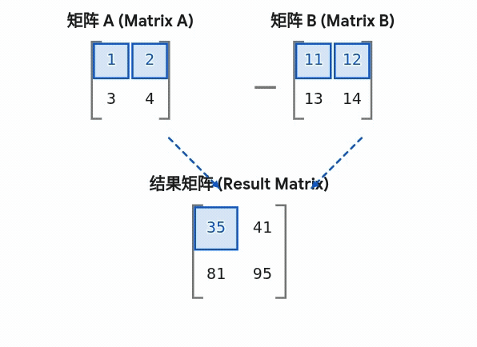

##### 3. 外积

`numpy.outer()` 函数用于计算两个向量的**外积**。它会生成一个二维矩阵，结果矩阵中第 $i$ 行、第 $j$ 列的元素就是第一个向量的第 $i$ 个元素乘以第二个向量的第 $j$ 个元素。

外积（Outer Product）的核心魅力在于：**它能够穷举两个向量中所有元素的“两两相互作用”，将一维的数据优雅地扩展为二维的关系矩阵。**

在实际工程中，它是特征构建与计算加速的“基石”，通常应用于以下核心场景：

- **代码加速（消灭循环）：** 替代低效的 Python 双重 `for` 循环，极速生成二维网格、距离矩阵或权重映射表。
- **图像处理（降维打击）：** 构建可分离滤波器（如利用两个 1D 向量的外积生成 2D 高斯模糊核），将图像卷积的时间复杂度从 $O(N^2)$ 骤降至 $O(2N)$。
- **机器学习（特征交叉）：** 快速计算数据的协方差矩阵，或在推荐系统和统计模型中生成不同变量组合的交叉特征。
- **物理与统计：** 构建更复杂的数学表达，如力学中的惯性张量（Tensors），或统计学中独立变量的联合概率分布矩阵。

**说明**：**不要求**两个数组长度相同，且最终生成的是一个二维特征矩阵。

```python
import numpy as np 
 
a = np.array([1, 2, 3])  
b = np.array([4, 5, 6])
 
print ('示例一维数组 a：')
print (a)
print ('示例一维数组 b：')
print (b)

print("--"*30)
"""
    numpy.outer() 计算两个向量的外积。
    运算逻辑：结果二维矩阵的 out[i, j] = a[i] * b[j]。
"""
print ('outer函数-------计算两个一维数组的外积：')
print (np.outer(a, b))

print("--"*30)
"""
    如果参数是多维数组，它们会被自动展平（flatten）为一维向量后再进行外积计算。
"""
c = np.array([[1, 5], 
              [4, 2]])  
d = np.array([[2],
              [3]])

print ('示例二维数组 c：')
print (c)
print ('示例二维数组 d：')
print (d)

print ('outer函数-------计算多维数组（默认先展平）的外积：')
# c 被展平为 [1, 5, 4, 2] (长度4)
# d 被展平为 [2, 3] (长度2)
# 最终生成 4x2 的矩阵
print (np.outer(c, d))

print("--"*30)
"""
    对于字母或字符串数组，必须显式声明 dtype=object。
    这样底层会调用纯 Python 的乘法逻辑（即字符串的倍数复制），避免发生 UFuncNoLoopError。
"""
# 注意：这里添加了 dtype=object
str_array = np.array(['A', 'B'], dtype=object)
num_array = np.array([1, 3])

print ('示例字符串数组 str_array（指定 dtype=object）：')
print (str_array)
print ('示例数字数组 num_array：')
print (num_array)

print ('outer函数-------计算 object 字符串与数字的外积：')
# 计算过程：
# ['A'*1, 'A'*3] -> ['A', 'AAA']
# ['B'*1, 'B'*3] -> ['B', 'BBB']
print (np.outer(str_array, num_array))
```

输出如下：

```
示例一维数组 a：
[1 2 3]
示例一维数组 b：
[4 5 6]
------------------------------------------------------------
outer函数-------计算两个一维数组的外积：
[[ 4  5  6]
 [ 8 10 12]
 [12 15 18]]
------------------------------------------------------------
示例二维数组 c：
[[1 5]
 [4 2]]
示例二维数组 d：
[[2]
 [3]]
outer函数-------计算多维数组（默认先展平）的外积：
[[ 2  3]
 [10 15]
 [ 8 12]
 [ 4  6]]
------------------------------------------------------------
示例字符串数组 str_array（指定 dtype=object）：
['A' 'B']
示例数字数组 num_array：
[1 3]
outer函数-------计算 object 字符串与数字的外积：
[['A' 'AAA']
 ['B' 'BBB']]
```


##### 4. 矩阵乘积

**numpy.matmul 函数**
		numpy.matmul() 函数（及 **@** 操作符）返回两个数组的矩阵乘积。不论二维数组还是高维数组，它都执行正常的矩阵乘法。

​	**支持**在前面的批次维度上进行**广播（若是高维度，除了后两个维度，满足前者的列==后者的行前提下，对其余维度广播）**。如果任一参数是一维数组，则通过在其维度上临时附加 1 来将其提升为二维矩阵，并在乘法完成后将该辅助维度去除。

​	此外，**matmul 严格禁止数组与标量相乘**。

**numpy.dot函数**
		numpy.dot() 函数返回两个数组的点积。

- 对于一维数组，它计算的是向量的内积等价于@和numpy.vdot；
- 对于二维数组，它同样执行正常的矩阵乘法。
- 对于高维，其行为与 matmul 截然不同：它执行的是**张量点积**或这说**张量收缩**，即将第一个数组的最后一个轴与第二个数组的倒数第二个轴上的元素对应相乘并求和，此过程**不包含批次广播机制**。
- 此外，与 matmul 不同**，dot 允许数组与单个标量进行乘法运算**。

因此，一般使用矩阵乘法时候选择@或者matmul，对于点乘即标量和矩阵乘法选择dot。

```python
import numpy as np 
 
"""
    对于二维矩阵，dot、matmul 和 @ 的结果完全一致，
    它们做的都是标准的【矩阵乘法】，绝不是单纯的元素对应相乘。
"""
a = np.array([[1, 2], 
              [3, 4]]) 
              
b = np.array([[5, 6], 
              [7, 8]]) 

print ('第一个二维数组 a：')
print (a)
print ('\n')
print ('第二个二维数组 b：')
print (b)
print ('\n')

print ('dot函数-------计算矩阵乘积：')
# 计算过程：例如第一行第一列：1*5 + 2*7 = 19
print (np.dot(a, b))
print ('\n')

print ('matmul函数-------计算矩阵乘积（结果与dot完全一样）：')
print (np.matmul(a, b))
print ('\n')

print ('@ 操作符-------这是matmul的语法糖，最推荐的矩阵乘法写法：')
print (a @ b)
print ('\n')

print ('='*60)
print ('以下为区别演示')
print ('='*60)
print ('\n')


"""
    区别 1：matmul支持广播机制 (Broadcasting)
    。
"""
# A_batch: 形状 (2, 2, 3)，表示 2 个 2x3 的矩阵
A_batch = np.array([[[1, 1, 1], [2, 2, 2]], 
                    [[3, 3, 3], [4, 4, 4]]])

# B_single: 形状 (3, 4)，表示 1 个 3x4 的矩阵
B_single = np.ones((3, 4)) 

print ('【区别 1】matmul 支持广播：')
print ('A_batch(2, 2, 3) @ B_single(3, 4)')
print ('逻辑：B_single 会被自动广播为 2 个 3x4 矩阵，与 A 分别相乘')
res_broadcast = np.matmul(A_batch, B_single)
print ('matmul 广播结果形状：', res_broadcast.shape) # 结果为 (2, 2, 4)
print ('\n')

# 注意：dot 也能运行上述代码，但它的逻辑是张量点积，结果形状会变成 (2, 2, 4)，
# 在更复杂的广播下（如 (2,1,3) 和 (3,4)），matmul 能广播，而 dot 的维度拼接会变得极其混乱。


"""
    区别 2：标量处理 (Scalar Handling)
    dot 允许数组与标量(单个数字)相乘，等价于所有元素乘以该数字。
    matmul 严格遵守线性代数规则，禁止与标量相乘。
"""
print ('【区别 2】dot 允许标量相乘：')
print ('np.dot(10, a) 的结果：')
print (np.dot(10, a))
print ('\n')

print ('【区别 2】matmul 严禁标量相乘，会直接报错：')
try:
    np.matmul(10, a)
except ValueError as e:
    print ('触发报错 ValueError:', e)
print ('\n')


"""
    区别 3：高维运算的区别 (High-dimensional Computation)
    当两个高维数组相乘时（这是深度学习中最常见的场景）：
    - matmul/@：将前面所有维度视为 Batch，只对最后两维做标准矩阵乘法。
    - dot：拿 A 的最后一维和 B 的倒数第二维做乘加，其余维度直接粗暴拼接。
"""
# 创建两个 3D 数组，形状均为 (2, 2, 2)
# 可以理解为 2 个批次(Batch)，每个里面是一个 2x2 矩阵
tensor_A = np.array([[[1, 2], [3, 4]], 
                     [[5, 6], [7, 8]]]) 
                 
tensor_B = np.array([[[1, 0], [0, 1]], 
                     [[2, 0], [0, 2]]]) 

print ('【区别 3】matmul / @ (批量矩阵乘法，符合人类直觉)：')
print ('tensor_A(2, 2, 2) @ tensor_B(2, 2, 2)')
res_high_matmul = np.matmul(tensor_A, tensor_B)
print ('matmul 结果形状：', res_high_matmul.shape) # 保留批次，结果为 (2, 2, 2)
print (res_high_matmul)
print ('\n')

print ('【区别 3】dot (张量点积，维度暴增)：')
print ('np.dot(tensor_A, tensor_B)')
res_high_dot = np.dot(tensor_A, tensor_B)
print ('dot 结果形状变成了 4 维！：', res_high_dot.shape) # 结果为 (2, 2, 2, 2)
print ('这在绝大多数实际业务中都是引发 Bug 的根源')
print ('\n')
```

输出如下：

```shell
第一个二维数组 a：
[[1 2]
 [3 4]]


第二个二维数组 b：
[[5 6]
 [7 8]]


dot函数-------计算矩阵乘积：
[[19 22]
 [43 50]]


matmul函数-------计算矩阵乘积（结果与dot完全一样）：
[[19 22]
 [43 50]]


@ 操作符-------这是matmul的语法糖，最推荐的矩阵乘法写法：
[[19 22]
 [43 50]]


============================================================
以下为区别演示
============================================================


【区别 1】matmul 支持广播：
A_batch(2, 2, 3) @ B_single(3, 4)
逻辑：B_single 会被自动广播为 2 个 3x4 矩阵，与 A 分别相乘
matmul 广播结果形状： (2, 2, 4)


【区别 2】dot 允许标量相乘：
np.dot(10, a) 的结果：
[[10 20]
 [30 40]]


【区别 2】matmul 严禁标量相乘，会直接报错：
触发报错 ValueError: matmul: Input operand 0 does not have enough dimensions (has 0, gufunc core with signature (n?,k),(k,m?)->(n?,m?) requires 1)


【区别 3】matmul / @ (批量矩阵乘法，符合人类直觉)：
tensor_A(2, 2, 2) @ tensor_B(2, 2, 2)
matmul 结果形状： (2, 2, 2)
[[[ 1  2]
  [ 3  4]]

 [[10 12]
  [14 16]]]


【区别 3】dot (张量点积，维度暴增)：
np.dot(tensor_A, tensor_B)
dot 结果形状变成了 4 维！： (2, 2, 2, 2)
这在绝大多数实际业务中都是引发 Bug 的根源

```

##### 5. 行列式计算

numpy.linalg.det() 函数计算输入矩阵的行列式。

行列式在线性代数中是非常有用的值。 它从方阵的对角元素计算。 对于 2×2 矩阵，它是左上和右下元素的乘积与其他两个的乘积的差。

换句话说，对于矩阵[[a，b]，[c，d]]，行列式计算为 ad-bc。 较大的方阵被认为是 2×2 矩阵的组合。

```python
import numpy as np
a = np.array([[1,2], [3,4]]) 
 
print (np.linalg.det(a))
```

输出如下：

```
-2.0
```

##### 6. 线性方程求解

numpy.linalg.solve() 函数给出了矩阵形式的线性方程的解。

考虑以下线性方程：

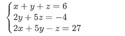

可以使用矩阵表示为：

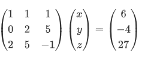

如果矩阵成为A、X和B，方程变为：

$AX=B \text{ 或者 } X = A * B^{-1}$

```python
import numpy as np 

"""
    numpy.linalg.solve() 函数给出了矩阵形式的线性方程的解。
    已知方程组：
    x + y + z = 6
    2y + 5z = -4
    2x + 5y - z = 27
    
    可以表示为 AX = B，其中 A 为系数矩阵，B 为常数项向量。
"""

# 定义系数矩阵 A
A = np.array([[1, 1, 1], 
              [0, 2, 5], 
              [2, 5, -1]])

# 定义常数项向量 B
B = np.array([6, -4, 27])

print ('系数矩阵 A：')
print (A)
print ('\n')

print ('常数项向量 B：')
print (B)
print ('\n')

print ('solve函数-------求解线性方程组 AX = B：')
X = np.linalg.solve(A, B)
print ("得出结果X是：",X)
print ('\n')

# 验证结果
print ('验证结果-------计算 A @ X 是否等于 B：')
print (np.equal(np.matmul(A, X),B))

```

输出如下：

```
系数矩阵 A：
[[ 1  1  1]
 [ 0  2  5]
 [ 2  5 -1]]


常数项向量 B：
[ 6 -4 27]


solve函数-------求解线性方程组 AX = B：
得出结果X是： [ 5.  3. -2.]


验证结果-------计算 A @ X 是否等于 B：
[ True  True  True]
```


##### 7. 逆矩阵

numpy.linalg.inv() 函数计算矩阵的乘法逆矩阵。

**逆矩阵（inverse matrix）**：设A是数域上的一个n阶矩阵，若在相同数域上存在另一个n阶矩阵B，使得： AB=BA=E ，则我们称B是A的逆矩阵，而A则被称为可逆矩阵。注：E为单位矩阵。

```python
import numpy as np 
 
x = np.array([[1,2],[3,4]]) 
y = np.linalg.inv(x) 
print (x)
print (y)
print (np.dot(x,y))
```

输出结果为：

```
[[1 2]
 [3 4]]
[[-2.   1. ]
 [ 1.5 -0.5]]
[[1.0000000e+00 0.0000000e+00]
 [8.8817842e-16 1.0000000e+00]]
```

#### 3. 矩阵分解

矩阵分解是线性代数中的重要工具，常用于求解线性方程组、特征值问题、最小二乘法等。`NumPy` 提供了多种矩阵分解方法，如 LU 分解、QR 分解和奇异值分解（SVD）。

##### 1.LU 分解

LU分解就是将一个矩阵 $A$ 分解为一个置换矩阵 $P$、一个下三角矩阵 $L$ 和一个上三角矩阵 $U$ 的乘积，即：

$$A = P L U$$

| **矩阵** | **名称**                   | **特点**                       | **作用**                                                     |
| -------- | -------------------------- | ------------------------------ | ------------------------------------------------------------ |
| **P**    | **置换矩阵 (Permutation)** | 每行每列只有一个 1，其余为 0   | 记录了**行交换**的操作。在数值计算中，为了防止除以极小的数导致误差，算法会把绝对值最大的元素换到主对角线上。 |
| **L**    | **下三角矩阵 (Lower)**     | 主对角线元素全为 1，左下方有值 | 记录了**行消元**的倍数过程。                                 |
| **U**    | **上三角矩阵 (Upper)**     | 右上方有值，左下方全为 0       | 这是 $A$ 经过高斯消元后得到的**阶梯形矩阵**。                |

```python
import scipy.linalg as la
import numpy as np
A = np.array([[4, 3], [6, 3]])
P, L, U = la.lu(A)
 
print("P 矩阵:\n", P)
print("L 矩阵:\n", L)
print("U 矩阵:\n", U)
```

输出如下：

```
P 矩阵:
 [[0. 1.]
 [1. 0.]]
L 矩阵:
 [[1.         0.        ]
 [0.66666667 1.        ]]
U 矩阵:
 [[6. 3.]
 [0. 1.]]
```

解释输出：

**Step 1: 选主元（行交换）：**

算法发现第二行的第一列元素 `6` 比第一行的 `4` 大，为了计算更稳定，它交换了第一行和第二行。

因此，**P 矩阵**会是：

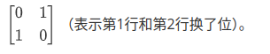

**Step 2: 消元得到 U：**

交换后的矩阵变为

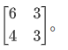

为了把第二行的 `4` 变成 `0`，我们需要执行：

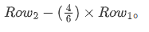

所以，**U 矩阵**是：

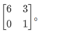

**Step 3: 记录倍数得到 L：**

我们在消元时用了倍数 $\frac{4}{6} \approx 0.6667$。

所以，**L 矩阵**是：

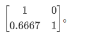

**Step4:验证结果：**

​				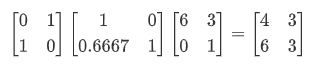

**为什么要做这个分解？**

- **解线性方程组**：一旦有了 $LU$ 分解，解 $Ax = b$ 就变成了两次非常简单的代入计算（前向替换和后向替换），速度比直接求逆矩阵快得多。
- **求行列式**：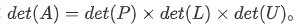由于 $L$ 和 $U$ 是三角阵，它们的行列式只是对角线元素的乘积。

##### 2.QR分解

​	QR 分解将一个任意矩阵 $A$ 拆解为两个特殊矩阵的乘积：

​			$$A = Q R$$

- **$Q$ 矩阵 (正交矩阵, Orthogonal Matrix)：**

  - **特点：** 它的列向量都是**互相垂直**的，且长度为 $1$（即单位正交基）。数学上满足 $Q^T Q = I（  Q的转置等于 Q 的逆）$。
  - **作用：** 正交矩阵就像是一个“完美的坐标系”。在这个坐标系里做变换（比如旋转或镜像），**不会改变向量的长度，也不会放大数据中的误差**。

- **$R$ 矩阵 (上三角矩阵, Right/Upper Triangular Matrix)：**

  - **特点：** 主对角线及右上方有非零元素，左下方全为 $0$。
  - **作用：** 它记录了原始矩阵 $A$ 的列向量，是如何在这个完美的 $Q$ 坐标系中通过线性组合被重新表达的。

  

  ```python
  import scipy.linalg as la
  import numpy as np
  A = np.array([[2, 1], [4, 3]])
  Q, R = np.linalg.qr(A)
  print("Q 矩阵:\n", Q)
  print("R 矩阵:\n", R)
  ```

  输出如下：

  ```
  Q 矩阵:
   [[-0.4472136  -0.89442719]
   [-0.89442719  0.4472136 ]]
  R 矩阵:
   [[-4.47213595 -3.13049517]
   [ 0.          0.4472136 ]]
  ```

  

  ###### 应用场景

  **场景一：解决最小二乘法问题 (最经典应用)**

  ​	在现实工程中（比如通过相机进行手眼标定，或者处理带有噪声的传感器数据），我们经常遇到**方程个数远多于未知数**的情况，即超定方程组 $Ax = b$。

  ​	这种方程没有精确解，只能找一个最优的近似解（最小二乘解）。传统的做法是算 $A^T A x = A^T b$，但这很容易导致计算溢出或精度丢失（因为 $A^T A$ 会把原矩阵的条件数平方）。

  如果使用 QR 分解：

  ​		$$A = QR \implies QRx = b \implies Rx = Q^T b$$

  具体推导如下：

  $由A^TAx=A^Tb$

  ​		$$=>(QR)^T (QR) x = (QR)^T b$$

  ​		$$=>R^T Q^T Q R x = R^T Q^T b$$

  由于 $Q^T Q = E$

  ​		$$=>R^T E R x = R^T Q^T b$$

  ​		$$=>R^T R x = R^T Q^T b$$

  左侧约去 $R^T得出符合AX=B形式$

  ​		$$=>R x = Q^T b$$

  

  由于 $Q^T$ 只是做个旋转不改变误差$，R$ 又是上三角矩阵，我们只需要做一次极其稳定的反向代入就能解出 $x$，极大提升了算法的抗噪能力。

  **场景二：深度学习中的正交初始化与正则化**

  ​	在训练深层神经网络（如 RNN 或极深的 CNN）时，梯度消失和梯度爆炸是常客。通过 QR 分解强行让网络层的权重矩阵保持正交性（即利用 $Q$ 矩阵），可以保证信号在正向传播和反向传播时能量不衰减、不放大。

##### 3. SVD分解

SVD 是将矩阵分解为三个矩阵：左奇异矩阵、对角矩阵（奇异值）、右奇异矩阵。

$$A = U S V^T$$

- **$V^T$ (右奇异矩阵)：** 它是一个正交矩阵。它的作用是“第一转”，把输入的数据旋转到一个最方便拉伸的角度。
- **$S$ (奇异值对角矩阵)：** 它是核心。对角线上的数字叫“奇异值”。它的作用是“拉伸”**。更重要的是，它把所有维度按照重要程度**从大到小极其严格地排好了队。数字越大，说明这个方向上的信息量（能量）越大。
- **$U$ (左奇异矩阵)：** 它也是一个正交矩阵。它的作用是“第二转”，把拉伸好的数据旋转到最终的目标坐标系里。

```python
U, S, V = np.linalg.svd(A)
print("U 矩阵:\n", U)
print("奇异值:\n", S)
print("V 矩阵:\n", V)
```

输出如下：

```
U 矩阵:
 [[-0.40455358 -0.9145143 ]
 [-0.9145143   0.40455358]]
奇异值:
 [5.4649857  0.36596619]
V 矩阵:
 [[-0.81741556 -0.57604844]
 [-0.57604844  0.81741556]]
```

###### 应用场景

1. **数据压缩与特征降维**

- **目的：** 在海量数据中去除冗余，用极少的数据量保留原始信息的核心特征。
- **原理：** SVD 拆解出的核心矩阵 $S$ 里面的“奇异值”天生就是从大到小排列的。通常，前 10% 的极大的奇异值包含了矩阵 90% 以上的“能量”（信息）。
- **应用场景：** 图像压缩（只保留少数大奇异值就能看清大意）、推荐系统（挖掘用户潜在特征）、以及深度学习中最常用的 PCA（主成分分析）的底层实现引擎。

2. **信号去噪**

- **目的：** 把真实的有用信号和随机的干扰杂音分离开来。
- **原理：** 在 SVD 分解后，那些排在最后面、数值非常微小的奇异值，往往代表的不是有用的物理特征，而是传感器的随机噪声或测量误差。我们直接把它们一刀切掉（强行置为 0），再反向乘回去，就能还原出纯净的原始数据。
- **应用场景：** 传感器数据滤波、医疗图像去噪、金融数据趋势提取。

3. **求伪逆矩阵**

- **目的：** 让**任何**矩阵（哪怕它不是正方形，哪怕它的行列式为 0 根本没有逆矩阵）都能进行类似“除法”的逆向运算，并找出一个误差最小的近似最优解。
- **原理：** 通过舍弃导致矩阵不可逆的“零奇异值”或极小奇异值，强行构造出一个伪逆矩阵（Pseudo-inverse, $A^+$）。
- **应用场景：** 机器人运动学求解（当机械臂陷入“奇异构型”卡死时强行求解速度）、机器视觉中的最小二乘法拟合求解超定方程组。

最小二乘法理论推导如下：

我们将 $A = U S V^T$ 代入方程 $Ax = b$：

​		$$=>(U S V^T)x = b$$

因为 $U^T U = I$（单位矩阵），等式变为：

​		$$=>S V^T x = U^T b$$

为了简化，我们令 $y = V^T x$

​		$$=>S y = U^T b$$

因为 $S$ 是对角矩阵，其伪逆 $S^+$ 很容易求得（将非零奇异值取倒数，其余置为 0）：

​		$$=> y = S^+ U^T b$$

根据 $y = V^T x$，两边左乘 $V$。由于 $V V^T = I$，我们得出最终解：

​		$$=>x = V y \implies x = V S^+ U^T b$$

4. **几何变换解耦**

- **目的：** 看透一个复杂的矩阵变换，到底对现实空间施加了怎样具体的扭曲。
- **原理：** SVD 证明了任何矩阵变换 $A$，都可以被完美拆解为 $A = U S V^T$。这相当于把一个复杂的乱揉乱捏，解耦成了三个极度纯粹、清晰的物理动作：**“旋转” $\rightarrow$ “拉伸” $\rightarrow$ “再旋转”**。
- **应用场景：** 3D 视觉中的点云配准（ICP 算法中通过 SVD 提纯出两组 3D 坐标间的最优旋转矩阵）、刚体运动学分析。

### 3.2.4.10. 最小二乘法

使用 `numpy.linalg.lstsq()` 解决超定方程（方程个数多于未知数）的最小二乘问题。

参数说明：

| **分类**     | **名称**            | **含义与作用**                                               |
| ------------ | ------------------- | ------------------------------------------------------------ |
| **输入参数** | `a` (矩阵 $A$)      | **特征矩阵**。通常代表已知的数据点或等式左边的系数。每一列代表一个特征（如斜率、截距）。 |
| **输入参数** | `b` (向量/矩阵 $B$) | **目标值**。等式右边的真实观测结果。                         |
| **输入参数** | `rcond` (浮点数)    | **截断阈值（极其重要）**。用来决定把多小的奇异值当成“0”（噪声）扔掉。传入 `None` 会使用机器精度的默认值。 |
| **返回值**   | `x`                 | **最优解**。即最小二乘法算出的参数组合（如你例子中的直线斜率和截距）。 |
| **返回值**   | `residuals`         | **残差平方和**。所有数据点到拟合结果的误差平方总和。值越小说明拟合越贴合数据。 |
| **返回值**   | `rank`              | **有效矩阵秩**。矩阵 $A$ 中真正线性独立的列数（代表你有多少个真实有效的特征）。 |
| 返回值       | `s`                 | **奇异值数组**。矩阵 $A$ 经过 SVD 分解后提取出的奇异值，按从大到小排列。 |

```python
import numpy as np
 
A = np.array([[1, 1], [1, 2], [1, 3]])
B = np.array([1, 2, 2])
 
# 使用最小二乘法求解 AX = B
X, residuals, rank, s = np.linalg.lstsq(A, B, rcond=None)
print("最小二乘法求解结果:\n", X)
```

输出如下：

```
最小二乘法求解结果:
 [0.66666667 0.5       ]
```

##### 和分解矩阵应用

| **分解方法** | **公式**      | **物理/几何直觉**                                  | **核心优势**                 | **在最小二乘法中的角色**                       |
| ------------ | ------------- | -------------------------------------------------- | ---------------------------- | ---------------------------------------------- |
| **LU 分解**  | $A = PLU$     | 记录消元的倍数和结果                               | 解基础方程速度极快           | 基本不用，数值稳定性太差                       |
| **QR 分解**  | $A = QR$      | 把向量掰直，提取完美坐标系                         | 绝对保真，抗噪稳定，速度较快 | **高性能首选**，适合健康的超定方程             |
| **SVD 分解** | $A = U S V^T$ | 旋转 $\rightarrow$ 按重要性拉伸 $\rightarrow$ 旋转 | 信息提纯，降维，强求伪逆     | **终极兜底方案**（`lstsq` 默认），无视恶劣数据 |

```python
import numpy as np


# ================== 使用最小二乘法直接计算====================
# 使用最小二乘法求解 AX = B,默认SVD
X, residuals, rank, s = np.linalg.lstsq(A, B, rcond=None)
print("最小二乘法求解结果:\n", X)
# ================== 使用SVD理论推导=========================
# 1. 准备数据 (假设 A 是超定矩阵)
A = np.array([[1, 1], [1, 2], [1, 3]])
B = np.array([1, 2, 2])

# 2. 执行 SVD 分解
# U: 左奇异矩阵, S: 奇异值数组, Vh: 右奇异矩阵的转置 (V.T)
U, S, Vh = np.linalg.svd(A, full_matrices=False)

# 3. 计算伪逆解的核心逻辑: x = V * (S^-1) * (U.T * B)
# 第一步: 计算 U.T @ B
Ut_B = U.T @ B

# 第二步: 将奇异值取倒数 (S^-1)，如果奇异值极小则设为0以去噪
# 这里可以使用 np.linalg.lstsq 中的 rcond 逻辑
S_inv = np.zeros_like(S)
threshold = 1e-15 # 设定截断阈值
S_inv[S > threshold] = 1.0 / S[S > threshold]

# 第三步: 依次相乘得到最终解 X
# 注意: Vh 是 V.T，所以这里要用 Vh.T (即 V)
X_svd = Vh.T @ (S_inv * Ut_B)
#或者使用 np.diag 将 1D 数组转换回 2D 对角矩阵
X_svd = Vh.T @ np.diag(S_inv) @ Ut_B


print("SVD 实现最小二乘法结果:\n", X_svd)
```

QR分解实现最小二乘法

```python
import numpy as np
import scipy.linalg as la
A = np.array([[1, 1], [1, 2], [1, 3]])
B = np.array([1, 2, 2])


# 1. 采用 QR 实现方程组求解
# mode='reduced' 表示经济型分解，扔掉无用的维度，计算更快
Q, R = np.linalg.qr(A, mode='reduced')

# 2. 计算 d = Q^T * B
d = Q.T @ B

# 3. 利用 R 是上三角矩阵的特性，使用回代法极速求 x
# solve_triangular 专门用于解上三角/下三角方程，由于R是一个上三角矩阵，我们采用solve_triangular。
# 速度较普通线性方程组求解 np.linalg.solve快
X_qr = la.solve_triangular(R, d)

print("QR 分解求解结果:\n", X_qr)
```


### 3.2.4.11 占位符NAN

numpy.nan (Not a Number)
    numpy.nan 是一个特殊的浮点值，用于表示“不是一个数字”。它在数据科学中通常作为缺失值（Missing Data）或无效计算结果的占位符。

**核心特性**：

- 类型限制：NaN 属于浮点类型（float）。如果将 NaN 插入整数数组，NumPy 会自动将数组转换为浮点型。
- 运算传播：在普通算术运算中，NaN 具有“污染性”。任何涉及 NaN 的操作（如 1 + NaN）结果均会返回 NaN。
- 逻辑特殊性：根据 IEEE 754 浮点数标准，NaN 与任何值都不相等，包括它自身（np.nan == np.nan 返回 False）。
- 检测与处理：不能使用 == 运算符检测 NaN，必须使用专用函数如 np.isnan()。在计算统计量（和、均值等）时，建议使用 np.nansum() 或 np.nanmean() 等安全函数以忽略这些缺失值。


```python
import numpy as np 

"""
    NaN (Not a Number) 演示：
    模拟一个包含缺失值的传感器读数列表。
"""

# 1. 创建一个包含 NaN 的数组
# 注意：np.nan 是浮点型，所以数组会自动转为 float64
data = np.array([10.5, np.nan, 20.3, 15.8, np.nan])

print ('原始传感器数据（包含缺失值）：')
print (data)
print ('\n')

# 2. 演示 NaN 的特殊性质：不自等
print ('直接比较验证：np.nan == np.nan 的结果为：')
print (np.nan == np.nan)
print ('\n')

# 3. 演示如何正确检测缺失值
print ('使用 isnan 函数检测缺失值的位置：')
mask = np.isnan(data)
print (mask)
print ('\n')

# 4. 演示普通运算遇上 NaN 的后果
print ('普通 mean 函数计算平均值：')
# 只要有一个 NaN，结果就会变成 NaN
print (np.mean(data))
print ('\n')

# 5. 演示“Nan-safe”函数的威力
"""
    numpy.nanmean() 会自动忽略掉其中的 NaN 进行计算。
    这在数据分析中非常实用。
"""
print ('nanmean 函数-------忽略缺失值后的平均值：')
safe_mean = np.nanmean(data)
print (safe_mean)
print ('\n')

# 6. 演示填充缺失值
print ('使用 0 填充缺失值后的数组：')
data_filled = np.copy(data)
data_filled[np.isnan(data_filled)] = 0
print (data_filled)
```

输出如下：

```
原始传感器数据（包含缺失值）：
[10.5  nan 20.3 15.8  nan]


直接比较验证：np.nan == np.nan 的结果为：
False


使用 isnan 函数检测缺失值的位置：
[False  True False False  True]


普通 mean 函数计算平均值：
nan


nanmean 函数-------忽略缺失值后的平均值：
15.533333333333333


使用 0 填充缺失值后的数组：
[10.5  0.  20.3 15.8  0. ]
```

### 3.2.4.12 文件

Numpy 可以读写磁盘上的文本数据或二进制数据。

NumPy 为 ndarray 对象引入了一个简单的文件格式：**npy**。

npy 文件用于存储重建 ndarray 所需的数据、图形、dtype 和其他信息。

常用的 IO 函数有：

- load() 和 save() 函数是读写文件数组数据的两个主要函数，默认情况下，数组是以未压缩的原始二进制格式保存在扩展名为 .npy 的文件中。

- savez() 函数用于将多个数组写入文件，默认情况下，数组是以未压缩的原始二进制格式保存在扩展名为 .npz 的文件中。

- loadtxt() 和 savetxt() 函数处理正常的文本文件(.txt 等)

  

#### 1.numpy.save & load

numpy.save() 函数将数组保存到以 .npy 为扩展名的文件中。

```
numpy.save(file, arr, allow_pickle=True, fix_imports=True)
```

**参数说明：**

- **file**：要保存的文件，扩展名为 .npy，如果文件路径末尾没有扩展名 .npy，该扩展名会被自动加上。
- **arr**: 要保存的数据
- **allow_pickle**: 可选，布尔值，允许使用 Python pickles 保存对象数组，Python 中的 pickle 用于在保存到磁盘文件或从磁盘文件读取之前，对对象进行序列化和反序列化。
- **fix_imports**: 可选，为了方便 Pyhton2 中读取 Python3 保存的数据。

在函数签名中，`allow_pickle=True` 是关键。当这个参数为 `True` 时（这是默认值），NumPy 会利用 Python 的 `pickle` 模块将非数组对象（如列表、字典、自定义类实例等）序列化并存储到 `.npy` 文件中,并对该对象反序列化加载取得数据。

```python
import numpy as np 

"""
    numpy.save() 存放非 NumPy 数组对象的演示。
    虽然名为 save 数组，但由于 pickle 的支持，它可以存放字典、列表等。
"""

# 1. 定义一个复杂的 Python 字典（包含多种类型）
data_dict = {
    'name': 'Gemini',
    'version': 3.0,
    'features': ['fast', 'smart', 'adaptive'],
    'is_ai': True
}

print ('准备存放的字典对象：')
print (data_dict)
print ('\n')

# 2. 使用 numpy.save 存放到 .npy 文件
# 虽然 data_dict 不是 ndarray，但它会被 pickle 序列化存储
np.save('my_config.npy', data_dict)
print ('save函数-------已将字典存入 my_config.npy')
print ('\n')

# 3. 使用 numpy.load 读取
# 注意：读取 pickle 存放的对象时，需要加 [()]/.item() 才能还原回原始对象
loaded_data = np.load('my_config.npy', allow_pickle=True)

print ('load函数-------读取出的对象（此时是 0 维数组）：')
print (loaded_data)
print ('\n')

print ('还原结果-------通过 [()] 提取出的原始字典：')
final_result = loaded_data.item() # 或者使用 loaded_data[()]
print (final_result)
print ('类型为：', type(final_result))
```

#### 2.numpy.savez

numpy.savez() 函数将多个数组保存到以 npz 为扩展名的文件中。

```
numpy.savez(file, *args, **kwds)
```

参数说明：

- **file**：要保存的文件，扩展名为 **.npz**，如果文件路径末尾没有扩展名 **.npz**，该扩展名会被自动加上。
- **args**: 要保存的数组，可以使用关键字参数为数组起一个名字，非关键字参数传递的数组会自动起名为 **arr_0**, **arr_1**, …　。
- **kwds**: 要保存的数组使用关键字名称。

```python
import numpy as np 

"""
    np.savez() 序列化与反序列化演示：
    同时保存一个 NumPy 数组和一个 Python 字典（非数组对象）。
"""

# 1. 准备数据
arr = np.array([1, 2, 3])
config_dict = {
    'learning_rate': 0.01,
    'optimizer': 'Adam',
    'epoch': 100
}

print ('准备保存的数组 arr：')
print (arr)
print ('\n')
print ('准备保存的字典 config_dict：')
print (config_dict)
print ('\n')

# 2. 序列化并保存到 .npz 文件
# allow_pickle=True 是支持非数组对象的关键（默认为 True）
np.savez('mixed_data.npz', my_arr=arr, my_cfg=config_dict)
print ('savez函数-------已将数组和字典打包保存至 mixed_data.npz')
print ('\n')

# 3. 加载并反序列化
# 注意：读取包含 pickle 对象的文件时，必须显式指定 allow_pickle=True
loaded_data = np.load('mixed_data.npz', allow_pickle=True)

print ('load函数-------提取数组（直接可用）：')
print (loaded_data['my_arr'])#和自己起的my_arr对应。
print ('\n')

print ('load函数-------提取字典（反序列化拆箱）：')
# 关键点：使用 [()] 或 .item() 将 0 维数组还原为原始 Python 对象
raw_cfg = loaded_data['my_cfg'][()] #和自己起的my_config对应。

print (raw_cfg)

```

输出如下：

```
准备保存的数组 arr：
[1 2 3]


准备保存的字典 config_dict：
{'learning_rate': 0.01, 'optimizer': 'Adam', 'epoch': 100}


savez函数-------已将数组和字典打包保存至 mixed_data.npz


load函数-------提取数组（直接可用）：
[1 2 3]


load函数-------提取字典（反序列化拆箱）：
{'learning_rate': 0.01, 'optimizer': 'Adam', 'epoch': 100}
```

#### 3. numpy.savetxt & loadtxt

savetxt() 函数是以简单的文本文件格式存储数据，对应的使用 loadtxt() 函数来获取数据。

```
np.loadtxt(FILENAME, dtype=int, delimiter=' ')
np.savetxt(FILENAME, a, fmt="%d", delimiter=",")
```

参数 delimiter 可以指定各种分隔符、针对特定列的转换器函数、需要跳过的行数等

```python
import numpy as np 

"""
    numpy.savetxt() 演示：
    将数组保存为文本文件（如 .csv 或 .txt）。
    注意：savetxt 主要用于一维或二维的数值型数组，不支持直接序列化字典等复杂对象。
"""

# 1. 准备一个二维实验数据
# 模拟 3 个样本的 4 项指标
data = np.array([[1.234, 2.345, 3.456, 4.567],
                 [5.678, 6.789, 7.890, 8.901],
                 [9.012, 0.123, 1.234, 2.345]])

print ('准备保存的原始数据：')
print (data)
print ('\n')

# 2. 执行保存操作
"""
    参数解析：
    - 'experiment_result.txt': 文件名
    - fmt='%.2f': 格式控制，保留两位小数
    - delimiter=',': 分隔符，CSV 文件通常用逗号
    - header: 文件开头的注释行
"""
np.savetxt('experiment_result.txt', 
           data, 
           fmt='%.2f', 
           delimiter=',', 
           header='val1,val2,val3,val4')

print ('savetxt函数-------已将数据导出为 experiment_result.csv')
print ('\n')

# 3. 执行读取操作（反向验证）
"""
    使用 loadtxt 加载时，需要指定相同的分隔符。
    skiprows=1 表示跳过之前写入的 header 注释行。
"""
loaded_txt_data = np.loadtxt('experiment_result.txt', 
                             delimiter=',', 
                             skiprows=1)

print ('loadtxt函数-------重新读取后的数据（注意精度已变为两位小数）：')
print (loaded_txt_data)
```

输出如下：

```
准备保存的原始数据：
[[1.234 2.345 3.456 4.567]
 [5.678 6.789 7.89  8.901]
 [9.012 0.123 1.234 2.345]]


savetxt函数-------已将数据导出为 experiment_result.txt


loadtxt函数-------重新读取后的数据（注意精度已变为两位小数）：
[[1.23 2.35 3.46 4.57]
 [5.68 6.79 7.89 8.9 ]
 [9.01 0.12 1.23 2.35]]
```

