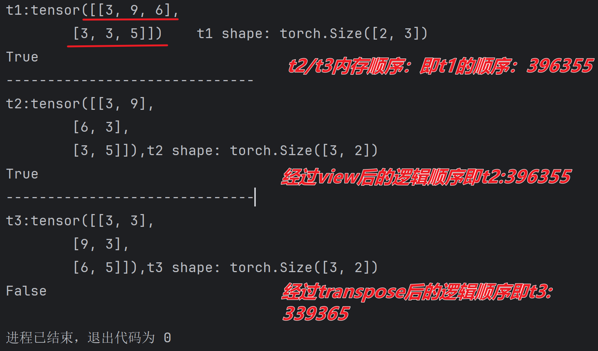

# 张量

## 张量创建

- PyTorch中的张量就是元素为同一种数据类型的多维矩阵，与NumPy数组类似。
- PyTorch中，张量以"类"的形式封装起来，对张量的一些运算、处理的方法（数值计算、矩阵操作、自动求导）被封装在类中。

### 基本创建（根据传入数据类型创建）

```python
import torch
import numpy as np
def demo01():
    t1=torch.tensor(10)
    print(f't1 : {t1},type : {type(t1)}')
    data = [[1,2,3],[4,5,6]]
    t2 = torch.tensor(data)
    print(f't2 : {t2},type : {type(t2)}')
    data = np.random.randint(0,10,size=(2,3))
    t3= torch.tensor(data,dtype=torch.float)
    print(f't3 : {t3},type : {type(t3)}')

if __name__ == '__main__':
    demo01()
#输出：
t1 : 10,type : <class 'torch.Tensor'>
t2 : tensor([[1, 2, 3],
        [4, 5, 6]]),type : <class 'torch.Tensor'>
t3 : tensor([[5., 1., 6.],
        [1., 1., 2.]]),type : <class 'torch.Tensor'>        
#这里没出输出float32的原因是tensor默认数据类型是float32
#比如我这里 t3= torch.tensor(data,dtype=torch.float)改成 t3= torch.tensor(data,dtype=torch.int)
#输出：
#		t3 : tensor([[1, 8, 8],
#       [7, 4, 5]], dtype=torch.int32),type : <class 'torch.Tensor'>
```


### 指定值张量

- torch.zeros(size=) 和 torch.zeros_like(input=) 创建全0张量

  ```python
  # 1. 创建指定形状全0张量
  data = torch.zeros(2, 3)
  print(data)
  
  # 2. 根据张量形状创建全0张量
  data = torch.zeros_like(data)
  print(data)
  ```

- torch.ones(size=) 和 torch.ones_like(input=) 创建全1张量

  ```python
  # 1. 创建指定形状全1张量
  data = torch.ones(2, 3)
  print(data)
  
  # 2. 根据张量形状创建全1张量
  data = torch.ones_like(data)
  print(data)
  ```

- torch.full(size=, fill_value=) 和 torch.full_like(input=, fill_value=) 创建全为指定值张量

  ```python
  import torch
  import numpy as np
  def demo01():
      t1 =  torch.full(size=(3,4),fill_value=0)
      print(f"t1:{t1} type : {type(t1)}")
      t2 = np.random.randint(0,10,size=(3,4))
      print(f"t2:{t2} type : {t2}")
      t3 = torch.full_like(torch.tensor(t2),fill_value=1)
      print(f"t3:{t3} type : {t3}")
  if __name__ == '__main__':
      demo01()
  #输出：
  t1:tensor([[0, 0, 0, 0],
          [0, 0, 0, 0],
          [0, 0, 0, 0]]) type : <class 'torch.Tensor'>
  t2:[[3 1 6 4]
   [0 5 4 4]
   [8 9 3 2]] type : [[3 1 6 4]
   [0 5 4 4]
   [8 9 3 2]]
  t3:tensor([[1, 1, 1, 1],
          [1, 1, 1, 1],
          [1, 1, 1, 1]], dtype=torch.int32) type : tensor([[1, 1, 1, 1],
          [1, 1, 1, 1],
          [1, 1, 1, 1]], dtype=torch.int32)
  ```

### 线性和随机张量

- torch.arange(start=, end=, step=)：固定步长线性张量

- torch.linspace(start=, end=, steps=)：固定元素数线性张量

- torch.randn/rand(size=) 创建随机浮点类型张量

- torch.randint(low=, high=, size=) 创建随机整数类型张量 左闭右开

- torch.initial_seed() 和 torch.manual_seed(seed=)   ***几乎不用***  ， 写出来与否都是按照时间戳作为种子

  ```python
  import torch
  import numpy as np
  def demo01():
      #(起始位置，终点位置，步数)
      t1 = torch.arange(0,10,2)
      print(f"t1 = {t1} , type(t1) = {type(t1)}")
      #linspace更像等差数列(起始位置，终点位置，元素个数)
      t2 = torch.linspace(0,10,5)
      print(f"t2 = {t2},type(t2) = {type(t2)}")
      #默认种子是以时间戳形式
      #若不想以时间戳形式使用如下方法：
      torch.manual_seed(0)
      #均匀分布区间是(0,1)的随机张量
      t3 = torch.rand(size=(2,3))
      print(f"t3 = {t3},type(t3) = {type(t3)}")
      #符合正太分布的随机张量
      t4 = torch.randn(size=(2,4))
      print(f"t4 = {t4},type(t4) = {type(t4)}")
      t5 = torch.randint(0,10,size=(2,5))
      print(f"t5 = {t5},type(t5)={t5.type()}")
  if __name__ == '__main__':
      demo01()
  #输出
  t1 = tensor([0, 2, 4, 6, 8]) , type(t1) = <class 'torch.Tensor'>
  t2 = tensor([ 0.0000,  2.5000,  5.0000,  7.5000, 10.0000]),type(t2) = <class 'torch.Tensor'>
  t3 = tensor([[0.4963, 0.7682, 0.0885],
          [0.1320, 0.3074, 0.6341]]),type(t3) = <class 'torch.Tensor'>
  #解释正太分布的随机张量：
  数值特征：
  所有数值都围绕 0 分布（比如 1.2645、-0.6874、0.1604），符合 “均值 = 0” 的特征；
  数值大多在 -1 ~ 1 之间（仅 1.2645 略超），符合 “标准差 = 1” 的分布规律；
  
  
  
  t4 = tensor([[ 1.2645, -0.6874,  0.1604, -0.6065],
          [-0.7831,  1.0622, -0.2613,  1.0667]]),type(t4) = <class 'torch.Tensor'>
  t5 = tensor([[1, 4, 4, 1, 9],
          [9, 9, 0, 1, 2]]),type(t5)=torch.LongTensor
  ```

| 函数          | 分布类型     | 数值范围                 | 用途                                           |
| ------------- | ------------ | ------------------------ | ---------------------------------------------- |
| `torch.randn` | 标准正态分布 | (-∞, +∞)（集中在 - 1~1） | 模拟自然随机波动（如神经网络初始化、噪声添加） |
| `torch.rand`  | 均匀分布     | [0, 1)                   | 随机采样、概率模拟                             |

## 指定张量类型转换

```python
import torch
import numpy as np
def demo01():
    #在创建时候可以为参数dtype赋值指定张量类型
    t1  = torch.tensor([1, 2, 3], dtype=torch.float16)
    print(f"t1 = {t1} , dtype = {t1.dtype},type  =  {type(t1)}")
    #对于已经创建的张量如何修改类型呢？这里有两种方式
    #方式1：type方法
    t2  = t1.type(torch.int32)
    print(f"t2 = {t2} , dtype = {t2.dtype},type ={type(t2)}")

    #方式2：.对应类型
    """
        short   ->  int16
        int     ->  int32
        long    ->  int64
        half    ->  float16
        float   ->  float32
        double  ->  float64
    
    """
    t3 = t1.double()
    print(f"t3 = {t3} , dtype = {t3.dtype},type={type(t3)}")
    t4 = t1.float()
    print(f"t4 = {t4} , dtype = {t4.dtype},type={type(t4)}")
    t5 = t1.int()
    print(f"t5 = {t5} , dtype = {t5.dtype},type={type(t5)}")
    t6 = t1.long()
    print(f"t6 = {t6} , dtype = {t6.dtype},type={type(t6)}")
if __name__ == '__main__':
    demo01()
#输出：
t1 = tensor([1., 2., 3.], dtype=torch.float16) , dtype = torch.float16,type  =  <class 'torch.Tensor'>
t2 = tensor([1, 2, 3], dtype=torch.int32) , dtype = torch.int32,type =<class 'torch.Tensor'>
t3 = tensor([1., 2., 3.], dtype=torch.float64) , dtype = torch.float64,type=<class 'torch.Tensor'>
t4 = tensor([1., 2., 3.]) , dtype = torch.float32,type=<class 'torch.Tensor'>
t5 = tensor([1, 2, 3], dtype=torch.int32) , dtype = torch.int32,type=<class 'torch.Tensor'>
t6 = tensor([1, 2, 3]) , dtype = torch.int64,type=<class 'torch.Tensor'>
```

## 张量类型转换

- 张量转换成numpy类型

- numpy转换成张量

- 提取标量张量的数值

  ```python
  import torch
  import numpy as np
  #定义函数，张量转换为numpy
  def demo01():
      t1 = torch.tensor([1, 2, 3])
      #方式1，共享内存
      #n1 = t1.numpy()
      # 方式2，不共享内存
      n1 = t1.numpy().copy()
      print(f"n1:{n1},type:{type(n1)}")
      n1[0]=100
      print("如果t1的第一位数字也是100，则说明共享数据,否则不共享")
      print(f"t1:{t1},type:{type(t1)}")
      print(f"n1:{n1},type:{type(n1)}")
  #numpy转换张量
  def demo02():
      n1 = np.array([1, 2, 3])
      print(f"n1:{n1},type:{type(n1)}")
      #方式1，共享内存
      #t1 = torch.from_numpy(n1)
      #方式2，不共享内存
      t1= torch.tensor(n1)
      print(f"n1:{t1},type:{type(t1)}")
      n1[0]=100
      print("如果t1的第一位数字是100则说明共享内存，否则不共享内存")
      print(f"n1:{n1}")
      print(f"t1:{t1}")
  #提取标量张量的数值
  def demo03():
      #只能从标量张量提取值（只有一个值的张量叫做标量张量）
      #张量只能有数值和布尔值，不能是字符串等其他类型
      #t1 = torch.tensor(100)
      t1 = torch.tensor([10, ])
      print(f"t1:{t1},type:{type(t1)}")
      a = t1.item()
      print(f"value:{a},type:{type(a)}")
  if __name__ == '__main__':
      #demo01()
      #demo02()
      demo03()
  ```

***<u>张量只能有`数值和布尔值`，不能是字符串等其他类型</u>***

## 张量的数值运算

### 四则运算

```python
import numpy as np
import torch

t1 = torch.tensor([1, 2, 3, 4])


#    加
def demo01():
    t2  = t1 + 10
    print("加法：",t2)
#    减
def demo02():
    t2 = t1 - 10
    print("减法：",t2)
#   乘
def demo03():
    t2 = t1 * 0
    print("乘法：",t2)
#   除
def demo04():
    t2 = t1/2
    print("除法：",t2)
    t3 = t1//2
    print("整除：",t3)

#   取反
def demo05():
    t2 = -t1
    print("取反：",t2)
if __name__ == '__main__':
    demo01()
    demo02()
    demo03()
    demo04()
    demo05()
#output：
加法： tensor([11, 12, 13, 14])
减法： tensor([-9, -8, -7, -6])
乘法： tensor([0, 0, 0, 0])
除法： tensor([0.5000, 1.0000, 1.5000, 2.0000])
整除： tensor([0, 1, 1, 2])
取反： tensor([-1, -2, -3, -4])
```

### 点乘和矩阵乘法运算

一：点乘指（Hadamard）的是***相同形状***的***<u>张量</u>***   ***对应位置**** 的  ***元素相乘***，使用`mul` 和运算符 实现。


```python
import torch
def demo01():
     #2行3列
    t1 = torch.tensor([[1,2,3],[4,5,6]])
    print(f"t1:{t1}")
     #2行3列
    t2 = torch.tensor([[1, 2, 3], [4, 5, 6]])
    print(f"t2:{t2}")
    #点乘
    t3 = t1 * t2
    print(f"t3:{t3}")
if __name__ == '__main__':
    demo01()
#输出：
t1:tensor([[1, 2, 3],
        [4, 5, 6]])
t2:tensor([[1, 2, 3],
        [4, 5, 6]])
t3:tensor([[ 1,  4,  9],
        [16, 25, 36]])
```


二：矩阵乘法运算要求第一个矩阵 shape: (n, m)，第二个矩阵 shape: (m, p), 两个矩阵点积运算 shape 为: (n, p)。

1.运算符 **@** 用于进行两个矩阵的乘积运算

2.torch.matmul 对进行乘积运算的两矩阵形状没有限定。对于输入的 shape 不同的张量, 对应的最后几个维度必须符合矩阵运算规则


```python
import torch
def demo01():
    #2行3列
    t1 = torch.tensor([[1,2,3],[4,5,6]])
    print(f"t1:{t1}")
    #3行2列
    t2 = torch.tensor([[1, 2], [3, 4],[5,6]])
    print(f"t2:{t2}")
    #点乘
    t3 = t1 @ t2
    print(f"t3:{t3}")
if __name__ == '__main__':
    demo01()
#输出：
t1:tensor([[1, 2, 3],
        [4, 5, 6]])
t2:tensor([[1, 2],
        [3, 4],
        [5, 6]])
t3:tensor([[22, 28],
        [49, 64]])
```

### 常见运算函数

- mean() ，**用之前现需要把张量转换成浮点数类型**

- sum()

- min()/max()

- dim: 按不同维度计算

- exp(): 指数

- sqrt(): 平方根

- pow(): 幂次方

- log()/log2()/log10(): 对数

  ```python
  import numpy as np
  import torch
  t1 = torch.tensor((
      [[1,2,3],[4,5,6]]
  ))
  print(f"t1,{t1}")
  print("有dim运算函数如下：")
  #求和sum()运算函数，其中dim=0,表示按列求和，dim=1，表示按行求和
  print("按列求和",t1.sum(dim=0))
  print("按行求和",t1.sum(dim=1))
  print("整体求和从头加到尾求和",t1.sum())
  
  print('-'*30)
  
  #最大值max()运算函数，其中dim=0,表示按列求最大值，dim=1，表示按行求最大值
  print("按列求最大值",t1.max(dim=0))
  print("按行求最大值",t1.max(dim=1))
  print("全部数中的最大值",t1.max())
  print('-'*30)
  #最小值min()运算函数，其中dim=0,表示按列求最小值，dim=1，表示按行求最小值
  print("按列求最小值",t1.min(dim=0))
  print("按行求最小值",t1.min(dim=1))
  print("全部数中的最小值",t1.min())
  print('-'*30)
  
  #平均值值meam()运算函数，其中dim=0,表示按列求平均值，dim=1，表示按行求平均值
  #注意,mean这里运算使用float类型，需要转型
  t1 = t1.float()
  print("按列求平均值",t1.mean(dim=0))
  print("按行求平均值",t1.mean(dim=1))
  print("全部数中的平均值",t1.mean())
  print('-'*30)
  print("没有dim运算函数如下：")
  
  #幂函数pow()，也就是张量与本身的点乘（Hadamard）运算
  print("t1每个元素进行平方",t1.pow(2))
  print("t1每个元素进行立方",t1.pow(3))
  print('-'*30)
  #平方根sqrt()
  print("t1每个元素开根后：",t1.sqrt())
  print('-'*30)
  #e的n次幂函数，exp()
  print("e的（t1元素）次幂：",t1.exp())
  print('-'*30)
  #对数函数log(以e为底) log2(以2为底数) log10(以10为底数)
  print("log以e为底数，t1元素作为真数：",t1.log())
  print("log2以2为底数，t1元素作为真数：",t1.log2())
  print("log10以10为底数，t1元素作为真数：",t1.log10())
  print('-'*30)
  
  
  
  #输出：
  t1,tensor([[1, 2, 3],
          [4, 5, 6]])
  有dim运算函数如下：
  按列求和 tensor([5, 7, 9])
  按行求和 tensor([ 6, 15])
  整体求和从头加到尾求和 tensor(21)
  ------------------------------
  按列求最大值 torch.return_types.max(
  values=tensor([4, 5, 6]),
  indices=tensor([1, 1, 1]))
  按行求最大值 torch.return_types.max(
  values=tensor([3, 6]),
  indices=tensor([2, 2]))
  全部数中的最大值 tensor(6)
  ------------------------------
  按列求最小值 torch.return_types.min(
  values=tensor([1, 2, 3]),
  indices=tensor([0, 0, 0]))
  按行求最小值 torch.return_types.min(
  values=tensor([1, 4]),
  indices=tensor([0, 0]))
  全部数中的最小值 tensor(1)
  ------------------------------
  按列求平均值 tensor([2.5000, 3.5000, 4.5000])
  按行求平均值 tensor([2., 5.])
  全部数中的平均值 tensor(3.5000)
  ------------------------------
  没有dim运算函数如下：
  t1每个元素进行平方 tensor([[ 1.,  4.,  9.],
          [16., 25., 36.]])
  t1每个元素进行立方 tensor([[  1.,   8.,  27.],
          [ 64., 125., 216.]])
  ------------------------------
  t1每个元素开根后： tensor([[1.0000, 1.4142, 1.7321],
          [2.0000, 2.2361, 2.4495]])
  ------------------------------
  e的（t1元素）次幂： tensor([[  2.7183,   7.3891,  20.0855],
          [ 54.5981, 148.4132, 403.4288]])
  ------------------------------
  log以e为底数，t1元素作为真数： tensor([[0.0000, 0.6931, 1.0986],
          [1.3863, 1.6094, 1.7918]])
  log2以2为底数，t1元素作为真数： tensor([[0.0000, 1.0000, 1.5850],
          [2.0000, 2.3219, 2.5850]])
  log10以10为底数，t1元素作为真数： tensor([[0.0000, 0.3010, 0.4771],
          [0.6021, 0.6990, 0.7782]])
  ------------------------------
  ```

## 张量的索引操作

我们在操作张量时，经常需要去获取某些元素就进行处理或者修改操作，在这里我们需要了解在torch中的索引操作。

张量的索引就是从现有的张量数据中，通过各种操作来抽取一个数据子集来形成新的视图（View）或者一个新的张量（Tensor）。

能够随心所欲地对张量的数据进行寻址访问与构型，是作为一个人工智能和机器学习工程师必备扎实掌握的基本功。

- 简单的行列索引
- 列表索引
- 位置索引
- 布尔索引
- 多维索引

```python
import numpy as np
import torch
torch.manual_seed(0)
t1 = torch.randint(0,10,size=(5,5))
print(f"t1:{t1}")
# 简单的行列索引，格式：张良对象：[行，列]，如果不写或者直接写:表示所有行/列,其实就是切片(slice)概念
def demo01():
    print("第一行且是所有列：", t1[1])
    # 等价于  print("第一行且是所有列：",t1[1,::])
    print("所有行且是第2列", t1[::, 2])
    print("第三行第二列", t1[3, 2])

# 列表索引,格式：张量对象[[行1，行2，...],[列1，列2，...]],返回元素是（行1，列1），（行2，列2），（行...,列...）
def demo02():
    print("返回(1,2),(3,4)两个位置的索引：",t1[[1,3],[2,4]])
    #列表索引特殊用法，对于如下，0行和1行在外面又套了[]，表示，不只是0行对应列，1行对应2列，而是
    #表示，0行对应后面所写的所有列的元素和1行对应后面所写的所有列的元素，即：（0,1）,(0,2),(1,1),(1,2)
    print("返回第0，1行的第1，2列的四个元素：",t1[[[0],[1]],[1,2]])
# 范围索引,使用到切片知识点
def demo03():
    print("前三行，前两列：",t1[0:3:1,0:2:1])
    print("返回第0，1行的第1，2列的四个元素：",t1[0:2:1,1:3:1])
    print("返回所有奇数行，偶数列",t1[1::2,::2])
# 布尔索引,布尔索引放在哪一维，就筛哪一维
"""
1️⃣t1[mask]
mask是行掩码👉 筛选行
2️⃣ t1[:, mask]
mask是列掩码👉 筛选列
"""
def demo04():
    print("第三列，大于5的行数据：",t1[t1[:,3]>5])#等价于print("第三列，大于5的行数据：",t1[t1[:,3]>5,::])
    print("第三列，大于5的行数据，然后此行的第二列的数据：",t1[t1[:,3]>5,2])
    print("选第二行大于5的列数据(理解1：在第二行大于5的元素所在列的全部数据)：",t1[:,t1[2]>5])
    print("选第二行大于5的列数据(理解2：在第二行大于5的元素)：",t1[2,t1[2]>5])
# 多维索引
def demo05():
    #创建一个三位张量，2个3行4列的矩阵
    t2 = torch.randint(1,10,size=(2,3,4))
    print(f"t2:{t2}")
    print("获取0轴上的第一个数据",t2[0,:,:])
    print("获取1轴上的第一个数据",t2[:,0,:])
    print("获取2轴上的第一个数据",t2[:,:,0])

if __name__ == '__main__':
    demo01()
    demo02()
    demo03()
    demo04()
    demo05()
#输出：
t1:tensor([[4, 9, 3, 0, 3],
        [9, 7, 3, 7, 3],
        [1, 6, 6, 9, 8],
        [6, 6, 8, 4, 3],
        [6, 9, 1, 4, 4]])
第一行且是所有列： tensor([9, 7, 3, 7, 3])
所有行且是第2列 tensor([3, 3, 6, 8, 1])
第三行第二列 tensor(8)
返回(1,2),(3,4)两个位置的索引： tensor([3, 3])
返回第0，1行的第1，2列的四个元素： tensor([[9, 3],
        [7, 3]])
前三行，前两列： tensor([[4, 9],
        [9, 7],
        [1, 6]])
返回第0，1行的第1，2列的四个元素： tensor([[9, 3],
        [7, 3]])
返回所有奇数行，偶数列 tensor([[9, 3, 3],
        [6, 8, 3]])
第三列，大于5的行数据： tensor([[9, 7, 3, 7, 3],
        [1, 6, 6, 9, 8]])
第三列，大于5的行数据，然后此行的第二列的数据： tensor([3, 6])
选第二行大于5的列数据(理解1：在第二行大于5的元素所在列的全部数据)： tensor([[9, 3, 0, 3],
        [7, 3, 7, 3],
        [6, 6, 9, 8],
        [6, 8, 4, 3],
        [9, 1, 4, 4]])
选第二行大于5的列数据(理解2：在第二行大于5的元素)： tensor([6, 6, 9, 8])
t2:tensor([[[6, 8, 9, 7],
         [1, 2, 1, 9],
         [7, 2, 7, 2]],

        [[9, 9, 8, 3],
         [4, 8, 8, 2],
         [6, 5, 8, 6]]])
获取0轴上的第一个数据 tensor([[6, 8, 9, 7],
        [1, 2, 1, 9],
        [7, 2, 7, 2]])
获取1轴上的第一个数据 tensor([[6, 8, 9, 7],
        [9, 9, 8, 3]])
获取2轴上的第一个数据 tensor([[6, 1, 7],
        [9, 4, 6]])

```

在这里进一步补充解释多维张量，我们这里对于(x,y,z),代码x=2,y=3,z=4

```python
t2:tensor
(

[    	#x = 0
		[	#y=0
			[6, #z=0
             8, #z=1
             9, #z=2
             7],#z=3                 后面也就是这样规律，不做演示
            #y=1
        	[1, 2, 1, 9],
            #y=2
        	[7, 2, 7, 2]
         ]
    	,
		#x = 1
        [	#y=0
        	[9, 9, 8, 3],
            #y=1
            [4, 8, 8, 2],
            #y=2
        	[6, 5, 8, 6]
        ]
        
]      
         
)
```

## 张量的形状操作

张量形状操作是指对张量的维度进行变换的一系列操作。张量的形状则描述了每个维度上的元素数量。

### reshape 

reshape 函数可以在保证***张量数据不变***的前提下改变数据的维度，将其转换成指定的形状。 

***约束条件：原来张量的行列之积 == reshape后张量的行列之积***

```python
import numpy as np
import torch

def demo():
    torch.manual_seed(0)
    t1 = torch.randint(1,10,size=(2,3))
    #shape用法，shape[0]表示第一个维度,在这里表示的物理意义是行，shape[1]表示是第二个维度，在这里表示物理意义是列
    #shape负索引说明，类似列表/元组的负索引用法，比如shape[-1]表示最后一个维度，在这里是第二维度即列，shape[-2]
    #表示倒数第二个维度即行
    print(f"t1:{t1}, type(t1):{type(t1)},shape:{t1.shape},row:{t1.shape[0]},col:{t1.shape[1]} {t1.shape[-1]}")
    print('-'*30)
    #print("把原来两行三列的t1转换成三行两列的t2:")
    #t2 = t1.reshape(3,2)
    #print("把原来2行3列的t1转换成1行6列的t2:")
    #t2 = t1.reshape(1,6)
    print("把原来2行3列的t1转换成6行两1列的t2:")
    t2 = t1.reshape(6,1)
    print(f"t2:{t2}, type(t2):{type(t2)},shape:{t2.shape},row:{t2.shape[0]},col:{t2.shape[1]} {t2.shape[-1]}")

if __name__ == '__main__':
    demo()
```


### unsqueeze与squeeze 

- ***<u>squeeze</u>*** 函数删除形状为 1 的维度（**降维**），***<u>unsqueeze</u>*** 函数添加形状为1的维度（**升维**）。 
- squeeze(dim=): ***删除值为1的维度***, dim->指定维度, ***维度值不为1不生效***  ***不设置dim,删除所有值为1的维度***
- ***unqueeze(dim=): 在指定维度上增加值为1的维度  dim=-1:最后维度***

#### 升维unsqueeze（）：

```python
import numpy as np
import torch

def demo():
    torch.manual_seed(0)
    t1 = torch.randint(1,10,size=(2,3))
    print(f"t1:{t1}, type(t1):{type(t1)},shape:{t1.shape},row:{t1.shape[0]},col:{t1.shape[1]} {t1.shape[-1]}")
    print('-'*31)
    print("以下是unsqueeze升维：")
    t2 = t1.unsqueeze(dim=0)    #结果 (2,3)   - >  (1,2,3)
    print("t2在0维度上,添加一个维度，unsqueeze方法增加维度后的维度大小只能是1,目的：保证原数据不变！:",
          f"t2:{t2},shape:{t2.shape}")
    print('-' * 31)
    t3 = t1.unsqueeze(dim=1)    #结果 (2,3)   - >  (2,1,3)
    print("t3在1维度上,添加一个维度:",
          f"t3:{t3},shape:{t3.shape}")
    print('-' * 31)
    t4 = t1.unsqueeze(dim=2)    #结果 (2,3)   - >  (2,3,1)    说明，虽然t1不存在第三维度，但t1又两个维度，
                                # 下一个维度是第三维度，这时候可以进行升维
    print("t4在2维度上,添加一个维度:",
          f"t4:{t4},shape:{t4.shape}")
    print('-' * 31)
    # 跨纬度问题，不被允许，对比t4便于理解
    #t5 = t1.unsqueeze(dim=3)   结果 error
if __name__ == '__main__':
    demo()
    
#outputs:
t1:,shape:torch.Size([2, 3]),row:2,col:3 3
-------------------------------
以下是unsqueeze升维：
t2在0维度上,添加一个维度，unsqueeze方法增加维度后的维度大小只能是1,目的：保证原数据不变！: t2,shape:torch.Size([1, 2, 3])
-------------------------------
t3在1维度上,添加一个维度: t3:,shape:torch.Size([2, 1, 3])
-------------------------------
t4在2维度上,添加一个维度: t4,shape:torch.Size([2, 3, 1])
-------------------------------

```

#### 降维squeeze():

```python
import numpy as np
import torch

def demo():
    torch.manual_seed(0)
    t1 = torch.randint(1,10,size=(3, 1, 2, 1))
    print(f"t1:{t1}, type(t1):{type(t1)},shape:{t1.shape},row:{t1.shape[0]},col:{t1.shape[1]} {t1.shape[-1]}")
    print('-'*31)

    print("以下是降维：")
    t2 = t1.squeeze()   #squeeze() 参数不写，就是将维度数量为1的全部删除
                        #此处即  (3,1,2,1)     ->      (3,2)
    print("不带参数squeeze()：",f"t2:shape{t2.shape}")
    t3 = t1.squeeze(dim=1)
    print("参数squeeze(dim=1)：",f"t2:shape{t3.shape}")
                        # 指定1维度的删除改为都  前提：该维度的维度大小为1
                        #此处即  (3,1,2,1)     ->      (3,2,1)
    t4 = t1.squeeze(dim=0)
    print("参数squeeze(dim=0)：",f"t2:shape{t4.shape}")
                        # 指定1维度的删除改为都  前提：该维度的维度大小为1,因为在这儿维度的大小是3，无法删除即
                        #此处即  (3,1,2,1)     ->      (3,1,2,1)
if __name__ == '__main__':
    demo()
#output:
t1,shape:torch.Size([3, 1, 2, 1]),row:3,col:1 1
-------------------------------
以下是降维：
不带参数squeeze()： t2:shapetorch.Size([3, 2])
-------------------------------
参数squeeze(dim=1)： t2:shapetorch.Size([3, 2, 1])
-------------------------------
参数squeeze(dim=0)： t2:shapetorch.Size([3, 1, 2, 1])
```

### transpose 与 permute 


transpose 函数可以实现交换张量形状的指定2个维度相当于线性代数里的***转置,***permute 函数可以一次交换更多的维度。

```python
import numpy as np
import torch
def demo():
    t1 = torch.randint(1,10,size=(2,3,4))
    print(f"t1 shape: {t1.shape}")
    print('-'*30)
    #改变 (2,3,4) -> (3,2,4)
    #交换是能是两个维度之间的交换!
    t2 = t1.transpose(0,1)
    print(f"t2 shape: {t2.shape}")
    #改变 (2,3,4) -> (4, 2, 3)
    #方式1，两次transpose
    t3 = t2.transpose(0,2)
    print(f"t3 shape: {t3.shape}")
    #方式2，premute(2,0,1) 设x = 0,y=1,z=2,即原维度 (0（维度值：2）,1（维度值：3）,2（维度值：3）)  ->
    #                                            (2（维度值：4）,0（维度值：2）,1（维度值：3）)
    t4 = t1.permute(2,0,1)
    print(f"t4 shape: {t4.shape}")


if __name__ == '__main__':
    demo()
```

### view 与contiguous


- ***view*** 函数也可以用于修改张量的形状，操作等同于reshape()，仅仅区别view***只能用于修改连续的张量***。

在 PyTorch 中，有些张量的***底层数据在内存中的存储顺序与其在张量中的逻辑顺序***不一致，view 函数无法对这样的张量进行变形处理，例如: 一个张量经过了 transpose 或者 permute 函数的处理之后，就无法使用 view 函数进行形状操作。对于unsqueeze和squeeze处理后可以使用view函数进行操作。

底层数据在内存中的存储顺序与其在张量中的逻辑顺序进一步说明：



- contiguous：将不连续张量转为连续张量

- is_contiguous：判断张量是否连续,返回True或False

```python 
import numpy as np
import torch
def demo():
    t1 = torch.randint(1,10,size=(2,3))
    print(f"t1:{t1}    t1 shape: {t1.shape}")
    #判断张量是否连续
    print(t1.is_contiguous())
    print('-'*30)
    #通过view函数把t1从2行3列变为3行2列
    t2 = t1.view(3,2)
    print(f"t2:{t2},t2 shape: {t2.shape}")
    print(t2.is_contiguous())
    print('-'*30)
    #经过transpose转换后就不连续了
    t3 = t1.transpose(0,1)
    print(f"t3:{t3},t3 shape: {t3.shape}")
    print(t3.is_contiguous())
    print('-'*30)
    #可以通过contiguous()函数，把t3张量转换成连续张量
    t5 = t3.contiguous()
    print(f"t5:{t5},t5 shape: {t5.shape}")
    print(t5.is_contiguous())#可以理解为 t3的内存顺序与此时逻辑顺序一样达到逻辑顺序与内存顺序一致，实现张量的连续
    print('-'*30)
    t6 = t5.view(2,3)
    print(f"t6:{t6},t6 shape: {t6.shape}")
    print(t6.is_contiguous())
    print('-'*30)

    #补充一个说明，reshape可以处理不连续的张量转换
if __name__ == '__main__':
    demo()
```

### 总结

1.reshape 函数可以在保证张量数据不变的前提下改变数据的维度

2.squeeze 和 unsqueeze 函数可以用来增加或者减少维度

3.transpose 函数可以实现交换张量形状的指定维度, permute 可以一次交换更多的维度

4.view 函数也可以用于修改张量的形状, 但是它要求被转换的张量内存必须连续，

所以一般配合 contiguous 函数使用

## 张量的拼接

张量拼接操作用于组合来自不同来源或经过不同处理的数据。

- torch.cat()函数可以将多个张量根据指定的维度拼接起来，不改变维度数。

```python
import numpy as np
import torch


t1 = torch.randint(1,10,size=[2,3])
print(f"t1:{t1},shape:{t1.shape}")

t2 = torch.randint(1,10,size=[2,3])
print(f"t2:{t2},shape:{t2.shape}")
#cat函数使用
#cat()不改变维度数，拼接张量，除了拼接的那个维度外，其他维度数保持一致
def demo01():
    #一般用法01：
    t3 = torch.randint(1,10,size=[2,3])
    print(f"t3:{t3},shape:{t3.shape}")
    temp1 = torch.cat([t1,t2,t3],dim=0)     #(2,3) + (2,3)  + (2,3) ->  (6,3)
    print(f"temp1:{temp1.shape}")
    print(f"temp1:{temp1}")

    print('-' * 30)

    #特殊用法02： 所拼接的那个维度可以不同，但其他维度必须保持相同
    #例子1：所拼接的那个维度可以不同
    t4 = torch.randint(1,10,size=(3,3))            #(2,3) + (2,3)  + (3,3) ->  (7,3)
    temp2 = torch.cat([t1,t2,t4],dim=0)
    print(f"temp2:{temp2.shape}")
    print('-' * 30)

    #例子2：其他维度必须保持相同，若不同则报错
    #t5 = torch.randint(1,10,size=(2,2))            #结果报错
    #temp3 = torch.cat([t1,t2,t5])
    #print(f"temp3:{temp3.shape}")

if __name__ == '__main__':
    demo01()
#输出：
t1:tensor([[1, 8, 4],
        [7, 3, 5]]),shape:torch.Size([2, 3])
t2:tensor([[2, 7, 4],
        [7, 6, 3]]),shape:torch.Size([2, 3])
t3:tensor([[8, 9, 8],
        [8, 2, 3]]),shape:torch.Size([2, 3])
temp1:torch.Size([6, 3])
temp1:tensor([[1, 8, 4],
        [7, 3, 5],
        [2, 7, 4],
        [7, 6, 3],
        [8, 9, 8],
        [8, 2, 3]])
------------------------------
temp2:torch.Size([7, 3])
------------------------------
```

演示说明：

```py
t1:[
		[1, 8, 4],  --->  	1
        [7, 3, 5]	--->  	2
   ]
t2:[
		[2, 7, 4],	--->  	3
        [7, 6, 3]	--->  	4
   ]
t3:[
		[8, 9, 8],	--->  	5
        [8, 2, 3]	--->  	6
   ]

temp1:[
		[1, 8, 4],	--->  	1
        [7, 3, 5],	--->  	2
        [2, 7, 4],	--->  	3
        [7, 6, 3],	--->  	4
        [8, 9, 8],	--->  	5
        [8, 2, 3]	--->  	6
      ]
```

- torch.stack()函数会在一个新的维度上连接一系列张量，这会增加一个新维度，并且所有输入张量的形状必须完全相同。

```python
import numpy as np
import torch


t1 = torch.randint(1,10,size=[2,3])
print(f"t1的shape:{t1.shape}")

t2 = torch.randint(1,10,size=[2,3])
print(f"t2的shape:{t2.shape}")
#stack函数使用
#stack函数使用()会改变维度数，拼接张量，不管拼接哪一个维度，所有的维度都必须保持一直
def demo01():
    #拼接0维度01：
    temp1 = torch.stack([t1,t2],dim=0)     #(2,3) + (2,3)  ->  (2,2,3)
    print(f"temp1的shape:{temp1.shape}")

    print('-' * 30)
    #拼接0维度02：
    t3 = torch.randint(1,10,size=(2,3))
    print(f"t3的shape:{t3.shape}")
    temp2 = torch.stack([t1,t2,t3],dim=0)   #(2,3) + (2,3) +(2,3) ->  (3,2,3)
    print(f"temp2的shape:{temp2.shape}")
    #拼接1维度01：
    temp3 = torch.stack([t1,t2],dim=1)       #(2,3) + (2,3)  ->  (2,2,3)
    print(f"temp3的shape:{temp3.shape}")
    print('-' * 30)
    # 拼接1维度02：
    temp4 = torch.stack([t1,t2,t3],dim=1)    #(2,3) + (2,3) +(2,3) ->  (2,3,3)
    print(f"temp4的shape:{temp4.shape}")
    #拼接2维度:
    temp5 = torch.stack([t1,t2],dim=2)
    print(f"temp5的shape:{temp5.shape}")                  #(2,3) + (2,3)  ->  (2,3,2)
    #跨维！报错
    #例子：拼接3维度
    #temp6 = torch.stack([t1, t2],dim=3)
    #print(f"temp6的shape:{temp6.shape}")

if __name__ == '__main__':
    demo01()
#输出：
t1的shape:torch.Size([2, 3])
t2的shape:torch.Size([2, 3])
temp1的shape:torch.Size([2, 2, 3])
------------------------------
t3的shape:torch.Size([2, 3])
temp2的shape:torch.Size([3, 2, 3])
temp3的shape:torch.Size([2, 2, 3])
------------------------------
temp4的shape:torch.Size([2, 3, 3])
temp5的shape:torch.Size([2, 3, 2])
```

#### 