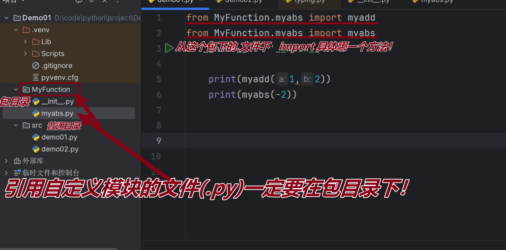
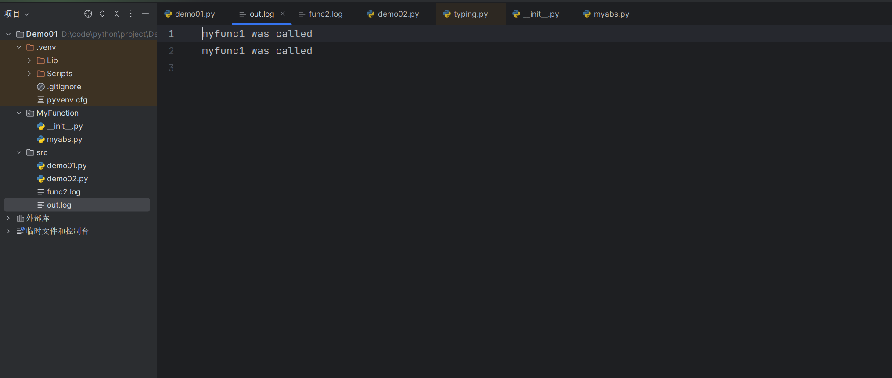

# 3.1 Python编程基础

```shell
    学习资源来源:   https://liaoxuefeng.com/books/python/introduction/index.html

```


## 基础

### 列表(list）

list是一种有序的集合，可以随时添加和删除其中的元素。

list可调用的方法：

|   pop   |     移除并返回指定索引的元素     |
| :-----: | :------------------------------: |
| append  |        在列表末尾添加元素        |
| reverse |         反转列表元素顺序         |
| extend  | 将可迭代对象的元素添加到列表末尾 |
|  clear  |         清空列表所有元素         |
|  copy   |         返回列表的浅拷贝         |
|  count  |        统计元素出现的次数        |
|  index  |      返回元素首次出现的索引      |
| insert  |      在指定索引位置插入元素      |
| remove  |      移除首次出现的指定元素      |
|  sort   |        对列表元素进行排序        |


### 元组（turtle）


另一种有序列表叫元组：tuple。tuple和list非常类似，但是tuple一旦初始化就不能修改。它也没有append()，insert()这样的方法。

不可变的tuple有什么意义？因为tuple不可变，所以代码更安全。如果可能，能用tuple代替list就尽量用tuple。

tuple的**陷阱**：当你定义一个tuple时，在定义的时候，tuple的元素就必须被确定下来！

```python
#设计空的元组
 c = ()
 #设计只有一个元素的元组
 d = (1,)
 #不可以携程d = (1) 否则 d 被python认为是int 类型 等于 1
 #但是d = (1,) 这里d是元组·····虽然都输出1但是d所代表数据类型不同

 #“可变的”tuple：
 f = (1,2,['A','B'])
 f[2][0] = 'x'
 f[2][1] = 'y'
 print(f)
#输出：(1, 2, ['x', 'y'])
#这个tuple定义的时候有3个元素，分别是'a'，'b'和一个list。不是说tuple一旦定义后就不可变了吗？怎么后来又变了？
#表面上看，tuple的元素确实变了，但其实变的不是tuple的元素，而是list的元素。tuple一开始指向的list并没有改成别的list，所以，tuple所谓的“不变”是说，tuple的每个元素，指向永远不变。即指向'a'，就不能改成指向'b'，指向一个list，就不能改成指向其他对象，但指向的这个list本身是可变的！
```


### 条件语句

```python
a = input("请输入age:")
b = int(a)
if b <0:
    print("输入年龄不合规!")
elif b < 19 :
    print("未成年")
else:
    print("已成年")
```


### 模式匹配

match匹配多个值、匹配一定范围，并且把匹配后的值绑定到变量


```python
b = int(input("请输入年龄"))

match b:
    case x if x<19 and x > 10  :
        print("你的年龄再11-18")
    case _:
        print("你的年龄未在11-18")
```


Python与其他语法再逻辑上的的区别

| 功能   | Python 写法 | 错误写法（其他语言） |
| ------ | ----------- | -------------------- |
| 逻辑与 | `and`       | &&                   |
| 逻辑或 | `or`        | \|\|                 |
| 逻辑非 | `not`       | ！                   |


**x<19 and x > 10   Python 还可以又更简洁的写法  等价于  10 < x < 19**


`match`语句还可以匹配列表，功能非常强大。

```python
a = []
a.append(input("请输入:"))
match a:
   case ["first"]:
       print("你选择first")
   case ["second"]:
       print("你选择second")
   case ["third"]:
       print("你选择third")
   case _:
       print("输出错误")
```


### 循环

Python 的 `for` 循环***用于遍历可迭代对象***，如***<u>字符串</u>***、***<u>列表</u>***、***<u>元组</u>***或***<u>字典</u>***、***<u>集合</u>***，它将序列中的每个元素依次赋值给一个临时变量，并执行循环体。其基本语法是 `for 变量 in 可迭代对象:`，可配合 `range()` 函数进行固定次数的循环。

```python
names = ["张三","李四","王五"]
for name in names: # 类似其他语法的增强for循环
    print(name)
    #range 左闭右开
for i in range(0,len(names)):
    print(names[i])
```

***使用 range() 函数:*** 
				range() 函数生成一个整数序列，非常适合进行固定次数的循环。 range(n) 生成从 0到 n的序列。 range(start, stop) 生成从 start 到 stop-1 的序列。 range(start, stop, step) 生成一个从 start 开始，以 step 为步长，直到 stop-1 的序列。

### pass

Python pass 是空语句，是为了保持程序结构的完整性。

**pass** 不做任何事情，一般用做占位语句。

```python
for letter in 'Python':
    if letter == 'h':
        pass #空语句没内容 区别于continue 只是没有操作，不会跳转下面语句
        print
        '这是 pass 块'
    print
    '当前字母 :', letter

print
"Good bye!"
#输出
#当前字母 : P
#当前字母 : y
#当前字母 : t
#这是 pass 块
#当前字母 : h
#当前字母 : o
#当前字母 : n
#Good bye!
```


### 字符串格式化f{}

- **用途**: 在字符串中嵌入变量，使输出更灵活。

- **例子**:

  **f-string **:

  

  ```python
  name = "Bob"
  print(f"Hello, {name}!") # 输出: Hello, Bob!
  name = {"one":1}
  print(f"My name is {list(name)} ")#输出： My name is ['one'] 对于字典默认对key
  ```


### 字典(dict)

字典是另一种可变容器模型，且可存储任意类型对象。

字典的每个键值 **key:value** 对用冒号 **:** 分割，每个键值对之间用逗号 **,** 分割，整个字典包括在花括号 **{}** 中

 

```python
d = {1:"one", 2:"two", 3:"three"}

#查
print(d[1])
#增
d["4"] = "forth"
print(d)
#删除
del d["4"]
print(d)
#改
d["4"] = "fifth"
print(d)


#输出
#one
#one
#{1: 'one', 2: 'two', 3: 'three', '4': 'forth'}
#{1: 'one', 2: 'two', 3: 'three'}
#{1: 'one', 2: 'two', 3: 'three', '4': 'fifth'}
```


**值可以取任何数据类型，但键必须是不可变的，如字符串，数字或元组。**

**键必须不可变，所以可以用数字，字符串或元组充当，所以用列表就不行**

```python
d = {1:"one", 2:"two", 3:"three"}
dd = {(1, 2): "one", (2, 3): "two"}
#不可以
ddd= {[1, 2]: "one", (2, 3): "two"}

```

常用方法

| 名称            | 参数                                                         | 返回值                                               | 方法使用解释                                                 |
| --------------- | ------------------------------------------------------------ | ---------------------------------------------------- | ------------------------------------------------------------ |
| `dict.clear()`  | 无                                                           | `None`                                               | 删除字典内所有元素，直接修改原字典，清空后字典为空。         |
| `dict.get()`    | `key`（目标键）、`default`（可选，键不存在时的返回值，默认 `None`） | 键对应的值 / `default`                               | 安全获取键的值：键存在则返回对应值，不存在则返回 `default`，不会抛出 `KeyError`。 |
| `dict.items()`  | 无                                                           | `dict_items` **视图对象**（可迭代的 `(键,值)` 元组） | 获取字典所有键值对，视图会**实时同步原字典的变化**，遍历效果与列表一致但内存更高效。 |
| `dict.keys()`   | 无                                                           | `dict_keys` **视图对象**（可迭代的键）               | 获取字典所有键，视图会实时同步原字典的变化，支持遍历、判断键是否存在等操作。 |
| `dict.values()` | 无                                                           | `dict_values` **视图对象**（可迭代的值）             | 获取字典所有值，视图会实时同步原字典的变化，注意值可能重复（不同键对应相同值）。 |
| `dict.pop()`    | `key`（目标键）、`default`（可选，键不存在时的返回值）       | 被删除键对应的值                                     | 删除指定键并返回对应值；若键不存在且未传 `default`，则抛出 `KeyError`。 |
| del dict[key]   | key                                                          | 无                                                   | 删除指定key的字典的键和值                                    |


```python
 d = {1:"one", 2:"two", 3:"three"}
 dd = {(1, 2): "one", (2, 3): "two"}
 for k, v in d.items():
     print(k)
     print(v)
 for k, v in dd.items():
     print(k)
# print(d.items())  
 print(list(d.items()))
 for k in d.keys():
     print(k)
     print(d[k])
    
    
    
    #print(d.items()) 输出结果dict_items([(1, 'one'), (2, 'two'), (3, 'three')])
    
    #list() 最常用的场景 ——Python 中「可迭代对象」指能逐个取出元素的对象（字符串、元组、字典视图、集合、range、生成器等），list() 会遍历这些对象，把所有元素提取出来生成新列表。
    
    #print(list(d.items())) 输出结果[(1, 'one'), (2, 'two'), (3, 'three')]
```


| 用法形式           | 作用                         | 示例             | 输出结果          |
| ------------------ | ---------------------------- | ---------------- | ----------------- |
| `list()`           | 创建空列表                   | `empty = list()` | `[]`              |
| `list(可迭代对象)` | 将可迭代对象转为列表         | `list("abc")`    | `['a', 'b', 'c']` |
| `list(已有列表)`   | 浅拷贝已有列表（生成新列表） | `list([1,2,3])`  | `[1,2,3]`         |

应用场景：

eg:

​	***字符串转列表（按字符拆分）***

​	***元组转列表（元组是不可变的，转列表后可修改）***

​    ***字典相关视图转列表（d.items()）***

​    ***集合转列表（注意：集合无序，列表顺序不固定）***

​    ***生成器转列表（生成器是一次性可迭代对象，转列表后可反复使用）***

### 集合(set)

set和dict类似，也是一组key的集合，但不存储value。由于key不能重复，所以，在set中，没有重复的key。

set可以看成数学意义上的**无序**和**无重复元素**的集合

```python
s = {(1,2),(2,3),2,3}
print(s)
s.add((1,2))
print(s)
```

set和dict的唯一区别仅在于没有存储对应的value，**但是**，set的原理和dict一样，所以，**同样不可以放入可变对象**，因为无法判断两个可变对象是否相等，也就无法保证set内部“不会有重复元素”。试试把list放入set，是会报错。


常用方法

*set.add()*

*set.clear()*

*set.pop()    无参 随机删除*

*set.remove() 有参 指定参数删除*

*集合运算方法*

两个set可以做数学意义上的交集、并集等操作

```python
s1 = {(1,2),(2,3),2,3}
s2 = {(1,2),8,9,3}
print(s1 & s2)
print(s1 | s2)
```

### 数据类型转换

比如`int()`函数可以把其他**数据类型**（与引用类型区别）转换为整数：

```python
    a = int("123")#字符串类型在python作为数据类型，所以可以转换
    b =int(23.6)
    print(a)
    print(b)
    c = str(123)
    print(isinstance(c,str))
    #输出
    123
	23
	True
    
    
```


### 函数


```python
import math

def move(x, y, step, angle=0):
    nx = x + step * math.cos(angle)
    ny = y - step * math.sin(angle)
    return nx, ny


print(move(10, 20, 5))# 若不输入angle第四个参数，使用默认值0


#输出
(15.0, 20.0)


```


原来返回值是一个tuple！但是，在语法上，返回一个tuple可以省略括号，而多个变量可以同时接收一个tuple，按位置赋给对应的值，***所以，Python的函数返回多值其实就是返回一个tuple***，但写起来更方便。

***不变的形参***

```python
def enroll(name, gender, age=6, city='Beijing'):
    print('name:', name)
    print('gender:', gender)
    print('age:', age)
    print('city:', city)
    
    #或者（常用）
        def enroll(name, gender, age=6, city=None):
            print('name:', name)
            print('gender:', gender)
            print('age:', age)
            if city is None:
                city="beijing"
            print('city:', city)
        enroll('Sarah', 'F')
```

默认参数降低了函数调用的难度，而一旦需要更复杂的调用时，又可以传递更多的参数来实现。无论是简单调用还是复杂调用，函数只需要定义一个.

也可以**不按顺序提供部分默认参数**。当不按顺序提供部分默认参数时，需要把参数名写上。比如调用`enroll('Adam', 'M', city='Tianjin')`，意思是，**`city`参数用传进去的值，其他默认参数继续使用默认值。**

***==定义默认参数要牢记一点：默认参数必须指向不变对象！==***即必须指向对应默认参数city='Tianjin'

默认参数一定要用不可变对象，如果是可变对象，程序运行时会有逻辑错误


### 切片


取一个***<u>list或tuple</u>***的部分元素是非常常见的操作


之所以是笨办法是因为扩展一下，取前N个元素就没辙了。

取前N个元素，也就是索引为0-(N-1)的元素，可以用循环.

对这种经常取指定索引范围的操作，用循环十分繁琐，因此，Python提供了切片（Slice）操作符，能大大简化这种操作。


```python
    a=[1,2,3,4,5,6,7,8,9]
    print(a[0:6:2])
    print(a[5:1:-1])
    b=(1,2,3,4,5,6,7,8,9)
    print(b[1:6:1])
    print(b[::-1])
    #等价于
    list(b).reverse()
    print(b)
    
    
    #输出
#[1, 3, 5]
#[6, 5, 4, 3]
#(2, 3, 4, 5, 6)
#(9, 8, 7, 6, 5, 4, 3, 2, 1)
#(1, 2, 3, 4, 5, 6, 7, 8, 9)

```


### 迭代

在Python中，迭代是通过`for ... in`来完成的

```python
c={1:"forst",2:"forst",3:"forst"}
for x,y in c.items():
    print(x)
    print(y)
```


默认情况下，`dict`迭代的是key。如果要迭代value，可以用`for value in d.values()`，如果要同时迭代key和value，可以用`for k, v in d.items()`。

当我们使用`for`循环时，只要作用于一个可迭代对象，`for`循环就可以正常运行，而我们不太关心该对象究竟是`list`还是其他数据类型。

那么，如何判断一个对象是可迭代对象呢？方法是通过`collections.abc`模块的`Iterable`类型判断

```python
from collections.abc import Iterable
if __name__ == '__main__':
    print(isinstance("abc",Iterable))
  
```

如果要对`list`实现类似Java那样的下标循环怎么办？Python内置的`enumerate`函数可以把一个**<u>*list*</u>**变成***<u>索引-元素</u>***对，这样就可以在`for`循环中同时迭代索引和元素本身：

```python
a=[1,2,3,4,5,6,7,8,9]
for x,y in enumerate(a):
    print(x,y)
```


上面的`for`循环里，同时引用了两个变量，在Python里是很常见的，比如下面的代码：

```python
 for x, y in [(1, 1), (2, 4), (3, 9)]:
     print(x, y)
#输出
1 1
2 4
3 9
```


### 迭代器

一类是集合数据类型，如`list`、`tuple`、`dict`、`set`、`str`等；

一类是`generator`，包括生成器和带`yield`的generator function。


这些可以直接作用于`for`循环的对象统称为可迭代对象：`Iterable`。

可以使用`isinstance()`判断一个对象是否是`Iterable`对象：

```python
 from collections.abc import Iterable
 isinstance([], Iterable)
True
 isinstance({}, Iterable)
True
 isinstance('abc', Iterable)
True
 isinstance((x for x in range(10)), Iterable)
True
 isinstance(100, Iterable)
False
```

生成器不但可以作用于`for`循环，还可以被`next()`函数不断调用并返回下一个值，直到最后抛出`StopIteration`错误表示无法继续返回下一个值了。

可以被`next()`函数调用并不断返回下一个值的对象称为迭代器：`Iterator`。

可以使用`isinstance()`判断一个对象是否是`Iterator`对象：

```python
 from collections.abc import Iterator
 isinstance((x for x in range(10)), Iterator)
True
 isinstance([], Iterator)
False
 isinstance({}, Iterator)
False
 isinstance('abc', Iterator)
False
```


生成器都是`Iterator`对象，但`list`、`dict`、`str`虽然是`Iterable`，却不是`Iterator`


把`list`、`dict`、`str`等`Iterable`变成`Iterator`可以使用`iter()`函数：

```python
 isinstance(iter([]), Iterator)
True
 isinstance(iter('abc'), Iterator)
True
```

```python
from collections.abs import Iterator
a=[1,2,3,4,5,6,7,8,9]
it = iter(a)

while True:
   try:
    print(next(it))
   except Exception:
    break
#输出
1
2
3
4
5
6
7
8
9

```


### 模块化

在计算机程序的开发过程中，随着程序代码越写越多，在一个文件里代码就会越来越长，越来越不容易维护。

为了编写可维护的代码，我们把很多函数分组，分别放到不同的文件里，这样，每个文件包含的代码就相对较少，很多编程语言都采用这种组织代码的方式。在Python中，***==一个.py文件就称之为一个模块（Module）==***。

使用模块有什么好处？

最大的好处是大大提高了代码的可维护性。其次，编写代码不必从零开始。当一个模块编写完毕，就可以被其他地方引用。我们在编写程序的时候，也经常引用其他模块，包括Python内置的模块和来自第三方的模块。

使用模块还可以避免函数名和变量名冲突。相同名字的函数和变量完全可以分别存在不同的模块中，因此，我们自己在编写模块时，不必考虑名字会与其他模块冲突。但是也要注意，尽量不要与内置函数名字冲突。点[这里](http://docs.python.org/3/library/functions.html)查看Python的所有内置函数。

你也许还想到，如果不同的人编写的模块名相同怎么办？为了避免模块名冲突，Python又引入了按目录来组织模块的方法，称为包（Package）。

举个例子，一个`abc.py`的文件就是一个名字叫`abc`的模块，一个`xyz.py`的文件就是一个名字叫`xyz`的模块。

现在，假设我们的`abc`和`xyz`这两个模块名字与其他模块冲突了，于是我们可以通过包来组织模块，避免冲突。方法是选择一个顶层包名，比如`mycompany`，按照如下目录存放：

```
mycompany
├─ __init__.py
├─ abc.py
└─ xyz.py
```

引入了包以后，只要顶层的包名不与别人冲突，那所有模块都不会与别人冲突。现在，`abc.py`模块的名字就变成了`mycompany.abc`，类似的，`xyz.py`的模块名变成了`mycompany.xyz`。

***请注意，每一个包目录下面都会有一个`__init__.py`的文件，这个文件是必须存在的，否则，Python就把这个目录当成普通目录，而不是一个包。`__init__.py`可以是空文件，也可以有Python代码，因为`__init__.py`本身就是一个模块，而它的模块名就是`mycompany`。***

```python
举例：
层级机构：
piper_sdk
├── api
│   ├── __init__.py
│   └── piper_api.py
├── demo
├── hardware_port
├── interface
│   ├── __init__.py
│   ├── interface_version.py
│   ├── piper_interface_v2.py
│   └── piper_interface.py
├── kinematics
├── log
├── param_map
├── piper_msgs
├── piper_param
├── protocol
├── utils
└── __init__.py

首先是piper_sdk的-------__init__.py:

from .hardware_port import * 
from .api import *#将__all__中且再api下且从原来的api子级别即piper_api.py级别提升至api级别
from .utils import *
from .protocol import *
from .piper_msgs.msg_v2 import *
from .protocol.protocol_v2 import *
from .kinematics import *
from .interface import *
from .version import PiperSDKVersion
from .param_map import PiperParamMap
from .api import Piper #将Piper从原来的piper_api.py级别提升至api级别

__all__ = [
    'Piper',
    'C_PiperParserBase',
    'C_FPSCounter',
    'LogManager',
    'LogLevel',
    'C_PiperForwardKinematics',
    'C_STD_CAN',
    'C_PiperInterface',
    'C_PiperInterface_V2',
    'PiperSDKVersion',
    'PiperParamMap'
]
api的-------__init__.py:
from .piper_api import Piper#将Piper提升至和piper_api.py一个级别

__all__ = ['Piper']
__version__='1.001'
__author__='yy'
对于__version__和__author__使用就是
import 包（api）
print(api.author)
#output:yy
```

类似的，可以有多级目录，组成多级层次的包结构。比如如下的目录结构：

```
mycompany
 ├─ web
 │  ├─ __init__.py
 │  ├─ utils.py
 │  └─ www.py
 ├─ __init__.py
 ├─ abc.py
 └─ utils.py
```

文件`www.py`的模块名就是`mycompany.web.www`，两个文件`utils.py`的模块名分别是`mycompany.utils`和`mycompany.web.utils`。


```python
from MyFunction.myabs import myadd
from MyFunction.myabs import myabs
if __name__ == '__main__':

    print(myadd(1,2))
    print(myabs(-2))
    
    
    #等价于
from MyFunction.myabs import*
if __name__ == '__main__':

    print(myadd(1,2))
    print(myabs(-2))

    
    
```




### 高阶函数

变量可以指向函数，并发挥函数功能，函数本身可以赋值给变量，就会有直接调用`abs()`函数和调用变量`f()`完全相同。

```python
f = abs
print(f(-2))
#输出
2
```

既然变量可以指向函数，函数的参数能接收变量，那么***一个函数就可以接收另一个函数作为参数***，这种函数就称之为***==高阶函数。==***

如下：

```python
def myadd(a,b,f):
    return f(a)+f(b)


print(myadd(-2,-4,myabs))
#输出
6
```


举一些高阶函数例子

***<u>1.map</u>***

`map()`函数接收两个参数，一个是**<u>函数</u>**，一个是**<u>Iterable</u>**`，`map`将传入的函数依次作用到序列的每个元素，并把结果作为新的**<u>Iterator</u>**返回。

```python
def f(x):
    return x**2
if __name__ == '__main__':
    print(list(map(f,[1,2,3,4,5])))
#输出
#[1, 4, 9, 16, 25]
    
```


`map()`传入的第一个参数是`f`，即函数对象本身。由于结果`r`是一个`Iterator`，`Iterator`是惰性序列，因此通过`list()`函数让它把整个序列都计算出来并返回一个list。


| func 参数个数 | map 后续可迭代对象数量 |
| :-----------: | :--------------------: |
|       1       |           1            |
|       2       |           2            |
|       n       |           n            |


```python
# 自定义函数：接收2个参数，返回两数之和
def add(x, y):
    return x + y

# map传2个可迭代对象，对应add的2个参数
result = list(map(add, [1,2,3], [10,20,30]))
print(result)  # [11, 22, 33]
# 执行过程：add(1,10) → add(2,20) → add(3,30)
```


***<u>2.filter</u>***


和`map()`类似，`filter()`也接收一个函数和一个序列。和`map()`不同的是，`filter()`把传入的函数依次作用于每个元素，然后根据返回值是`True`还是`False`决定保留还是丢弃该元素。

```python
def is_odd(n):
    return n % 2 == 1

list(filter(is_odd, [1, 2, 4, 5, 6, 9, 10, 15]))
# 结果: [1, 5, 9, 15]
```

把一个序列中的空字符串删掉，可以这么写：

```python
def not_empty(s):
    return s and s.strip()

list(filter(not_empty, ['A', '', 'B', None, 'C', '  ']))
# 结果: ['A', 'B', 'C']
```


可见用`filter()`这个高阶函数，关键在于正确实现一个**<u>*“筛选”*</u>**函数。

注意到`filter()`函数返回的是一个`Iterator`，也就是一个惰性序列，所以要强迫`filter()`完成计算结果，需要用`list()`函数获得所有结果并返回`list`。


**<u>*3.sorted*</u>**

排序也是在程序中经常用到的算法。无论使用冒泡排序还是快速排序，排序的核心是比较两个元素的大小。如果是数字，我们可以直接比较，但如果是字符串或者两个dict呢？直接比较数学上的大小是没有意义的，因此，比较的过程必须通过函数抽象出来。

Python内置的`sorted()`函数就可以对list进行排序：

```python
>>> sorted([36, 5, -12, 9, -21])
[-21, -12, 5, 9, 36]
```


此外，`sorted()`函数也是一个高阶函数，它还可以接收一个`key`函数来实现自定义的排序，例如按绝对值大小排序：

```python
sorted([36, 5, -12, 9, -21], key=abs)
#输出
[5, 9, -12, -21, 36]
```


key指定的函数将作用于list的每一个元素上，并根据key函数返回的结果进行排序。对比原始的list和经过`key=abs`处理过的list：

```python
list = [36, 5, -12, 9, -21]

keys = [36, 5,  12, 9,  21]
```


然后`sorted()`函数按照keys进行排序，并按照对应关系返回list相应的元素：

```python
keys sort   => [5, 9,  12,  21, 36]
                |  |    |    |   |
result sort => [5, 9, -12, -21, 36]
```

我们再看一个字符串排序的例子：

```python
sorted(['bob', 'about', 'Zoo', 'Credit'])
#输出
['Credit', 'Zoo', 'about', 'bob']
```


默认情况下，对字符串排序，是按照ASCII的大小比较的，由于`'Z' < 'a'`，结果，大写字母`Z`会排在小写字母`a`的前面。

现在，我们提出排序应该***忽略大小写***，按照字母序排序。要实现这个算法，不必对现有代码大加改动，只要我们能用一个key函数把字符串映射为忽略大小写排序即可。忽略大小写来比较两个字符串，实际上就是先把字符串都变成大写（或者都变成小写），再比较。

这样，我们给`sorted`传入key函数，即可实现忽略大小写的排序：

```python
sorted(['bob', 'about', 'Zoo', 'Credit'], key=str.lower)
#输出
['about', 'bob', 'Credit', 'Zoo']
```


要进行***<u>反向排序</u>***，不必改动key函数，可以传入第三个参数`reverse=True`：

```python
sorted(['bob', 'about', 'Zoo', 'Credit'], key=str.lower, reverse=True)
#输出
['Zoo', 'Credit', 'bob', 'about']
```


### 返回函数

高阶函数除了可以接受函数作为参数外，还可以把函数作为结果值返回。

使用***<u>闭包</u>***，就是内层函数引用了外层函数的局部变量。如果只是读外层变量的值，我们会发现返回的闭包函数调用一切正常：

但是，如果对外层变量赋值，由于Python解释器会把`x`当作函数`fn()`的局部变量，它会报错：

```python
  def inc():

        x = 0
        def fn():
            #闭包
            nonlocal x
            x = x + 1
            return x

        return fn


    f = inc()
    print(f())  # 1
    print(f())  # 2
    
    
    
    #注意  等价于  
      def inc():

        x = 0
        def fn():
            #闭包
            nonlocal x
            x = x + 1
            return x

        return fn()  #这里返回函数的返回值的话 再主函数给变量复制为函数，，，


    f = inc
    print(f())  # 1
    print(f())  # 2
    
```

`x`作为局部变量并没有初始化，直接计算`x+1`是不行的。但我们其实是想引用`inc()`函数内部的`x`，所以需要在`fn()`函数内部加一个***<u>==nonlocal== x</u>***的声明。加上这个声明后，解释器把`fn()`的`x`看作外层函数的局部变量，它已经被初始化了，可以正确计算`x+1`。


### 匿名函数

当我们在传入函数时，有些时候，不需要显式地定义函数，直接传入匿名函数更方便。


在Python中，对匿名函数提供了有限支持。还是以`map()`函数为例，计算f(x)=x2时，除了定义一个`f(x)`的函数外，还可以直接传入匿名函数：

```python
list(map(lambda x: x * x, [1, 2, 3, 4, 5, 6, 7, 8, 9]))
[1, 4, 9, 16, 25, 36, 49, 64, 81]
```


通过对比可以看出，匿名函数`lambda x: x * x`实际上就是：

```python
def f(x):
    return x * x
```


关键字***<u>==lambda==</u>***`表示匿名函数，冒号前面的`x`表示函数参数。

匿名函数有个限制，就是***只能有一个表达式***，***不用写`return`，返回值就是该表达式的结果。***

用匿名函数有个好处，因为函数没有名字，不必担心函数名冲突。此外，匿名函数也是一个函数对象，也可以把匿名函数赋值给一个变量，再利用变量来调用该函数：

```python
 f = lambda x: x * x 
 f(5) # 等价于(lambda x: x * x)(2)
#输出
25
```


同样，也可以把***匿名函数作为返回值返回***，比如：


```python
if __name__ == '__main__':
    def build(x, y):
        return lambda : x + y


    f = build(2,3)
    print(f())
```


## 装饰器

### 引入

由于函数也是一个对象，而且函数对象可以被赋值给变量，所以，通过变量也能调用该函数。

```python
def now():
     print('2024-6-1')
f()
2024-6-1
```


函数对象有一个`__name__`属性（注意：是前后各两个下划线），可以拿到函数的名字：

```python
now.__name__
'now'
f.__name__
'now'
```


现在，假设我们要增强`now()`函数的功能，比如，在函数调用前后自动***<u>打印日志</u>***，但又不希望修改`now()`函数的定义，***==这种在代码运行期间动态增加功能的方式，称之为“装饰器”（Decorator）。==***

首先回顾一下高级函数和返回函数的实现

```python
def a_new_decorator(a_func):
    def wrapTheFunction():
        print("I am doing some boring work before executing a_func()")

        a_func()

        print("I am doing some boring work after executing a_func()")

    return wrapTheFunction


def a_function_requiring_decoration():
    print("I am the function which needs some decoration to remove my foul smell")


a_function_requiring_decoration()
# outputs: "I am the function which needs some decoration to remove my foul smell"

a_function_requiring_decoration = a_new_decorator(a_function_requiring_decoration)
# now a_function_requiring_decoration is wrapped by wrapTheFunction()

a_function_requiring_decoration()
# outputs:I am doing some boring work before executing a_func()
#        I am the function which needs some decoration to remove my foul smell
#        I am doing some boring work after executing a_func()
```


何使用 **@** 来运行之前的代码：

```python
@a_new_decorator
def a_function_requiring_decoration():
    """Hey you! Decorate me!"""
    print("I am the function which needs some decoration to "
          "remove my foul smell")


a_function_requiring_decoration()
# outputs: I am doing some boring work before executing a_func()
#         I am the function which needs some decoration to remove my foul smell
#         I am doing some boring work after executing a_func()

# the @a_new_decorator is just a short way of saying:
#等价a_function_requiring_decoration = a_new_decorator(a_function_requiring_decoration)
```


希望你现在对 Python 装饰器的工作原理有一个基本的理解。如果我们运行如下代码会存在一个问题：

```python
print(a_function_requiring_decoration.__name__)
# Output: wrapTheFunction
```

这并不是我们想要的！Ouput输出应该是"a_function_requiring_decoration"。这里的函数被warpTheFunction替代了。它重写了我们函数的名字和注释文档(docstring)。幸运的是Python提供给我们一个简单的函数来解决这个问题，那就是functools.wraps。我们修改上一个例子来使用functools.wraps：

```python
from functools import wraps


def a_new_decorator(a_func):
    @wraps(a_func)
    def wrapTheFunction():
        print("I am doing some boring work before executing a_func()")
        a_func()
        print("I am doing some boring work after executing a_func()")

    return wrapTheFunction


@a_new_decorator
def a_function_requiring_decoration():
    """Hey yo! Decorate me!"""
    print("I am the function which needs some decoration to "
          "remove my foul smell")


print(a_function_requiring_decoration.__name__)
# Output: a_function_requiring_decoration
```

***<u>日志</u>***是装饰器运用的一个亮点。这是个例子：

```python
def logit(func):
    @wraps(func)
    def with_logging(*args, **kwargs):
        print(func.__name__ + " was called")
        return func(*args, **kwargs)

    return with_logging


@logit
#理解为addition_func = logit(addition_func)
def addition_func(x):

    return x + x


result = addition_func(4)
print(result)
# Output: addition_func was called
```

| 参数       | 作用                                         | 类型          |
| ---------- | -------------------------------------------- | ------------- |
| `*args`    | 接收「任意数量的位置参数」，打包成元组传递   | 元组（tuple） |
| `**kwargs` | 接收「任意数量的关键字参数」，打包成字典传递 | 字典（dict）  |

### args kwargs

逐个理解：从 “打包” 到 “解包”

1. `*args`：处理位置参数（打包 + 解包）

- **打包**：函数定义时用 `*args`，会把调用时传入的「多余位置参数」打包成元组；
- **解包**：函数调用时用 `*`，会把元组 / 列表拆成单个位置参数。

**示例：通用加法函数**

```python
# 定义时用*args：接收所有位置参数，打包成元组
def add(*args):
    print("args的类型：", type(args))  # <class 'tuple'>
    print("args的内容：", args)        # 比如传入1,2,3 → (1,2,3)
    total = 0
    for num in args:
        total += num
    return total

# 调用时：传任意数量的位置参数都能处理
print(add(1, 2))          # 3（args=(1,2)）
print(add(1, 2, 3))       # 6（args=(1,2,3)）
print(add(1, 2, 3, 4))    # 10（args=(1,2,3,4)）

# 解包用法：把列表/元组拆成位置参数
nums = [1,2,3]
print(add(*nums))         # 6（等价于add(1,2,3)）
```

2. `**kwargs`：处理关键字参数（打包 + 解包）

- **打包**：函数定义时用 `**kwargs`，会把调用时传入的「多余关键字参数」打包成字典；
- **解包**：函数调用时用 `**`，会把字典拆成单个关键字参数。

**示例：打印任意用户信息**

```python
# 定义时用**kwargs：接收所有关键字参数，打包成字典
def print_info(**kwargs):
    print("kwargs的类型：", type(kwargs))  # <class 'dict'>
    print("kwargs的内容：", kwargs)        # 比如name="Alice",age=20 → {'name':'Alice','age':20}
    for key, value in kwargs.items():
        print(f"{key}: {value}")

# 调用时：传任意数量的关键字参数都能处理
print_info(name="Alice", age=20)
# 输出：
# kwargs的内容： {'name': 'Alice', 'age': 20}
# name: Alice
# age: 20

print_info(name="Bob", age=25, city="Beijing")
# 输出：
# kwargs的内容： {'name': 'Bob', 'age': 25, 'city': 'Beijing'}
# name: Bob
# age: 25
# city: Beijing

# 解包用法：把字典拆成关键字参数
user = {"name": "Charlie", "age": 30}
print_info(**user)         # 等价于print_info(name="Charlie", age=30)
```

装饰器需要适配**任意参数的函数**，所以必须用 `*args` + `**kwargs` 接收所有参数，再拆包传给原函数：


```python
from functools import wraps

def logit(func):
    @wraps(func)
    def with_logging(*args, **kwargs):
        # 1. 接收调用者传入的所有参数（不管是位置/关键字）
        print(f"调用{func.__name__}，参数：{args} {kwargs}")
        # 2. 拆包传给原函数，保证原函数能正常执行
        result = func(*args, **kwargs)
        # 3. 返回原函数的结果，保证调用者能拿到值
        return result
    return with_logging

# 装饰器适配任意参数的函数
@logit
def add(x, y):
    return x + y

@logit
def print_user(name, age, city="Shanghai"):
    return f"{name}, {age}, {city}"

add(1, 2)                  # 输出：调用add，参数：(1, 2) {} → 返回3
print_user("Alice", 20)    # 输出：调用print_user，参数：(Alice, 20) {} → 返回"Alice, 20, Shanghai"
print_user("Bob", 25, city="Beijing")  # 输出：调用print_user，参数：(Bob, 25) {'city':'Beijing'}
```


### ***<u>带参数的装饰器</u>***

```python
from MyFunction.myabs import*
from functools import wraps
if __name__ == '__main__':

    def logit(logfile='out.log'):
        def logging_decorator(func):
            @wraps(func)
            def wrapped_function(*args, **kwargs):
                log_string = func.__name__ + " was called"
                print(log_string)
                # 打开logfile，并写入内容
                with open(logfile, 'a') as opened_file:
                    # 现在将日志打到指定的logfile
                    opened_file.write(log_string + '\n')
                return func(*args, **kwargs)

            return wrapped_function

        return logging_decorator


    @logit()#这里return三回  所以这里@login  重点()所以
    #等价于 myfunc1 = logit()(myfunc1)  和之前#login注意下
    def myfunc1():
        pass


    myfunc1()


    # Output: myfunc1 was called
    # 现在一个叫做 out.log 的文件出现了，里面的内容就是上面的字符串

    @logit(logfile='func2.log')
    def myfunc2():
        pass


    myfunc2()
    # Output: myfunc2 was called
    # 现在一个叫做 func2.log 的文件出现了，里面的内容就是上面的字符串
```





### 类中应用

现在我们有了能用于正式环境的logit装饰器，但当我们的应用的某些部分还比较脆弱时，异常也许是需要更紧急关注的事情。比方说有时你只想打日志到一个文件。而有时你想把引起你注意的问题发送到一个email，同时也保留日志，留个记录。这是一个使用继承的场景，但目前为止我们只看到过用来构建装饰器的函数。

幸运的是，类也可以用来构建装饰器。那我们现在以一个类而不是一个函数的方式，来重新构建logit。

```python
from functools import wraps


class logit(object):
    def __init__(self, logfile='out.log'):
        self.logfile = logfile

    def __call__(self, func):
        @wraps(func)
        def wrapped_function(*args, **kwargs):
            log_string = func.__name__ + " was called"
            print(log_string)
            # 打开logfile并写入
            with open(self.logfile, 'a') as opened_file:
                # 现在将日志打到指定的文件
                opened_file.write(log_string + '\n')
            # 现在，发送一个通知
            self.notify()
            return func(*args, **kwargs)

        return wrapped_function

    def notify(self):
        # logit只打日志，不做别的
        pass


```


这个实现有一个附加优势，在于比嵌套函数的方式更加整洁，而且包裹一个函数还是使用跟以前一样的语法：

```python
		@logit()  # 等价于：myfunc1 = logit()(myfunc1)
        def myfunc1():
         pass
    	print(myfunc1())
        #输出
        myfunc1 was called
		None
```


解释类中`__call__`   魔术方法:

`__call__`与`__init__:`

- `__init__`：在对象**创建**时被调用，用于初始化实例属性（**设置状态**）。
- `__call__`：在对象**被调用**（**执行**）时被调用，处理业务逻辑并可以访问和修改`__init__`设置的属性（**操作状态**）。 


```python
class Accumulator:
    def __init__(self):
        self.total = 0 # 初始化一个状态属性

    def __call__(self, x): # 实例被调用时执行此方法
        self.total += x
        print(f"Current total: {self.total}")
        return self.total

# 创建实例
acc = Accumulator()#调用__init__内容

# 调用实例，每次调用都累加并打印当前总和  调用__call__内容
acc(5)                       # 输出: Current total: 5
acc(10)                      # 输出: Current total: 15
acc(2)  					 # 输出: Current total: 17


```


现在，我们给 logit 创建子类，来添加 email 的功能(虽然 email 这个话题不会在这里展开。


```python
class email_logit(logit):

    '''
    一个logit的实现版本，可以在函数调用时发送email给管理员
    '''
def __init__(self, email='admin@myproject.com', *args, **kwargs):
    self.email = email
    super(email_logit, self).__init__(*args, **kwargs)

def notify(self):
    # 发送一封email到self.email
    # 这里就不做实现了
    pass
```


### @classmethod&staticmethod


在Python面向对象编程中，@classmethod和@staticmethod是两个重要的装饰器，它们能改变方法的调用方式和行为。常规的实例方法第一个参数是self，代表实例本身；而@classmethod和@staticmethod则提供了不同的调用和使用方式，以满足多样化的编程需求。

**classmethod** 修饰符对应的函数**不需要实例化**，**不需要 self 参数**，但**第一个参数**需要是表示自身类的 cls 参数，可以来**调用类的属性**，类的方法，**实例化对象**等。

**staticmethod**装饰符**不需要传入self**或**cls**参数，它就像一个普通函数

|                            | classmethod | staticmethod |
| :------------------------: | :---------: | :----------: |
|       是否需要实例化       |     否      |      否      |
|      是否需要self参数      |     否      |      否      |
| 是否需要cls作为第一个参数  |     是      |      否      |
| 是否可以调用类的属性、方法 |     是      |      否      |


```python
class Pizza(object):
    def __init__(self, Base_area, height):
        self.Base_area = Base_area
        self.height = height
 
    @staticmethod
    def compute_area(radius):
        return math.pi * (radius ** 2)
 
    @classmethod
    def compute_volume(cls, height, radius):
        return cls(cls.compute_area(radius),height)    #调用（类方法）@staticmethod方法   返回的是一个初始化后的类
    
 
    def get_volume(self):
        return self.height*self.Base_area
def __main__():
    
    r=Pizza.compute_volume(3,4)

    r.get_volume()
```


## 类面向对象编程


### 类和实例

面向对象最重要的概念就是类（Class）和实例（Instance），必须牢记类是抽象的模板，而实例是根据类创建出来的一个个具体的“对象”，每个对象都拥有相同的方法，但各自的数据可能不同。

以Student类为例，在Python中，定义类是通过***<u>class关键字</u>***：

```python
class Student(object):
    def __init__(self, name):
        self.name =name
    pass
if __name__ == '__main__':

    a = Student("Mikes")#实例化
    print(a.name)
```


`class`后面紧接着是类名，即`Student`，类名通常是大写开头的单词，紧接着是`(object)`，表示***该类是从哪个类继承***下来的，继承的概念我们后面再讲，通常，如果没有合适的继承类，就使用`object`类，这是所有类最终都会继承的类。

由于类可以起到模板的作用，因此，可以在创建实例的时候，把一些我们认为必须绑定的属性强制填写进去。通过定义一个***特殊的***==__*<u>init</u>*__==  方法，在创建实例的时候，就把`name`，`score`等属性绑上去：

注意到`__init__`方法的***第一个参数永远是self***，表示创建的实例本身，因此，在`__init__`方法内部，就可以把各种属性绑定到`self`，因为`self`就指向创建的实例本身。

有了`__init__`方法，***在创建实例的时候，就不能传入空的参数了***，***必须传入***与`__init__`***方法匹配的参数***，但`self`不需要传，Python解释器自己会把实例变量传进去

和普通的函数相比，在类中定义的函数只有一点不同，就是第一个参数永远是实例变量***<u>self</u>***，并且，调用时，***不用传递该参数***。除此之外，类的方法和普通函数没有什么区别，所以，你仍然***可以用默认参数、可变参数、关键字参数和命名关键字参数***。

### 封装

面向对象编程的一个重要特点就是数据封装。在上面的`Student`类中，每个实例就拥有各自的`name`和`score`这些数据。我们可以通过函数来访问这些数据，比如打印一个学生的成绩,直接在`Student`类的内部定义访问数据的函数，这样，就把“数据”给封装起来了。这些封装数据的函数是和`Student`类本身是关联起来的，我们称之为类的方法：

```python
class Student(object):
    def __init__(self, name):
        self.name =name
   		pass
    def printStudent(self):
        print(self.name)
if __name__ == '__main__':

    a = Student("Mikes")
    a.printStudent()
```


要定义一个方法，除了第一个参数是`self`外，其他和普通函数一样。要调用一个方法，只需要在实例变量上直接调用，除了`self`不用传递，其他参数正常传入：


```python
class Student(object):
    def __init__(self, name):
        self.name =name
    pass
    def printStudent(self,age):
        print(self.name,age)
if __name__ == '__main__':

    a = Student("Mikes")
    a.printStudent(23)
```


***和静态语言不同，***Python允许对实例变量绑定任何数据，也就是说，***对于两个实例变量***，***虽然它们都是同一个类的不同实例，但拥有的变量名称都可能不同***：

```python
class Student(object):
    def __init__(self,name):
        self.name =name

    pass
    def printStudent(self,age):
        print(self.name,age)
if __name__ == '__main__':

    a = Student("Mikes")
    b = Student("Mikes")
    a.age = 1
    print(a.age)
    print(b.age)
    #输出
    1
Traceback (most recent call last):
  File "D:\code\python\project\Demo01\src\demo01.py", line 17, in <module>
    print(b.age)
          ^^^^^
AttributeError: 'Student' object has no attribute 'age'

```


### 访问权限

如果要让内部属性不被外部访问，可以把属性的名称前加上两个下划线`__`，在Python中，实例的变量名如果以`__`开头，就变成了一个私有变量（private），只有内部可以访问，外部不能访问，所以，我们把Student类改一改：

```python
class Student(object):


    def __init__(self,name):
        self.__name =name
        self.__sex = None
   		pass
    def getName(self):
        return self.__name
    def setName(self,name):
        self.__name =name


if __name__ == '__main__':

    a = Student("Mikes")
    print(a.getName())
    a.setName("John")
    print(a.getName())
    
    a.__name = "哈哈"
    
    print(a.getName())
```

表面上看，外部代码“成功”地设置了`__name`变量，但实际上这个`__name`变量和class内部的`__name`变量*不是*一个变量！内部的`__name`变量已经被Python解释器自动改成了`_Student__name`，而外部代码给`bart`新增了一个`__name`变量


### 继承和多态

面向对象的继承与多态是 Python 和 Java 的共通特性，但实现逻辑差异显著：Java 作为静态类型语言，多态依赖严格的继承 / 接口约束、方法签名匹配和编译期类型检查；而 Python 作为动态类型语言，以 “鸭子类型” 为核心，多态实现更灵活，无需显式类型声明和严格语法约束。

```python
class Animal(object):
    def run(self):
        print('Animal is running...')
class Dog(Animal):
    def run(self):
        print('Dog is running...')
    def funcisdog(self):
        print('Only for dog')
class Cat(Animal):
    def run(self):
        print('Cat is running...')
    def funciscat(self):
        print('Only for cat')
if __name__ == '__main__':
    def run_twice(animal):
        animal.run()
        animal.run()
        if(isinstance(animal,Dog)):
            animal.funcisdog()
        if(isinstance(animal,Cat)):
            animal.funciscat()
    run_twice(Animal())
    run_twice(Dog())
    run_twice(Cat())

#输出
Animal is running...
Animal is running...
Dog is running...
Dog is running...
Only for dog
Cat is running...
Cat is running...
Only for cat

```


Java 的向上 / 向下转型是 “编译期约束 + 运行期检查” 的显式操作，依赖静态类型体系；Python 无真正意义上的转型，仅通过运行期类型判断实现类似逻辑，完全基于动态类型和鸭子类型，无需语法层面的转型约束，灵活但需开发者自行把控类型安全。


***<u>在 Python 中的多态：鸭子类型 (Duck Typing)</u>***

Python 的多态不依赖于对象的继承关系，而是依赖于对象的**行为**（即它拥有的方法）。这被称为“鸭子类型”：
“When I see a bird that walks like a duck and swims like a duck and quacks like a duck, I call that bird a duck.”
（当看到一只鸟走起来像鸭子、游泳像鸭子、叫声像鸭子，那么我称这只鸟为鸭子。）

这意味着，只要对象具有预期的方法，Python 就会接受它。它不需要显式地声明继承自某个基类或实现某个接口。

回到你提供的例子：

```python
class Timer(object): # 注意，Timer 类并没有继承 Animal
    def run(self):
        print('Start...')

class Animal:
    def run(self):
        print('Animal is running.')

def make_it_run(obj): # 这个函数不限制 obj 的类型，只要求 obj 有 run() 方法
    obj.run()

# 创建实例
animal_obj = Animal()
timer_obj = Timer()

# 调用 make_it_run
make_it_run(animal_obj) # 输出: Animal is running.
make_it_run(timer_obj)  # 输出: Start...

# 再试试我们的 Dog 实例
class Dog(Animal):
    def run(self):
        print('Dog is running fast!')

dog_obj = Dog()
make_it_run(dog_obj) # 输出: Dog is running fast!
```

在这个 `make_it_run` 函数中：

- 它接收 `animal_obj` 时，因为 `animal_obj` 有 `run()` 方法，所以可以正常调用。
- 它接收 `timer_obj` 时，尽管 `Timer` 类和 `Animal` 类之间没有任何继承关系，但因为 `timer_obj` 也提供了一个名为 `run()` 的方法，Python 假定它知道如何“跑”，同样可以正常调用。

这就是 Python 鸭子类型多态的强大之处。它使得代码更具灵活性和可扩展性，因为你不需要提前知道所有可能的对象类型，只需要关心它们提供什么功能。

***<u>Python中的多重继承</u>***

现在，我们要给鸟、狗动物再加上`Runnable`和`Flyable`的功能

```python
#Dog - 狗狗；
#Bat - 蝙蝠；

class Animal(object):
    pass

# 大类:
class Mammal(Animal):
    pass

class Bird(Animal):
    pass

# 各种动物:
class Dog(Mammal):
    pass

class Bat(Mammal):
    pass

class Runnable(object):
	pass
class Flyable(object):
	pass


#写,就可以
class Dog(Mammal, Runnable):
    pass
class Bat(Mammal, Flyable):
    pass
```

通过多重继承，一个子类就可以同时获得多个父类的所有功能。

设计类的继承关系时，通常，主线都是单一继承下来的，例如，`Ostrich`继承自`Bird`。但是，如果需要“混入”额外的功能，通过多重继承就可以实现，比如，让`Ostrich`除了继承自`Bird`外，再同时继承`Runnable`。这种设计通常称之为***<u>==MixIn==</u>***。

为了更好地看出继承关系，我们把`Runnable`和`Flyable`改为`RunnableMixIn`和`FlyableMixIn`。类似的，你还可以定义出肉食动物`CarnivorousMixIn`和植食动物`HerbivoresMixIn`，让某个动物同时拥有好几个MixIn：

```python
class Dog(Mammal, RunnableMixIn, CarnivorousMixIn):
    pass
```

MixIn的目的就是给一个类增加多个功能，这样，在设计类的时候，我们优先考虑通过多重继承来组合多个MixIn的功能，而不是设计多层次的复杂的继承关系。

```python
#这个类可以让子类拥有像 dict 一样调用属性的功能
class MappingMixin:
    def __getitem__(self, key):
        return self.__dict__.get(key)

    def __setitem__(self, key, value):
        return self.__dict__.set(key, value)

class Person(MappingMixin):
    def __init__(self, name, gender, age):
        self.name = name
        self.gender = gender
        self.age = age
p = Person("小陈", "男", 18)
print(p['name'])  # "小陈"
print(p['age'])  # 18
###---------------若没有MappingMixin----------------------
class Person:
    def __init__(self, name, gender, age):
        self.name = name
        self.gender = gender
        self.age = age
p = Person("小陈", "男", 18)
print(p.name)  # "小陈"
```


### 实例属性和类属性

于Python是动态语言，根据类创建的实例可以任意绑定属性。

给实例绑定属性的方法是通过实例变量，或者通过`self`变量：

```python
class Student(object):
    def __init__(self, name):
        self.name = name

s = Student('Bob')
s.score = 90#score数s独有的实例变量
```

但是，如果`Student`类本身需要绑定一个属性呢？可以直接在class中定义属性，这种属性是类属性，归`Student`类所有：

```python
class Student(object):
    name = 'Student'
```

当我们定义了一个类属性后，这个属性虽然归类所有，但类的所有实例都可以访问到。

```python
class Student(object):
     name = 'Student'

 s = Student() # 创建实例s
 print(s.name) # 打印name属性，因为实例并没有name属性，所以会继续查找class的name属性
#输出Student
 print(Student.name) # 打印类的name属性
#输出Student
 s.name = 'Michael' # 给实例绑定name属性
 print(s.name) # 由于实例属性优先级比类属性高，因此，它会屏蔽掉类的name属性
#输出Michael
 print(Student.name) # 但是类属性并未消失，用Student.name仍然可以访问
#输出Student
 del s.name # 如果删除实例的name属性
 print(s.name) # 再次调用s.name，由于实例的name属性没有找到，类的name属性就显示出来了
#输出Student
```


从上面的例子可以看出，在编写程序的时候，千万不要对实例属性和类属性使用相同的名字，因为相同名称的实例属性将屏蔽掉类属性，但是当你删除实例属性后，再使用相同的名称，访问到的将是类属性。


## 异常处理

### try...except...finally

高级语言通常都内置了一套`try...except...finally...`的错误处理机制，Python也不例外。


当我们认为某些代码可能会***出错时***，就可以用***<u>try</u>***来***运行这段代码***，如果***执行出错***，则后续代码不会继续执行，而是***直接跳转至错误处理代码***，即***<u>except</u>***语句块，***执行完***`except`后，如果有`finally`语句块，则***执行**********<u>finally</u>*******语句块，至此，执行完毕。

***没有错误发生***，所以***except语句块不会被执行***，但是***finally如果有，则一定会被执行***（可以没有`finally`语句）。

```python
try:
    x = 2/0
except ZeroDivisionError:
    print('ZeroDivisionError')
finally:
    print('finally')
```

如果没有错误发生，可以在`except`语句块后面加一个`else`，当没有错误发生时，会自动执行`else`语句：

```python
try:
    print('try...')
    r = 10 / int('2')
    print('result:', r)
    #1.except
    except ValueError as e:
        print('ValueError:', e)
     #2.except
    except ZeroDivisionError as e:
        print('ZeroDivisionError:', e)
    else:#就是说我没有任何问题即没执行任何一个except，那么try 在执行结束后会执行else内容再执行finally内容
        print('no error!')
    finally:
        print('finally...')
    print('END')
```

如果***1.except成功捕捉异常，那么2.except就不会再捕捉异常***而是捕捉完1.except后到finally语句块

### raise

Python的内置函数会抛出很多类型的错误，我们自己编写的函数也可以抛出错误。

如果要抛出错误，首先根据需要，可以定义一个错误的class，选择好继承关系，然后，用`raise`语句抛出一个错误的实例：

```python
def foo(s):
    n = int(s)
    if n==0:
        raise ValueError('invalid value: {s}')
    return 10 / n

def bar():
    try:
        foo('0')
    except ValueError as e:
        print('ValueError!')
        raise

bar()
```

在`bar()`函数中，我们明明已经捕获了错误，但是，打印一个`ValueError!`后，又把错误通过`raise`语句抛出去了，这不有病么？

其实这种错误处理方式不但没病，而且相当常见。捕获错误目的只是记录一下，便于后续追踪。但是，由于当前函数不知道应该怎么处理该错误，所以，最恰当的方式是继续往上抛，让顶层调用者去处理。好比一个员工处理不了一个问题时，就把问题抛给他的老板，如果他的老板也处理不了，就一直往上抛，最终会抛给CEO去处理。

***<u>raise</u>***   ***语句如果不带参数，就会把当前错误原样抛出***。此外，在`except`中`raise`一个Error，***即如果raise带了参数***还可以***把一种类型的错误转化成另一种类型***：

```python
try:
    10 / 0
except ZeroDivisionError:
    raise ValueError('input error!')
#由之前ZeroDivisionError经过raise抛异常类型ValueError
```

### logging

如果不捕获错误，自然可以让Python解释器来打印出错误堆栈，但程序也被结束了。既然我们能捕获错误，就可以把错误堆栈打印出来，然后分析错误原因，同时，让程序继续执行下去。

```python
import logging

def foo(s):
    return 10 / int(s)

def bar(s):
    return foo(s) * 2

def main():
    try:
        bar('0')
    except Exception as e:
        logging.exception(e)

main()
print('END')
```

同样是出错，但程序打印完错误信息后会继续执行，并正常退出：

```python
$ python3 err_logging.py
ERROR:root:division by zero
Traceback (most recent call last):
  File "err_logging.py", line 13, in main
    bar('0')
  File "err_logging.py", line 9, in bar
    return foo(s) * 2
  File "err_logging.py", line 6, in foo
    return 10 / int(s)
ZeroDivisionError: division by zero
END
```

通过配置，`logging`还可以把错误记录到日志文件里，方便事后排查

## OS 文件/目录方法

`os` 模块是 Python 标准库中的一个重要模块，它提供了与操作系统交互的功能。

通过 `os` 模块，你可以执行文件操作、目录操作、环境变量管理、进程管理等任务。

`os` 模块是跨平台的，这意味着你可以在不同的操作系统（如 Windows、Linux、macOS）上使用相同的代码。

在使用 `os` 模块之前，你需要先导入它。导入 `os` 模块的代码如下：

```python
import os
```

```
***先看下我的文件目录结构\***
D:\LearnTool\pycode\part1
在此目录下的文件如下：

- abcd.py
- demo1.1.py
- demo1.2.py
- zhang.py

```

### 常用方法

|          方法           |                功能                |
| :---------------------: | :--------------------------------: |
|       os.getcwd()       |        获取当前文件所在目录        |
| `os.path.abspath(path)` |     将相对路径转换为绝对路径。     |
| `os.path.exists(path)`  |         判断路径是否存在。         |
| `os.path.join(*paths)`  | 拼接多个路径，自动处理路径分隔符。 |


**1.获取当前文件所在目录** 

```python
import os
d1=os.getcwd() 
print(d1)
#输出
D:\LearnTool\pycode\part1
```


**2.获取当前文件的绝对路径 os.path.abspath(“filename”)**

```python
import os
#__file__是内置变量，代表的就是当前运行的程序文件
d1 = os.path.abspath(__file__)
print(d1)

#输出:
D:\LearnTool\pycode\part1\abcd.py
```

**3.拼接文件目录 os.path.join(path,name)**

```python
import os

d1 = os.getcwd()
d2 = os.path.join(d1, "cache")
d3 = os.path.join(d1, "cache", "hello")
print(d2)
print(d3)

输出:
D:\LearnTool\pycode\part1\cache
D:\LearnTool\pycode\part1\cache\hello
```

