```
			学习资源：
        	    https://www.runoob.com/opencv/opencv-image-thresholding.html
				https://blog.csdn.net/qq_55621259/article/details/125269490
				https://zhuanlan.zhihu.com/p/459501430
				https://hello-david.github.io/archives/696dccb2.html
				https://zhuanlan.zhihu.com/p/447343074
				https://tianchi.aliyun.com/notebook/43883
				https://zh.wikipedia.org/wiki/%E9%98%BF%E5%B0%94%E6%B3%95%E9%80%9A%E9%81%93
```


# 3.4 OpenCV图像处理

## 3.4.1 简介

**OpenCV** 全称是**Open Source Computer Vision Library**，即：**开源计算机视觉库**

1. 它是一个非常常用的图像处理与计算机视觉工具库，支持：

   1. Python
   2. Java
   3. C++等语言

2. OpenCV 是由多个模块组成的，每个模块都提供了不同的功能，以下是 OpenCV 中最常用的一些模块：

   1. **cv2.core**: 核心模块，包含了图像处理的基础功能（如图像数组的表示和操作）。

      **功能:** 提供 OpenCV 的核心功能，包括基本数据结构、矩阵操作、绘图函数等。

      1. **Mat:** OpenCV 中用于存储图像和矩阵的基本数据结构。
      2. **Scalar:** 用于表示颜色或像素值。
      3. **Point、Size、Rect:** 用于表示点、尺寸和矩形。
      4. **基本绘图函数:** `cv.line()`、`cv.circle()`、`cv.rectangle()`、`cv.putText()` 等。

      **应用场景:**

      1. 图像的基本操作（如创建、复制、裁剪）。
      2. 绘制几何图形和文本。

   2. **cv2.imgproc**: 图像处理模块，提供图像的各种操作，如滤波、图像变换、形态学操作等。

      **功能:** 提供图像处理功能，包括图像滤波、几何变换、颜色空间转换等。

      1. **图像滤波:** `cv.blur()`、`cv.GaussianBlur()`、`cv.medianBlur()` 等。
      2. **几何变换:** `cv.resize()`、`cv.warpAffine()`、`cv.warpPerspective()` 等。
      3. **颜色空间转换:** `cv.cvtColor()`（如 BGR 转灰度、BGR 转 HSV）。
      4. **阈值处理:** `cv.threshold()`、`cv.adaptiveThreshold()`。
      5. **边缘检测:** `cv.Canny()`、`cv.Sobel()`、`cv.Laplacian()`。

      **应用场景:**

      1. 图像平滑、锐化、边缘检测。
      2. 图像缩放、旋转、仿射变换。
      3. 图像二值化、颜色空间转换。

   3. **cv2.highgui**: 图形用户界面模块，提供显示图像和视频的功能。

      **功能:** 提供高层 GUI 和媒体 I/O 功能，用于图像的显示和交互。

      1. **图像显示:** `cv.imshow()`、`cv.waitKey()`、`cv.destroyAllWindows()`。
      2. **视频捕获:** `cv.VideoCapture()`、`cv.VideoWriter()`。
      3. **鼠标和键盘事件:** `cv.setMouseCallback()`。

      **应用场景:**

      1. 显示图像和视频。
      2. 捕获摄像头或视频文件。
      3. 处理用户交互（如鼠标点击、键盘输入）。

   4. **cv2.video**: 提供视频处理的功能，如视频捕捉、视频流的处理等。

      **功能:** 提供视频分析功能，包括运动检测、目标跟踪等。

      1. **背景减除:** `cv.createBackgroundSubtractorMOG2()`、`cv.createBackgroundSubtractorKNN()`。
      2. **光流法:** `cv.calcOpticalFlowPyrLK()`。
      3. **目标跟踪:** `cv.TrackerKCF_create()`、`cv.TrackerMOSSE_create()`。

      **应用场景:**

      1. 视频中的运动检测。
      2. 目标跟踪（如行人、车辆跟踪）。

   5. **cv2.features2d**: 特征检测与匹配模块，包含了角点、边缘、关键点检测等。

      **功能:** 提供特征检测和描述功能。

      1. **特征检测:** `cv.SIFT_create()`、`cv.ORB_create()`、`cv.SURF_create()`。
      2. **特征匹配:** `cv.BFMatcher()`、`cv.FlannBasedMatcher()`。
      3. **关键点绘制:** `cv.drawKeypoints()`。

      **应用场景:**

      1. 图像特征提取和匹配。
      2. 图像拼接、物体识别。

   6. **cv2.ml**: 机器学习模块，提供了多种机器学习算法，可以进行图像分类、回归、聚类等。

      **功能:** 提供机器学习算法。

      1. **支持向量机 (SVM):** `cv.ml.SVM_create()`。
      2. **K 均值聚类 (K-Means):** `cv.kmeans()`。
      3. **神经网络 (ANN):** `cv.ml.ANN_MLP_create()`。

      **应用场景:**

      1. 图像分类、聚类分析。

   7. **cv2.calib3d** : 相机校准和 3D 重建模块

      **功能:** 提供相机校准和 3D 重建功能。

      1. **相机校准:** `cv.calibrateCamera()`、`cv.findChessboardCorners()`。
      2. **3D 重建:** `cv.solvePnP()`、`cv.reprojectImageTo3D()`。

      **应用场景:**

      1. 相机标定（用于去除镜头畸变）。
      2. 3D 重建（如从 2D 图像恢复 3D 信息）。

   8. **cv2.objdetect** : 目标检测模块。

      **功能:** 提供目标检测功能。

      1. **aar 特征分类器:** `cv.CascadeClassifier()`（用于人脸检测）。
      2. **HOG 特征分类器:** 用于行人检测。

      **应用场景:**

      1. 人脸检测、行人检测。

   9. **cv2.dnn** : 深度学习模块。

      **功能:** 提供深度学习功能，支持加载和运行预训练的深度学习模型。

      1. **模型加载:** `cv.dnn.readNetFromCaffe()`、`cv.dnn.readNetFromTensorflow()`。
      2. **前向传播:** `net.forward()`。

      **应用场景:**

      1. 图像分类、目标检测、语义分割。

   ## 3.4.2 安装

   在使用 OpenCV 之前，首先需要在你的开发环境中安装它。

   安装 OpenCV 的方法取决于你使用的操作系统以及开发语言，我们以 Python 环境下的安装为例，因为 Python 是 OpenCV 最常用的编程语言之一。

   使用 pip 安装 OpenCV 是最简单和直接的方法，你只需要在命令行中输入以下命令：

   ```bash
   pip install opencv-python
   ```

   该命令会自动从 PyPI（Python 包索引）下载并安装 OpenCV 的 Python 版本。

   如果需要额外的模块（例如 contrib 模块），可以安装 opencv-contrib-python：

   ```
   pip install opencv-contrib-python
   ```

   这个版本包含了更多 OpenCV 的模块和功能，适合需要深度学习、物体识别等复杂任务的开发者。

   opencv-python 和 opencv-contrib-python 包是 OpenCV 的不同版本，它们分别包含了核心模块和扩展模块，一般来说，opencv-contrib-python 包含更多功能，适合需要高级应用的用户。

   如果安装速度慢，可以切换 pip 源（例如使用清华源）：

   ```bash
   pip install opencv-python -i https://pypi.tuna.tsinghua.edu.cn/simple
   ```

   安装完成后，可以通过以下代码验证 OpenCV 是否安装成功：

   ```python
   import cv2
   print(cv2.__version__)
   ```

   若成功输出版本号则证明安装成功！


## 3.4.3 常用术语

在正式开启OpenCV图像处理相关学习之前，我们需要在这里补充一些常用术语和概念的解释，要不再讲解时候会涉及到很多的知识，对于初学者，学习阻碍很大。

### 3.4.3.1 像素

在计算机中，图像本质上是一个由数字组成的矩阵。一张图片看起来是连续的画面，但计算机并不能直接理解“画面”，它只能处理数字。因此，图像会被拆分成一个个小方格，每个小方格称为 **像素（Pixel）**。

每个像素记录了该位置的颜色或亮度信息，是图像中最小的显示单位。

例如，一张灰度图可以理解为：

```text
[
  [  0,  30,  80, 120],
  [ 20,  60, 100, 150],
  [ 50,  90, 180, 220],
  [100, 160, 200, 255]
]
```

其中每个数字表示一个像素的亮度，在这里灰度图也就是表示灰度的亮度程度。

一张图片由大量像素组成。

例如：

```text
宽度 = 1920
高度 = 1080
```

表示这张图像：

- 横向有 1920 个像素
- 纵向有 1080 个像素
- 总像素数为：1920 × 1080 = 2,073,600

常见情况下，像素值范围是：

```text
0 ~ 255
```

其中：

| 像素值 |           含义           |
| :----: | :----------------------: |
|   0    |           最暗           |
|  255   |           最亮           |
| 中间值 | 不同程度的亮度或颜色强度 |


### 3.4.3.2 常见图像类型

#### 彩色图

**彩色图**（(Color Image ）是一种由红、绿、蓝三通道构成的图像，由一个三维矩阵构成，形状一般为（H，W，C）。

最常见的是 RGB 彩色图，由三个通道组成即、绿、蓝组成，每个像素由三个数值共同表示颜色，分别对应通道颜色的强度，比如在R通道，当像素是255这里表示满红，红色强度最大了，当R通道像素为0表示没有红色，红色强度最小，当每个通道都是255表示白色，每个通道都是0,表示黑色。

```
R 通道：记录红色强度
G 通道：记录绿色强度
B 通道：记录蓝色强度
```

> 注意：**OpenCV里默认使用BGR彩色图**。

#### 灰度图

**灰度图**（Grayscale Image）是一种只有灰色亮度信息、没有颜色信息的图像，即每个像素只有一个灰度值，一般由二维矩阵构成，形状一般是（H，W）。

灰度图中的每个像素通常只有一个数值，用来表示灰色亮度的亮暗程度。

常见范围为0~255,其中，0表示黑色，255表示白色，自1-254表示不同程度的灰色，即0-255表示从黑-->暗灰-->浅灰-->白。

#### 二值图

**二值图**（Binary Image）是一种只有两个取值的图像，一般也是由二维矩阵构成，形状为（H，W）。

像素表示范围只有0和255，一般情况下0表示就是前景，255表示背景。

当你读到前景和背景时候又懵了吧，别慌，在后面我们会做到介绍，现在简单理解成，前景一般就是我们需要的目标区域的内容，背景就是相反不是目标的区域，你现在有个印象就行了。

#### 原始图

在图像处理中，**原始图**通常指未经处理或刚读取进来的图像。他可以是我们之前说过的灰度图、RGB彩色图、BGR彩色图也可以是带阿尔法（Alpha）通道的图像和相机传感采集的RAW图像。

在这里可能你又不懂了，什么叫做带Alpha通道的图像。

所谓Alpha指的是透明度，一般我们从网上下载JPG格式的图片可能只有BGR三通道，但对于Png格式或者是Tiff格式的图像原始来讲是由透明度即一般形状是BGRA。

$Alpha通道的取值范围也是[0,255]，其中0表示完全透明，255表示完全不透明， [1,254] 表示半透明，数值越大，越不透明，透明程度越低，具体公式如下:$

```math


不透明度 = \alpha = \frac{A}{255}  


```

```math
透明度 = 1 - \alpha = 1 - \frac{A}{255}
```

在教程中，如果没有特别说明，原始图一般指：从文件或相机中读取后，尚未进行预处理的图像。

### 3.4.3.3 RGB & BGR & GRAY & HSV及互相转换

BGR 和 RGB 本质上使用的是同样的三个颜色通道，只是通道顺序不同。在我们处理图像过程中，必须要注意的是，何时的通道是RGB何时的通道是BGR，这里我们作以区分。

RGB一般应用于：深度学习模型输入、Pillow 读取图像、Matplotlib 显示图像、大多数图像标注工具、Web 图像、屏幕显示，即大部分情况下彩色图使用的通道格式就是RGB。

BGR一般应用于：OpenCV图像处理，比如，在 OpenCV 中，使用 `cv2.imread()` 读取图片时，默认得到的是 BGR 格式。

既然涉及到不同场景下使用，我们会涉及到RGB和BGR的切换即需要转换彩色图的通道格式，采用OpenCV库内置函数`cv2.cvtColor`即可实现，具体如下展示：

1）BGR转RGB

```python
img_rgb = cv2.cvtColor(img_bgr, cv2.COLOR_BGR2RGB)
```

2）RGB转BGR

```python
img_rgb = cv2.cvtColor(img_bgr, cv2.COLOR_RGB2BGR)
```

除了以上OpenCV内置方法`cv2.cvtColor`实现转换也可以通过NumPy实现：

```
img_rgb = img_bgr[:, :, ::-1]
img_bgr = img_rgb[:, :, ::-1]
```

GRAY 表示灰度颜色空间，没有颜色信息，只有亮度信息，在作彩色图和灰度图转换时，他们之间转换并不是简单的加和再平均，而是根据人眼对不同颜色的敏感程度的不同而采取加权求和，一般来讲，人眼对RGB敏感程度排序为   $G > R > B$，一般常见灰度转换公式为：

```
Gray = 0.299 × R + 0.587 × G + 0.114 × B
```

在 OpenCV 中可以通过下面方式实现BRG和GRAY转换：

```python
gray = cv2.cvtColor(img_bgr, cv2.COLOR_BGR2GRAY)
```

HSV 是另一种常见颜色空间，它更接近人类描述颜色的方式，他包含三个分量，分别为H（Hue）：色相、S（Saturation） ：饱和度、V（Value）：明度。

三个分量的含义分别为：

| 分量 | 中文名 |               含义               |
| :--: | :----: | :------------------------------: |
|  H   |  色相  | 表示颜色类型，例如红、黄、绿、蓝 |
|  S   | 饱和度 |     表示颜色纯度，越高越鲜艳     |
|  V   |  明度  |      表示颜色亮度，越高越亮      |

> 举例：
>
> 在 RGB 空间中，颜色和亮度混合在一起。例如同一个红色物体，在不同光照下 RGB 值可能差异很大：
>
> 强光下：RGB = [255, 80, 80] 
>
> 弱光下：RGB = [120, 30, 30]


而HSV可以将颜色信息和亮度信息相对分离，因此，再做颜色识别时候，HSV往往比RGB稳定。

而对于则三个分量是由范围的，通常我们认为H范围是[0,360]，S范围是[0,100]，V范围是[0,100]。

> 注意：在OpenCV中HSV范围与普遍情况不一样，H的范围是[0,179]，S范围是[0,255]~百分制~，V范围是[0,255]~百分制~，，因此在 OpenCV 中设置 HSV 阈值时要特别小心。
>


在 OpenCV 中可以通过下面方式实现BRG和GRAY转换：

```python
gray = cv2.cvtColor(img_bgr, cv2.COLOR_BGR2HSV)
```


以下对于所有常见的图像转换总结如下：

|         代码         |    说明    |
| :------------------: | :--------: |
| `cv2.COLOR_BGR2GRAY` | BGR 转灰度 |
| `cv2.COLOR_BGR2RGB`  | BGR 转 RGB |
| `cv2.COLOR_BGR2HSV`  | BGR 转 HSV |
| `cv2.COLOR_HSV2BGR`  | HSV 转 BGR |
| `cv2.COLOR_GRAY2BGR` | 灰度转 BGR |

### 3.4.3.4  图像数据格式 HWC？CHW？

不论在OpenCV这里还是在深度学习神经网络中，涉及到图像操作时候，你经常会看到HWC、HWC格式。那么这代表什么，为什么使用场景不一样呢？

这里我作详细介绍，首先先介绍H、W、C个字母含义。

H（Height）顾名思义是图片的高度，W（width）是图片宽度的意思，以及C（channel）值的是图像的通道书，比如灰度图就是1个通道，彩色图就是3通道。

而对于HWC和CHW具体有什么区别呢？再介绍之前先说明，其实一般在给深度学习图中在内存中存放的特征图一般是四维度，即NCHW和NHWC。这里的N指的是批量大小，也就是第N张图。

虽然我们人可以的将数据按照任意维度进行划分，然而对于计算机而言，数据的存储只能是线性的。NCHW和NHWC格式数据的存储形式如下图所示：

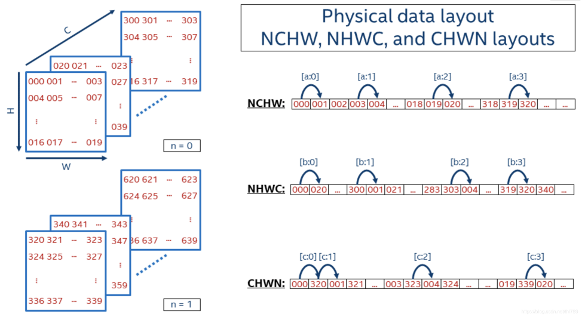


NCHW是先取W方向数据；然后H方向；再C方向；最后N方向。所以，序列化出1D数据是这个样子的：

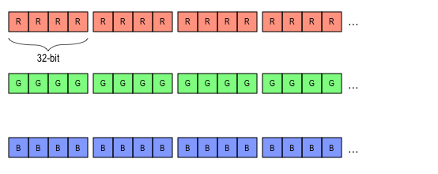

NHWC则是先取C方向数据；然后W方向；再H方向；最后N方向。所以，序列化出1D数据为：

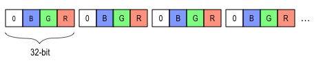

尽管数据的排列方式不一样，但存储的数据是一样的，因此不同框架下数据的计算结果也是相同的。值得注意的是，数据的不同排布方式会导致数据访问特性不一致，因此即使输入输出相同，但过程的性能会存在区别。

实现神经网络的快速训练和推理，需要考验处理器的并行计算能力，不同网络框架实现并行计算有着各自的加速器的设计，但加速器的支持必须要考虑数据的排布格式。这是不同网络框架推荐不同数据排布格式的根本原因。


但为什么大多数神经网络框架推荐一种数据格式后，同时还支持另一种呢？这是因为两种数据储存格式都有着各自的优势，在某些情况使用另一种数据排布格式有着更好的整体性能。因为不同框架中加速器的设计不同，我们举一些简单的例子分析。


通常，由于神经网络的计算特性，使用HWC格式不需要参数太多的数据移动，且每次内存读取可以将数据并行传输到多个处理器内。因此HWC 更快。


但是，内存通常是分块的，不同处理器组管理不同的数据块，即多处理器需共享一个数据存储器，这降低了输入的最大允许尺寸。而使用 CHW 数据格式时，一般使用单个处理器处理一个内存数据块，下一个通道需要使用连接到不同数据存储器的处理器，以便机器可以在每个时钟周期将一个字节传送到每个启用的处理器中。


因此，一般来讲，HWC格式更符合多核CPU运算，HWC格式的图像常见于OpenCV、Pillow、Numpy图像处理、Matplotlib显示、普通图像文件读取后的默认结构，所以， HWC 更适合图像读取、显示、裁剪、绘制等操作。。

> 说明：HWC更符合人类对图像的直观理解，先定位图像中的某个点，再查看这个点的颜色通道
>
> 比如：定位第y行，x列，然后再查看这个点的像素。

而对于CHW格式的图像常见于Pytorch、深度学习模型输入、GPU加速、ONNX。TensorRT等推理框架，这更符合GPU运算。


既然HWC和CHW应用场景不同时需要不同格式的图片，所以我们需要掌握HWC和CHW相互转换。

1）HWC 转换 CHW

在 Python 中，可以使用 NumPy 转换：

```python
image_CHW = image_HWC.transpose(2, 0, 1)
```

2）CHW转换HWC

```python
image_HWC = image_CHW.transpose(1, 2, 0)
```


### 3.4.3.5  图像坐标

在数学坐标系中，我们通常习惯写（x，y），但是我们再图像数组中，通常使用却是（y,x）。那为什么这么表示呢？我们在之前学习过Numpy，知道当我们表示二维数组时候表示为 `arr[行，列]`，在这里的图像的像素位置也是用二维数组表述。计算机中的坐标系与正常我们不一样，他的坐标系如下：

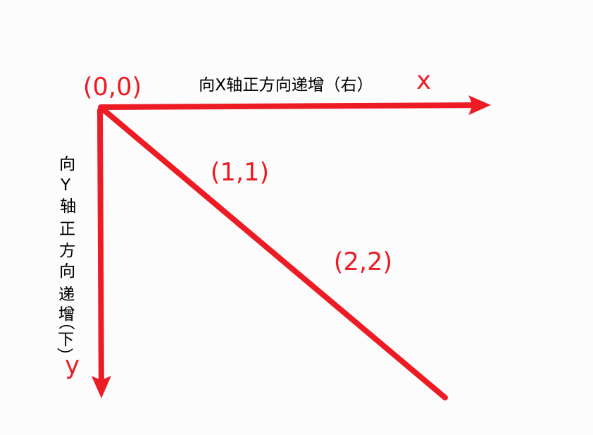


比如我们访问第 100 行、第 200 列的像素：

```python
pixel = image[100, 200]
```

这里：

```text
y = 100
x = 200
```

而不是：

```text
x = 100
y = 200
```

因此正确访问的像素坐标为`img[y,x]`，**y表示行，x表示列**。

### 3.4.3.6 前景与背景

**前景**（Foreground）通常指图像中我们关心的目标区域。例如：

|   场景   |   前景   |
| :------: | :------: |
| 人像抠图 |    人    |
| 车牌识别 | 车牌字符 |
| 工业检测 | 缺陷区域 |
| 医学图像 | 病灶区域 |
| 文档扫描 |   文字   |

**背景**（Background）通常指图像中不关心的区域，或者目标之外的区域。

例如在人像抠图中：人是前景，人后面的环境就是背景

前景和背景**取决于任务目标**。例如同一张街景图：

|    任务    |  前景  |       背景       |
| :--------: | :----: | :--------------: |
|  行人检测  |  行人  | 道路、建筑、车辆 |
|  车辆检测  |  车辆  | 行人、道路、建筑 |
| 车道线检测 | 车道线 | 车辆、行人、天空 |
| 红绿灯识别 | 交通灯 |   其他所有区域   |

因此，前景和背景不是图像本身决定的，而是由**任务决定的**。

### 3.4.3.7 噪声 & 滤波

#### 噪声

**噪声**（Noise）是图像中**不希望出现的随机干扰信息**，它会影响图像质量，也会影响后续算法的准确性。

比如一张干净图像应该平滑、清晰，如果途中出现了随机白点、随即黑点、彩色斑点、颗粒感、条纹干扰等这些都可是称为噪声

这里列举一些特殊场景的噪声：

| 噪声类型 |                       视觉表现                       |                直观理解                |                 常见原因 / 常见场景                 |                常用处理方法                |
| -------- | :--------------------------------------------------: | :------------------------------------: | :-------------------------------------------------: | :----------------------------------------: |
| 椒盐噪声 |               图像中随机出现黑点和白点               | 像黑色的“椒”和白色的“盐”随机撒在图像上 |         图像传输错误、传感器异常、数据损坏          |                  中值滤波                  |
| 高斯噪声 | 一种随机分布的噪声，通常表现为图像整体有细小颗粒感。 |      像图像表面覆盖了一层随机颗粒      | 光照不足、相机传感器噪声、高 ISO 拍摄、电子信号干扰 | 均值滤波、高斯滤波、双边滤波、深度学习去噪 |
| 条纹噪声 |            图像中出现固定方向的横线或竖线            |  像图像上叠加了规律性的横向或纵向条纹  |      扫描图像、工业相机、医学成像、传感器异常       |  频域滤波、方向滤波、去条纹算法、图像校正  |

#### 滤波

**滤波**（Filtering）可以理解为根据一定规则，重新计算每个像素的值，这个规则一般是由一个小矩阵决定，这个小矩阵称为卷结核（Kernel）比如：

```
3×3 滤波核
[
  [1, 1, 1],
  [1, 1, 1],
  [1, 1, 1]
]
```

滤波时，滤波核会在图像上滑动，并与局部区域进行计算，具体计算步骤为:

1. 取该像素周围的一小块区域
2. 用滤波核和这块区域进行计算
3. 得到新的像素值
4. 移动到下一个像素继续计算

滤波是一种底层图像处理手段，不同的滤波规则可以实现平滑、锐化、边缘检测、纹理增强和降噪等不同效果。

| 滤波操作   | 常见方法                  | 效果                                                         |
| ---------- | ------------------------- | ------------------------------------------------------------ |
| 平滑滤波   | 均值滤波 / 高斯滤波       | 减弱图像中的细小变化，使图像整体变得更平滑，可用于简单去噪或模糊处理 |
| 去椒盐噪声 | 中值滤波                  | 去除图像中随机出现的黑点、白点，对椒盐噪声效果较好，同时能较好保留边缘 |
| 锐化滤波   | 自定义卷积核              | 增强图像边缘和细节，使图像看起来更加清晰                     |
| 边缘检测   | Sobel / Laplacian / Canny | 找出图像中灰度变化明显的位置，用于提取物体轮廓或图像边界     |
| 纹理增强   | Laplacian 增强            | 突出图像中的局部细节和纹理变化，使细节更加明显               |
| 保边降噪   | 双边滤波                  | 在减少噪声的同时尽量保留边缘信息，适合对边缘要求较高的图像   |
| 高级降噪   | 非局部均值去噪            | 根据图像中相似区域进行综合降噪，去噪效果较好，适合噪声较明显的图像 |

以下我们展开对部分滤波操作进行讲解

##### 平滑滤波

**平滑**（Smoothing）是减少图像中细节变化和噪声的一种操作，平滑处理通常会让图像变得更柔和，同时也可能让边缘变模糊。

平滑常用于降低噪声、减少细节干扰、让图像更适合后续分割、减少边缘检测中的误检、提高图像整体视觉质量等

平滑前：

```
图像中可能有很多细碎噪声和颗粒
```

平滑后：

```
噪声减少
局部变化变小
图像变柔和
```


##### 锐化滤波

**锐化**（Sharpening）是增强图像边缘和细节的一种操作，锐化会让图像看起来更清晰，但也可能放大噪声。

锐化前：

```text
边缘不够明显
细节不够突出
图像略显模糊
```

锐化后：

```text
边缘更清楚
纹理更明显
细节更突出
```

> 锐化不是越强越好。过度锐化会导致：噪声被放大、边缘出现光晕、图像变得不自然、细节出现伪影等，因此，锐化通常需要适度使用


剩下其他的滤波操作我们会在后面的图像处理章节进行详细讲解。

### 3.4.3.8 掩膜

**掩膜，Mask**，是用于指定图像中哪些区域需要被保留、处理或忽略的一张辅助图，通常是一张二值图，比如当像素值为0的地方认为是无效区域，表示这个内容不处理/不保留，对于像素值为255地方认为是有效区域，表示该处的内容进行对应处理/保留。

> 掩膜只需要表示每个位置是否有效，不一定需要颜色通道。
>
> 比如，当你输入一张彩色图，形状是（H，W，3），对应的掩膜图形状是（H，W）
>
> 

一般掩膜常用于：抠图、图像分割、目标区域提取、局部图像增强、局部模糊、ROI 区域选择、背景替换、缺陷区域标记等。


在图像处理中，我们有时候并不想处理整张图像，而是只想处理其中某一部分区域，比如只提取红色区域、只保留人脸区域、只处理指定 ROI 区域等，而掩膜的作用，正是用来把这些区域明确地区分出来。通过掩膜，我们可以告诉程序：哪些位置需要保留或处理，哪些位置需要忽略或排除。 在很多图像处理任务中，通常会用掩膜值来表示区域类别。

所以，掩膜常用于抠图、图像分割、目标区域提取、局部图像增强、局部模糊、ROI 区域选择、背景替换、缺陷区域标记等任务。

#### 1. 掩膜获取

掩膜一般获取通过颜色范围、阈值分割、手动绘制、多边形区域等方式，得到一张二值掩膜；

1. 颜色范围来获取掩膜。

OpenCV提供函数`cv2.inRange()` 根据颜色范围生成掩膜。

语法：

```python
mask = cv2.inRange(src, lower, upper)
```

**参数说明**

|  `src`  | 输入图像，可以是 BGR 图像、HSV 图像或灰度图 |
| :-----: | :-----------------------------------------: |
| `lower` |               颜色范围的下限                |
| `upper` |               颜色范围的上限                |

**返回值**

- mask：输出的二值掩膜图

> 说明：如果某个像素的颜色在 lower_red 和 upper_red 之间，则该位置在 mask 中为 255。 如果某个像素的颜色不在这个范围内，则该位置在 mask 中为 0。
>
> 对于灰度图lower、upper是数值，对于彩色图、HSV的lower和upper是列表[B_lower，G_lower，R_lower]、[B_upper，G_upper，R_upper]以及[H_lower，S_lower，V_lower]、[H_upper，S_upper，V_upper]。

2. 通过阈值分割获取掩膜。OpenCV提供函数`cv2.threshold()`通过阈值分割获取掩膜。

语法：

```
_, mask = cv2.threshold(src, thresh, maxval, cv2.THRESH_BINARY)
```

**参数说明**

|   参数   |                       说明                       |
| :------: | :----------------------------------------------: |
|  `src`   |                  输入**灰度图**                  |
| `thresh` |                       阈值                       |
| `maxval` | 当像素满足阈值条件时赋予的值，二值化时常用 `255` |
|  `type`  |                     阈值类型                     |

> 这里是涉及阈值操作了，这里不必掌握，后续会详细讲解。只需要理解：现在当灰度图的某点的像素值低于thresh，那么该点的像素值为0,否则像素值变成maxval。

**返回值**

- 该语法中的mask就是阈值分割后的二值图。

> 这种方式常用于： 提取较亮区域、分离前景和背景、得到简单的二值掩膜。


3. 手动创建

如果只想处理图像中的某个固定区域，也可以手动创建一张全黑掩膜，然后在需要处理的区域画白色。

```
mask = np.zeros(image.shape[:2], dtype=np.uint8)
cv2.rectangle(mask, (100, 100), (300, 300), 255, -1)
```

该代码含义：先创建一张和原图大小相同的黑色掩膜，然后在掩膜上画一个白色矩形。 白色矩形区域表示需要保留或处理的区域。


#### 2. 掩膜使用

掩膜最常见的使用方式之一，就是和 OpenCV 的位运算函数结合使用。 位运算函数可以通过 mask 参数指定处理范围，只有 mask 中为 255 的区域才会参与运算，mask 中为 0 的区域会被忽略。

常用函数包括：

|        函数         |                作用                |
| :-----------------: | :--------------------------------: |
| `cv2.bitwise_and()` | 与运算，常用于按照掩膜提取目标区域 |
| `cv2.bitwise_or()`  |     或运算，常用于合并图像区域     |
| `cv2.bitwise_not()` |  非运算，常用于反转图像或反转掩膜  |
| `cv2.bitwise_xor()` |    异或运算，常用于提取差异区域    |

1. 最常用的是与运算，这里我们作讲解。

```
result = cv2.bitwise_and(image, image, mask=mask)
```

最终函数执行效果：第一个 image 和第二个 image 表示原图和自身做与运算。 mask=mask 表示只在掩膜为白色的位置进行保留。


2. 有时候我们需要保留掩膜以外的区域，这时可以先将掩膜反转，非运算常用于帮我们实现掩膜反转。

```
mask_inv = cv2.bitwise_not(mask)
```

最终函数执行效果：原来 mask 中为 255 的区域会变成 0。 原来 mask 中为 0 的区域会变成 255。

mask和非运算结合使用常用于提取背景元素、排除目标区域、做背景替换时生成反向掩膜。


代码示例：

```python
import cv2
import numpy as np

# 1. 读取图像
image = cv2.imread('./src/Python_demo/image.jpg')
image = cv2.resize(image, (640, 480))

# 2. 将 BGR 图像转换为 HSV 图像
hsv = cv2.cvtColor(image, cv2.COLOR_BGR2HSV)

# 3. 设置红色的 HSV 范围
# 注意：HSV 中红色通常分布在两个区间
lower_red1 = np.array([0, 100, 100])
upper_red1 = np.array([10, 255, 255])

lower_red2 = np.array([160, 100, 100])
upper_red2 = np.array([179, 255, 255])

# 4. 根据颜色范围生成两个红色掩膜
mask1 = cv2.inRange(hsv, lower_red1, upper_red1)
mask2 = cv2.inRange(hsv, lower_red2, upper_red2)

# 5. 合并两个红色掩膜  因为红色有两个mask区域，但与其他颜色并不用此步。
mask = cv2.bitwise_or(mask1, mask2)

# 6. 使用掩膜提取红色区域
result = cv2.bitwise_and(image, image, mask=mask)

# 7. 反转掩膜，得到非红色区域
mask_inv = cv2.bitwise_not(mask)

# 8. 提取非红色区域
background = cv2.bitwise_and(image, image, mask=mask_inv)

# 9. 显示结果
cv2.imshow("Original", image)
cv2.imshow("Mask", mask)
cv2.imshow("Red Area", result)
cv2.imshow("Non Red Area", background)

cv2.waitKey(0)
cv2.destroyAllWindows()
```

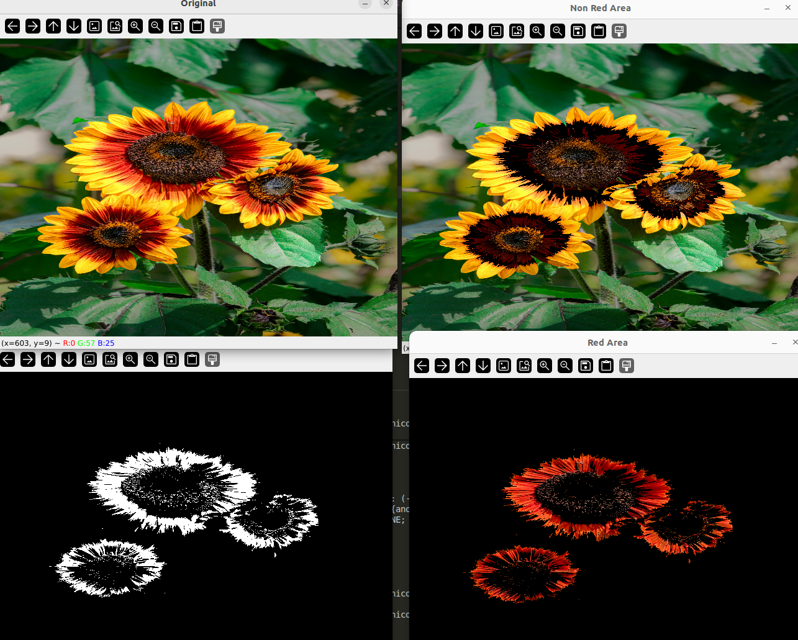


## 3.4.4 图像处理函数讲解

### 3.4.4.1 图像基本读写操作

OpenCV 通过 NumPy 数组来表示图像数据，每个图像就是一个多维数组，其中每个元素对应图像中的一个像素。图像的尺寸和颜色模式也可以通过数组的形状来表示。

**图像的基本属性：**

- **图像的尺寸（Width, Height）**：可以通过 `img.shape` 获取。
- **颜色通道（Channels）**：通常为 RGB（三个通道），也可以是灰度图（单通道）。
- **数据类型（Data type）**：常见的有 `uint8`（0-255 范围），也可以是 `float32` 或其他。

涉及到的函数有：

1. **读取图像：**`image = cv2.imread(filename, flags)`

   ​	**参数解释**

   1. filename:图像路径
   2. flags: 读取方式
      1. `1`：表示读取彩色图
      2. `0`：表示读取灰度图
      3. `-1`：保留所有通道，包括透明

   ​         **返回值**

   1. 读取成功返回 NumPy 数组，读取失败返回 `None`。

2. **显示图像**：`cv2.imshow(window_name, image)`

   ​	**参数解释**

   1. `window_name`：窗口名
   2. `image`：要显示的图像（通过图像读取后的Numpy数组对象）

   ​         **返回值**

   1. 无

3. **保存图像**：`cv2.imwrite(filename, image)`

   ​	**参数解释**

   1. filename：写入图像路径
   2. image：要写入图像对象，是经过读取后的Numpy数组对象。

   ​          **返回值**

   1. `True`：成功
   2. `False`：失败

接下来我们通过代码直观感受图像读写操作实现：

```python
import cv2

image = cv2.imread('./src/Python_demo/image.jpg',flags=1)

if image is None:
    print('读取失败')
    exit()

cv2.imshow('Original', image)

key = cv2.waitKey(0)

if key == ord('s'):
    cv2.imwrite('./src/Python_demo/saved.jpg', image)
    print('保存成功')

cv2.destroyAllWindows()
```

路径说明：

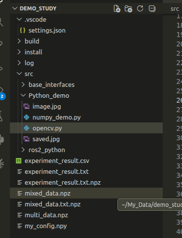


补充知识点：按键等待操作，即上述代码中的 `key = cv2.waitKey(0)`。

具体语法如下：

```python
key = cv2.waitKey(delay)
```

参数说明：

| 参数值 | 含义                                   |
| ------ | -------------------------------------- |
| `0`    | 无限等待，直到用户按下键盘上的任意按键 |
| `1`    | 等待 1ms，常用于视频或实时画面显示     |

返回值通常可以配合键盘按键进行判断，例如：

```python
key = cv2.waitKey(0)

if key == ord('q'):
    # 按下 q 键后执行的操作
    print("退出程序")

elif key == ord('s'):
    # 按下 s 键后执行的操作
    print("保存图像")
```

其中：

```python
ord('q')
```

表示获取字符 `q` 对应的 ASCII 数值。

最后常与以下语句配合使用：

```python
cv2.destroyAllWindows()
```

它的作用是关闭 OpenCV 创建的所有显示窗口。


### 3.4.4.2 访问和修改像素

由于 OpenCV 中的图像本质上是 NumPy 数组，因此可以通过数组索引和切片来访问单个像素或某个区域。接下来我们分别介绍单个像素访问和修改以及某个区域访问和修改。


#### 单独点像素操作

在图像处理中，图像本质上可以看作是由一个个像素组成的数组，因此，我们可以像操作数组一样，访问图像中某个位置的像素值，也可以对指定位置或指定区域的像素进行修改。  

在 OpenCV 中，图像通常以 `NumPy` 数组的形式存储，所以可以通过数组索引的方式访问和修改像素。

可以通过索引访问图像中某个位置的像素值，比如访问第100行（y），200列（x）的像素值如下：

```python
pixel_value = image[100, 200]
```

访问到某个像素后，也可以直接对它进行修改。

如果是灰度图，像素值是一个 0 到 255 之间的数值,比如我将坐标 `(x, y)` 处的像素灰度值修改为 `200`。

```python
image[y, x] = 200
```

如果是彩色图，像素值由 B、G、R 三个通道组成，所以要注意通道顺序，比如我将坐标 `(x, y)` 处的像素值修改为 `蓝色`。

```python
image[y, x] = [255, 0, 0]
```

对于彩色图像，也可以先将 B、G、R 三个通道分离，然后分别修改某个通道的值，然后对指定通道的指定位置修改像素值。

```python
b, g, r = cv2.split(image)
b[y, x] = 255
g[y, x] = 0
r[y, x] = 0
```

然后再将三个通道合并：

```python
merged_image = cv2.merge([b, g, r])
```

这样也可以实现像素颜色的修改。

不过在实际使用中，如果只是修改某个像素或某个区域，通常可以直接使用：

```python
image[y, x] = [B, G, R]
```

这种方式更加简单。

#### ROI

除了访问单个像素，也可以访问图像中的一块区域，这种区域通常称为**ROI区域**（Region of Interest ），意思是感兴趣区域，可以理解为，我们不处理整张图像，只处理其中某一部分目标区域。


实现对ROI区域获取和修改的语法形式是`image[y1:y2, x1:x2]`，其中，`y1:y2` 表示行范围，也就是高度方向，`x1:x2` 表示列范围，也就是宽度方向。比如我想获取再y方向上50~150和x方向上50 ~ 150这块区域。然后获取 ROI 区域后，也可以直接对该区域进行修改。

```python
# 获取 ROI 区域
roi = image[50:150, 50:150]

# 将该 ROI 区域修改为绿色
image[50:150, 50:150] = [0, 255, 0]
```

执行后，图像中对应的矩形区域会变成绿色。

> ROI 修改会影响原图，也就是说通过切片得到的 ROI，通常和原图共享数据，所以如果不想影响原图，可以使用 `.copy()`：


#### Crop

**裁剪图像本质上也是获取 ROI 区域**，语法格式`crop = image[y1:y2, x1:x2]`，表示裁减y方向上y1~y2行，x方向上x1 ~x2行的矩阵区域。

比如裁减x方向200~400，y方向100 ~ 300的区域实现如下，最终从原图中裁剪出一个矩形区域。

```python
crop = image[100:300, 200:400]
```


#### 小节

语法小口诀：

```python
image[y, x]                 # 访问单个像素
image[y, x] = value          # 修改单个像素
image[y1:y2, x1:x2]          # 获取 ROI 区域
image[y1:y2, x1:x2] = value  # 修改 ROI 区域
crop = image[y1:y2, x1:x2]   # 裁剪图像
```


完整代码示例

```python
import cv2

# 读取图像
image = cv2.imread("test.jpg")

# 访问单个像素
pixel_value = image[100, 200]
print("该位置的像素值为：", pixel_value)

# 修改单个像素为红色
image[100, 200] = [0, 0, 255]

# 获取 ROI 区域
roi = image[50:150, 50:150]

# 修改 ROI 区域为绿色
image[50:150, 50:150] = [0, 255, 0]

# 裁剪图像
crop = image[100:300, 200:400]

# 显示结果
cv2.imshow("image", image)
cv2.imshow("crop", crop)

cv2.waitKey(0)
cv2.destroyAllWindows()
```


### 3.4.4.3 仿射变换

$在图像处理中，仿射变换_{Affine \  Transformation}是一类常见的几何变换，它包含对图像的平移、缩放、旋转、翻转、剪切等操作。$

仿射变换的特点是：

1. **变换前是直线，变换后仍然是直线**；
2. **变换前后互相平行的线，变换后仍然平行**。

也就是说，仿射变换不会随意扭曲图像的整体结构，而是按照一定的线性规则改变图像中像素的位置。


若我们假设，图像中的某个点的原始坐标 $P = （x,y），仿射变换后的坐标为:P^{'}= (x^{'},y^{'})，那么放射变换可以表示为：$

```math
x' = ax + by +c
```

```math
y' = d x + e y + f
```

一般求解我们是通过矩阵运算的，矩阵表示形式为：

仿射变换的一般用矩阵形式表示为：

```math
\begin{bmatrix}
x' \\
y' \\
1
\end{bmatrix}
=
\begin{bmatrix}
a & b & c \\
d & e & f \\
0 & 0 & 1
\end{bmatrix}
\begin{bmatrix}
x \\
y \\
1
\end{bmatrix}
```


其中：a、b、d、e 控制图像的缩放、旋转、翻转和剪切，c、f 控制图像在 x 方向和 y 方向上的平移。

接下来我们依次讲解的几种常用仿射变化。

#### 1. Translation

平移（Translation）变换表示将图像沿 x 方向和 y 方向移动一定距离，比如这里，假设原始坐标仍然是（x，y），我们平移该点：x方向平移tx，y方向平移ty，那么有：

```math
x' = x + tx

```

```math
y' = y + ty
```

矩阵形式为：


```math

\begin{bmatrix}
x' \\
y' \\
1
\end{bmatrix}
=
\begin{bmatrix}
1 & 0 & t_x \\
0 & 1 & t_y \\
0 & 0 & 1
\end{bmatrix}
\begin{bmatrix}
x \\
y \\
1
\end{bmatrix}

```

> tx > 0：向右移动，tx < 0：向左移动，ty > 0：向下移动，ty < 0：向上移动。
>


在OpenCV中，图像平移可以通过 `cv2.warpAffine()` 函数实现。需要指定平移矩阵。

```
translated = cv2.warpAffine(src, M, dsize)
```

**参数说明**

| 参数 | 说明 |
|:-:|:-:|
| `src` | 输入图像 |
| `M` | 仿射变换矩阵，这里表示平移矩阵 |
| `dsize` | 输出图像尺寸，格式为 `(width, height)` |

其中，平移矩阵 `M` 的形式为：

```math
M =
\begin{bmatrix}
1 & 0 & t_x \\
0 & 1 & t_y
\end{bmatrix}
```

```python
import cv2
import numpy as np

# 设置平移距离
tx = 100
ty = 50

# 获取图像尺寸
h, w = image.shape[:2]

# 构造平移矩阵
M = np.float32([
    [1, 0, tx],
    [0, 1, ty]
])

# 进行图像平移
translated = cv2.warpAffine(image, M, (w, h))
```


#### 2. 缩放

缩放（resize）变换表示改变图像的大小，比如这里我们仍然假设，原始坐标（x，y），我们将该点在x方向上缩放比例为sx，在y的方向上缩放比例为sy，那么有：

```math
x' = sx · x
```

```math
y' = sy · y
```

矩阵形式为：

```math

\begin{bmatrix}
x' \\
y' \\
1
\end{bmatrix}
=
\begin{bmatrix}
s_x & 0 & 0 \\
0 & s_y & 0 \\
0 & 0 & 1
\end{bmatrix}
\begin{bmatrix}
x \\
y \\
1
\end{bmatrix}
```

> sx > 1：水平方向放大，0 < sx < 1：水平方向缩小；
>
> sy > 1：垂直方向放大，0 < sy < 1：垂直方向缩小。
>
> 如果sx = sy，我们称为等比例缩放。


在OpenCV中，图像缩放可以通过 `cv2.resize()` 函数实现。可以指定缩放后的图像尺寸或缩放比例。

```
resized = cv2.resize(src, dsize, fx=None, fy=None, interpolation=cv2.INTER_LINEAR)
```

**参数说明**

| 参数            | 说明                       |
| --------------- | -------------------------- |
| `src`           | 输入图像                   |
| `dsize`         | 目标尺寸 `(width, height)` |
| `fx`            | 水平方向缩放倍数           |
| `fy`            | 垂直方向缩放倍数           |
| `interpolation` | 插值方式                   |

简单代码示例：

```python
# 图像缩放
resized_img = cv2.resize(img, (200, 200))  # 将图像缩放为 200x200 像素
```

##### 补充：插值

在 `cv2.resize()` 中，`interpolation` 表示**插值方式**。

因为图像缩放时，**新的图像尺寸和原图尺寸不一样**，因此新图中的像素点不一定能在原图中找到完全对应的位置。这时就需要通过某种方法，根据原图已有像素值，计算出新图像中的像素值。这个过程就叫**插值**

简单理解插值就是根据已有像素，估算新的像素。

放大图像时候需要生成新像素，这时候利用插值；缩小图像时，需要压缩合并或重新采样像素

> 放大图像，比如之前是8 * 8的像素，放大后变为 16 * 16的像素，那么多出来的像素在原图并不存在，此时就需要插值来进行估算
>
> 缩小图像，原图大量像素需要被压缩合并，此时新图中的一个像素可能代表原图的一片区域，此时也需要通过插值方式来决定这个像素。


我们举一个简单的例子，假设一行灰度像素是：

```
10        20
```

现在要在它们中间生成一个新像素：

```
10    ?    20
```

这个 `?` 应该是多少？

一种简单方法是取平均值：

```
(10 + 20) / 2 = 15
```

于是得到：

```
10    15    20
```

这就是插值的基本思想。

而对于彩色图，和灰度图处理原理类似，只不过是对每个颜色通道都进行分别计算而以。


#### 3. Rotation

旋转 （Rotation） 变换表示将图像绕某个点旋转一定角度。比如这里，假设原始坐标仍然是 （x，y），如果以**坐标原点为中心**，**逆时针旋转**角度 θ，那么有：


```math
x' = x \cos\theta - y \sin\theta
```

```math
y' = x \sin\theta + y \cos\theta
```


矩阵形式为：

```math
\begin{bmatrix}
x' \\
y' \\
1
\end{bmatrix}
=
\begin{bmatrix}
\cos\theta & -\sin\theta & 0 \\
\sin\theta & \cos\theta & 0 \\
0 & 0 & 1
\end{bmatrix}
\begin{bmatrix}
x \\
y \\
1
\end{bmatrix}
```


> θ > 0：逆时针旋转 
>
> θ < 0：顺时针旋转
>
> 在实际图像处理中，旋转通常不是围绕坐标原点，而是围绕图像中心进行。

在 OpenCV 中，图像旋转可以通过 `cv2.getRotationMatrix2D()` 和 `cv2.warpAffine()` 函数实现。需要先根据旋转中心、旋转角度和缩放比例生成旋转矩阵，再进行仿射变换。

```python
M = cv2.getRotationMatrix2D(center, angle, scale) //函数返回的矩阵形状是 2行3列
rotated = cv2.warpAffine(src, M, dsize)
```

**参数说明**

| 参数 | 说明 |
|:-:|:-:|
| `center` | 旋转中心，通常为图像中心 `(w / 2, h / 2)` |
| `angle` | 旋转角度，正数表示逆时针旋转，负数表示顺时针旋转 |
| `scale` | 缩放比例，`1.0` 表示保持原大小 |
| `src` | 输入图像 |
| `M` | 旋转矩阵 |
| `dsize` | 输出图像尺寸，格式为 `(width, height)` |

简单代码示例：

```python
# 图像旋转
h, w = image.shape[:2]

# 设置旋转中心
center = (w / 2, h / 2)

# 生成旋转矩阵
M = cv2.getRotationMatrix2D(center, 45, 1.0)

# 进行旋转变换
rotated = cv2.warpAffine(image, M, (w, h))
```

上述代码表示：将图像围绕中心点逆时针旋转 `45°`，并保持原始大小。


#### 4. 翻转

翻转 ~Flip~ 变换可以看作是一种特殊的缩放变换。当某个方向的缩放比例为负数时，就会产生翻转效果。 比如这里，假设原始坐标仍然是 （x，y），接下来分别进行水平翻转、垂直翻转。

##### 1. 水平翻转

$水平翻转表示图像在左右方向发生对调，也可以理解为 x 方向取反，y不变，也就是说S_x = -1，S_y= 1，那么有：$

```math
x' = -x
```


```math
y' = y
```

矩阵形式为：

```math
\begin{bmatrix}
x' \\
y' \\
1
\end{bmatrix}
=
\begin{bmatrix}
-1 & 0 & 0 \\
0 & 1 & 0 \\
0 & 0 & 1
\end{bmatrix}
\begin{bmatrix}
x \\
y \\
1
\end{bmatrix}
```


##### 2. 垂直翻转

$垂直翻转表示图像在上下方向发生对调，也可以理解为 y 方向取反，x方向不变，也就是说S_x=1，S_y=-1，那么有：$

```math
x' = x
```


```math
y' = -y
```

矩阵形式为：

```math
\begin{bmatrix}
x' \\
y' \\
1
\end{bmatrix}
=
\begin{bmatrix}
1 & 0 & 0 \\
0 & -1 & 0 \\
0 & 0 & 1
\end{bmatrix}
\begin{bmatrix}
x \\
y \\
1
\end{bmatrix}
```

> 其中需要注意的是，在图像坐标系中，y 轴通常是向下的，因此实际翻转效果需要结合图像坐标方向理解。
>

在 OpenCV 中，图像翻转可以通过 `cv2.flip()` 函数实现。需要指定翻转方式。

```python
 flipped = cv2.flip(src, flipCode)
```

**参数说明**

| 参数 | 说明 |
|:-:|:-:|
| `src` | 输入图像 |
| `flipCode` | 翻转方式 |


| `flipCode` | 说明 |
|:-:|:-:|
| `1` | 水平翻转，左右对调 |
| `0` | 垂直翻转，上下对调 |
| `-1` | 水平和垂直同时翻转 |

简单代码示例： 

```python
# 水平翻转
flip_horizontal = cv2.flip(image, 1)

# 垂直翻转
flip_vertical = cv2.flip(image, 0)

# 水平和垂直同时翻转
flip_both = cv2.flip(image, -1)
```


#### 5. 剪切变换

剪切 （Shear） 变换也叫错切变换，它会让图像在某个方向发生倾斜。和旋转不同，剪切不会让图像整体绕某个点转动，而是让图像的某一方向坐标受到另一方向坐标的影响。 比如这里，假设原始坐标仍然是 （x,，y），接下来我们分别讲解x方向剪切、y方向剪切。


##### 1. x 方向剪切

$x 方向剪切表示点的 x 坐标会受到 y 坐标的影响。也就是说，不同高度位置的点，会在水平方向产生不同程度的偏移。 假设 x 方向剪切系数为 kx，那么有:$ 

```math
x' = x + kx · y
```

```math
y' = y
```

矩阵形式为：

```math
\begin{bmatrix}
x' \\
y' \\
1
\end{bmatrix}
=
\begin{bmatrix}
1 & k_x & 0 \\
0 & 1 & 0 \\
0 & 0 & 1
\end{bmatrix}
\begin{bmatrix}
x \\
y \\
1
\end{bmatrix}
```


> kx > 0：图像上方或下方会沿 x 方向产生正向倾斜   
>
> kx < 0：图像会沿相反方向倾斜

直观来看，x 方向剪切会让一个原本的矩形变成类似“平行四边形”的形状：

```text
原始矩形：              x 方向剪切后：

+-------+              /-------/
|       |             /       /
|       |            /       /
+-------+           /-------/
```

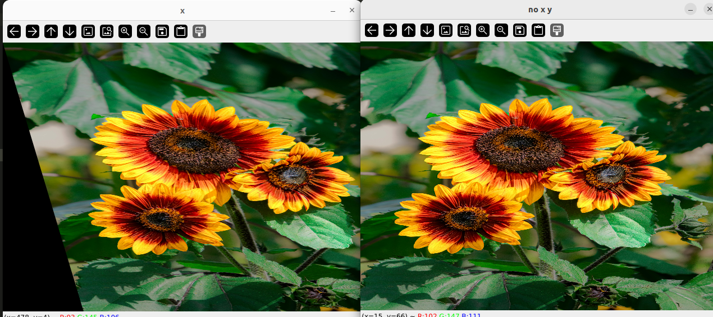

##### 2. y 方向剪切

$y 方向剪切表示点的 y 坐标会受到 x 坐标的影响。也就是说，不同水平位置的点，会在垂直方向产生不同程度的偏移。 假设 y 方向剪切系数为 ky，那么有:$

```math
x' = x
```


```math
y' = ky · x + y
```


矩阵形式为：


```math
\begin{bmatrix}
x' \\
y' \\
1
\end{bmatrix}
=
\begin{bmatrix}
1 & 0 & 0 \\
k_y & 1 & 0 \\
0 & 0 & 1
\end{bmatrix}
\begin{bmatrix}
x \\
y \\
1
\end{bmatrix}
```

> ky > 0：图像会沿 y 方向产生正向倾斜   
>
> ky < 0：图像会沿相反方向倾斜

直观来看，y 方向剪切也会让矩形变成类似“平行四边形”的形状，只不过倾斜方向主要体现在上下方向： 


```text
原始矩形：              y 方向剪切后：

+-------+              +-------+
|       |               \       \
|       |                \       \
+-------+                 +-------+
```

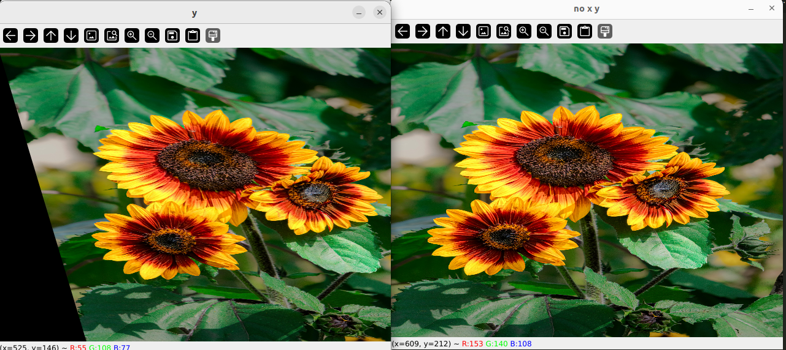

也可以理解为：图像的每一列仍然保持竖直趋势，但是不同水平位置的列会被向上或向下移动不同距离，因此整体看起来像被“拉斜”了。

剪切后的图像通常会产生类似“倾斜”“斜切”“斜体”的效果。原本水平和垂直的边不再互相垂直，矩形区域会变成平行四边形区域。


在 OpenCV 中，剪切变换可以通过 `cv2.warpAffine()` 函数实现。需要先构造剪切矩阵，然后再进行仿射变换。 

```python
sheared = cv2.warpAffine(src, M, dsize)
```

**参数说明**

| 参数 | 说明 |
|:-:|:-:|
| `src` | 输入图像 |
| `M` | 剪切矩阵 |
| `dsize` | 输出图像尺寸，格式为 `(width, height)` |

简单代码示例：


```python
# x 方向剪切
import cv2
import numpy as np

h, w = image.shape[:2]

# 设置 x 方向剪切系数
kx = 0.3

# 构造 x 方向剪切矩阵
M = np.float32([
    [1, kx, 0],
    [0, 1, 0]
])

# 进行剪切变换
sheared_x = cv2.warpAffine(image, M, (w, h))
-----------------------------------------------------------------------------------
# y 方向剪切
import cv2
import numpy as np

h, w = image.shape[:2]

# 设置 y 方向剪切系数
ky = 0.3

# 构造 y 方向剪切矩阵
M = np.float32([
    [1, 0, 0],
    [ky, 1, 0]
])

# 进行剪切变换
sheared_y = cv2.warpAffine(image, M, (w, h))
```

> 需要注意的是，剪切后图像可能会有一部分超出原始画布范围，因此实际使用时可以适当增大输出图像尺寸 `dsize`。


剪切变换常用于以下场景：

| 应用场景 | 说明 |
|---|---|
| 图像倾斜校正 | 当文档、图片出现轻微倾斜或透视偏斜时，可以通过剪切进行一定程度的修正 |
| 数据增强 | 在深度学习中，可以对训练图像进行随机剪切，增加样本多样性，提高模型鲁棒性 |
| 字体变形 | 类似斜体字效果，可以通过剪切让文字产生倾斜 |
| 图形特效 | 在图像编辑、动画或视觉设计中，可以制作斜切、倾斜、动态拉伸等效果 |
| 仿射变换组合 | 剪切可以和缩放、旋转、平移组合，用于更复杂的图像几何变换 |


#### 6. 刚体变换

刚体变换（Rigid Transform）表示图像经过**旋转和平移**后，图像中任意两点之间的距离仍然保持不变，也就是说，刚体变换只会改变图像的位置和方向，不会改变图像的大小和形状。

$刚体变换等价于 平移+旋转，假设原始坐标点为 (x, y)，变换后的坐标点为 (x', y')，旋转角度为 \theta，平移量为 (t_x, t_y)，那么有:$

```math
x' = x\cos\theta - y\sin\theta + t_x
```

```math
y' = x\sin\theta + y\cos\theta + t_y
```

写成齐次矩阵形式为：

```math
\begin{bmatrix}
x' \\
y' \\
1
\end{bmatrix}
=
\begin{bmatrix}
\cos\theta & -\sin\theta & t_x \\
\sin\theta & \cos\theta & t_y \\
0 & 0 & 1
\end{bmatrix}
\begin{bmatrix}
x \\
y \\
1
\end{bmatrix}
```

> 刚体变换不会改变图像中点与点之间的距离，也不会改变图像的形状，只会改变图像的位置和朝向。

在 OpenCV 中，刚体变换通常可以通过 `cv2.warpAffine()` 实现。

```python
dst = cv2.warpAffine(src, M, dsize)
```

**参数说明**

|  参数   |                  说明                  |
| :-----: | :------------------------------------: |
|  `src`  |                输入图像                |
|   `M`   |   仿射变换矩阵，这里表示刚体变换矩阵   |
| `dsize` | 输出图像尺寸，格式为 `(width, height)` |

其中，刚体变换矩阵 `M` 的形式为：

```math

M=
\begin{bmatrix}
\cos\theta &  -\sin\theta  & t_x \\
\sin\theta &  \cos\theta  &  t_y 

\end{bmatrix}

```

**返回值**

- dst：返回刚体变换后的图像。


示例代码如下：

```python
import cv2
import numpy as np
import matplotlib.pyplot as plt
# 1. 读取图像
image = cv2.imread('./src/Python_demo/image.jpg',1)
image = cv2.resize(dsize=(640,480),src=image)
# 获取图像尺寸
h, w = image.shape[:2]

# 设置旋转角度和平移距离
angle = 30
tx = 100
ty = 50

# 角度转弧度
theta = np.deg2rad(angle)

# 构造刚体变换矩阵
M = np.float32([
    [np.cos(theta), -np.sin(theta), tx],
    [np.sin(theta),  np.cos(theta), ty]
])

# 进行刚体变换
rigid = cv2.warpAffine(image, M, (w, h))
cv2.imshow("rigid",rigid)
key= cv2.waitKey(0)
cv2.destroyAllWindows()
```


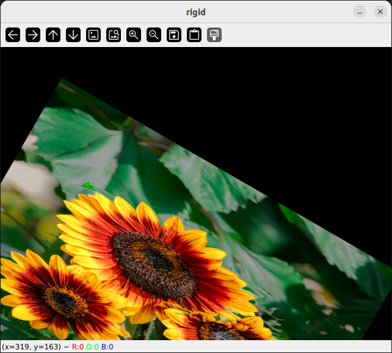

我这里是直接给定矩阵M，一般使用其实是通过 OpenCV 提供的 `cv2.getRotationMatrix2D()` 生成旋转矩阵，然后再加入平移量。

```python
import cv2
import numpy as np
import matplotlib.pyplot as plt
# 1. 读取图像
image = cv2.imread('./src/Python_demo/image.jpg',1)
image = cv2.resize(dsize=(640,480),src=image)
# 获取图像尺寸
h, w = image.shape[:2]

# 设置旋转角度和平移距离
angle = 30
tx = 100
ty = 50

# 角度转弧度
theta = np.deg2rad(angle)

# 设置旋转中心、旋转角度和缩放比例
center = (w // 2, h // 2)
angle = 30
scale = 1.0

# 生成旋转矩阵
M = cv2.getRotationMatrix2D(center, angle, scale)

# 添加平移量
M[0, 2] += 100
M[1, 2] += 50

# 进行刚体变换
rigid = cv2.warpAffine(image, M, (w, h))
cv2.imshow("rigid",rigid)
key= cv2.waitKey(0)
cv2.destroyAllWindows()
```

> 需要注意的是：
>
> - `angle > 0`：OpenCV 中默认表示逆时针旋转
> - `angle < 0`：表示顺时针旋转
> - `scale = 1.0`：表示不缩放，此时就是刚体变换
> - 如果 `scale != 1.0`，则变成相似变换

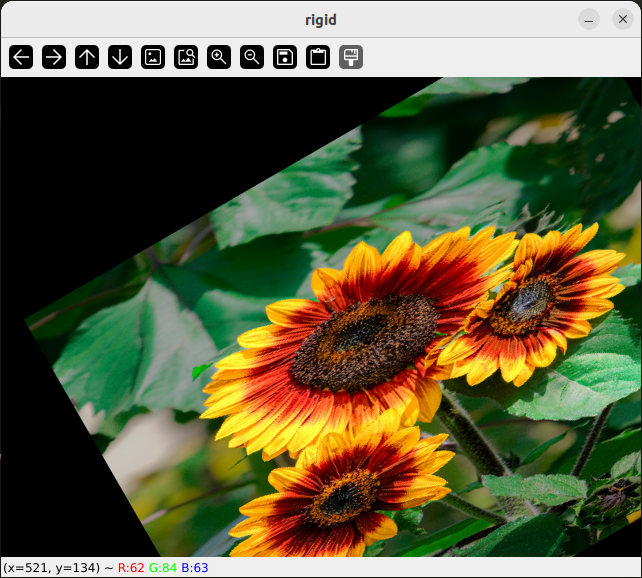


#### 7. 相似变换 

相似变换（Similarity Transform）是在刚体变换的基础上增加了**等比例缩放**，即相似变换 = 刚体变换+缩放 = 平移+ 旋转+ 缩放。

> 相似变换不会改变图像中直线之间的夹角，也不会改变图像的整体形状，只会改变图像的位置、方向和大小。
>

$假设原始坐标点为 (x, y)，变换后的坐标点为 (x', y')，旋转角度为 \theta，缩放比例为 s，平移量为 (t_x, t_y)，那么有:$

```math
x' = s(x\cos\theta - y\sin\theta) + t_x
```

```math
y' = s(x\sin\theta + y\cos\theta) + t_y
```


写成齐次矩阵形式为：

```math
\begin{bmatrix}
x' \\
y' \\
1
\end{bmatrix}
=
\begin{bmatrix}
s\cos\theta & -s\sin\theta & t_x \\
s\sin\theta & s\cos\theta & t_y \\
0 & 0 & 1
\end{bmatrix}
\begin{bmatrix}
x \\
y \\
1
\end{bmatrix}
```


令：

```math
\alpha = s\cos\theta
```

```math
\beta = s\sin\theta
```


则相似变换矩阵可以写成：

```math
\begin{bmatrix}
x' \\
y'
\end{bmatrix}
=
\begin{bmatrix}
\alpha & -\beta \\
\beta & \alpha
\end{bmatrix}
\begin{bmatrix}
x \\
y
\end{bmatrix}
+
\begin{bmatrix}
t_x \\
t_y
\end{bmatrix}
```


那么相似变换矩阵也就是：

```math
M =
\begin{bmatrix}
\alpha & -\beta & t_x \\
\beta & \alpha & t_y
\end{bmatrix}
```

> 相似变换相比刚体变换多了一个缩放比例，因此点与点之间的距离会发生等比例变化，但直线之间的夹角保持不变。

在 OpenCV 中，相似变换可以通过 `cv2.getRotationMatrix2D()` 和 `cv2.warpAffine()` 实现。

```python
M = cv2.getRotationMatrix2D(center, angle, scale)
dst = cv2.warpAffine(src, M, dsize)
```

**参数说明**

| 参数     | 说明                                    |
| -------- | --------------------------------------- |
| `center` | 旋转中心，格式为 `(center_x, center_y)` |
| `angle`  | 旋转角度，单位为度                      |
| `scale`  | 缩放比例                                |
| `src`    | 输入图像                                |
| `M`      | 相似变换矩阵                            |
| `dsize`  | 输出图像尺寸，格式为 `(width, height)`  |


其中，OpenCV 中 `cv2.getRotationMatrix2D()` 返回的矩阵形式为：

```math
M =
\begin{bmatrix}
\alpha & \beta & (1-\alpha)c_x - \beta c_y \\
-\beta & \alpha & \beta c_x + (1-\alpha)c_y
\end{bmatrix}

```


其中：

```math
\alpha = s \cdot \cos\theta
```

```math
\beta = s \cdot \sin\theta
```

```math

c_x = center_x,\quad c_y = center_y,\quad s = scale

```

**返回值**

- dst：返回相似变换后的图像。


示例代码如下：

```python
import cv2
import numpy as np
import matplotlib.pyplot as plt
# 1. 读取图像
image = cv2.imread('./src/Python_demo/image.jpg',1)
image = cv2.resize(dsize=(640,480),src=image)
# 获取图像尺寸
h, w = image.shape[:2]

# 设置旋转中心
center = (w // 2, h // 2)

# 设置旋转角度和缩放比例
angle = 30
scale = 0.8

# 生成相似变换矩阵
M = cv2.getRotationMatrix2D(center, angle, scale)

# 进行相似变换
similarity = cv2.warpAffine(image, M, (w, h))
cv2.imshow("similarity",similarity)
key= cv2.waitKey(0)
cv2.destroyAllWindows()
```

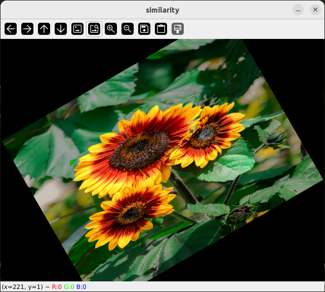


我这里是直接给定矩阵M，一般使用其实是通过 OpenCV 提供的 `cv2.getRotationMatrix2D()` 生成旋转+缩放矩阵，然后再加入平移量。

```python
import cv2
import numpy as np
import matplotlib.pyplot as plt
# 1. 读取图像
image = cv2.imread('./src/Python_demo/image.jpg',1)
image = cv2.resize(dsize=(640,480),src=image)
# 获取图像尺寸
h, w = image.shape[:2]

# 设置旋转中心
center = (w // 2, h // 2)

# 设置旋转角度、缩放比例和平移量
angle = 30
scale = 0.8
tx = 100
ty = 50

# 生成相似变换矩阵
M = cv2.getRotationMatrix2D(center, angle, scale)

# 添加平移量
M[0, 2] += tx
M[1, 2] += ty

# 进行相似变换
similarity = cv2.warpAffine(image, M, (w, h))
cv2.imshow("similarity",similarity)
key= cv2.waitKey(0)
cv2.destroyAllWindows()
```

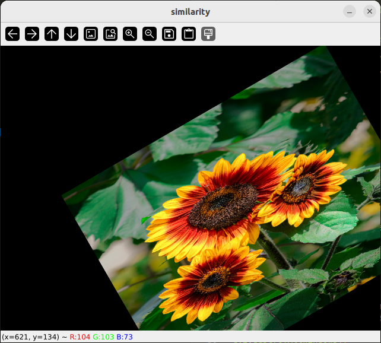

> 需要注意的是：
>
> - `scale > 1`：图像放大
> - `0 < scale < 1`：图像缩小
> - `scale = 1`：只旋转不缩放，此时退化为刚体变换
> - 相似变换保持角度不变，但不保持距离不变


### 3.4.4.4 透射变换 

​	透视变换（Perspective Transform）是将二维的图片投影到一个三维视平面上，然后再转换到二维坐标下，所以也称为投影映射（Projective Mapping）。

简单来说就是二维→三维→二维的一个过程。

前面的平移、旋转、缩放、仿射变换，变换后的平行线仍然保持平行；**而透视变换后，平行线可能不再平行**。

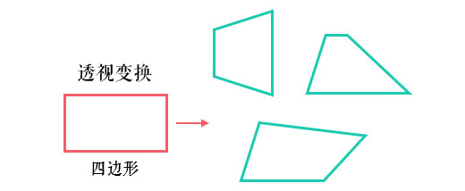

$假设原始坐标点为 (x, y)，变换后的齐次坐标为 (X, Y, Z)，则有:$

```math
X = a_1x + b_1y + c_1
```

$$
Y = a_2x + b_2y + c_2
$$

```math
Z = a_3x + b_3y + c_3
```


写成矩阵形式为：

```math
\begin{bmatrix}
X \\
Y \\
Z
\end{bmatrix}
=
\begin{bmatrix}
a_1 & b_1 & c_1 \\
a_2 & b_2 & c_2 \\
a_3 & b_3 & c_3
\end{bmatrix}
\begin{bmatrix}
x \\
y \\
1
\end{bmatrix}
```

由于最终图像坐标需要转换回二维坐标，因此需要进行齐次坐标归一化：

```math
x' = \frac{X}{Z}
```

```math
y' = \frac{Y}{Z}
```


也就是：

```math
x' = \frac{a_1x + b_1y + c_1}{a_3x + b_3y + c_3}
```

```math
y' = \frac{a_2x + b_2y + c_2}{a_3x + b_3y + c_3}
```


透视变换矩阵可以写成：

```math
H =
\begin{bmatrix}
a_1 & b_1 & c_1 \\
a_2 & b_2 & c_2 \\
a_3 & b_3 & c_3
\end{bmatrix}
```

其中：

```math
\begin{bmatrix}
a_1 & b_1 \\
a_2 & b_2
\end{bmatrix}
```

表示线性变换部分，

```math
\begin{bmatrix}
c_1 \\
c_2
\end{bmatrix}
```

表示平移部分，

```math
\begin{bmatrix}
a_3 & b_3
\end{bmatrix}
```


表示透视变换部分。

> 透视变换比仿射变换更加灵活，仿射变换可以看作透视变换的特殊情况。  
> $当 a_3 = 0, b_3 = 0时，透视变换退化为仿射变换。$

透视变换可以将任意四边形映射为另一个任意四边形。

因此，在 OpenCV 中进行透视变换时，需要提供变换前后的四个对应点。

$OpenCV 中通常通过 cv2.getPerspectiveTransform() 生成(3 \times 3)的透视变换矩阵，然后使用 cv2.warpPerspective()完成图像变换。$

```python
M = cv2.getPerspectiveTransform(src_pts, dst_pts)
dst = cv2.warpPerspective(src, M, dsize)
```

**参数说明**

|     参数      |                             说明                             |
| :-----------: | :----------------------------------------------------------: |
|   `src_pts`   |         原图中的四个点，数据类型通常为 `np.float32`          |
|   `dst_pts`   |       目标图像中的四个点，数据类型通常为 `np.float32`        |
|     `src`     |                           输入图像                           |
|      `M`      |             $透视变换矩阵，大小为 (3 \times 3)$              |
|    `dsize`    |            输出图像尺寸，格式为 `(width, height)`            |
|    `flags`    |                           插值方式                           |
| `borderValue` |               边界填充值，搭配边界填充方式使用               |
| `borderMode`  | 边界填充方式， 表示当变换后的某些区域超出原图范围时，边界填充方式 |

> 注意：点的坐标格式是 `(x, y)`，这里不是NumPy数组形式！
>
> x表示横坐标，向右增大
>
> y 表示纵坐标，向下增大
>
> `src_pts` 和 `dst_pts` 中的点必须一一对应，并且顺序要一致。
>
> 说明：
>
> 1. 插值主要发生在**图像画布内部**，用于计算目标图像中像素点的值。
>
> 当图像经过缩放、旋转、透视变换等操作后，目标图像中的像素点可能无法直接对应原图中的某一个像素，因此需要通过插值来计算。
>
> - **小图变大图**：
>   目标图像像素变多，新增的位置原图中没有直接对应的像素，需要通过插值估算像素值。
> - **大图变小图**：
>   目标图像像素变少，原图中多个像素可能对应到目标图像的一个像素，需要通过插值或重采样计算出一个代表值。
>
> 2. 边界填充用于处理**超出原图范围的像素位置**。
>
> 当目标图像中的某些点映射回原图时，如果坐标超出了原图边界，原图中没有对应像素，就需要使用边界填充方式来规定这些位置的像素值。
>
> ​	    

常见插值方式如下：

|        参数         |    含义    |          特点          |
| :-----------------: | :--------: | :--------------------: |
| `cv2.INTER_NEAREST` | 最近邻插值 | 速度快，不产生新灰度值 |
| `cv2.INTER_LINEAR`  | 双线性插值 |  默认常用，效果较平滑  |
|  `cv2.INTER_CUBIC`  |  三次插值  |   更平滑，但速度更慢   |

> 因为透视变换后，图像中的像素位置会发生变化，新图像中的某些像素值需要通过插值计算得到。
>
> - 彩色图、灰度图：常用 cv2.INTER_LINEAR
> - 二值图、mask、标签图：常用 cv2.INTER_NEAREST
>
> 二值图不能使用线性插值方式
>
> ​	原因：二值图或掩膜图通常只有 0 和 255，如果使用线性插值，边缘可能会出现 1、2、128 等中间灰度值，导致结果不再是严格的二值图。


常见边界填充方式如下：

|          参数          |                  含义                  |
| :--------------------: | :------------------------------------: |
| `cv2.BORDER_CONSTANT`  | 使用固定值，指定颜色填充空白区域，常用 |
| `cv2.BORDER_REPLICATE` |        复制边缘像素填充空白区域        |


**返回值**

- M：返回的 3×3 透视变换矩阵。

- dst：返回经过透视变换后的图像。

  

示例代码如下：

```python
import cv2
import numpy as np
import matplotlib.pyplot as plt

# 1. 读取图像
image = cv2.imread('./src/Python_demo/image.jpg', 1)
image = cv2.resize(src=image, dsize=(640, 480))

# 原图中需要矫正区域的四个角点
# 顺序一般为：左上、右上、左下、右下
src_pts = np.float32([
    [148, 80],
    [437, 114],
    [94, 247],
    [423, 288]
])

# 目标图像中的四个角点
# 假设输出图像宽为 320，高为 178
dst_pts = np.float32([
    [0, 0],
    [320, 0],
    [0, 178],
    [320, 178]
])

# 生成透视变换矩阵
M = cv2.getPerspectiveTransform(src_pts, dst_pts)

# ==============================
# 透视变换参数设置
# ==============================

# 1. 插值方式 flags
# cv2.INTER_NEAREST：最近邻插值，速度快，但效果较粗糙
# cv2.INTER_LINEAR：双线性插值，默认常用，效果较平滑
# cv2.INTER_CUBIC：三次插值，效果更平滑，但速度较慢
interpolation = cv2.INTER_LINEAR

# 2. 边界填充方式 borderMode
# cv2.BORDER_CONSTANT：使用固定颜色填充边界
# cv2.BORDER_REPLICATE：复制边缘像素填充边界
border_mode = cv2.BORDER_CONSTANT

# 3. 边界填充值 borderValue
# 当 borderMode=cv2.BORDER_CONSTANT 时生效
# 对于彩色图像，格式为 BGR，例如：
# (0, 0, 0) 表示黑色
# (255, 255, 255) 表示白色
# (0, 0, 255) 表示红色
border_value = (0, 0, 0)

# 进行透视变换
dst = cv2.warpPerspective(
    src=image,
    M=M,
    dsize=(640, 480),
    flags=interpolation,
    borderMode=border_mode,
    borderValue=border_value
)

# 显示结果
cv2.imshow("perspective", dst)

plt.subplot(121)
plt.imshow(image[:, :, ::-1])
plt.title('input')
plt.axis('off')

plt.subplot(122)
plt.imshow(dst[:, :, ::-1])
plt.title('output')
plt.axis('off')

plt.show()

key = cv2.waitKey(0)
cv2.destroyAllWindows()
```

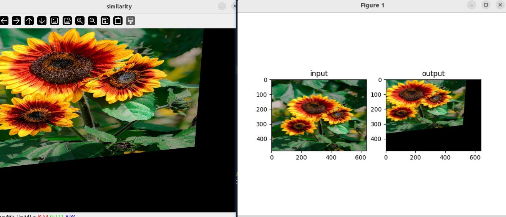


体现出不同边界方式和边界值的示例代码


```python
import cv2
import numpy as np
import matplotlib.pyplot as plt

# ============================================================
# 1. 读取图像
# ============================================================

# cv2.imread(path, 1)
# 参数 1 表示以彩色图像方式读取，读取结果是 BGR 格式
# 注意：OpenCV 默认颜色顺序是 BGR，不是 RGB
image = cv2.imread('./src/Python_demo/image.jpg', 1)

# 将图像缩放到固定大小，方便后续统一处理
# dsize=(640, 480) 表示输出图像宽为 640，高为 480
image = cv2.resize(src=image, dsize=(640, 480))

# ============================================================
# 2. 设置透视变换前后的四个对应点
# ============================================================

# src_pts 表示原图中需要矫正区域的四个角点
# 这四个点来自原始图像
#
# 点的顺序一般保持一致，例如：
# 左上、右上、左下、右下
#
# np.float32 是 OpenCV 计算透视变换矩阵时常用的数据类型
src_pts = np.float32([
    [148, 80],    # 左上角点
    [437, 114],   # 右上角点
    [94, 247],    # 左下角点
    [423, 288]    # 右下角点
])

# dst_pts 表示目标图像中的四个角点
# 也就是希望 src_pts 中的四个点分别变换到哪里
#
# 这里表示将原图中的四边形区域拉正为一个矩形区域：
# 左上角 -> [0, 0]
# 右上角 -> [320, 0]
# 左下角 -> [0, 178]
# 右下角 -> [320, 178]
dst_pts = np.float32([
    [0, 0],       # 目标左上角
    [320, 0],     # 目标右上角
    [0, 178],     # 目标左下角
    [320, 178]    # 目标右下角
])

# ============================================================
# 3. 生成透视变换矩阵
# ============================================================

# cv2.getPerspectiveTransform(src_pts, dst_pts)
# 根据变换前后的 4 对点，计算 3×3 的透视变换矩阵 M
#
# M 用来描述从原图坐标到目标图像坐标之间的映射关系
M = cv2.getPerspectiveTransform(src_pts, dst_pts)

# ============================================================
# 4. 关于 warpPerspective 中三个重要参数的说明
# ============================================================

# cv2.warpPerspective() 常用形式：
#
# dst = cv2.warpPerspective(
#     src=image,
#     M=M,
#     dsize=(640, 480),
#     flags=插值方式,
#     borderMode=边界方式,
#     borderValue=边界填充值
# )
#
# ------------------------------------------------------------
# flags：插值方式
# ------------------------------------------------------------
# 作用：
#   透视变换后，新图像中的像素点通常不会刚好对应原图中的整数坐标。
#   例如，新图像某个点可能对应原图中的坐标 (123.4, 56.7)。
#   但是图像像素只能在整数坐标上取值，所以需要通过插值计算像素值。
#
# 常见插值方式：
#   cv2.INTER_NEAREST：最近邻插值
#       直接取离目标坐标最近的原图像素值。
#       优点：速度快。
#       缺点：图像边缘可能有锯齿，效果较粗糙。
#
#   cv2.INTER_LINEAR：双线性插值
#       根据周围 4 个像素加权计算新像素值。
#       优点：效果较平滑，是 OpenCV 默认常用方式。
#       缺点：速度比最近邻稍慢。
#
#   cv2.INTER_CUBIC：三次插值
#       根据周围更多像素计算新像素值。
#       优点：效果更平滑。
#       缺点：计算量更大，速度更慢。
#
# ------------------------------------------------------------
# borderMode：边界方式
# ------------------------------------------------------------
# 作用：
#   透视变换时，有些目标图像中的像素点，反向映射回原图后，
#   可能落在原图范围之外。
#
#   例如原图大小是 640×480，
#   但是某个目标像素反向映射后得到原图坐标 (-10, 50)，
#   这个坐标已经超出了原图边界。
#
#   此时 OpenCV 就需要知道：
#   “超出原图范围的区域应该怎么处理？”
#
# 常见边界方式：
#   cv2.BORDER_CONSTANT：
#       使用一个固定颜色填充超出边界的区域。
#       这个固定颜色由 borderValue 指定。
#
#   cv2.BORDER_REPLICATE：
#       复制原图最边缘的像素来填充超出边界的区域。
#       这种方式不需要 borderValue。
#
# ------------------------------------------------------------
# borderValue：边界填充值
# ------------------------------------------------------------
# 作用：
#   当 borderMode=cv2.BORDER_CONSTANT 时，
#   用 borderValue 指定的颜色填充超出原图范围的区域。
#
# 注意：
#   borderValue 只有在 borderMode=cv2.BORDER_CONSTANT 时才生效。
#   如果 borderMode=cv2.BORDER_REPLICATE，
#   borderValue 不起作用。
#
# 对于彩色图像：
#   borderValue 是一个 BGR 格式的三元组。
#
# 例如：
#   borderValue=(0, 0, 0)         表示黑色
#   borderValue=(255, 255, 255)   表示白色
#   borderValue=(0, 0, 255)       表示红色
#   borderValue=(0, 255, 0)       表示绿色
#   borderValue=(255, 0, 0)       表示蓝色
#
# 注意这里是 BGR，不是 RGB。

# ============================================================
# 5. 最近邻插值 + 黑色边界填充
# ============================================================

# 这个结果用于观察最近邻插值的效果
#
# flags=cv2.INTER_NEAREST：
#   使用最近邻插值，速度最快，但图像可能有锯齿感
#
# borderMode=cv2.BORDER_CONSTANT：
#   超出原图范围的区域使用固定颜色填充
#
# borderValue=(0, 0, 0)：
#   固定填充颜色为黑色
#
# 总结：
#   如果变换后出现空白区域，这些区域会被填充为黑色
dst_nearest = cv2.warpPerspective(
    src=image,
    M=M,
    dsize=(640, 480),
    flags=cv2.INTER_NEAREST,
    borderMode=cv2.BORDER_CONSTANT,
    borderValue=(0, 0, 0)
)

# ============================================================
# 6. 双线性插值 + 黑色边界填充
# ============================================================

# 这个结果是最常用的透视变换设置之一
#
# flags=cv2.INTER_LINEAR：
#   使用双线性插值，图像效果比最近邻更平滑
#
# borderMode=cv2.BORDER_CONSTANT：
#   超出原图范围的区域使用固定颜色填充
#
# borderValue=(0, 0, 0)：
#   固定填充颜色为黑色
#
# 总结：
#   图像主体比较平滑，空白区域为黑色
dst_linear = cv2.warpPerspective(
    src=image,
    M=M,
    dsize=(640, 480),
    flags=cv2.INTER_LINEAR,
    borderMode=cv2.BORDER_CONSTANT,
    borderValue=(0, 0, 0)
)

# ============================================================
# 7. 三次插值 + 黑色边界填充
# ============================================================

# flags=cv2.INTER_CUBIC：
#   使用三次插值，图像通常比双线性插值更平滑
#   但是计算速度更慢
#
# borderMode=cv2.BORDER_CONSTANT：
#   超出原图范围的区域使用固定颜色填充
#
# borderValue=(0, 0, 0)：
#   固定填充颜色为黑色
#
# 总结：
#   图像可能更平滑，但运行速度比 INTER_LINEAR 慢
dst_cubic = cv2.warpPerspective(
    src=image,
    M=M,
    dsize=(640, 480),
    flags=cv2.INTER_CUBIC,
    borderMode=cv2.BORDER_CONSTANT,
    borderValue=(0, 0, 0)
)

# ============================================================
# 8. 双线性插值 + 白色边界填充
# ============================================================

# 这一组用来说明 borderValue 的作用
#
# flags=cv2.INTER_LINEAR：
#   插值方式仍然是双线性插值
#
# borderMode=cv2.BORDER_CONSTANT：
#   仍然使用固定颜色填充超出边界的区域
#
# borderValue=(255, 255, 255)：
#   这次固定填充颜色改为白色
#
# 和 dst_linear 的区别：
#   dst_linear 的 borderValue 是 (0, 0, 0)，所以边界是黑色
#   dst_white_border 的 borderValue 是 (255, 255, 255)，所以边界是白色
#
# 注意：
#   这里改变的是“边界填充值”，不是“边界方式”
#   边界方式仍然是 cv2.BORDER_CONSTANT
dst_white_border = cv2.warpPerspective(
    src=image,
    M=M,
    dsize=(640, 480),
    flags=cv2.INTER_LINEAR,
    borderMode=cv2.BORDER_CONSTANT,
    borderValue=(255, 255, 255)
)

# ============================================================
# 9. 双线性插值 + 复制边缘像素填充
# ============================================================

# 这一组用来说明 borderMode 的作用
#
# flags=cv2.INTER_LINEAR：
#   插值方式仍然是双线性插值
#
# borderMode=cv2.BORDER_REPLICATE：
#   超出原图范围的区域，不再使用固定颜色填充，
#   而是复制原图边缘的像素进行填充
#
# 这里没有写 borderValue：
#   因为 BORDER_REPLICATE 不需要固定填充值
#   即使写了 borderValue，也不会按照固定颜色填充
#
# 和 dst_white_border / dst_linear 的区别：
#   dst_linear：
#       borderMode 是 BORDER_CONSTANT，边界用黑色填充
#
#   dst_white_border：
#       borderMode 是 BORDER_CONSTANT，边界用白色填充
#
#   dst_replicate：
#       borderMode 是 BORDER_REPLICATE，边界复制原图边缘像素
#
# 重点区别：
#   borderMode 决定“用什么方式填边界”
#   borderValue 只是在 borderMode=BORDER_CONSTANT 时，
#   决定“固定填充颜色是什么”
dst_replicate = cv2.warpPerspective(
    src=image,
    M=M,
    dsize=(640, 480),
    flags=cv2.INTER_LINEAR,
    borderMode=cv2.BORDER_REPLICATE
)

# ============================================================
# 10. 使用 matplotlib 显示对比结果
# ============================================================

# 创建一个 12×8 英寸大小的显示窗口
plt.figure(figsize=(12, 8))

# 显示原图
plt.subplot(231)

# OpenCV 读取的图像是 BGR 格式
# matplotlib 显示图像时使用 RGB 格式
# 所以这里使用 image[:, :, ::-1] 将 BGR 转为 RGB
plt.imshow(image[:, :, ::-1])
plt.title('input')
plt.axis('off')

# 显示最近邻插值结果
plt.subplot(232)
plt.imshow(dst_nearest[:, :, ::-1])
plt.title('INTER_NEAREST')
plt.axis('off')

# 显示双线性插值结果
plt.subplot(233)
plt.imshow(dst_linear[:, :, ::-1])
plt.title('INTER_LINEAR')
plt.axis('off')

# 显示三次插值结果
plt.subplot(234)
plt.imshow(dst_cubic[:, :, ::-1])
plt.title('INTER_CUBIC')
plt.axis('off')

# 显示白色固定边界填充结果
plt.subplot(235)
plt.imshow(dst_white_border[:, :, ::-1])
plt.title('BORDER_CONSTANT White')
plt.axis('off')

# 显示复制边缘像素填充结果
plt.subplot(236)
plt.imshow(dst_replicate[:, :, ::-1])
plt.title('BORDER_REPLICATE')
plt.axis('off')

# 显示所有 matplotlib 图像
plt.show()

# ============================================================
# 11. OpenCV 窗口相关操作
# ============================================================

# 等待键盘输入
# 如果前面没有使用 cv2.imshow()，这里其实可以省略
cv2.waitKey(0)

# 关闭所有 OpenCV 创建的窗口
cv2.destroyAllWindows()
```

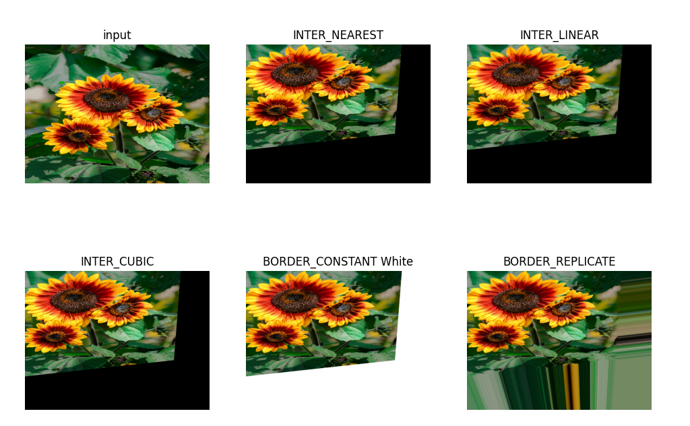

> 需要注意的是：
>
> - `cv2.getPerspectiveTransform()` 需要输入四组对应点
> - 四个点的顺序必须一一对应，即`src_pts` 和 `dst_pts` 中的点必须一一对应，并且顺序要一致。
> - 通常点的顺序可以设置为：**左上、右上、左下、右下**
> - $cv2.warpPerspective()使用的是 (3 \times 3) 变换矩阵$
> - 透视变换后，**平行线可能不再保持平行**
> - 透视变换能够处理更复杂的视角变化


### 3.4.4.5 阈值分割

在图像处理中，阈值处理是一种常用的技术，用于将图像转换为二值图像（即黑白图像）。通过设定一个阈值，可以将图像中的像素分为两类：高于阈值的像素和低于阈值的像素。

OpenCV 提供了多种阈值处理方法，我们将详细介绍三种常见的阈值处理技术：简单阈值处理、自适应阈值处理。

#### 简单阈值

简单阈值处理是最基础的阈值处理方法。它通过设定一个固定的阈值，将图像中的像素分为两类。

OpenCV 提供了 `cv2.threshold()` 函数来实现这一功能。

```
ret, binary = cv2.threshold(src, thresh, maxval, type)
```

**参数说明**

|   参数   |                       说明                       |
| :------: | :----------------------------------------------: |
|  `src`   |                  输入**灰度图**                  |
| `thresh` |                       阈值                       |
| `maxval` | 当像素满足阈值条件时赋予的值，二值化时常用 `255` |
|  `type`  |                     阈值类型                     |

常见的Type有：

|           型            |                             说明                             |
| :---------------------: | :----------------------------------------------------------: |
|   `cv2.THRESH_BINARY`   |     如果像素值大于阈值，则赋予 `maxval`，否则赋予 `0`。      |
| `cv2.THRESH_BINARY_INV` | 与 `cv2.THRESH_BINARY` 相反，如果像素值大于阈值，则赋予 `0`，否则赋予 `maxval`。 |
|   `cv2.THRESH_TRUNC`    |        如果像素值大于阈值，则赋予阈值，否则保持不变。        |
|   `cv2.THRESH_TOZERO`   |        如果像素值大于阈值，则保持不变，否则赋予 `0`。        |
| `v2.THRESH_TOZERO_INV`  | 与 `cv2.THRESH_TOZERO` 相反，如果像素值大于阈值，则赋予 `0`，否则保持不变。 |
|    `cv2.THRESH_OTSU`    |        常应用于前景和背景灰度差异明显的图像，自动阈值        |

**返回值**

- `retval`: 实际使用的阈值（在某些情况下可能与设定的阈值不同）。
- `dst`: 处理后的图像。

##### 1.简单用法

这里直接以代码进行讲解

```python
import cv2
import numpy as np

# 读取图像
img = cv2.imread('image.jpg', 0)

# 简单阈值处理
ret, thresh1 = cv2.threshold(img, 127, 255, cv2.THRESH_BINARY)

# 显示结果
cv2.imshow('Binary Threshold', thresh1)
cv2.waitKey(0)
cv2.destroyAllWindows()
```

最终效果是将127以下的像素值为0,高于127像素值复赋值255,即最终返回二值图。

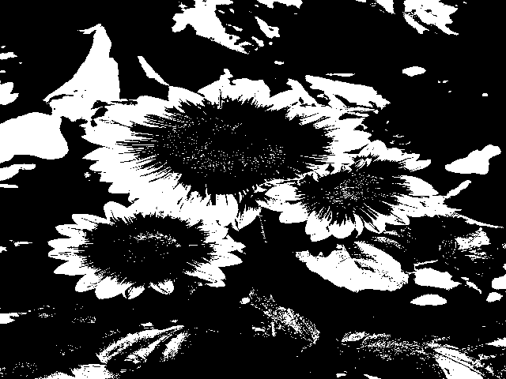

##### 2.  Otsu's 二值化组合用法

Otsu's 二值化是一种自动确定阈值的方法。它通过最大化类间方差来找到最佳的全局阈值，适用于双峰图像（即图像直方图有两个明显的峰值）。

和简单用法区别就是，在函数填写Type时候，通常为 `cv2.THRESH_BINARY` 或 `cv2.THRESH_BINARY_INV`，并加上 `cv2.THRESH_OTSU`。

仍然直接以代码展示：

```python
import cv2
import numpy as np

# 读取图像
img = cv2.imread('./src/Python_demo/image.jpg', 0)
img = cv2.resize(img,(640,480))
# 简单阈值处理
ret, binary = cv2.threshold(
    img,
    0,
    255,
    cv2.THRESH_BINARY + cv2.THRESH_OTSU
)

# 显示结果
cv2.imshow('Binary Threshold', binary)
cv2.waitKey(0)
cv2.destroyAllWindows()
```

> 说明：这里虽然 `thresh` 写的是 `0`，但实际不会用这个 0，你可以打印出ret检查
>
> 原因：cv2.THRESH_BINARY + cv2.THRESH_OTSU组合用法，不是表示“执行两个阈值类型”，而是表示使用 `THRESH_BINARY` 这种二值化规则，同时让 OTSU 自动计算阈值。也就是说：
>
> THRESH_BINARY      决定：超过阈值后怎么赋值，
>
> THRESH_OTSU        决定：阈值由算法自动计算

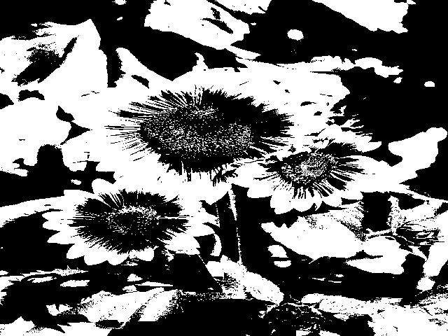

#### 自适应阈值处理

在某些情况下，图像的亮度分布不均匀，使用固定的阈值可能无法得到理想的效果。自适应阈值处理通过为图像的不同区域计算不同的阈值，从而更好地处理这种情况。

OpenCV中提供函数

```
dst = cv2.adaptiveThreshold(src, maxValue, adaptiveMethod, thresholdType, blockSize, C)
```

**参数说明**

| 参数 | 说明 |
|:-:|:-:|
| `src` | 输入图像，通常为灰度图像 |
| `maxValue` | 当像素值超过或小于阈值时，赋予的新值，通常为 `255` |
| `adaptiveMethod` | 自适应阈值计算方法 |
| `thresholdType` | 阈值处理类型，通常为 `cv2.THRESH_BINARY` 或 `cv2.THRESH_BINARY_INV` |
| `blockSize` | 计算阈值时使用的邻域大小，必须为奇数 |
| `C` | 从平均值或加权平均值中减去的常数 |

常用的Type为：

| 类型 | 说明 |
|:-:|:-:|
| `cv2.ADAPTIVE_THRESH_MEAN_C` | 阈值是邻域的平均值减去常数 `C` |
| `cv2.ADAPTIVE_THRESH_GAUSSIAN_C` | 阈值是邻域的加权平均值减去常数 `C`，权重由高斯函数确定 |

**返回值**

- `dst`: 处理后的图像。

```python
import cv2
import numpy as np

# 读取图像
img = cv2.imread('./src/Python_demo/image.jpg', 0)
img = cv2.resize(img,(640,480))
# 自适应阈值处理
binary = cv2.adaptiveThreshold(
    img,
    255,
    cv2.ADAPTIVE_THRESH_GAUSSIAN_C,
    cv2.THRESH_BINARY,
    11,
    2
)

# 显示结果
cv2.imshow('Binary Threshold', binary)
cv2.waitKey(0)
cv2.destroyAllWindows()
```

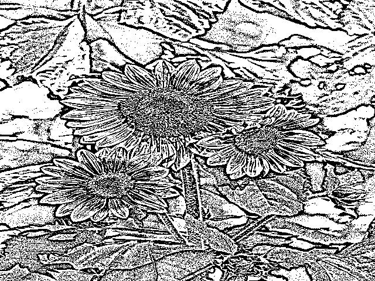

> 你是否会产生疑惑？既然Otsu和 `adaptiveThreshold()`都能自动去确定阈值，那么他是否能替换使用？
>
> 答案是：不能，而且通常不建议互相替代。
>
> `THRESH_OTSU` 和 `adaptiveThreshold()`虽然二者都可以避免手动指定固定阈值，但它们的计算方式和适用场景并不一样。 ：
>
> ​		`THRESH_OTSU` 它会根据整张灰度图像的像素分布，自动计算出一个最合适的全局阈值。 也就是说，整张图像最终只会使用同一个阈值。
>
> ​		`adaptiveThreshold()` 它不会给整张图像使用同一个阈值，而是会根据每个像素周围邻域的灰度情况，动态计算该位置附近的局部阈值。 也就是说，不同区域可能使用不同的阈值。
>
> 也就是说，一个全局取得出一个阈值，另一个是根据对应坐标周围的去计算阈值，所以可见，不能替换，那么什么时候用Otsu什么时候用adaptiveThreshold？
>
> 适合 Otsu 的情况： 背景亮度比较统一 、前景和背景差异明显也就是适合光照均匀、前景背景区分明显的图像。
>
> 适合 adaptiveThreshold 的情况： 适合光照不均、阴影明显、局部亮度变化较大的图像。


### 3.4.4.6 平滑滤波

在图像处理中，平滑处理（也称为模糊处理）是一种常见的操作，用于减少图像中的噪声或细节。

OpenCV 提供了多种平滑处理的方法，我们这里将详细讲解四种常用的平滑处理技术：均值滤波、高斯滤波、中值滤波和双边滤波。

在讲解执之前，我们需要对滤波核进行讲解，方便后续滤波原理的理解。

#### 1. 滤波核

滤波核（Kernel）也可以理解为一个小窗口，它会在图像上从左到右、从上到下不断滑动，每滑动到一个位置，就会覆盖图像中的一小块区域，然后根据这块区域内的像素值都进行了加权平均运算，计算出中心像素的新值。我们假定滤波核如下：

```math
\begin{bmatrix}
1 & 0 & 1 \\
0 & 1 & 0 \\
1 & 0 & 1
\end{bmatrix}
```

正如下图我们使用下面这个卷积模板进行图像卷积运算，其结果就如动图那样，每个像素值都进行了加权平均运算。

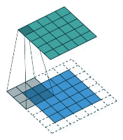

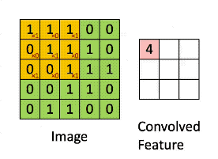

在滤波中，滤波核Kernel对最终结果影响显著，`ksize` 越大，参与平均计算的像素越多，图像会变得越平滑，但是同时，图像也会变得越模糊。


| 滤波核大小 |              效果              |
| :--------: | :----------------------------: |
|  `(3, 3)`  |   平滑程度较弱，细节保留较多   |
|  `(5, 5)`  |  平滑效果更明显，图像轻微模糊  |
|  `(9, 9)`  | 平滑效果很强，但图像会明显模糊 |


#### 2. 均值滤波

均值滤波是图像平滑处理中最简单、最常见的方法之一。

它的核心思想是：用当前像素周围邻域像素的平均值，替换当前像素的值。也就是说，均值滤波会让图像中每个像素都参考周围像素的值，从而减小像素之间的突变，使图像变得更加平滑。

均值滤波在去除噪声起到很大作用，但是也会模糊图像的边缘和细节信息，因为图像边缘本身就是灰度变化比较明显的地方，而均值滤波会把这种变化“平均掉”。

在 OpenCV 中，可以使用 `cv2.blur()` 实现均值滤波。

```python
dst = cv2.blur(src, ksize)
```

**参数说明**

| 参数 | 说明 |
|:-:|:-:|
| `src` | 输入图像即可以是灰度图也可以是彩色图。 |
| `ksize` | 滤波核大小，格式为 `(width, height)` |

**返回值**

- dst：输出图像，即均值滤波后的结果。

> 其中，`ksize` 表示参与平均计算的邻域大小，即在该点周围每个像素的加权值一样！比如（3，3）表示当前像素周围 `3 × 3` 区域计算平均值。


 简单代码示例：

```python
import cv2

# 读取图像
image = cv2.imread('image.jpg')

# 应用均值滤波
blurred_image = cv2.blur(image, (5, 5))

# 显示结果
cv2.imshow('Original Image', image)
cv2.imshow('Blurred Image', blurred_image)

cv2.waitKey(0)
cv2.destroyAllWindows()
```


> 说明：对输入的灰度图进行滤波很好理解，对于彩色图也是可以进行滤波，原理就是会分别对R、G、B三个通道分别进行滤波，也就是说彩色图像的每个通道就会单独进行平均值计算，最后再组合成一张新的彩色图像。


#### 3. 高斯滤波

高斯滤波是一种基于高斯函数的平滑处理方法。与均值滤波不同，高斯滤波在计算像素平均值时，会给中心像素赋予更高的权重，而给边缘像素赋予较低的权重。

高斯滤波在去除噪声的同时，能够更好地保留图像的边缘信息。

在 OpenCV 中，可以使用`cv2.GaussianBlur()` 实现高斯滤波。

```
dst=cv2.GaussianBlur(src，Ksize，Sigma)
```

**参数说明**

|  参数   |                      说明                       |
| :-----: | :---------------------------------------------: |
|  `src`  |     输入图像即可以是灰度图也可以是彩色图。      |
| `ksize` |      滤波核大小，格式为 `(width, height)`       |
| `Sigma` | 高斯核的标准差，如果为0，则根据核大小自动计算。 |

> Sigma：决定高斯函数的平滑程度。值越大，边缘越模糊。
>
> **ksize**：决定滤波器的尺寸。值越大，图像越模糊。

**返回值**

- dst：输出图像，即高斯滤波后的结果。

> 相比均值滤波，高斯滤波适用于去除图像中的高斯噪声，并且在保留图像边缘信息方面表现较好。

简单代码示例：

```python
import cv2
import numpy as np

# 读取图像
img = cv2.imread('./src/Python_demo/image.jpg', 0)
img = cv2.resize(img,(640,480))

# 应用高斯滤波
blurred_image = cv2.GaussianBlur(img, (5, 5), 0)


# 显示结果
cv2.imshow('Binary Threshold', blurred_image)
cv2.waitKey(0)
cv2.destroyAllWindows()
```


#### 4. 中值滤波

中值滤波是一种非线性平滑处理方法。它的原理是将图像中每个像素的值替换为其周围像素的中值，中值滤波在去除椒盐噪声（即图像中随机出现的黑白点）时非常有效，因此通常中值滤波一般处理二值图。

在 OpenCV 中，可以使用`cv2.medianBlur()` 实现中值滤波。

```python
dst = cv2.medianBlur(src, ksize)
```

**参数解释**

|  参数   |             说明             |
| :-----: | :--------------------------: |
|  `src`  |    输入图像一般是二值图。    |
| `ksize` | 滤波核大小，**必须是奇数**！ |

**返回值**

- dst：输出图像，即中值滤波后的结果。

> 中值滤波适用于去除图像中的椒盐噪声，并且在保留图像边缘信息方面表现较好。


代码示例：

```python
import cv2
import numpy as np

# 读取图像
img = cv2.imread('./src/Python_demo/image.jpg', 0)
img = cv2.resize(img,(640,480))

# 应用中值滤波
blurred_image = cv2.medianBlur(img, 5)


# 显示结果
cv2.imshow('Binary Threshold', blurred_image)
cv2.waitKey(0)
cv2.destroyAllWindows()
```


#### 5. 双边滤波

双边滤波是一种非线性的平滑处理方法，它结合了空间邻近度和像素值相似度。

与高斯滤波不同，双边滤波在平滑图像的同时，能够保留图像的边缘信息。这是因为双边滤波不**仅考虑像素之间的空间距离**，**还考虑像素值之间的差异**。

在 OpenCV 中，可以使用` cv2.bilateralFilter()` 实现中值滤波。

```
cv2.bilateralFilter(src, d, sigmaColor, sigmaSpace[, dst[, borderType]])
```


**参数说明**

| 参数 | 说明 |
|:-:|:-:|
| `src` | 输入图像，可以是灰度图，也可以是彩色图 |
| `d` | 滤波时每个像素邻域的直径，也就是参与计算的像素范围 |
| `sigmaColor` | 颜色空间的标准差，用来控制像素值差异对滤波结果的影响 |
| `sigmaSpace` | 坐标空间的标准差，用来控制像素距离远近对滤波结果的影响 |

**返回值**

- dst：输出图像，即双边滤波后的结果。


代码示例：

```python
import cv2
import numpy as np

# 读取图像
img = cv2.imread('./src/Python_demo/image.jpg', 0)
img = cv2.resize(img,(640,480))

# 应用中值滤波
blurred_image = cv2.bilateralFilter(img, 9, 75, 75)


# 显示结果
cv2.imshow('Binary Threshold', blurred_image)
cv2.waitKey(0)
cv2.destroyAllWindows()
```


### 3.4.4.7 边缘检测

 图像边缘检测是计算机视觉和图像处理中的一项基本任务，它用于识别图像中亮度变化明显的区域，这些区域通常对应于物体的边界。简单来说，边缘检测就是找到图像中灰度或者颜色变化明显的位置，然后把这些边缘提取出来，经过内部处理，返回一张边缘图，通常是二值图是。

边缘检测据比如说检测物体和背景的交界处、文字和纸张的交界处、圆和背景之间的分解出等。

在OpenCV中，对边缘检测提供了多种函数，这里我们将讲解以下四种常用的边缘检测函数：

|       **函数**        |    **算法**    |                     **说明**                     |          **适用场景**          |
| :-------------------: | :------------: | :----------------------------------------------: | :----------------------------: |
|   **`cv2.Canny()`**   | Canny 边缘检测 |    多阶段算法，检测效果较好，噪声抑制能力强。    | 通用边缘检测，适合大多数场景。 |
|   **`cv2.Sobel()`**   |   Sobel 算子   | 基于一阶导数的边缘检测，可以检测水平和垂直边缘。 |      检测水平和垂直边缘。      |
|  **`cv2.Scharr()`**   |  Scharr 算子   |     Sobel 算子的改进版本，对边缘的响应更强。     |        检测细微的边缘。        |
| **`cv2.Laplacian()`** | Laplacian 算子 |       基于二阶导数的边缘检测，对噪声敏感。       |        检测边缘和角点。        |

接下来依次经行讲解。

#### 1. Canny

Canny 边缘检测算法主要包括以下几个步骤：

1. **噪声抑制**：使用高斯滤波器对图像进行平滑处理，以减少噪声的影响。
2. **计算梯度**：使用 Sobel 算子计算图像的梯度幅值和方向。
3. **非极大值抑制**：沿着梯度方向，保留局部梯度最大的像素点，抑制其他像素点。
4. **双阈值检测**：使用两个阈值（低阈值和高阈值）来确定真正的边缘。高于高阈值的像素点被认为是强边缘，低于低阈值的像素点被抑制，介于两者之间的像素点如果与强边缘相连则保留。
5. **边缘连接**：通过滞后阈值处理，将弱边缘与强边缘连接起来，形成完整的边缘。


在 OpenCV 中，可以使用 `cv2.Canny()` 函数来实现 Canny 边缘检测。

```
edges = cv2.Canny(image, threshold1, threshold2, apertureSize=3, L2gradient=False)
```

**参数说明**

| 参数 | 说明 |
|:-:|:-:|
| `image` | 输入图像，通常是**灰度图** |
| `threshold1` | 低阈值，当像素值低于该阈值，将会被丢弃，即认为不是边缘 |
| `threshold2` | 高阈值，当像素值高于该阈值，将会被保留，即认为一定是边缘 |
| `apertureSize` | Sobel 算子的孔径大小，默认为 3 |
| `L2gradient` | 是否使用 L2 范数计算梯度幅值，默认为 False（使用 L1 范数）。 |

**返回值**

- edges：输出结果，即边缘检测后的图像。

> 注意：Canny 通常建议输入灰度图，若果输入是彩色图，一般会边缘检测前转换成**灰度图**。
>
> 当像素值在最小阈值和最大阈值之间，那么会判断，如果这个像素和`threshold2`相连，那么会保留，即认为是边缘，否则丢弃。


代码示例：


```python
import cv2
import numpy as np

# 读取图像
img = cv2.imread('./src/Python_demo/image.jpg', 0)
img = cv2.resize(img,(640,480))


edges = cv2.Canny(img, 100, 200)


# 显示结果
cv2.imshow('Binary Threshold', edges)
cv2.waitKey(0)
cv2.destroyAllWindows()
```

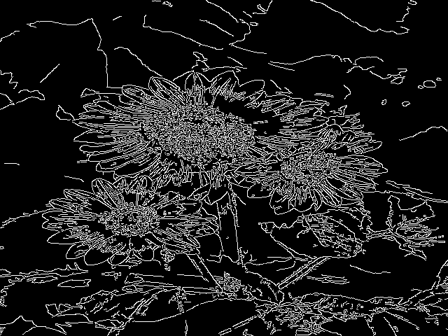

#### 2.Sobel 算子 

Sobel 算子是一种基于梯度的边缘检测算子，它通过计算图像在水平和垂直方向上的梯度来检测边缘。

Sobel 算子结合了高斯平滑和微分操作，因此对噪声具有一定的抑制作用。

**Sobel算子原理**：

Sobel 算子使用两个 3x3 的卷积核分别计算图像在水平和垂直方向上的梯度：

- 水平方向的卷积核：

​		

```math
\begin{bmatrix}
-1 & 0 & 1 \\
-2 & 0 & 2 \\
-1 & 0 & 1
\end{bmatrix}
```


- 垂直方向的卷积核：

```math
\begin{bmatrix}
-1 & -2 & -1 \\
0 & 0 & 0 \\
1 & 2 & 1
\end{bmatrix}
```


通过这两个卷积核，可以分别得到图像在水平和垂直方向上的梯度 `Gx` 和 `Gy`。最终的梯度幅值可以通过以下公式计算：


```math
G = \sqrt{Gx^2 + Gy^2}
```


>  `sobel_x` 检测的是水平方向变化，它的卷积核在计算后，表示的效果是右边像素 - 左边像素，也就是
>
> ​		如果右边比左边亮，结果是正数
>
> ​		如果左边比右边亮，结果是负数
>
> ​		如果左右差不多，结果接近 0
>
>  因此，差值越大，代表的是变化程度大，即我们查看他反映的梯度变化图像应该是采用绝对值。
>
> 
>
> 对于`sobel_y`同理！


在 OpenCV 中，可以使用 `cv2.Sobel()` 函数来计算图像的梯度。该函数的原型如下：

```
dst = cv2.Sobel(src, ddepth, dx, dy, ksize=3, scale=1, delta=0, borderType=cv2.BORDER_DEFAULT)
```


**参数说明**

|     参数     |                   说明                    |
| :----------: | :---------------------------------------: |
|    `src`     |         输入图像，一般是灰度图。          |
|   `ddepth`   |   输出图像的深度，通常使用 `cv2.CV_64F`   |
|     `dx`     |            x 方向上的导数阶数             |
|     `dy`     |            y 方向上的导数阶数             |
|   `ksize`    |        Sobel 核的大小，默认为 `3`         |
|   `scale`    |           缩放因子，默认为 `1`            |
|   `delta`    |        可选的 delta 值，默认为 `0`        |
| `borderType` | 边界填充类型，默认为 `cv2.BORDER_DEFAULT` |

> 适合计算 x 或 y 方向的梯度变化。

**返回值**

- sobel_x ：返回反映x方向梯度变化的灰度图，也就是表示图像在 x 方向上的一阶导数结果。
- sobel_y ：返回反映y方向梯度变化的灰度图，也就是表示图像在 y 方向上的一阶导数结果。

代码示例：

```python
import cv2
import numpy as np

img = cv2.imread('./src/Python_demo/image.jpg', 0)
img = cv2.resize(img, (640, 480))

sobel_x = cv2.Sobel(img, cv2.CV_64F, 1, 0, ksize=3)
sobel_y = cv2.Sobel(img, cv2.CV_64F, 0, 1, ksize=3)

# x方向梯度绝对值
sobel_x_abs = cv2.convertScaleAbs(sobel_x)

# y方向梯度绝对值
sobel_y_abs = cv2.convertScaleAbs(sobel_y)

# 综合梯度幅值
sobel_combined = np.sqrt(sobel_x ** 2 + sobel_y ** 2)

# 转成 uint8，方便 OpenCV 按普通图像显示
sobel_combined = np.uint8(sobel_combined)

cv2.imshow('Original', img)
cv2.imshow('Sobel X Abs', sobel_x_abs)
cv2.imshow('Sobel Y Abs', sobel_y_abs)
cv2.imshow('Sobel Combined', sobel_combined)

cv2.waitKey(0)
cv2.destroyAllWindows()
```


> 说明代码 类型转换：
>
> 在计算综合梯度时，代码使用了：sobel_combined = np.sqrt(sobel_x^2 + sobel_y^2)，由于这里进行了平方和开平方运算，得到的 `sobel_combined` 通常是浮点数类型，例如 `float64`。
>
> 需要注意的是，`cv2.imshow()` 在显示不同数据类型的图像时，对像素值范围的理解不同：
>
> - 对于 `uint8` 图像，OpenCV 按照 `0 ~ 255` 的范围显示；
> - 对于浮点数图像，OpenCV 通常按照 `0.0 ~ 1.0` 的范围显示。
>
> 而 Sobel 计算得到的梯度幅值往往不是 `0.0 ~ 1.0`，而可能是：10.0、50.0、100.0、160等
>
> 因此，如果直接将 `sobel_combined` 传入 `cv2.imshow()` 显示，即使像素值只有 `10.0`，也可能已经被当作接近白色处理，导致大量区域显示过亮，从而看不清真实的梯度纹理和边缘变化。
>
> 所以需要对结果进行类型转换，将浮点数类型转换为无符号 8 位整数类型，这样OpenCV对像素值的范围就变成了0~255了
>
> 


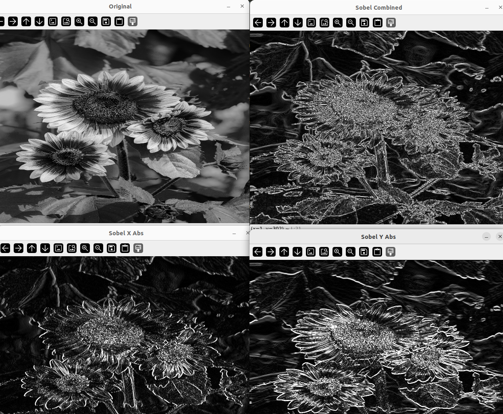


#### 3. Laplacian 算子

Laplacian 算子是一种二阶微分算子，它通过计算图像的二阶导数来检测边缘。Laplacian 算子对噪声比较敏感，因此通常在使用之前会对图像进行高斯平滑处理。

**Laplacian 算子的原理**

Laplacian 算子使用以下卷积核来计算图像的二阶导数，会同时考虑 x 方向和 y 方向的二阶梯度变化：

```math
\begin{bmatrix}
0 & 1 & 0 \\
1 & 4 & 1 \\
0 & 1 & 0
\end{bmatrix}
```

通过这个卷积核计算后可以得到图像的 Laplacian 值，Laplacian 值较大的区域通常对应于图像的边缘。

$卷积核计算结果等同于 dst = ∂²I/∂x² + ∂²I/∂y²$

在 OpenCV 中，可以使用 `cv2.Laplacian()` 函数来计算图像的 Laplacian 值。

```
dst = cv2.Laplacian(src, ddepth, ksize=1, scale=1, delta=0, borderType=cv2.BORDER_DEFAULT)
```

**参数说明**

|     参数     |                   说明                    |
| :----------: | :---------------------------------------: |
|    `src`     |                 输入图像                  |
|   `ddepth`   |   输出图像的深度，通常使用 `cv2.CV_64F`   |
|   `ksize`    |      Laplacian 核的大小，默认为 `1`       |
|   `scale`    |           缩放因子，默认为 `1`            |
|   `delta`    |       可选的 `delta` 值，默认为 `0`       |
| `borderType` | 边界填充类型，默认为 `cv2.BORDER_DEFAULT` |


**返回值**

- dst：返回反映图像灰度二阶变化的图像，也可以理解为综合检测图像边缘变化的结果图


> Laplacian 算子计算对噪声敏感，通常先模糊去噪。

代码示例

```python
import cv2
import numpy as np

img = cv2.imread('./src/Python_demo/image.jpg', 0)
img = cv2.resize(img, (640, 480))


laplacian = cv2.Laplacian(img, cv2.CV_64F)

cv2.imshow('laplacian', laplacian)

cv2.waitKey(0)
cv2.destroyAllWindows()
```

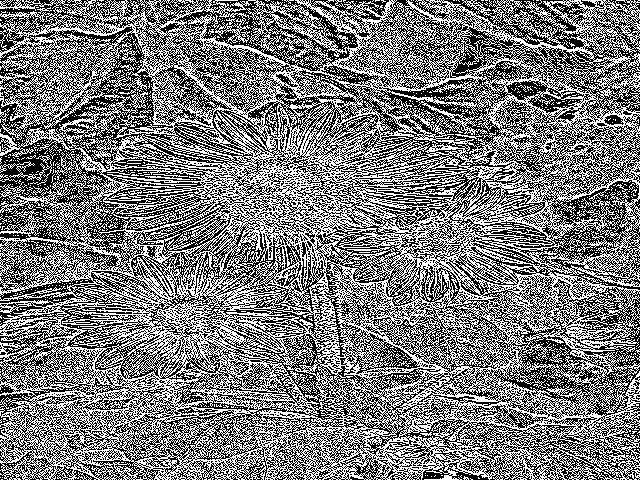

### 3.4.4.68轮廓提取

轮廓检测是图像处理中的重要任务，用于提取图像中物体的边界，轮廓就是物体边界点的集合，轮廓之间可以是嵌套关系，比如一个轮廓可以包含另一个轮廓，比圆环就是外层圆这层轮廓，内部嵌套了一层内圆。

对于之前学习的边缘检测检测得到的是边缘，而轮廓检测就是根据这个边缘来判断这一圈边界属于哪个物体。一般的轮廓特征有轮廓的面积、周长、边界矩形、最小外界矩形、最小外界圆等。

**轮廓检测常用函数**

|          函数名称          |        功能描述        |
| :------------------------: | :--------------------: |
|    `cv2.findContours()`    |    查找图像中的轮廓    |
|    `cv2.drawContours()`    |    在图像上绘制轮廓    |
|    `cv2.contourArea()`     |     计算轮廓的面积     |
|     `cv2.arcLength()`      |  计算轮廓的周长或弧长  |
|    `cv2.boundingRect()`    |   计算轮廓的边界矩形   |
|    `cv2.minAreaRect()`     | 计算轮廓的最小外接矩形 |
| `cv2.minEnclosingCircle()` |  计算轮廓的最小外接圆  |
|    `cv2.approxPolyDP()`    |  对轮廓进行多边形近似  |

接下来我们一次对常用的函数进行讲解。

#### 1.  cv2.findContours()


该函数用于**在二值图**像中查找轮廓。轮廓是图像中具有相同颜色或强度的连续点的曲线。在OpenCV中提供函数如下

```
contours, hierarchy = cv2.findContours(image, mode, method)
```


**参数描述**

|   参数   |                             说明                             |
| :------: | :----------------------------------------------------------: |
| `image`  | 输入图像，通常二值图（**通常为经过阈值处理或边缘检测后的图像**） |
|  `mode`  |                         轮廓检索模式                         |
| `method` |                         轮廓近似方法                         |

一般常见的轮廓模式有：

|        模式         |         说明         |
| :-----------------: | :------------------: |
| `cv2.RETR_EXTERNAL` |      只找外轮廓      |
|   `cv2.RETR_LIST`   | 找全部轮廓，不建层级 |
|   `cv2.RETR_TREE`   |  找全部轮廓，建层级  |

常见的轮廓近似方法有：

|           方法            |     说明     |
| :-----------------------: | :----------: |
| `cv2.CHAIN_APPROX_SIMPLE` | 压缩点，常用 |
|  `cv2.CHAIN_APPROX_NONE`  |  保存所有点  |

**返回值**

- `contours`: 检测到的轮廓列表。
- `hierarchy`: 轮廓的层次结构信息。

#### 2. cv2.drawContours()

该函数用于在图像上绘制检测到的轮廓。在OpenCV中提供函数：

```
cv2.drawContours(image, contours, contourIdx, color, thickness, lineType, hierarchy, maxLevel, offset)
```


**参数说明**

|     参数     | 是否必填 |                      说明                      |
| :----------: | :------: | :--------------------------------------------: |
|   `image`    |   必填   | 要绘制轮廓的目标图像，函数**会直接修改这张图** |
|  `contours`  |   必填   |     轮廓列表，由 `cv2.findContours()` 得到     |
| `contourIdx` |   必填   |   指定绘制第几个轮廓，`-1` 表示绘制所有轮廓    |
|   `color`    |   必填   |     轮廓颜色，例如 `(0, 255, 0)` 表示绿色      |
| `thickness`  |   可选   |   轮廓线宽，正数表示线宽；`-1` 表示填充轮廓    |
|  `lineType`  |   可选   |   线条类型，例如 `cv2.LINE_8`、`cv2.LINE_AA`   |
| `hierarchy`  |   可选   |   轮廓层级信息，由 `cv2.findContours()` 返回   |
|  `maxLevel`  |   可选   |   绘制轮廓的最大层级，配合 `hierarchy` 使用    |
|   `offset`   |   可选   |         轮廓点的偏移量，例如 `(x, y)`          |

> 说明：强调OpenCV绘图坐标和Numpy索引行列，所以这里偏移量格式是（x，y）
>
> |           场景           |     写法      |              含义              |
> | :----------------------: | :-----------: | :----------------------------: |
> | OpenCV 绘图坐标 / 点坐标 |   `(x, y)`    | `x` 表示横坐标，`y` 表示纵坐标 |
> |      NumPy 图像索引      | `image[y, x]` |     先写行 `y`，再写列 `x`     |

**返回值**

无返回值，直接在输入图像上绘制轮廓。


代码示例

```python
import cv2
import numpy as np

img = cv2.imread('./src/Python_demo/image.jpg', 0)
img = cv2.resize(img, (640, 480))

# 二值化处理
_, binary = cv2.threshold(img, 127, 255, cv2.THRESH_BINARY)
# 查找轮廓
contours, hierarchy = cv2.findContours(binary, cv2.RETR_TREE, cv2.CHAIN_APPROX_SIMPLE)

ima_copy = img.copy()

cv2.drawContours(ima_copy, contours, -1, (255, 0, 0), 2)
cv2.imshow('contours', ima_copy)

cv2.waitKey(0)
cv2.destroyAllWindows()
```

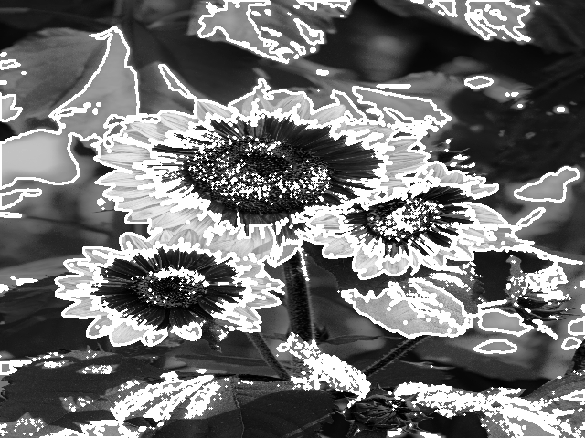

#### 3. cv2.contourArea()

该函数用于计算轮廓的面积。在OpenCV中提供函数：

```
area = cv2.contourArea(contour, oriented)
```

**参数说明**

|    参数    | 是否必填 |                        说明                        |
| :--------: | :------: | :------------------------------------------------: |
| `oriented` |   选填   | 是否返回有符号的面积，如果为True，返回有符号的面积 |
| `contours` |   必填   |       轮廓列表，由 `cv2.findContours()` 得到       |

**返回值**

- area：轮廓的面积

代码示例：

```python
for contour in contours:
    area = cv2.contourArea(contour)
    if area < 100:
        continue
```

> 对于面积低于100可能是噪音造成的轮廓，此时我们不需要这样的轮廓，通过该函数可以对噪音的轮廓进行剔除，常用于过滤小噪声。

代码示例：

```python
import cv2
import numpy as np

img = cv2.imread('./src/Python_demo/image.jpg')
img = cv2.resize(img, (640, 480))

gray = cv2.cvtColor(img, cv2.COLOR_BGR2GRAY)

blur = cv2.GaussianBlur(gray, (5, 5), 0)
edges = cv2.Canny(blur, 100, 200)

kernel = np.ones((3, 3), np.uint8)
#Canny 边缘线经常是断的，可以先做膨胀或闭运算
edges_dilate = cv2.dilate(edges, kernel, iterations=1)

contours, _ = cv2.findContours(
    edges_dilate,
    cv2.RETR_EXTERNAL,
    cv2.CHAIN_APPROX_SIMPLE
)

output = img.copy()

for contour in contours:
    area = cv2.contourArea(contour)
    if area < 100:
        continue

    cv2.drawContours(output, [contour], -1, (0, 255, 0), 2)

cv2.imshow('Original', img)
cv2.imshow('Edges', edges)
cv2.imshow('Dilated Edges', edges_dilate)
cv2.imshow('Contours', output)
cv2.waitKey(0)
cv2.destroyAllWindows()
```

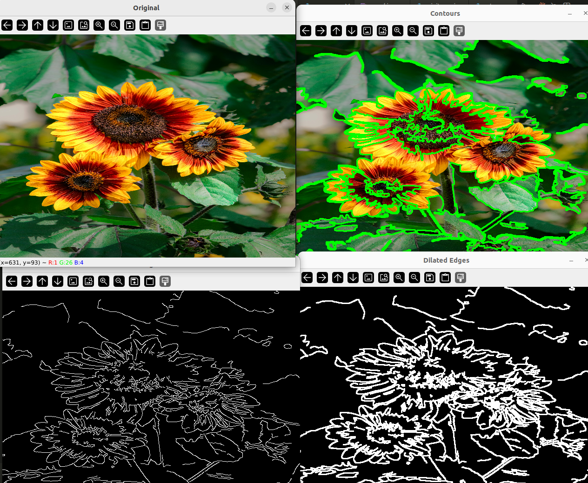


#### 4. cv2.arcLength()

该函数用于计算轮廓的周长或弧长。在OpenCV中提供函数：

```
length = cv2.arcLength(curve, closed)
```

**参数说明**

|   参数   | 是否必填 |                        说明                        |
| :------: | :------: | :------------------------------------------------: |
| `curve`  |   必填   | 轮廓列表，由 `cv2.findContours()` 得到结果的元素。 |
| `closed` |   必填   |             布尔值，表示轮廓是否闭合。             |

**返回值**:

- length：轮廓的周长或弧长


代码示例

```python
for contour in contours:
    perimeter = cv2.arcLength(contour, True)
    print(f"Contour perimeter: {perimeter}")
```


#### 5. cv2.boundingRect()

该函数用于计算轮廓的边界矩形。在OpenCV中提供函数：

```
x, y, w, h = cv2.boundingRect(points)
```

**参数说明**

- `points`: 输入的轮廓点集。

**返回值**

- 边界矩形的左上角坐标 `(x, y)` 和宽度 `w`、高度 `h`。

代码示例：

```python
for contour in contours:
    x, y, w, h = cv2.boundingRect(contour)
    cv2.rectangle(image, (x, y), (x + w, y + h), (0, 255, 0), 2)
cv2.imshow('Bounding Rectangles', image)
cv2.waitKey(0)
```

> 补充：cv2.rectangle(img, pt1, pt2, color, thickness)参数介绍：
>
> |    参数     |                含义                 |
> | :---------: | :---------------------------------: |
> |    `img`    |          要绘制矩形的图像           |
> |    `pt1`    |           矩形左上角坐标            |
> |    `pt2`    |           矩形右下角坐标            |
> |   `color`   |              矩形颜色               |
> | `thickness` | 矩形线条厚度，`-1` 表示填充整个矩形 |


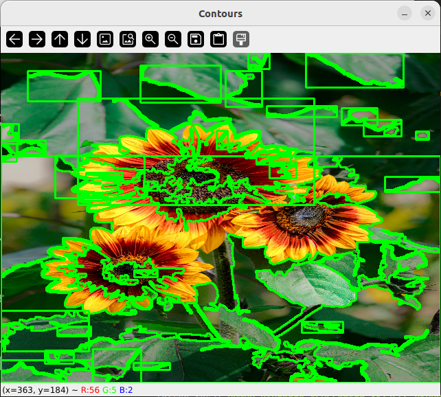


#### 6. cv2.minAreaRect()

该函数用于计算轮廓的最小外接矩形（旋转矩形）。在OpenCV中提供函数：

```
rect = cv2.minAreaRect(points)
```

**参数说明**:

- `points`: 输入的轮廓点集。

**返回值**:

- 返回一个旋转矩形，包含中心点 `(x, y)`、宽度、高度和旋转角度。

代码示例：

```python
for contour in contours:
    rect = cv2.minAreaRect(contour)
    box = cv2.boxPoints(rect)
    box = np.int0(box)
    cv2.drawContours(image, [box], 0, (0, 0, 255), 2)
cv2.imshow('Min Area Rectangles', image)
cv2.waitKey(0)
```

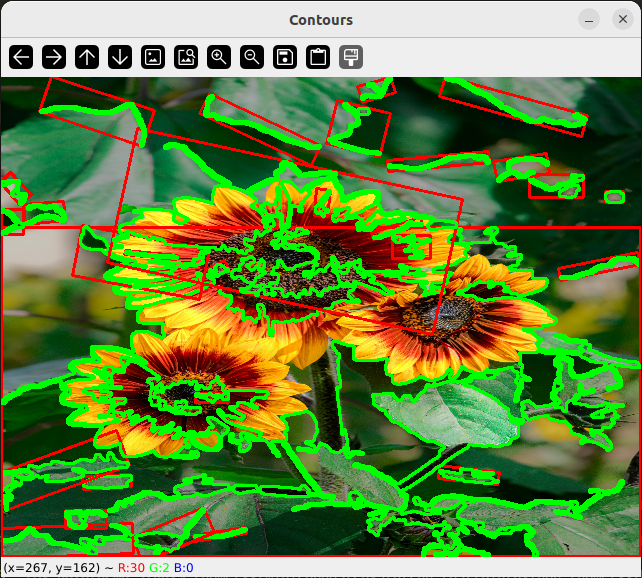

#### 7. cv2.minEnclosingCircle()

该函数用于计算轮廓的最小外接圆。在OpenCV中提供函数：

```
(center, radius) = cv2.minEnclosingCircle(points)
```

**参数说明**:

- `points`: 输入的轮廓点集。

**返回值**:

- 返回圆心 `(x, y)` 和半径 `radius`

代码示例：

```python
for contour in contours:
    (x, y), radius = cv2.minEnclosingCircle(contour)
    center = (int(x), int(y))
    radius = int(radius)
    cv2.circle(image, center, radius, (255, 0, 0), 2)
cv2.imshow('Min Enclosing Circles', image)
cv2.waitKey(0)
```

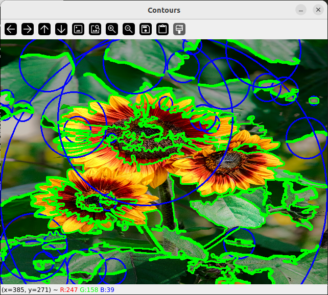

#### 8.  cv2.approxPolyDP()

该函数用于对轮廓进行多边形近似。在OpenCV中提供函数：

```
approx = cv2.approxPolyDP(curve, epsilon, closed)
```


**参数说明**

|   参数    | 是否必填 |                        说明                        |
| :-------: | :------: | :------------------------------------------------: |
|  `curve`  |   必填   | 轮廓列表，由 `cv2.findContours()` 得到结果的元素。 |
| `epsilon` |   必填   |           近似精度，值越小，近似越精确。           |
| `closed`  |   必填   |             布尔值，表示轮廓是否闭合。             |

**返回值**:

- 返回近似后的多边形点集

代码示例：

```python
for contour in contours:
    epsilon = 0.01 * cv2.arcLength(contour, True)
    approx = cv2.approxPolyDP(contour, epsilon, True)
    cv2.drawContours(image, [approx], 0, (0, 255, 0), 2)
cv2.imshow('Approx Polygons', image)
cv2.waitKey(0)
```

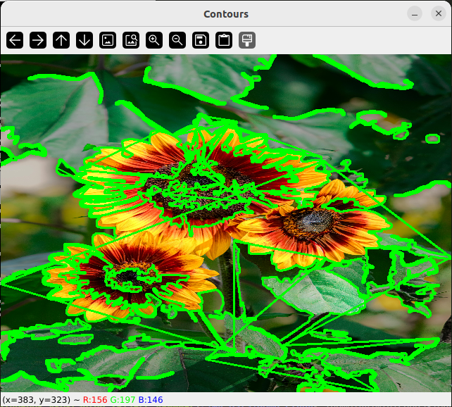

### 3.4.4.9 形态学

图像形态学操作是图像处理中的一种重要技术，主要用于处理**二值图**，处理前景区域的形状。

OpenCV 中的图像形态学操作是图像处理中的重要工具，通过腐蚀、膨胀、开运算、闭运算和形态学梯度等操作，可以实现对图像的噪声去除、对象分离、边缘检测等效果。掌握这些操作有助于更好地处理和分析图像数据。

以下是 OpenCV 中常用的形态学操作及其函数：

| **操作**       | **函数**             | **说明**                                                     | **应用场景**               |
| :------------- | :------------------- | :----------------------------------------------------------- | :------------------------- |
| **腐蚀**       | `cv2.erode()`        | 用结构元素扫描图像，如果结构元素覆盖的区域全是前景，则保留中心像素。 | 去除噪声、分离物体。       |
| **膨胀**       | `cv2.dilate()`       | 用结构元素扫描图像，如果结构元素覆盖的区域存在前景，则保留中心像素。 | 连接断裂的物体、填充空洞。 |
| **开运算**     | `cv2.morphologyEx()` | 先腐蚀后膨胀。                                               | 去除小物体、平滑物体边界。 |
| **闭运算**     | `cv2.morphologyEx()` | 先膨胀后腐蚀。                                               | 填充小孔洞、连接邻近物体。 |
| **形态学梯度** | `cv2.morphologyEx()` | 膨胀图减去腐蚀图。                                           | 提取物体边缘。             |
| **顶帽运算**   | `cv2.morphologyEx()` | 原图减去开运算结果。                                         | 提取比背景亮的细小物体。   |
| **黑帽运算**   | `cv2.morphologyEx()` | 闭运算结果减去原图。                                         | 提取比背景暗的细小物体。   |


#### 1. Kernel

在正式学习形态学的具体操作之前，我们先引入一个重要概念：**结构元素（Structuring Element，也常称为 Kernel）** 。

在前面学习滤波和边缘检测时，我们已经接触过 `ksize` 或滤波核的概念。比如在滤波操作中，滤波核会在图像上滑动，对指定邻域内的像素进行加权计算；在边缘检测求导操作中，卷积核则用于计算局部像素灰度变化，从而提取边缘信息。

类似地，在形态学操作中，也需要一个小的操作窗口来作用于图像的局部区域，这个窗口就是**结构元素**。它会在图像上逐步移动，并根据不同的形态学操作规则，对覆盖区域内的像素进行处理。

> 结构元素可以简单理解为：形态学操作中的局部处理窗口。

它会在图像上不断滑动，并根据不同的形态学操作规则，对当前覆盖区域内的像素进行判断和处理。

需要注意的是，结构元素虽然也叫 Kernel，但它和滤波中的卷积核作用并不完全相同：

- 滤波核主要用于数值计算，例如求平均值、加权求和、计算梯度等。
- 结构元素主要用于形状判断，例如缩小目标、扩大目标、连接断裂区域、去除小噪声等。

关于Kernel创建有两种方式，一种是直接使用Numpy数组进行创建，另一种 是在OpenCV中使用内置函数`cv2.getStructuringElement`创建，下面我们依次介绍。

最简单的方式是使用 `numpy` 创建一个全 1 矩阵：

```
kernel = np.ones((5, 5), np.uint8)
```

> 这表示创建一个大小为 `5 × 5` 的结构元素：后续形态学操作时，会以当前像素为中心，查看它周围 `5 × 5` 范围内的像素情况。

在 OpenCV 中，也可以使用

```
kernel = cv2.getStructuringElement(shape, ksize)
```

**参数说明**

| 参数    | 说明                                     |
| ------- | ---------------------------------------- |
| `shape` | 结构元素的形状                           |
| `ksize` | 结构元素的大小，格式为 `(width, height)` |

常见的结构元素形状有三种：

| 形状                | 含义           |
| ------------------- | -------------- |
| `cv2.MORPH_RECT`    | 矩形结构元素   |
| `cv2.MORPH_ELLIPSE` | 椭圆结构元素   |
| `cv2.MORPH_CROSS`   | 十字形结构元素 |

代码示例

```python
import cv2
import numpy as np

# 矩形结构元素
kernel_rect = cv2.getStructuringElement(cv2.MORPH_RECT, (5, 5))

# 椭圆结构元素
kernel_ellipse = cv2.getStructuringElement(cv2.MORPH_ELLIPSE, (5, 5))

# 十字形结构元素
kernel_cross = cv2.getStructuringElement(cv2.MORPH_CROSS, (5, 5))

print(kernel_rect)
print(kernel_ellipse)
print(kernel_cross)
```

输出如下：

```
[[1 1 1 1 1]
 [1 1 1 1 1]
 [1 1 1 1 1]
 [1 1 1 1 1]
 [1 1 1 1 1]]
[[0 0 1 0 0]
 [1 1 1 1 1]
 [1 1 1 1 1]
 [1 1 1 1 1]
 [0 0 1 0 0]]
[[0 0 1 0 0]
 [0 0 1 0 0]
 [1 1 1 1 1]
 [0 0 1 0 0]
 [0 0 1 0 0]]
```


不同形状的结构元素，在形态学操作中会产生不同的效果。

例如：

- 矩形结构元素：作用范围较完整，常用。
- 椭圆结构元素：更适合处理圆形、弧形区域。
- 十字形结构元素：只关注上下左右方向，对斜向像素影响较小。

不同大小的结构元素也会对形态学操作中会产生不同的效果。

较小的结构元素，例如 `(3, 3)`：

- 操作效果较弱。
- 对图像细节影响较小。
- 更适合处理小噪声。
- 对目标形状破坏较少。

较大的结构元素，例如 `(9, 9)`：

- 操作效果更强。
- 腐蚀时目标会缩小更多。
- 膨胀时目标会扩大更多。
- 可能会破坏图像细节。
- 更适合处理较大的孔洞或断裂区域。

#### 1.腐蚀

腐蚀操作可以理解为一种**缩小图像中前景对象**的过程。在二值图中，前景通常指白色区域，因此腐蚀会让白色区域变小；在灰度图中，腐蚀会取结构元素覆盖区域内的最小灰度值，**通常情况下**，前景指的亮区域，这时通常表现为亮区域被压缩、暗区域被扩大。

腐蚀操作原理是：通过将结构元素与图像进行卷积，只有当结构元素完全覆盖图像中的前景像素时，也就是当所有元素满足前景条件，中心像素才会保留为前景，否则中心像素变成背景，也就是会被腐蚀掉，因此说腐蚀操作会让白色区域变小，黑色区域相对扩大。

所以，腐蚀常用于去除图像中的小白点噪声，或者让目标区域变细、变小，实现粘连在一起的内容的分裂的等。

> 简单理解：腐蚀会让前景对象向内部收缩。

对于二值图像来说，可以理解为：

- 如果结构元素覆盖区域内全是白色，中心点保留为白色。
- 如果结构元素覆盖区域内存在黑色，中心点就变成黑色。

对于灰度图来说，可以理解为：

- 取结构元素覆盖区域内的最小值。

在OpenCV中提供腐蚀函数`dst = cv2.erode()`

```python
dst = cv2.erode(src, kernel, iterations=1)
```

**参数说明**

|     参数     |                             说明                             |
| :----------: | :----------------------------------------------------------: |
|    `src`     |         输入图像，通常是**二值图像**，或者是灰度图。         |
|   `kernel`   | 结构元素，可以自定义或使用 `cv2.getStructuringElement()` 生成 |
| `iterations` |                  腐蚀操作的次数，默认为 `1`                  |

**返回值**

- `dst`：腐蚀后的输出图像。

代码示例

```python
import cv2
import numpy as np

# 读取图像
image = cv2.imread('./src/Python_demo/image.jpg', 0)
image = cv2.resize(image, (640, 480))

# 二值化处理
_, binary = cv2.threshold(image, 127, 255, cv2.THRESH_BINARY)

# 定义结构元素
kernel = np.ones((5, 5), np.uint8)

# 腐蚀操作
eroded_image = cv2.erode(binary, kernel, iterations=1)

# 显示结果
cv2.imshow('Binary Image', binary)
cv2.imshow('Eroded Image', eroded_image)
cv2.waitKey(0)
cv2.destroyAllWindows()
```


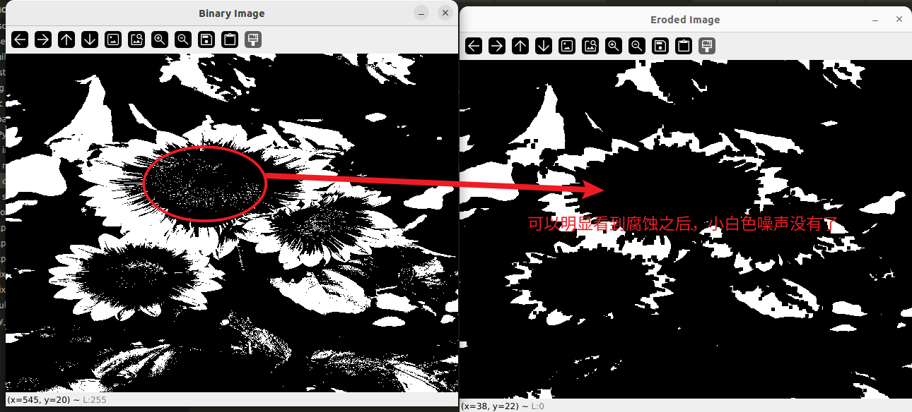


> 对于二值图：
>
> 腐蚀之后：
>
> - 白色前景区域会变小。
> - 细小的白色噪点可能会被去除。
> - 较细的连接部分可能会被断开。
> - 目标边界会向内部收缩。
>
> 因此，腐蚀常用于去除图像中的小白点噪声，或者分离两个靠得比较近的前景区域。
>
> 对于灰度图：
>
> 如果前景是亮区域，最终效果会压低亮区域，使图像局部变暗。

---

#### 3. 膨胀

膨胀操作可以理解为一种**扩大图像中前景对象**的过程。在二值图中，前景通常指白色区域，因此膨胀会让白色区域变大；在灰度图中，膨胀会取结构元素覆盖区域内的最大灰度值，通常情况下，如果把较亮区域看作前景，那么膨胀通常表现为亮区域被扩张，暗区域被压缩。

膨胀操作原理是：通过将结构元素与图像进行卷积，只要结构元素覆盖区域中存在图像的前景像素，也就是存在白色像素，中心像素就会被设置为前景；只有当结构元素覆盖区域内全是背景像素时，中心像素才保持为背景。因此，膨胀操作会让白色区域变大，黑色区域相对缩小。

所以，膨胀常用于填补图像中的小黑洞，或者连接断裂的前景区域，也可以让目标区域变粗、变大。

> 简单理解：膨胀会让前景对象向外扩张。

对于二值图像来说，可以理解为：

- 如果结构元素覆盖区域内存在白色，中心点就变成白色。
- 只有当结构元素覆盖区域内全是黑色时，中心点才保持黑色。

对于灰度图来说，可以理解为：

- 取结构元素覆盖区域内的最大值。

在OpenCV中，对膨胀提供函数`cv2.dilate()`

```python
dst = cv2.dilate(src, kernel, iterations=1)
```

**参数说明**

|     参数     |                             说明                             |
| :----------: | :----------------------------------------------------------: |
|    `src`     |          输入图像，通常是**二值图像**，或者是灰度图          |
|   `kernel`   | 结构元素，可以自定义或使用 `cv2.getStructuringElement()` 生成 |
| `iterations` |                  膨胀操作的次数，默认为 `1`                  |

**返回值**

- `dst`：膨胀后的输出图像。

代码示例

```python
import cv2
import numpy as np

# 读取图像
image = cv2.imread('./src/Python_demo/image.jpg', 0)
image = cv2.resize(image, (640, 480))

# 二值化处理
_, binary = cv2.threshold(image, 127, 255, cv2.THRESH_BINARY)

# 定义结构元素
kernel = np.ones((5, 5), np.uint8)

# 膨胀操作
dilated_image = cv2.dilate(binary, kernel, iterations=1)

# 显示结果
cv2.imshow('Binary Image', binary)
cv2.imshow('Dilated Image', dilated_image)
cv2.waitKey(0)
cv2.destroyAllWindows()
```

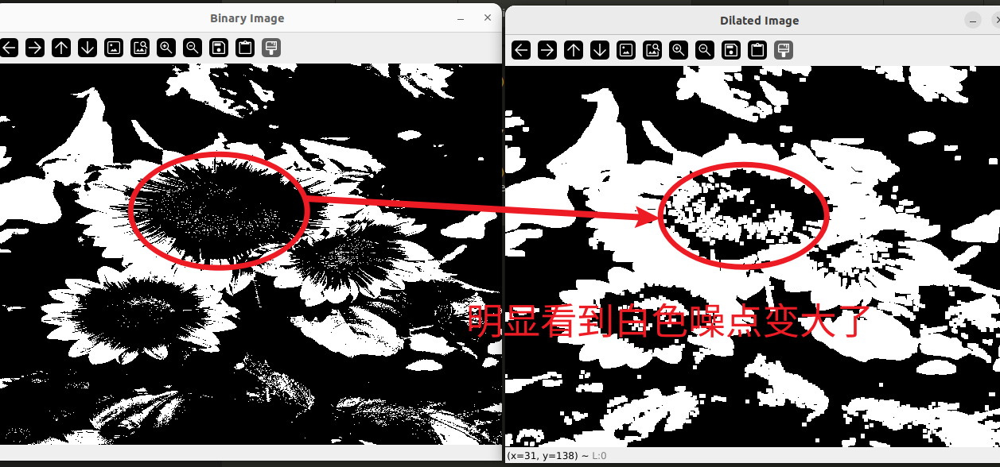

> 对于二值图：
>
> 膨胀之后：
>
> - 白色前景区域会变大。
> - 目标边界会向外扩张。
> - 图像中的小黑洞可能会被填充。
> - 断裂的白色区域可能会被连接起来。
>
> 因此，膨胀常用于连接断开的目标区域，或者填补前景对象中的小缺口。
>
> 对于灰度图：
>
> 最终效果会抬高暗区域，使图像局部变亮

---

#### 4. 开运算 

开运算可以理解为一种**先缩小再恢复图像中前景对象**的过程。

- 在二值图中，前景通常指白色区域，因此开运算会先让白色区域变小，再让白色区域适当变大；
- 灰度图中，开运算会先取结构元素覆盖区域内的最小灰度值，再取局部最大灰度值，通常情况下，如果把较亮区域看作前景，那么开运算通常表现为去除或削弱较小的亮区域。

开运算的执行顺序是：先腐蚀，再膨胀，也就是：开运算 = 腐蚀 + 膨胀

由于开运算先进行腐蚀，所以可以先去除图像中较小的白色噪声，或者断开较细的连接；随后再进行膨胀，使较大的前景目标尽量恢复到原来的大小，因此，开运算常用于去除图像中的小白点噪声，分离轻微连接的目标，并在尽量保留主体形状的同时，清理前景区域中的小干扰。

> 简单理解：开运算适合去除前景中的小白点噪声。

对于二值图像来说，可以理解为：

- 先腐蚀：如果结构元素覆盖区域内存在黑色，中心点就变成黑色。
- 再膨胀：如果结构元素覆盖区域内存在白色，中心点就变成白色。
- 小的白色区域会在腐蚀阶段被去除，后续膨胀也难以恢复。
- 较大的白色目标会在腐蚀后再膨胀，尽量恢复原来的大小。

对于灰度图来说，可以理解为：

- 先取结构元素覆盖区域内的最小值。
- 再在腐蚀结果上取结构元素覆盖区域内的最大值。
- 通常用于去除或削弱小的亮区域。

在OpenCV提供开运算函数 `cv2.morphologyEx()`

```python
dst = cv2.morphologyEx(src, op, kernel)
```

当进行开运算时，`op` 使用：

```python
cv2.MORPH_OPEN
```

完整写法：

```python
dst = cv2.morphologyEx(src, cv2.MORPH_OPEN, kernel)
```

**参数说明**

|   参数   |                             说明                             |
| :------: | :----------------------------------------------------------: |
|  `src`   |          输入图像，通常是**二值图像**，或者灰度图。          |
|   `op`   |         形态学操作类型，开运算使用 `cv2.MORPH_OPEN`          |
| `kernel` | 结构元素，可以自定义或使用 `cv2.getStructuringElement()` 生成 |

**返回值**

- `dst`：开运算后的输出图像。

代码示例

```python
import cv2
import numpy as np

# 读取图像
image = cv2.imread('./src/Python_demo/image.jpg', 0)
image = cv2.resize(image, (640, 480))

# 二值化处理
_, binary = cv2.threshold(image, 127, 255, cv2.THRESH_BINARY)

# 定义结构元素
kernel = np.ones((5, 5), np.uint8)

# 开运算：先腐蚀，再膨胀
open_image = cv2.morphologyEx(binary, cv2.MORPH_OPEN, kernel)

# 显示结果
cv2.imshow('Binary Image', binary)
cv2.imshow('Open Image', open_image)
cv2.waitKey(0)
cv2.destroyAllWindows()
```

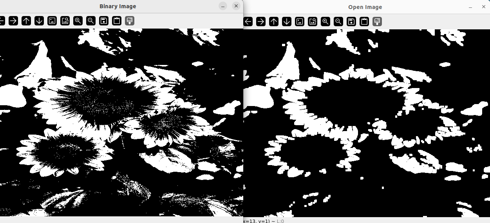

> 对于二值图：
>
> 开运算之后：
>
> - 小的白色噪点会被去除。
> - 较大的前景目标会被保留。
> - 细小的连接区域可能会被断开。
> - 目标整体形状不会像单独腐蚀那样明显缩小。
>
> 因此，开运算常用于二值图像的去噪处理。
>
> 对于灰度图：
>
> 开运算之后：
>
> - 小的亮区域会被削弱或去除。
> - 图像中的亮点噪声会减少。
> - 较大的亮区域会被相对保留。
> - 可以用于背景估计、光照校正等任务。

---

#### 5. 闭运算

闭运算可以理解为一种**先扩大再恢复图像中前景对象**的过程。

- 在二值图中，前景通常指白色区域，因此闭运算会先让白色区域变大，再让白色区域适当变小；
- 在灰度图中，闭运算会先取结构元素覆盖区域内的最大灰度值，再取局部最小灰度值，通常情况下，如果把较亮区域看作前景，那么闭运算通常表现为填补或削弱较小的暗区域。

闭运算的执行顺序是：先膨胀，再腐蚀，也就是：闭运算 = 膨胀 + 腐蚀。

由于闭运算先进行膨胀，所以可以先扩大前景区域，从而填补前景对象中的小黑洞，或者连接断裂的前景区域；随后再进行腐蚀，使目标区域尽量恢复到原来的大小。

所以，闭运算常用于填补前景对象内部的小孔洞，连接断裂的白色区域，平滑目标边界，并在尽量保留主体大小的情况下修补前景区域。

> 简单理解：闭运算适合填补前景中的小黑洞，或者连接断裂区域。

对于二值图像来说，可以理解为：

- 先膨胀：如果结构元素覆盖区域内存在白色，中心点就变成白色。
- 再腐蚀：如果结构元素覆盖区域内存在黑色，中心点就变成黑色。
- 小的黑色孔洞会在膨胀阶段被填补，后续腐蚀也难以完全恢复。
- 断裂较小的白色区域会在膨胀阶段被连接起来。

对于灰度图来说，可以理解为：

- 先取结构元素覆盖区域内的最大值。
- 再在膨胀结果上取结构元素覆盖区域内的最小值。
- 通常用于填补或削弱小的暗区域。

在OpenCV提供闭运算函数`cv2.morphologyEx（）`

```python
dst = cv2.morphologyEx(src, op, kernel)
```

当进行闭运算时，`op` 使用：

```python
cv2.MORPH_CLOSE
```

完整写法：

```python
dst = cv2.morphologyEx(src, cv2.MORPH_CLOSE, kernel)
```

**参数说明**

|   参数   |                             说明                             |
| :------: | :----------------------------------------------------------: |
|  `src`   |            输入图像，通常是二值图像，或者灰度图。            |
|   `op`   |         形态学操作类型，闭运算使用 `cv2.MORPH_CLOSE`         |
| `kernel` | 结构元素，可以自定义或使用 `cv2.getStructuringElement()` 生成 |

**返回值**

- `dst`：闭运算后的输出图像。

 代码示例

```python
import cv2
import numpy as np

# 读取图像
image = cv2.imread('./src/Python_demo/image.jpg', 0)
image = cv2.resize(image, (640, 480))

# 二值化处理
_, binary = cv2.threshold(image, 127, 255, cv2.THRESH_BINARY)

# 定义结构元素
kernel = np.ones((5, 5), np.uint8)

# 闭运算：先膨胀，再腐蚀
close_image = cv2.morphologyEx(binary, cv2.MORPH_CLOSE, kernel)

# 显示结果
cv2.imshow('Binary Image', binary)
cv2.imshow('Close Image', close_image)
cv2.waitKey(0)
cv2.destroyAllWindows()
```

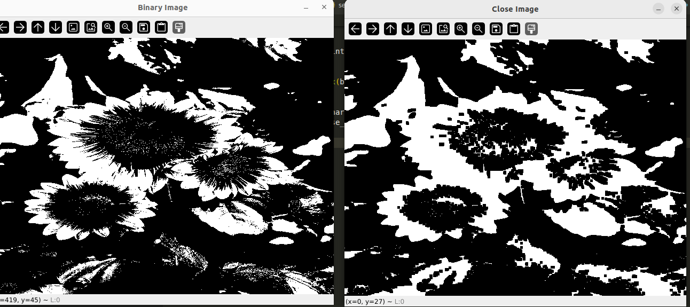

> 对于二值图：
>
> 闭运算之后：
>
> - 前景对象中的小黑洞会被填补 。  |  小黑洞指的是是白色目标里面夹杂的小块黑色区域。
> - 距离较近的白色区域可能会被连接。
> - 断裂的边缘可能会变得连续。
> - 目标整体大小不会像单独膨胀那样明显变大。
>
> 因此，闭运算常用于修补前景区域中的缺口或断裂。
>
> 对于灰度图：
>
> - 小的暗区域会被削弱或填补。
> - 图像中的暗点噪声会减少。
> - 较大的暗区域会被相对保留。
> - 可以用于修复局部暗缺陷、平滑图像中的暗细节。

---

#### 6. 形态学梯度

形态学梯度是膨胀图像和腐蚀图像之间的差值，它的计算方式可以理解为：形态学梯度 = 膨胀结果 - 腐蚀结果。

由于膨胀会让前景区域变大，腐蚀会让前景区域变小，两者相减之后，保留下来的主要就是目标边界附近的区域。

因此，形态学梯度常用于提取图像中前景对象的边缘，所以形态学梯度主要用于突出目标轮廓。它和 Canny 边缘检测类似，都可以得到边缘信息，但是两者原理不同：

- Canny 主要根据灰度变化来检测边缘。
- 形态学梯度主要根据膨胀和腐蚀之间的差异来提取边缘。

> 可以简单理解为：形态学梯度可以提取前景对象的外轮廓边缘。

在OpenCV中提供函数`cv2.morphologyEx`

```python
dst = cv2.morphologyEx(src, op, kernel)
```

当进行形态学梯度时，`op` 使用：

```python
cv2.MORPH_GRADIENT
```

完整写法：

```python
dst = cv2.morphologyEx(src, cv2.MORPH_GRADIENT, kernel)
```

**参数说明**

|   参数   |                             说明                             |
| :------: | :----------------------------------------------------------: |
|  `src`   |       输入图像，通常**是二值图像**，也可以是**灰度图**       |
|   `op`   |     形态学操作类型，形态学梯度使用 `cv2.MORPH_GRADIENT`      |
| `kernel` | 结构元素，可以自定义或使用 `cv2.getStructuringElement()` 生成 |


**返回值**

- `dst`：形态学梯度处理后的输出图像。

 代码示例

```python
import cv2
import numpy as np

# 读取图像
image = cv2.imread('./src/Python_demo/image.jpg', 0)
image = cv2.resize(image, (640, 480))

# 二值化处理
_, binary = cv2.threshold(image, 127, 255, cv2.THRESH_BINARY)

# 定义结构元素
kernel = np.ones((5, 5), np.uint8)

# 形态学梯度
gradient_image = cv2.morphologyEx(binary, cv2.MORPH_GRADIENT, kernel)

# 显示结果
cv2.imshow('Binary Image', binary)
cv2.imshow('Gradient Image', gradient_image)
cv2.waitKey(0)
cv2.destroyAllWindows()
```

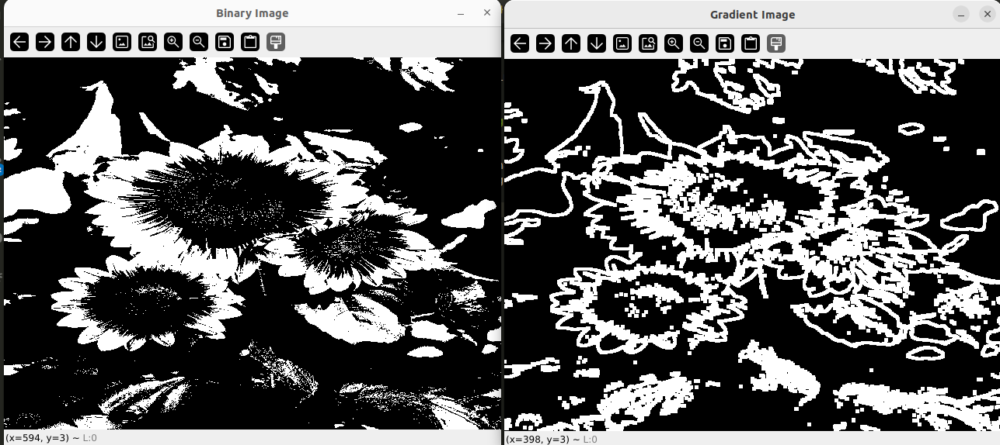

> 形态学梯度之后：
>
> - 图像中的前景边界会被突出。
> - 前景内部大面积区域会被削弱。
> - 结果通常表现为目标对象的轮廓。
> - 常用于边缘提取、轮廓分析等任务。
>
> 需要注意的是，结构元素越大，提取出的边缘通常越粗；结构元素越小，边缘越细。


#### 7. 顶帽运算

顶帽运算是**原图像和开运算结果之间的差值**，它的计算方式可以理解为：顶帽运算 = 原图像 - 开运算结果。

由于开运算可以去除较小的白色亮区域，因此原图减去开运算结果后，留下来的通常就是那些被开运算去除的小亮区域。因此，顶帽运算主要用于提取图像中比周围区域更亮的小目标，所以一般顶帽运算应用于提取亮点、提取小的白色区域、处理光照不均匀的图像、增强图像中的局部亮细节。

> 可以简单理解为：顶帽运算用于提取图像中的小亮区域。


在OpenCV中对于顶帽运算提供函数`cv2.morphologyEx`。

```python
dst = cv2.morphologyEx(src, op, kernel)
```

当进行顶帽运算时，`op` 使用：

```python
cv2.MORPH_TOPHAT
```

完整写法：

```python
dst = cv2.morphologyEx(src, cv2.MORPH_TOPHAT, kernel)
```

**参数说明**

|   参数   |                             说明                             |
| :------: | :----------------------------------------------------------: |
|  `src`   |              输入图像，可以是**灰度图或二值图**              |
|   `op`   |       形态学操作类型，顶帽运算使用 `cv2.MORPH_TOPHAT`        |
| `kernel` | 结构元素，可以自定义或使用 `cv2.getStructuringElement()` 生成 |

**返回值**

- `dst`：顶帽运算后的输出图像。

 代码示例

```python
import cv2
import numpy as np

# 读取图像
image = cv2.imread('./src/Python_demo/image.jpg', 0)
image = cv2.resize(image, (640, 480))

# 定义结构元素
kernel = np.ones((9, 9), np.uint8)
_, binary = cv2.threshold(image, 127, 255, cv2.THRESH_BINARY)
# 顶帽运算
tophat_image = cv2.morphologyEx(binary, cv2.MORPH_TOPHAT, kernel)

# 显示结果
cv2.imshow('Original Image', binary)
cv2.imshow('Tophat Image', tophat_image)
cv2.waitKey(0)
cv2.destroyAllWindows()
```

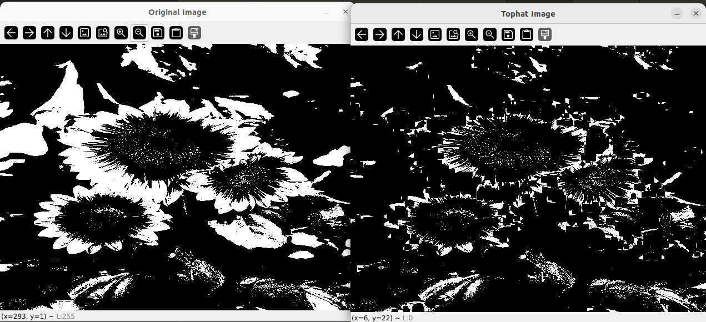


> 顶帽运算之后：
>
> - 图像中的小亮区域会被突出。
> - 大面积背景信息会被削弱。
> - 可以用于提取亮色细节。
> - 对光照不均匀的图像有一定改善作用。
>

#### 8. 黑帽运算 

黑帽运算是闭运算结果和原图像之间的差值，它的计算方式为：黑帽运算 = 闭运算结果 - 原图像

由于闭运算可以填补较小的黑色暗区域，因此闭运算结果减去原图之后，留下来的通常就是那些被闭运算填补的小暗区域，所以黑帽运算主要用于提取图像中比周围区域更暗的小目标。

一般黑帽运算应用于提取暗点、提取黑色细节、检测图像中的裂缝、增强图像中的局部暗区域等

常见用途包括：

> 可以简单理解为：黑帽运算用于提取图像中的小暗区域。

在OpenCV中对于顶帽运算提供函数`cv2.morphologyEx`。

```python
dst = cv2.morphologyEx(src, op, kernel)
```

当进行黑帽运算时，`op` 使用：

```python
cv2.MORPH_BLACKHAT
```

完整写法：

```python
dst = cv2.morphologyEx(src, cv2.MORPH_BLACKHAT, kernel)
```

**参数说明**

|   参数   |                             说明                             |
| :------: | :----------------------------------------------------------: |
|  `src`   |                输入图像，可以是灰度图或二值图                |
|   `op`   |      形态学操作类型，黑帽运算使用 `cv2.MORPH_BLACKHAT`       |
| `kernel` | 结构元素，可以自定义或使用 `cv2.getStructuringElement()` 生成 |

**返回值**

- `dst`：黑帽运算后的输出图像。

 代码示例

```python
import cv2
import numpy as np

# 读取图像
image = cv2.imread('./src/Python_demo/image.jpg', 0)
image = cv2.resize(image, (640, 480))

# 定义结构元素
kernel = np.ones((9, 9), np.uint8)
_, binary = cv2.threshold(image, 127, 255, cv2.THRESH_BINARY)
# 黑帽运算
blackhat_image = cv2.morphologyEx(binary, cv2.MORPH_BLACKHAT, kernel)

# 显示结果
cv2.imshow('Original Image', binary)
cv2.imshow('Tophat Image', blackhat_image)
cv2.waitKey(0)
cv2.destroyAllWindows()
```

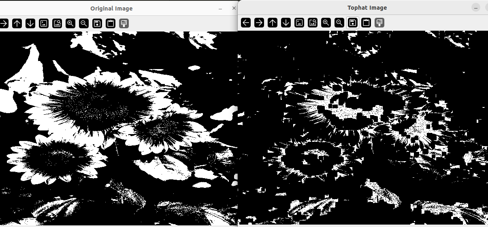

> 黑帽运算之后：
>
> - 图像中的小暗区域会被突出。
> - 亮色背景会被削弱。
> - 可以用于提取黑色细节。
> - 常用于裂缝检测、文字增强、暗区域提取等任务。
>

#### 9. iterations

在腐蚀和膨胀函数中，经常会看到 `iterations` 参数,，`iterations` 表示操作执行的次数，`iterations`参数对形态学操作影响很大。

当 `iterations` 越大时，腐蚀效果越明显，膨胀效果也越明显。

腐蚀表现为：

- 白色区域缩小得更多。
- 较细的目标更容易消失。
- 小的白色噪点更容易被去除。

例如：

```python
eroded_image = cv2.erode(binary, kernel, iterations=3)
```

表示连续腐蚀 3 次。

膨胀表现为：

- 白色区域扩大得更多。
- 断裂区域更容易连接。
- 小黑洞更容易被填补。

例如：

```python
dilated_image = cv2.dilate(binary, kernel, iterations=3)
```

表示连续膨胀 3 次。


### 3.4.4.10 直方图

图像直方图可以理解为一种**统计图像中像素强度分布情况**的工具。

在图像处理中，直方图是一种非常重要的分析方法，它可以帮助我们了解图像的亮度、对比度以及颜色分布情况。通过分析图像直方图，我们可以进行图像增强、对比度调整、图像分割、图像匹配等操作。

对于灰度图像来说，直方图统计的是每个灰度级在图像中出现的次数；对于彩色图像来说，可以分别统计每个颜色通道的像素强度分布，例如 B、G、R 三个通道的直方图。

简单理解：

> 直方图就是用来统计图像中不同像素值出现次数的图。

我们以灰度图为例，灰度图的像素值范围通常是 0 到 255，其中：

- 0 表示黑色。
- 255 表示白色。
- 中间值表示不同程度的灰色。

灰度直方图会统计每个灰度值在图像中出现的次数。

最终在图像上，横轴表示像素强度值，也就是灰度值，范围通常是 0 到 255，纵轴表示该灰度值对应的像素数量。

> - 如果直方图主要集中在左侧，说明图像中低灰度值较多，图像整体偏暗。
>
> - 如果直方图主要集中在右侧，说明图像中高灰度值较多，图像整体偏亮。
>
> - 如果直方图分布范围较窄，说明图像灰度变化不明显，图像对比度较低。
>
> - 如果直方图分布范围较宽，说明图像灰度变化较丰富，图像对比度较好。
>

因此，灰度直方图常用于判断图像整体偏亮还是偏暗、判断图像对比度是否充足、辅助选择图像分割阈值、进行直方图均衡化增强。

而对于颜色直方图来讲，就是分别计算B、G、R三通道的直方图，图像表示与灰度直方图类似，这里不作重复讲解，一般颜色直方图常用于分析图像颜色分布、进行颜色校正、图像检索和匹配、判断图像整体色彩风格。

在OpenCV 提供了多个直方图相关函数，常用函数如下：

|     功能     |            函数            |              说明              |
| :----------: | :------------------------: | :----------------------------: |
|  计算直方图  |      `cv2.calcHist()`      |      用于计算图像的直方图      |
| 直方图均衡化 |    `cv2.equalizeHist()`    |      用于增强图像的对比度      |
|  直方图比较  |    `cv2.compareHist()`     |   用于比较两个直方图的相似度   |
|  绘制直方图  | `matplotlib.pyplot.plot()` | 使用 Matplotlib 绘制直方图曲线 |

直方图常用于图像分析和图像增强任务中。

常见应用如下：

- 图像增强：通过直方图均衡化，可以增强图像对比度，使细节更加清晰。
- 图像分割：通过分析直方图，可以辅助确定阈值，用于前景和背景分割。
- 图像匹配：通过比较直方图，可以判断两张图像的相似程度，用于图像检索和匹配。
- 颜色分析：通过颜色直方图，可以分析图像的颜色分布，用于颜色校正和风格化处理。
- 曝光判断：通过观察直方图分布，可以判断图像是否偏暗、偏亮或者对比度不足。

接下来我们依次进行讲解。

#### 1.计算直方图

`cv2.calcHist()` 是 OpenCV 中用于计算图像直方图的函数，它可以用于计算灰度图像的直方图，也可以用于计算彩色图像某个通道的直方图。

```python
hist = cv2.calcHist(images, channels, mask, histSize, ranges[, accumulate])
```

**参数说明**

|     参数     |                             含义                             |
| :----------: | :----------------------------------------------------------: |
|   `images`   |               输入图像列表，通常写成 `[image]`               |
|  `channels`  | 需要计算直方图的通道索引，对于灰度图，[0]即可，对于颜色图，[0]、[1]、[2]依次对应B、G、R通道。 |
|    `mask`    |  掩膜图像，用于指定统计区域，如果统计整张图像，传入 `None`   |
|  `histSize`  | 直方图的 bin 数量，也就是把像素值范围分成多少份，如果希望每个灰度值都单独统计一次，就设置为256，固定写256即可 |
|   `ranges`   | 像素值范围，灰度图通常为 `[0, 256]`，左闭右开！固定写[0，256]即可 |
| `accumulate` | 是否累积直方图，默认为 `False`，若设置为 `True`，那么每次调用函数时，新的统计结果会累加到原来的直方图上。 |

> `bin` 可以理解为一个“桶”，直方图统计时，会准备一些桶，然后把像素按照灰度值放进对应的桶里。
>
> 比如灰度图像中像素值范围是：
>
> ```
> 0 ~ 255
> ```
>
> 一共有 256 个整数灰度值：
>
> ```
> 0, 1, 2, 3, ..., 253, 254, 255
> ```
>
> 如果设置：
>
> ```
> histSize = [256]
> ranges = [0, 256]
> ```
>
> 意思就是准备 256 个桶。
>
> 每个桶负责统计一个灰度值：
>
> ```
> 第 0 个 bin：统计灰度值 0 的像素数量
> 第 1 个 bin：统计灰度值 1 的像素数量
> 第 2 个 bin：统计灰度值 2 的像素数量
> ...
> 第 255 个 bin：统计灰度值 255 的像素数量
> ```
>
> 所以这时就是：
>
> ```
> 每个灰度值都单独统计一次。
> ```

**返回值**

- hist：输出的直方图数组

灰度图代码示例

```python
import cv2
import numpy as np
import matplotlib.pyplot as plt
# 1. 读取图像
image = cv2.imread('./src/Python_demo/image.jpg',0)
image = cv2.resize(image, (640, 480))
# 计算灰度直方图
hist = cv2.calcHist([image], [0], None, [256], [0, 256])

# 绘制直方图
plt.plot(hist)
plt.title("Grayscale Histogram")
plt.xlabel("Pixel Intensity")
plt.ylabel("Pixel Count")
plt.show()
```

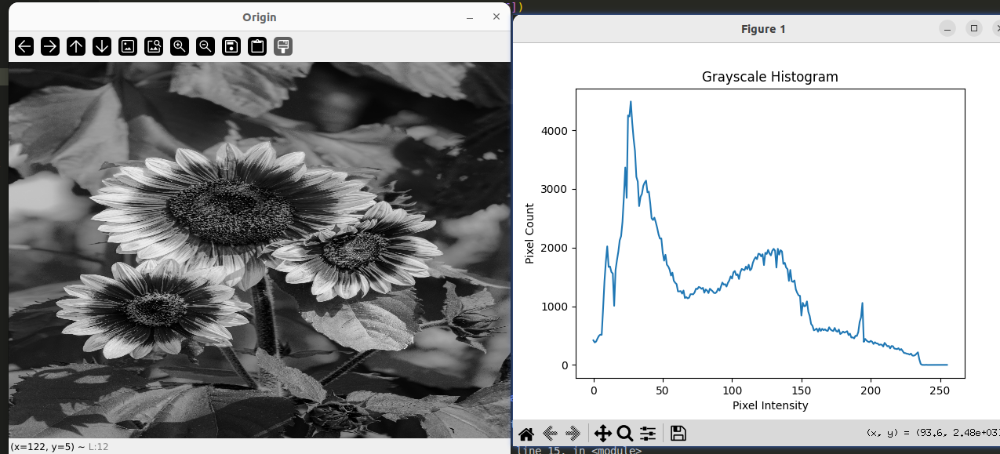

彩色度代码示例

```python
import cv2
import numpy as np
import matplotlib.pyplot as plt
# 1. 读取图像
image = cv2.imread('./src/Python_demo/image.jpg',1)
image = cv2.resize(image, (640, 480))

# 设置通道颜色
colors = ("b", "g", "r")

# 分别计算 B、G、R 三个通道的直方图
for i, color in enumerate(colors):
    hist = cv2.calcHist([image], [i], None, [256], [0, 256])
    plt.plot(hist, color=color)

# 绘制直方图
plt.title("Color Histogram")
plt.xlabel("Pixel Intensity")
plt.ylabel("Pixel Count")
plt.show()
```

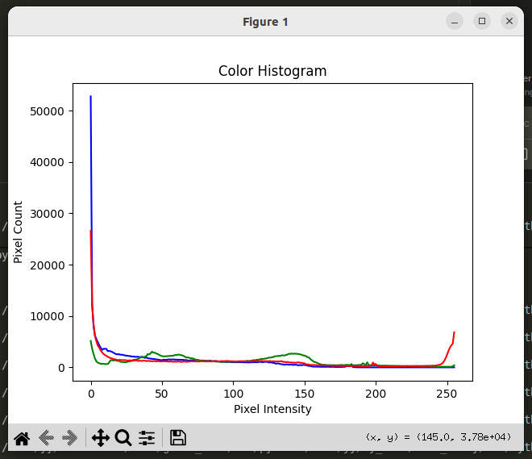


#### 2. 直方图均衡化

直方图均衡化可以理解为一种**增强图像对比度**的方法，它通过重新分配图像中的灰度值，使图像的灰度分布更加均匀，从而让图像中的细节更加清晰。

简单理解：

> 直方图均衡化会把原本集中的灰度分布拉开，让图像的明暗层次更加明显。

如果一张图像的灰度值主要集中在某个较小范围内，那么图像通常会显得偏暗、偏亮或者对比度不足。

例如：

- 灰度值集中在左侧，图像整体偏暗。
- 灰度值集中在右侧，图像整体偏亮。
- 灰度值集中在中间很窄的范围，图像对比度较低。

通过直方图均衡化，可以把这些集中的灰度值重新拉伸到更大的范围中，使图像的亮暗变化更加明显。

因此，直方图均衡化常用于：

- 增强图像对比度。
- 提高图像细节可见性。
- 改善曝光不足或对比度较低的图像。

在OpenCV提供内置函数`equalized_image`

```python
equalized_image = cv2.equalizeHist(image)
```

**参数说明**

|  参数   | 含义                             |
| :-----: | -------------------------------- |
| `image` | 输入的灰度图像，必须是单通道图像 |

**返回值**

- `equalized_image`：直方图均衡化后的图像

注意：

> `cv2.equalizeHist()` 只能直接用于单通道灰度图像，不能直接对 BGR 彩色图像整体使用。
>
> ​					效果：对灰度图像进行直方图均衡化，增强图像对比度。

灰度图代码示例

```python
import cv2
import numpy as np
import matplotlib.pyplot as plt
# 1. 读取图像
image = cv2.imread('./src/Python_demo/image.jpg',0)
image = cv2.resize(image, (640, 480))
# 计算灰度直方图
hist = cv2.calcHist([image], [0], None, [256], [0, 256])
# 直方图均衡化
equalized_image = cv2.equalizeHist(image)

# 显示结果
cv2.imshow("Original Image", image)
cv2.imshow("Equalized Image", equalized_image)

cv2.waitKey(0)
cv2.destroyAllWindows()

```

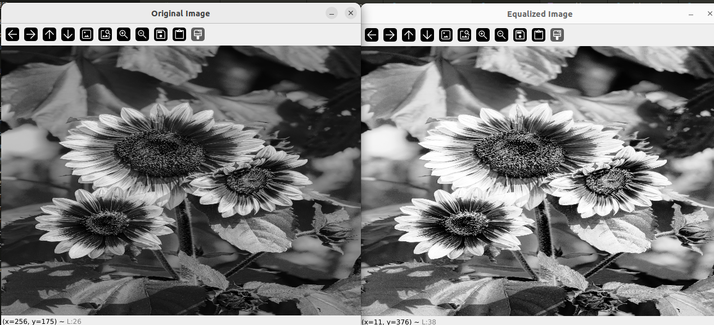


彩色图代码示例

```python
import cv2
import numpy as np
import matplotlib.pyplot as plt
# 1. 读取图像
image = cv2.imread('./src/Python_demo/image.jpg',1)
image = cv2.resize(image, (640, 480))

# 分离 B、G、R 通道
b, g, r = cv2.split(image)

# 对每个通道分别进行直方图均衡化
b_eq = cv2.equalizeHist(b)
g_eq = cv2.equalizeHist(g)
r_eq = cv2.equalizeHist(r)

# 合并通道
equalized_image = cv2.merge([b_eq, g_eq, r_eq])

# 显示结果
cv2.imshow("Original Image", image)
cv2.imshow("Equalized Color Image", equalized_image)

cv2.waitKey(0)
cv2.destroyAllWindows()
```

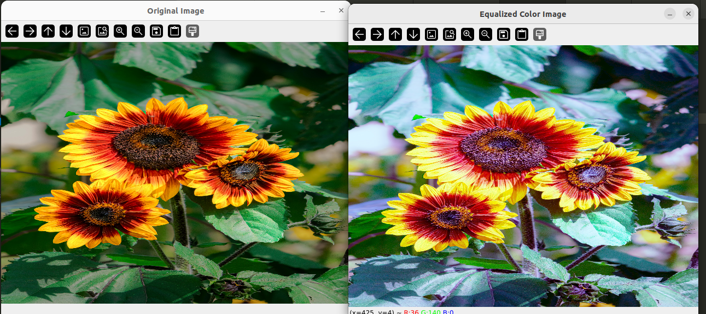


> 注意：直接分别对 B、G、R 三个通道均衡化，可能会改变图像原本的颜色比例，使颜色看起来不自然。  
> 如果希望增强亮度对比度但尽量保持颜色自然，可以考虑转换到 HSV 空间，只对亮度通道进行均衡化。


#### 3. 直方图比较

直方图比较可以理解为一种**通过比较像素分布来判断两张图像相似程度**的方法。

OpenCV 中可以使用 `cv2.compareHist()` 函数比较两个直方图之间的相似度。

```python
similarity = cv2.compareHist(hist1, hist2, method)
```

**参数说明**

|   参数   |      含义      |
| :------: | :------------: |
| `hist1`  |  第一个直方图  |
| `hist2`  |  第二个直方图  |
| `method` | 直方图比较方法 |

**返回值**

- similarity：返回的相似度结果

常用的method比较方法

|            方法             |        含义        |      结果理解      |
| :-------------------------: | :----------------: | :----------------: |
|    `cv2.HISTCMP_CORREL`     | 相关性比较，最常用 | 值越接近 1，越相似 |
|    `cv2.HISTCMP_CHISQR`     |      卡方比较      |   值越小，越相似   |
|   `cv2.HISTCMP_INTERSECT`   |      交集比较      |   值越大，越相似   |
| `cv2.HISTCMP_BHATTACHARYYA` |      巴氏距离      |   值越小，越相似   |

示例代码

```python
import cv2
import numpy as np
import matplotlib.pyplot as plt
# 1. 读取图像
image1 = cv2.imread('./src/Python_demo/image.jpg',1)
image2 = cv2.imread('./src/Python_demo/image.jpg',0)
image1 = cv2.resize(image1, (640, 480))
image2 = cv2.resize(image2, (640, 480))

# 计算两张图像的灰度直方图
hist1 = cv2.calcHist([image1], [0], None, [256], [0, 256])
hist2 = cv2.calcHist([image2], [0], None, [256], [0, 256])

# 比较直方图
similarity = cv2.compareHist(hist1, hist2, cv2.HISTCMP_CORREL)

print("Histogram Similarity:", similarity)
```

输出如下：

```
Histogram Similarity: 0.10090451324893199
```


## 附录A 常用函数速查表

|    模块    |           函数            |     作用     |
| :--------: | :-----------------------: | :----------: |
|  图像读写  |      `cv2.imread()`       |   读取图像   |
|  图像显示  |      `cv2.imshow()`       |   显示图像   |
|  按键等待  |      `cv2.waitKey()`      | 等待键盘输入 |
|  图像保存  |      `cv2.imwrite()`      |   保存图像   |
|  颜色转换  |     `cv2.cvtColor()`      | 转换颜色空间 |
|    缩放    |      `cv2.resize()`       |   调整大小   |
| 平移/旋转  |    `cv2.warpAffine()`     |   仿射变换   |
|    翻转    |       `cv2.flip()`        |   图像翻转   |
|    阈值    |     `cv2.threshold()`     |   普通阈值   |
| 自适应阈值 | `cv2.adaptiveThreshold()` |   局部阈值   |
|  均值滤波  |       `cv2.blur()`        |   均值模糊   |
|  高斯滤波  |   `cv2.GaussianBlur()`    |   高斯模糊   |
|  中值滤波  |    `cv2.medianBlur()`     |   中值去噪   |
|  边缘检测  |       `cv2.Canny()`       |  Canny 边缘  |
|  轮廓检测  |   `cv2.findContours()`    |   查找轮廓   |
|   画轮廓   |   `cv2.drawContours()`    |   绘制轮廓   |
|  轮廓面积  |    `cv2.contourArea()`    |   计算面积   |
|  外接矩形  |   `cv2.boundingRect()`    |  获取矩形框  |
|    腐蚀    |       `cv2.erode()`       | 缩小白色区域 |
|    膨胀    |      `cv2.dilate()`       | 扩大白色区域 |
|   形态学   |   `cv2.morphologyEx()`    |  开闭运算等  |
|    掩膜    |      `cv2.inRange()`      |  生成 mask   |
|   位运算   |    `cv2.bitwise_and()`    | 按 mask 提取 |
|    融合    |    `cv2.addWeighted()`    |   图像融合   |
|   直方图   |     `cv2.calcHist()`      |  计算直方图  |
|   均衡化   |   `cv2.equalizeHist()`    |  对比度增强  |
|  透视变换  |  `cv2.warpPerspective()`  |   透视校正   |


