```
		学习资源：
				https://blog.csdn.net/ZHOU_YONG915/article/details/115792869
				https://c.biancheng.net/view/xtdmucq.html
				https://zhuanlan.zhihu.com/p/8602002085
				https://blog.csdn.net/weixin_29075633/article/details/157633537
```


# 4.1 MATLAB基础

## 4.1.1 简介

MATLAB（Matrix Laboratory）是一款面向科学计算的高级编程与可视化环境，尤其适合**机器人运动学建模与仿真**。

MATLAB 与普通编程语言的核心区别，在于它**原生以矩阵为基础数据类型**，能高效完成以下任务：

- 数值计算、算法开发与数据可视化
- 从简单矩阵运算，到复杂信号处理、控制系统设计
- 配套 Simulink 工具实现图形化系统仿真

它最突出的特点是**直观的矩阵运算机制**：无需编写复杂循环语句，即可完成大规模数据计算。同时，MATLAB 覆盖机器学习、图像处理、金融建模等多个领域，开箱即用，大幅降低了专业算法的使用门槛。

在机器人运动学学习中，MATLAB 的优势体现在：

- 原生支持矩阵运算，语法简洁
- 工具箱生态丰富，便于快速实现**坐标变换、雅可比矩阵、正 / 逆运动学**等算法
- 支持仿真验证，为后续机器人计算与仿真打下基础

**Robotics Toolbox** 是 MATLAB 中专为机器人学开发的开源工具箱，是理论落地实践的关键工具，其必要性体现在：

- 提供标准的 `SerialLink` 类与 DH 参数建模方法，内置正 / 逆运动学函数（如 `fkine`、`ikine`）
- 内置四元数、旋转矩阵、齐次变换等刚体运动工具，直接对接课程理论
- 支持可视化仿真（`plot`、`teach`、`traj` 等函数），大幅提升学习与调试效率
- 与刚体位姿描述、轨迹规划等课程内容高度对应，是理论与实践的桥梁

总之，MATLAB 构建了通用的科学计算基础，Robotics Toolbox 则提供了机器人运动学专用功能。二者结合，是机器人运动学高效学习与实践的标准配置，因此本节课本着这个目的，为后续计算以及应用打下基础！

## 4.1.2 安装

### 1. MATLAB

MATLAB安装包点击下载 ：[MATLAB](https://pan.baidu.com/s/1qN8M-JG0fPMrCq1xe61Rjw )，提取码: yy66 。

> 解压之前需要关闭杀毒与防火墙，并且确保保存文件路劲无中文！

1) 下载解压 MATLAB R2024b.rar，内容如下图所示：


2. 双击进入 Setup 文件夹：

   

3. 鼠标右击 setup.exe 点击 “以管理员身份运行”：

   

4. 点击 “高级选项” 下的 “我有文件密钥”：


5. 点击 “是”，然后点击 “下一步”：

   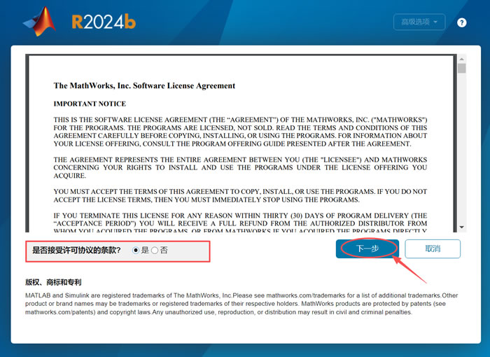

6. 进入 Crack 文件夹：


7. 双击进入 安装密钥.txt ：

   

8. 复制密钥：


9. 粘贴到 “输入文件安装密钥” 里，点击 “下一步”：

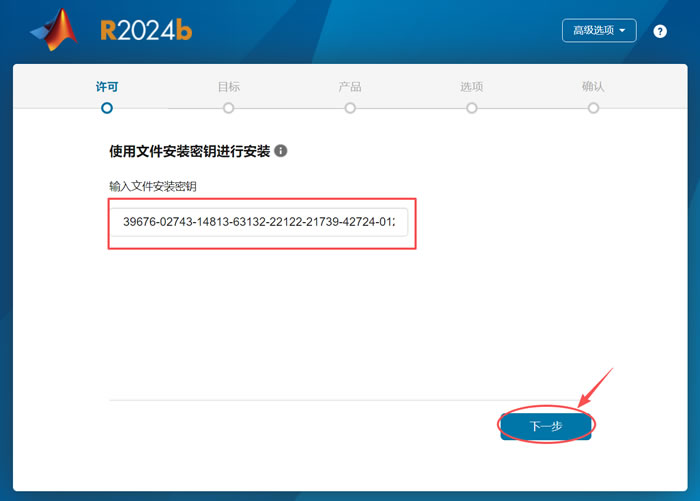

10. 点击 “浏览”：


11.  找到安装包 Crack 目录下的 license 文件，点击 “打开”：

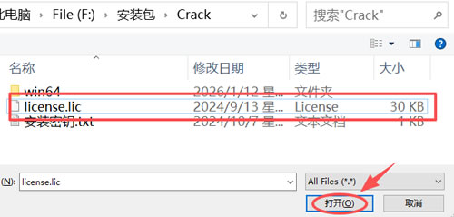

12. 点击 “下一步”：


13. 系统默认安装到 C 盘，这里强烈建议手动修改到其它盘（非系统盘），点击 “下一步”：


14. 点击 “下一步”：

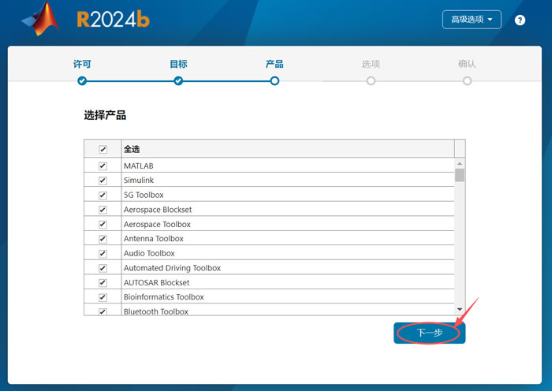

15. 只勾选 “添加桌面快捷方式”，点击 “下一步”：

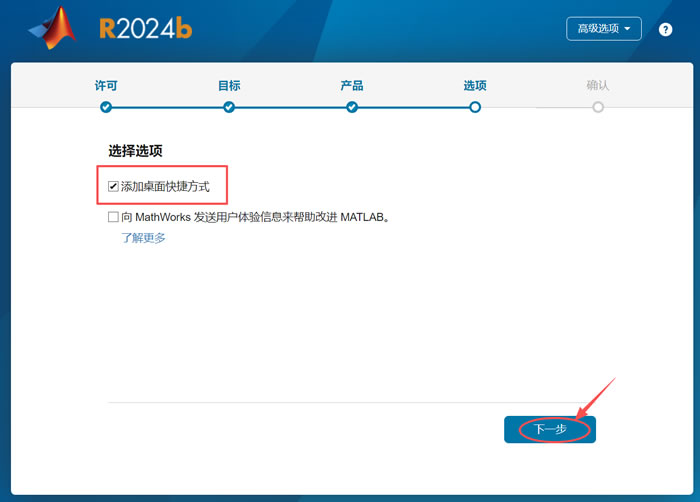

16. 点击 “开始安装”：


17. 等待进度条加载到 100%，然后点击关闭。


18.  复制 Crack 目录下的 win64 文件夹：

    

19. 右键桌面的 MATLAB R2024b 图标，点击 “打开文件所在的位置”：

    

20. 在空白处，右键点击 “粘贴”：

    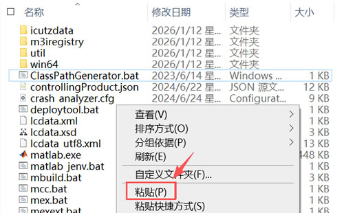

21. 弹出下图所示窗口，点击 “替换目标中的文件”：

    

22. 双击桌面的 MATLAB R2024b 图标，启动软件，出现下图所示界面，就可以使用了：

    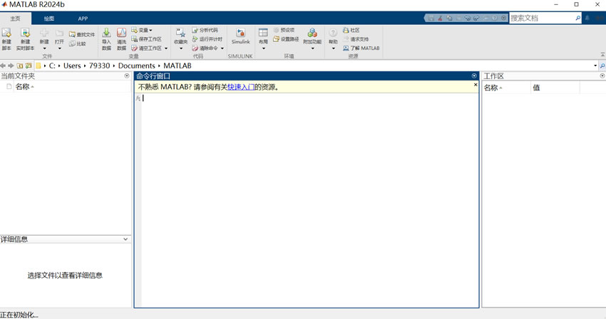

#### 常见问题及解决

**若你双击 MATLAB R2024b 启动软件时，报错 license manager error -8：**

1. 解压 libmwlmgrimpl.7z，复制 libmwlmgrimpl.dll：


2. 右键桌面的 MATLAB R2024b 图标，点击 “打开文件所在的位置”：

   

3. 点击 win64：

   

4. 点击 matlab_startup_plugins 文件夹：

   

5. 点击 lmgrimpl 文件夹：

   

6.  右键空白处点击 “粘贴”，点击 “替换目标中的文件”：

   

7. 重新启动软件就可以使用了。

### 2. 界面优化

参考[界面布局介绍](https://zhuanlan.zhihu.com/p/8602002085)，[界面编辑窗口](https://blog.csdn.net/HHH_____/article/details/110939513)。

最终达到效果如图，更符合使用IDE的风格：

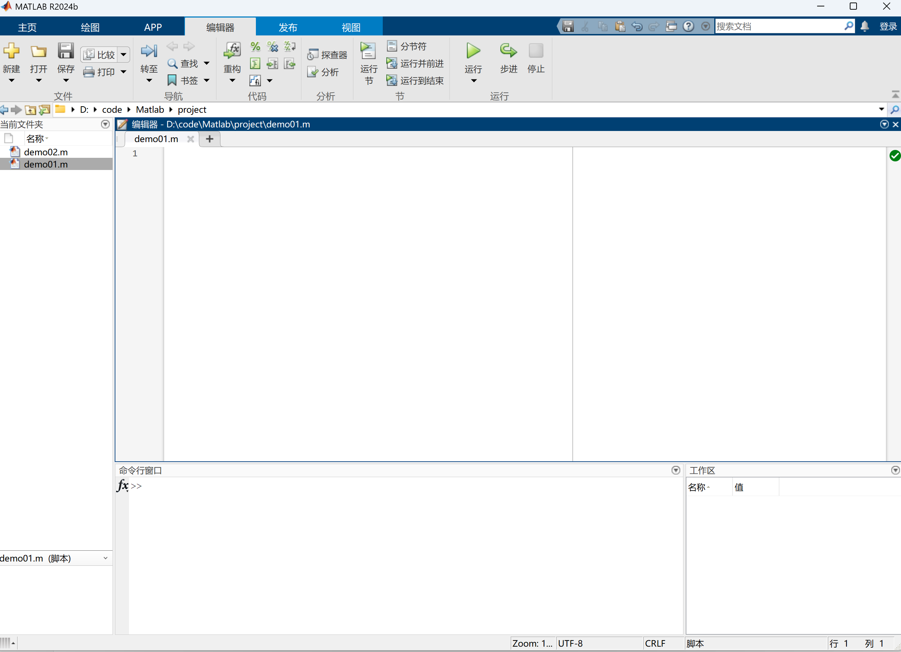

界面简单介绍：
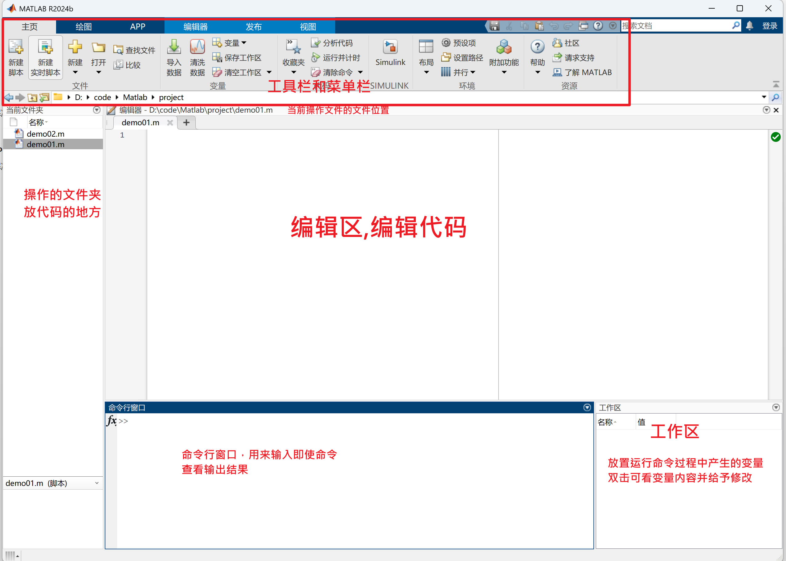

如果需要完成比较复杂的任务，也可以在所在的工作文件夹 下，右键，新建，脚本，建立.m文件，相当于C语言里面的.c和.cpp文件，然后双击.m文件就会在命令行上方弹出编辑器窗口，拉动边界可以调整命令行和编辑器的大小，如果按住窗口上方往外拖，还可以实现编辑器单独窗口。


接下来对工具栏 和菜单栏做一个简单的介绍。

1. **文件栏**主要是对脚本文件的操作
2. **变量栏**主要是对工作区变量的操作，但一般用得很少，因为如果要查看变量可以直接在工作区双击即可查看
3. **环境部分**要注意**预设**和**设置路径**两个按钮，预设就相当于是设置，可以调节界面，字体，显示语言等；设置路径是在添加第三方工具包的时候需要用到，可以理解为添加插件


### 3. Robotics Toolbox安装

1. 解压下载的压缩包，得到rvctools文件夹，将整个文件夹复制到MATLAB的toolbox目录下。

   ```bash
   默认路劲是：C:\Program Files\MATLAB\R2021a\toolbox\
   ```

   > 若忘记自己MATLAB下载位置可对图标点击打开文件所在位置，然后找到toolbox文件进行操作。
   >
   > 

2. 启动MATLAB，在主页点击"设置路径"，点击"添加并包含子文件夹"，选择rvctools目录，点击"保存"后关闭对话框。

   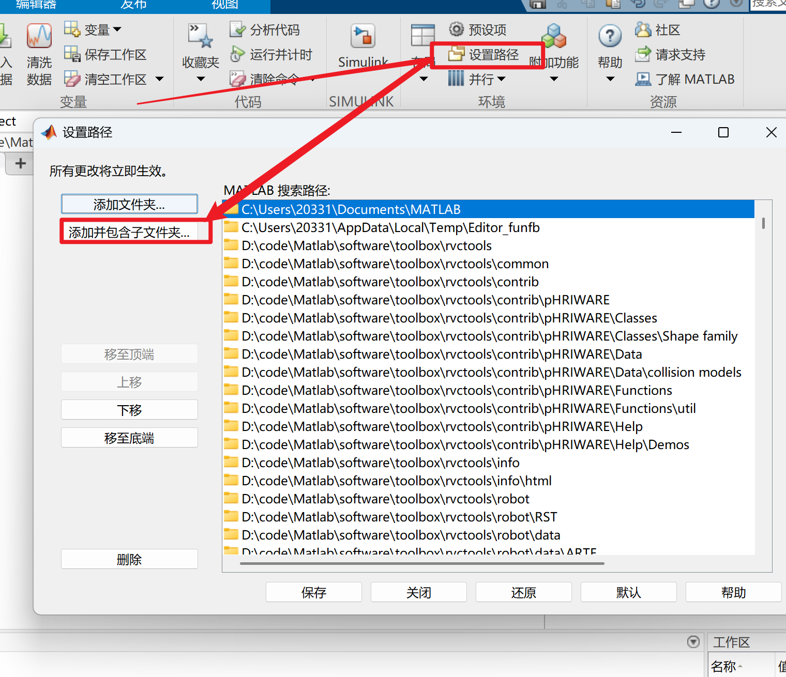

#### 常见问题及解决

- 如果遇到权限问题，可以尝试

```bash
!chmod -R 777 /path/to/rvctools
```

- 路径冲突时，建议先移除旧版本再安装

#### 验证

```matlab
startup_rvc
```

应该看到类似输出：

```bash
Robotics Toolbox for Matlab (release 10.4)
```

检查版本信息：

```matlab
ver('robotics')
```

应该看到类似输出：

```
------------------------------------------------------------------------------------------------
MATLAB 版本: 24.2.0.2712019 (R2024b)
MATLAB 许可证编号: 968398
操作系统: Microsoft Windows 11 家庭版 中文版 Version 10.0 (Build 26200)
Java 版本: Java 1.8.0_202-b08 with Oracle Corporation Java HotSpot(TM) 64-Bit Server VM mixed mode
------------------------------------------------------------------------------------------------
Robotics System Toolbox                               版本 24.2             (R2024b)
```

如果输出正常，说明安装成功！

## 4.1.3 基础语法

### 1. 循环

在MatLab中，循环不使用 **{ }** ，而是用**end**表示循环的结束（不要求缩进），而且**if** 或**while**的条件不需要加 **( )** 。

#### 1. for

**定义与作用**

`for` 循环用于重复执行一段代码，在机器人学中常用于遍历多个关节的角度、批量计算运动学参数等场景。

**语法结构**

```matlab
for 变量 = 起始值:步长:终止值
    % 循环体代码
end
```

**参数说明**

- `变量`：循环计数器，每次迭代自动更新
- `起始值`：循环开始的数值
- `步长`：每次迭代的增量（可省略，默认为1）
- `终止值`：循环结束的数值

**使用案例**

```matlab
% 案例1：遍历6个关节角度并转换为弧度
joint_angles_deg = [0, 30, 45, 60, 90, 120];  % 角度制
joint_angles_rad = zeros(1, 6);  % 预分配空间

for i = 1:6
    joint_angles_rad(i) = joint_angles_deg(i) * pi / 180;
    fprintf('关节%d: %.2f度 = %.4f弧度\n', i, joint_angles_deg(i), joint_angles_rad(i));
end
```

**输出结果**

```mathematica
关节1: 0.00度 = 0.0000弧度
关节2: 30.00度 = 0.5236弧度
关节3: 45.00度 = 0.7854弧度
关节4: 60.00度 = 1.0472弧度0
关节5: 90.00度 = 1.5708弧度
关节6: 120.00度 = 2.0944弧度
```

> **注意事项**
>
> - MATLAB索引从1开始，不是0
> - 循环前用 `zeros` 预分配数组空间可显著提升性能
> - 避免在循环内动态改变数组大小


#### 2. while

**定义与作用**

`while` 循环在条件为真时重复执行代码块，适用于不确定循环次数的场景。在机器人学中用于迭代求解（如数值逆运动学）、等待传感器信号等。

**语法结构**

```matlab
while 条件表达式
    % 循环体代码
end
```

**参数说明**

- `条件表达式`：逻辑表达式，为 `true` 时继续循环，为 `false` 时退出
- MATLAB中不需要括号 `()`，直接写条件即可

**使用案例**

```matlab
% 案例1：累加求和（0+2+4+...直到超过100）
x = 0;
sum = 0;

while x < 101
    sum = sum + x;
    x = x + 2;
end

fprintf('累加结果: sum = %d, 最终x = %d\n', sum, x);

% 案例2：迭代求解逆运动学（简化示例）
q_current = [0; 0; 0];  % 初始关节角度
q_target = [pi/4; pi/6; pi/3];  % 目标角度
tolerance = 0.0005;  % 容差
max_iter = 100;
iter = 0;

while norm(q_target - q_current) > tolerance && iter < max_iter
    % 简化的梯度下降
    q_current = q_current + 0.01 * (q_target - q_current);
    iter = iter + 1;
end

fprintf('迭代%d次后收敛，误差: %.4f\n', iter, norm(q_target - q_current));
```

**输出结果**

```mariadb
累加结果: sum = 2550, 最终x = 102
迭代100次后收敛，误差: 0.5160
```

> **注意事项**
>
> - 必须确保循环条件最终会变为 `false`，否则会陷入死循环
> - 在循环体内加分号 `;` 可抑制中间结果输出，提升性能
> - 使用 `break` 可提前跳出循环


#### 3. if else 

**定义与作用**

`if-elseif-else` 根据条件执行不同的代码分支。在机器人学中用于判断奇异位形、选择不同的控制策略、处理边界条件等。

**语法结构**

```matlab
if 条件1
    % 条件1为真时执行
elseif 条件2
    % 条件1为假且条件2为真时执行
else
    % 所有条件都为假时执行
end
```

**参数说明**

- `条件`：逻辑表达式，可以使用 `>`、`<`、`==`、`~=`（不等于）、`>=`、`<=`
- `elseif` 和 `else` 都是可选的

**使用案例**

```matlab
% 案例1：根据x值选择不同的函数
x = 2;

if x > 1
    f = x^2 + 1;
    fprintf('x > 1: f = %.2f\n', f);
elseif x <= 0
    f = x^3;
    fprintf('x <= 0: f = %.2f\n', f);
else
    f = 2 * x;
    fprintf('0 < x <= 1: f = %.2f\n', f);
end

% 案例2：检测机械臂奇异位形
J = [1, 0, 0; 0, 1, 0; 0, 0, 0];  % 雅可比矩阵
det_J = det(J);

if abs(det_J) < 1e-6
    warning('机械臂处于奇异位形！使用伪逆求解');
    J_inv = pinv(J);
elseif det_J < 0
    warning('雅可比矩阵行列式为负，检查坐标系定义');
    J_inv = inv(J);
else
    fprintf('正常位形，行列式 = %.4f\n', det_J);
    J_inv = inv(J);
end

% 案例3：多条件组合（逻辑与 && 和逻辑或 ||）
angle = 95;
velocity = 0.5;

if angle > 90 && velocity > 0.3
    fprintf('关节角度过大且速度过快，触发安全保护\n');
elseif angle > 90 || velocity > 0.3
    fprintf('警告：接近安全边界\n');
else
    fprintf('运行正常\n');
end
```

**输出结果**

```mathematica
x > 1: f = 5.00
警告: 机械臂处于奇异位形！使用伪逆求解
关节角度过大且速度过快，触发安全保护
```

> **注意事项**
>
> - MATLAB中不等于是 `~=`，不是 `!=`
> - 逻辑与用 `&&`（短路求值）或 `&`（全部求值）
> - 逻辑或用 `||`（短路求值）或 `|`（全部求值）
> - 条件判断按顺序执行，一旦某个条件为真就不再检查后续条件

#### 4. swich

**定义与作用**

`switch-case` 根据变量的值选择执行对应的代码块，比多个 `if-elseif` 更清晰。在机器人学中用于选择不同的运动模式、处理用户输入等。

**语法结构**

```matlab
switch 变量
    case 值1
        % 变量等于值1时执行
    case 值2
        % 变量等于值2时执行
    otherwise
        % 所有case都不匹配时执行（相当于default）
end
```

**参数说明**

- `变量`：可以是数值、字符串或字符
- `case` 后面不需要冒号，直接写值
- `otherwise` 等同于C语言中的 `default`

**使用案例**

```matlab
% 案例1：根据输入选择身份
num = input('请输入一个数字（-1/0/1）: ');

switch num
    case -1
        fprintf('I am a teacher.\n');
    case 0
        fprintf('I am a student.\n');
    case 1
        fprintf('You are a teacher.\n');
    otherwise
        fprintf('You are a student.\n');
end

% 案例2：选择机器人运动模式
mode = 'joint';  % 可选：'joint', 'cartesian', 'trajectory'

switch mode
    case 'joint'
        fprintf('关节空间运动模式\n');
        % 执行关节空间插值
    case 'cartesian'
        fprintf('笛卡尔空间运动模式\n');
        % 执行直线插值
    case 'trajectory'
        fprintf('轨迹跟踪模式\n');
        % 执行轨迹规划
    otherwise
        error('未知的运动模式！');
end

% 案例3：多个case共享同一代码块
robot_type = 6;

switch robot_type
    case {4, 5}
        fprintf('SCARA机器人\n');
    case {6, 7}
        fprintf('6/7自由度工业机械臂\n');
    case 3
        fprintf('Delta并联机器人\n');
    otherwise
        fprintf('未识别的机器人类型\n');
end
```

**输出结果**

```matlab
请输入一个数字（-1/0/1）: 0
I am a student.

关节空间运动模式

6/7自由度工业机械臂
```

> **注意事项**
>
> -  `case` 后面没有冒号，这与C/C++不同
> - MATLAB的 `switch` 不需要 `break`，每个 `case` 自动结束
> - 可以用花括号 `{}` 将多个值组合到一个 `case`：`case {1, 2, 3}`
> -  `otherwise` 是可选的，但建议加上以处理意外输入

### 2. 函数

在MatLab中，写脚本时，不能像C语言一样在该脚本中随便定义一个函数，应该在另一个文件（最好同一目录）中定义。**操作方法就是点击新建按钮旁边的三角，选择新建函数**。

**定义与作用**

`function` 用于封装可重复使用的代码块，在机器人学中用于封装正/逆运动学求解、雅可比矩阵计算等功能。

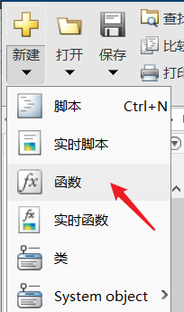

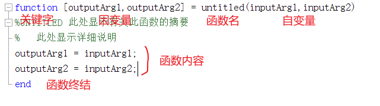

**参数说明**

- `输出`：函数返回值，可以有多个
- `函数名`：遵循变量命名规则
- `输入`：函数参数，可以有多个

**使用案例**

```matlab
% 案例：计算2R机械臂的正运动学
function [x, y] = forward_kinematics_2R(L1, L2, theta1, theta2)
    % L1, L2: 连杆长度
    % theta1, theta2: 关节角度（弧度）
    % x, y: 末端执行器位置
    
    x = L1 * cos(theta1) + L2 * cos(theta1 + theta2);
    y = L1 * sin(theta1) + L2 * sin(theta1 + theta2);
end

% 调用函数
L1 = 1.0;  % 第一连杆长度1米
L2 = 0.8;  % 第二连杆长度0.8米
theta1 = pi/4;  % 45度
theta2 = pi/6;  % 30度

[pos_x, pos_y] = forward_kinematics_2R(L1, L2, theta1, theta2);
fprintf('末端位置: x = %.4f, y = %.4f\n', pos_x, pos_y);
```

**输出结果**

```matlab
末端位置: x = 0.9142, y = 1.4798
```

> **注意事项**
>
> - 保存为.m文件时，文件名和定义的函数名**forward_kinematics_2R.m**必须要一样！
> - 函数内部变量是局部变量，不影响外部工作区
> - 多输出时用方括号 `[]` 接收

#### 说明：

1. 如果需要另外定义一个函数，可以直接在该文件中直接定义，但这个函数不能被其他文件调用，只能被该文件名对应的函数调用。

编辑代码：

```matlab
% ==================== 文件名：mainCalculator.m ====================

% 1. 主函数（公开的，其他人只要能看到这个文件，就能调用它） ---> 和文件名一样的函数
function [sumRes, mulRes] = mainCalculator(a, b)
    sumRes = privateAdd(a, b);  % 正确！主函数可以调用底部的私有局部函数
    mulRes = privateMul(a, b);  % 正确！
end

% 2. 局部函数 A（私有的，专门服务于主函数）
function out = privateAdd(x, y)
    out = x + y;
end

% 3. 局部函数 B（私有的，别人休想直接访问我）
function out = privateMul(x, y)
    out = x * y;
end
```

命令行输入：

```matlab
>> [s, m] = mainCalculator(3, 5)  
% 运行成功！输出 s = 8, m = 15。因为系统能通过文件名找到主函数。

>> res = privateAdd(3, 5)
% 报错：无法识别函数或变量 'privateAdd'。
% 原因：正如图片第3点所说，它不能被其他文件或外部直接调用，只能被这个文件内的函数调用。
```

2. 调用该函数时，需要**严格按照** 定义的函数格式来调用，即输入参数和输出参数应该一一对应。

> 一一对应输出参数：区别于Python中，比如函数mainCalculator返回值是两个：
>
> 1. Python ：res = mainCalculator(3,5),最终res 是元组接受(8，15)，输出res是 (8，15)。
> 2. MATLAB：只能使用[res1,res2 ]= mainCalculator(3,5)。

```matlab
>> [s, m] = mainCalculator(3, 5)  
% 运行成功！输出 s = 8, m = 15。因为系统能通过文件名找到主函数。

>> res = mainCalculator(3, 5)
% res只接受到8，也就是mainCalculator函数输出（8，15）的一个参数
```

> 一一对应输入参数：区别于Python中，比如函数mainCalculator输入是两个：
>
> 1. Python：如果函数 mainCalculator在定义参数由默认参数，那么参数比如mainCalculator(a,b=1),调用可传入1个参数即可。
> 2. MATLAB：函数不支持直接对mainCalculator定义参数使用默认定义法，即，调用函数的实参必须和形参一一对应，且顺序不可换，比如在该函数由定义可知，第一个实参值就是形参a的值，第二个实参值就是形参b的值。

```matlab
% 正确运行！严格按照位置，第一个 3 给 a，第二个 5 给 b
>> [s, m] = mainCalculator(3, 5)  
% 运行成功！系统把 a=3, b=5 带入计算，输出 s = 8, m = 15。


%  试图模仿 Python 颠倒顺序指定名字（翻车现场）
>> [s, m] = mainCalculator(b=5, a=3)  
% 报错：计算表达式时发现无效的运算符或语法。
% 原因：MATLAB 无法在函数调用时动态识别“关键字赋值”，它只看逗号分隔的位置！


%  试图少传参数（翻车现场）
>> [s, m] = mainCalculator(3)  
% 报错：输入参数的数目不足。
% 原因：定义时需要 a 和 b 两个自变量，你只给了一个 3，第二个坑位 b 空着，MATLAB 无法向下执行。
```

#### nargin & nargout

**nargin**可以理解为**n_arg_in**，即输入参数的个数，同理，**nargout**表示输出参数的个数，有了这两个**永久变量**，可以实现Matlab调用函数时的**参数可调性**，即通过 `nargin`，MATLAB 就能在保证“严格对应”的底线下，聪明地处理不同数量的输入自变量了！参考下面这个例子：

```matlab
function fout = charray(a,b,c)
    % 这一行定义了函数名叫 charray。它对外最多可以接收 3 个参数 (a, b, c)
    % 并且准备用变量 fout 来装最终的计算结果。

    if nargin == 1
        % 分流情况 A：如果外面调用时只传了 1 个参数（即 nargin 等于 1）
        fout = a;
        % 那么：把第一个参数 a 的值直接塞给输出变量 fout，完事！

    elseif nargin == 2
        % 分流情况 B：如果外面调用时传了 2 个参数（即 nargin 等于 2）
        fout = a + b;
        % 那么：把前两个参数 a 和 b 加起来，结果塞给 fout！

    elseif nargin == 3
        % 分流情况 C：如果外面调用时传满了 3 个参数（即 nargin 等于 3）
        fout = (a*b*c)/2;
        % 那么：执行乘除法数学公式 (a * b * c) / 2，结果塞给 fout！

    end
    % 函数终结。此时 MATLAB 会看 fout 里装的是啥，然后把它吐给外面。
```

### 3. 类

在当前文件夹空白区，点击新建文件，找到类，新建完后如下有类写法介绍：

```matlab
classdef MyClass
    %MYCLASS 此处显示有关此类的摘要
    %   此处显示详细说明
    
    properties
        Property1
    end
    
    methods
        function obj = MyClass(inputArg1,inputArg2)
            %MYCLASS 构造此类的实例
            %   此处显示详细说明
            obj.Property1 = inputArg1 + inputArg2;
        end
        
        function outputArg = method1(obj,inputArg)
            %METHOD1 此处显示有关此方法的摘要
            %   此处显示详细说明
            outputArg = obj.Property1 + inputArg;
        end
    end
end
```

由于类的编写，我们这里需求几乎没有，所以不做介绍。


### 4. 常用预定义量

**定义与作用**

MATLAB内置的常量和特殊值，在机器人学计算中频繁使用。

**常用预定义量列表**

| 预定义量 |        含义        |           物理意义           |
| :------: | :----------------: | :--------------------------: |
|   `pi`   |  圆周率π ≈ 3.1416  | 关节角度弧度制转换的核心常数 |
|  `ans`   |   上一次计算结果   |   临时存储未赋值的计算结果   |
|  `inf`   |      正无穷大      |    表示超出范围或奇异位形    |
|  `eps`   | 浮点精度 ≈ 2.2e-16 |      判断数值是否接近零      |
|  `NAN`   |       非数值       | 表示逆运动学无解或传感器失效 |

> 常见运算中产生NAN：
>
> - *0/0*
> - *inf - inf*
> - *inf / inf*
> - *负数开平方*

**使用案例**

请创建robot_predefined_values_demo.m，然后复制以下代码：

```matlab
%% ========================================================================
%% 1. pi - 关节角度转换与轨迹规划
%% ========================================================================
fprintf('【1】pi - 关节角度转换与轨迹规划\n');
fprintf('----------------------------------------\n');

% 案例1.1：计算旋转矩阵（绕Z轴旋转90度）
theta = 90 * pi / 180;  % 90度转弧度
R_z = [cos(theta), -sin(theta), 0;
       sin(theta),  cos(theta), 0;
       0,           0,          1];
fprintf('\n绕Z轴旋转90度的旋转矩阵:\n');
disp(R_z);

%% ========================================================================
%% 2. ans - 快速验证运动学计算
%% ========================================================================
fprintf('【2】ans - 快速验证运动学计算\n');
fprintf('----------------------------------------\n');

% 案例2.1：连续计算雅可比矩阵的行列式
J = [0.5, -0.3, 0.2;
     0.4,  0.6, 0.1;
     0.0,  0.0, 0.8];
det(J);  % 计算行列式，结果存入ans
fprintf('雅可比矩阵行列式: %.4f\n', ans);

if abs(ans) < 0.01
    warning('接近奇异位形！');
end
fprintf('\n');

%% ========================================================================
%% 3. inf - 检测工作空间边界与奇异位形
%% ========================================================================
fprintf('【3】inf - 检测工作空间边界与奇异位形\n');
fprintf('----------------------------------------\n');

% 案例3.1：检测目标点是否超出机械臂工作空间
L1 = 1.0;  % 连杆1长度
L2 = 0.8;  % 连杆2长度
max_reach = L1 + L2;  % 最大工作半径
min_reach = abs(L1 - L2);  % 最小工作半径

target_x = 5.0;  % 目标点X坐标
target_y = 5.0;  % 目标点Y坐标
target_distance = sqrt(target_x^2 + target_y^2);

fprintf('工作空间检测:\n');
fprintf('  目标点距离: %.2f m\n', target_distance);
fprintf('  最大工作半径: %.2f m\n', max_reach);

if target_distance > max_reach
    warning('目标点超出工作空间！');
    joint_velocity = inf;  % 用inf标记无法到达
    fprintf('  关节速度: inf（无法到达）\n');
end

% 案例3.2：奇异位形时的速度放大系数
det_J_singular = 0.0001;  % 雅可比矩阵行列式接近零
velocity_scale = 1 / det_J_singular;  % 速度放大系数

fprintf('\n奇异位形检测:\n');
fprintf('  雅可比行列式: %.6f\n', det_J_singular);
fprintf('  速度放大系数: %.2f\n', velocity_scale);

if velocity_scale > 1000
    warning('速度放大系数过大，接近奇异位形！');
    velocity_scale = inf;  % 标记为无穷大
    fprintf('  修正后速度放大系数: inf\n');
end

% 案例3.3：除零保护
joint_velocity_test = 0.5;  % 关节速度
time_to_target = 0;  % 到达剩余距离时间，为0则到达

if time_to_target == 0
    acceleration = inf;  % 瞬时加速度为无穷大
    fprintf('\n已到达目标，瞬时加速度: inf\n\n');
else
    acceleration = joint_velocity_test / time_to_target;
end

%% ========================================================================
%% 4. eps - 判断奇异位形与浮点数比较
%% ========================================================================
fprintf('【4】eps - 判断奇异位形与浮点数比较\n');
fprintf('----------------------------------------\n');

% 案例4.1：检测雅可比矩阵是否奇异
J_singular = [1.0, 0.5, 0.3;
              0.0, 0.8, 0.4;
              0.0, 0.0, 0.0000001];  % 第三行接近零向量

det_J_eps = det(J_singular);
fprintf('奇异位形检测:\n');
fprintf('  雅可比矩阵行列式: %.10f\n', det_J_eps);
fprintf('  机器精度 eps: %.10e\n', eps);

if abs(det_J_eps) < eps
    warning('机械臂处于奇异位形！');
    fprintf('  建议：使用伪逆 pinv() 代替 inv()\n');
    J_inv = pinv(J_singular);
else
    fprintf('  正常位形，可以使用 inv()\n');
    J_inv = inv(J_singular);
end

% 案例4.2：浮点数相等判断（关节角度到位检测）
current_angle = 1.5708;  % 当前关节角度
target_angle = pi / 2;   % 目标角度（90度）

fprintf('\n关节到位检测:\n');
fprintf('  当前角度: %.10f rad\n', current_angle);
fprintf('  目标角度: %.10f rad\n', target_angle);

% 错误的判断方式
if current_angle == target_angle
    fprintf('  方法1（==）: 已到位\n');
else
    fprintf('  方法1（==）: 未到位（浮点误差导致）\n');
end

% 正确的判断方式
if abs(current_angle - target_angle) < eps
    fprintf('  方法2（eps）: 已到位\n');
else
    fprintf('  方法2（eps）: 未到位\n');
end

% 案例4.3：轨迹插值精度控制
point1 = [1.0, 2.0, 3.0];
point2 = [1.0000000001, 2.0000000001, 3.0000000001];
distance = norm(point2 - point1);

fprintf('\n轨迹插值精度:\n');
fprintf('  两点距离: %.15f m\n', distance);

if distance < eps
    fprintf('  两点重合，跳过插值\n\n');
else
    fprintf('  两点不重合，执行插值\n\n');
end

%% ========================================================================
%% 5. NAN - 逆运动学无解与传感器数据处理
%% ========================================================================
fprintf('【5】NAN - 逆运动学无解与传感器数据处理\n');
fprintf('----------------------------------------\n');

% 案例5.1：2R机械臂逆运动学求解
fprintf('逆运动学求解测试:\n');

% 测试1：正常目标点
q1 = robot_inverse_kinematics(1.5, 0.5, 1.0, 0.8);
fprintf('  目标点(1.5, 0.5): ');
if any(isnan(q1))
    fprintf('无解（NaN）\n');
else
    fprintf('q1=%.4f rad, q2=%.4f rad\n', q1(1), q1(2));
end

% 测试2：超出工作空间
q2 = robot_inverse_kinematics(5.0, 5.0, 1.0, 0.8);
fprintf('  目标点(5.0, 5.0): ');
if any(isnan(q2))
    fprintf('无解（NaN）\n');
else
    fprintf('q1=%.4f rad, q2=%.4f rad\n', q2(1), q2(2));
end

% 案例5.2：传感器数据处理
fprintf('\n激光传感器数据处理:\n');
laser_readings = [1.2, 3.4, NaN, 5.6, NaN, 7.8];  % NaN表示传感器失效
fprintf('  原始数据: ');
disp(laser_readings);

% 检测失效点
failed_indices = find(isnan(laser_readings));
fprintf('  传感器失效位置: ');
disp(failed_indices);

% 用线性插值修复
laser_readings_fixed = laser_readings;
for i = failed_indices
    if i > 1 && i < length(laser_readings_fixed)
        prev_valid = laser_readings_fixed(i-1);
        next_idx = i + 1;
        while next_idx <= length(laser_readings_fixed) && isnan(laser_readings_fixed(next_idx))
            next_idx = next_idx + 1;
        end
        if next_idx <= length(laser_readings_fixed)
            laser_readings_fixed(i) = (prev_valid + laser_readings_fixed(next_idx)) / 2;
        end
    end
end

fprintf('  修复后数据: ');
disp(laser_readings_fixed);

% 案例5.3：轨迹规划中的无效点过滤
fprintf('轨迹规划点过滤:\n');
trajectory = [1.0, 2.0, 3.0;
              1.5, 2.5, 3.5;
              NaN, NaN, NaN;  % 无效点
              2.0, 3.0, 4.0;
              NaN, NaN, NaN]; % 无效点

fprintf('  原始轨迹点数: %d\n', size(trajectory, 1));

% 移除包含NaN的行
valid_trajectory = trajectory(~any(isnan(trajectory), 2), :);
fprintf('  有效轨迹点数: %d\n', size(valid_trajectory, 1));
fprintf('  有效轨迹:\n');
disp(valid_trajectory);

%% ========================================================================
%% 辅助函数定义
%% ========================================================================

% 2R机械臂逆运动学求解函数
function q = robot_inverse_kinematics(x, y, L1, L2)
    % 简化的2R机械臂逆运动学
    d = sqrt(x^2 + y^2);
    
    % 检查是否在工作空间内
    if d > (L1 + L2) || d < abs(L1 - L2)
        warning('目标点 (%.2f, %.2f) 超出工作空间！', x, y);
        q = [NaN; NaN];  % 返回NAN表示无解
        return;
    end
    
    % 余弦定理求解（简化）
    cos_q2 = (x^2 + y^2 - L1^2 - L2^2) / (2 * L1 * L2);
    
    if abs(cos_q2) > 1
        warning('数值误差导致无解！');
        q = [NaN; NaN];
        return;
    end
    
    q2 = acos(cos_q2);
    q1 = atan2(y, x) - atan2(L2*sin(q2), L1 + L2*cos(q2));
    q = [q1; q2];
end

%% ========================================================================
%% 程序结束
%% ========================================================================
fprintf('\n========================================\n');
fprintf('所有预定义量示例运行完毕！\n');
fprintf('========================================\n');
```

> **注意事项**
>
> - 不要用 `pi` 作为变量名，会覆盖内置常量
> -  `inf` 参与运算遵循数学规则：`inf + 1 = inf`，`inf / inf = NaN`
> -  使用 `eps` 判断浮点数相等：`abs(a - b) < eps`
>


## 4.1.4 矩阵语法

### 1. 矩阵创建

**定义与作用**

矩阵是机器人学的核心数据结构，表示位姿、速度、雅可比等所有关键信息。

#### 1. 直接输入法

**语法结构**

```matlab
A = [元素1, 元素2, ...; 下一行元素...]
% 空格或逗号分隔列，分号分隔行
```

**使用案例**

```matlab
% 案例1：创建旋转矩阵
R = [0, -1, 0;
     1,  0, 0;
     0,  0, 1];
fprintf('旋转矩阵:\n');
disp(R);

% 案例2：创建齐次变换矩阵
T = [R, [2; 3; 0];  % 拼接旋转和平移
     0, 0, 0, 1];
fprintf('齐次变换矩阵:\n');
disp(T);
```

**输出结果**

```mathematica
旋转矩阵:
     0    -1     0
     1     0     0
     0     0     1

齐次变换矩阵:
     0    -1     0     2
     1     0     0     3
     0     0     1     0
     0     0     0     1
```

#### 2. 零矩阵 - zeros

**定义与作用**

创建全零矩阵，用于预分配空间、初始化变量等。

**语法结构**

```matlab
A = zeros(m, n)  % m行n列的零矩阵
A = zeros(n)     % n×n的零方阵
```

**使用案例**

```matlab
% 案例：预分配轨迹存储空间
num_points = 100;
trajectory = zeros(num_points, 3);  % 100个三维点

for i = 1:num_points
    t = (i-1) * 0.01;
    trajectory(i, :) = [cos(t), sin(t), t];  % 螺旋线
end

fprintf('轨迹前5个点:\n');
disp(trajectory(1:5, :));
```

**输出结果**

```mathematica
轨迹前5个点:
    1.0000         0         0
    1.0000    0.0100    0.0100
    0.9998    0.0200    0.0200
    0.9996    0.0300    0.0300
    0.9992    0.0400    0.0400
```

#### 3. 单位矩阵 - eye

**定义与作用**

创建单位矩阵（对角线为1，其余为0），物理意义是"无变换"的初始参考坐标系。

**语法结构**

```matlab
I = eye(n)  % n×n单位矩阵
```

**使用案例**

```matlab
% 案例：初始化齐次变换矩阵
T_base = eye(4);  % 基坐标系（无旋转无平移）
fprintf('基坐标系变换矩阵:\n');
disp(T_base);

% 验证性质：A * I = A
A = [1, 2; 3, 4];
result = A * eye(2);
fprintf('A * I = A:\n');
disp(result);
```

**输出结果**

```mathematica
基坐标系变换矩阵:
     1     0     0     0
     0     1     0     0
     0     0     1     0
     0     0     0     1

A * I = A:
     1     2
     3     4
```

> **注意事项**
>
> -  `zeros` 和 `eye` 可显著提升循环性能
>
> **补充**
>
> -  其他创建函数：`ones(m,n)`（全1）、`rand(m,n)`（随机）、对角矩阵diag

### 2. 矩阵操作与常用运算

#### 1. 获取大小 - size

**语法结构**

```matlab
[m, n] = size(A)  % 返回矩阵A的行数m和列数n
d = size(A, 1)    % 仅返回行数
d = size(A, 2)    % 仅返回列数
```

**使用案例**

```matlab
% 案例：检查雅可比矩阵维度
J = rand(6, 6);  % 6自由度机械臂的雅可比
[rows, cols] = size(J);
fprintf('雅可比矩阵: %d行 × %d列\n', rows, cols);

if rows ~= cols
    warning('雅可比矩阵不是方阵，可能处于奇异位形');
end
```

**输出结果**

```mathematica
雅可比矩阵: 6行 × 6列
```

> - **~=** ：表示不等于，记住，不是感叹号哦！
> - **==** ：表示等于，一个 **=** 表示赋值

#### 2. 分块矩阵拼接

**语法结构**

```matlab
C = [A, B]   % 水平拼接（左右拼接，列数增加）
C = [A; B]   % 垂直拼接（上下拼接，行数增加）
```

**参数说明**

- 水平拼接：A和B的行数必须相同
- 垂直拼接：A和B的列数必须相同

**使用案例**

```matlab
% 案例1：构建齐次变换矩阵（核心技能）
R = [0, -1, 0;   % 3×3旋转矩阵
     1,  0, 0;
     0,  0, 1];
p = [2; 3; 0];   % 3×1平移向量

% 水平拼接旋转和平移
T_top = [R, p];  % 得到3×4矩阵
fprintf('上半部分（3×4）:\n');
disp(T_top);

% 垂直拼接底部行
T = [T_top; 0, 0, 0, 1];  % 得到4×4齐次变换矩阵
fprintf('完整齐次变换矩阵（4×4）:\n');
disp(T);

% 案例2：批量拼接轨迹点
point1 = [1, 2, 3];
point2 = [4, 5, 6];
point3 = [7, 8, 9];
trajectory = [point1; point2; point3];  % 垂直拼接成3×3矩阵
fprintf('轨迹点集合:\n');
disp(trajectory);

% 案例3：错误示范
A = [1, 2; 3, 4];  % 2×2
B = [5, 6, 7];     % 1×3
% C = [A, B];  % 错误！行数不匹配（2 vs 1）
% C = [A; B];  % 错误！列数不匹配（2 vs 3）
```

**输出结果**

```
上半部分（3×4）:
     0    -1     0     2
     1     0     0     3
     0     0     1     0

完整齐次变换矩阵（4×4）:
     0    -1     0     2
     1     0     0     3
     0     0     1     0
     0     0     0     1

轨迹点集合:
     1     2     3
     4     5     6
     7     8     9
```

> **注意事项**
>
> -  拼接前必须检查维度匹配
> -  齐次变换矩阵的标准构建：`T = [R, p; 0 0 0 1]`
> -  可以多个矩阵连续拼接：`[A, B, C]` 或 `[A; B; C]`
>

---

#### 3. 矩阵的切片与提取

**定义与作用**

从矩阵中提取特定的行、列或子矩阵。在机器人学中，这是从4×4齐次变换矩阵中分离旋转和平移的核心技能。

**语法结构**

```matlab
row_data = A(r, :)        % 提取第r行（所有列）
col_data = A(:, c)        % 提取第c列（所有行）
sub_matrix = A(r1:r2, c1:c2)  % 提取子矩阵
```

**参数说明**

- `:`：表示"所有"
- `r1:r2`：从第r1行到第r2行
- `end`：表示最后一个索引

**使用案例**

```matlab
% 案例1：从齐次变换矩阵中提取旋转和平移（核心技能）
T = [0, -1, 0, 2;
     1,  0, 0, 3;
     0,  0, 1, 0;
     0,  0, 0, 1];

% 提取3×3旋转矩阵
R = T(1:3, 1:3);
fprintf('旋转矩阵:\n');
disp(R);

% 提取3×1平移向量
p = T(1:3, 4);
fprintf('平移向量:\n');
disp(p);

% 提取底部行（验证是否为[0 0 0 1]）
bottom_row = T(4, :);
fprintf('底部行:\n');
disp(bottom_row);

% 案例2：提取雅可比矩阵的线速度和角速度部分
J = rand(6, 6);  % 6×6雅可比矩阵
Jv = J(1:3, :);  % 前3行：线速度雅可比
Jw = J(4:6, :);  % 后3行：角速度雅可比
fprintf('线速度雅可比（3×6）:\n');
disp(Jv);


% 案例3：使用end关键字
last_column = T(:, end);  % 提取最后一列
fprintf('最后一列:\n');
disp(last_column);
```

**输出结果**

```mathematica
旋转矩阵:
     0    -1     0
     1     0     0
     0     0     1

平移向量:
     2
     3
     0

底部行:
     0     0     0     1

线速度雅可比（3×6）:
    0.6948    0.7655    0.7094    0.1190    0.7513    0.5472
    0.3171    0.7952    0.7547    0.4984    0.2551    0.1386
    0.9502    0.1869    0.2760    0.9597    0.5060    0.1493

最后一列:
     2
     3
     0
     1
```

> **注意事项**
>
> - **物理意义**：RTB算出的4×4齐次变换矩阵包含全部信息，学会切片才能把"旋转"和"位置"分别提取
> -  MATLAB索引从1开始，`A(0, :)` 会报错
> - 切片操作不改变原矩阵，是复制操作

#### 4. 矩阵乘法 & 数组点乘 

**定义与作用**

这是MATLAB中最容易混淆的运算符，直接影响机器人变换矩阵的计算正确性。

**运算符对比**

| 运算符 | 名称     | 数学含义         | 物理意义           |
| ------ | -------- | ---------------- | ------------------ |
| `*`    | 矩阵乘法 | 线性代数矩阵乘法 | 坐标系变换的叠加   |
| `.*`   | 数组点乘 | 对应元素相乘     | 独立数据的逐个缩放 |

**语法结构**

```matlab
C = A * B    % 矩阵乘法：A的列数必须等于B的行数
C = A .* B   % 数组点乘：A和B尺寸必须相同
```

**使用案例**

```matlab
% 案例1：矩阵乘法 - 两次旋转变换的叠加
R1 = [cos(pi/4), -sin(pi/4); sin(pi/4), cos(pi/4)];  % 绕Z轴旋转45度
R2 = [cos(pi/6), -sin(pi/6); sin(pi/6), cos(pi/6)];  % 绕Z轴旋转30度
R_total = R1 * R2;  % 绕固定轴旋转 = 先R2再R1
fprintf('总旋转矩阵:\n');
disp(R_total);

% 案例2：数组点乘 - 多个关节角度同时缩放
joint_angles = [30, 45, 60, 90];  % 度
scale_factors = [1.5, 2.0, 0.5, 1.0];
scaled_angles = joint_angles .* scale_factors;
fprintf('缩放后角度: ');
disp(scaled_angles);

% 案例3：错误示范
A = [1, 2; 3, 4];
B = [5, 6; 7, 8];
% C = A * B;   % 正确：矩阵乘法
% C = A .* B;  % 正确：对应元素相乘

```

**输出结果**
```
总旋转矩阵:
    0.2588   -0.9659
    0.9659    0.2588

缩放后角度:     45    90    30    90
```

> **注意事项**
>
> -  **关键判断规则**：
>   - 需要物理变换叠加（如旋转矩阵连乘）→ 用 `*`
>   - 需要独立数据逐个操作（如批量缩放）→ 用 `.*`
> -  矩阵乘法不满足交换律：`A * B ≠ B * A`
> - 其他点运算符：`./`（点除）、`.^`（点幂）
>

---

#### 5. 符号变量声明 - syms

**定义与作用**

`syms` 用于声明符号变量，使MATLAB进行符号推导而非数值计算。在机器人学中用于推导运动学解析解、雅可比矩阵等。

**语法结构**

```matlab
syms 变量1 变量2 ... [假设条件]
```

**参数说明**
- `变量`：符号变量名，可以一次声明多个
- `假设条件`：可选，如 `real`（实数）、`positive`（正数）

**使用案例**

```matlab
% 案例：推导2R机械臂正运动学符号解
syms L1 L2 q1 q2 real  % 声明符号变量

% 末端位置的符号表达式
x = L1*cos(q1) + L2*cos(q1 + q2);
y = L1*sin(q1) + L2*sin(q1 + q2);

fprintf('末端X坐标符号解:\n');
disp(x);
fprintf('末端Y坐标符号解:\n');
disp(y);

% 对q1求偏导（雅可比矩阵的一部分）
dx_dq1 = diff(x, q1);
fprintf('∂x/∂q1 =\n');
disp(dx_dq1);

% 代入具体数值
x_numeric = subs(x, {L1, L2, q1, q2}, {1, 0.8, pi/4, pi/6});
x_numeric_dq1 = subs(dx_dq1, {L1, L2, q1, q2}, {1, 0.8, pi/4, pi/6});

fprintf('代入数值后: x = %.4f\n', double(x_numeric));
fprintf('代入数值后: dx/dq1 = %.4f\n', double(x_numeric_dq1));
```

**输出结果**
```matlab
末端X坐标符号解:
L2*cos(q1 + q2) + L1*cos(q1)
 
末端Y坐标符号解:
L2*sin(q1 + q2) + L1*sin(q1)
 
∂x/∂q1 =
- L2*sin(q1 + q2) - L1*sin(q1)
 
代入数值后: x = 0.9142
代入数值后: dx/dq1 = -1.4798
```

> **注意事项**
>
> -  符号计算速度远慢于数值计算，仅用于推导阶段
> - 符号变量不能直接用于数值函数，需用 `double()` 转换
> - 使用 `subs()` 函数代入数值，使用 `simplify()` 简化表达式，本次下载的2024b版本自动化简，所以无需写`simplify()`
> - syms q1;q1 = 0.5;   % 翻车了！
>   - `q1` 就会**瞬间被降维打击，重新变成一个普通的数字 `0.5`**
>   - 此后你再写 `diff(sin(q1))`，MATLAB 就会报错或者直接算出 0（因为常数的导数是 0），从而失去符号推导的功能。
>
>


#### 6. 三角函数

**定义与作用**

MATLAB提供两套三角函数：角度制和弧度制，选错会导致计算结果完全错误。

**函数对比**

| 函数类型 | 角度制     | 弧度制    |
| -------- | ---------- | --------- |
| 正弦     | `sind(x)`  | `sin(x)`  |
| 余弦     | `cosd(x)`  | `cos(x)`  |
| 正切     | `tand(x)`  | `tan(x)`  |
| 反正弦   | `asind(x)` | `asin(x)` |
| 反余弦   | `acosd(x)` | `acos(x)` |
| 反正切   | `atand(x)` | `atan(x)` |

**使用案例**

```matlab
% 案例：计算旋转矩阵（角度制 vs 弧度制）
angle_deg = 90;
angle_rad = pi/2;

% 使用角度制函数,参数是角度
R_deg = [cosd(angle_deg), -sind(angle_deg); 
         sind(angle_deg),  cosd(angle_deg)];

% 使用弧度制函数，参数是弧度
R_rad = [cos(angle_rad), -sin(angle_rad); 
         sin(angle_rad),  cos(angle_rad)];

fprintf('角度制旋转矩阵:\n');
disp(R_deg);
fprintf('弧度制旋转矩阵:\n');
disp(R_rad);

% 错误示范
R_wrong = [cos(angle_deg), -sin(angle_deg);  % 错误！把角度当弧度
           sin(angle_deg),  cos(angle_deg)];
fprintf('错误的旋转矩阵:\n');
disp(R_wrong);
```

**输出结果**
```
角度制旋转矩阵:
     0    -1
     1     0

弧度制旋转矩阵:
     0    -1
     1     0

错误的旋转矩阵:
   -0.4481    0.8940
   -0.8940   -0.4481
```

> **注意事项**
>
> - **选择规则**：
>   - 输入是度数 → 用 `sind/cosd`
>   - 输入是弧度 → 用 `sin/cos`
> - 机器人工具箱（RTB）内部统一使用弧度制
> -  `atan2(y, x)` 比 `atan(y/x)` 更安全，能正确处理四个象限
>


#### 7. 向量点积 -dot

**定义与作用**

`dot` 计算两个向量的内积（点积），在机器人学中用于计算功率、判断向量夹角、投影分量等。

**语法结构**

```
d = dot(a, b)
```

**参数说明**

- `a, b`：3×1 或 1×3 的向量（维度必须相同）
- `d`：内积结果，为标量（单个数值）

**数学公式**

$$\mathbf{a} \cdot \mathbf{b} = a_x b_x + a_y b_y + a_z b_z = |\mathbf{a}| |\mathbf{b}| \cos\theta$$

$其中 θ是两向量的夹角。$

**使用案例**

```matlab
% 案例1：计算机械臂关节功率-> 旋转运动
joint_velocity = [0.5; 0.3; 0.2];  % 关节速度（rad/s）
joint_torque = [10; 5; 3];         % 关节力矩（N·m）
power = dot(joint_velocity, joint_torque);
fprintf('关节功率:\n');
fprintf('  P = %.2f W\n', power);

% 案例2：判断两向量是否垂直
x_axis = [1; 0; 0];
y_axis = [0; 1; 0];
dot_product = dot(x_axis, y_axis);
fprintf('\nX轴与Y轴内积: %.2f\n', dot_product);
if abs(dot_product) < eps
    fprintf('  结论：两向量垂直\n');
end

% 案例3：计算向量夹角
v1 = [1; 2; 3];
v2 = [4; 5; 6];
cos_theta = dot(v1, v2) / (norm(v1) * norm(v2));
theta_rad = acos(cos_theta);
theta_deg = rad2deg(theta_rad);
fprintf('\n向量夹角:\n');
fprintf('  θ = %.2f° (%.4f rad)\n', theta_deg, theta_rad);

% 案例4：计算力在运动方向上的投影
force = [10; 5; 2];           % 作用力（N）
direction = [1; 0; 0];        % 运动方向（单位向量）
force_projection = dot(force, direction);
fprintf('\n力在X方向的投影:\n');
fprintf('  F_x = %.2f N\n', force_projection);

% 案例5：验证向量正交性（机器人坐标系）
x_axis = [1; 0; 0];
y_axis = [0; 1; 0];
z_axis = [0; 0; 1];
fprintf('\n坐标系正交性验证:\n');
fprintf('  X·Y = %.2f\n', dot(x_axis, y_axis));
fprintf('  Y·Z = %.2f\n', dot(y_axis, z_axis));
fprintf('  Z·X = %.2f\n', dot(z_axis, x_axis));
```

**输出结果**


```matlab
关节功率:
  P = 7.10 W

X轴与Y轴内积: 0.00
  结论：两向量垂直

向量夹角:
  θ = 12.93° (0.2257 rad)

力在X方向的投影:
  F_x = 10.00 N

坐标系正交性验证:
  X·Y = 0.00
  Y·Z = 0.00
  Z·X = 0.00
```

> **注意事项**
>
> -  内积结果是**标量**
> -  内积满足交换律：`dot(a, b) = dot(b, a)`
> -  当 `dot(a, b) = 0` 时，两向量垂直
> -  当 `dot(a, b) > 0` 时，夹角 < 90°（同向）
> -  当 `dot(a, b) < 0` 时，夹角 > 90°（反向）
> -  只适用于三维或二维向量，高维向量需扩展为 `[x, y, z, ...]`


#### 8. 向量叉乘 - cross

**定义与作用**

`cross` 计算两个三维向量的叉乘（外积），在机器人学中用于计算力矩、求雅可比矩阵、判断坐标系方向等。

**语法结构**

```matlab
c = cross(a, b)
```

**参数说明**
- `a`, `b`：3×1 或 1×3 的向量
- `c`：叉乘结果，垂直于a和b构成的平面

**数学公式**
$$
\mathbf{a} \times \mathbf{b} = 
\begin{vmatrix}
\mathbf{i} & \mathbf{j} & \mathbf{k} \\\\
a_x & a_y & a_z \\\\
b_x & b_y & b_z
\end{vmatrix}
=|a| ×|b|×sin \theta
$$
**使用案例**

```matlab
% 案例1：计算力矩
r = [0.5; 0.3; 0.2];  % 力臂向量（米）
F = [10; 0; 0];       % 力向量（牛顿）
torque = cross(r, F);
fprintf('力矩向量:\n');
disp(torque);
fprintf('力矩大小: %.2f N·m\n', norm(torque));

% 案例2：验证右手坐标系
x_axis = [1; 0; 0];
y_axis = [0; 1; 0];
z_axis = cross(x_axis, y_axis);
fprintf('X × Y = Z:\n');
disp(z_axis);

% 案例3：计算雅可比矩阵的一列（线速度部分）
z0 = [0; 0; 1];       % 关节轴方向
p = [0.5; 0.3; 0.2];  % 末端位置
Jv = cross(z0, p);    % 雅可比矩阵线速度列
fprintf('雅可比线速度列:\n');
disp(Jv);
```

**输出结果**
```matlab
力矩向量:
     0
     2
    -3

力矩大小: 3.61 N·m
X × Y = Z:
     0
     0
     1

雅可比线速度列:
   -0.3000
    0.5000
         0

```

> **注意事项**
>
> -  叉乘不满足交换律：`cross(a, b) = -cross(b, a)`
> -  叉乘结果的模长 = `|a| * |b| * sin(θ)`
> -  只适用于三维向量，二维向量需扩展为 `[x, y, 0]`
>

---

#### 9. 矩阵转置 - A'

**定义与作用**

矩阵转置将行列互换，在机器人学中用于坐标变换、求解线性方程组等。

**语法结构**

```matlab
B = A'      % 共轭转置（复数矩阵取共轭）
B = A.'     % 非共轭转置（仅行列互换）
```

**使用案例**

```matlab
% 案例1：列向量转行向量
joint_angles = [30; 45; 60; 90];  % 列向量
fprintf('原始列向量:\n');
disp(joint_angles);
fprintf('转置后行向量:\n');
disp(joint_angles');

% 案例2：验证旋转矩阵的正交性
R = [0, -1, 0; 1, 0, 0; 0, 0, 1];  % 绕Z轴旋转90度
R_inv = R';  % 旋转矩阵的逆 = 转置
I = R * R';  % 应该得到单位矩阵
fprintf('R * R^T（应为单位矩阵）:\n');
disp(I);

% 案例3：复数矩阵的转置
A_complex = [1+2i, 3-4i; 5+6i, 7-8i];
fprintf('共轭转置:\n');
disp(A_complex');
fprintf('非共轭转置:\n');
disp(A_complex.');
```

**输出结果**
```matlab
原始列向量:
    30
    45
    60
    90

转置后行向量:
    30    45    60    90

R * R^T（应为单位矩阵）:
     1     0     0
     0     1     0
     0     0     1

共轭转置:
   1.0000 - 2.0000i   5.0000 - 6.0000i
   3.0000 + 4.0000i   7.0000 + 8.0000i

非共轭转置:
   1.0000 + 2.0000i   5.0000 + 6.0000i
   3.0000 - 4.0000i   7.0000 - 8.0000i
```

> **注意事项**
>
> -  实数矩阵用 `'` 和 `.'` 结果相同
> -  旋转矩阵的重要性质：`R^(-1) = R^T`
> -  转置两次回到原矩阵：`(A')' = A`
>

---

#### 10. 矩阵求逆 - inv

**定义与作用**

`inv` 计算方阵的逆矩阵，在机器人学中用于逆运动学求解、坐标系反向变换等。

**语法结构**

```matlab
B = inv(A)  % A必须是方阵且可逆
```

**使用案例**

```matlab
% 案例1：求解逆运动学（简化示例）
% 已知：末端位置 p = J * q（雅可比关系）
% 求：关节速度 q = J^(-1) * p
J = [1, 0, 0.5; 0, 1, 0.3; 0, 0, 1];  % 雅可比矩阵
p_dot = [0.1; 0.2; 0.05];  % 末端速度
q_dot = inv(J) * p_dot;
fprintf('关节速度:\n');
disp(q_dot);

% 案例2：齐次变换矩阵的逆
T = [0, -1, 0, 2;   % 旋转90度 + 平移(2,3,0)
     1,  0, 0, 3;
     0,  0, 1, 0;
     0,  0, 0, 1];
T_inv = inv(T);
fprintf('逆变换矩阵:\n');
disp(T_inv);

% 案例3：检测奇异性
J_singular = [1, 2, 3; 2, 4, 6; 1, 1, 1];  % 行列式为0
det_J = det(J_singular);
fprintf('行列式: %.4f\n', det_J);
if abs(det_J) < 1e-6
    warning('矩阵接近奇异，不可逆！');
else
    J_inv = inv(J_singular);
end
```

**输出结果**
```
关节速度:
    0.0350
    0.1850
    0.0500

逆变换矩阵:
     0     1     0    -3
    -1     0     0     2
     0     0     1     0
     0     0     0     1

行列式: 0.0000
警告: 矩阵接近奇异，不可逆！
```

> **注意事项**
> - 求逆前必须检查行列式：`det(A) ≈ 0` 时不可逆
> - 求解线性方程组 `Ax = b` 时，用 `x = A\b` 比 `x = inv(A)*b` 更快更稳定
> - 奇异位形时用 `pinv()` 代替 `inv()`
>

#### 11. 伪逆矩阵 - pinv

**定义与作用**

`pinv` 计算矩阵的Moore-Penrose伪逆，当矩阵不可逆（如奇异矩阵、非方阵）时，伪逆能给出最优近似解。在机器人学中用于处理奇异位形、冗余机械臂等问题。

**语法结构**

```matlab
A_pinv = pinv(A)
A_pinv = pinv(A, tol)  % tol为容差阈值
```

**参数说明**

- `A`：任意m×n矩阵（可以不是方阵）
- `tol`：奇异值截断阈值，默认为 `max(size(A)) * eps(norm(A))`

**数学原理**

对于矩阵 $A$，其伪逆 $A^+$ 满足：

- 如果 $A$ 可逆，则 $A^+ = A^{-1}$
- 如果 $A$ 不可逆，$A^+$ 是使 $\|Ax - b\|$ 最小的最小二乘解

**使用案例**

```matlab
% 案例1：处理奇异雅可比矩阵（机械臂伸直时）
J_singular = [1, 0, 0.5;
              0, 1, 0.3;
              0, 0, 0];  % 第三行全零，行列式为0

fprintf('雅可比矩阵行列式: %.4f\n', det(J_singular));

% 尝试求逆会报错
% J_inv = inv(J_singular);  % 错误！

% 使用伪逆
J_pinv = pinv(J_singular);
fprintf('伪逆矩阵:\n');
disp(J_pinv);

% 求解逆运动学
v_desired = [0.1; 0.2; 0];  % 期望末端速度
q_dot = J_pinv * v_desired;
fprintf('关节速度:\n');
disp(q_dot);

% 案例2：冗余机械臂（7自由度求解6维任务）
J_redundant = rand(6, 7);  % 6×7矩阵（非方阵）
v_task = rand(6, 1);
q_dot_redundant = pinv(J_redundant) * v_task;
fprintf('冗余机械臂关节速度（7维）:\n');
disp(q_dot_redundant');

% 案例3：对比inv和pinv
A_invertible = [1, 2; 3, 4];
fprintf('可逆矩阵用inv:\n');
disp(inv(A_invertible));
fprintf('可逆矩阵用pinv:\n');
disp(pinv(A_invertible));
fprintf('两者差异:\n');
disp(inv(A_invertible) - pinv(A_invertible));
```

**输出结果**

```mathematica
雅可比矩阵行列式: 0.0000
伪逆矩阵:
    0.8134   -0.1119         0
   -0.1119    0.9328         0
    0.3731    0.2239         0

关节速度:
    0.0590
    0.1754
    0.0821

冗余机械臂关节速度（7维）:
    0.8303    0.3654   -0.5410   -0.6169   -1.7488    3.1624   -0.2833

可逆矩阵用inv:
   -2.0000    1.0000
    1.5000   -0.5000

可逆矩阵用pinv:
   -2.0000    1.0000
    1.5000   -0.5000

两者差异:
   1.0e-14 *

    0.2220   -0.0888
   -0.1776    0.0666

```

> **注意事项**
>
> -  **物理意义**：当机械臂伸直处于奇异位形时，`inv` 会报错，`pinv` 能给出最合理的近似解
> - `pinv` 计算速度比 `inv` 慢，仅在必要时使用
> -  对于可逆矩阵，`inv` 和 `pinv` 结果相同（数值误差在 $10^{-15}$ 量级）
> -  冗余机械臂（自由度 > 任务维度）必须用 `pinv`,比如

## 4.1.4 空间可视化

### 1.  三维画线 - plot3

**定义与作用**

`plot3` 用于在三维空间中绘制曲线，在机器人学中用于可视化末端执行器的运动轨迹、关节空间路径等。

**语法结构**

```matlab
plot3(x, y, z, '线型颜色标记', 'LineWidth', 粗细, 'MarkerSize', 大小, 'MarkerFaceColor', 填充色,     'MarkerEdgeColor', 边缘色)
```

**参数说明**

- `x, y, z`：三维坐标向量，长度必须相同
- `线型颜色标记`：如 `'r-'`（红色实线）、`'b--'`（蓝色虚线）、`'go'`（绿色圆圈），即**一般组合使用！**
- `MarkerSize`：表示标记大小，数值越大标记越大。
- `MarkerFaceColor`：表示标记填充色，控制标记内部颜色，默认`none`（无填充）
- `MarkerEdgeColor`：表示标记边缘色，控制标记边框颜色吗，默认自动（与线条颜色一致）。

**使用案例**

```matlab
% 案例1：绘制螺旋线轨迹
t = 0:0.01:4*pi;  % 参数t
x = cos(t);
y = sin(t);
z = t / (2*pi);   % 高度随时间线性增加

figure;
plot3(x, y, z, 'b-', 'LineWidth', 2);
grid on;
xlabel('X (m)');
ylabel('Y (m)');
zlabel('Z (m)');
title('末端执行器螺旋轨迹');
axis equal;

% 案例2：绘制多段轨迹对比
% 轨迹1：直线运动
t1 = linspace(0, 1, 50);
x1 = t1;
y1 = zeros(size(t1));
z1 = zeros(size(t1));

% 轨迹2：圆弧运动
theta = linspace(0, pi/2, 50);
x2 = cos(theta);
y2 = sin(theta);
z2 = zeros(size(theta));

figure;
plot3(x1, y1, z1, 'r-', 'LineWidth', 2);
hold on;  % 保持图像，继续绘制
plot3(x2, y2, z2, 'b--', 'LineWidth', 2);
plot3(x1(1), y1(1), z1(1), 'go', 'MarkerSize', 10);  % 起点
plot3(x2(end), y2(end), z2(end), 'rs', 'MarkerSize', 10);  % 终点
hold off;
legend('直线轨迹', '圆弧轨迹', '起点', '终点');
grid on;
xlabel('X (m)');
ylabel('Y (m)');
zlabel('Z (m)');
title('路径规划对比');
```

**输出结果**

 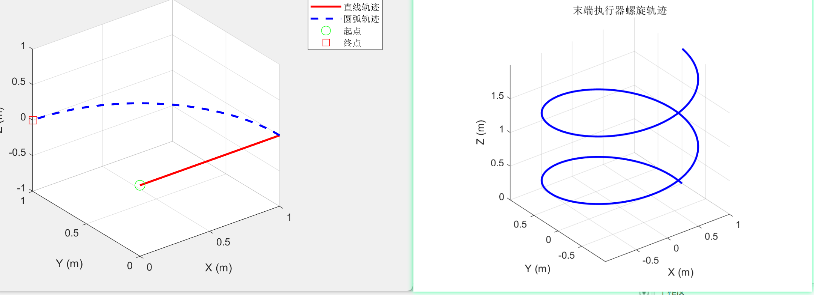

> **注意事项**
>
> -  使用 `grid on` 显示网格，便于观察空间位置
> -  `axis equal` 保证三个轴的比例一致，避免变形
> -  常用线型：`'-'`实线、`'--'`虚线、`':'`点线、`'o'`圆圈、`'*'`星号
>


### 2.  图像保持 - hold on/off

**定义与作用**

`hold on` 保持当前图像，允许在同一坐标系中叠加绘制多条曲线；`hold off` 恢复默认模式（新绘图会清除旧图）。

**语法结构**

```matlab
hold on   % 开启保持模式
hold off  % 关闭保持模式
```

**使用案例**

```matlab
% 案例：对比不同速度规划的轨迹
t = 0:0.1:2*pi;

% 匀速运动
x1 = cos(t);
y1 = sin(t);
z1 = t;

% 加速运动
t2 = t.^2 / (2*pi);
x2 = cos(t2);
y2 = sin(t2);
z2 = t2;

figure;
plot3(x1, y1, z1, 'b-', 'LineWidth', 2);
hold on;  % 保持图像
plot3(x2, y2, z2, 'r--', 'LineWidth', 2);
plot3(x1(1), y1(1), z1(1), 'ko', 'MarkerSize', 10, 'MarkerFaceColor', 'k');
hold off;  % 关闭保持

legend('匀速', '加速', '起点');
grid on;
xlabel('X (m)');
ylabel('Y (m)');
zlabel('Z (m)');
title('不同速度规划对比');
```

**输出结果**

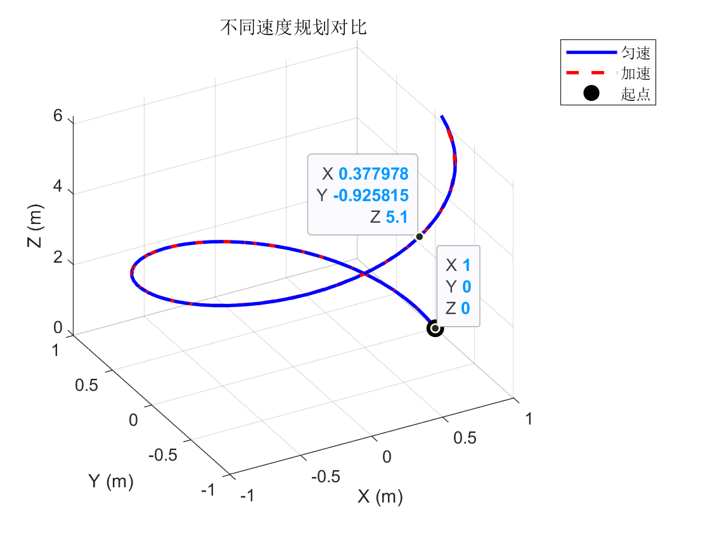

> **注意事项**
>
> - 忘记 `hold off` 会导致后续所有绘图都叠加在同一图上
> -  可以用 `figure` 创建新窗口，避免覆盖旧图
> -  `clf` 命令可清空当前图形窗口
>

> figure vs hold on 的区别

> | 对比项       | `figure`                                                 | `hold on`                                            |
> | ------------ | -------------------------------------------------------- | ---------------------------------------------------- |
> | **作用**     | 创建新窗口                                               | 在当前窗口叠加                                       |
> | **窗口数量** | 增加窗口                                                 | 不增加窗口                                           |
> | **适用场景** | 分开对比多个图像                                         | 在同一图中叠加多条曲线                               |
> | **示例**     | `figure; plot3(x1,y1,z1);`<br>`figure; plot3(x2,y2,z2);` | plot3(x1,y1,z1);<br />hold on;<br />plot3(x2,y2,z2); |

### 3. 常用函数及参数表

#### 1. plot3 图像设置常用函数

| 数                                      | 功能           | 用法示例                    | 说明                                |
| --------------------------------------- | -------------- | --------------------------- | ----------------------------------- |
| `figure`                                | 创建新图像窗口 | `figure;`                   | 在新窗口画图，不覆盖旧图            |
| `figure(n)`                             | 指定窗口编号   | `figure(1);`                | 切换到编号为1的窗口（不存在则创建） |
| `clf`                                   | 清空当前图像   | `clf;`                      | 清除当前窗口所有内容                |
| `close`                                 | 关闭当前窗口   | `close;`                    | 关闭当前图像窗口                    |
| `close all`                             | 关闭所有窗口   | `close all;`                | 关闭所有打开的图像窗口              |
| `grid on`                               | 显示网格线     | `grid on;`                  | 帮助判断空间位置关系                |
| `grid off`                              | 关闭网格线     | `grid off;`                 | 隐藏网格，图像更简洁                |
| `xlabel('文本')`                        | 设置X轴标签    | `xlabel('X (m)');`          | 标注X轴的物理含义和单位             |
| `ylabel('文本')`                        | 设置Y轴标签    | `ylabel('Y (m)');`          | 标注Y轴的物理含义和单位             |
| `zlabel('文本')`                        | 设置Z轴标签    | `zlabel('Z (m)');`          | 标注Z轴的物理含义和单位             |
| `title('文本')`                         | 设置图像标题   | `title('机械臂轨迹');`      | 说明图像内容                        |
| `legend('图例')`                        | 添加图例       | `legend('轨迹1', '轨迹2');` | 区分多条曲线                        |
| `axis equal`                            | 等比例坐标轴   | `axis equal;`               | 避免圆形轨迹变形为椭圆              |
| `axis([xmin xmax ymin ymax zmin zmax])` | 设置坐标轴范围 | `axis([0 1 0 1 0 1]);`      | 手动指定显示范围                    |
| `view(az, el)`                          | 设置视角       | `view(45, 30);`             | az=方位角，el=仰角（单位：度）      |
| `view(3)`                               | 默认三维视角   | `view(3);`                  | 恢复标准3D视角                      |
| `view(2)`                               | 俯视图（2D）   | `view(2);`                  | 从上往下看（Z轴垂直纸面）           |
| `hold on`                               | 保持图像       | `hold on;`                  | 后续plot3不清空当前图像             |
| `hold off`                              | 关闭保持       | `hold off;`                 | 恢复默认（新plot3会清空）           |
| `rotate3d on`                           | 开启鼠标旋转   | `rotate3d on;`              | 可用鼠标拖动旋转视角                |

#### 2.plot3 线型、颜色、标记参数

##### 1. 线型参数

| 符号 | 线型           | 示例                 | 效果           |
| ---- | -------------- | -------------------- | -------------- |
| `-`  | 实线（默认）   | `plot3(x,y,z,'r-')`  | 红色实线       |
| `--` | 虚线           | `plot3(x,y,z,'b--')` | 蓝色虚线       |
| `:`  | 点线           | `plot3(x,y,z,'g:')`  | 绿色点线       |
| `-.` | 点划线         | `plot3(x,y,z,'k-.')` | 黑色点划线     |
| 无   | 仅标记（无线） | `plot3(x,y,z,'ro')`  | 仅显示红色圆圈 |

##### 2. 颜色参数

| 符号 | 颜色 | 英文    | 示例               |
| ---- | ---- | ------- | ------------------ |
| `r`  | 红色 | Red     | `plot3(x,y,z,'r')` |
| `g`  | 绿色 | Green   | `plot3(x,y,z,'g')` |
| `b`  | 蓝色 | Blue    | `plot3(x,y,z,'b')` |
| `c`  | 青色 | Cyan    | `plot3(x,y,z,'c')` |
| `m`  | 品红 | Magenta | `plot3(x,y,z,'m')` |
| `y`  | 黄色 | Yellow  | `plot3(x,y,z,'y')` |
| `k`  | 黑色 | Black   | `plot3(x,y,z,'k')` |
| `w`  | 白色 | White   | `plot3(x,y,z,'w')` |

##### 3. 标记参数

| 符号 | 标记形状 | 示例                | 效果       |
| ---- | -------- | ------------------- | ---------- |
| `o`  | 圆圈     | `plot3(x,y,z,'ro')` | 红色圆圈   |
| `*`  | 星号     | `plot3(x,y,z,'b*')` | 蓝色星号   |
| `.`  | 点       | `plot3(x,y,z,'g.')` | 绿色点     |
| `+`  | 加号     | `plot3(x,y,z,'k+')` | 黑色加号   |
| `x`  | 叉号     | `plot3(x,y,z,'rx')` | 红色叉号   |
| `s`  | 方块     | `plot3(x,y,z,'bs')` | 蓝色方块   |
| `d`  | 菱形     | `plot3(x,y,z,'md')` | 品红菱形   |
| `^`  | 上三角   | `plot3(x,y,z,'g^')` | 绿色上三角 |
| `v`  | 下三角   | `plot3(x,y,z,'cv')` | 青色下三角 |
| `p`  | 五角星   | `plot3(x,y,z,'yp')` | 黄色五角星 |


## 4.1.5  实战：2R机械臂正运动学可视化

**任务目标**

给定2R平面机械臂的连杆长度和关节角度，计算末端位置并绘制机械臂构型。

**完整代码**

```matlab
% ========== 2R机械臂正运动学可视化 ==========

% 1. 定义机械臂参数
L1 = 1.0;  % 连杆1长度（米）
L2 = 0.8;  % 连杆2长度（米）

% 2. 定义关节角度序列（模拟运动）
theta1_seq = linspace(0, pi/2, 50);  % 关节1从0到90度
theta2_seq = linspace(0, pi/3, 50);  % 关节2从0到60度

% 3. 预分配存储空间
end_effector_traj = zeros(length(theta1_seq), 2);

% 4. 计算每个时刻的末端位置
for i = 1:length(theta1_seq)
    theta1 = theta1_seq(i);
    theta2 = theta2_seq(i);
    
    % 正运动学公式
    x = L1 * cos(theta1) + L2 * cos(theta1 + theta2);
    y = L1 * sin(theta1) + L2 * sin(theta1 + theta2);
    
    end_effector_traj(i, :) = [x, y];
end

% 5. 绘制末端轨迹
figure('Name', '2R机械臂运动分析');

% 子图1：末端轨迹
subplot(1, 2, 1);
plot(end_effector_traj(:, 1), end_effector_traj(:, 2), 'b-', 'LineWidth', 2);
hold on;
plot(end_effector_traj(1, 1), end_effector_traj(1, 2), 'go', ...
     'MarkerSize', 10, 'MarkerFaceColor', 'g');
plot(end_effector_traj(end, 1), end_effector_traj(end, 2), 'rs', ...
     'MarkerSize', 10, 'MarkerFaceColor', 'r');
hold off;
grid on;
axis equal;
xlabel('X (m)');
ylabel('Y (m)');
title('末端执行器轨迹');
legend('轨迹', '起点', '终点');

% 子图2：绘制初始和最终构型
subplot(1, 2, 2);

% 初始构型（绿色）
theta1_init = theta1_seq(1);
theta2_init = theta2_seq(1);
joint1_init = [L1*cos(theta1_init), L1*sin(theta1_init)];
joint2_init = [joint1_init(1) + L2*cos(theta1_init + theta2_init), ...
               joint1_init(2) + L2*sin(theta1_init + theta2_init)];

plot([0, joint1_init(1), joint2_init(1)], ...
     [0, joint1_init(2), joint2_init(2)], ...
     'g-o', 'LineWidth', 3, 'MarkerSize', 8, 'MarkerFaceColor', 'g');
hold on;

% 最终构型（红色）
theta1_final = theta1_seq(end);
theta2_final = theta2_seq(end);
joint1_final = [L1*cos(theta1_final), L1*sin(theta1_final)];
joint2_final = [joint1_final(1) + L2*cos(theta1_final + theta2_final), ...
                joint1_final(2) + L2*sin(theta1_final + theta2_final)];

plot([0, joint1_final(1), joint2_final(1)], ...
     [0, joint1_final(2), joint2_final(2)], ...
     'r-s', 'LineWidth', 3, 'MarkerSize', 8, 'MarkerFaceColor', 'r');
hold off;

grid on;
axis equal;
xlabel('X (m)');
ylabel('Y (m)');
title('机械臂构型对比');
legend('初始构型', '最终构型');

% 6. 输出关键信息
fprintf('========== 2R机械臂运动分析 ==========\n');
fprintf('连杆长度: L1 = %.2f m, L2 = %.2f m\n', L1, L2);
fprintf('初始关节角度: θ1 = %.2f°, θ2 = %.2f°\n', ...
        rad2deg(theta1_init), rad2deg(theta2_init));
fprintf('最终关节角度: θ1 = %.2f°, θ2 = %.2f°\n', ...
        rad2deg(theta1_final), rad2deg(theta2_final));
fprintf('初始末端位置: (%.4f, %.4f)\n', joint2_init);
fprintf('最终末端位置: (%.4f, %.4f)\n', joint2_final);
fprintf('运动距离: %.4f m\n', ...
        norm(joint2_final - joint2_init));
```

**输出结果**
```
========== 2R机械臂运动分析 ==========
连杆长度: L1 = 1.00 m, L2 = 0.80 m
初始关节角度: θ1 = 0.00°, θ2 = 0.00°
最终关节角度: θ1 = 90.00°, θ2 = 60.00°
初始末端位置: (1.8000, 0.0000)
最终末端位置: (-0.4000, 1.6928)
运动距离: 2.2804 m
```

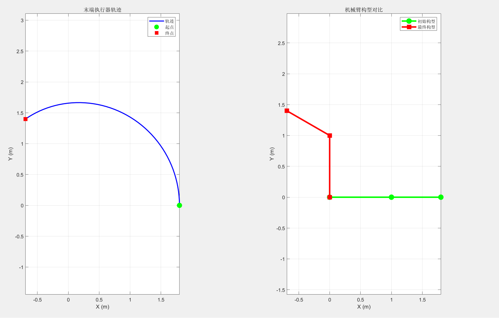


## 附录：快速查询表

### 常用函数速查

| 功能         | 函数           | 示例                  |
| ------------ | -------------- | --------------------- |
| 创建零矩阵   | `zeros(m,n)`   | `A = zeros(3,3)`      |
| 创建单位矩阵 | `eye(n)`       | `I = eye(4)`          |
| 矩阵转置     | `A'`           | `B = A'`              |
| 矩阵求逆     | `inv(A)`       | `A_inv = inv(A)`      |
| 伪逆         | `pinv(A)`      | `A_pinv = pinv(A)`    |
| 行列式       | `det(A)`       | `d = det(A)`          |
| 向量叉乘     | `cross(a,b)`   | `c = cross(a,b)`      |
| 向量模长     | `norm(v)`      | `len = norm(v)`       |
| 三维绘图     | `plot3(x,y,z)` | `plot3(x,y,z,'r-')`   |
| 角度转弧度   | `deg2rad(x)`   | `rad = deg2rad(90)`   |
| 弧度转角度   | `rad2deg(x)`   | `deg = rad2deg(pi/2)` |

### 符号对照表

| 符号 | 含义      | 物理意义      |
| ---- | --------- | ------------- |
| `*`  | 矩阵乘法  | 坐标变换叠加  |
| `.*` | 数组点乘  | 逐元素缩放    |
| `'`  | 转置      | 行列互换      |
| `:`  | 全部/范围 | 提取行列      |
| `;`  | 换行      | 矩阵分行      |
| `[]` | 矩阵定界  | 创建/拼接矩阵 |


