# 4.2 数学基础


## 4.2.1 简介

​	机器人操作的定义是指通过某种机构使零件和工具在空间运动。这自然就需要表达零件、工具以及机构本身的位置和姿态。为了定义和运用表达位姿的数学量，我们必须定义坐标系并给出表达的规则。

​	我们这里提出了许多关于位姿的描述，这些描述作为我们以后表达线速度和角速度、力和力矩的基础。

​	我们采用这样一个体系，即存在着一个世界坐标系（$World \ Frame$），我们讨论任何问题都能够参照这个坐标系。我们定义的位姿都是参照世界坐标系或者由世界坐标系定义的（或能够定义的）的笛卡儿坐标系（$Cartesian\ Frame$）。

​	由于我们作为笔记形式来当作讲解，所以对一下内容我们直接不再做出引出，大家只需要根据知识点进行学习。


## 4.2.2 位置、姿态与位姿


### 1. 位置

​	一旦建立了坐标系，我们就能用一个 3×1 的**位置矢量**对世界坐标系中的任何点进行定位。因为经常在世界坐标系中还要定义许多坐标系，因此必须在位置矢量上附加一信息，表明是在哪一个坐标系被定义的，例如：$^A P$ 。

​	这表明 $^A P$ 的数值是由沿着坐标轴 ${A}$ 的距离表示的。每个沿着坐标轴的距离都可被认为是矢量在相应坐标轴上的投影。


**Case**:

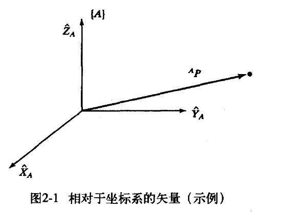


对于图中的黑点，我们使用向量 $^A P$ 表示如下：

```math
^A P = \begin{bmatrix}
p_x \\
p_y \\
p_z
\end{bmatrix}
```

​	因此，我们用一个**位置矢量来描述空间中点的位置**。其他空间点位置的3维描述，例如球坐标或柱坐标表示，我们这里这里不做讲解，感兴趣的同学可自行了解。


### 2.  姿态


​	我们发现不仅经常需要表示空间的点，还经常需要描述空间中物体的姿态。我们以下图为例。


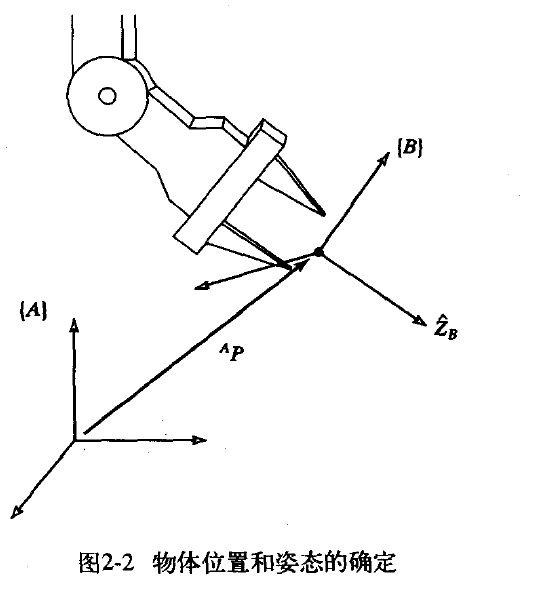

​	坐标系$B$是一个刚体的固定坐标系，坐标系原点是$P$，描述坐标系 B相对于坐标系A的姿态，记作如下：


```math
{}_B^A R = \begin{bmatrix} {}^A\hat{X}_B & {}^A\hat{Y}_B & {}^A\hat{Z}_B \end{bmatrix} = 
\begin{bmatrix}
\hat{X}_B \cdot \hat{X}_A & \hat{Y}_B \cdot \hat{X}_A & \hat{Z}_B \cdot \hat{X}_A \\
\hat{X}_B \cdot \hat{Y}_A & \hat{Y}_B \cdot \hat{Y}_A & \hat{Z}_B \cdot \hat{Y}_A \\
\hat{X}_B \cdot \hat{Z}_A & \hat{Y}_B \cdot \hat{Z}_A & \hat{Z}_B \cdot \hat{Z}_A
\end{bmatrix}
=  \begin{bmatrix}
r_{11} & r_{12} & r_{13} \\
r_{21} & r_{22} & r_{23} \\
r_{31} & r_{32} & r_{33}
\end{bmatrix}
```

​	其中，$_B^A R$​就是我们常说的旋转矩阵。下面我们对以上各量做说明。


​	$\begin{bmatrix} {}^A\hat{X}_B & {}^A\hat{Y}_B & {}^A\hat{Z}_B \end{bmatrix}$表示坐标系$B$的主轴方向的单位向量 $X_B \ Y_B \ Z_B$ **分别在**坐标系$A$的三个主轴 $X_A \ Y_A \ Z_A$的分量。他们都是$3×1$单位列向量，这三个向量构成一个单位正交向量组，因此**旋转矩阵$_B^A R$是一个$3×3$的正交矩阵！**


​	为了简化写，一般我们使用 $r_{11}\ r_{12}$等字母表示矩阵各Element。


​	学过线性代数我们知道，对于矩阵$_B^A R$也就是正交矩阵有 $A \ A^T = I$，如果我们将 $_B^A  R^{T}$写出来，即应用分块矩阵的转置，最终发现结果：$_B^A  R^{T}=_A ^B  R$，又根据矩阵可逆充要条件，就会有$_B^A R^{T}=_B^AR^{-1}$。

​	

综上，旋转矩阵有如下性质：

1. $_B^A R = _A^B R ^{-1} =_A^B R ^{T}$

2. 旋转矩阵是正交矩阵，有各行各列正交且是单位向量。

> 旋转矩阵不满足交换律！

### 3. 位姿

​	我们一般常说的位姿其实就是 **位置 +  姿态** 。根据之前两小节讲到的位置和姿态，我们就可以描述某一点相对于某一坐标系的位姿了。这部分理解较为简单，我们直接以定理形式给出。

​	一般的位姿既包含移动也包含旋转，所以为了简化统一表示，我们采用变换矩阵（$Transformation Matrix$）来表示，一般方便运算，我们会将写成齐次矩阵形式（$4×4$）即如下：

```math
{}_B^A T = \begin{bmatrix}
{}_B^A R & {}^A P_{BORG} \\
\mathbf{0} & 1
\end{bmatrix}
= \begin{bmatrix}
r_{11} & r_{12} & r_{13} & p_x \\
r_{21} & r_{22} & r_{23} & p_y \\
r_{31} & r_{32} & r_{33} & p_z \\
0 & 0 & 0 & 1
\end{bmatrix}
```

#### 1.Mapping映射

​	这种情况也就是：$P$由某一个$frame_1$的表达转换到另一个和此$frame_1$有相对变换的$frame_2$来表达。我们以一般情况作讲解，既包含平移又包含旋转，结论如下：

```math
\begin{bmatrix}
^A P \\
1
\end{bmatrix}
=
\begin{bmatrix}
{}_B^A R & ^A P_{BORG} \\
\mathbf{0} & 1
\end{bmatrix}
\begin{bmatrix}
^B P \\
1
\end{bmatrix}
=
\begin{bmatrix}
r_{11} & r_{12} & r_{13} & p_x \\
r_{21} & r_{22} & r_{23} & p_y \\
r_{31} & r_{32} & r_{33} & p_z \\
0 & 0 & 0 & 1
\end{bmatrix}
\begin{bmatrix}
^B P_x \\
^B P_y \\
^B P_z \\
1
\end{bmatrix}
```

​	其中的$_B ^A  R$就是之前我们说的位姿，即坐标系$B$相对于坐标系$A$的旋转矩阵，$^A P_{BORG}$ 就是我们之前说的位置，即坐标系$B$相对于坐标系$A$**原点**的位置矢量，$^B P$作为已知量，最终经过$Transformation Matrix$得到目标位姿即$^A P$ 。

> `ORG` 是 **Origin** 的缩写，$^A P_{BORG}$ 表示坐标系 {B} 的原点，在参考坐标系 {A} 下的位置矢量。


#### 2. Operators算子

​	这种情况和第一种区别于，该情况，同一坐标系，点经过变换后求解变换后的点在该坐标系的位姿。即 $P$点位于同一$frame$中进行变换后的位姿表达

​	变换算子就是为了描述空间点在同一个参考$frame$下的经过变换后的位姿，包括平移算子和旋转算子，分别作解释。

##### 1. 平移算子

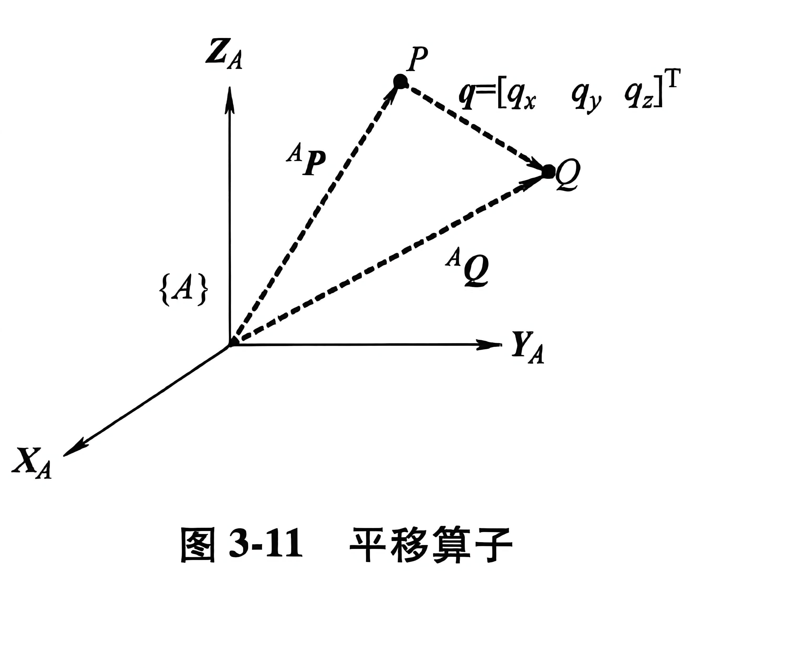

如图所示，现将P点经过平移向量q得到Q点，求解Q点在A坐标系下的位姿：

```math
\begin{bmatrix}
^A Q \\
1
\end{bmatrix}
=
\begin{bmatrix}
1 & 0 & 0 & q_x \\
0 & 1 & 0 & q_y \\
0 & 0 & 1 & q_z \\
0 & 0 & 0 & 1
\end{bmatrix}
\begin{bmatrix}
^B P_x \\
^B P_y \\
^B P_z \\
1
\end{bmatrix}
```


##### 2. 旋转算子

这里的旋转算子，表达为$R_K(\theta)$ 

```math
{}^A P_2 = R_K(\theta) {}^A P_1
```

常见有如下几种：

```math
R_z(\theta) = 
\begin{bmatrix}
\cos\theta & -\sin\theta & 0 & 0 \\
\sin\theta & \cos\theta & 0 & 0 \\
0 & 0 & 1 & 0 \\
0 & 0 & 0 & 1
\end{bmatrix}
```

​		

```math
R_x(\theta) = 
\begin{bmatrix}
1 & 0 & 0 & 0 \\
0 & \cos\theta & -\sin\theta & 0 \\
0 & \sin\theta & \cos\theta & 0 \\
0 & 0 & 0 & 1
\end{bmatrix}
```


```math
R_y(\theta) = 
\begin{bmatrix}
\cos\theta & 0 & \sin\theta & 0 \\
0 & 1 & 0 & 0 \\
-\sin\theta & 0 & \cos\theta & 0 \\
0 & 0 & 0 & 1
\end{bmatrix}
```

​	证明以$R_z$为例，其余原理一样：

我们之前学习过姿态，其实就是将旋转后的坐标系的三个主轴分别投影到原坐标轴的三个主轴即：

```math
{}_B^A R = \begin{bmatrix} {}^A\hat{X}_B & {}^A\hat{Y}_B & {}^A\hat{Z}_B \end{bmatrix} = 
\begin{bmatrix}
\hat{X}_B \cdot \hat{X}_A & \hat{Y}_B \cdot \hat{X}_A & \hat{Z}_B \cdot \hat{X}_A \\
\hat{X}_B \cdot \hat{Y}_A & \hat{Y}_B \cdot \hat{Y}_A & \hat{Z}_B \cdot \hat{Y}_A \\
\hat{X}_B \cdot \hat{Z}_A & \hat{Y}_B \cdot \hat{Z}_A & \hat{Z}_B \cdot \hat{Z}_A
\end{bmatrix}
```


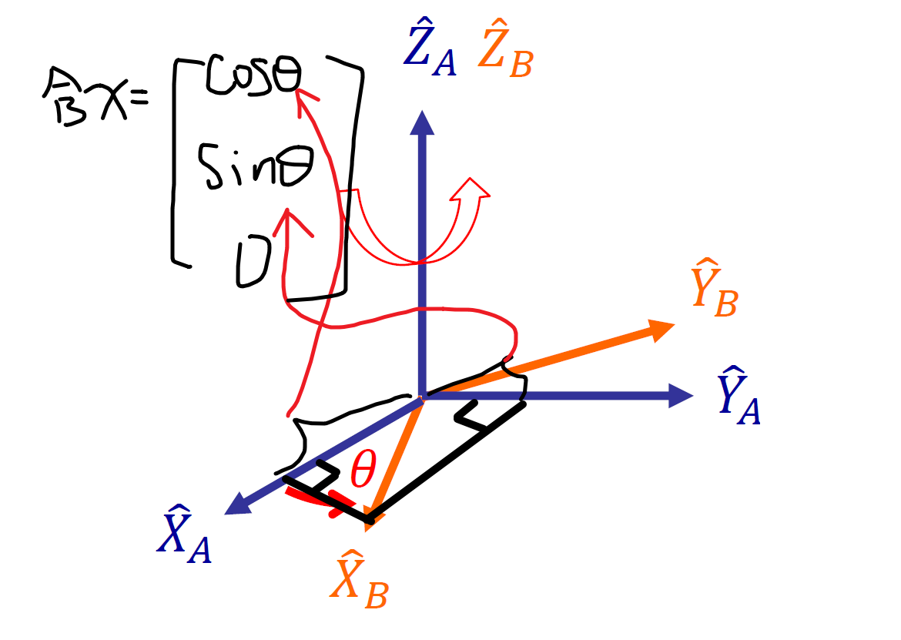

我们在图中证明了${X}_B \cdot \hat{X}_A \ 、  {X}_B \cdot \hat{X}_A \   和  {X}_B \cdot \hat{X}_A$，其余列向量同理。


##### 3. 一般变换算子

一般情况的变换，既包含平移又包含旋转，仍然我们直接给结论：

​	

```math
\begin{bmatrix}
^{A'} P \\
1
\end{bmatrix}
= T
\begin{bmatrix}
^A P \\
1
\end{bmatrix}
```


​	这里的T就是既包含了平移算子又包含了旋转算子的齐次矩阵。

​	


​	对于，，同一坐标系，点经过变换后求解变换后的点在该坐标系的位姿，也可以转换成Mapping映射来思考。

**Case：**

​	求解P经过比如逆时针旋转$x°$，X轴平移$+5m$，然后求解${P'}$ ，由于运动具有相对性，可以理解为将坐标系$A$经过顺时针旋转$x°$，X轴平移$-5m$，得到坐标系${A'}$，即求解P在坐标系${A'}$下的姿态，就将问题转换成第一种了，便于理解。

​	


### 4. 变换算法

​	这里将会介绍复合变换和逆变换，并给出一套齐次变换通式。

#### 1. 复合变换


定义：将一个向量或函数依次进行两次或多次基础变换（如旋转、缩放、平移等），组合成的一个整体映射过程。

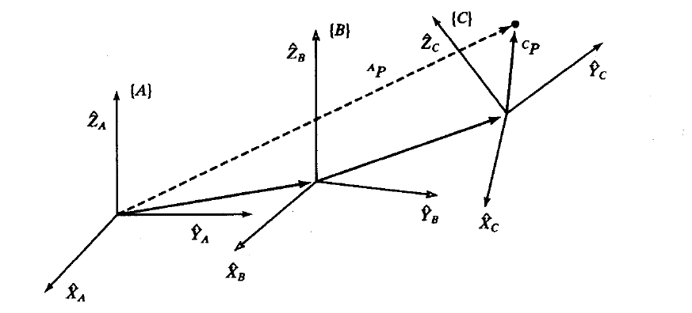


​	现有三个坐标系分别是 $frame_A\ frame_B  \  frame_C$ ，已知空间点$P$在$frame_C$，下的位置是$^C P$，现需要求解空间点P在$frame_A$的位姿。

​	我们可以使用连乘：$^A P = ^A_B  T \ ^B_C  T  \ ^C P$，像这样的连乘式子我们称作**复合变换**。

进一步化简：$  ^A_C  T  = ^A_B  T \ ^B_C  T$ 

展开如下：

```math
{}^A_C T =  \begin{bmatrix} {}^A_B R & {}^A P_{BORG} \\ \mathbf{0}_{1 \times 3} & 1 \end{bmatrix} \begin{bmatrix} {}^B_C R & {}^B P_{CORG} \\ \mathbf{0}_{1 \times 3} & 1 \end{bmatrix} = \begin{bmatrix} {}^A_B R {}^B_C R & {}^A_B R {}^B P_{CORG} + {}^A P_{BORG} \\ \mathbf{0}_{1 \times 3} & 1 \end{bmatrix}
```

为了发现规律我们再举一个Case：

​	若现在有四个坐标系，分别是 $frame_A\ frame_B  \  frame_C \  frame_D$ ，已知空间点$P$在$frame_D$，下的位置是$^C P$，现需要求解空间点P在$frame_A$的位姿。

​	展开如下：

```math
\begin{align*}
^A P &= {}^A_B T \, \ {}^B_C T \, \ {}^C_D T \, \ {}^D P \\\\
&= 
\begin{bmatrix}
{}^A_B R \,  \ {}^B_C R \, \ {}^C_D R &  \ {}^A P_{B\mathrm{org}} + {}^A_B R \, \ {}^B P_{C\mathrm{org}} + {}^A_B R \, \  {}^B_C R \, \  {}^C P_{D\mathrm{org}} \\
\mathbf{0}_{1 \times 3} & 1
\end{bmatrix}
\\\\&
= \ {}^A_D T \,  {}^D P
\end{align*}
```

可见规律如上。


#### 2. 变换方程


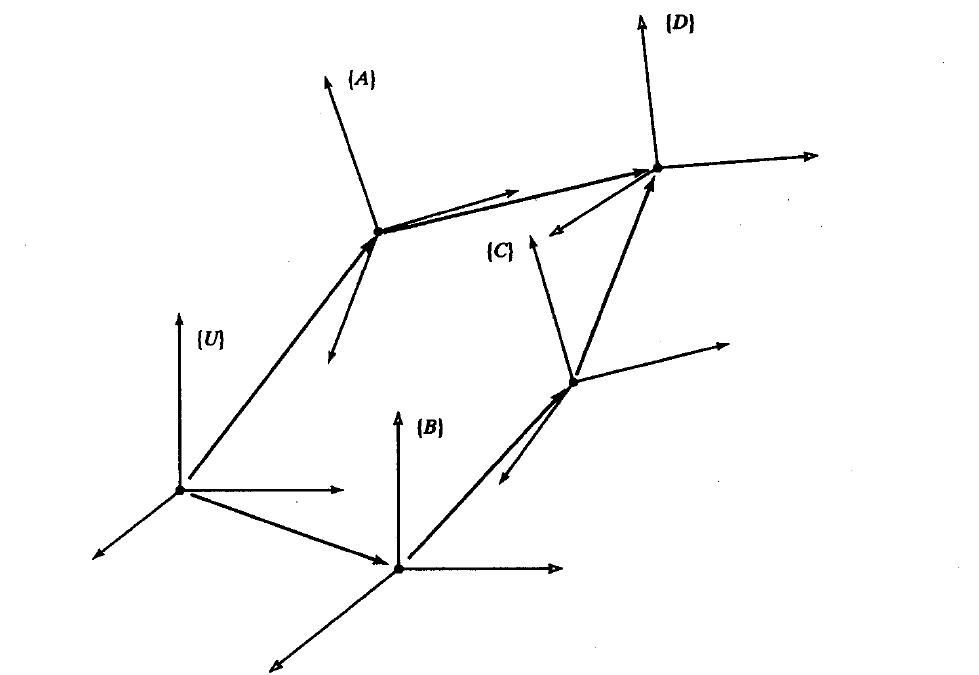


图中表示frame_D 可以用两种不同的方式表达成变换的相乘式是：

​	${}^U_D T = {}^U_A T \, {}^A_D T$     以及        $   {}^U_D T = {}^U_B T \, {}^B_C T \, {}^C_D T$

将两个表达式构造成一个变换方程：

​	${}^U_A T \, {}^A_D T = {}^U_B T \, {}^B_C T \, {}^C_D T$


> 定理：一般地，假设有n各未知的齐次变换和n各变换方程，则可以解出所有的齐次变换！


#### 3. 逆变换

​	若已知齐次矩阵如下：


```math

{}^A_B T =
\begin{bmatrix}
{}^A_B R & {}^A P_{B\,\text{org}} \\
\mathbf{0}_{1 \times 3} & 1
\end{bmatrix}

```

​	则其逆矩阵为：

```math

{}^B_A T = {}^A_B T^{-1} =
\begin{bmatrix}
{}^A_B R^T & -{}^A_B R^T \, {}^A P_{B\,\text{org}} \\
\mathbf{0}_{1 \times 3} & 1
\end{bmatrix}


```

​	证明如下：

​	

我们先列出$^A_B T$和$^A_B T ^{-1}(^B_A T)$：

```math
\begin{bmatrix} {}^A_B R & {}^A P_{B\,\text{org}} \\ \mathbf{0}_{1 \times 3} & 1 \end{bmatrix} 
```

```math
\begin{bmatrix} {}^B_A R & {}^B P_{A\,\text{org}} \\ \mathbf{0}_{1 \times 3} & 1 \end{bmatrix}
```

有之前学习过旋转矩阵是正交矩阵也就是拥有$_B^A R = _A^B R ^{-1} =_A^B R ^{T}$，那么我们就会利用这个性质来处理这两个旋转矩阵，即我们尝试产生$_B^A R  \   _A^B R ^{-1} = I$，即利用$_B^A T  \   _A^B T ^{-1}$ :

```math
=
\begin{bmatrix}
{}^A_B R \, {}^B_A R & {}^A P_{B\,\text{org}} + {}^A_B R \, {}^B P_{A\,\text{org}} \\
\mathbf{0}_{1 \times 3} & 1
\end{bmatrix}
```

则有：

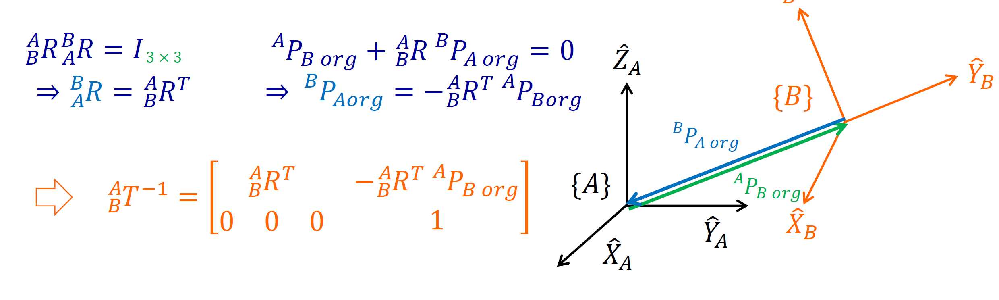

综上证明成立！


### 5. 其他姿态描述法

​	对于旋转矩阵，虽然形式上是 $3×3$ 的 $9$ 个元素，但由于它是正交矩阵，满足每行、每列都是单位向量且两两正交，因此实际上只有**3 个独立自由度**。在实际应用中，直接使用旋转矩阵会带来不便：例如，在机器人控制或姿态设定中，频繁构造或输入 9 个元素的正交矩阵既繁琐又不直观。

​	因此，为了简化姿态的表示与交互，我们引入了多种仅需少数参数的描述方法，常见的包括：

- **固定轴旋转（RPY 角）**：绕固定坐标系的三个轴依次旋转，同样用 3 个参数即可表示任意姿态；

- **欧拉角**：通过三次绕坐标轴的连续旋转来描述姿态，仅需 3 个独立参数；
- **一般轴旋转**：以过原点的单位向量为旋转轴进行旋转。
- **四元数**：以 4 个参数（含 1 个约束）描述旋转，避免了欧拉角的万向锁问题，更适合数值计算和插值。

这些方法在保留 3 个自由度的同时，大幅降低了姿态描述的复杂度，因此在机器人学、计算机图形学等领域得到了广泛应用。


#### 1. 固定轴 Fixed Angles

​	现有$frame_A$和$frame_B$，现对$frame_B$进行旋转，绕固定$frame_A$进行旋转，先将$frame_B$绕$X_A$轴旋转**$γ$**角，然后再绕$Y_A$旋转$β$角，最后绕$Z_A$旋转$α$，得到最中的$frame_{B'}$。

​	上面的三次旋转都是通过绕固定$frame_A$的坐标轴进行旋转，这样通过一组[α，β，γ]角度即可描述$frame_B$相对于$frame_A$的姿态，这种表示法称为$X{-Y}-Z$固定角，或$RPY$角，也称为$Cardan$角。

​	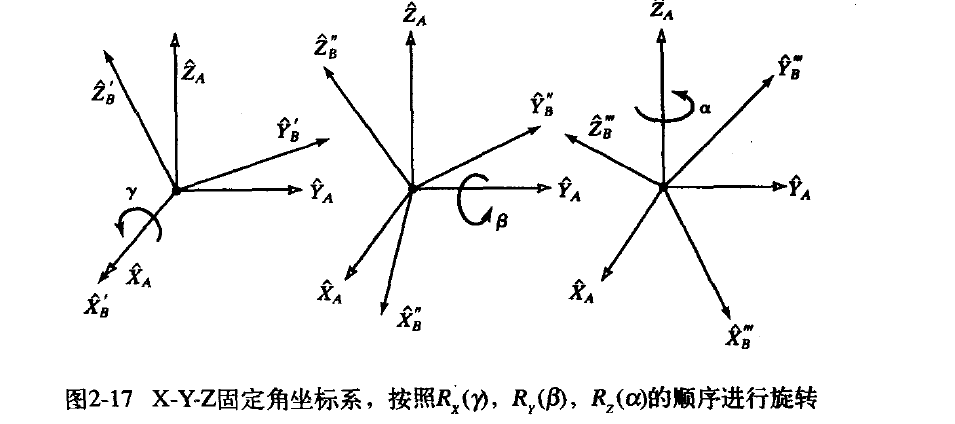

​	最终经过计算得到：

```math
{}^A_B R_{XYZ}(\gamma, \beta, \alpha) = R_Z(\alpha) R_Y(\beta) R_X(\gamma)
=
\begin{bmatrix}
c\alpha & -s\alpha & 0 \\
s\alpha & c\alpha & 0 \\
0 & 0 & 1
\end{bmatrix}
\begin{bmatrix}
c\beta & 0 & s\beta \\
0 & 1 & 0 \\
-s\beta & 0 & c\beta
\end{bmatrix}
\begin{bmatrix}
1 & 0 & 0 \\
0 & c\gamma & -s\gamma \\
0 & s\gamma & c\gamma
\end{bmatrix}
```

> 式中cα式cosα简写，sα式sinα简写。

​	可以看到乘法顺序是**左乘**：先旋转的在最后面，后旋转的在最前面，也就是从右往左乘，具体过程如下：

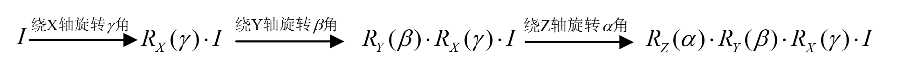

最终将矩阵乘法乘开如下：

```math
{}^A_B R_{XYZ}(\gamma, \beta, \alpha) =
\begin{bmatrix}
c\alpha c\beta & c\alpha s\beta s\gamma - s\alpha c\gamma & c\alpha s\beta c\gamma + s\alpha s\gamma \\
s\alpha c\beta & s\alpha s\beta s\gamma + c\alpha c\gamma & s\alpha s\beta c\gamma - c\alpha s\gamma \\
-s\beta & c\beta s\gamma & c\beta c\gamma
\end{bmatrix}

```

然后我们接着考虑逆问题，已知旋转矩阵最终结果，去求解对应旋转角度，假设旋转矩阵如下：


```math
{}^A_B R_{XYZ}(\gamma, \beta, \alpha) =
\begin{bmatrix}
r_{11} & r_{12} & r_{13} \\
r_{21} & r_{22} & r_{23} \\
r_{31} & r_{32} & r_{33}
\end{bmatrix}
```

> 注意我们这里讨论的是$XYZ$型的绕固定轴旋转的旋转矩阵，若是$ZYX$等其他旋转情况，答案与此处不同。
>
> 对于绕固定叫旋转也叫做**==外旋==**


过程我们不做证明，直接给对应答案：

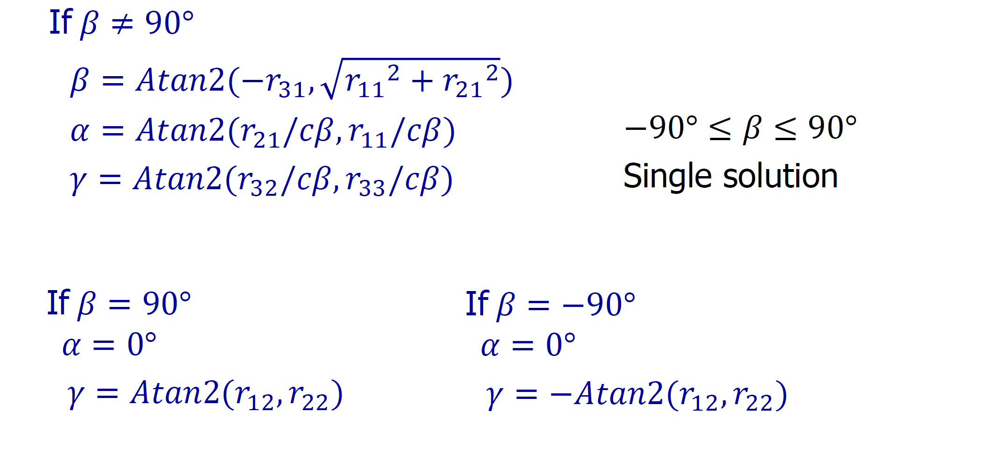

#### 2. Euler Anles

​	$Euler Angles$是由欧拉提出的**一种绕运动坐标系的三个坐标轴的转角组合**描述刚体姿态的方法。与固定叫类似，欧拉角也是使用了三个角度变量，绕动轴也常叫做**==外旋==**。

​	欧拉角与$Fixed Angles$一样，同样有很多种类型，在$Fixed Angles$我们讨论了$XYZ$型，在$Eluer Angles$我们讨论两种，分别是$Z-Y-Z$，和$Z-Y-X$这两种组合。

> 组合类型共有  $3  ×2  ×2$种，即保证当前轴和前一轴不是一个轴，否则其实相当于绕一个轴转动。

​	现有$frame_A$和$frame_B$，现对$frame_B$进行旋转，绕自身轴旋转，先将$frame_B$绕$Z_B$旋转$α$，然后再绕$Y_B$旋转$β$角，最后$frame_B$绕$X_B$轴旋转**$γ$**角，得到最中的$frame_{B'}$。

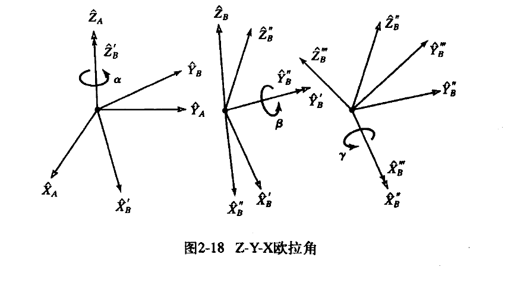

最后经过计算得到：

```math
{}^A_B R_{Z'Y'X'} = R_Z(\alpha) R_Y(\beta) R_X(\gamma)
=
\begin{bmatrix}
c\alpha & -s\alpha & 0 \\
s\alpha & c\alpha & 0 \\
0 & 0 & 1
\end{bmatrix}
\begin{bmatrix}
c\beta & 0 & s\beta \\
0 & 1 & 0 \\
-s\beta & 0 & c\beta
\end{bmatrix}
\begin{bmatrix}
1 & 0 & 0 \\
0 & c\gamma & -s\gamma \\
0 & s\gamma & c\gamma
\end{bmatrix}
```

> 式中cα式cosα简写，sα式sinα简写。

​	可以看到乘法顺序是**右乘**：先旋转的在最前面，后旋转的在最后面，也就是从左往右乘，具体过程如下：

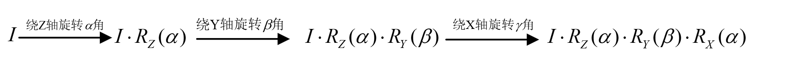

最终将矩阵乘法乘开如下：

```math
{}^A_B R_{Z'Y'X'}(\alpha, \beta, \gamma) =
\begin{bmatrix}
c\alpha c\beta & c\alpha s\beta s\gamma - s\alpha c\gamma & c\alpha s\beta c\gamma + s\alpha s\gamma \\
s\alpha c\beta & s\alpha s\beta s\gamma + c\alpha c\gamma & s\alpha s\beta c\gamma - c\alpha s\gamma \\
-s\beta & c\beta s\gamma & c\beta c\gamma
\end{bmatrix}
```

​	注意到，该结果与之前$Fixed Angles$的$X-Y- Z$型完全一致，即**绕自身轴旋转三次和相反顺序绕固定轴旋转三次得到的结果一致**！

​	对于已知ZYX旋转矩阵逆求解角度，这里不做说明，同学可自行网上查找，我们重点讲解$Z-Y-Z$型欧拉角。


​	过程性推导与$X-Y-Z$型已知，这里直接给出对应旋转矩阵结果，最终将矩阵乘法乘开如下：

```math
{}^A_B R_{Z'Y'Z'}(\alpha, \beta, \gamma) =
\begin{bmatrix}
c\alpha c\beta c\gamma - s\alpha s\gamma & -c\alpha c\beta s\gamma - s\alpha c\gamma & c\alpha s\beta \\
s\alpha c\beta c\gamma + c\alpha s\gamma & -s\alpha c\beta s\gamma + c\alpha c\gamma & s\alpha s\beta \\
-s\beta c\gamma & s\beta s\gamma & c\beta
\end{bmatrix}
```

​	这里我们考虑逆问题，已知旋转矩阵最终结果，去求解对应旋转角度，假设旋转矩阵如下：

```math
{}^A_B R_{Z'Y'Z'}(\alpha, \beta, \gamma) =
\begin{bmatrix}
r_{11} & r_{12} & r_{13} \\
r_{21} & r_{22} & r_{23} \\
r_{31} & r_{32} & r_{33}
\end{bmatrix}
```

​	过程我们不做证明，直接给对应答案：

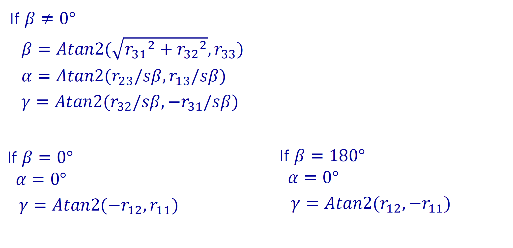


​	我们会发现，当$sin \beta$=0时，即$\beta=0° or\ 180°$，则仅能求出$\alpha 和\ gamma$ 的和或差，如推导所示。

​	此时旋转矩阵到欧拉角转换不唯一，对于固定叫也会有同样情况，也就是说，当旋转矩阵转换到$Fixed \ Angles \ \ or  \ \  \  Eluer  \ Angles$ 的转换不唯一，这一问题我们称为 "**万向锁问题**（Gimbal Lock）"。

​	上面说明通过公式，下面通过旋转直观感受，以$Z-Y-Z$欧拉角为例。

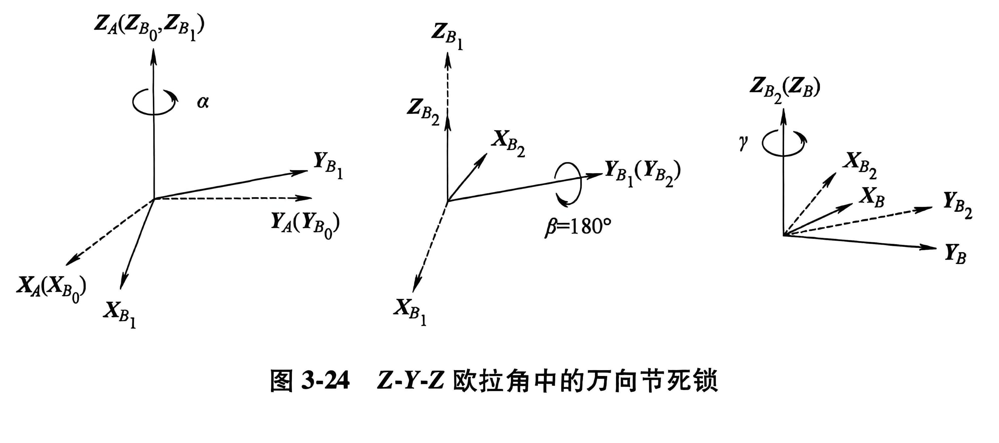

​	如图所示，当$\beta=180°$时，第一次与第三次转动的旋转轴重合，因此无法分辨出这两次旋转的角度值$\alpha  \   and  \   \gamma$ ，而只能确定他们的和。

​	为了解决万向节锁问题，当绕一般轴旋转时不会出现万向节锁问题，于是我们引出四元数以及等效轴转动，接下来我们对这部分做详细介绍。


#### 3. 绕等效轴旋转


​	在前一小节中，已经介绍了三种表示姿态的惯用方法：$X-Y-Z$ 固定角、$Z-Y-X$ 欧拉角和 $Z-Y-Z$ 欧拉角。每个表示法必须按一定顺序进行三次绕**主轴**的旋转，并且可能会出现万向节锁问题。

​	下面我们介绍一种绕一般轴旋转，既能**避开顺序依赖**由能**避开万向锁**——绕**等效轴旋转**。

​	如果选择坐标系主轴进行旋转，等效矩阵就会变成我们之前学习过的熟悉的平面旋转矩阵：

```math
R_z(\theta) = 
\begin{bmatrix}
\cos\theta & -\sin\theta & 0 & 0 \\
\sin\theta & \cos\theta & 0 & 0 \\
0 & 0 & 1 & 0 \\
0 & 0 & 0 & 1
\end{bmatrix}
```

```math
R_x(\theta) = 
\begin{bmatrix}
1 & 0 & 0 & 0 \\
0 & \cos\theta & -\sin\theta & 0 \\
0 & \sin\theta & \cos\theta & 0 \\
0 & 0 & 0 & 1
\end{bmatrix}
```

```math
R_y(\theta) = 
\begin{bmatrix}
\cos\theta & 0 & \sin\theta & 0 \\
0 & 1 & 0 & 0 \\
-\sin\theta & 0 & \cos\theta & 0 \\
0 & 0 & 0 & 1
\end{bmatrix}
```

如果旋转轴为一般轴，则等效矩阵为：

```math
R_{K}(\theta) =
\begin{bmatrix}
k_x k_x v\theta + c\theta & k_x k_y v\theta - k_z s\theta & k_x k_z v\theta + k_y s\theta \\
k_x k_y v\theta + k_z s\theta & k_y k_y v\theta + c\theta & k_y k_z v\theta - k_x s\theta \\
k_x k_z v\theta - k_y s\theta & k_y k_z v\theta + k_x s\theta & k_z k_z v\theta + c\theta
\end{bmatrix}
```

> （注：c$θ=cosθ,sθ=sinθ,vθ=1−cosθ$）
>
> 观察注意到，旋转矩阵自由度为3DOFs：共4个变量，但是有一个约束条件：单位向量。

其中，等效轴，即过原点的单位向量${}^A \hat{K} = [k_x, k_y, k_z]^T$。$\theta$的符号由右手定则确定，即大拇指执行${}^A \hat{K}$ 的正方向。

​	既然我们能够通过等效轴得到旋转矩阵，接着我们讨论逆问题，已知旋转矩阵，解出等效轴向量以及旋转角度：

若我们已知的旋转矩阵：

```math
{}^A_B R_K(\theta) =
\begin{bmatrix}
r_{11} & r_{12} & r_{13} \\
r_{21} & r_{22} & r_{23} \\
r_{31} & r_{32} & r_{33}
\end{bmatrix}
```


直接给出结果由 $\theta$ 和${}^A \hat{K}$ 如下：

```math
 \ cos\theta = \left(\frac{r_{11} + r_{22} + r_{33} - 1}{2}\right)
```

```math
\sin\theta = \pm \frac{1}{2} \sqrt{(r_{32} - r_{23})^2 + (r_{13} - r_{31})^2 + (r_{21} - r_{12})^2}
```

于是就有：

```math
\theta = \mathrm{arctan2}\left(\sin\theta, \cos\theta\right)
```

```math
\hat{K} = \frac{1}{2\sin\theta}
\begin{bmatrix}
r_{32} - r_{23} \\
r_{13} - r_{31} \\
r_{21} - r_{12}
\end{bmatrix}
```


​	由上式总可以计算出一个在 0 度到 180 度之间的 $\theta$  值。对于任意一对轴角 $({}^A \hat{K},$$\theta)$，存在另一对轴角，即   $(-{}^A \hat{K},$$-\theta)$，它们在空间的姿态相同，可用同样的旋转矩阵描述，也可以由上式结果可见。

​	因此，在将旋转矩阵转化为等效轴角坐标系表示法时，我们需要对解进行选择。

​	另外除了以上存在两种状态一样的相反解，一个更加重要的问题是，对于小角度的旋转，此时的轴将变得不确定。显然，如果转动量为零，旋转轴根本无法确定。如果 $ \theta =0°\ or \ 180°$ 时，${}^A \hat{K}$式**将无解**。


​	到此为止，我们讨论过的所有旋转都是绕经过参考系原点的轴进行的。如果我们遇到的问题不属于这种情况时，我们可以定义另外一个坐标系，该坐标系的原点在轴上，为此将这类问题简化为 “经过原点的轴” 的情况来解决，然后再求解这个变换方程。


#### 4. 四元数  **quaternion** 

​	另一种姿态表示方法式通过四个数值表示，称为**欧拉参数**。根据等效旋转轴${}^A \hat{K} = [k_x, k_y, k_z]^T$和等效旋转角得到欧拉参数如下：

```math
\begin{align*}
\varepsilon_1 &= k_x \sin \frac{\theta}{2} \\
\varepsilon_2 &= k_y \sin \frac{\theta}{2} \\
\varepsilon_3 &= k_z \sin \frac{\theta}{2} \\
\varepsilon_4 &= \cos \frac{\theta}{2}
\end{align*}
```

显然，这四个参数不是独立：

```math
\varepsilon_1^2 + \varepsilon_2^2 + \varepsilon_3^2 + \varepsilon_4^2 = 1
```

​	以上欧拉参数也就是我们所说的四元数，只不过表达的是单位四元数。

​	一般四元数由一个实数单位1和三个虚数单位$i、j、k$组成，一般表示形式为 $q=  a + bi +cj+dk$。

​	将四元数表达为坐标形式$： q = (a,v)=[a,b,c,d]$。

> ​	单位四元数：将模长为1的四元数称为单位四元数。

​	对于四元数操作，通常情况我们是采用单位四元数，根据欧拉参数表达形式，我们表示为：

$q = (\cos \alpha ，v \sin \alpha) =	[\cos\frac{\alpha}{2},\sin \frac{\alpha}{2}x,\sin \frac{\alpha}{2}y,\sin \frac{\alpha}{2}z]$

​	$(\cos \alpha ，v \sin \alpha)$该形式表示绕空间向量$v$旋转$2 \alpha$ 角度运动，根据等效旋转轴通式，将$v=[k_x, k_y, k_z]^T$,旋转角度 $\theta = 2 \alpha$，可得到旋转矩阵如下：

```math
R_\varepsilon =
\begin{bmatrix}
1 - 2\varepsilon_2^2 - 2\varepsilon_3^2 & 2(\varepsilon_1\varepsilon_2 - \varepsilon_3\varepsilon_4) & 2(\varepsilon_1\varepsilon_3 + \varepsilon_2\varepsilon_4) \\
2(\varepsilon_1\varepsilon_2 + \varepsilon_3\varepsilon_4) & 1 - 2\varepsilon_1^2 - 2\varepsilon_3^2 & 2(\varepsilon_2\varepsilon_3 - \varepsilon_1\varepsilon_4) \\
2(\varepsilon_1\varepsilon_3 - \varepsilon_2\varepsilon_4) & 2(\varepsilon_2\varepsilon_3 + \varepsilon_1\varepsilon_4) & 1 - 2\varepsilon_1^2 - 2\varepsilon_2^2
\end{bmatrix}
```

​	反之，由等效轴旋转矩阵也可得到等效轴$v= [0,x,y,z]$与等效角 $\alpha$ ，则旋转矩阵对应的四元数为$[\cos\frac{\alpha}{2},\sin \frac{\alpha}{2}x,\sin \frac{\alpha}{2}y,\sin \frac{\alpha}{2}z]$

即由旋转矩阵得到对应的欧拉参数是：

```math
\begin{align*}
\varepsilon_1 &= \frac{r_{32} - r_{23}}{4\varepsilon_4} \\
\varepsilon_2 &= \frac{r_{13} - r_{31}}{4\varepsilon_4} \\
\varepsilon_3 &= \frac{r_{21} - r_{12}}{4\varepsilon_4} \\
\varepsilon_4 &= \frac{1}{2}\sqrt{1 + r_{11} + r_{22} + r_{33}}
\end{align*}
```

​	注意，从计算的意义来讲，如果旋转矩阵表示的是绕某一轴 180° 的旋转，式上式欧拉参数将失去意义，因为ε4=0。但可以看出，当取极限时，上式欧拉参数中的所有表达式都趋向于无穷大，对于上述情况也是如此。

​	实际上从式欧拉参数不独立等式中可以看出，对于所有的εi，其值在 [-1,1] 间。

**Case**：

​	现在要把机械臂的末端，绕着基坐标系的 $Z$ 轴，实打实地旋转 $90^\circ$，采用四元数方式进行旋转。

Solve：

​	首先，轴$v = [0,0,1]^{T}$,物理旋转角度 $\theta = 90°$，采用四元数如下：

令 四元数 $q =[w , x, y, z]$，其中 w为实部，x，y，z为虚部。

​	现将条件转换成四元数表达如下：

```math
\begin{align*}
x&= \sin {45°} ·0 = 0\\\\
y &= \sin {45°} ·0=0\\\\
z &= \cos {45°}·1=\cos {45°}=\frac{\sqrt{2}}{2} \approx 0.707\\
w&= \cos {45°} = \frac{\sqrt{2}}{2} \approx 0.707\\
\end{align*}
```

​	综上，有$q = [0.707,\ 0,\ 0,\ 0.707]$


若已知四元数 $q = [0.707,\ 0,\ 0,\ 0.707]$，求解对应的旋转角 $\theta$ 和 轴$u$

​	由$q =	[\cos\frac{\alpha}{2},\sin \frac{\alpha}{2}x,\sin \frac{\alpha}{2}y,\sin \frac{\alpha}{2}z]$带入角度

```math
\begin{cases}
x = v_x \cdot \sin \frac{\theta}{2} \\
y = v_y \cdot \sin \frac{\theta}{2} \\
z = v_z \cdot \sin \frac{\theta}{2} \\
w = \cos \frac{\theta}{2}
\end{cases}
```


​	推出：

```math
\begin{cases}
\theta = 2 \cdot \arccos(w) = 90°\\
u_x = \frac{x}{\sin \frac{\theta}{2}} = \frac{0}{0.707} = 0 \\
u_y = \frac{y}{\sin \frac{\theta}{2}} = \frac{0}{0.707} = 0 \\
u_z = \frac{z}{\sin \frac{\theta}{2}} = \frac{0.707}{0.707} = 1 \\

\end{cases}
```

​	综上，轴$u = [0,0,1]^{T}$，旋转角$\theta=90°$。


#### 总结

​	前面介绍了描述空间刚体姿态的四种方式，它们各有优劣，下面简单总结：

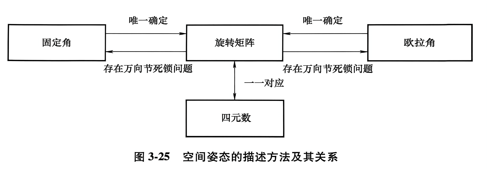

​		上图所示为空间姿态的描述方法及其关系。旋转矩阵通过 9 个参数描述空间姿态，其他描述方式可以唯一地转换为旋转矩阵，但旋转矩阵描述涉及的参数太多；固定角和欧拉角通过 3 个参数描述空间姿态，参数数量少，但旋转矩阵向固定角或欧拉角的转化存在万**向节死锁问题**；四元数通过 4 个参数描述空间姿态，参数数量较少，且四元数和旋转矩阵存在一一对应关系。
