```
	        学习资源：                                  
            	机器人导论                       
            	机器人学基础                        
            	台大林沛群运动学
```


# 4.3 运动学 Kinematics

## 4.3.1 简介

​	机器人运动学问题就是确定机器人末端执行器 相对于参考坐标系的位姿，并用机器人的各关节变量来表示。机器人运动学（Kinematics）包括正运动学（Forward Kinematics）和逆运动学（Inverse Kinematics）两部分。

- $FK$就是给定机器人各关节变量，计算机器人末端的目标位姿，也称为机器人学运动学建模，表达如下：

```math
T_{0}^{n}(q) = A_1(q_1)A_2(q_2)\cdots A_n(q_n)
```

其中：			

1. $T_{0}^{n}$：末端坐标系相对于基坐标系的位姿。
2. $A_i$：第 $\{i−1\}$ 个坐标系到第 $\{i\}$ 个坐标系的变换。
3. $q_i$：第 $i$ 个关节变量，转动关节是角度，移动关节是位移。

- $IK$则是已知机器人的末端位姿，计算各个关节变量，也称为机器人运动学求解，表达式为$q=f^−1(T)$


## 4.3.2 连杆描述

​	操作臂可以看成由一系列刚体通过关节连接而成的一个运动链，我们将这些刚体称为连杆。通过关节将两个相邻的连杆连接起来。

​	在进行操作臂的结构设计时，通常优先选择仅具有一个自由度的关节作为连杆的连接方式。

​	大部分操作臂中包括**转动关节**或**移动关节**。在极少数情况下，采用具有n个自由度的关节，这种关节可以看成是用n个单自由度的关节与n−1个长度为 0 的连杆连接而成的。因此，不失一般性，**这里仅对只含单自由度关节的操作臂进行研究**。

​	从操作臂的固定基座开始为连杆进行编号，可以称固定基座为**连杆 0**。第一个可动连杆为**连杆 1**，以此类推，操作臂最末端的连杆为**连杆n**。

> ​	为了确定末端执行器在 3 维空间的位置和姿态，操作臂至少需要 6 个关节。


#### 1. 连杆关节轴描述

​	三维空间中的任意两个轴之间的距离均为一个确定值（**杆视为刚体**），两个轴之间的距离即为两轴之间公垂线的长度。两轴之间的公垂线总是存在的：

1. 当两轴不平行即相交时，两轴之间的公垂线只有一条，且认为他们的公垂线线段长度为0。
1. 当两关节轴平行或异面时，则存在**无数条长度相等**的公垂线。

​	在下图中，关节轴$i−1$和关节轴$i$之间公垂线的长度为$a_{i−1}$，$ai−1$即为**连杆长度**。

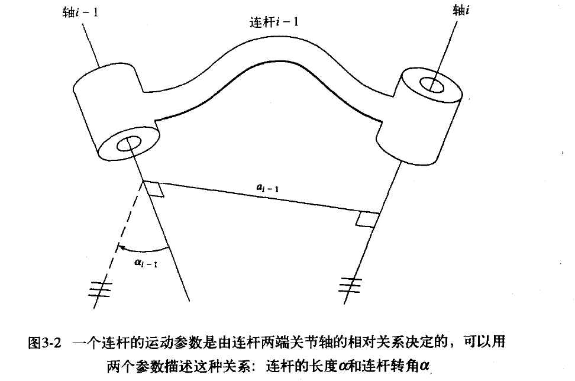

​	用来定义两关节轴相对位置的第二个参数为连杆转角（$Link \ Twist$）。

​	假设作一个平面，并使该平面与两关节轴之间的公垂线$a_{i-1}$ 垂直，然后，把关节轴$i−1$和关节轴$ i$ 投影到该平面上，在平面内轴$i−1$按照右手法则绕$a_{i-1}$转向轴$i$，测量两轴线之间的夹角，用转角$\alpha _{i−1}$定义连杆$i−1$的扭转角。

​	如上图$3-2$，$\alpha _{i−1}$表示关节轴$i−1$和关节轴$i$之间的夹角。

> （上面带有三条短划线的两条线为平行线。）

​	当两个关节轴线相交时，两轴线之间的夹角可以在两者所在的平面中测量，但是$\alpha _{i−1}$没有意义。在这种特殊情况下，$\alpha _{i−1}$的大小和符号可以任意选取，为了简化计算，一般去选 $0° \ or \ 90°。$


​	可以用上面定义的两个参数，即**连杆的长度**和**转角**来定义空间任意两条直线的关系（这里是用来**定义两个关节轴之间的关系**）。

​	

#### 2.  相邻连杆连接方式描述

​	为了描述**两个相邻连杆的连接方式**，还需要引入两个参数——连杆偏距、关节角。

​	首先定义连杆偏距$d_i$。在关节轴$i$上，记$a_{i−1}$与关节轴i的交点为$P_{i−1}$，$a_i$与关节轴$i$的交点为$P_i$，则$P_{i−1}$到$P_i$的有向距离即为连杆偏距$d_i$。

​	然后定义关节角$\theta_i$。过$a_{i−1}$作平行于$a_{i}$的平面，并将$a_{i}$投影到该平面内，在该平面内，根据右手定则，右手握住关节轴i，大拇指由$P_{i−1}$指向$P_i$，四指由$a_{i−1}$转向$a_{i}$，转过的角度即为关节角$\theta_i$。

​	注意：

1. 当关节$i$为旋转关节时，关节角$\theta_i$是一个变量，而连杆偏距$d_i$为常量，为固定的结构参数；

2. 当关节i为移动关节时，连杆偏距$d_i$是一个变量，而关节角$\theta_i$为常数，为固定的结构参数。


因此，根据关节类型的不同，连杆偏距$d_i$或关节角$\theta_i$又称为**关节变量**。

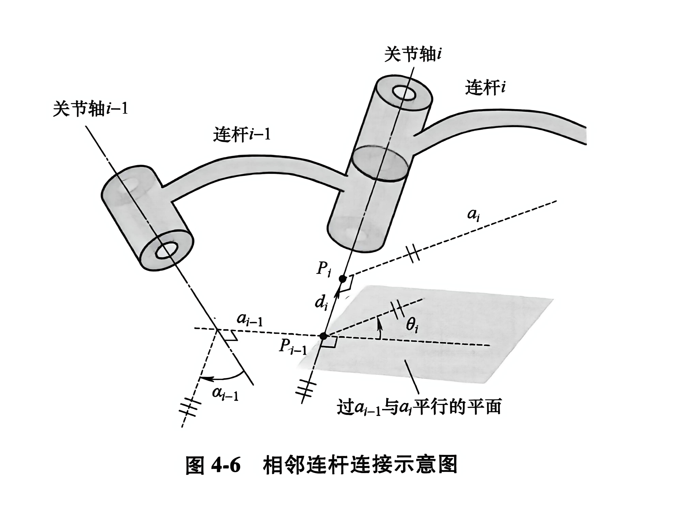

#### 3. 连杆中的首、末连杆

​	对于开式链机器人两端的连杆，其近端或远端不存在关节轴，无法按上面的定义确定 4 个连杆参数，因此需要补充定义。

​	对于首、末连杆，**连杆长度**和**连杆扭转角**习惯定义为 0，即$a_0=a_N=0, \alpha_0=α_N=0∘$。

对于首端连杆 0：

1. 若关节 1 为旋转关节，则关节角$\theta_1$的起始位置可以任意选取，并且设定连杆偏距$d_1=0$。
2. 如果关节 1 为移动关节，则连杆偏距$d_1$的起始位置可以任意选取，并且设定$\theta_1=0°$。

​	末端连杆N的连杆参数也可以通过类似的方式定义。

> 注意：我们常说的**末端连杆**通常不是末端执行器本身，而是机器人本体的**最后一节刚体**：也就是经过最后一个关节以后，到法兰盘为止的那一段刚体。


## 4.3.3 Forward Kinematics

​	由上小节学习的连杆之间的描述我们知道，机器人的每个连杆都可以用四个运动学参数来描述，其中两个参数用于描述连杆本身，另外两个参数用于描述连杆之间的连接关系。

​	通常，对于转动关节，$\theta_i$为关节变量，其他三个连杆参数是固定不变的；对于移动关节，$d_i$为关节变量，其他三个连杆参数是固定不变的。

​	这种用连杆参数描述机构运动关系的规则称为 Denavit-Hartenberg 参数，简称DH参数。

> ​	我们这里重点介绍Modify DH 参数法，还有其他一些描述机构运动参数的方法，例如：PoE指数积法、萨哈DH法、标准DH法，在此不作介绍。

### 1. 改进DH建模

$改进DH$一般步骤如下：

1. 在每个连杆上建立一个连杆坐标系，描述相邻连杆坐标系的相对位姿。
2. 列DH 参数表。
3. 建立相邻坐标系之间的齐次变换矩阵。
4. 利用上述的齐次变换矩阵，经过复合变换，得到末端连杆坐标系相对于基坐标系的位姿。

下面我们详细讲解一下过程：

#### 1. 建立连杆坐标系

（1）连杆坐标系规定

​	为了描述每个连杆与相邻连杆之间的相对位置关系，需要在每个连杆上定义一个固连坐标系。根据固连坐标系所在连杆的编号对固连坐标系命名，因此，固连在连杆$i$上的固连坐标系称为坐标系{$i$}。

（2） 中间连杆坐标系建立

1. Z轴确定

​	使Z轴沿**关节轴线方向**，此时有两个方向，可任意选择。为简化连杆参数，各连杆坐标系的Z轴如果平行，则应**同向**。

2. X轴确定

​	使X轴沿**关节轴的公垂线方向**，由连杆**近端指向**连杆**远端**；

​	当两关节轴相交时，它们的公垂线段长度为0，此时令X轴垂直于两关节轴确定的空间平面有两个方向可任意选择。为简化连杆参数，同向。

3. Y轴确定

​	根据X轴和Z轴的方向，由右手定则可唯一地确定Y轴的方向。

> $X \ Cross\  Y  = Z  (叉积)$

4. 原点确定

​	在改进 D-H 法中，将连杆坐标系的原点设置在连杆的近端，即关节轴$i−1$与公垂线段$a_{i−1}$的交点处。

​	注意到，当两关节轴线不相交时，存在无穷多条公垂线段，因此就有无穷多个交点，此时原点位置可任意选择，一般选在关节中心等特殊位置；

​	当两关节轴线相交时，将原点取为关节轴线的交点，此时原点位置可唯一确定。


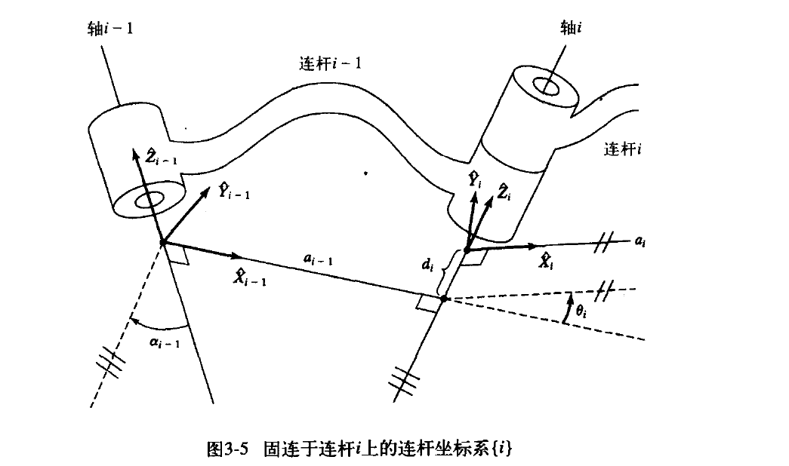

|    D-H 参数    |                    定义                     |
| :------------: | :-----------------------------------------: |
|   $a_{i-1}$    |      从$Z_{i-1}$移动到$Z_i$的垂直距离       |
| $\alpha_{i-1}$ | 绕$X_{i-1}$轴，从$Z_{i-1}$旋转到$Z_i$的角度 |
|     $d_i$      |        从$X_{i-1}$移动到$X_i$的距离         |
|   $\theta_i$   |  绕$Z_{i}$轴，从$X_{i-1}$旋转到$X_i$的角度  |

> ​	注意：逆时针为正，顺时针为负！

（3） 首、末连杆坐标系建立

​	原则上，基坐标系{${0}$}的坐标轴方向、原点位置都可以任意设定，但为了简化建模过程，通常将基坐标系{${0}$}设置为连杆坐标系{1}的初始位姿，即连杆坐标系{$1$}在关节变量为 0 时的位姿，于是连杆坐标系{0}在运动的初始时刻与连杆坐标系{1}重合，因此有$a_0=0$和$\alpha_0=0°$。并且，当关节 1 为转动关节时，连杆偏距$d_1=0$；当关节 1 为移动关节时，关节角$\theta_1=0°$。

​	对于末端连杆坐标系{$N$}，其$Z$轴方向就是关节$N$的轴线方向，然而，由于不存在后一个关节轴，因此X轴的方向无法定义。

​	若关节$N$为旋转关节，则取X轴方向为前一连杆坐标系{$N−1$}的X轴初始方向，即$\theta_N=0°$时$X_{N−1}$轴的方向，并选取合适的原点位置使连杆偏距$d_N=0$。

​	若关节$N$为移动关节，则取满足关节角$θ_N=0°$的$X$轴方向。确定坐标轴方向后，选取连杆坐标系{$N$}的原点为$X_{N−1}$轴与关节轴$N$的交点。


#### 2. DH Parameter Table

根据坐标系以及参数定义，填写即可。

|    D-H 参数    |                    定义                     |
| :------------: | :-----------------------------------------: |
|   $a_{i-1}$    |      从$Z_{i-1}$移动到$Z_i$的垂直距离       |
| $\alpha_{i-1}$ | 绕$X_{i-1}$轴，从$Z_{i-1}$旋转到$Z_i$的角度 |
|     $d_i$      |        从$X_{i-1}$移动到$X_i$的距离         |
|   $\theta_i$   |  绕$Z_{i}$轴，从$X_{i-1}$旋转到$X_i$的角度  |

> ​	注意：逆时针为正，顺时针为负！

#### 3.  Transformation Matrix

图 4-17 所示为相邻连杆坐标系的相对位姿关系。希望建立相邻连杆坐标系{$i$}、{$i−1$}之间的齐次变换矩阵，可通过 4 个步骤完成：

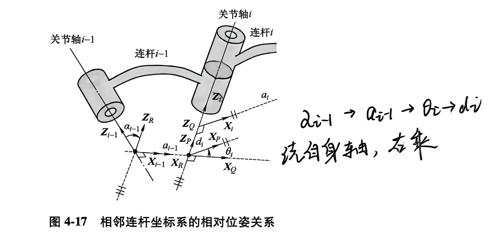

1. 将连杆坐标系 {$i−1$} 绕 $X_{i−1}$轴旋转 $\alpha_{i−1}$，得到中间坐标系 {$R$}。
2. 将中间坐标系 {$R$} 沿 $X_R$ 轴（即$X_{i−1}$轴）平移 $a_{i−1}$，得到中间坐标系 {$Q$}。
3. 将中间坐标系 {$Q$} 绕 $Z_Q$ 轴（即 $Z_i$ 轴）旋转 $\theta_i$，得到中间坐标系 {$P$}。
4. 将中间坐标系 {$P$} 沿 $Z_P$ 轴（即 $Z_i$ 轴）平移 $d_i$，得到连杆坐标系 {$i$}。

​	注意到，上面的 4 次变换均为纯旋转或纯平移，每一次变换仅与一个连杆参数有关，根据数学基础姿态的相关内容，得到连杆坐标系{$i$}的齐次变换矩阵：

```math
\begin{align}
_{i}^{i-1}T &= {}_{R}^{i-1}T{}_{Q}^{R}T{}_{P}^{Q}T{}_{i}^{P}T \\
&= \boldsymbol{R}_x(\alpha_{i-1})\boldsymbol{D}_x(a_{i-1})\boldsymbol{R}_z(\theta_i)\boldsymbol{D}_z(d_i)
\end{align}
```

其中：

1. ```math
   \boldsymbol{R}_x(\alpha_{i-1})=
   \begin{bmatrix}
   1 & 0 & 0 & 0 \\
   0 & \cos\alpha_{i-1} & -\sin\alpha_{i-1} & 0 \\
   0 & \sin\alpha_{i-1} & \cos\alpha_{i-1} & 0 \\
   0 & 0 & 0 & 1
   \end{bmatrix}
   ```

2. ```math
   \boldsymbol{D}_x(a_{i-1})=
   \begin{bmatrix}
   1 & 0 & 0 & a_{i-1} \\
   0 & 1 & 0 & 0 \\
   0 & 0 & 1 & 0 \\
   0 & 0 & 0 & 1
   \end{bmatrix}
   ```

3. ```math
   \boldsymbol{R}_z(\theta_i)=
   \begin{bmatrix}
   \cos\theta_i & -\sin\theta_i & 0 & 0 \\
   \sin\theta_i & \cos\theta_i & 0 & 0 \\
   0 & 0 & 1 & 0 \\
   0 & 0 & 0 & 1
   \end{bmatrix}
   ```

4. ```math
   \boldsymbol{D}_z(d_i)=
   \begin{bmatrix}
   1 & 0 & 0 & 0 \\
   0 & 1 & 0 & 0 \\
   0 & 0 & 1 & d_i \\
   0 & 0 & 0 & 1
   \end{bmatrix}
   ```

   

​	因此得出如下结论：

```math
_{i}^{i-1}T=
\begin{bmatrix}
\cos\theta_i & -\sin\theta_i & 0 & a_{i-1} \\
\sin\theta_i\cos\alpha_{i-1} & \cos\theta_i\cos\alpha_{i-1} & -\sin\alpha_{i-1} & -\sin\alpha_{i-1}d_i \\
\sin\theta_i\sin\alpha_{i-1} & \cos\theta_i\sin\alpha_{i-1} & \cos\alpha_{i-1} & \cos\alpha_{i-1}d_i \\
0 & 0 & 0 & 1
\end{bmatrix}
```

注意到，对于一对相邻的连杆坐标系，4 个连杆参数中有且仅有一个变量，即关节变量$\theta_i$或$di$：

1. 当关节$i$为旋转关节时，$_{i}^{i-1}T$仅是关节角$\theta_i$的函数；
2. 当关节$i$为移动关节时，$_{i}^{i-1}T$仅是连杆偏距$d_i$的函数。

若有机械臂$n$个关节，则从0到n把这些变换矩阵依次乘起来，就得到了末端相对于基座的变换：

```math
{}^n_0T(q) = A_1(q_1)A_2(q_2)\cdots A_n(q_n)
```

其中：

1. $T ^n _0$：末端坐标系相对于基坐标系的位姿。
2. $A_i$：第 $i−1$ 个坐标系到第 $i$ 个坐标系的变换。
3. $q_i$：第 $i$ 个关节变量，转动关节是角度，移动关节是位移。

**Case**：


​	图 4-11 所示为 “$RRR$” $3$ 自由度平面机器人，该机器人包括 $3$ 个旋转关节，建立机器人的$FK$模型。假设 “$RRR$”平面机器人的末端安装了一只手爪，手爪中心点$P$在末端坐标系{$3$}下的齐次坐标为$^ 3  {P}={[L_3  \ 0  \ 0 \  0]}^T$，试计算点P在基坐标系{$0$}下的齐次坐标。

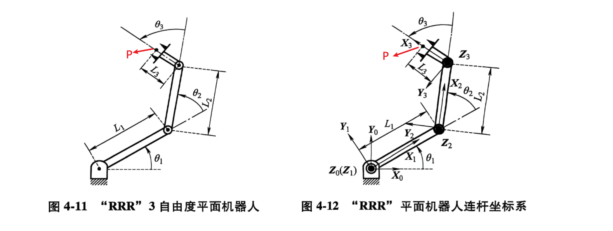

1. 首先建立如图4-12所示的坐标系

2. 通过坐标系就能得到DH参数表：

   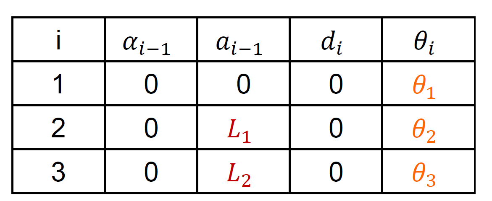

   > 说明： 这里我们建立都是改进DH参数表

3. 根据参数表中的连杆参数代如齐次矩阵求得：

```math
_{3}^{0}T={}_{1}^{0}T{}_{2}^{1}T{}_{3}^{2}T=
\begin{bmatrix}
\cos(\theta_1+\theta_2+\theta_3) & -\sin(\theta_1+\theta_2+\theta_3) & 0 & L_1\cos\theta_1+L_2\cos(\theta_1+\theta_2) \\
\sin(\theta_1+\theta_2+\theta_3) & \cos(\theta_1+\theta_2+\theta_3) & 0 & L_1\sin\theta_1+L_2\sin(\theta_1+\theta_2) \\
0 & 0 & 1 & 0 \\
0 & 0 & 0 & 1
\end{bmatrix}
```

手爪中线点$P$在基坐标系{$0$}下的齐次坐标：

```math
^{0}\boldsymbol{P}={}_{3}^{0}T\,^{3}\boldsymbol{P}=
\begin{bmatrix}
L_1\cos\theta_1+L_2\cos(\theta_1+\theta_2)+L_3\cos(\theta_1+\theta_2+\theta_3) \\
L_1\sin\theta_1+L_2\sin(\theta_1+\theta_2)+L_3\sin(\theta_1+\theta_2+\theta_3) \\
0 \\
1
\end{bmatrix}
```

#### 4. 建模多样性

​	坐标建立和DH参数并不是唯一的，我们注意到，当$a_{i-1} = 0$ 时，即$Z_{i-1}$和$Z_i$相交时，若我们固定$Z_{i-1}$那么$Z_i$有两种选择，同样在$Z_i$和$Z_{i-1}$确定下，$X_{i-1}$也有两种：

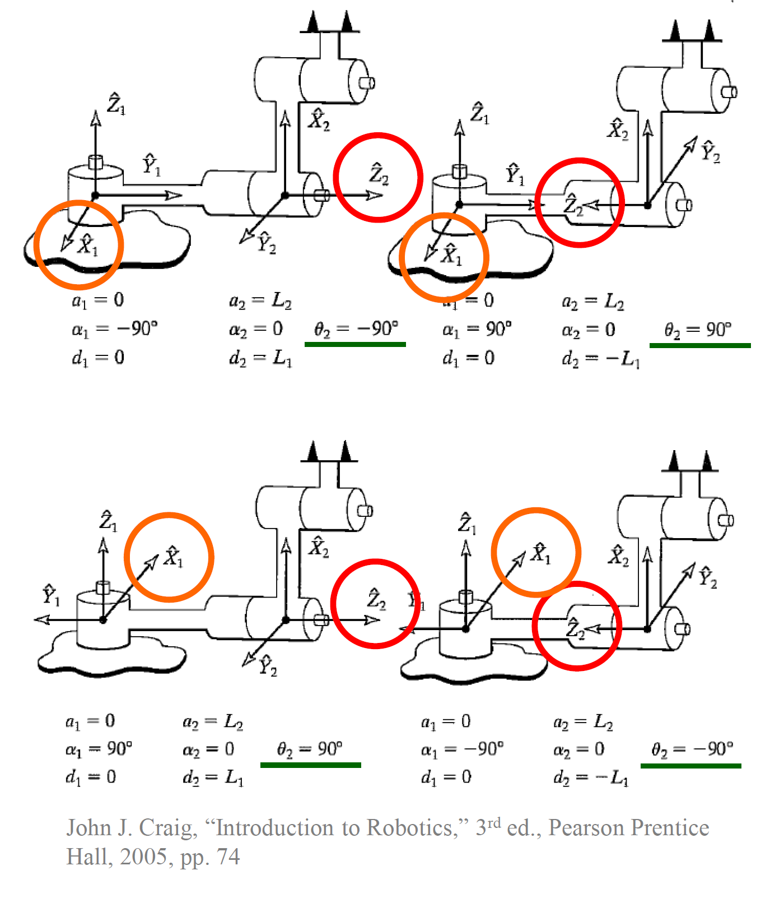

​	为了简化运算，我们选取有一定习惯，具体参考建立坐标系小节的习惯。

### 2. Joint Space | Actuator Space | Cartesian Space

​	对于n自由度开式链机器人，它的位形可由n个关节变量确定，通常将这组关节变量表达为n×1关节向量，所有关节向量组成的集合称为机器人的关节空间（Joint Space）。

​	若机器人末端的位置和姿态是通过笛卡儿正交坐标系来描述的，则将机器人末端运动的空间称为笛卡儿空间（Cartesian Space）。因此，**正向运动学就是建立关节空间到笛卡儿空间的映射**。

​	每个关节的运动都是通过某种驱动器实现的，一般来说，**机器人的运动关节并不是由电动机等驱动器直接驱动**，而是驱动器经由减速器、丝杠等传动装置后产生关节的运动。此时，驱动器产生的转速、力矩等经过传动装置的转换后成为关节的转速、力矩。各关节驱动器的**驱动变量**可表达为一个**驱动向量**，所有驱动向量组成的集合称为机器人的驱动器空间（Actuator Space）。

​	如图 3-16 所示，机器人的运动学涉及三个空间：驱动器空间、关节空间和笛卡儿空间。本节主要讨论图  3-16  中实线箭头表示的映射关系，在第 4.3.4 Inverse Kinematics 章中会讨论逆映射关系，即图 3-16  中虚线箭头表示的映射关系。

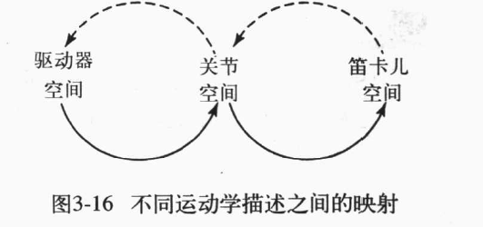

​	在进行机器人设计或分析时，必须**确定驱动器空间和关节空间的映射关系**，进而通过运动学得到关节空间和笛卡儿空间的映射关系，最终得到可测的驱动器空间变量与笛卡儿空间位姿的映射关系。

### 3. 工具的定位

​	在机器人的实际应用场景中，经常涉及一系列坐标系，为了规范起见，有必要对这些坐标系进行规定。如图 4-25 所示，机器人末端安装了某种工具，希望机器人通过工具来取放工作台上的物块。这一过程涉及 5 个坐标系：基坐标系、固定坐标系、腕部坐标系、工具坐标系以及目标坐标系。

​	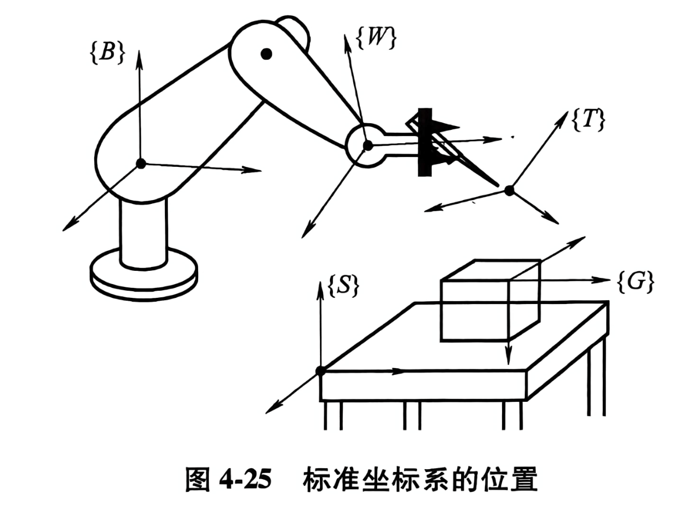

1. **基坐标系** {$B$}：基坐标系 {$B$} 位于机器人的基座上，它固连在机器人的静止部位，**一般取机器人的连杆坐标系 {$0$} 为基坐标系**。

2. **固定坐标系** {$S$}：固定坐标系 {$S$} 的位置与具体任务相关。例如，在图 4-26 中，固定坐标系位于机器人工作台的一角。固定坐标系有时也称为任务坐标系、**世界坐标系**或通用坐标系。

3. **腕部坐标系** {$W$}：腕部坐标系 {$W$} 附于机器人的末端连杆，**一般取末端连杆坐标系 {$N$} 为腕部坐标系**。大多数情况下，腕部坐标系 {$W$} 的原点位于机器人手腕上，它随着机器人的末端连杆一起运动，{$W$}$ = {}_W^B T = {}_N^0 T$

4. **工具坐标系** {$T$}：工具坐标系 {$T$} 附于机器人末端工具之上，工具坐标系通常根据玩不坐标系来确定，例如，在图 4-26 中，工具坐标系的原点定义在机器人抓持轴销的末端。

5. **目标坐标系** {$G$}：目标坐标系 {G} 是对目标位姿的描述。在机器人运动任务结束时，**工具坐标系应当与目标坐标系重合**，即$_{T}^{B}T = _{G}^{B}T$。例如，在图 4-26 中，目标坐标系位于物块中心。**目标坐标系通常根据工作台坐标系确定。**

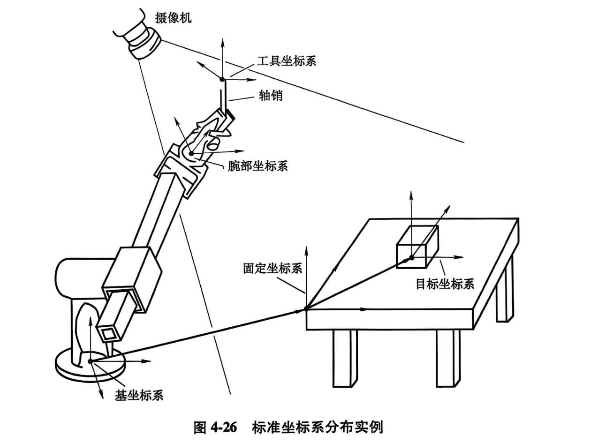

​	实际应用中，常常需要实时计算**工具坐标系相对于固定坐标系的位姿**$_{T}^{S}T$。为此，可先计算工具坐标系相对于基坐标系的位姿，即$_{T}^{B}T = {}_{W}^{B}T\,{}_{T}^{W}T$

​	首先需要分别计算**腕部坐标系相对于基坐标系的位姿**、**工具坐标系相对于腕部坐标系的位姿**，前者可通过机器人**正运动学**建模得到，后者的确定过程称为 “工具坐标系（tool control frame，**TCF**）标定”，它包括工具中心位置（tool center point，TCP）标定和工具姿态标定，常用的标定方法有四点法、六点法等。

1. 四点法：

​	主要用于求 TCP 的**位置偏移**${}^W p_{TCP}$。让工具尖端从不同姿态接触同一个固定点，利用多组姿态求解工具尖端相对于法兰的位置。四点法通常只能可靠求 TCP 位置，不能完整确定工具姿态即$RPY$角度。

​	下面具体推导：

​	令工具尖端 TCP 在不同机器人姿态下始终接触同一个固定点。设第 \($i$) 次示教时，由机器人正运动学得到腕部/法兰坐标系 {$W$} 相对于基坐标系 {$B$} 的位姿为：

​												

```math
{}_{W,i}^{B}T=
\begin{bmatrix}
{}_{W,i}^{B}R & {}_{W,i}^{B}p \\
\boldsymbol{0} & 1
\end{bmatrix}
```

​	设 TCP 在腕部/法兰坐标系 $\{W\}$ 下的位置为：

​												

```math
{}^W p_{TCP}
```

​	固定接触点在基坐标系 $\{B\}$ 下的位置为：

​										

```math
		{}^B p
```

​	由于每次示教时 TCP 都接触同一个固定点，因此有：

​												

```math
	{}^B p = {}_{W,i}^{B}R\,{}^W p_{TCP} + {}_{W,i}^{B}p
```


​												

```math
	{}^B p = {}_{W,j}^{B}R\,{}^W p_{TCP} + {}_{W,j}^{B}p
```

​	其中，${}^{B}R_{W,i}和 {}^{B}p_{W,i}$ 分别为第 \($i$) 次正运动学得到的旋转矩阵和平移向量，${}^{B}R_{W,j}和 {}^{B}p_{W,j}$ 分别为第 \($j$) 次正运动学得到的旋转矩阵和平移向量，${}^{W}p_{TCP}$ 为待求的 TCP 偏移量。

对任意两组姿态 \($i$\) 和 \($j$\) 作差，可以消去未知固定点 ${}^{B}p$，得到：

```math
\bigl({}_{W,i}^{B}R - {}_{W,j}^{B}R\bigr){}^W p_{TCP} = {}_{W,j}^{B}p - {}_{W,i}^{B}p
```

将多组示教数据构造成**超定线性方程组**：

```math
A\,{}^W p_{TCP} = b
```

再通过最小二乘法求解：		

```math
{}^W p_{TCP} = \bigl(A^T A\bigr)^{-1}A^T b
```

代码示例：

```python
import numpy as np


def solve_tcp_four_point(T_BW_list):
    """
    使用四点法求解 TCP 在腕部/法兰坐标系 {W} 下的位置。

    参数
    ----
    T_BW_list : list[np.ndarray]
        多组机器人正运动学结果。
        每个元素为 4x4 齐次变换矩阵 ^B T_W,i，
        表示第 i 次示教时腕部/法兰坐标系 {W} 相对于基坐标系 {B} 的位姿。

    返回
    ----
    p_W_TCP : np.ndarray
        形状为 (3,) 的向量，表示 TCP 在腕部/法兰坐标系 {W} 下的位置 ^W p_TCP。

    residuals : np.ndarray
    
        最小二乘残差，可用于判断标定误差大小。
    """

    if len(T_BW_list) < 4:
        raise ValueError("四点法至少需要 4 组不同姿态的数据")

    A_blocks = []
    b_blocks = []

    n = len(T_BW_list)

    for i in range(n - 1):
        for j in range(i + 1, n):
            # 提取第 i 组姿态的旋转矩阵和平移向量
            R_i = T_BW_list[i][:3, :3]   # ^B R_W,i
            p_i = T_BW_list[i][:3, 3]    # ^B p_W,i

            # 提取第 j 组姿态的旋转矩阵和平移向量
            R_j = T_BW_list[j][:3, :3]   # ^B R_W,j
            p_j = T_BW_list[j][:3, 3]    # ^B p_W,j

            # 根据公式：
            # (^B R_W,i - ^B R_W,j) ^W p_TCP = ^B p_W,j - ^B p_W,i
            A_blocks.append(R_i - R_j)
            b_blocks.append(p_j - p_i)

    # 拼接成超定线性方程组 A x = b
    A = np.vstack(A_blocks)
    b = np.hstack(b_blocks)

    # 使用数值最小二乘方法求解
    # x 即 ^W p_TCP
    p_W_TCP, residuals, rank, singular_values = np.linalg.lstsq(A, b, rcond=None)

    return p_W_TCP, residuals


# ---------------- 示例 ----------------
if __name__ == "__main__":
    # 假设以下为机器人在 4 个不同姿态下的正运动学结果 ^B T_W,i
    # 实际使用时，应由机器人控制器或正运动学模型计算得到

    T1 = np.array([
        [1, 0, 0, 400],
        [0, 1, 0, 100],
        [0, 0, 1, 300],
        [0, 0, 0, 1]
    ], dtype=float)

    T2 = np.array([
        [0, -1, 0, 450],
        [1,  0, 0,  50],
        [0,  0, 1, 300],
        [0,  0, 0,   1]
    ], dtype=float)

    T3 = np.array([
        [0, 0, 1, 420],
        [0, 1, 0, 120],
        [-1, 0, 0, 280],
        [0, 0, 0, 1]
    ], dtype=float)

    T4 = np.array([
        [1, 0,  0, 390],
        [0, 0, -1, 130],
        [0, 1,  0, 260],
        [0, 0,  0,   1]
    ], dtype=float)

    T_BW_list = [T1, T2, T3, T4]

    p_W_TCP, residuals = solve_tcp_four_point(T_BW_list)

    print("TCP 在腕部/法兰坐标系 {W} 下的位置 ^W p_TCP 为：")
    print(p_W_TCP)

    print("最小二乘残差：")
    print(residuals)
```

> 这里输入的 ${}^{B}T_{W,i}$ 必须对应**工具尖端接触同一个固定点**时的多组机器人姿态；如果示教点不是同一个物理点，求出来的 TCP 偏移会失真。

2. 六点法：

​	在四点法求 TCP 的基础上，再通过额外的定向点确定**工具坐标系的方向**，例如工具的 $X$ 轴方向、$XY$ 平面方向等。因此六点法可同时标定 TCP **位置和工具姿态**，具体推导可上网搜查，这里不做展开说明。


​	对$_{T}^{B}T = {}_{W}^{B}T\,{}_{T}^{W}T$两边同时乘$_{S}^{B}T^{-1}$，即得到$_{T}^{S}T = \bigl({}_{S}^{B}T\bigr)^{-1}{}_{W}^{B}T\,{}_{T}^{W}T$，即为**工具坐标系相对于固定坐标系的位姿**。

对于其中的$\bigl({}_{S}^{B}T\bigr)^{-1}$，可通过三点法、手眼标定或外部测量方法求得。


1. 三点法：

​	在固定坐标系中选取**三个不共线点**，并用机器人 **TCP 依次触碰这些点**，得到它们在机器人基坐标系下的位置，由两组三维点建立坐标系，求 $^B T_S$。


​	具体推导如下：

设在固定坐标系 $\{S\}$ 中选取三个点：

```math
{}^S p_1,\quad {}^S p_2,\quad {}^S p_3
```

机器人 TCP 依次触碰这三个点后，可得到它们在基坐标系 $\{B\}$ 下的位置：

```math
{}^B p_1,\quad {}^B p_2,\quad {}^B p_3
```

​	其中，${}^{B}p_1,{}^{B}p_2,{}^{B}p_3$ 通常可由机器人正运动学结合已标定的 TCP 偏移求得。

固定坐标系 $\{S\}$ 的原点通常取为第一个点：

```math
{}^B o_S = {}^B p_1
```

令从点 $p_1$ 指向点 $p_2$ 的方向作为固定坐标系的 $X_S$ 轴方向：

```math
{}^B x_S = \frac{{}^B p_2 - {}^B p_1}{\left\| {}^B p_2 - {}^B p_1 \right\|}
```


再利用第三个点 $p_3$ 确定 $X_SY_S$ 平面。先构造辅助向量：

```math
{}^B v = {}^B p_3 - {}^B p_1
```

由右手定则可得固定坐标系的 $Z_S$ 轴方向：

```math
{}^B z_S = \frac{{}^B x_S \times {}^B v}{\left\| {}^B x_S \times {}^B v \right\|}
```

再由 $Z_S$ 轴和 $X_S$ 轴确定 $Y_S$ 轴方向：

```math
{}^B y_S = {}^B z_S \times {}^B x_S
```

于是固定坐标系 $\{S\}$ 相对于基坐标系 $\{B\}$ 的旋转矩阵为：

```math
{}^B R_S = \begin{bmatrix} {}^B x_S & {}^B y_S & {}^B z_S \end{bmatrix}
```

因此，固定坐标系  $\{S\}$ 相对于机器人基坐标系 $\{B\}$的齐次变换矩阵为：

```math
{}^B T_S =
\begin{bmatrix}
{}^B R_S & {}^B o_S \\
\boldsymbol{0} & 1
\end{bmatrix}
```

如果需要求机器人基坐标系 $\{B\}$ 相对于固定坐标系 $\{S\}$ 的位姿，则取逆即可：

```math
{}^S T_B = \bigl({}^B T_S\bigr)^{-1}
```

即：

```math
{}^S T_B =
\begin{bmatrix}
\bigl({}^B R_S\bigr)^T & -\bigl({}^B R_S\bigr)^Tp {}^B o_S \\
\boldsymbol{0} & 1
\end{bmatrix}
```

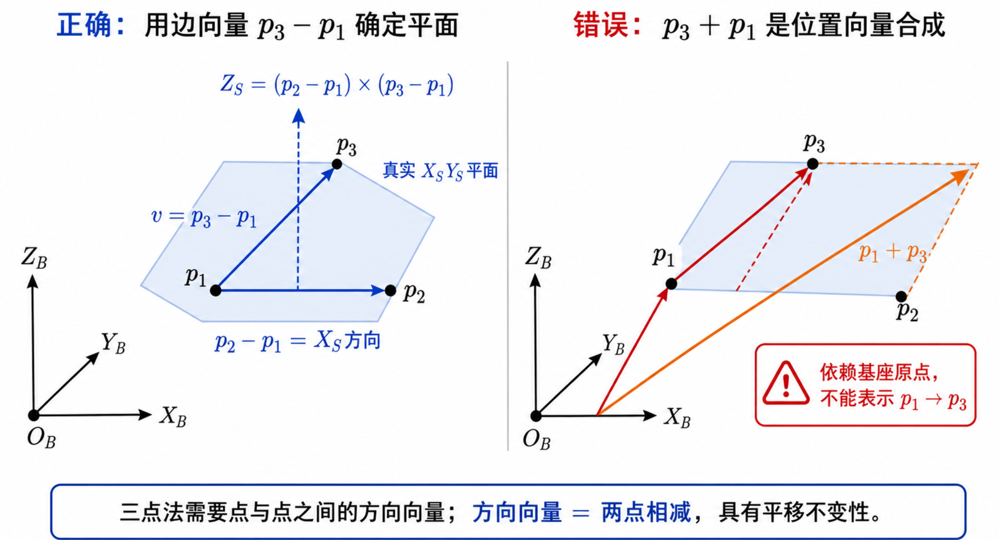

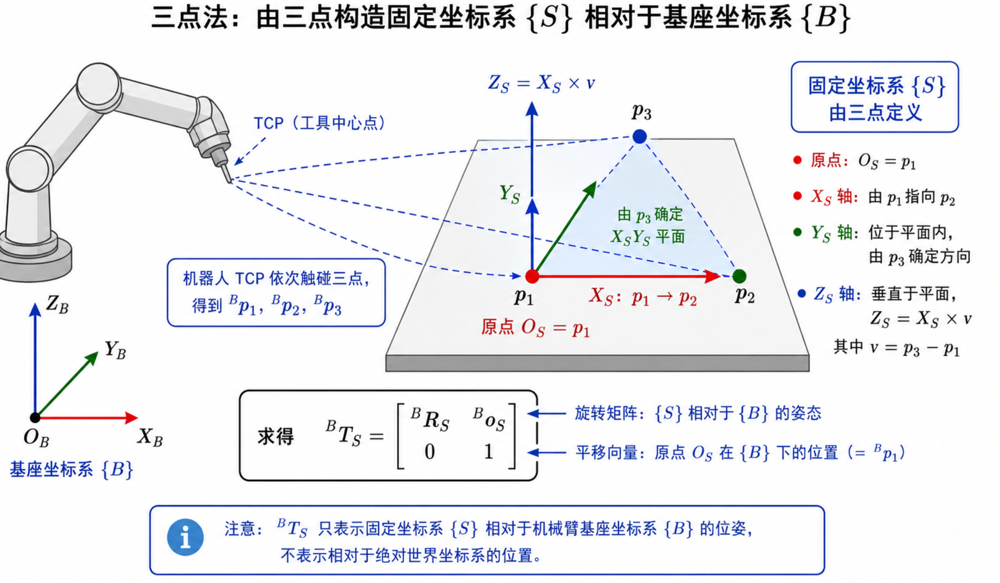

代码示例：

```python
import numpy as np


def normalize(v):
    """
    向量单位化。
    """
    norm = np.linalg.norm(v)
    if norm < 1e-9:
        raise ValueError("向量长度过小，无法单位化")
    return v / norm


def solve_frame_three_point(p1_B, p2_B, p3_B):
    """
    使用三点法求固定坐标系 {S} 相对于机器人基坐标系 {B} 的位姿 ^B T_S。

    参数
    ----
    p1_B, p2_B, p3_B : np.ndarray
        三个标定点在机器人基坐标系 {B} 下的位置，形状均为 (3,)。

    返回
    ----
    T_BS : np.ndarray
        4x4 齐次变换矩阵 ^B T_S。
    """

    p1_B = np.asarray(p1_B, dtype=float)
    p2_B = np.asarray(p2_B, dtype=float)
    p3_B = np.asarray(p3_B, dtype=float)

    # 以第一个点作为固定坐标系 {S} 的原点
    o_S_B = p1_B

    # X 轴由 p1 指向 p2
    x_S_B = normalize(p2_B - p1_B)

    # 第三个点用于确定 X-Y 平面
    v = p3_B - p1_B

    # Z 轴由 X 轴和辅助向量叉乘得到
    z_S_B = normalize(np.cross(x_S_B, v))

    # Y 轴由右手定则得到
    y_S_B = np.cross(z_S_B, x_S_B)

    # 旋转矩阵的三列分别为 {S} 的 x、y、z 轴在 {B} 下的表示
    R_BS = np.column_stack((x_S_B, y_S_B, z_S_B))

    # 构造齐次变换矩阵 ^B T_S
    T_BS = np.eye(4)
    T_BS[:3, :3] = R_BS
    T_BS[:3, 3] = o_S_B

    return T_BS


# 示例
if __name__ == "__main__":
    # 三个点在机器人基坐标系 {B} 下的位置，单位可为 mm
    p1_B = np.array([500.0, 100.0, 200.0])
    p2_B = np.array([600.0, 100.0, 200.0])
    p3_B = np.array([500.0, 200.0, 200.0])

    T_BS = solve_frame_three_point(p1_B, p2_B, p3_B)
    T_SB = np.linalg.inv(T_BS)

    print("^B T_S =")
    print(T_BS)

    print("^S T_B =")
    print(T_SB)
```


> ​	三点法求的是固定坐标系与基坐标系之间的外部关系，而四点法求的是 TCP 相对于法兰/腕部坐标系的位置偏移。实际使用时，一般先完成 TCP 标定，再用 TCP 去触碰固定坐标系的三个点，从而求得 ${}^{B}T_S$。


2. 手眼标定：

​	如果世界坐标系来自相机或视觉系统，可通过 `eye-in-hand` 或 `eye-to-hand` 标定求相机、基座、工具之间的关系。

3. 外部测量：

​	使用激光跟踪仪、视觉系统、全站仪等直接测量机器人基座、工件或标定板的位置。


## 4.3.4 Inverse Kinematics

​	在实际应用中，常希望使机器人的末端以特定的姿态到达某个指定的空间位置，通过控制关节变量实现这一要求，就是机器人逆运动学的基本任务，即已知机器人的末端坐标系相对于基坐标系的期望位置和姿态，以计算使机器人的末端到此位姿的关节变量。

​	已知目标物体相对于工作台的位姿$_{G}^{S}T$，求机械臂的关节变量，抓取目标时，**只需控制机械臂的工具坐标系与目标坐标系重合**，因此使机械臂工具坐标系相对于工作台的位姿$_{T}^{S}T$与$_{G}^{S}T$重合，根据坐标系变换关系，有

```math
{}_W^B T = {}_S^B T {}_T^S T {}_W^T T = {}_S^B T {}_G^S T {}_W^T T
```

​	注意到，$_{G}^{S}T$、$_{B}^{S}T$、$_{W}^{T}T$与关节变量无关，均为常矩阵，因此等式右边为常矩阵，则此问题刚好就是本章讨论的逆运动学问题，已知目标点相对基坐标位姿，求解机器人让关节到达该位姿的各关节变量。

​	因此抓取目标时，先通过坐标变换把“目标物体在工作台上的位姿”转换成“机器人腕部在基坐标系下的期望位姿”，然后再用逆运动学求关节角。

​	

> ​	插入下式，之前我们学习过Transformation Maritx ：
>
> ```math
> _{i}^{i-1}T=
> \begin{bmatrix}
> \cos\theta_i & -\sin\theta_i & 0 & a_{i-1} \\
> \sin\theta_i\cos\alpha_{i-1} & \cos\theta_i\cos\alpha_{i-1} & -\sin\alpha_{i-1} & -\sin\alpha_{i-1}d_i \\
> \sin\theta_i\sin\alpha_{i-1} & \cos\theta_i\sin\alpha_{i-1} & \cos\alpha_{i-1} & \cos\alpha_{i-1}d_i \\
> 0 & 0 & 0 & 1
> \end{bmatrix}
> ```
>
> ​	并且学习了复合变换，那么有：
>
> ```math
> {}_{6}^{0}T={}_{1}^{0}T{}_{6}^{1}T=
> \begin{bmatrix}
> r_{11} & r_{12} & r_{13} & p_x \\
> r_{21} & r_{22} & r_{23} & p_y \\
> r_{31} & r_{32} & r_{33} & p_z \\
> 0 & 0 & 0 & 1
> \end{bmatrix}
> ```
>
> ```math
> \begin{align*}
> r_{11} &= c_1\bigl[c_{23}(c_4c_5c_6-s_4s_5)-s_{23}s_5c_6\bigr]+s_1(s_4c_5c_6+c_4s_6) \\
> r_{21} &= s_1\bigl[c_{23}(c_4c_5c_6-s_4s_6)-s_{23}s_5c_6\bigr]-c_1(s_4c_5c_6+c_4s_6) \\
> r_{31} &= -s_{23}(c_4c_5c_6-s_4s_6)-c_{23}s_5c_6 \\
> r_{12} &= c_1\bigl[c_{23}(-c_4c_5s_6-s_4c_6)+s_{23}s_5s_6\bigr]+s_1(c_4c_6-s_4c_5s_6) \\
> r_{22} &= s_1\bigl[c_{23}(-c_4c_5s_6-s_4c_6)+s_{23}s_5s_6\bigr]-c_1(c_4c_6-s_4c_5s_6) \\
> r_{32} &= -s_{23}(-c_4c_5s_6-s_4c_6)+c_{23}s_5s_6 \\
> r_{13} &= -c_1(c_{23}c_4s_5+s_{23}c_5)-s_1s_4s_5 \\
> r_{23} &= -s_1(c_{23}c_4s_5+s_{23}c_5)+c_1s_4s_5 \\
> r_{33} &= s_{23}c_4s_5-c_{23}c_5 \\
> p_x &= c_1\bigl[a_2c_2+a_3c_{23}-d_4s_{23}\bigr]-d_3s_1 \\
> p_y &= s_1\bigl[a_2c_2+a_3c_{23}-d_4s_{23}\bigr]+d_3c_1 \\
> p_z &= -a_3s_{23}-a_2s_2-d_4c_{23}
> \end{align*}
> ```

​	

​	求解操作臂运动学方程是一个非线性问题。已知$_{N}^{0}T$的数值，试图求出$θ_1,θ_2,…,θ_n。$

​	考虑上式给出的方程，对于 PUMA560 操作臂来说，目前对这个问题的确切表述如下：已知$_{6}^{0}T$（腕部坐标系 相对于 基坐标系 的齐次变换矩阵）的 16 个数值（其中 4 个无意义：[0,0,0,1]），我们根据矩阵元素对应相等，可建立12个方程的非线性方程组如上式，求解上式中的 6 个关节角$θ_1$~$θ_6$。

​	对于上式其实只有六DOFs，共有16个变量，有4个无意义，对于旋转矩阵正交，有6个约束条件，最终16 -4 - 6  =6，因此只有6个角度$\theta$是未知的，也就是我们要求解的，

​	上式12个方程组所描述的机器人的连杆参数很简单，多个$α_i$是 $0°$ 或±$90°$，许多连杆偏距和长度分别为 0。显而易见，一般 6 自由度机构（所有连杆参数均不为 0）的运动方程要比上式复杂得多。同任何非线性方程组一样，我们必须考虑其解的存在性、多重解性以及求解方法。

### 1. 解情况

#### 1. 解的存在性

​	解是否存在的问题完全取决于操作臂的工作空间。简单地说，工作空间是操作臂末端执行器所能到达的范围。**若解存在**，**则被指定的目标点必须在工作空间内**，同理，**若期望的末端位置不在机器人的工作空间内**，**则运动学逆解不存在**。

​	根据末端执行器能到达某点的姿态，可将工作空间划分成可达工作空间（Reachable workspace）和灵巧工作空间（Dexterous workspace）。

​	**灵巧工作空间**：指机器人的末端执行器能够从各个方向到达的空间区域。也就是说，机器人末端执行器可以从任意方向到达灵巧工作空间的每一个点。

​	**可达工作区间**是机器人至少从一个方向上有一个方位可以达到的空间。

显然，**灵巧工作空间是可达工作空间的子集**。

**Case**：

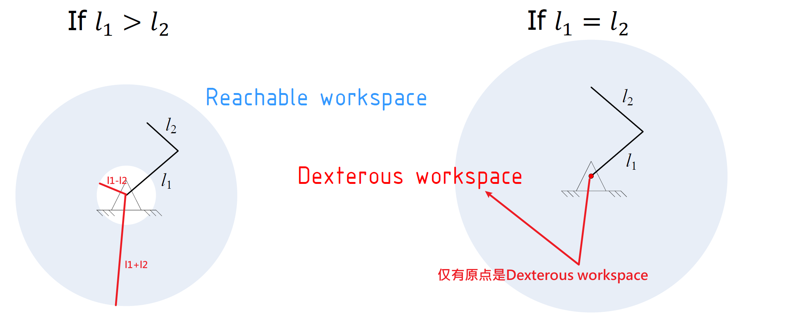

上图可知，

1. 当$l_1 = l_2$，灵巧空间是仅包含基座中心点的单点集，而可达空间是以基座中心点为圆心，$l_1+l_2$为半径的圆盘区域。
2. 若$l_1 > l_2$，灵巧空间是空集，而可达空间是外径$l_1+l_2$、内径为$l_1-l_2$的圆环区域。

​	

​	这里讨论的两连杆操作臂的工作空间是假设所有关节能够旋转 360 度，这在实际机构中是很少见的。

​	当关节旋转角度不能达到 360 度时，显然工作空间的范围或可能的姿态的数目相应减小。例如，对于图 4-1 所示的操作臂，$θ_1$的运动范围为 $360 °$，但只有当$0⩽θ_2⩽180°$时，可达工作空间才具有相同的范围，而此时仅有一个方位可以达到工作空间的每一个点。

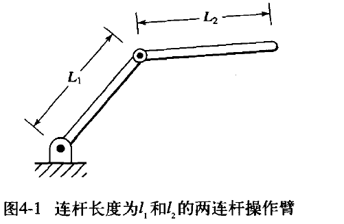

> ​	由力学原理可知，当操作臂的自由度小于6时，他不能达到三维空间内一般目标的位置和姿态，因此通常对于这种机器人的工作空间是一个子空间，这个空间是由特定的机器人的工作空间确定，这里不做介绍，感兴趣的同学可自行了解。

​	

​	工作空间也取决于工具坐标系的变换，因为机器人的末端通常指的是工具的末端点。而一般来说，**工具坐标系**$\{T\}$的变换**与操作臂的运动学和逆向运动学无关**，所以一般常去研究**腕部坐标系**$\{W\}$的**工作空间**。

​	对于一个给定的末端执行器，定义工具坐标系$\{T\}$，给定目标坐标系$\{G\}$，去计算相应的坐标系$\{W\}$。

​	接着我们会问：$\{W\}$的期望位姿是否在这个工作空间内？这里，我们所研究的工作空间（从计算的角度出发）即腕部坐标系$\{W\}$的工作空间，这与用户关心的工作空间是有区别的，用户关心的是末端执行器的工作空间坐$\{T\}$标系。

> 腕部坐标系$\{W\}$的工作空间：$\{W\}$原点能够到达的空间点集。

​	如果期望的腕部位姿在腕部工作空间中，那么机器人至少存在一组关节配置，可以实现这个腕部位姿。

> 注意：“在工作空间内”通常只说明 **位置可达**，但完整“位姿”还包括姿态。


#### 2. 多重解

​	在求解运动学方程时可能遇到的另一个问题就是多重解问题。一个具有三个旋转关节的的平面操作臂，如下图所示为在某一位姿下带有末端执行器的三连杆平面操作臂。虚线代表第二个能到达该位置的位姿。

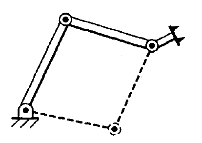


​	因为系统最终只能选择一个解，因此操作臂的多重解现象会产生一些问题。解的选择标准是变化的，然而比较合理的选择应当是取 “最短行程” 解。

​	例如，在图 4-3 中，如果操作臂处于点 A，我们希望它移动到点 B，最近解就是使得每一个运动关节的移动量最小。因此，在没有障碍的情况下，可选择图 4-3 中上部虚线所示的位形，这表明对于操作臂的当前位置来说只需要对逆运动程序输入一个小位移量即可。这样，利用算法能够选择关节空间内的最短行程解。

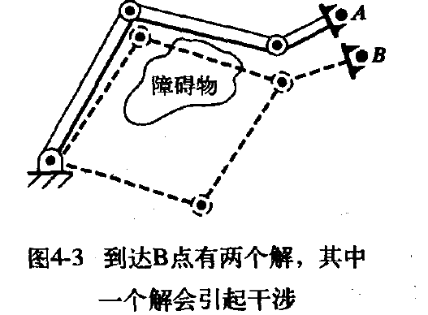

​	但是，“最短行程” 解可能有几种确定方式，即在逆解选择中，我们可以引入选择指标，如能量消耗。例如，典型的机器人有 3 个大连杆，附带 3 个小连杆，我们知道，大连杆的驱动功率一般比小连杆的大，因此，从能量消耗最小的角度考虑，应优先移动小连杆而非大连杆，这样，在计算 “最短行程” 解时需要加权，使得这种选择**侧重于移动小连杆而不是移动大连杆**。

​	在存在障碍的情况下**，“最短行程” 解可能发生干涉**，这时只能选择 “较长行程” 解。为此，一般我们需要计算全部可能的解，再建立评价模型进行选择。

​	这样，在图 4-3 中，如果由障碍物存在，则需要按照下部虚线所示的位形才能到达B点。


> ​	机器人的逆解个数取决于机器人的关节数量、连杆参数和关节运动范围。

​	通常，连杆的非零参数越多，达到某一特定目标的方式也越多。以一个具有 6 个旋转关节的操作臂为例，下表表明解的最大数目与等于零的连杆长度参数($a_i$)的数目有关。非零参数越多，解的最大数目就越大。对于一个全部为旋转关节的 6 自由度操作臂来说，可能多达 16 种解.


|         $a_i$         | 解的个数 |
| :-------------------: | :------: |
| $a_1$$=$$a_3=$$a_5=0$ |    ≤4    |
|    $a_3=$$a_5$$=0$    |    ≤8    |
|       $a_3$$=0$       |   ≤16    |
|    全部$a_i\not=$0    |   ≤16    |


### 2. 求解方法

​	逆运动学问题的目标是：在已知末端执行器期望位姿的情况下，求出能够实现该位姿的一组或多组关节变量。若某种算法能够求出与已知位姿对应的全部关节变量，并且能够给出所有可能的解，则称该操作臂的逆运动学问题是可解的。

​	需要注意的是，这里强调的是**全部关节变量**和**所有解**。由于机械臂可能存在多重解，例如肩部左/右解、肘上/肘下解、腕部翻转/非翻转解等，因此仅求得其中一个解并不一定代表已经完整求解了逆运动学问题。

​	从求解形式来看，逆运动学方法通常可以分为两大类：**封闭解方法**和**数值解方法**。封闭解又常称为解析解，指能够通过有限次代数运算、三角函数运算或几何关系直接求出关节变量的方法。封闭解通常计算速度快，且更容易列出全部可能解，因此在工业机器人控制中具有重要意义。

​	对于包含旋转关节和移动关节的 6 自由度串联机械臂均存在运动学逆解，但一般只能给出数值解，只有在特殊情况下才能求得封闭解，也就是说并不是所有结构都容易获得封闭解，所以，大多数机械臂都设计成具有解析解的构造。

​	经典结论表明，当 6R 操作臂满足某些特殊结构条件时，较容易得到解析解。例如，**若相邻的三个关节轴线相交于一点**，即形成球形腕部，则可以将逆运动学问题分解为位置求解和姿态求解。许多工业机械臂，如 PUMA560，其第 4、5、6 轴相交，因而具有较典型的解析求解结构。

​	封闭解方法主要包括**代数法**和**几何法**。

- 代数法通常从齐次变换矩阵方程出发，通过矩阵元素对应关系建立方程组，再求解各关节变量；

- 几何法则利用连杆长度、关节角和空间三角关系，将逆运动学问题转化为几何构型问题。

两者本质上都属于解析求解方法，只是推导角度不同：代数法偏重方程变换，几何法偏重空间结构关系。

​	与封闭解不同，**数值解方法**不要求机器人结构满足特殊解析条件，而是通过迭代逐步逼近期望位姿。雅可比矩阵法就是常见的数值逆运动学方法。它根据末端位姿误差和关节变量增量之间的微分关系，反复修正关节变量，直到误差满足要求。

​	数值法适用范围广，但通常依赖初始值，可能只收敛到某一个局部解，也不一定保证求出全部解。

因此，下面将分别介绍三种常见逆运动学求解思路：**代数法、几何法和基于雅可比矩阵的数值解法**。

> 对于**雅可比矩阵的数值解法**我们将在4.4章节进行介绍。
>

#### 1. 几何解 geometric

​	一般使用几何解法中，为了求解出操作臂的解，必须将操作臂的**空间几何参数分解成平面几何参数**，用这种方法求解操作臂 时特别是当 $\alpha_1 = 0° \ or \ 90°$时是相对容易的。

​	以下是一个简单的平面三连杆的操作臂，给出目标点（$x$，$y$，$\Phi$）,求解（$\theta_1$，$\theta_2$，$\theta_3$）.

> 由于操作臂式平面的，因此我们可以利用平面几何关系直接求解，不需要由将空间几何切割成平面几何这个操作。

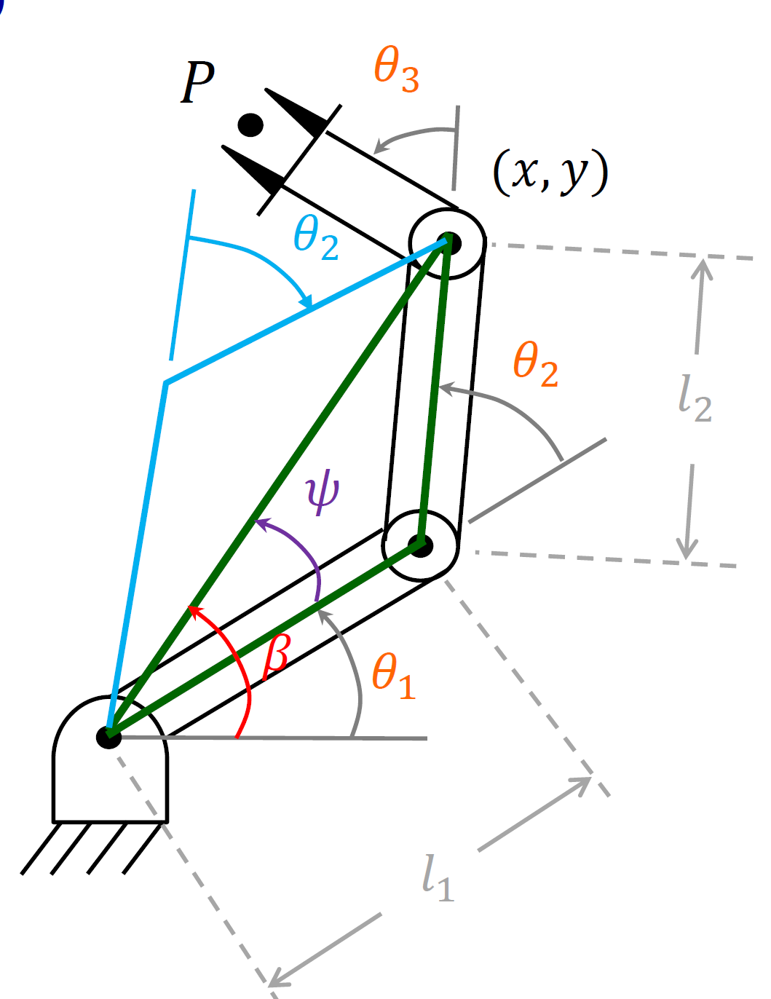

求解如下，以一组姿态作图，最终求解答案式所有解。

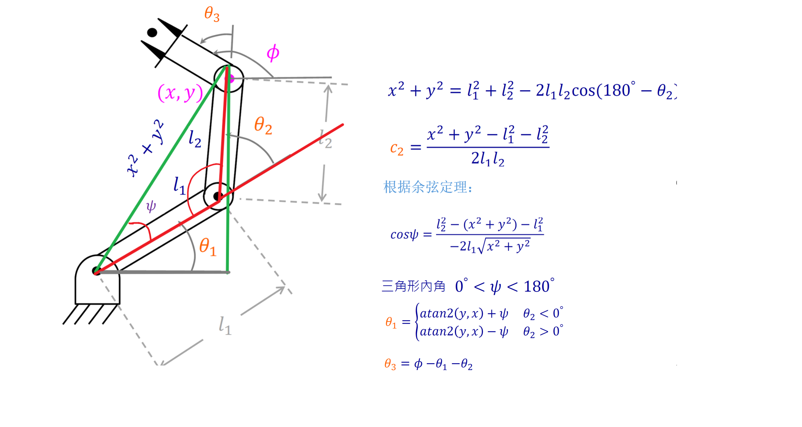

#### 2. 代数解

题目仍然如几何解，下面采用代数求解：

由之前学习过的Transformation Matirx:

```math
_{i}^{i-1}T=
\begin{bmatrix}
\cos\theta_i & -\sin\theta_i & 0 & a_{i-1} \\
\sin\theta_i\cos\alpha_{i-1} & \cos\theta_i\cos\alpha_{i-1} & -\sin\alpha_{i-1} & -\sin\alpha_{i-1}d_i \\
\sin\theta_i\sin\alpha_{i-1} & \cos\theta_i\sin\alpha_{i-1} & \cos\alpha_{i-1} & \cos\alpha_{i-1}d_i \\
0 & 0 & 0 & 1
\end{bmatrix}
```

经过复合变换得到:

```math
_{3}^{0}T={}_{1}^{0}T{}_{2}^{1}T{}_{3}^{2}T=
\begin{bmatrix}
\cos(\theta_1+\theta_2+\theta_3) & -\sin(\theta_1+\theta_2+\theta_3) & 0 & L_1\cos\theta_1+L_2\cos(\theta_1+\theta_2) \\
\sin(\theta_1+\theta_2+\theta_3) & \cos(\theta_1+\theta_2+\theta_3) & 0 & L_1\sin\theta_1+L_2\sin(\theta_1+\theta_2) \\
0 & 0 & 1 & 0 \\
0 & 0 & 0 & 1
\end{bmatrix}
```

由题目标点相对原点位姿：

```math
_{3}^{0}T =
\begin{bmatrix}
cos\phi & -sin\phi & 0.0 & x \\
sin\phi & cos\phi & 0.0 & y \\
0.0 & 0.0 & 1.0 & 0.0 \\
0 & 0 & 0 & 1
\end{bmatrix}
```

建立等式那么有：

```math
_{3}^{0}T =
\begin{bmatrix}
c_{123} & -s_{123} & 0.0 & l_1 c_1 + l_2 c_{12} \\
s_{123} & c_{123} & 0.0 & l_1 s_1 + l_2 s_{12} \\
0.0 & 0.0 & 1.0 & 0.0 \\
0 & 0 & 0 & 1
\end{bmatrix}
=
\begin{bmatrix}
cos\phi & -sin\phi & 0.0 & x \\
sin\phi & cos\phi & 0.0 & y \\
0.0 & 0.0 & 1.0 & 0.0 \\
0 & 0 & 0 & 1
\end{bmatrix}
```

建立如下四个非线性方程组：

```math
\begin{aligned}
c_\phi &= c_{123} \\
s_\phi &= s_{123} \\
x &= l_1 c_1 + l_2 c_{12} \\
y &= l_1 s_1 + l_2 s_{12}
\end{aligned}
```

对后两时两边同时平方，然后利用三角函数大的合角公式展开，相加得到$\theta_2$：

> ```math
> \begin{aligned}
> &\bullet \text{正弦(Sine)} \\
> &\quad \circ \sin(\alpha+\beta)=\sin\alpha\cos\beta+\cos\alpha\sin\beta \\
> &\quad \circ \sin(\alpha-\beta)=\sin\alpha\cos\beta-\cos\alpha\sin\beta \\[4pt]
> &\bullet \text{余弦(Cosine)} \\
> &\quad \circ \cos(\alpha+\beta)=\cos\alpha\cos\beta-\sin\alpha\sin\beta \\
> &\quad \circ \cos(\alpha-\beta)=\cos\alpha\cos\beta+\sin\alpha\sin\beta
> \end{aligned}
> ```

```math
\begin{aligned}
x^2 + y^2 &= l_1^2 + l_2^2 + 2l_1 l_2 c_2 \\[4pt]
c_2 &= \frac{x^2 + y^2 - l_1^2 - l_2^2}{2l_1 l_2}
\end{aligned}
```

> 当$\cos\theta_2$范围:
>
> $>1$ or $<1$: too far for the manipulator to reach
>
>  $-1 \le  \cos\theta_2 \le 1$: ``two solutions'' 

为了明确多组不同的解，采用双变量正切函数计算$\theta_2$,保证求出的角度再恰当的象限中：

```math
\sin\theta_2 = \pm\sqrt{1-\cos^2\theta_2}
```

```math
\theta_2 = \arctan2(\sin\theta_2,\cos\theta_2)
```


将求解的$\theta_2$带入方程式后两个等式求解$\theta_1$:


```math
\begin{aligned}
x &= l_1 c_1 + l_2 c_{12} = (l_1 + l_2 c_2)c_1 + (-l_2 s_2)s_1 \triangleq k_1 c_1 - k_2 s_1 \\
y &= l_1 s_1 + l_2 s_{12} = (l_1 + l_2 c_2)s_1 + (l_2 s_2)c_1 \triangleq k_1 s_1 + k_2 c_1
\end{aligned}
```

其中：

$k_1 = l_1 + l_2\cos\theta_2$

$k_2 =l_2\sin\theta_2$

对上述式上下平方并求和：

```math
k_1^2+k_2^2 = l_1^2 + l_2^2 - 2l_1 l_2 \cos(\pi-\theta_2)
```

然后变量替换:

```math
\begin{aligned}
r &= +\sqrt{k_1^2 + k_2^2} \\
\gamma &= \text{Atan2}(k_2,k_1)
\end{aligned}
```

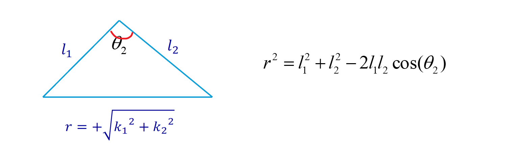

则有：

```math
\begin{aligned}
k_1 &= r\cos\gamma \\
k_2 &= r\sin\gamma
\end{aligned}
```

最终后两等式可以表示为：

```math
\begin{aligned}
\frac{x}{r} &= \cos\gamma \cos\theta_1 - \sin\gamma \sin\theta_1 = \cos(\gamma+\theta_1) \\[4pt]
\frac{y}{r} &= \cos\gamma \sin\theta_1 + \sin\gamma \cos\theta_1 = \sin(\gamma+\theta_1)
\end{aligned}
```

利用双变量反正切公式，则有：

```math
\gamma + \theta_1 = \text{Atan2}\left(\frac{y}{r},\frac{x}{r}\right) = \text{Atan2}(y,x)
```

将$\gamma$带入变量替换的的值,得到$\theta_2$：

```math
\theta_1 = \text{Atan2}(y,x) - \text{Atan2}(k_2,k_1)
```

由$\theta_1 +\theta_2 + \theta_3 = \phi$，得出$\theta_3$：

```math
\theta_3 = \phi - \theta_1 - \theta_2
```

##### a cosθ + b sinθ = c 万能解法

​	代数求解就是利用前面已经得到三连杆平面机械臂的正运动学表达式后，逆运动学的代数求解便可转化为方程求解问题。

​	其基本思路是：将由正运动学得到的齐次变换矩阵与目标位姿矩阵逐项对应，建立关于关节变量的非线性方程组；随后利用三角恒等式、平方相加、变量代换等代数操作，对方程组进行化简和消元，最终求出各关节角。

​	上面推导过程的半角正切代换是一种常见的代数处理方法。

​	由于逆运动学方程中经常同时出现 $\sin\theta$ 和 $cos\theta$，直接求解较困难，因此可令 $u=\tan(\theta/2)$，将三角方程转化为关于 $u$ 的多项式方程：

```math
\begin{aligned}
u &= \tan\frac{\theta}{2}\\[4pt]
\cos\theta &= \frac{1-u^2}{1+u^2}\\[4pt]
\sin\theta &= \frac{2u}{1+u^2}
\end{aligned}
```

​	这样，原本的超越方程就变成了代数方程，便于求出解析形式的解。

仍然再上述代数求解中：

已知正运动学等式建立得到**位置方程**如下：

```math
x = l_1 \cos\theta_1 + l_2 \cos(\theta_1 + \theta_2)
\\
y = l_1 \sin\theta_1 + l_2 \sin(\theta_1 + \theta_2)
```

姿态方程：

```math
\phi = \theta_1 + \theta_2 + \theta_3
```

对未知方程上下式平方求和：

```math
x^2 + y^2 = l_1^2 + l_2^2 + 2l_1 l_2 \cos\theta_2
```

得到$\theta_2$的余弦值：

```math
\cos\theta_2 = \frac{x^2 + y^2 - l_1^2 - l_2^2}{2l_1 l_2}
```

令：

```math
D = \frac{x^2 + y^2 - l_1^2 - l_2^2}{2l_1 l_2}
```

利用半角正切代换：

```math
u_2 = \tan\frac{\theta_2}{2}
\\
\cos\theta_2 = \frac{1 - u_2^2}{1 + u_2^2}
```

由于$D=\cos\theta_2$：

```math
\frac{1 - u_2^2}{1 + u_2^2} = D\\
(1-D)-(1+D)u_2^2 = 0
```

上式即式$u_2$的多项式方程，求解$u_2$:

```math
u_2^2 = \frac{1-D}{1+D}
\\
u_2 = \pm\sqrt{\frac{1-D}{1+D}}
```

那么带入我们定义的$u_2$，求解$\theta_2$：

```math
\theta_2 = 2\tan^{-1}u_2
\\
\theta_2 = 2\tan^{-1}\left(\pm\sqrt{\frac{1-D}{1+D}}\right)
```

> 这里的正负号对应两组解，也就是常说的“肘上解”和“肘下解”。

目前$\theta_2$作为常量，带入之前的后两等式，同样做变量替换：

```math
\begin{aligned}
x &= l_1 c_1 + l_2 c_{12} = (l_1 + l_2 c_2)c_1 + (-l_2 s_2)s_1 \triangleq k_1 c_1 - k_2 s_1 \\
y &= l_1 s_1 + l_2 s_{12} = (l_1 + l_2 c_2)s_1 + (l_2 s_2)c_1 \triangleq k_1 s_1 + k_2 c_1
\end{aligned}
```

令：

```math
u_1 = \tan\frac{\theta_1}{2}
```

也就有：

```math

\cos\theta_1 = \frac{1-u_1^2}{1+u_1^2}
\\
\sin\theta_1 = \frac{2u_1}{1+u_1^2}
```

将$\theta_2$的正弦余弦带么变量替换后的式子$x$：

```math
x = k_1 \frac{1-u_1^2}{1+u_1^2} - k_2 \frac{2u_1}{1+u_1^2}
\\
(x+k_1)u_1^2 + 2k_2 u_1 + (x-k_1) = 0
```

求解得到关于$u_1$的二次多项式方程，则易解出$\theta_1$：

```math
\theta_1 = 2\tan^{-1}u_1

```

由$\theta_1 +\theta_2 + \theta_3 = \phi$，得出$\theta_3$：

```math
\theta_3 = \phi - \theta_1 - \theta_2
```

#### 3. 三轴相交PIEPER解法

​	如前所述，尽管一般具有 6 个自由度的机器人没有封闭解，但在某些特殊情况下还是可解的。Pieper研究了 3 个相邻的轴相交于一点的 6 自由度操作臂有逆解，这种方法是针对 6 个关节均为旋转关节、且后面 3 个轴相交的操作臂。

​	具有这种构型的机器人，其**末端位置仅与前三轴有关**，**末端姿态仅与后三轴有关**。

​	

​	当最后 3 根轴相交时，连杆坐标系 {$4$}，{$5$} 和 {$6$} 原点均位于这个交点上。

之前我们学习过的Transformation Matrix可知，有如下式子：

```math
{}_i^{i-1}T =
\begin{bmatrix}
c\theta_i & -s\theta_i & 0 & a_{i-1} \\
s\theta_i c\alpha_{i-1} & c\theta_i c\alpha_{i-1} & -s\alpha_{i-1} & -s\alpha_{i-1}d_i \\
s\theta_i s\alpha_{i-1} & c\theta_i s\alpha_{i-1} & c\alpha_{i-1} & c\alpha_{i-1}d_i \\
0 & 0 & 0 & 1
\end{bmatrix}
```

​	这点的基坐标如下:

```math
{}^0P_{4ORG}={}_1^0T{}_2^1T{}_3^2T{}^3P_{4ORG}=
\begin{bmatrix}
x\\
y\\
z\\
1
\end{bmatrix}
={}_1^0T{}_2^1T{}_3^2T
\begin{bmatrix}
a_3 \\
-d_4 s\alpha_3 \\
d_4 c\alpha_3 \\
1
\end{bmatrix}
```

> ​	说明：
>
> 		1. 目标点在的位置由${}_4^3T$的第四列即位置向量得到。
> 		1. 当最后 3 根轴相交时，连杆坐标系 {$4$}，{$5$} 和 {$6$} 原点均位于这个交点上，即
> 
> ```math
>{}^0P_{4ORG}={}^0P_{5ORG}={}^0P_{6ORG}
> ```
> 
> ​			

将${}_3^2T$与右侧的向量做乘法：

```math
{}^0P_{4ORG}={}_1^0T{}_2^1T
\begin{bmatrix}
f_1(\theta_3)\\
f_2(\theta_3)\\
f_3(\theta_3)\\
1
\end{bmatrix}
```

其中：

```math
\begin{aligned}
f_1 &= a_3 c_3 + d_4 s\alpha_3 s_3 + a_2 \\
f_2 &= a_3 c\alpha_2 s_3 - d_4 s\alpha_3 c\alpha_2 c_3 - d_4 s\alpha_2 c\alpha_3 - d_3 s\alpha_2 \\
f_3 &= a_3 s\alpha_2 s_3 - d_4 s\alpha_3 s\alpha_2 c_3 + d_4 c\alpha_2 c\alpha_3 + d_3 c\alpha_2
\end{aligned}
```

可见，$f_i$仅与$\theta_3$有关。

将${}_2^1T$带入乘法：

```math
{}^0P_{4ORG}=
\begin{bmatrix}
x\\
y\\
z\\
1
\end{bmatrix}
={}_1^0T{}_2^1T
\begin{bmatrix}
f_1(\theta_3)\\
f_2(\theta_3)\\
f_3(\theta_3)\\
1
\end{bmatrix}
={}_1^0T
\begin{bmatrix}
g_1(\theta_2,\theta_3)\\
g_2(\theta_2,\theta_3)\\
g_3(\theta_2,\theta_3)\\
1
\end{bmatrix}

```

其中：

```math
\begin{aligned}
g_1(\theta_2,\theta_3) &= c_2 f_1 - s_2 f_2 + a_1 \\
g_2(\theta_2,\theta_3) &= s_2 c\alpha_1 f_1 + c_2 c\alpha_1 f_2 - s\alpha_1 f_3 - d_2 s\alpha_1 \\
g_3(\theta_2,\theta_3) &= s_2 s\alpha_1 f_1 + c_2 s\alpha_1 f_2 + c\alpha_1 f_3 + d_2 c\alpha_1
\end{aligned}
```

可见，$g_i$ 仅与f_i和$\theta_2$有关。

最后将${}_1^0T$带入乘法：

```math
{}^0P_{4ORG}=
\begin{bmatrix}
x\\
y\\
z\\
1
\end{bmatrix}

={}_1^0T
\begin{bmatrix}
g_1(\theta_2,\theta_3)\\
g_2(\theta_2,\theta_3)\\
g_3(\theta_2,\theta_3)\\
1
\end{bmatrix}
=
\begin{bmatrix}
c_1 g_1 - s_1 g_2 \\
s_1 g_1 + c_1 g_2 \\
g_3 \\
1
\end{bmatrix}
```

上述操作实现了通过$f_i$和$g_i$实现了$\theta_1$、$\theta_2$、$\theta_3$的分离。

对最后一步的${}^0P_{4ORG}$的前三项平方，消去$\theta_1$ ：

```math
\begin{aligned}
r &= x^2+y^2+z^2 = g_1^2+g_2^2+g_3^2 \\
  &= f_1^2+f_2^2+f_3^2+a_1^2+d_2^2+2d_2 f_3+2a_1(c_2 f_1-s_2 f_2) \\
  &= (k_1 c_2 + k_2 s_2)2a_1 + k_3
\end{aligned}
```

其中由$k(\theta_3)$仅与$\theta_3$有关：

```math
\begin{aligned}
k_1(\theta_3) &= f_1 \\
k_2(\theta_3) &= -f_2 \\
k_3(\theta_3) &= f_1^2+f_2^2+f_3^2+a_1^2+d_2^2+2d_2 f_3
\\
k_4(\theta_3) &= f_3\cos\alpha_1+d_2\cos\alpha_1
\end{aligned}
```

则有：

```math
\begin{cases}
r = (k_1 c_2 + k_2 s_2)2a_1 + k_3 \\
z = (k_1 s_2 - k_2 c_2)s\alpha_1 + k_4
\end{cases}
```

下面对$\theta_3$进行讨论

​	若 $a_1 = 0,r = k_3(\theta_3) = f_1^2+f_2^2+f_3^2+a_1^2+d_2^2+2d_2 f_3$，由于r是已知量，因为$r= x^2+y^2+z^2$ ，即此方程是只有一个变量$\theta_3$，因此可以求解出$\theta_3$。

​	若$\sin\alpha_1=0$，则$z=k_4$，这里$z$也是已知量（目标位置的$z$轴坐标），那么式子仅有$z=k_4$，即此方程是只有一个变量$\theta_3$，因此可以求解出$\theta_3$。

​	若上述条件都不成立，则对两式$r$和$z$的等式，做运算消去$\theta_2$，最终依旧能求出$\theta_3$，由于推导较为复杂，直接给出结果：

```math
\frac{(r - k_3)^2}{4a_1^2} + \frac{(z - k_4)^2}{\sin^2\alpha_1} = k_1^2 + k_2^2
```

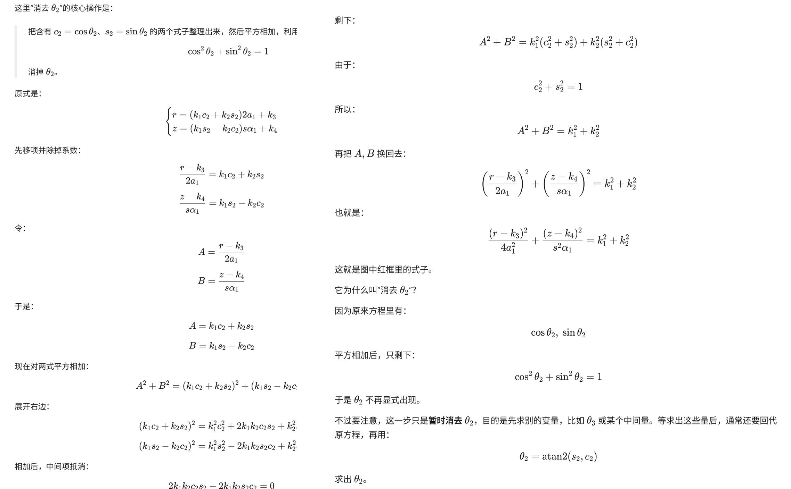

​	现在有了$\theta_3$，接着求解$\theta_2$，将$\theta_3$，带入下式子,求解出$\theta_2$：

```math
r = (k_1 c_2 + k_2 s_2)2a_1 + k_3
```

​	有了$\theta_3$和$\theta_2$，带入下式求解$\theta_1$:

```math
 x = c_1 g_1(\theta_2,\theta_3) - s_1 g_2(\theta_2,\theta_3)
 \\
 y = s_1 g_1(\theta_2,\theta_3) + c_1 g_2(\theta_2,\theta_3)
 \\
\theta_1 = \operatorname{atan2}(y,x) - \operatorname{atan2}(g_2,g_1)
```

目前求解出前三轴的关节变量，接下来求解后三轴的关节变量，利用下式：

```math
{}^3_6R = {}^0_3R^{-1} ·{}^0_6R
```

其中：

- ${}^0_3R^{-1}$：通过前三轴关节变量带入到Transformation Matrix 经过复合变换得到的齐次矩阵可得。
- ${}^0_6R$：通过变换方程，由已知条件得出的齐次矩阵可得。

​	最终求得的${}^3_6R$表示后三轴需要实现的相对姿态。对于具有球形腕部的 6 自由度机械臂，后三个转动关节的姿态变化可等效表示为 Z-Y-Z 欧拉角形式，即

```math
{}^3_6R = R_z(\theta_4)R_y(\theta_5)R_z(\theta_6)
```

​	需要注意的是，欧拉角表示具有多解性。对于同一个旋转矩阵，通常存在两组等价的腕部姿态解。当 $\theta_5$取相反方向时，为保持整体姿态不变，需要使 $\theta_4$ 和 $\theta_6$ 分别增加 $180°$。因此，后三轴解通常存在“腕部翻转”和“腕部非翻转”两种形式。

​	可见，对于RRRRRR类型机械臂，一般前三轴有两组解，由$\theta_2$和$\theta_3$决定**肘部上/下**，后三轴有两组解，由后三个关节角度转动影响，若RRRRRR类型机械臂由肩部左右，在前三轴四组解，因为$\theta_1$影响**肩左/右**，共$2\times 2 = 4$。

​	但是需要注意的是，我们逆解求出来的角度目的是DH角度，而上式中的 $\theta_4,\theta_5,\theta_6$ 是将 ${}^3_6R$ 按 Z-Y-Z 欧拉角形式分解得到的姿态角是欧拉角。它们与 DH 参数表中的后三个关节变量并不一定完全相同。原因在于，欧拉角分解采用的是标准旋转轴序列，而 DH 法中的各连杆坐标系由关节轴线和公法线方向确定，二者的坐标轴方向可能存在固定偏置。

​	因此，在利用 Z-Y-Z 欧拉角求得后三轴角度后，需要结合本文所建立的 DH 坐标系检查坐标轴方向。如果 Z-Y-Z 分解得到的中间坐标系与 DH 坐标系存在 $180^\circ$ 的方向差异，则应对相应关节角进行补偿。对于图中所示坐标系，第 4 轴和第 6 轴相对于 Z-Y-Z 欧拉角定义存在半圈偏置，因此可写为：

```math
\begin{aligned}
\theta_4^{DH} &= \theta_4^{\text{Euler}} + 180^\circ \\\\
\theta_5^{DH} &= \theta_5^{\text{Euler}} \\\\
\theta_6^{DH} &= \theta_6^{\text{Euler}} + 180^\circ
\end{aligned}
```

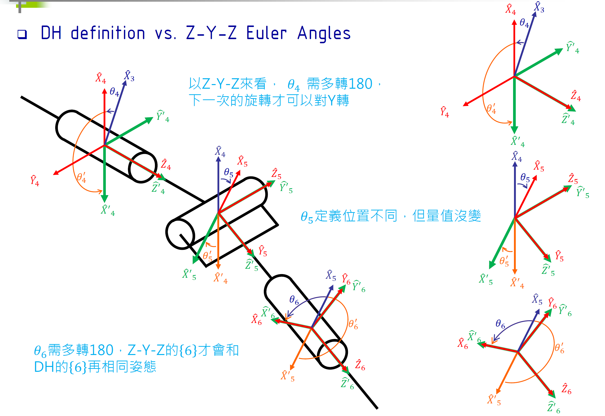


​	


