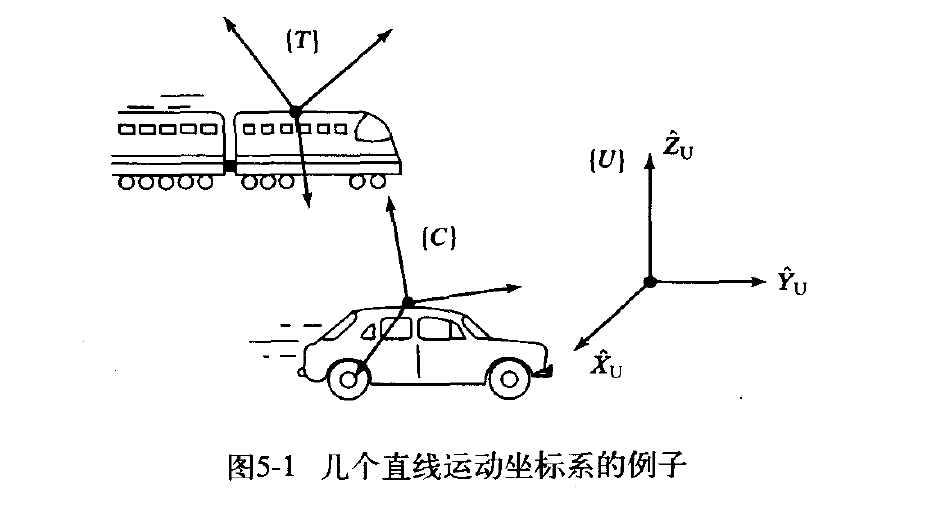
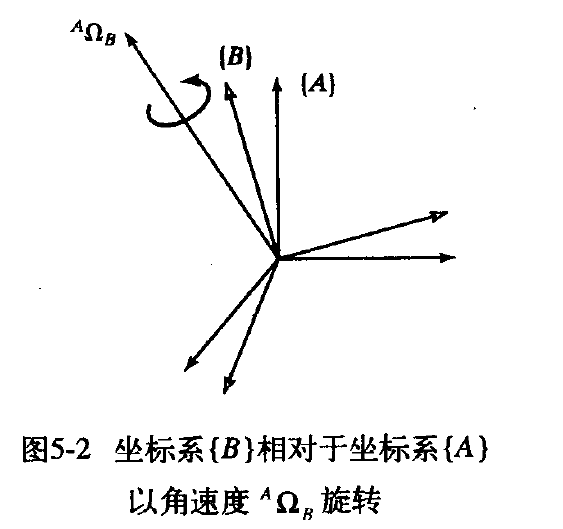
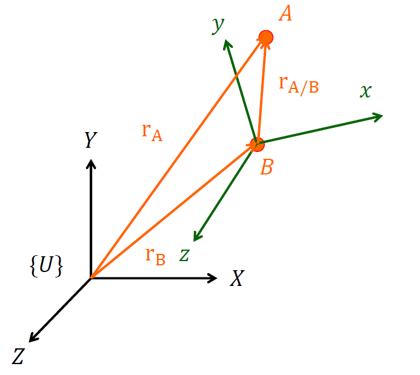
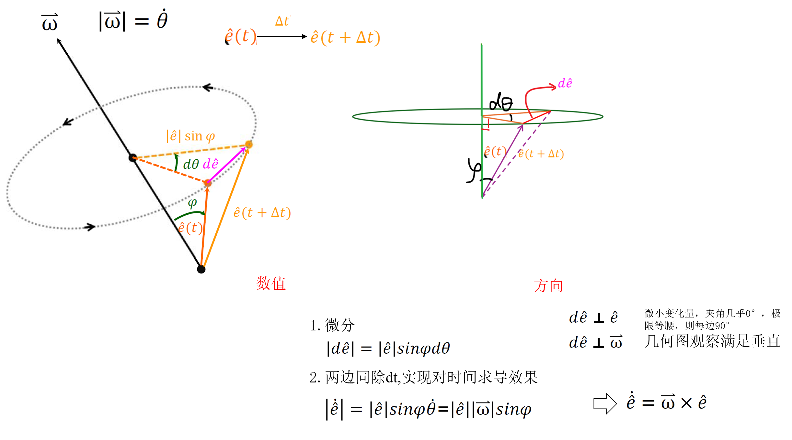
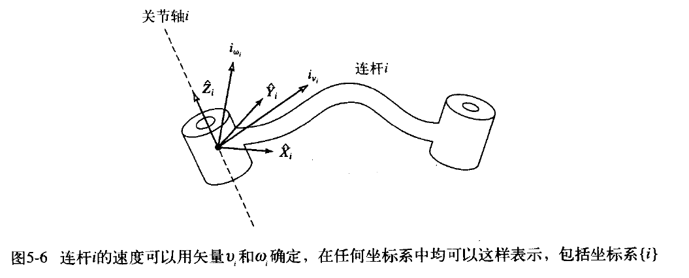
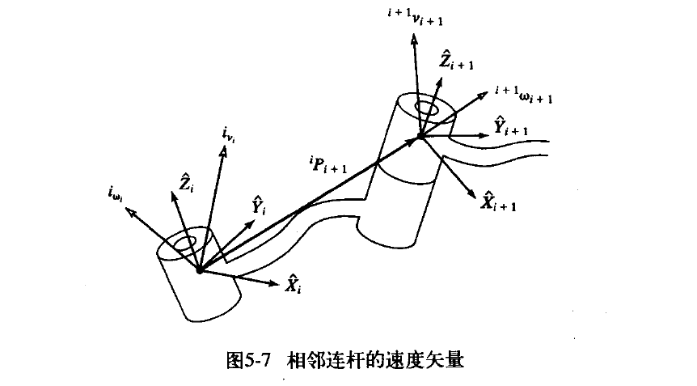
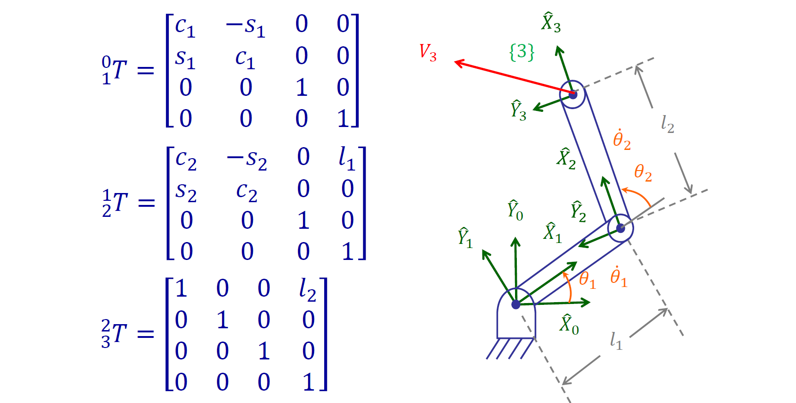
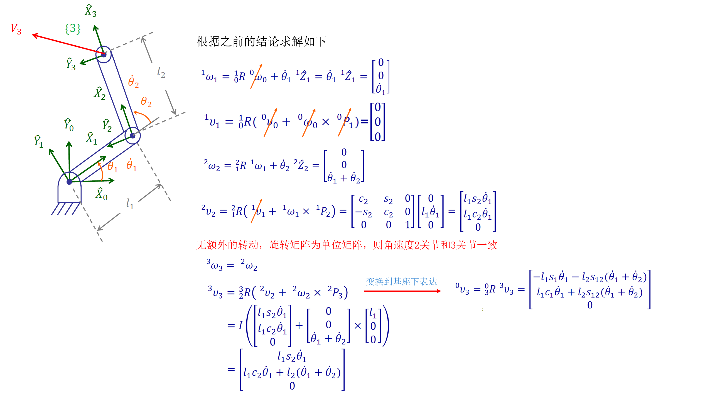

```
学习资源：
	1. 
```


# 4.4 速度和静力

此前在4.3 运动学节讨论的正运动学与逆运动学，主要研究机械臂的**位姿关系**。正运动学根据关节变量 $q$ 计算末端位姿 $X$：

```math
X = f(q)
```

逆运动学则根据期望末端位姿，求取对应的关节变量：

```math
q = f^{-1}(X)
```

这些方法描述了机械臂“处于什么位置和姿态”，属于有限运动层面的问题。然而在机械臂实际运行与控制过程中，仅知道起点和终点并不足够，还需要进一步回答：

- 各关节以一定速度运动时，末端将以怎样的速度运动？
- 为使末端沿指定方向运动，各关节应分别以多大速度运动？
- 机械臂在某一构型下，是否会丧失部分运动能力？
- 当末端受到外力时，各关节需要承受多大的力或力矩？

因此，需要在某一瞬时构型附近研究关节变量微小变化与末端运动之间的关系，这便是机械臂的**微分运动学**。

对正运动学关系进行微分，可得：

```math
\dot{X} = J(q)\dot{q} 
```

其中：

- $\dot q$ 为关节空间速度；
- $\dot X$ 为末端在操作空间中的速度；
- $J(q)$ 为机械臂的雅可比矩阵。

雅可比矩阵建立了关节空间与操作空间之间的局部线性映射。其第 i列表示仅第 i个关节以单位速度运动时，对末端线速度和角速度产生的贡献。通过雅可比矩阵，可以完成末端速度计算、关节速度求解、奇异性分析以及微分运动控制。

除速度映射外，雅可比矩阵还建立了机械臂两侧力之间的传递关系。根据虚功原理，末端广义力与关节力矩满足：

```math
\tau = J^T(q)F
```

其中：

- F为作用于末端的力和力矩组成的六维力旋量；
- $\tau$ 为对应的关节驱动力或驱动力矩。

由此可见，速度关系与静力关系是同一几何映射的两个方面：

```math
\dot{X} = J(q)\dot{q}, \quad \tau = J^T(q)F
```

​	本节将围绕雅可比矩阵展开，首先介绍末端线速度与角速度的表示方法，并建立关节速度到末端速度的映射；随后讨论雅可比矩阵的构造、坐标变换及奇异性；最后利用虚功原理分析末端力与关节力矩之间的静力传递关系。

## 4.4.1  时变位姿的符号表示

### 1. 位置矢量的微分

速度以及加速度是需要研究的基本问题，可用下面符号表示某个矢量的微分：

```math
\begin{equation*}
{}^{B}V_Q = \frac{d}{dt}{}^{B}Q = \lim_{\Delta t \to 0} \frac{{}^{B}Q(t+\Delta t) - {}^{B}Q(t)}{\Delta t}
\tag{1}
\end{equation*}
```

**位置矢量的速度**可以看成是用位置矢量描述的空间一点的**==线速度==**。

由式 (1) 可以看出，可以通过计算Q相对于坐标系{B}的微分进行描述。例如，如果相对于坐标系{B}，Q不随时间变化，那么速度就为零，尽管在其他一些坐标系中Q是变化的。因此，重要的是**必须说明一个矢量**是**==相对于哪个坐标系求微分==**。

像其他矢量一样，速度矢量能在任意坐标系中描述，其参考坐标系可以用左上标注明。因此，如果在坐标系{A}中表示式 (1) 的速度矢量，可以写为

```math
\begin{equation}
{}^{A}\left( {}^{B}V_Q \right) = \frac{{}^{A}d}{dt} {}^{B}Q
\end{equation}
```

可以看出，在通常的情况下，速度矢量都是与空间的某点相关的，而描述此点速度的大小取决于两个坐标系：一个是进行微分运算的坐标系即**==相对哪个坐标系求导的坐标==系**，另一个是描述这个速度矢量的坐标系即==**相对于哪个坐标系表达**==。

在式 (1) 中，速度是用微分坐标系描述的，因此这个结果用左上标B注明。但是，为简单起见，当两个上标相同时，不需要给出外层上标，即可以写为

```math
\begin{equation}
{}^{B}\left( {}^{B}V_Q \right) = {}^{B}V_Q
\end{equation}
```

> 此处，由于相对于{B}坐标系微分，而此处又是在{B}坐标系表达，那么在外层的在{B}看的这个表达可以省略。

最后，由于进行参考坐标系变换的旋转矩阵已可清楚地表示这个关系，因此总是省略掉外部左上标，可以写为

```math
\begin{equation}
{}^{A}\left( {}^{B}V_Q \right) ={}_B^A R {}^B \left( {}^B V_Q \right)  = {}_B^{A}R \, {}^{B}V_Q
\tag{2}
\end{equation}

```

通常按照式（2）右边的形式给出速度的表达式，因此描述速度的符号总是代表**微分坐标系中的速度**，而没有外部左上标。

经常讨论的是一个坐标系原点相对于某个常见的世界参考坐标系的速度，而不考虑相对于任意坐标系中一般点的速度。对于这种特殊情况，定义一个缩写符号

```math
\begin{equation}
v_C = {}^{U}V_{CORG}
\end{equation}
```

式中的点为坐标系{C}的原点，参考坐标系为{U}。例如，用符号$v_C$表示坐标系{C}**原点的速度**；${}^A v_C$是坐标系{C}的原点在坐标系{A}中表示的速度（尽管微分是相对于坐标系{U}进行的）

```math
\begin{equation}
{}^A v_C = {}_U^{A}R \ · v_C 
\end{equation}
```


**Case**:

图 5-1 所示为固定的世界坐标系{U}，坐标系{T}固连在速度为 100 km/h的火车上，坐标系{C}固连在速度为 30km/h的汽车上。两车的前进方向为{U}的{$\hat{X}$}方向。旋转矩阵${}_T^U R$和${}_C^U R$为已知且为常数。



由题可知

```math
{}^U V_T = V_{train} = 100\hat{i}\\
{}^U V_C =V_{car} = 30\hat{i}
```

则有如下式成立

```math
\begin{align*}
{}^U\left(\frac{d}{dt}{}^U P_{CORG}\right)
&= {}^U V_{CORG} = V_{car} = 30\hat{i} \\

\end{align*}
```

```math
{}^{car}\left({}^U V_{trainORG}\right)
&= {}^{car} V_{train} = {}^{car}_U R\left(V_{train}\right)
= {}^{car}_U R\left(100\hat{i}\right)
= {}^U_{car} R^{-1} 100\hat{i} \\

```

```math
\begin{align*}
{}^{car}\left({}^{train} V_{carORG}\right)
&= {}^{car}_{train} R \left({}^{train} V_{carORG}\right)\\
&= {}^{car}_{U} R \,· {}^{U}_{train} R· \left(-70\hat{i}\right)
= - {}^{U}_{car} R^{-1} \, {}^{U}_{train} R \, 70\hat{i}
\end{align*}
```

### 2. 角位移矢量

现在介绍角速度矢量，用符号Ω表示。线速度描述了点的一种属性，角速度则描述了刚体的一种属性。坐标系总是固连在被描述的刚体上，所以可以用角速度来描述坐标系的旋转。

在图 5-2 中，${}^A Ω_B$描述了坐标系{B}相对于坐标系{A}的旋转。



实际上，${}^A Ω_B$的方向就是{B}相对于{A}的瞬时旋转轴，${}^A Ω_B$的大小表示旋转速度。像任意矢量一样，角速度矢量可以在任意坐标系中描述，所以需要附加另一个左上标，例如，${}^C({}^A Ω_B)$就是坐标系{B}相对于坐标系{A}的角速度在坐标系{C}中的描述。

对于一种重要的特殊情况，再介绍一个简化符号，即已知参考坐标系非常简单以致不需要符号表示：

```math
\omega_C = {}^U \Omega_C
```

这里，$ω_C$为坐标系{C}相对于某个已知参考坐标系{U}的角速度。例如，${}^A ω_C$是坐标系{C}的角速度在坐标系{A}中的描述（尽管这个角速度是相对于坐标系{U}的）。

```math
\begin{equation}
{}^A \omega_C = {}_C^{A}R \ · \omega_C 
\end{equation}
```


## 4.4.2 刚体的线速度和角速度


### 1. 线速度

把坐标系{B}和{A}固连在一刚体上，若坐标系{B}相对于坐标系{A}的位置用位置矢量$r_B$和旋转矩阵${}^A _B R$来描述，其余信息如图所示，求解坐标系{A}中Q点的线速度的 ，如图 5-3 所示。这里已经认为坐标系{A}是固定的。



推导如下

```math
\begin{align*}
\vec{r}_A &= X_A \hat{I} + Y_A \hat{J} + Z_A \hat{K} \\
&= \vec{r}_B + \vec{r}_{A/B} \\
&= \left( X_B \hat{I} + Y_B \hat{J} + Z_B \hat{K} \right) + \left( X_{A/B} \hat{I} + Y_{A/B} \hat{J} + Z_{A/B} \hat{K} \right) \\


\end{align*}
\tag{1}
```

若对右侧$r_{A/B}$采用{B}坐标系轴分量表示

```math
\begin{align*}
\vec{r}_A &= \vec{r}_B + \vec{r}_{A/B} \\
&= \left( X_B \hat{I} + Y_B \hat{J} + Z_B \hat{K} \right) + {}_B ^A R· \left( x_{A/B} \hat{\imath} + y_{A/B} \hat{\jmath} + z_{A/B} \hat{k} \right)
\end{align*}
\tag{2}
```


> 其中，$\hat{I}$表示A坐标系的X轴，$\hat{i}$表示B坐标系的X轴，$\hat{J}$表示A坐标系的Y轴，$\hat{j}$表示B坐标系的Y轴，$\hat{K}$表示A坐标系的Z轴，$\hat{k}$表示B坐标系的Y轴。
>
> 注意，相加运算，保证轴相同。

对式（1）左右式对时间求导

```math
\begin{align*}
\vec{v}_A &= \dot{\vec{r}}_A = \dot{X}_A \hat{I} + \dot{Y}_A \hat{J} + \dot{Z}_A \hat{K} \\
&= \dot{\vec{r}}_B + \dot{\vec{r}}_{A/B} \\
&= \left( \dot{X}_B \hat{I} + \dot{Y}_B \hat{J} + \dot{Z}_B \hat{K} \right) + \left( \dot{X}_{A/B} \hat{I} + \dot{Y}_{A/B} \hat{J} + \dot{Z}_{A/B} \hat{K} \right)
\end{align*}
```

若对式(2)采用，由于 $\hat {i}$ 、$\hat {j}$、$\hat {k}$随时间变化，所以求导也需要关注

```math
\begin{align*}
\vec{v}_A &= 

  \left( \dot{X}_B \hat{I} + \dot{Y}_B \hat{J} +\dot{Z}_B \hat{K} \right) + \left( \dot{x}_{A/B} \hat{i} + \dot{y}_{A/B} \hat{j} +\dot{z}_{A/B}\hat{k}  \right) + ({x}_{A/B} \dot{\hat{i}} + \dot{y}_{A/B}  \dot{\hat{j}}  +z_{A/B}  \dot{\hat{k}})
\\
&
= \left( \dot{X}_B \hat{I} + \dot{Y}_B \hat{J} +\dot{Z}_B \hat{K} \right) + \left( \dot{x}_{A/B} \hat{i} + \dot{y}_{A/B} \hat{j} +\dot{z}_{A/B}\hat{k}  \right)+ \vec{\omega} \times \left( x_{A/B} \hat{i} + y_{A/B} \hat{j} +  z_{A/B} \hat{k}  \right)
\\
&
由于一般w都是对于已知坐标系这里是A，所以对应轴分量也要转换成A的轴分量
\\
&
= 
\underbrace{
\left( \dot{x}_B \hat{I} + \dot{y}_B \hat{J} + \dot{z}_B \hat{K} \right)}_{\text {坐标系B原点在A坐标系速度}}
+ \underbrace{{}_B^AR\left( \dot{x}_{A/B} \hat{i} + \dot{y}_{A/B} \hat{j} + \dot{z}_{A/B} \hat{k} \right)}_{\text {Q点在坐标系B的速度}}
+ \underbrace{ \vec{\omega} \times {}_B^AR\left( x_{A/B} \hat{i} + y_{A/B} \hat{j} + z_{A/B} \hat{k} \right)
}_{\text {由于转动产生的Q点在坐标系A的角速度}}
\\
&最后简写成
{}^AV_Q  = {}^AV_{BORG} +{}_B^AR	·{}^BV_Q + {}^A Ω_B \times {}_B^AR{}^BP_Q

\end{align*}
```

下面解释下面式子成立

```math
({x}_{A/B} \dot{\hat{i}} + \dot{y}_{A/B}  \dot{\hat{j}}  +z_{A/B}  \dot{\hat{k}})=\vec{\omega} \times \left( x_{A/B} \hat{i} + y_{A/B} \hat{j} +  z_{A/B} \hat{k}  \right)
```




> 以上得到的是单位向量导数的通式即对任意单位向量成立$\dot{\hat{e}} = \vec{\omega} \times \hat{e}$
>


### 2. 角速度

仍然讨论与线速度相同的对象。坐标系 {A\} 与坐标系 {B}固连在同一刚体上，旋转矩阵 ${}^{A}_{B}R$ 描述坐标系{B} 相对于坐标系 {A} 的姿态。

与线速度不同，刚体上不同点的线速度通常不同，但整个刚体具有相同的角速度。

> 严格来说，角速度属于刚体或坐标系，而不是刚体上的某个点。因此不存在“\(A\) 点角速度”和“\(B\) 点角速度不同”的情况。

#### 1. 定义

坐标系{B} 的单位基向量分别为

```math
\hat{i}, \quad \hat{j}, \quad \hat{k}.
```

当坐标系{B} 相对于坐标系{A} 旋转时，这些单位基向量的方向会随时间变化。

设坐标系 {B} 相对于坐标系{A} 的角速度为$^A\omega_B$，则旋转坐标系中任意单位基向量的导数均满足

```math
\frac{\mathrm{d}\hat{i}}{\mathrm{d}t} = {}^A\omega_B \times \hat{i}, \\
\frac{\mathrm{d}\hat{j}}{\mathrm{d}t} = {}^A\omega_B \times \hat{j}, \\
\frac{\mathrm{d}\hat{k}}{\mathrm{d}t} = {}^A\omega_B \times \hat{k}.
```

这说明角速度描述了坐标系各坐标轴方向的变化速度。

> 该结论在线速度时候已经证明过

#### 2. 性质

同一个角速度向量可以分别使用坐标系 {A}和坐标系{B} 表示：

```math
^A\omega =
\begin{bmatrix}
^A\omega_x \\
^A\omega_y \\
^A\omega_z
\end{bmatrix},
\quad
^B\omega =
\begin{bmatrix}
^B\omega_x \\
^B\omega_y \\
^B\omega_z
\end{bmatrix}.
```

两种坐标表示之间通过旋转矩阵转换：

```math
\boxed{
^A\omega = {}_B^A R \, ^B\omega
}
```

如果坐标系{B}  相对于坐标系{A} 旋转，坐标系 {C}  又相对于坐标系{B}  旋转，则坐标系 {C}  相对于坐标系{A}  的角速度为

```math
\boxed{^A\omega_C = {}^A\omega_B + {}_B^A R{}^B\omega_{C}}
```

> 与线速度叠加公式相比，角速度叠加中不存在由平移位置产生的叉乘项。

#### 3. 旋转矩阵计算角速度

在第二节数学基础中，我们学习过旋转矩阵并且证明了旋转矩阵是一个正交矩阵，那么有

```math
RR^T = I_n
```

式中，$I_n$ 是 $n×n$ 单位阵。另外，我们关心的是 n=3, R 为特征正交矩阵，即旋转矩阵的情况。对上式对时间求导得

```math
\dot{R}R^T + R\dot{R}^T = 0_n
```

式中 $0_n$ 为 n×n 的零矩阵。上述方程又可以写为

```math
\dot{R}R^T + (\dot{R}R^T)^T = 0_n
```

令$S=\dot{R}R^T$，代入方程则

```math
S + S^T = 0_n
```

则说明S 为反对称矩阵

因此正交矩阵的微分与反对称矩阵之间存在如下特性，可写为

```math
\dot{R}R^{-1} =S
```


假定固定矢量 ${}^B P$ 相对于坐标系{B}是不变的，在另一个坐标系{A}中的描述为

```math
{}^A P = {}_B^A R \, {}^B P
```

如果坐标系{B}是旋转的（ $\dot{{}_B^A R}$ 的微分非零），${}^AP$ 也是变化的，即使 ${}^BP$为常数，即

```math
{}^A \dot{P} = {}_B^A \dot{R} \, {}^B P
```

或用速度符号写为

```math
{}^A V_P = {}_B^A \dot{R} \, {}^B P
```

在式 上式 中代入${}^B P$  的表达式，得

```math
{}^A V_P = {}_B^A \dot{R} \, {}_B^A R^{-1} \, {}^A P = {}^A_B S	\,{}^AP
```

式中用 S 的上下标表明它是与旋转矩阵 ${}_B^A R$相关的反对称矩阵，那么S就可以如下矩阵

```math
S =
\begin{bmatrix}
0 & s_{12} & s_{13} \\
s_{21} & 0 & s_{23} \\
s_{31} & s_{32} & 0
\end{bmatrix}
```

对于角速度我们有

```math
\omega = \begin{bmatrix}
\omega_x \\
\omega_y \\
\omega_z
\end{bmatrix}
```

任意向量有

```math
p = \begin{bmatrix}
p_x \\
p_y \\
p_z
\end{bmatrix}
```

角速度与位置向量的叉乘为：

```math
\omega \times p = \begin{bmatrix}
\omega_y p_z - \omega_z p_y \\
\omega_z p_x - \omega_x p_z \\
\omega_x p_y - \omega_y p_x
\end{bmatrix}
```

将其写成矩阵乘法：

```math
\omega \times p =
\begin{bmatrix}
0 & -\omega_z & \omega_y \\
\omega_z & 0 & -\omega_x \\
-\omega_y & \omega_x & 0
\end{bmatrix}
\begin{bmatrix}
p_x \\
p_y \\
p_z
\end{bmatrix}
```


定义叉乘定义如下：

```math
[\omega]_\times =
\begin{bmatrix}
0 & -\omega_z & \omega_y \\
\omega_z & 0 & -\omega_x \\
-\omega_y & \omega_x & 0
\end{bmatrix}
```


满足

```math
[\omega]_\times p = \omega \times p
```

而我们之前发现得S 形式于叉乘矩阵一致，因此叉乘矩阵一定是一个反对称矩阵，若S矩阵每个元素与叉乘矩阵依次对应即

```math
S =
\begin{bmatrix}
0 & s_{12} & s_{13} \\
s_{21} & 0 & s_{23} \\
s_{31} & s_{32} & 0
\end{bmatrix}
=\begin{bmatrix}
0 & -\omega_z & \omega_y \\
\omega_z & 0 & -\omega_x \\
-\omega_y & \omega_x & 0

\end{bmatrix}
=\dot{R}R^{-1}
```


即

```math
\omega_x = s_{32}, \quad \omega_y = s_{13}, \quad \omega_z = s_{21}
```

那么便有

```math
\omega =
\begin{bmatrix}
s_{32} \\
s_{13} \\
s_{21}
\end{bmatrix}
```


则后续就能根据旋转矩阵计算出角速度，现做出根据欧拉角

> 其中旋转矩阵同样是可以是：3×3的旋转矩阵如${}_6^0R$、四元数、绕轴以及给定的欧拉角来描述.

**Case**

刚体在==平面==内绕固定 {Z}轴旋转，姿态矩阵为

```math
R = R_z(\theta) =
\begin{bmatrix}
\cos\theta & -\sin\theta & 0 \\
\sin\theta & \cos\theta & 0 \\
0 & 0 & 1
\end{bmatrix}
```

则$\dot{R_z(\theta)}$求导得

```math
\dot{R} =
\begin{bmatrix}
-\dot{\theta}\sin\theta & -\dot{\theta}\cos\theta & 0 \\
\dot{\theta}\cos\theta & -\dot{\theta}\sin\theta & 0 \\
0 & 0 & 0
\end{bmatrix}
```


那么就能得到叉乘矩阵

```math
[\omega]_\times = \dot{R}R^T=
\begin{bmatrix}
0 & -\dot{\theta} & 0 \\
\dot{\theta} & 0 & 0 \\
0 & 0 & 0
\end{bmatrix}=\begin{bmatrix}
0 & -\omega_z & \omega_y \\
\omega_z & 0 & -\omega_x \\
-\omega_y & \omega_x & 0
\end{bmatrix}
```

因此有

```math
\omega_x = 0, \quad \omega_y = 0, \quad \omega_z = \dot{\theta}
```


得到角速度

```math
\omega =
\begin{bmatrix}
0 \\
0 \\
\dot{\theta}
\end{bmatrix}
```

> 1. 这就是为什么平面运动中经常直接说：$\omega = \dot{\theta}$，因为平面旋转只有一个自由度.
>
> 2. 上式是一个通式，即对于绕轴转动角度的导数就是此轴转动下产生的角速度.


**Case**

设三维姿态由 \(Z-Y-Z\) 欧拉角描述：$R = R_z(\alpha)R_y(\beta)R_z(\gamma)$

> 注意：所以角速度不是简单的$\begin{bmatrix} {\dot\alpha} \\{\dot\beta}\\ {\dot\gamma}\end{bmatrix}$,而是三个旋转轴方向分别乘以对应角速度后相加,也就是得转换到同一坐标系下叠加角速度这一矢量.

1. 第一转绕Z轴转动$\alpha$

```math
\omega_\alpha = \dot{\alpha}
\begin{bmatrix}
0 \\
0 \\
1
\end{bmatrix}
```

2. 第二转动，由于第一转已经改变了坐标系，为了表达在同一坐标系运算，需要旋转矩阵

初始 Y轴为：

```math
\begin{bmatrix}
0 \\
1 \\
0
\end{bmatrix}
```

经过 $R_z(\alpha)$后，在基坐标系中的方向为：

```math
R_z(\alpha)
\begin{bmatrix}
0 \\
1 \\
0
\end{bmatrix}
=
\begin{bmatrix}
-\sin\alpha \\
\cos\alpha \\
0
\end{bmatrix}
```

所以：


```math
\omega_\beta = \dot{\beta}
\begin{bmatrix}
-\sin\alpha \\
\cos\alpha \\
0
\end{bmatrix}
```

> 旋转矩阵仅参与改变在基座下表示而不参与求导运算.


3. 第三转动，需要乘前两次转动产生的旋转矩阵

初始 Z轴为：

```math
\begin{bmatrix}
0 \\
0 \\
1
\end{bmatrix}
```

经过前两次旋转后，它在基坐标系中的方向为：

```math
R_z(\alpha)R_y(\beta)
\begin{bmatrix}
0 \\
0 \\
1
\end{bmatrix}
=
\begin{bmatrix}
\cos\alpha\sin\beta \\
\sin\alpha\sin\beta \\
\cos\beta
\end{bmatrix}
```

所以：

```math
\omega_\gamma = \dot{\gamma}
\begin{bmatrix}
\cos\alpha\sin\beta \\
\sin\alpha\sin\beta \\
\cos\beta
\end{bmatrix}
```

总角速度为：$\omega = \omega_\alpha + \omega_\beta + \omega_\gamma$

因此：

```math
\omega = \dot{\alpha}
\begin{bmatrix}
0 \\
0 \\
1
\end{bmatrix}
+ \dot{\beta}
\begin{bmatrix}
-\sin\alpha \\
\cos\alpha \\
0
\end{bmatrix}
+ \dot{\gamma}
\begin{bmatrix}
\cos\alpha\sin\beta \\
\sin\alpha\sin\beta \\
\cos\beta
\end{bmatrix}
```

写成矩阵形式：


```math
\omega =
\begin{bmatrix}
0 & -\sin\alpha & \cos\alpha\sin\beta \\
0 & \cos\alpha & \sin\alpha\sin\beta \\
1 & 0 & \cos\beta
\end{bmatrix}
\begin{bmatrix}
\dot{\alpha} \\
\dot{\beta} \\
\dot{\gamma}
\end{bmatrix}
```

也就是

```math
\omega = E_{ZYZ}(\alpha,\beta,\gamma)\dot{\Theta}
```

> 其中：$\dot{\Theta} = \begin{bmatrix} \dot{\alpha} \\ \dot{\beta} \\ \dot{\gamma} \end{bmatrix}$

以上给出是欧拉角的一种解法即把每一个都当作平面转动，最终利用角速度叠加计算，除了以上特殊思路解法也可以利用本小节讲的旋转矩阵的倒数和转置的乘积对应位置元素匹配角速度去求解.


## 4.4.3 机器人连杆学

以上讨论了对于线速度和角速度的求解，现在讨论计算机器人连杆线速度和角速度的问题。

在机器人连杆运动的分析中，一般使用连杆坐标系 {0} 作为参考坐标系。因此，$v_i$ 是连杆坐标系原点{i}的线速度，$ω_i$ 是连杆坐标系{i}的角速度。

操作臂是一个链式结构，每一个连杆的运动都与它的相邻杆有关。由于这种结构的特点，我们可以**==由基坐标系==**依次计算各连杆的速度。连杆 {i+1}的速度就是连杆{i} 的速度加上那些附加到关节{i+1}上的新的速度分量。

如图 5-6 所示，将机构的每一个连杆看作为一个刚体，可以用线速度矢量和角速度矢量描述其运动。进一步，我们可以用连杆坐标系本身描述这些速度，而不用基坐标系。



图 5-7 所示为连杆 i 和 i+1，以及在连杆坐标系中定义的速度矢量。==**当两个 ω 矢量都是相对于同一个坐标系时**==，==**那么这些角速度能够相加**==。因此，连杆 i+1 的角速度就等于连杆 i 的角速度加上一个由于关节 i+1 的角速度引起的分量。参照坐标系 {i}，上述关系可写成

```math
{}^i \omega_{i+1} = {}^i \omega_i + {}_{i+1}^i R \dot{\theta}_{i+1} {}^{i+1} \hat{Z}_{i+1}
\tag{5-43}
```

其中

```math
\dot{\theta}_{i+1} {}^{i+1} \hat{Z}_{i+1}
= {}^{i+1}
\begin{bmatrix}
0 \\
0 \\
\dot{\theta}_{i+1}
\end{bmatrix}
```




在方程式 (5-43) 两边同时左乘 ${}_i^{i+1}R$，可以得到连杆 i+1 的角速度相对于坐标系 {i+1} 的表达式：

```math
{}^{i+1}\omega_{i+1} = {}^{i+1}_iR {}^i\omega_i + \dot{\theta}_{i+1} {}^{i+1}\hat{Z}_{i+1}
```

坐标系 {i+1} **==原点的线速度==**等于坐标系 {i} 原点的线速度加上一个由于连杆 i 的角速度引起的新的分量。这与之前我们讨论线速度求解完全一致。我们本节仅讨论**==旋转关节==**，因此有

```math
{}^i v_{i+1} = {}^i v_i + {}^i\omega_i \times {}^i P_{i+1}
```

上式两边同时左乘${}_i^{i+1}R$，得

```math
{}^{i+1} v_{i+1} = {}^{i+1}_i R \left( {}^i v_i + {}^i\omega_i \times {}^i P_{i+1} \right)
```

> 对于关节 i+1 为移动关节的情况，相应的关系为:
>
> ```math
> {}^{i+1}\omega_{i+1} = {}^{i+1}_iR {}^i\omega_i\\{}^{i+1} v_{i+1} = {}^{i+1}_i R \left( {}^i v_i + {}^i\omega_i \times {}^i P_{i+1} \right) + \dot{d}_{i+1} {}^{i+1}\hat{Z}_{i+1}
> ```
>
> 

从一个连杆到下一个连杆依次应用这些公式，可以计算出最后一个连杆的角速度${}^ Nω_N$ 和线速度 ${}^ Nv_N$，注意，这两个速度是按照坐标系 {N} 表达的。在后面可以看到，这个结果是非常有用的。如果用**==基坐标系来表达角速度和线速度==**的话，==就可以用 ${}^N_0R$ 去左乘速度，向基坐标进行旋转变换。==


**Case**

图 5-8 所示是具有两个转动关节的操作臂。计算出操作臂末端的速度，将它表达为关节速度的函数。给出两种形式的解答，一种是用坐标系 {3} 表示的，另一种是用基坐标系.



根据之前所得到的结论，推导如下




对上式进行如下整理

```math
{}^3 v = \begin{bmatrix} v_x \\ v_y \\ \omega \end{bmatrix}
= \begin{bmatrix}
l_1 s_2 & 0 \\
l_1 c_2 + l_2 & l_2 \\
1 & 1
\end{bmatrix}
\begin{bmatrix} \dot{\theta}_1 \\ \dot{\theta}_2 \end{bmatrix}

```


若我们令

```math
 \begin{bmatrix}
l_1 s_2 & 0 \\
l_1 c_2 + l_2 & l_2 \\
1 & 1
\end{bmatrix}= {}^3 J(\theta) 


```


```math
\begin{bmatrix} \dot{\theta}_1 \\ \dot{\theta}_2 \end{bmatrix}=\dot{\theta}
```

则上式为

```math
{}^3 v 
= {}^3 J(\theta) \dot{\theta}
```


其中的${}^3 J(\theta)$我们称作雅可比矩阵.

若雅可比矩阵的行列式为0，我们称雅可比矩阵式奇异的，机械臂所到达的位置为奇异位形.

```math
\det \begin{vmatrix}
l_1 s_2 & 0 \\
l_1 c_2 + l_2 & l_2
\end{vmatrix}
= l_1 l_2 s_2 = 0
```

同样对于在基座坐标系下表述也有同样表达

```math
{}^0 v = \begin{bmatrix} v_x \\ v_y \\ \omega \end{bmatrix}
= \begin{bmatrix}
- l_1 s_1 - l_2 s_{12} & - l_2 s_{12} \\
l_1 c_1 + l_2 c_{12} & l_2 c_{12} \\
1 & 1
\end{bmatrix}
\begin{bmatrix} \dot{\theta}_1 \\ \dot{\theta}_2 \end{bmatrix}
= {}^0 J(\theta) \dot{\theta}
```


## 4.4.4 雅可比


雅可比矩阵是多元形式的导数。例如设q为广义关节变量，$q={[q_1 \quad q_2 \quad q_3 \quad q_4 \quad q_5 \quad q_6 ]}^T$,则根据正运动学有

```math
\begin{align*}
x &= x(q_1, q_2, \dots, q_n) = x(\mathbf{q}) \\
y &= y(q_1, q_2, \dots, q_n) = y(\mathbf{q}) \\
z &= z(q_1, q_2, \dots, q_n) = z(\mathbf{q}) \\
\phi_x &= \phi_x(q_1, q_2, \dots, q_n) = \phi_x(\mathbf{q}) \\
\phi_y &= \phi_y(q_1, q_2, \dots, q_n) = \phi_y(\mathbf{q}) \\
\phi_z &= \phi_z(q_1, q_2, \dots, q_n) = \phi_z(\mathbf{q})
\end{align*}
```


也可以用矢量符号表示这些等式

```math
\mathbf{X} = \begin{bmatrix} x & y & z & \phi_x & \phi_y & \phi_z \end{bmatrix}^T = \mathbf{X}(\mathbf{q})
```

现在，如果想要计算出 $X_i$ 的微分关于 $q_j$ 的微分的函数，可简单应用多元函数求导法则计算，得到

```math
\begin{align*}
\delta x &= \frac{\partial x}{\partial q_1} \delta q_1 + \frac{\partial x}{\partial q_2} \delta q_2 + \cdots + \frac{\partial x}{\partial q_n} \delta q_n \\
\delta y &= \frac{\partial y}{\partial q_1} \delta q_1 + \frac{\partial y}{\partial q_2} \delta q_2 + \cdots + \frac{\partial y}{\partial q_n} \delta q_n \\
\delta z &= \frac{\partial z}{\partial q_1} \delta q_1 + \frac{\partial z}{\partial q_2} \delta q_2 + \cdots + \frac{\partial z}{\partial q_n} \delta q_n \\
\delta \phi_x &= \frac{\partial \phi_x}{\partial q_1} \delta q_1 + \frac{\partial \phi_x}{\partial q_2} \delta q_2 + \cdots + \frac{\partial \phi_x}{\partial q_n} \delta q_n \\
\delta \phi_y &= \frac{\partial \phi_y}{\partial q_1} \delta q_1 + \frac{\partial \phi_y}{\partial q_2} \delta q_2 + \cdots + \frac{\partial \phi_y}{\partial q_n} \delta q_n \\
\delta \phi_z &= \frac{\partial \phi_z}{\partial q_1} \delta q_1 + \frac{\partial \phi_z}{\partial q_2} \delta q_2 + \cdots + \frac{\partial \phi_z}{\partial q_n} \delta q_n
\end{align*}
```


矩阵形式表达如下

```math
\underbrace{
\begin{bmatrix}
\delta x \\
\delta y \\
\delta z \\
\delta \phi_x \\
\delta \phi_y \\
\delta \phi_z
\end{bmatrix}
}_{\delta \mathbf{X}}
=
\underbrace{
\begin{bmatrix}
\frac{\partial x}{\partial q_1} & \frac{\partial x}{\partial q_2} & \cdots & \frac{\partial x}{\partial q_n} \\
\frac{\partial y}{\partial q_1} & \frac{\partial y}{\partial q_2} & \cdots & \frac{\partial y}{\partial q_n} \\
\frac{\partial z}{\partial q_1} & \frac{\partial z}{\partial q_2} & \cdots & \frac{\partial z}{\partial q_n} \\
\frac{\partial \phi_x}{\partial q_1} & \frac{\partial \phi_x}{\partial q_2} & \cdots & \frac{\partial \phi_x}{\partial q_n} \\
\frac{\partial \phi_y}{\partial q_1} & \frac{\partial \phi_y}{\partial q_2} & \cdots & \frac{\partial \phi_y}{\partial q_n} \\
\frac{\partial \phi_z}{\partial q_1} & \frac{\partial \phi_z}{\partial q_2} & \cdots & \frac{\partial \phi_z}{\partial q_n}
\end{bmatrix}
}_{\mathbf{J}(\mathbf{q}) = \frac{\partial \mathbf{X}}{\partial \mathbf{q}}}
\underbrace{
\begin{bmatrix}
\delta q_1 \\
\delta q_2 \\
\vdots \\
\delta q_n
\end{bmatrix}
}_{\delta \mathbf{q}}
```

将上述式子写成更为简单的矢量表达式

```math
\delta \mathbf{X} = \frac{\partial \mathbf{X}}{\partial \mathbf{q}} \delta \mathbf{q}
\tag{5-61}
```


式 (5-61) 中的 6×6 偏导数矩阵就是我们所说的雅可比矩阵 J，那么可以表达如下

```math
\delta \mathbf{X} =J(q) \delta \mathbf{q}
```

将上式两端同时除以时间的微分，可以将雅可比矩阵看成是 q即关节变量在关节空间 中的速度向X 即机器人末端在Cartesian空间中速度的映射.

```math
\dot{\mathbf{X}} = \mathbf{J}(\mathbf{X}) \dot{\mathbf{q}}
```

在任一瞬时，q都有一个确定的值，J(X) 是个线性变换。在每一个新时刻，如果 q 改变，线性变换也会随之而变。所以，雅可比是**==时变的线性变换==**。

在机器人学中，通常使用雅可比将关节速度与操作臂末端的笛卡儿速度联系起来，比如：

```math
{}^0 \mathbf{v} = {}^0 \mathbf{J}({\Theta}) \dot{{\Theta}}\tag{5-64}
```

式中，Θ 是操作臂关节角矢量，v 是笛卡儿速度矢量。在式 (5-64) 中，我们给雅可比表达式附加了**==左上标==**，以此表示==笛卡儿速度所参考的坐标系==。有时，由于参考坐标系很明显而不用说明，或者对后续推导并不重要时，这个左上标就可以略去。注意到，对于任意已知的操作臂位形，==**关节速度**和**操作臂末端速度**==的关系是**==线性==**的，然而这种线性关系仅是**==瞬时==**的，因为在**==下一刻==**，雅可比矩阵就会有**==微小的变化==**。对于通常的 6 关节机器人，雅可比矩阵是 6×6 阶的矩阵，$\dot{\theta}$ 是 6×1 维的，${}^0 v$ 也是 6×1 维的。这个 6×1 笛卡儿速度矢量是由一个 3×1 的线速度矢量和一个 3×1 的角速度矢量组合起来的：

```math
{}^0 \mathbf{v} = \begin{bmatrix} {}^0 v \\ {}^0 \omega \end{bmatrix}
```

可以定义任何维数的雅可比矩阵（包括非方阵形式）。雅可比矩阵的行数等于操作臂在笛卡儿空间的自由度数量，雅可比矩阵的列数等于操作臂的关节数量。例如，对于平面操作臂，虽然雅可比矩阵不可能超过 3 行，但对于冗余度平面操作臂，可以有任意多个列（列数和关节数相等）。

对于两连杆的操作臂，可以写出一个 2×2 的雅可比矩阵，该矩阵将关节速度和末端执行器的速度联系起来。利用例 5.3 的结果，可以很容易地给出两连杆操作臂的雅可比矩阵。可以由式 (5-55) 写出坐标系 {3} 中的雅可比表达式：


由式 (5-57) 可以写出坐标系 {0} 中的雅可比表达式：


注意，在上述两种情况下，都选择了一个方阵将关节速度和末端执行器的速度联系起来。当然，也可以选择包含末端执行器角速度的 3×2 阶雅可比矩阵。

通过从式 (5-58) 到式 (5-62) 建立雅可比矩阵的过程，我们会发现，也可以通过对机构的运动方程直接微分来求得雅可比矩阵。这样可以直接求得线速度，但却得不到 3×1 的方位矢量，而这个矢量的导数就是 ω。我们已经介绍了一种方法，就是通过依次使用式 (5-45) 和式 (5-47) 求出雅可比矩阵。也可以应用另外的几种方法来求（参阅 [4]），在 5.8 节中将简要介绍其中一种方法。采用本文所述方法求雅可比矩阵的原因之一，就是为第 6 章讨论的内容作准备。在第 6 章中，我们将采用类似的方法来计算操作臂运动的动力学方程。


