# 4.5 运动规划与执行

```
		学习资源
				机器人学基础
				https://www.bilibili.com/video/BV1xGR2YXEd9?spm_id_from=333.788.videopod.sections&vd_source=cbdff95f6409c069f7d66d3a07fc742f
```

在前面的机器人运动学分析中，主要研究了关节变量与末端位姿之间的位置和速度映射关系。正运动学用于根据关节变量计算末端位姿，逆运动学用于根据目标末端位姿求解关节构型，雅可比矩阵则描述关节速度与末端速度之间的映射关系。然而，运动学只能描述机械臂各运动变量之间的关系，并不能直接回答机械臂在存在障碍物、关节限位和速度限制的情况下，应当如何从当前状态安全、平稳地运动至目标状态。

机械臂从任务目标到实际运动，需要依次解决以下三个问题：

1. **从哪里运动：**在满足关节限位和碰撞约束的条件下，寻找一条从起始状态到目标状态的可行路径；
2. **如何随时间运动：**为路径分配运动时间，生成连续的位置、速度和加速度轨迹；
3. **如何驱动实际机械臂运动：**将连续轨迹转换为控制器能够处理的离散指令，并根据机械臂实际状态反馈完成轨迹跟踪。

因此，机械臂运动规划与执行的完整过程可以表示为：

```math
\text{任务目标与环境模型}
\rightarrow
\text{路径规划}
\rightarrow
\text{无碰撞几何路径}
\rightarrow
\text{轨迹规划}
\rightarrow
\text{连续时间轨迹}
\rightarrow
\text{采样与约束检查}
\rightarrow
\text{控制执行与反馈}
```

运动规划与执行并不是单独的一种算法，而是连接任务目标、机器人运动学与底层控制系统的完整过程。该过程需要综合使用正运动学、逆运动学、雅可比矩阵、碰撞检测、路径搜索、轨迹插值、状态采样以及反馈控制等方法。

> ​		路径规划决定机械臂从哪里运动，轨迹规划决定机械臂如何随时间运动，控制执行负责驱动实际机械臂完成规划运动。


## 4.5.1 路径规划

在机械臂运动任务中，起始状态和目标状态之间通常不能直接连接。即使起点和终点分别都是合法构型，机械臂从起点直接运动至终点的过程中，连杆仍可能与环境发生碰撞，也可能产生自身碰撞或超过关节限位。因此，在生成具体运动轨迹之前，首先需要寻找一条能够安全连接起点与终点的几何路径。

机械臂路径规划是指：给定机器人的起始状态、目标状态和环境模型，在满足关节限位、碰撞约束及其他任务约束的条件下，寻找一系列能够连接起点与终点的中间状态。路径规划结果通常表示为一组离散路径点：

```math
\boldsymbol q_0,
\boldsymbol q_1,
\ldots,
\boldsymbol q_m
```

其中，$\boldsymbol q_0=\boldsymbol q_{\mathrm{start}}$ 为起始关节构型，$\boldsymbol q_m=\boldsymbol q_{\mathrm{goal}}$ 为目标关节构型。相邻路径点之间的局部运动也必须满足碰撞约束。

需要注意，路径规划得到的路径只描述机械臂运动时需要从哪里经过，并不包含到达各路径点的时间、运动速度和加速度。因此，路径规划属于几何层面的运动规划问题，其主要回答：

> 机械臂能否从起点到达终点，以及应当经过哪些中间构型。

路径规划与后续轨迹规划之间的关系可以表示为：

```math
\text{起始构型、目标构型与环境模型}
\rightarrow
\text{路径搜索与碰撞检测}
\rightarrow
\text{离散无碰撞路径点}
\rightarrow
\text{路径平滑}
\rightarrow
\text{轨迹规划}
```

对于机械臂等高自由度系统，路径规划通常在由所有关节变量构成的配置空间中进行。RRT、RRT* 和 RRT-Connect 等采样规划算法能够避免对整个高维空间进行规则网格离散，因此在机械臂路径规划中应用广泛。


### 4.5.1.1 配置空间、自由空间与碰撞检测

#### 1. 配置空间

设机械臂具有 $n$ 个自由度，其关节变量为：

```math
\boldsymbol q
=
\begin{bmatrix}
q_1&q_2&\cdots&q_n
\end{bmatrix}^{T}
```

一组确定的关节变量 $\boldsymbol q$ 能够完整描述机械臂的一种关节构型，因此称为一个**配置** Configuration 。所有可能配置构成的空间称为**配置空间** Configuration  Space，记为：

```math
\mathcal C
```

例如，一个六自由度机械臂的配置可以表示为：

```math
\boldsymbol q
=
\begin{bmatrix}
q_1&q_2&q_3&q_4&q_5&q_6
\end{bmatrix}^{T}
\in\mathbb R^6
```

虽然机械臂实际位于三维工作空间中，但路径规划算法搜索的通常是一整组关节变量，而不是末端执行器的位置，末端执行器是随着搜索得到的关节构型通过正运动学求得。配置空间中的一个点对应机械臂的一种完整姿态，配置空间中的一条曲线则对应机械臂连续改变关节构型的过程。

> 对机械臂进行路径规划时，仅规划末端执行器避开障碍物是不够的，还必须检查机械臂的所有连杆是否与环境或自身发生碰撞。

#### 2. 自由空间与障碍空间

配置空间可以划分为自由空间和障碍空间：

```math
\mathcal C
=
\mathcal C_{\mathrm{free}}
\cup
\mathcal C_{\mathrm{obs}}
```

其中：

- $\mathcal C_{\mathrm{free}}$ 表示满足关节限位，并且机械臂不与环境或自身发生碰撞的配置集合；
- $\mathcal C_{\mathrm{obs}}$ 表示发生碰撞、超过关节限位或违反其他约束的配置集合。

路径规划需要寻找一条连续曲线：

```math
\boldsymbol q(s):[0,1]\rightarrow\mathcal C_{\mathrm{free}}
```

使其满足：

```math
\boldsymbol q(0)=\boldsymbol q_{\mathrm{start}}
```

```math
\boldsymbol q(1)=\boldsymbol q_{\mathrm{goal}}
```

并且路径上的所有构型都位于自由空间中：

```math
\boldsymbol q(s)\in\mathcal C_{\mathrm{free}},
\qquad
\forall s\in[0,1]
```

参数 $s$ 仅表示路径上的几何进度，不是时间。若没有进一步进行时间分配，则不能由 $s$ 判断机械臂的速度和加速度。

#### 3. 目标末端位姿与目标关节构型

实际任务经常给定目标末端位姿：

```math
\boldsymbol T_{\mathrm{goal}}
```

而机械臂采样规划算法通常在配置空间中搜索，因此首先需要利用逆运动学获得目标关节构型：

```math
\boldsymbol q_{\mathrm{goal}}
=
IK(\boldsymbol T_{\mathrm{goal}})
```

同一个目标末端位姿可能存在多组逆运动学解：

```math
\mathcal Q_{\mathrm{goal}}
=
\left\{
\boldsymbol q_{\mathrm{goal}}^{(1)},
\boldsymbol q_{\mathrm{goal}}^{(2)},
\ldots
\right\}
```

不同逆运动学解对应不同的机械臂姿态，其碰撞情况和规划难度可能完全不同。规划时可以选择其中一组合法解作为目标，也可以将多组合法解都作为候选目标，从而提高找到可行路径的概率。

#### 4. 节点有效不等于连接边有效

假设两个机械臂构型 $\boldsymbol q_a$ 和 $\boldsymbol q_b$ 分别都不发生碰撞，并不能说明机械臂一定能够从 $\boldsymbol q_a$ 直接运动至 $\boldsymbol q_b$。二者之间的中间构型仍可能穿过障碍空间。

对于不考虑动力学约束的几何规划，可以使用关节空间线性插值构造局部路径：

```math
\boldsymbol q(\lambda)
=
(1-\lambda)\boldsymbol q_a
+
\lambda\boldsymbol q_b,
\qquad
\lambda\in[0,1]
```

然后沿局部路径取若干中间构型，并逐一进行碰撞检测。若最大检测间隔为 $\delta_{\mathrm{check}}$，则检测段数可以取为：

```math
N
=
\left\lceil
\frac{
d(\boldsymbol q_a,\boldsymbol q_b)
}{
\delta_{\mathrm{check}}
}
\right\rceil
```

对应的离散检测点可以直接写为：

```math
\boldsymbol q_k
=
\left(
1-\frac{k}{N}
\right)
\boldsymbol q_a
+
\frac{k}{N}
\boldsymbol q_b,
\qquad
k=0,1,\ldots,N
```

只有所有检测点均无碰撞时，才可以认为该连接边有效：

```math
\operatorname{CollisionFree}
\left(
\boldsymbol q_a,\boldsymbol q_b
\right)
=
\mathrm{True}
```

检测分辨率过低可能漏检碰撞，检测分辨率过高则会增加计算时间。实际规划器还可以使用连续碰撞检测，但入门实现中通常使用足够密集的离散检测。

> 路径规划中的碰撞检测不仅需要检查采样节点，还必须检查节点之间的整条连接边。

#### 5. 配置之间的距离

RRT 系列算法需要利用距离函数搜索最近节点。最简单的关节空间距离为：

```math
d(\boldsymbol q_a,\boldsymbol q_b)
=
\left\|
\boldsymbol q_a-\boldsymbol q_b
\right\|_2
```

如果不同关节的运动范围或重要程度差异较大，可以使用加权距离：

```math
d(\boldsymbol q_a,\boldsymbol q_b)
=
\sqrt{
(\boldsymbol q_a-\boldsymbol q_b)^T
\boldsymbol W
(\boldsymbol q_a-\boldsymbol q_b)
}
```

其中，$\boldsymbol W$ 为权重矩阵。对于连续旋转关节，还需要处理角度周期性。例如，$179^\circ$ 与 $-179^\circ$ 之间的最短角度差应为 $2^\circ$，而不是 $358^\circ$，解决办法就是利用atan2:

```math
\Delta\theta
=
\operatorname{atan2}
\left(
\sin(\theta_b-\theta_a),
\cos(\theta_b-\theta_a)
\right)
\quad
\Delta\theta\in(-\pi,\pi]
```

因此求解$179^\circ$ 与 $-179^\circ$ 如下

```math
\theta_a=179^\circ,
\qquad
\theta_b=-179^\circ
```

```math
\Delta\theta
=
\operatorname{atan2}
\left(
\sin(-358^\circ),
\cos(-358^\circ)
\right)
=
2^\circ
```

距离函数不只影响“哪一个节点最近”，还会影响树的生长方向和最终路径形状。因此，配置空间、距离函数、局部连接方法和碰撞检测共同构成路径规划器的基础。


### 4.5.1.2 常见路径规划方法

机器人路径规划方法可以粗略分为**==基于图搜索的方法==**和**==基于采样的方法==**。

|  方法类别  |          典型算法           |                 基本思想                 |             常见应用             |
| :--------: | :-------------------------: | :--------------------------------------: | :------------------------------: |
| 基于图搜索 |   Dijkstra、A*  、D*Lite    | 先将空间离散为网格或图，再搜索图中的路径 | 二维地图、移动机器人、已构建路网 |
|  基于采样  | PRM、RRT、RRT*、RRT-Connect | 在连续空间中采样，只检查采样节点和连接边 |     高维机械臂、复杂配置空间     |

### 4.5.1.3 Dijkstra和A*算法思想

#### 1.  Dijkstrasua算法

Dijkstra 算法：是一种快速找到最短路径的经典算法。其基本思路是采用贪心策略，每次遍历到起点最近且未访问过的邻接点，直到扩展到终点为止。


算法步骤:

1. 栅格化地图，地图内的为有效点
2. 计算有效邻接节点 near_node，可运动方向：x 正、x 负，y 正、y 负
3. 计算邻接节点的 cost_new
4. 如果之前没有计算过 cost_new 或者 cost_new 可以降低，则更新节点，并加入列表 Q_list
5. 从 Q_list 中取出代价最小的，如果不是终点，则循环进入 2，如果是终点，则回溯找到路径

具体操作如下

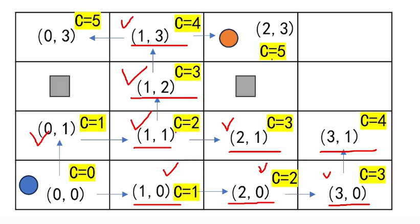

#### 2. A*算法

A* 是一种**==启发式图搜索==**算法，原理上与 Dijkstra 算法类似，都是基于已知地图环境，采用图形化方法寻找最优路径。但在进行代价计算的时候略有不同：

- Dijkstra 算法：代价仅考虑从起点到当前节点的实际代价
- A * 算法：代价为实际代价 + 启发式代价的估计值

> ​		因此，只要启发式代价函数设计合理，其效率比 Dijkstra 算法更优。
>
> 

假设搜索空间已经表示为图，每个节点 $n$ 的评价函数为：

```math
f(n)
=
g(n)
+
h(n)
```

其中：

- $g(n)$ 表示从起点到节点 $n$ 的实际累计代价；
- $h(n)$ 表示从节点 $n$ 到目标节点的估计代价；
- $f(n)$ 表示经过节点 $n$ 到达目标的估计总代价。

A* 每次优先扩展 $f(n)$ 最小的节点。若 $h(n)=0$，A* 退化为 Dijkstra 算法；

若启发函数能够准确估计目标方向，A* 通常可以少扩展许多无关节点，为了保证 A* 找到最短路径，常用条件是启发函数不能高估真实剩余代价：

```math
0
\leq
h(n)
\leq
h^{*}(n)
```

其中，$h^{*}(n)$ 表示从节点 $n$ 到目标节点的真实最小代价。满足该条件的启发函数称为**可采纳启发函数**。


A* 的算法步骤:

1. 栅格化地图，将可通行区域设置为有效节点，并标记起点、终点和障碍物。

2. 将起点加入列表 Q_list，设置起点实际代价 C=0，计算起点到终点的启发式估计代价 h，并得到预计总代价：

   ```math
    f(n)=C(n)+h(n)
   ```

   

3. 从Q_list 中取出 f最小的节点，并寻找该节点周围所有未被障碍物阻挡的有效相邻节点。根据允许的运动方式，可以采用**==四方向移动==**或**==八方向移动==**。

4. 计算经过当前节点到达每个相邻节点的新实际代价：

   ```math
    C_{\mathrm{new}} = C_{\mathrm{current}} + C_{\mathrm{current,neighbor}} 
   ```

   

5. 计算每个相邻节点到终点的启发式估计代价 h。**==四方向移动通常使用曼哈顿距离==**，**==八方向移动可以使用欧氏距离或对角距离==**。

6. 计算每个相邻节点的预计总代价：

   ```math
   f_{\mathrm{new}} = C_{\mathrm{new}} + h 
   ```

   

7. 如果相邻节点之前没有被搜索过，或者 $C_{\mathrm{new}}$ 小于其原有实际代价，则更新该节点的 C、h、f\和父节点，并将其加入 Q_list。

8. 继续从Q_list 中取出 f最小的节点。若该节点不是终点，则循环进入步骤 3；若该节点是终点，则沿父节点回溯得到完整路径。

9. 如果Q_list为空时仍未找到终点，则说明当前地图中不存在可行路径。

具体操作如下

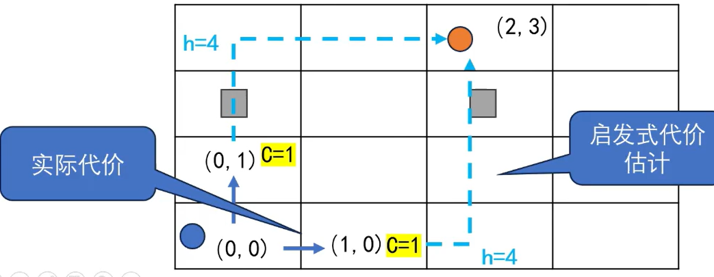

表示为

```math
f(1,0)=g(1,0)+h(1,0)=5
```


#### 3. A*不适用于机械臂路径规划


A* 必须先具有可搜索的离散图。若将每个关节划分为 $k$ 个离散位置，则 $n$ 自由度机械臂最多需要考虑：

```math
k^n
```

个网格节点。例如，每个关节仅划分为 $20$ 个位置，六自由度机械臂就可能产生：

```math
20^6
=
64\,000\,000
```

个离散配置。随着自由度增加，节点数量会迅速增长，这就是高维空间中的“维数灾难”。而对于RRT及其系列算法，则产生20个离散配置。

因此：

- 对二维或低维离散地图，A* 通常非常实用；
- 对高维机械臂配置空间，通常优先使用 RRT、RRT-Connect 等采样算法；
- A* 并非不能用于机械臂，而是需要先构造合适的图，例如在 PRM 生成的路线图上使用 A* 搜索。

> A* 适合在已经存在的图中寻找较优路径；RRT 系列算法则在搜索路径的同时逐步构造树。


### 4.5.1.4 RRT 算法

RRT 的全称为 Rapidly-exploring Random Tree，即**快速扩展随机树**。其基本思想是：

> 从起点建立一棵树，在配置空间中不断随机采样，并引导树向尚未探索的区域扩展，直到树能够连接目标点。

RRT 不需要预先建立完整的高维网格，能够较快找到一条可行路径。但是，RRT 的主要目标是找到路径，而不是找到最短路径。


#### RRT 算法步骤如下

##### 1. 初始化搜索树

首先检查起点和目标点是否满足关节限位并且无碰撞，然后以起点建立搜索树：

```math
\mathcal T
=
\left\{
\boldsymbol q_{\mathrm{start}}
\right\}
```

##### 2. 随机采样

在配置空间的关节范围内随机生成采样点：

```math
\boldsymbol q_{\mathrm{rand}}
\sim
\operatorname{Sample}(\mathcal C)
```

为了使搜索树更积极地靠近目标，可以采用目标偏置采样：

```math
\boldsymbol q_{\mathrm{rand}}
=
\begin{cases}
\boldsymbol q_{\mathrm{goal}}, & \text{以概率 }p_{\mathrm{goal}}\\
\operatorname{Sample}(\mathcal C), & \text{其他情况}
\end{cases}
```

目标偏置过小会导致搜索缺少方向，目标偏置过大则可能使树反复撞向阻挡目标的同一障碍物。

##### 3. 搜索最近节点

在已有树中寻找距离随机采样点最近的节点：

```math
\boldsymbol q_{\mathrm{near}}
=
\underset{
\boldsymbol q\in\mathcal T
}{
\operatorname{argmin}
}
\;
d(\boldsymbol q,\boldsymbol q_{\mathrm{rand}})
```

##### 4. 向采样点方向扩展得到$x_{new}$

从最近节点向随机采样点方向移动一个步长 $\eta$，得到新节点：

```math
\boldsymbol q_{\mathrm{new}}
=
\operatorname{Steer}
\left(
\boldsymbol q_{\mathrm{near}},
\boldsymbol q_{\mathrm{rand}},
\eta
\right)
```

当二者距离大于步长时，可以写为：

```math
\boldsymbol q_{\mathrm{new}}
=
\boldsymbol q_{\mathrm{near}}
+
\eta
\frac{
\boldsymbol q_{\mathrm{rand}}-\boldsymbol q_{\mathrm{near}}
}{
\left\|
\boldsymbol q_{\mathrm{rand}}-\boldsymbol q_{\mathrm{near}}
\right\|_2
}
```

当二者距离不大于步长时，可以直接令：

```math
\boldsymbol q_{\mathrm{new}}
=
\boldsymbol q_{\mathrm{rand}}
```

例如，在二维配置空间中，若：

```math
\boldsymbol q_{\mathrm{near}}
=
\begin{bmatrix}
2\\1
\end{bmatrix},
\qquad
\boldsymbol q_{\mathrm{rand}}
=
\begin{bmatrix}
5\\5
\end{bmatrix},
\qquad
\eta=1
```

则：

```math
\boldsymbol q_{\mathrm{rand}}
-
\boldsymbol q_{\mathrm{near}}
=
\begin{bmatrix}
3\\4
\end{bmatrix},
\qquad
\left\|
\boldsymbol q_{\mathrm{rand}}
-
\boldsymbol q_{\mathrm{near}}
\right\|_2
=
5
```

因此，新节点为：

```math
\boldsymbol q_{\mathrm{new}}
=
\begin{bmatrix}
2\\1
\end{bmatrix}
+
\frac{1}{5}
\begin{bmatrix}
3\\4
\end{bmatrix}
=
\begin{bmatrix}
2.6\\1.8
\end{bmatrix}
```

> 该算例说明 RRT 并不会直接跳到随机采样点，而是由当前树向采样点方向生长一个有限步长。
>

##### 5. 检查连接边并加入新节点

检查从 $\boldsymbol q_{\mathrm{near}}$ 到 $\boldsymbol q_{\mathrm{new}}$ 的整条局部路径：

- 若连接边发生碰撞，则丢弃 $\boldsymbol q_{\mathrm{new}}$；
- 若连接边无碰撞，则将 $\boldsymbol q_{\mathrm{new}}$ 加入树中，并将其父节点设置为 $\boldsymbol q_{\mathrm{near}}$。

##### 6. 尝试连接目标并回溯路径

若新节点能够无碰撞连接目标点，则将目标点加入树中。随后从目标节点不断访问父节点，直到回到起点，即可得到完整路径：

```math
\boldsymbol q_{\mathrm{start}}
\rightarrow
\cdots
\rightarrow
\boldsymbol q_{\mathrm{goal}}
```

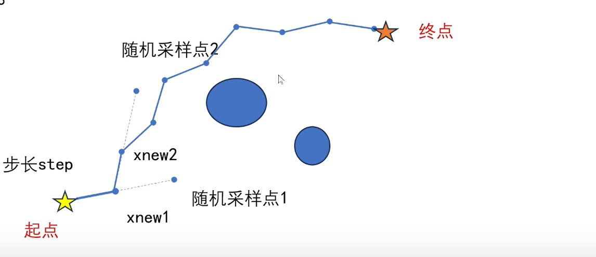


####  RRT 伪代码

```py
RRT(q_start, q_goal):
    T ← 初始化仅包含 q_start 的树

    for k = 1 到最大迭代次数:
        q_rand ← SampleWithGoalBias()
        q_near ← Nearest(T, q_rand)
        q_new  ← Steer(q_near, q_rand, step_size)

        if not CollisionFree(q_near, q_new):
            continue

        AddNode(T, q_new, parent=q_near)

        if Distance(q_new, q_goal) ≤ goal_threshold
           and CollisionFree(q_new, q_goal):
            AddNode(T, q_goal, parent=q_new)
            return BacktrackPath(T, q_goal)

    return Failure
```

#### RRT 的性质

- **概率完备性：**在满足一定条件且迭代次数趋于无穷时，如果可行路径存在，RRT 找到路径的概率趋近于 $1$；
- **不保证最优：**RRT 找到的第一条路径通常较曲折，继续迭代也不会自动使已有路径收敛至最优路径；
- **适合高维空间：**不需要规则离散整个配置空间；
- **对参数敏感：**扩展步长、目标偏置和碰撞检测分辨率会明显影响规划效果；
- **狭窄通道效率较低：**随机采样点落入狭窄可行区域的概率较小。


### 4.5.1.5 RRT* 算法

RRT* 是 RRT 的渐近最优改进算法。普通 RRT 生成新节点后，直接将最近节点作为其父节点；RRT* 则会在新节点附近寻找多个候选节点，并通过**重选父节点**和**重布线**降低路径代价。

RRT* 的目标不只是回答“能否找到路径”，还希望在不断迭代的过程中逐渐改进路径质量。

#### 1. 路径代价

定义节点 $\boldsymbol q$ 从起点到该节点的累计代价为：

```math
\operatorname{Cost}(\boldsymbol q)
```

若以关节空间路径长度作为代价，则通过父节点 $\boldsymbol q_{\mathrm{parent}}$ 到达新节点的代价为：

```math
\operatorname{Cost}(\boldsymbol q_{\mathrm{new}})
=
\operatorname{Cost}(\boldsymbol q_{\mathrm{parent}})
+
d(\boldsymbol q_{\mathrm{parent}},\boldsymbol q_{\mathrm{new}})
```

实际应用中的路径代价还可以综合考虑：

- 路径长度或关节总运动量；
- 与障碍物的安全距离；
- 接近关节限位的惩罚；
- 接近奇异位形的惩罚；
- 能量消耗或其他任务指标。

RRT* 最终优化的是所定义的代价函数，因此代价函数不同，得到的“最优路径”也可能不同。


#### 2. 重选父节点 Choose Parent

对于每个邻近节点 $\boldsymbol q_i$，若其能够无碰撞连接新节点，则计算通过该节点到达新节点的代价：

```math
c_i
=
\operatorname{Cost}(\boldsymbol q_i)
+
d(\boldsymbol q_i,\boldsymbol q_{\mathrm{new}})
```

选择代价最小的邻近节点作为新节点的父节点：

```math
\boldsymbol q_{\mathrm{parent}}^{*}
=
\underset{
\boldsymbol q_i\in\mathcal Q_{\mathrm{near}}
}{
\operatorname{argmin}
}
\;
c_i
```

> 普通 RRT 只关心“哪一个已有节点距离新节点最近”；RRT* 则进一步关心“通过哪一个已有节点到达新节点的累计代价最低”。
>

重选父节点流程,以下图为例说明

1. 找到 $x_{new2}$ 后，在半径为 r 的邻域内，找到==**所有**==潜在父节点，也就是起点和 $x_{new1}$。
2. 对潜在父节点到$x_{new2}$  的路径进行碰撞检测，并计算代价（这里规定为路径长度），发现起点到$x_{new2}$ 的路径成本更小，且无碰撞
3. 选择 xnew2 的父节点为起点位置

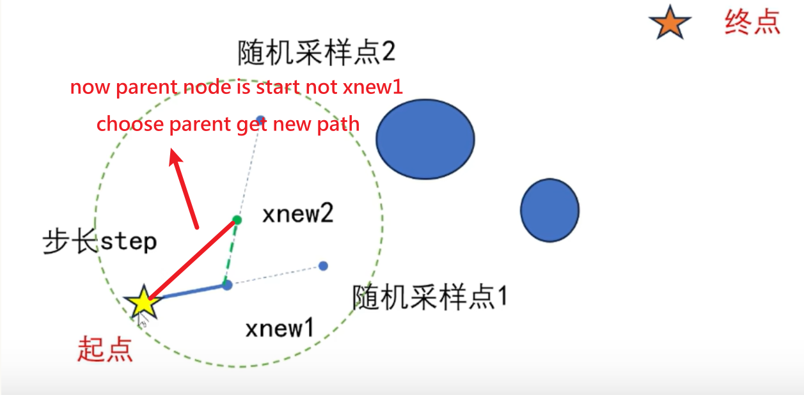


#### 3. 重布线 Rewire

重连树就是获得一个新节点 $x_{new}$ 后，在邻域中找到附近节点，判断从新节点到附近节点是否可以降低路径成本，如果可以就将附近节点的父节点改成 $x_{new}$。

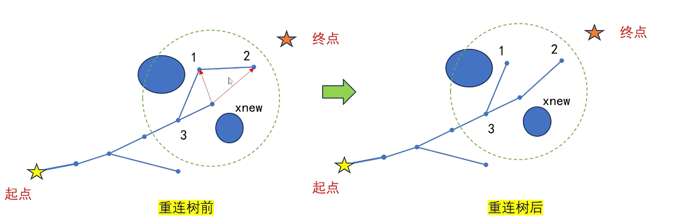


#### 4. RRT* 伪代码

```py
RRT_STAR(q_start, q_goal):
    T ← 初始化树、父节点和累计代价

    while 未达到停止条件:
        q_rand    ← Sample()
        q_nearest ← Nearest(T, q_rand)
        q_new     ← Steer(q_nearest, q_rand, step_size)

        if not CollisionFree(q_nearest, q_new):
            continue

        Q_near ← Near(T, q_new, radius)

        q_best ← q_nearest
        c_best ← Cost(q_nearest) + Distance(q_nearest, q_new)

        for q_i in Q_near:
            c_i ← Cost(q_i) + Distance(q_i, q_new)
            if c_i < c_best and CollisionFree(q_i, q_new):
                q_best ← q_i
                c_best ← c_i

        AddNode(T, q_new, parent=q_best, cost=c_best)

        for q_i in Q_near:
            c_new ← Cost(q_new) + Distance(q_new, q_i)
            if c_new < Cost(q_i) and CollisionFree(q_new, q_i):
                ChangeParent(q_i, q_new)
                UpdateDescendantCosts(q_i)

    return 当前代价最低的起点到目标路径
```

#### 5. RRT* 的性质

- **渐近最优性：**在满足理论条件并且迭代次数趋于无穷时，所得路径代价趋近于最优代价；
- **可以持续优化：**找到第一条可行路径后，算法仍可继续重布线以降低代价；
- **计算量较大：**每次加入节点时需要搜索邻近节点、比较代价并执行多次碰撞检测；
- **首条路径不一定更好：**RRT* 的优势通常需要通过充分迭代才能体现。


> RRT* 中的“最优”不是指有限时间内一定得到全局最优路径，而是指在满足理论条件并不断增加采样时，路径代价渐近趋近最优值。


### 4.5.1.6 RRT-Connect 算法

普通 RRT 从起点建立一棵树并不断向外扩展。RRT-Connect 则同时从起点和终点建立两棵树：

```math
\mathcal T_a
=
\left\{
\boldsymbol q_{\mathrm{start}}
\right\},
\qquad
\mathcal T_b
=
\left\{
\boldsymbol q_{\mathrm{goal}}
\right\}
```

两棵树轮流扩展，并尝试相互连接。当两棵树成功相遇时，即得到从起点到终点的完整路径。

RRT-Connect 的核心不仅是“双向生长”，还包括一种更加积极的连接策略：

> 一棵树成功扩展一个新节点后，另一棵树会朝该新节点连续扩展，直到到达该节点或被障碍物阻挡。


#### 3. RRT-Connect 算法步骤

1. **初始化两棵搜索树：**分别以起始构型和目标构型作为根节点，建立起点树 `Start_tree`用$T_a$表示和目标树 `Goal_tree`用$T_b$表示。
2. **随机采样：**在配置空间中随机生成采样点 $q_{\mathrm{rand}}$
3. **选择当前扩展树：** 如果$T_a$中的节点数量小于$T_b$，则扩展$T_a$，反之则扩展$T_b$，假设当前扩展树 $T_a$，另一棵树为连接树 $T_b$。每轮迭代结束后交换两棵树的角色，使其交替扩展。
4. **扩展当前树：**在 $T_a$中找到距离 $q_{\mathrm{rand}}$ 最近的节点$q_{\mathrm{near}}$，并从 $q_{\mathrm{near}}$向 $q_{\mathrm{rand}}$ 方向扩展一个步长，得到新节点 $q_{\mathrm{new}}$。若连接路径无碰撞，则将 $q_{\mathrm{new}}$加入 $T_a$；否则本轮扩展失败。
5. **连接另一棵树：**若 $T_a$扩展成功，则在 $T_b$中寻找距离 $q_{\mathrm{new}}$最近的节点，并让 $T_b$朝 $q_{\mathrm{new}}$ 方向连续扩展。每次扩展均需进行碰撞检测，直到成功到达 $q_{\mathrm{new}}$或被障碍物阻挡。
6. **判断连接结果：**若 $T_b$成功到达 $q_{\mathrm{new}}$，则两棵树连接成功；若连接过程被障碍物阻挡，则连接失败，交换两棵树的角色并进入下一轮迭代。
7. **回溯并拼接路径：**两棵树连接成功后，分别从连接节点沿父节点回溯至起点和终点。将目标树一侧的路径反转后，与起点树路径拼接，得到完整路径。
8. **终止搜索：**若两棵树成功连接，则返回完整路径；若达到最大迭代次数或最大规划时间仍未连接，则返回规划失败。

下面对拓展树和连接树做对比

| 操作      |                 扩展目标                  |          生长方式          |
| --------- | :---------------------------------------: | :------------------------: |
| `EXTEND`  |      随机采样点 $q_{\mathrm{rand}}$       |       只扩展一个步长       |
| `CONNECT` | 另一棵树刚产生的新节点 $q_{\mathrm{new}}$ | 连续扩展，直到到达或被阻挡 |

交换两棵树可以表示为：

```math
\mathcal T_a
\leftrightarrow
\mathcal T_b
```


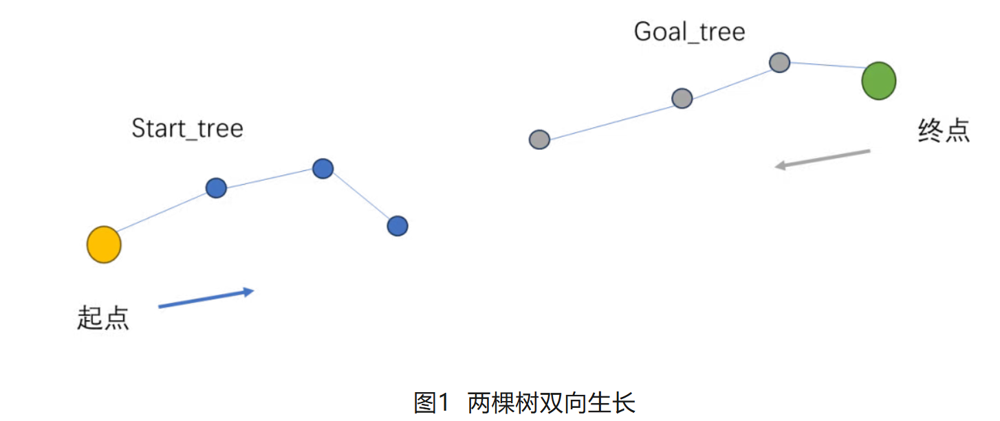

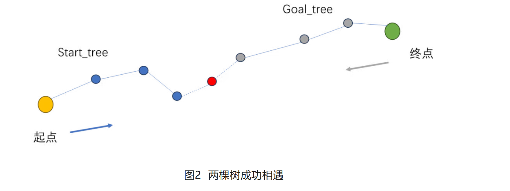


#### 4. RRT-Connect 伪代码

```text
RRT_CONNECT(q_start, q_goal):
    Ta ← 以 q_start 为根节点的树
    Tb ← 以 q_goal  为根节点的树

    for k = 1 到最大迭代次数:
        q_rand ← Sample()

        status_a, q_new ← EXTEND(Ta, q_rand)

        if status_a ≠ TRAPPED:
            status_b ← CONNECT(Tb, q_new)

            if status_b = REACHED:
                return MergePaths(Ta, Tb, q_new)

        Swap(Ta, Tb)

    return Failure
```

> ​		连接成功后，拼接路径时必须注意两棵树的父节点方向相反。一侧路径从连接点回溯至起点，另一侧路径从连接点回溯至终点；拼接前通常需要将其中一侧路径顺序反转。
>

#### 5. RRT-Connect 的性质

- 同时从起点和终点搜索，通常能够较快找到可行路径；
- 连接 操作能够快速跨越较大的无障碍区域；
- 适合机械臂点到点的单次路径查询；
- 找到的路径通常不是最优路径；
- 在狭窄通道中仍可能需要较多采样；
- 连接过程中的每一条新增边都必须进行碰撞检测；
- 找到路径后通常需要进行路径平滑。


### 4.5.1.7 RRT、RRT* 与 RRT-Connect 的比较

| 比较项目           | RRT                | RRT*               | RRT-Connect             |
| :----------------- | :----------------- | :----------------- | :---------------------- |
| 搜索树数量         | 一棵树             | 一棵树             | 两棵树                  |
| 主要目标           | 快速找到可行路径   | 持续优化路径代价   | 快速连接起点和终点      |
| 特有操作           | 随机采样与单步扩展 | 重选父节点、重布线 | EXTEND、CONNECT、交换树 |
| 路径最优性         | 不保证最优         | 具有渐近最优性     | 不保证最优              |
| 找到首条路径速度   | 通常较快           | 通常慢于 RRT       | 通常较快                |
| 找到路径后持续优化 | 不会自动优化       | 会持续优化         | 不会自动优化            |
| 碰撞检测开销       | 中等               | 较高               | 中等至较高              |
| 典型用途           | 快速验证可达性     | 重视路径质量       | 机械臂快速寻找可行路径  |

选择算法时，可以遵循以下原则：

- 只需要较快找到一条可行路径时，可以使用 RRT；
- 需要持续降低路径长度或其他代价时，可以使用 RRT*；
- 对机械臂进行点到点运动规划，并希望较快获得可行路径时，通常优先考虑 RRT-Connect；
- 同一静态环境中需要反复处理大量起终点查询时，可以进一步了解 PRM；
- 末端必须严格沿指定直线、圆弧或曲面运动时，仅使用普通关节空间 RRT 不一定能够满足要求，还需要加入任务空间约束或使用专门的约束规划方法。

> 没有一种规划器对所有问题都最好。规划速度、路径质量和约束满足能力之间通常需要根据任务进行取舍。


### 4.5.1.8 路径平滑处理

RRT 系列算法输出的初始路径通常包含较多折线段和冗余节点。虽然路径无碰撞，但若直接对这些路径点进行轨迹插值，机械臂可能产生不必要的绕行，并在路径转折处出现较大的速度或加速度变化。因此，在轨迹规划之前通常需要进行路径后平滑处理。

#### 1. 捷径平滑 Shortcut Smoothing

捷径平滑的基本思想是：

1. 从路径中选择两个不相邻的路径点；
2. 检查二者之间能否直接无碰撞连接；
3. 若可以直接连接，则删除二者之间的冗余路径点；
4. 重复执行若干次。

```python
SHORTCUT_SMOOTH(path):
    重复若干次:
        随机选择 i < j

        if CollisionFree(path[i], path[j]):
            删除 path[i] 与 path[j] 之间的路径点

    return path
```

平滑过程中必须重新进行连接边碰撞检测，否则新生成的捷径可能穿过障碍物。平滑后的路径也应保留合理的安全距离，不能只追求最短。

#### 2. 路径点加密

路径平滑后，相邻路径点之间的距离可能仍然较大。为了进行更精细的碰撞检查或后续轨迹插值，可以在路径段之间插入中间点。

需要注意，路径点加密只增加几何路径点，并不会自动产生速度和时间信息。

#### 3. 从路径转换为轨迹

路径规划和路径后处理得到：

```math
\boldsymbol q_0,
\boldsymbol q_1,
\ldots,
\boldsymbol q_m
```

随后需要为路径点分配到达时间：

```math
t_0<t_1<\cdots<t_m
```

再使用 Cubic Polynomial、Quintic Polynomial 或 Linear Function with Parabolic Blends 等方法进行轨迹插值，生成：

```math
\boldsymbol q(t),
\qquad
\dot{\boldsymbol q}(t),
\qquad
\ddot{\boldsymbol q}(t)
```

最后还需要按照控制周期采样，并检查关节位置、速度、加速度和整段运动的碰撞约束。

> ​		RRT 中的随机采样用于搜索配置空间；这要与后边讲述的控制执行中的等时间采样做区分，控制执行中的等时间采样用于生成周期控制指令。二者都称为采样，但含义完全不同


### 4.5.1.9 总结

机械臂路径规划通常在配置空间中进行。算法搜索的每一个节点表示一整组关节变量，连接边表示机械臂从一个构型到另一个构型的局部运动。规划过程中必须同时检查关节限位、节点碰撞和自身连接边碰撞，即

```math
\operatorname{Valid}(\boldsymbol q)
=
\operatorname{JointLimitValid}(\boldsymbol q)
\land
\operatorname{EnvironmentCollisionFree}(\boldsymbol q)
\land
\operatorname{SelfCollisionFree}(\boldsymbol q)
```


一个完整的机械臂路径规划流程通常包括：

```math
\text{建立机械臂与环境碰撞模型}
\rightarrow
\text{检查起点和目标点}
\rightarrow
\text{设置配置空间与距离函数}
\rightarrow
\text{执行路径搜索}
\rightarrow
\text{回溯得到离散路径}
\rightarrow
\text{路径平滑与重新验证}
\rightarrow
\text{轨迹规划与执行前检查}
```

> 细节问题：
>
> 1. 机械臂路径规划通常在关节配置空间中进行。对于每个候选关节构型，需要通过正运动学计算机械臂所有连杆在三维工作空间中的位姿，并使用整机碰撞模型检查环境碰撞和自身碰撞。
> 2. RRT 系列算法具有随机性。在有限迭代次数内规划失败，只能说明当前参数和计算预算下没有找到路径，并不能严格证明路径不存在。可以尝试增加**==规划时间==**、**==调整步长==**、**==选择其他目标逆运动学解==**或**==更换规划器==**。


## 4.5.2 轨迹规划


路径规划得到了一系列能够避开障碍物的路径点，但这些路径点只描述了机械臂应当经过的位置，并未规定机械臂何时到达各路径点，也未规定运动过程中的速度和加速度。若直接按照离散路径点控制机械臂运动，路径点连接处可能出现速度突变，导致机械臂产生冲击、振动，甚至超过关节驱动能力。

因此，在获得几何路径后，还需要进一步为路径赋予时间信息，将离散路径点转换为关于时间连续变化的运动函数，这一过程称为轨迹规划。

机器人的路径和轨迹是两个不同的概念。**路径**是从起始状态到目标状态所经过的连续点集，主要描述机器人“从哪里经过”；**轨迹**则是机器人相关变量随时间变化的函数关系，主要描述机器人“在什么时刻，以怎样的速度和加速度经过路径”。

> ​		机器人的轨迹和路径是两个不同的概念。**==轨迹==**是指与机器人相关的变量（如关节变量、关节力矩、末端位姿等）在工作过程中**==随时间变化的函数关系==**，是关于时间的连续函数；**==路径==**是指从起始点到目标点的**==连续点集==**，它是一个集合，而**==不是时间的函数==。**

轨迹可以在关节空间或笛卡尔空间中进行规划。关节空间轨迹规划直接对各关节变量进行插值，便于检查关节位置、速度和加速度限制；笛卡尔空间轨迹规划直接规定末端执行器的位置和姿态变化，能够控制末端沿指定几何路径运动，但需要逐点进行逆运动学求解，并检查奇异性和逆运动学解连续性。

关节空间轨迹通常表示为：

```math
\boldsymbol q(t),\qquad
\dot{\boldsymbol q}(t),\qquad
\ddot{\boldsymbol q}(t)
```

笛卡尔空间轨迹通常表示为：

```math

\boldsymbol T(t),\qquad
\boldsymbol V(t),\qquad
\dot{\boldsymbol V}(t)
```


常用轨迹插值方法包括 Cubic Polynomial 和 Linear Function with Parabolic Blends 等。通过轨迹插值，可以根据起止位置、速度、加速度和运动时间，生成连续、平滑的轨迹函数。

```math
\text{离散几何路径点}
\rightarrow
\text{分配路径点到达时间}
\rightarrow
\text{轨迹插值}
\rightarrow
\boldsymbol q(t),\dot{\boldsymbol q}(t),\ddot{\boldsymbol q}(t)
```


### 4.5.2.1 关节空间和笛卡尔空间

机械臂的轨迹可以在关节空间或笛卡尔空间中进行规划。两种方法的主要区别在于：被插值变量分别是关节变量和末端执行器位姿。选择不同的规划空间，将直接影响末端运动路径、计算复杂度以及轨迹执行过程中的约束检查方式。

具有 n个自由度的机械臂关节变量为

```MATH
\boldsymbol{q} = \begin{bmatrix} q_1 & q_2 & \cdots & q_n \end{bmatrix}^T
```

末端执行器相对于基坐标系的位姿为

```math
\boldsymbol{T} = f(\boldsymbol{q}) \in SE(3)
```

其中，$f(q)$ 表示机械臂的正运动学映射。轨迹规划可以对关节变量 $\boldsymbol q(t)$直接进行，也可以先规划末端位姿 $\boldsymbol T(t)$，再通过逆运动学求得对应的关节变量，并检查末端路径、关节限位、速度、加速度以及碰撞约束。

#### 1. Joint Space

关节空间轨迹规划首先将给定的末端起点、路径点和终点通过逆运动学转换为相应的关节构型：

```math
\boldsymbol{T}_k \xrightarrow{\text{IK}} \boldsymbol{q}_k, \quad k = 0,1,\dots,m
```

随后，分别对每个关节变量进行时间插值，得到：

```math
\boldsymbol{T}(t) = f(\boldsymbol{q}(t))
```

所有关节必须采用一致的路径点到达时刻，使机械臂能够在指定时刻同时到达相应构型。完成插值后，可以利用正运动学重新计算末端执行器轨迹：

```math
\boldsymbol{T}(t) = f(\boldsymbol{q}(t))
```

并检查末端路径、关节限位、速度、加速度以及碰撞约束。

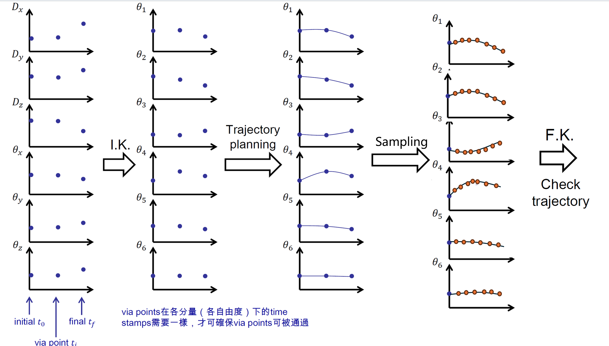

结合图示，关节空间轨迹规划的基本过程可以表示为：

```math

\text{笛卡尔路径点} \rightarrow IK \rightarrow \text{关节轨迹插值} \rightarrow \text{采样} \rightarrow FK\text{检查}

```

关节空间规划计算简单，能够方便地限制各关节的速度和加速度，并且不需要在每个控制周期求解逆运动学。但是，各关节变量独立插值后，末端执行器在笛卡尔空间中的实际路径通常为曲线，不能保证沿直线经过各个笛卡尔路径点。

> 
>
> ​		关节空间轨迹规划直接对各关节变量进行插值，规划过程中不需要连续求解逆运动学，因此不会因末端路径经过运动学奇异位形而直接导致规划计算失效。但是，机器人实际运动仍可能经过奇异位形；同时，关节空间轨迹无法直接保证末端执行器沿期望的笛卡尔路径运动。


#### 2. Cartesian Space

笛卡尔空间轨迹规划直接对末端执行器的位置和姿态进行插值。其基本过程为：

```math
\boldsymbol{T}_0, \boldsymbol{T}_1, \dots, \boldsymbol{T}_m \xrightarrow{\text{轨迹插值}} \boldsymbol{T}(t) \xrightarrow{\text{逆运动学}} \boldsymbol{q}(t).
```

对于末端位置，可以对位置向量

```math
\boldsymbol{p}(t) = \begin{bmatrix} x(t) & y(t) & z(t) \end{bmatrix}^T
```

进行插值。对于末端姿态，则需要对旋转矩阵或四元数进行姿态插值。由于欧拉角存在奇异性，并且直接对各欧拉角分量插值通常不能产生均匀的空间旋转，因此实际应用中常采用四元数球面线性插值等方法。

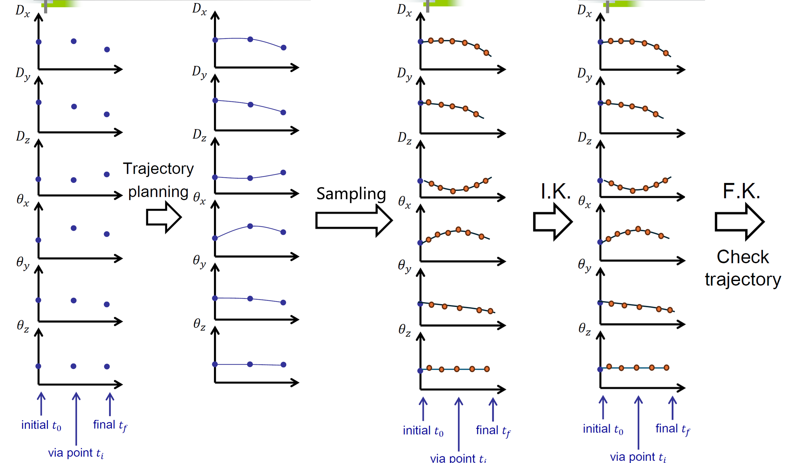

结合图示，笛卡尔空间轨迹规划过程可以表示为：

```math

\text{笛卡尔路径点} \rightarrow \text{轨迹插值} \rightarrow \text{采样} \rightarrow IK \rightarrow FK\text{检查}


```

笛卡尔空间规划能够直接规定末端执行器的运动路径，例如使末端沿直线移动。但是，每个采样时刻通常都需要求解逆运动学，并且由于笛卡尔空间描述的路劲形状于关节位置之间有连续的对应关系，所以笛卡尔空间的路劲容易出现于工作空间和奇异点有关的各种问题。因此，得到笛卡尔轨迹后，还必须通过采样、逆运动学求解与约束检查，对路径上的不可达点、奇异位形和逆运动学解分支连续性进行验证。若轨迹不能满足上述要求，则需要修改末端路径、降低运动速度、增加中间路径点，或改用关节空间轨迹规划。

#### 3. 笛卡尔路径的极限几何问题

前面分别介绍了关节空间与笛卡尔空间轨迹规划的基本过程。关节空间规划直接对各关节变量进行插值，便于限制关节运动状态，但难以直接控制末端执行器的几何路径；笛卡尔空间规划则直接对末端位姿进行插值，能够使末端按照指定的直线、圆弧等路径运动，因此更适用于焊接、喷涂和装配等对末端路径形状具有明确要求的任务。

然而，在笛卡尔空间中能够定义一条连续、平滑的末端路径，并不意味着机械臂一定能够沿该路径运动。笛卡尔路径最终仍需要通过逆运动学映射为关节轨迹，其可执行性受到机械臂工作空间、奇异位形、关节限位以及逆运动学多解等因素的共同影响。即使路径的起点和终点均可到达，二者之间的中间路径也可能无法实现；即使路径上每个位姿均存在逆运动学解，得到的关节轨迹也可能出现速度过大或解分支跳变的问题。

因此，对笛卡尔空间轨迹进行规划时，除了考虑末端路径自身的连续性和平滑性，还必须分析其映射至关节空间后的可达性、连续性与可执行性。下面将从不可到达的中间点、奇异点附近的高关节速率以及不同逆运动学解分支等方面，讨论笛卡尔路径中常见的几何问题。

> 笛卡尔空间轨迹的几何连续性并不等价于关节空间轨迹的可执行性

##### 1. 不可到达的中间点

尽管操作臂的起始点和目标点都在其工作空间内部，但是很有可能在连接这两点的直线上有某些点不在工作空间中，例如图 7-12 所示的平面两杆机器人及其工作空间。在此例中，连杆 2 比连杆 1 短，所以在工作空间的中间存在一个空洞，其半径为两连杆长度之差。起始点 A 和目标点 B 均在工作空间中，在关节空间中从 A 运动到 B 没有问题。但是如果试图在笛卡儿空间沿直线运动，将无法到达路径上的某些中间点。该例表明了在某些情况下，关节空间中的路径容易实现，而笛卡儿空间中的直线路径将无法实现。

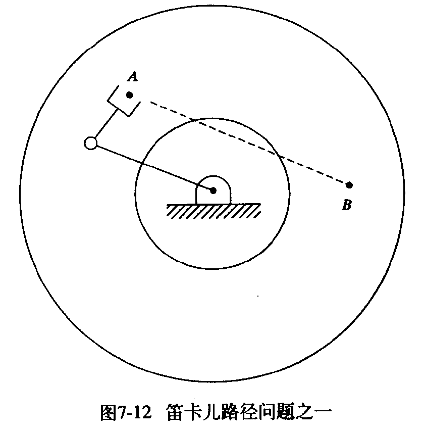


##### 2. 在奇异点附近的高关节速率

从 《4.4节速度和静力》内容可以看到，在操作臂的工作空间中存在着某些位置，在这些位置处无法用有限的关节速度来实现末端执行器在笛卡儿空间的期望速度。因此，有某些路径（在笛卡儿空间描述）是操作臂所无法执行的，这一点并不奇怪。例如，如果一个操作臂沿笛卡儿直线路径接近机构的一个奇 异位形时，则机器人的一个或多个关节速度可能增加至无穷大。由于机构的速度是有上限的，因此这通常将导致操作臂偏离期望的路径。

例如，图 7-13 给出了一个平面两杆（两杆长度相同）操作臂，从 A 点沿着路径运动到 B 点。期望轨迹是使操作臂末端以恒定的线速度作直线运动。图中画出了操作臂在运动过程中的一些中间位置以便于观察其运动。可以看到，路径上的所有点都可以到达，但是当机器人经过路径的中间部分时，关节 1 的速度非常高。路径越接近关节 1 的轴线，关节 1 的速度就越大。一个解决办法是减小这个路径上的所有运动速度，以使所有关节速度在其容许范围内。虽然这样可能不能保证路径上的瞬时特性，但是至少由路径定义的空间点都能够达到。

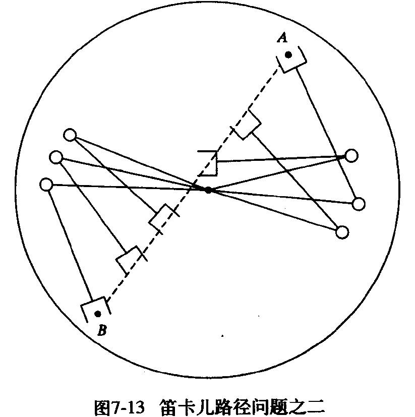

##### 3. 不同解下的可达起点和终点

对于具有多个逆运动学解的机械臂，同一个末端位姿可能对应不同的关节构型。以图示平面二连杆机械臂为例，对于路径上的同一个末端位置，机械臂通常存在肘部朝向不同的两组逆运动学解。然而，受到关节转动范围、机械结构及碰撞条件等约束，并非所有逆运动学解均能够实际使用。

图中起点 A、终点 B\以及二者之间的各个路径点分别都是可达的。但是，沿路径从 A向 B 运动时，起点处选定的逆运动学解可能无法始终满足关节约束。继续沿同一解分支求解时，机械臂可能出现关节超限或碰撞；若在运动过程中切换到另一组逆运动学解，则关节角会发生不连续跳变，同样无法直接执行。因此，路径上各点分别可达，并不代表这些点对应的关节构型能够连接成一条连续、可执行的关节轨迹。

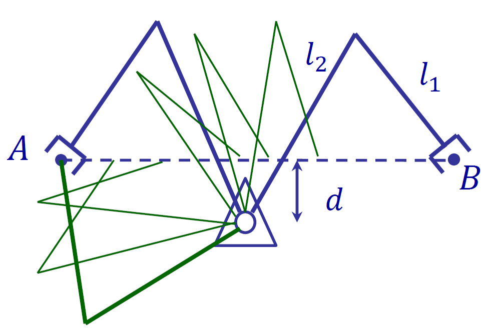


##### 4.总结

| 问题                     | 位置是否可达     |    连续关节轨迹是否存在    | 主要原因                                 |
| :----------------------- | ---------------- | :------------------------: | ---------------------------------------- |
| 不可到达的中间点         | 部分中间点不可达 |           不存在           | 路径离开**工作空间**                     |
| 在奇异点附近的高关节速率 | 所有点均可达     | 理论上存在，但速度不可实现 | 路径接近或经过**奇异点**                 |
| 不同解下的可达起点和终点 | 所有点均可达     |   指定起终点解之间不存在   | 逆运动学解分支不连续或受**关节限位阻断** |


> ​		路径点的逐点可达性只能说明各点分别存在逆运动学解；笛卡尔路径的可执行性还要求这些解能够组成连续且满足约束的关节轨迹。


#### 4. 总结

|   比较项目   |         关节空间规划          |         笛卡尔空间规划         |
| :----------: | :---------------------------: | :----------------------------: |
|   插值变量   | 各关节变量 $\boldsymbol q(t)$ |  末端位姿 $\boldsymbol T(t)$   |
|   末端路径   |       通常无法直接规定        |          可以直接规定          |
| 逆运动学求解 |     通常只在路径点处求解      |      通常需要逐采样点求解      |
| 关节约束检查 |            较直接             |    需要转换到关节空间后检查    |
|   主要问题   |   末端路径可能偏离期望路径    |     奇异点、多解和关节跳变     |
|   适用场景   |        点到点快速运动         | 焊接、喷涂、装配等路径受限任务 |


关节空间和笛卡尔空间决定了轨迹规划所处理的变量：前者直接规划关节变量 ，后者规划末端位姿。然而，仅确定规划空间并不能完整描述机械臂的运动，还需要选择合适的插值方法，规定机器人如何随时间从起点平滑运动至终点，并确定运动过程中的位置、速度和加速度，因此下面我们对Cubic Polynomial和Linear Function with Parabolic Blends在关节空间和笛卡尔空间分别做出说明.


### 4.5.2.2 Cubic Polynomial

如果我们想要规划轨迹时，想要平滑过度位置和速度，那么对于其中一条轨迹段$[t_i，t_{i+1}]$如图所示，该段轨迹的边界条件有4个,包括两个端点位置的位置约束和两个端点速度的速度约束.

```math
\theta(t_i), \\ \theta(t_{i+1}), \\ \dot{\theta}(t_i), \\ \dot{\theta}(t_{i+1})
```

> 这里的$\theta$指的是泛化的变量，它既可以代表关节空间的关节变量，又可以代表末端位姿，即在这里代表自由度的位置

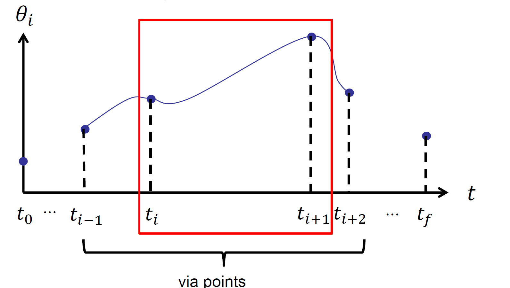


如上，可知，4个约束需要4个未知参数来描述，那么需要构造三次多项式来规划轨迹，三次多项式通式

```math
\theta(\tilde{t}) = a_0 + a_1 \tilde{t} + a_2 \tilde{t}^2 + a_3 \tilde{t}^3
```

对每一段有,$t∈[t_i,t_{i+1}]$，则

```math
\tilde{t} = t - t_i \quad 
```

那么边界条件有如下等式

```math
\theta\left(\tilde{t}\big|_{t=t_i}\right) = \theta_i = a_0 \\
\theta\left(\tilde{t}\big|_{t=t_{i+1}}\right) = \theta_{i+1} = a_0 + a_1\Delta t + a_2\Delta t^2 + a_3\Delta t^3 \\
\dot{\theta}\left(\tilde{t}\big|_{t=t_i}\right) = \dot{\theta}_i = a_1 \\
\dot{\theta}\left(\tilde{t}\big|_{t=t_{i+1}}\right) = \dot{\theta}_{i+1} = a_1 + 2a_2\Delta t + 3a_3\Delta t^2
```


写为矩阵形式

```math
\begin{bmatrix}
\theta_i \\
\theta_{i+1} \\
\dot{\theta}_i \\
\dot{\theta}_{i+1}
\end{bmatrix}
=
\begin{bmatrix}
1 & 0 & 0 & 0 \\
1 & \Delta t & \Delta t^2 & \Delta t^3 \\
0 & 1 & 0 & 0 \\
0 & 1 & 2\Delta t & 3\Delta t^2
\end{bmatrix}
\begin{bmatrix}
a_0 \\
a_1 \\
a_2 \\
a_3
\end{bmatrix}
```

我们想要求解的未知量式$a_0 -a_3$,于是对于时间的矩阵求逆，推出如下

 	

```math
\begin{bmatrix}
a_0 \\
a_1 \\
a_2 \\
a_3
\end{bmatrix}
=
\begin{bmatrix}
1 & 0 & 0 & 0 \\
0 & 0 & 1 & 0 \\
-\dfrac{3}{\Delta t^2} & \dfrac{3}{\Delta t^2} & -\dfrac{2}{\Delta t} & -\dfrac{1}{\Delta t} \\
\dfrac{2}{\Delta t^3} & -\dfrac{2}{\Delta t^3} & \dfrac{1}{\Delta t^2} & \dfrac{1}{\Delta t^2}
\end{bmatrix}
\begin{bmatrix}
\theta_i \\
\theta_{i+1} \\
\dot{\theta}_i \\
\dot{\theta}_{i+1}
\end{bmatrix}
```

> ​		注意，求逆的前提式时间矩阵行列式不为0，求解det(T) = $-{\Delta t}^4$,即只要时间不为0即可，从物理来讲，要求一段的轨迹，该段肯定存在时间差，因此上式存在逆矩阵，于是求解成立.

求解得出

```math
a_0 = \theta_i
\\
a_1 = \dot \theta_i
\\
a_2 = \frac{3}{\Delta t^2} \left( \theta_{i+1} - \theta_i \right) - \frac{2}{\Delta t} \dot{\theta}_i - \frac{1}{\Delta t} \dot{\theta}_{i+1}
\\[1em]
a_3 = -\frac{2}{\Delta t^3} \left( \theta_{i+1} - \theta_i \right) + \frac{1}{\Delta t^2} \left( \dot{\theta}_{i+1} + \dot{\theta}_i \right)
```

如上若像求解出参数，对于$\theta_i$和$\theta_{i+1}$,这些未知点是通过路径规划计算出的，即认为是已知量，但是对于速度量即$\dot \theta_i$和$\dot\theta_{i+1}$作为未知量需要我们规定或求解，路径上的速度可以通过以下几种方法规定.

第一种方法，用户在**笛卡尔空间**规定机械臂末端经过中间点时的运动方向和速度，再利用雅可比矩阵的逆，将末端速度转换成各关节的速度。

如果操作臂在某个特定的中间点上处于奇异位置，则用户将无法在该点处任意指定速度。对于一个路径生成算法而言，其用处之一就是满足用户指定的期望速度。然而，总是要求用户指定速度也是一个负担。因此，一个方便的路径规划系统还应包括方法 2 或 3（或者二者兼而有之）。

第二种方法，系统使用一些启发式方法来自动地选择合理的中间点速度。图 7-4 所示为由中间点确定的某一关节θ的路径的方法。

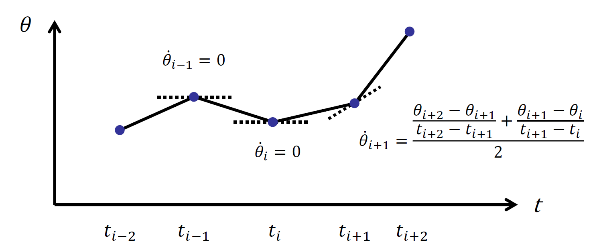

在图 7-4 中，如果$\dot\theta_i$在$t_i$前后变号，则将$\dot\theta_i$=0，如果$\dot\theta_{i+1}$在$t_{i+1}$前后同号，那么如图计算取平均值.


第三种方法，系统根据中间点处的加速度为连续的原则选取各点的速度。为此，需要一种新的方法。在这种样条曲线中设置一组数据，在两条三次曲线的连接点处，用速度和加速度均为连续的约束条件替换两个速度约束条件，这一方法称为**==三次样条插样==**.


对于前两种方法，不同区段的三次多样曲线可以分开求解，而第三种方法需要将不同区间段的三次多项式整合到一起，一并求解，下面我们来重点讲解第三种方法即三次样条插样进行轨迹规划.


我们先假设，在轨迹中，路径规划仅规划出一个中间点，即共有三个点，分别是initial、final、one via point，如图所示，同时令

```math
\tilde{t} = t_1 - t_0 \quad [\ 0\ \Delta t_1\ ]
\\[1em]
\theta_I(\tilde{t}) = a_{10} + a_{11}\tilde{t} + a_{12}\tilde{t}^2 + a_{13}\tilde{t}^3
\\
\tilde{t} = t_f - t_1 \quad [\ 0\ \Delta t_2\ ]
\\[1em]
\theta_{II}(\tilde{t}) = a_{20} + a_{21}\tilde{t} + a_{22}\tilde{t}^2 + a_{23}\tilde{t}^3
```


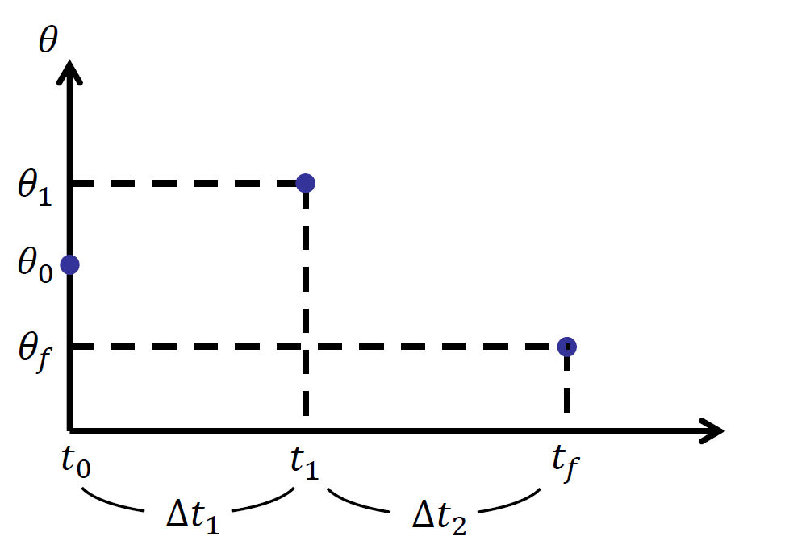


两段三次多项式分别包含四个待定系数，因此共有 8 个未知参数需要求解。为了唯一确定这些参数，需要建立 8个相互独立的约束方程。

首先，两段轨迹都必须经过各自的起点和终点。第一段应从初始点 $\theta_0$ 运动至中间点 $\theta_1$，第二段应从中间点 $\theta_1$ 运动至终点 $\theta_f$，由此可以建立 4个位置约束方程。其次，若规定轨迹在初始点和终点处的速度分别为 $\dot{\theta}_0$和 $\dot{\theta}_f$，则可以建立 2个端点速度约束方程。

对于中间连接点，虽然其具体速度和加速度均未知，但为了使两段轨迹能够平滑连接，只需保证第一段末端与第二段起始端的速度相等，同时保证两侧的加速度相等。由此分别得到 1速度连续性约束和 1 个加速度连续性约束。

因此，整个求解过程共包含

```math
4\text{个位置约束}
+2\text{个端点速度约束}
+1\text{个速度连续性约束}
+1\text{个加速度连续性约束}
=8\text{个约束方程}
```

这 8个约束方程恰好对应两段三次多项式的 8 个待定系数。求解时无须提前确定中间点处速度和加速度的具体数值，只需将其左右两侧的速度与加速度分别联立，便可同时求得两段三次多项式的全部系数。具体求解过程如下。


```math
\begin{align*}
\theta_0 &= a_{10} \\
\theta_1 &= a_{10} + a_{11}\Delta t_1 + a_{12}\Delta t_1^2 + a_{13}\Delta t_1^3 \\
\theta_1 &= a_{20} \\
\theta_f &= a_{20} + a_{21}\Delta t_2 + a_{22}\Delta t_2^2 + a_{23}\Delta t_2^3 \\
\dot{\theta}_0 &= {0} = a_{11} \\
\dot{\theta}_f &= {0} = a_{21} + 2a_{22}\Delta t_2 + 3a_{23}\Delta t_2^2 \\

\dot{\theta}_1 &= a_{11} + 2a_{12}\Delta t_1 + 3a_{13}\Delta t_1^2 = a_{21} \\
\ddot{\theta}_1 &= 2a_{12} + 6a_{13}\Delta t_1 = 2a_{22}
\end{align*}
```

一般将连接处的速度和加速度等式按上述说法变形如下

```math
\begin{align*}
\theta_0 &= a_{10} \\
\theta_1 &= a_{10} + a_{11}\Delta t_1 + a_{12}\Delta t_1^2 + a_{13}\Delta t_1^3 \\
\theta_1 &= a_{20} \\
\theta_f &= a_{20} + a_{21}\Delta t_2 + a_{22}\Delta t_2^2 + a_{23}\Delta t_2^3 \\
\dot{\theta}_0 &= {0} = a_{11} \\
\dot{\theta}_f &= {0} = a_{21} + 2a_{22}\Delta t_2 + 3a_{23}\Delta t_2^2 \\

0 &= a_{11} + 2a_{12}\Delta t_1 + 3a_{13}\Delta t_1^2 - a_{21} \\
 0&=2a_{12} + 6a_{13}\Delta t_1 - 2a_{22}
\end{align*}
```

写成矩阵形式

```math

\begin{bmatrix}
\theta_0 \\
\theta_1 \\
\theta_1 \\
\theta_f \\
\dot{\theta}_0 \\
\dot{\theta}_f \\
0 \\
0
\end{bmatrix}
=
\begin{bmatrix}
1 & 0 & 0 & 0 & 0 & 0 & 0 & 0 \\
1 & \Delta t_1 & \Delta t_1^2 & \Delta t_1^3 & 0 & 0 & 0 & 0 \\
0 & 0 & 0 & 0 & 1 & 0 & 0 & 0 \\
0 & 0 & 0 & 0 & 1 & \Delta t_2 & \Delta t_2^2 & \Delta t_2^3 \\
0 & 1 & 0 & 0 & 0 & 0 & 0 & 0 \\
0 & 0 & 0 & 0 & 0 & 1 & 2\Delta t_2 & 3\Delta t_2^2 \\
0 & 1 & 2\Delta t_1 & 3\Delta t_1^2 & 0 & -1 & 0 & 0 \\
0 & 0 & 2 & 6\Delta t_1 & 0 & 0 & -2 & 0
\end{bmatrix}
\begin{bmatrix}
a_{10} \\
a_{11} \\
a_{12} \\
a_{13} \\
a_{20} \\
a_{21} \\
a_{22} \\
a_{23}
\end{bmatrix}

```

> ​		和之前一样，求逆矩阵需要考虑矩阵行列式问题，此行列式求解结果为$4\Delta t_1^4 \Delta t_2^3 + 4\Delta t_1^3 \Delta t_2^4$，同理，每段之间的时间不可能为0，因此等式一定成立！

将上述方法推广至包含多个中间点的轨迹规划。假设轨迹由 1个初始点、N-1 个中间点和 1 个终止点组成，共有 N+1个路径点。相邻路径点之间分别使用一段三次多项式进行插值，因此整条轨迹由 N段三次多项式构成。

第 j段三次多项式可表示为

```math
s_j(t) = a_j + b_j t + c_j t^2 + d_j t^3, \quad j = 1, 2, \dots, N.
```

每段三次多项式包含 4个待定系数，因此整条轨迹共有4N个待定系数。为了唯一确定这些系数，需要建立 4N个相互独立的约束方程。

首先，每段轨迹均需经过其起点和终点。由于共有 N段轨迹，每段提供两个位置约束，因此可以建立2N个位置约束方程。

其次，在 N-1个中间点处，为了保证相邻轨迹段能够平滑连接，需要分别满足速度连续和加速度连续，即

```math
\dot{s}_j(t_{j+1}) = \dot{s}_{j+1}(t_{j+1}), \\
\ddot{s}_j(t_{j+1}) = \ddot{s}_{j+1}(t_{j+1}), \quad j = 1, 2, \dots, N-1.
```

每个中间点提供两个连续性约束，因此共可建立2(N-1)个约束方程。


此时已有的约束总数为4N-2，因此，还需补充两个边界条件，才能得到与 4N 个待定系数数量相同的方程组。根据轨迹的实际运动要求，这两个边界条件通常有以下三种选择。

1.   指定初始与终止加速度(自然三次样条)

令轨迹起点和终点处的加速度均为零：

```math
\ddot{s}_1(t_1) = 0, \quad \ddot{s}_N(t_{N+1}) = 0.
```

这种方法称为**自然三次样条**。其优点是不需要预先指定端点速度，轨迹端部的速度由所有路径点共同决定。不过，它不能保证机械臂在起点或终点处处于静止状态。

2. 指定初始与终止速度(夹持三次样条)

直接规定轨迹起点和终点处的速度：

```math
\dot{s}_1(t_1) = v_0, \quad \dot{s}_N(t_{N+1}) = v_f.
```

这种方法称为**夹持三次样条**。在机械臂轨迹规划中，如果要求机械臂从静止状态启动，并在到达终点后停止，通常选择

```math
\dot{s}_1(t_1) = 0, \quad \dot{s}_N(t_{N+1}) = 0.
```

如果轨迹需要与前后其他运动过程衔接，则应根据相邻轨迹的速度，指定相应的初始速度和终止速度。

3. 设置周期边界条件(周期三次样条)

对于首尾位置相同、需要重复执行的闭合轨迹，应保证轨迹在首尾连接处的速度和加速度连续：

```math
\dot{s}_1(t_1) = \dot{s}_N(t_{N+1}), \\
\ddot{s}_1(t_1) = \ddot{s}_N(t_{N+1}).
```

这种方法称为**周期三次样条**，适用于机械臂重复作业、闭合路径运动等周期性任务。


综上，完整约束条件的数量为

```math
\underbrace{2N}_{\text{各段端点位置约束}} + \underbrace{2(N-1)}_{\text{中间点速度与加速度连续约束}} + \underbrace{2}_{\text{边界条件}} = 4N.
```

因此，可以建立包含 4N 个独立方程的线性方程组，从而求得全部 4N个三次多项式系数。

需要注意的是，**最后补充的两个条件并不一定是速度条件**。在机械臂一般的点到点运动中，通常规定初始速度和终止速度为零；在未规定端点速度时，可以采用端点加速度为零的自然边界条件；对于周期性闭合运动，则应采用首尾速度和加速度连续的周期边界条件。


下面我们以例题进行讲解

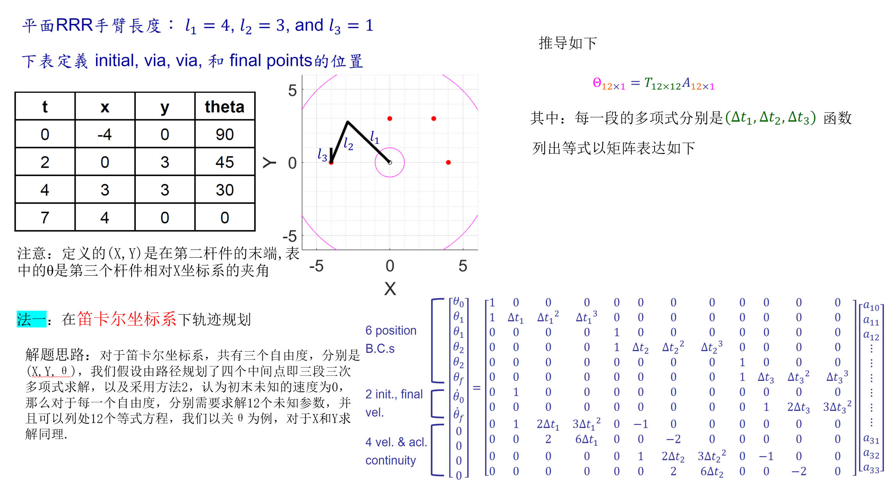

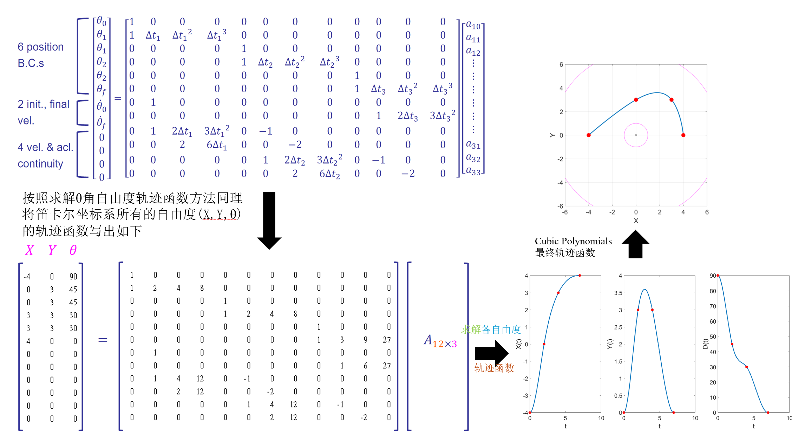


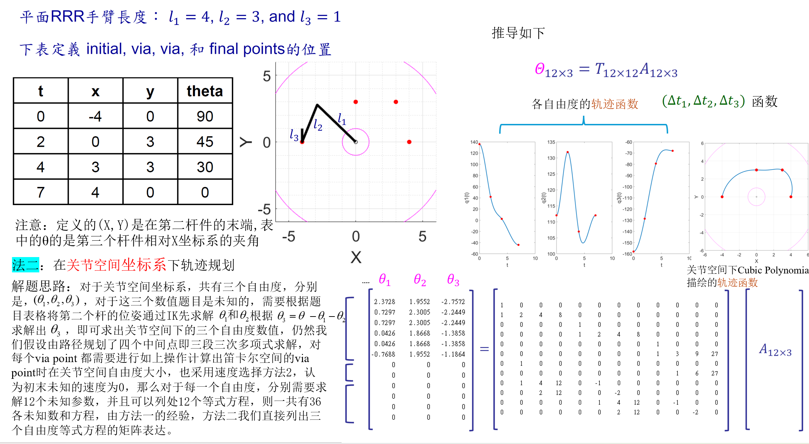


> ​		在位置控制中，一般是通过关节变量的离散序列来控制末端位姿的变化，因此无论是关节空间的轨迹规划，还是笛卡尔空间轨迹规划，最终都要给出关节变量的离散序列.


### 4.5.2.3 Quintic polynomial

三次多项式能够同时满足轨迹段两端的位置和速度约束，但由于其仅包含四个待定系数，无法进一步独立规定两端的加速度。因此，当机械臂需要更加平稳地启动或停止，或者需要明确控制轨迹端点处的加速度时，可以采用五次多项式进行轨迹规划。

```math
\theta(t) = a_0 + a_1 t + a_2 t^2 + a_3 t^3 + a_4 t^4 + a_5 t^5 = \sum_{i=0}^{5} a_i t^i
```

> 其中，$\theta$\为广义位置变量，既可以表示关节空间中的关节角，也可以表示笛卡尔空间中的某个位置或姿态分量。

五次多项式包含 6 个待定系数，因此需要建立 6个相互独立的约束方程。通常分别规定轨迹段起点和终点处的位置、速度与加速度：

```math
\begin{align*}
\theta_0 &= a_0 \\
\theta_f &= a_0 + a_1 \Delta t + a_2 \Delta t^2 + a_3 \Delta t^3 + a_4 \Delta t^4 + a_5 \Delta t^5 \\
\dot{\theta}_0 &= a_1 \\
\dot{\theta}_f &= a_1 + 2a_2 \Delta t + 3a_3 \Delta t^2 + 4a_4 \Delta t^3 + 5a_5 \Delta t^4 \\
\ddot{\theta}_0 &= 2a_2 \\
\ddot{\theta}_f &= 2a_2 + 6a_3 \Delta t + 12a_4 \Delta t^2 + 20a_5 \Delta t^3
\end{align*}
```

这 6 个约束方程恰好对应五次多项式的 6个待定系数，因此可以唯一确定该段轨迹

代数求解如下

```math
\begin{align*}
a_0 &= \theta_0 \\
a_1 &= \dot{\theta}_0 \\
a_2 &= \frac{1}{2} \ddot{\theta}_0 \\[1em]
a_3 &= \frac{20(\theta_f - \theta_0) - (8\dot{\theta}_f + 12\dot{\theta}_0)\Delta t - (3\ddot{\theta}_0 - \ddot{\theta}_f)\Delta t^2}{2\Delta t^3} \\[1em]
a_4 &= \frac{30(\theta_0 - \theta_f) + (14\dot{\theta}_f + 16\dot{\theta}_0)\Delta t - (3\ddot{\theta}_0 - 2\ddot{\theta}_f)\Delta t^2}{2\Delta t^4} \\[1em]
a_5 &= \frac{12(\theta_f - \theta_0) - (6\dot{\theta}_f + 6\dot{\theta}_0)\Delta t - (\ddot{\theta}_0 - \ddot{\theta}_f)\Delta t^2}{2\Delta t^5}
\end{align*}
```

在机械臂的一般点到点运动中，通常要求机械臂从静止状态平稳启动，并在终点处平稳停止。此时，可以令起点和终点处的速度与加速度均为零：

```math
\begin{align*}
a_0 &= \theta_0 \\
a_1 &= 0 \\
a_2 &= 0 \\[1em]
a_3 &= \frac{20(\theta_f - \theta_0)}{2\Delta t^3}
     = \frac{10(\theta_f - \theta_0)}{\Delta t^3} \\[1em]
a_4 &= \frac{30(\theta_0 - \theta_f)}{2\Delta t^4}
     = -\frac{15(\theta_f - \theta_0)}{\Delta t^4} \\[1em]
a_5 &= \frac{12(\theta_f - \theta_0)}{2\Delta t^5}
     = \frac{6(\theta_f - \theta_0)}{\Delta t^5}
\end{align*}
```

与三次多项式相比，五次多项式能够进一步控制端点加速度，使速度和加速度的变化更加平滑，因而更加适合对运动平稳性要求较高的轨迹规划任务。不过，五次多项式仍不能保证加加速度，即跃度（jerk）连续；若需要进一步约束跃度，则需要采用更高阶多项式或其他轨迹规划方法。

对于包含多个中间点的分段五次多项式轨迹，还需要根据实际要求规定各中间点的速度和加速度，或者建立相邻轨迹段之间的连续性约束。具体方程建立与系数求解过程可按照三次多项式的方法进一步推广，此处不再展开。

> 说明：
>
> ​		五次多项式与三次样条虽然都会使用加速度约束，但二者使用加速度约束的目的并不相同。  
>
> 对于单段五次多项式，由于存在 \(6\) 个待定系数，通常需要明确指定轨迹起点和终点的位置、速度以及加速度。因此，五次多项式中的加速度约束不仅要求加速度连续，还直接规定了端点加速度的具体数值，例如令起止加速度均为零：
>
> ```math
> \ddot{\theta}(t_i)=0,\qquad \ddot{\theta}(t_{i+1})=0.
> ```
>
> ​		对于分段三次样条，中间点处通常不预先指定加速度的具体数值，而只要求相邻两段轨迹在连接点处的加速度相等:
>
> ```math
> \ddot{\theta}_{j}(t_i)=
> \ddot{\theta}_{j+1}(t_i).
> ```
>
> 该条件只能保证加速度在连接点处不发生跳变，加速度的实际数值则由全部路径点、时间分配以及边界条件共同求解得到。

### 4.5.2.4  Linear Function with Parabolic Blends


在前文中，我们使用三次多项式描述整段运动轨迹，使位置以及速度满足相应的边界条件。除此之外，还可以采用一种结构更加直观、计算更加简单的轨迹规划方法，即**带抛物线过渡的直线轨迹规划**，也称为 **Linear Segment with Parabolic Blends，LSPB**。

若直接使用一次多项式连接起点位置 $\theta_0$ 和终点位置 $\theta_f$，可以得到一条匀速直线轨迹：

```math
\theta(t) = \theta_0 + vt
```

然而，当要求轨迹从静止状态开始并最终停止时，机械臂需要在起点处将速度瞬间由零变为 v，并在终点处将速度瞬间由 v变为零。这意味着起止时刻会出现**==速度突变==**，理论上需要**==无穷大的加速度==**，因而无法由实际机械系统实现。

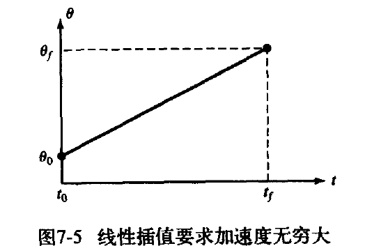

为解决该问题，可以保留中间阶段的匀速直线运动，并使用两段二次多项式分别修正轨迹的起始端和终止端：

- 起始阶段采用恒定正加速度，使速度由零逐渐增加至巡航速度；
- 中间阶段采用一次多项式，使系统以恒定速度运动；
- 终止阶段采用恒定负加速度，使速度由巡航速度逐渐降低至零。

因此，整段轨迹可划分为三个阶段：

```math

\theta(t) =
\begin{cases}
\theta_a(t), & 0 \le t \le t_b, \\[4pt]
\theta_l(t), & t_b \le t \le t_f - t_b, \\[4pt]
\theta_d(t), & t_f - t_b \le t \le t_f,
\end{cases}
```

其中，$\theta_a(t)$ 和 $\theta_d(t)$分别为加速段与减速段的二次多项式，$\theta_l(t)$为中间匀速段的一次多项式，$t_b$ 表示抛物线过渡段的持续时间。

采用这种规划方式后，轨迹的位置和速度均保持连续，其速度曲线呈梯形，因此该方法也常称为**梯形速度轨迹规划**。

> 需要注意的是，其加速度在三个阶段内部均为常数，但在阶段切换处会发生突变，因此加速度并不连续。

这里的 $\theta$ 为广义位置变量，既可以表示关节空间中的某个关节角，也可以表示笛卡尔空间中的某个位置或姿态分量。所谓“直线”主要指位置关于时间的中间匀速段为直线，并不一定表示机械臂末端在空间中沿直线运动。

#### 单段分析

为了构造这样的路径段，假设两端的抛物线拟合区段具有相同的持续时间；因此在这两个拟合区段中采用相同的恒定加速度（符号相反）。如图 7-7 所示，假定认为初始位置和末位置的速度为0，即

```math
\dot\theta_0=0,\quad \dot\theta_f=0
```

**==这里存在有多个解==**，但是每个结果都对称于时间中点$t_h$和位置中点$θ_h$，即

```math
t_h = \frac{1}{2} t_f, \quad \theta_h = \frac{\theta_f + \theta_0}{2}
```

由于拟合区段终点的速度必须等于直线段的速度即**==保证交界处速度连续==**，所以有

1. 在直线段交界处速度表示

```math
\dot{\theta} _{t_b} = \frac{\theta_h - \theta_b}{t_h - t_b}
```

2. 在抛物线交界处的是速度$\dotθ_b$的值由下式给出

```math
\dot\theta_{t_b}=\dot\theta_0+\ddot\theta_{t_b}·t_b\\

=\ddot\theta_{t_b}·t_b
```

联立两式得

```math
\ddot{\theta}· t_b = \dot{\theta}_{t_b}
= \frac{\theta_h - \theta_b}{t_h - t_b}
= \frac{\frac{\theta_f + \theta_0}{2} - \left( \theta_0 + \frac{1}{2}\ddot{\theta} t_b^2 \right)}{\frac{t_f}{2} - t_b}
= \frac{\theta_f - \theta_0 - \ddot{\theta} t_b^2}{t_f - 2t_b}
```

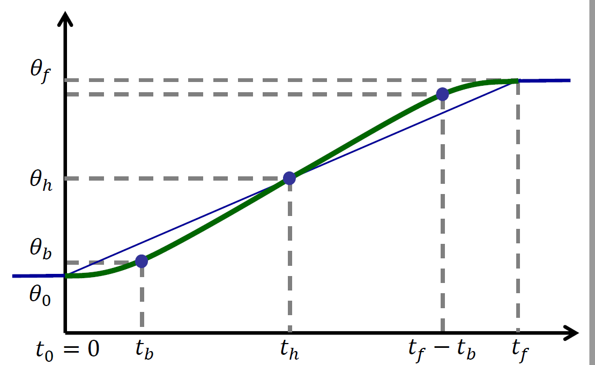

由上式展开得

```math
\ddot{\theta} t_b^2 - \ddot{\theta} t_f t_b + (\theta_f - \theta_0) = 0
```

式中，$t_f$是期望的运动时间。对于任意给定的 $\theta_f$，$\theta_0$ 和 $t_f$，可通过选取满足式上式的 **==$\ddot\theta$ 和 $t_b$ 来获得任意一条路径==**，即存在多解轨迹规划，通常，**==先选择加速度==** $\ddot\theta$ ，代入方程中，**==求解出相应的==** $t_b$。选择的加速度必须足够大，否则解将不存在。

求解$t_b$

```math
t_b = \frac{\ddot{\theta} t_f - \sqrt{\ddot{\theta}^2 t_f^2 - 4\ddot{\theta}(\theta_f - \theta_0)}}{2\ddot{\theta}}
```

在拟合区段使用加速度是有约束条件，从上述$t_b$得解也可以看出，需要满足判别式为正数,即


```math
\ddot{\theta} \ge \frac{4(\theta_f - \theta_0)}{t_f^2}
```

当上式的等号成立时，即加速度取最小值时

```math
\ddot{\theta}_{\min} = \frac{4(\theta_f - \theta_0)}{t_f^2}
```

直线部分的长度缩减为零，整个路径由两个拟合区段组成，且衔接处的斜率相等，将最小加速度带入得到，也能直观感受

```math
t_b =\frac{1}{2} t_f=t_h
```

如果加速度的取值越来越大，则拟合区段的长度将随之越来越短。当处于极限状态时，即：加速度无穷大，路径又回复到简单的线性插值情况。

而当上式不成立即不满足加速度约束条件式，则如图

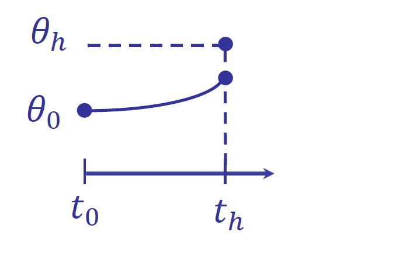

现在对以上仅有直线段、直线段和抛物线段结合、仅有抛物线段做图示对比如下

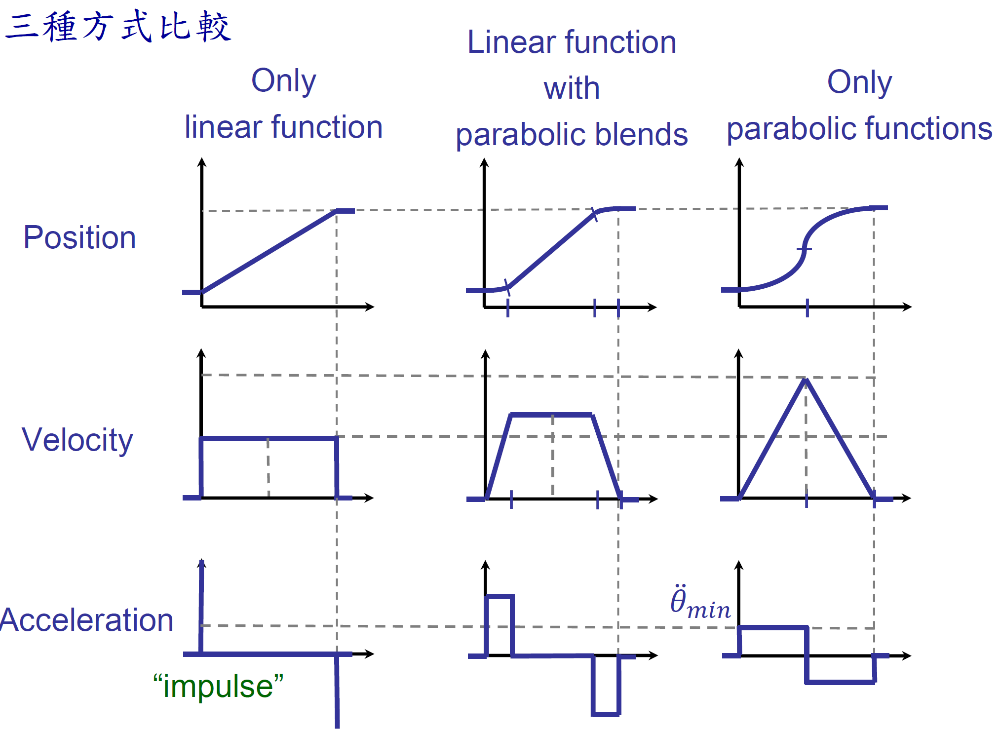


通过图发现，当加速度取最小值时即仅有抛物线段时，中间速度是仅有直线段速度得2倍，简要证明如下

```math
\dot{\theta}(t_b) = \ddot{\theta} t_b = \frac{4(\theta_f - \theta_0)}{t_f^2} \cdot \frac{t_f}{2} = 2 \frac{\theta_f - \theta_0}{t_f}
```

该速度为和原本无规划直接相连的速度：$\dot{\theta} = \frac{\theta_f - \theta_0}{t_f}$相比为 2 倍关系.

#### 多端分析

有了以上一段路径的轨迹分析，现在我们拓展到多端路径的轨迹分析，路径上指定了任意数量的中间点。图 7-9 所示，为某个关节$\theta$在关节空间的一组中间点，中间点之间使用线性函数相连，而各中间点附近使用抛物线拟合。

##### 1. 中间段

在这里将使用如下符号：用j,k和l表示三个相邻的路径点，位于路径点k处的拟合区段的时间间隔为$t_k$，位于点j和k之间的直线段的时间间隔为$t_{jk}$，点j和k之间总的时间间隔为$t_{djk}$。直线段的速度为$\dot\theta_{jk}$，而在点j处拟合区段的加速度为$\ddot\theta_j$，位于k和l段同上述标记，如图 7-9 所示。

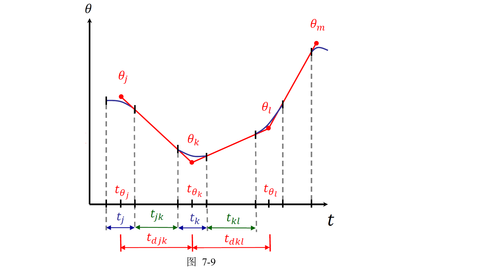

 与单段路径类似，多段直线轨迹的抛物线拟合**==也存在多组可行解==**，其具体形状取决于各路径点处采用的**==加速度==**或**==拟合时间==**。

```math
\dot{\theta}_{jk} = \frac{\theta_k - \theta_j}{t_{djk}}, \quad \dot{\theta}_{kl} = \frac{\theta_l - \theta_k}{t_{dkl}}.
```

抛物线拟合段需要使速度在时间 $t_k$ 内，由进入路径点前的速度 $\dot{\theta}_{jk}$，连续变化为离开路径点后的速度 $\dot{\theta}_{kl}$。由于拟合段采用恒定加速度，因此满足

```math
\dot{\theta}_{kl} = \dot{\theta}_{jk} + \ddot{\theta}_k t_k.
```

根据实际规划要求，可以采用以下两种方式确定抛物线拟合段。

1. 指定加速度，求解拟合时间

若已知路径点处允许采用的加速度大小 $\lvert\ddot{\theta}_k\rvert$，则首先根据速度变化方向确定加速度符号：

```math
\ddot{\theta}_k = \text{sgn}\left(\dot{\theta}_{kl} - \dot{\theta}_{jk}\right) \left|\ddot{\theta}_k\right|.
```

随后计算完成速度过渡所需的拟合时间：

```math
t_k = \frac{\dot{\theta}_{kl} - \dot{\theta}_{jk}}{\ddot{\theta}_k}
= \frac{\left|\dot{\theta}_{kl} - \dot{\theta}_{jk}\right|}{\left|\ddot{\theta}_k\right|}
```

这种方法适用于机械臂加速度能力已知，需要保证加速度不超过允许范围的情况。

2. 指定拟合时间，求解加速度

直接规定路径点附近抛物线拟合段的持续时间 $t_k$，则所需恒定加速度为

```math
\ddot{\theta}_k = \frac{\dot{\theta}_{kl} - \dot{\theta}_{jk}}{t_k}
```


这种方法适用于希望直接控制抛物线过渡区域长度或运动节奏的情况。

需要注意的是，这里的 $t_k$表示路径点$\theta_k$ 附近**完整抛物线拟合段的持续时间**。该拟合段以路径点时刻为中心，其前后两侧分别占用 $\tfrac12t_k$。

因此，相邻路径点 $\theta_k$ 与 $\theta_l$之间实际用于匀速直线运动的时间和速度大小为

```math
t_{kl} = t_{dkl} - \frac{1}{2}t_k - \frac{1}{2}t_l , \qquad\dot{\theta}_{kl} = \dot{\theta}_{jk} + \ddot{\theta}_k t_k.
```

为避免相邻抛物线拟合段相互重叠，必须满足

```math
t_{kl} \ge 0
```

> ​		若指定的加速度过小，则计算所得拟合时间可能过长，从而导致拟合区段重叠。此时需要增大加速度、延长路径段运动时间，或重新调整各拟合段时间。

> ​		当 $\dot{\theta}_{kl} = \dot{\theta}_{jk}$时，路径点两侧速度相同，不需要进行速度过渡，可以令 $t_k=0$，即不设置抛物线拟合段。

当拥有了抛物线段的加速度和时间，就可以求解出抛物线段的轨迹函数，以及拥有匀速直线运动的速度和时间可以求解出直线段的轨迹函数.

##### 2. 第一段

对于第一个路径段 $[\theta_1,\theta_2]$，其处理方式与内部路径段不同。由于轨迹从路径点 $\theta_1$开始，因此起点附近的**完整抛物线拟合段**都包含在第一个路径段的时间间隔 $t_{d12}$内。

假设轨迹由静止状态开始，即

```math
\dot{\theta}(0)=0.
```

起始抛物线段采用恒定加速度 $\ddot{\theta}_1$，在时间 $t_1$ 内将速度由零连续增加至第一段直线速度 $\dot{\theta}_{12}$，因此满足


```math
\dot{\theta}_{12}=\ddot{\theta}_1t_1
```

需要注意，加速度方向本质上应由速度变化方向决定：

```math
\operatorname{sgn}(\ddot{\theta}_1)
=
\operatorname{sgn}(\dot{\theta}_{12}-0)
```

由于第一段直线速度与位移 $\theta_2-\theta_1$同号，因此在起始速度为零的前提下，也可以写为

```math
{
\ddot{\theta}_1
=
\operatorname{sgn}(\theta_2-\theta_1)
|\ddot{\theta}_1|
}
```


即起始加速度方向与第一段运动方向相同。

根据第一路径段的位移关系，其直线段速度为

```math
\dot{\theta}_{12}
=
\frac{\theta_2-\theta_1}
{t_{d12}-\frac{1}{2}t_1}
```

结合速度连续条件，可得

```math
\frac{\theta_2-\theta_1}
{t_{d12}-\frac{1}{2}t_1}
=
\ddot{\theta}_1t_1
```

1. 若给定起点加速度大小，则可求得拟合时间：

```math
t_1 = t_{d12} - \sqrt{t_{d12}^2 - \frac{2(\theta_2 - \theta_1)}{\ddot{\theta}_1}}
```

这里选择较小的根，以保证拟合时间不超过路径段时间。为使结果存在实数解，必须满足

```math
|\ddot{\theta}_1| \ge \frac{2|\theta_2 - \theta_1|}{t_{d12}^2}.
```

2. 若直接规定起点拟合时间 $t_1$，则所需加速度为

```math
\ddot{\theta}_1 = \frac{\theta_2 - \theta_1}{t_1\left(t_{d12} - \frac{1}{2}t_1\right)}
```


求得 $t_1$ 和 $\ddot{\theta}_1$ 后，无论哪一种方法，都可以得到抛物线段的加速度和时间，，可以进一步计算直线段的速度


```math
\dot{\theta}_{12} = \ddot{\theta}_1 t_1,
```

以及第一段实际用于匀速直线运动的时间：

```math
t_{12} = t_{d12} - t_1 - \frac{1}{2}t_2
```

其中，$\tfrac12t_2$ 为路径点 $\theta_2$附近拟合段占用的时间，因此可以刻画出首段轨迹函数.


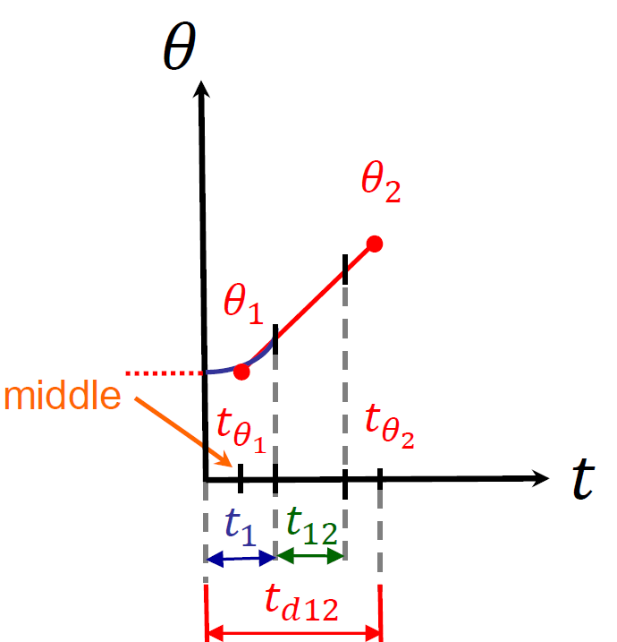

##### 3. 最后一段

对于最后一个路径段 $[\theta_{n-1},\theta_n]$，终点附近的完整抛物线拟合段$t_n$必须包含在总路径段时间 $t_{d(n-1)n}$内。

假设轨迹最终停止，即

```math
 \dot{\theta}(t_f)=0
```

终止拟合段采用恒定加速度 $\ddot{\theta}_n$，在时间 $t_n$内将末段直线速度$\dot{\theta}_{(n-1)n}$ 连续降低至零，因此满足

 

```math
0 = \dot{\theta}_{(n-1)n} + \ddot{\theta}_n t_n,
```

即

```math
\dot{\theta}_{(n-1)n} = -\ddot{\theta}_n t_n.
```

加速度方向应由速度变化方向决定：

```math
\operatorname{sgn}(\ddot{\theta}_n) = \operatorname{sgn}\left(0 - \dot{\theta}_{(n-1)n}\right).
```

因此，终止加速度方向与末段运动方向相反：

```math
\ddot{\theta}_n = \operatorname{sgn}(\theta_{n-1} - \theta_n) |\ddot{\theta}_n|
```


末段直线速度为

```math
\dot{\theta}_{(n-1)n} = \frac{\theta_n - \theta_{n-1}}{t_{d(n-1)n} - \frac{1}{2}t_n}.
```

结合速度连续条件，得到

```math
\frac{\theta_n - \theta_{n-1}}{t_{d(n-1)n} - \frac{1}{2}t_n} = -\ddot{\theta}_n t_n.
```


1. 若给定终点加速度大小，则拟合时间为

```math
t_n = t_{d(n-1)n} - \sqrt{t_{d(n-1)n}^2 + \frac{2(\theta_n - \theta_{n-1})}{\ddot{\theta}_n}}
```

由于 $\ddot{\theta}_n$与末段位移方向相反，根号中的第二项实际上为负值。为保证存在实数解，应满足

```math
|\ddot{\theta}_n| \ge \frac{2|\theta_n - \theta_{n-1}|}{t_{d(n-1)n}^2}.
```


2. 若直接规定终点拟合时间 $t_n$，则所需加速度为

```math
\ddot{\theta}_n = -\frac{\theta_n - \theta_{n-1}}{t_n \left(t_{d(n-1)n} - \frac{1}{2}t_n\right)}
```

> ​		通常用户只需给定中间点以及各个路径段的持续时间。在这种情况下，系统使用各个关节的默认加速度值。有时，为了方便用户起见，系统还可按照默认的速度来计算持续时间。对于各个拟合区段，加速度值必须取得足够大，以便在下一个拟合区段开始之前有足够的时间进入直线区段。

因此，同样无论哪种方法都可以求得抛物线段的加速度和时间，由图也可以求得末段实际用于匀速直线运动的时间为

```math
t_{(n-1)n} = t_{d(n-1)n} - \frac{1}{2}t_{n-1} - t_n
```

为了避免相邻拟合段发生重叠，最终还应检查

```math
t_{12} \ge 0, \quad t_{(n-1)n} \ge 0.
```

带入求得的抛物线段的加速度和时间求得直线段速度

```math
 \dot{\theta}_{(n-1)n} = -\ddot{\theta}_n t_n
```

因此可以求得出末端轨迹函数.

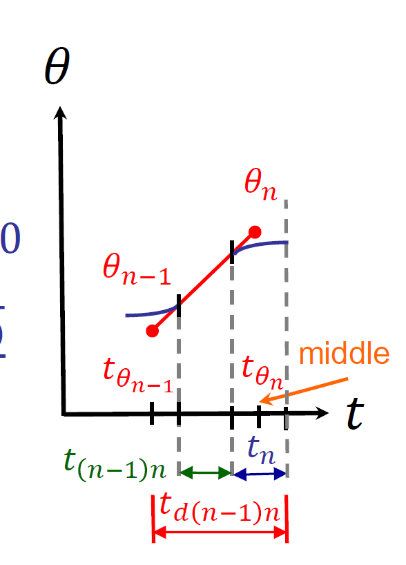


#### 伪中间点

在多段带抛物线拟合的直线轨迹中，普通中间点主要用于描述期望的运动趋势。图7-9可以看到，抛物线段会取代两条直线在路径点附近的尖锐连接部分，因此实际轨迹通常只会接近中间点，而不会准确经过该点。但是某些任务需求就希望操作臂**准确经过中间点且不停留**，可以不再将原中间点作为抛物线拟合中心，而是在其左右分别增加一个伪中间点，使原中间点位于两个伪中间点之间的匀速直线段上。

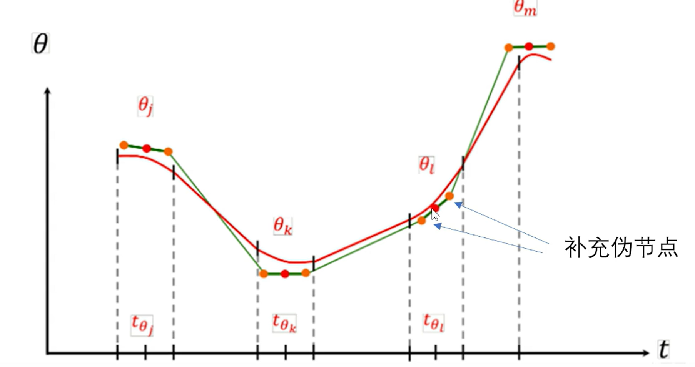

用于精确经过原中间点 $(t_j,\theta_j)$的两个伪节点并没有唯一的设置方式。只要原中间点位于两个伪节点之间的直线段上，便可以保证生成的轨迹准确经过该点。

因此，伪节点的确定需要额外选择：

- 轨迹经过原中间点时的速度 $v_j^\ast$；
- 两个伪节点与原中间点之间的时间间隔。

若用户已经规定经过速度，则直接采用指定值。若用户没有规定速度，可以使用启发式方法，将原中间点两侧直线段速度的算术平均值作为经过速度：

```math
v_j^* = \frac{v_j + v_{j+1}}{2}
```

其中，

```math
v_j = \frac{\theta_j - \theta_{j-1}}{t_j - t_{j-1}}, \quad v_{j+1} = \frac{\theta_{j+1} - \theta_j}{t_{j+1} - t_j}.
```

这种选择使经过速度同时考虑进入中间点前后的运动趋势，避免直接采用其中某一侧速度而造成较大的速度变化。

随后，在原中间点时刻 $t_j$ 的左右两侧选取相同的时间间隔 $\Delta T$：

```math
t_j^- = t_j - \Delta T, \quad t_j^+ = t_j + \Delta T.
```


根据经过速度 $v_j^\ast$，可确定左右伪节点的位置：

```math
\theta_j^- = \theta_j - v_j^* \Delta T, \quad \theta_j^+ = \theta_j + v_j^* \Delta T.
```

因此，两个伪节点分别为

```math
P_j^- = \left( t_j - \Delta T,\, \theta_j - \frac{v_j + v_{j+1}}{2} \Delta T \right)
\\
P_j^+ = \left( t_j + \Delta T,\, \theta_j + \frac{v_j + v_{j+1}}{2} \Delta T \right)
```


两个伪节点的位置关于原中间点对称，其连线速度为

```math
\frac{\theta_j^+ - \theta_j^-}{t_j^+ - t_j^-} = v_j^*.
```


因此，两个伪节点之间的直线轨迹为

```math
\theta(t) = \theta_j + v_j^* (t - t_j),
```


代入 $t=t_j$可得

```math
\theta(t_j) = \theta_j,
```

从而保证轨迹准确经过原中间点。

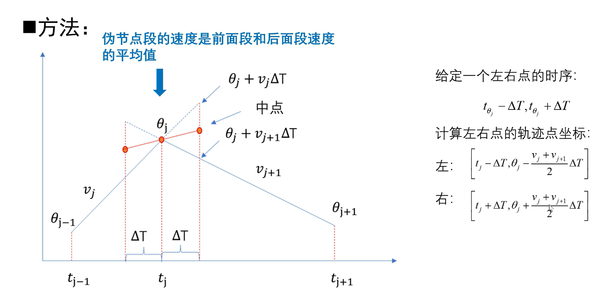

下面对是否添加伪节点后的轨迹经过中间点情况进行对比如下

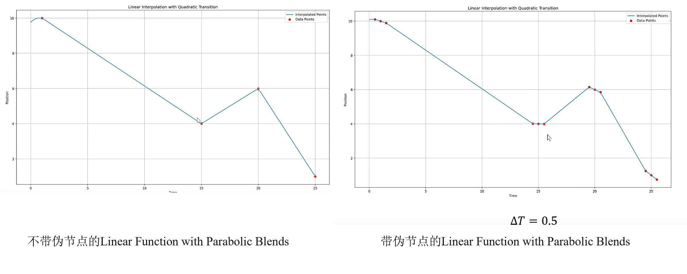


**Case**

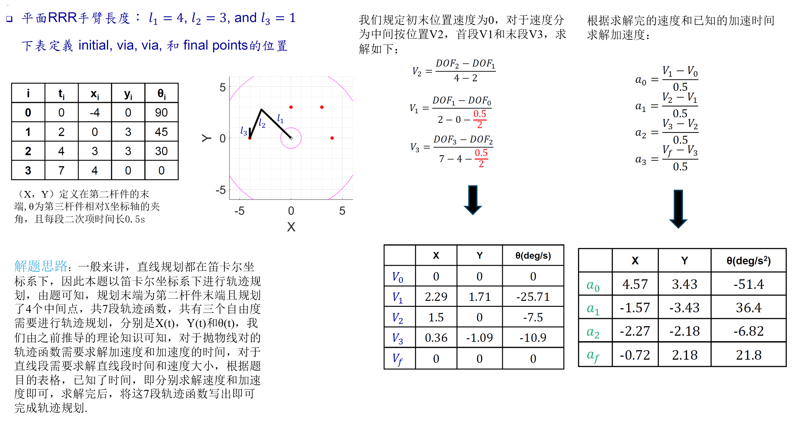


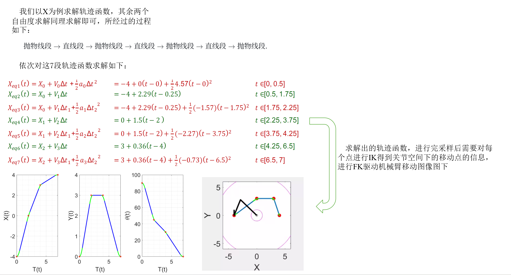

> 一般来说，若存在 \(N+1\) 个路径点，便具有 \(N\) 个直线段和 \(N+1\) 个抛物线段，因此总分段数为2N+1个时间段即轨迹函数

### 4.5.2.5 总结

轨迹规划完成后，还需要检查整条轨迹是否超过机械臂允许的关节位置、速度和加速度限制。若轨迹超出限制，则需要增加运动时间、降低期望运动速度或重新生成轨迹，这也就是接下来我们要讲解的控制执行所完成的任务。

> 轨迹规划并不改变机械臂需要经过的几何路径，其主要作用是规定机械臂沿该路径运动时的时间、速度和加速度规律。

## 4.5.3 控制执行

轨迹规划得到的是关于时间连续变化的期望轨迹函数。然而，机械臂控制器属于数字控制系统，不能一次性接收并执行完整的连续函数，而是需要按照固定控制周期不断接收当前时刻的期望运动状态。因此，在实际控制前，需要对连续轨迹进行等时间采样。

设控制周期为 $\Delta t$，则第 $k$ 个控制时刻为：

```math
t_k=t_0+k\Delta t
```


将采样时刻代入连续关节轨迹，可以得到对应的期望关节位置、速度和加速度：

```math
\boldsymbol q_{d,k}
=
\boldsymbol q_d(t_k)
\\
\boldsymbol q_{d,k}
=
\boldsymbol q_d(t_k)
\\
\dot{\boldsymbol q}_{d,k}
=
\dot{\boldsymbol q}_d(t_k)
\\
\ddot{\boldsymbol q}_{d,k}
=
\ddot{\boldsymbol q}_d(t_k)
```

需要注意，控制执行阶段的采样是按照固定控制周期进行的**等时间采样**，与 RRT 等路径规划算法中的随机采样含义不同。路径规划中的随机采样用于搜索无碰撞路径，而控制执行中的等时间采样用于生成能够逐周期发送给控制器的期望指令。

在发布指令前，需要检查采样轨迹是否满足机械臂约束：

```math
q_{i,\min}
\leq
q_{d,i}(t_k)
\leq
q_{i,\max}
\\
\left|\dot q_{d,i}(t_k)\right|
\leq
\dot q_{i,\max}
\\
\left|\ddot q_{d,i}(t_k)\right|
\leq
\ddot q_{i,\max}
```


对于笛卡尔空间轨迹，还需要通过逆运动学获得关节位置，并利用雅可比矩阵检查末端速度对应的关节速度是否超过限制，以及机械臂是否接近奇异位形。

轨迹通过约束检查后，控制器按照固定周期接收期望状态。根据机械臂控制接口，可以发布：

- 期望关节位置 $\boldsymbol q_{d,k}$；
- 期望关节位置和速度 $\boldsymbol q_{d,k},\dot{\boldsymbol q}_{d,k}$；
- 完整期望关节状态 $\boldsymbol q_{d,k},\dot{\boldsymbol q}_{d,k},\ddot{\boldsymbol q}_{d,k}$；
- 或期望笛卡尔位姿和末端速度。

在轨迹执行过程中，控制器还需要读取机械臂编码器和传感器反馈，获得实际关节位置与速度：

```math
\boldsymbol q_{a,k},\qquad
\dot{\boldsymbol q}_{a,k}
```


并计算期望状态与实际状态之间的跟踪误差：

```math
\boldsymbol e_k
=
\boldsymbol q_{d,k}
-
\boldsymbol q_{a,k}
```

当出现跟踪误差过大、通信超时、关节超限、碰撞或控制器报警时，应停止轨迹发布并使机械臂进入安全状态。

因此，控制执行过程可以表示为：

```math
\text{连续时间轨迹}
\rightarrow
\text{等周期采样}
\rightarrow
\text{约束检查}
\rightarrow
\text{发布期望指令}
\rightarrow
\text{驱动机械臂运动}
\rightarrow
\text{读取反馈并监测状态}
```


> 轨迹规划器负责生成机械臂应当如何运动的期望状态，控制器负责驱动实际机械臂跟踪这些期望状态。


### 4.5.3.1 轨迹采样与实时生成


### 4.5.3.2 轨迹约束检查


### 4.5.3.3 控制指令发布与反馈监测


```math
{
\text{环境与机器人模型}
\rightarrow
\text{路径规划}
\rightarrow
\text{无碰撞关节路径点}
\rightarrow
\text{路径平滑}
\rightarrow
\text{轨迹规划}
\rightarrow
\text{控制执行}
}
```


