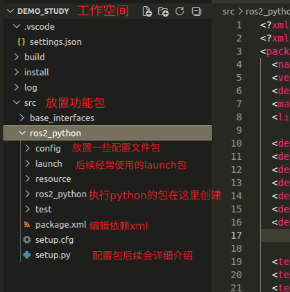
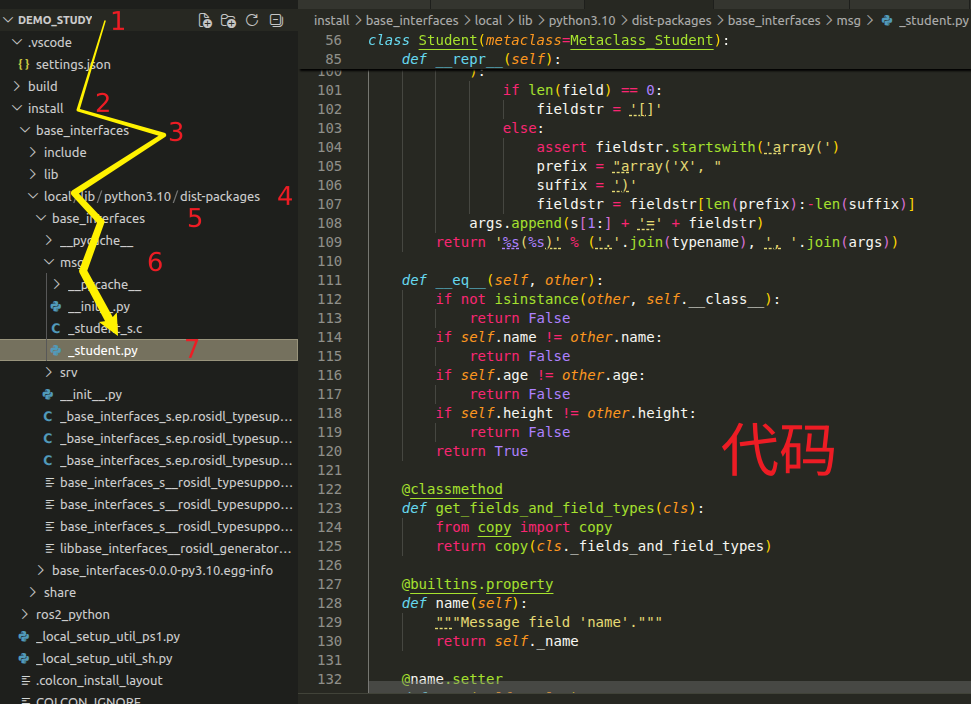
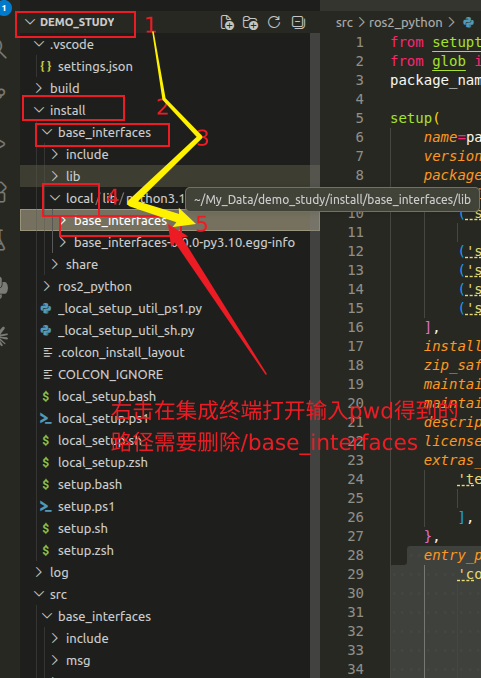
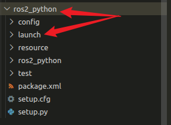
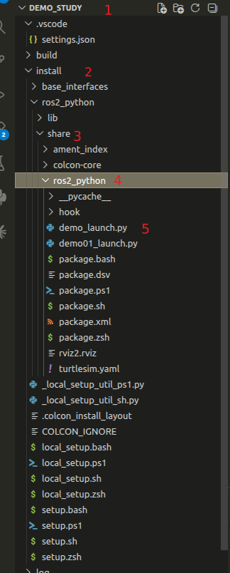
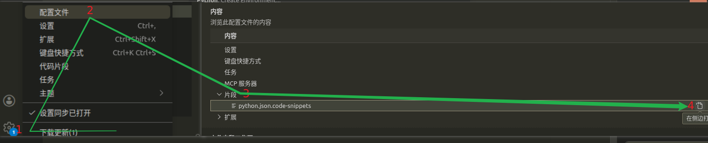
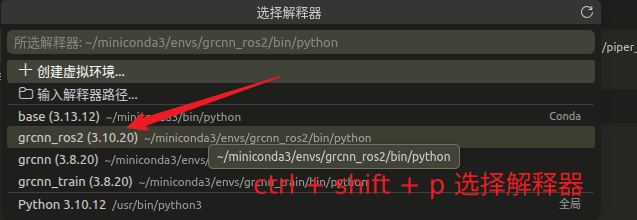
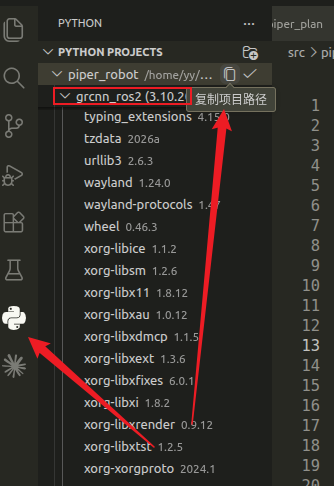
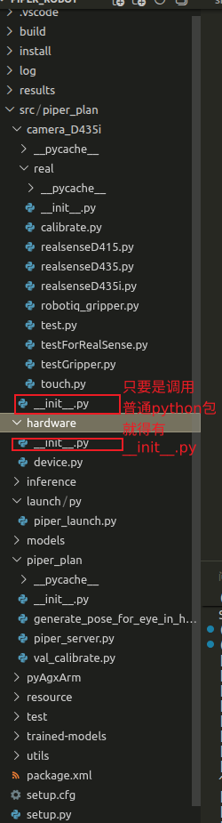

# 5.2 ROS2

#### 1. 简介

在正式动手编写任何代码之前，我们首先需要从宏观的角度建立对 ROS 2 的认知：它究竟是什么？为什么整个机器人行业都在向它迁移？它在当今的机器人开发中又扮演着怎样的角色？

##### 1.1 超越传统意义的“操作系统”

当我们听到“机器人操作系统（Robot Operating System, ROS）”这个名字时，初学者极易将其与 Windows、Linux 或 macOS 混为一谈。但明确地说，ROS / ROS 2 并不是一个传统意义上的操作系统。传统操作系统负责管理计算机的底层硬件（如 CPU、内存）和基本软件资源；而 ROS 2 运行在这些传统操作系统（甚至是实时操作系统或裸机）之上，它是一个**次级操作系统（Meta-Operating System）\**或称为\**机器人中间件（Middleware）**。

如果我们把开发机器人比作“建造一座现代化的城市”，那么 Linux/Windows 就是城市的“土地和底层地基”；而 ROS 2 则是城市的“基础设施网络”，它铺设了自来水管、电网和道路交通。基于这个坚实的基础设施，开发者编写的各个 Node（节点）就像是城市里拔地而起的房屋、工厂和商店。

具体而言，ROS 2 为开发者提供了四大核心支撑：一套基于发布/订阅、服务、动作的高效进程间**通信框架**；一系列强大的调试、可视化和数据记录**开发工具**（如 RViz2、Rosbag2）；庞大的现成**算法功能包**（如 Nav2 导航、MoveIt2 机械臂控制）；以及一个由全球数以万计开发者共享知识的**开源生态系统**。

##### 1.2 从实验室走向工业现场的必然演进

了解了 ROS 2 的本质后，我们不禁会问：这样一套庞大的系统是如何演变而来的？这就不得不提及它的前身——ROS 1。

2007 年，美国 Willow Garage 实验室诞生了最早的 ROS。它的初衷非常纯粹：“为了避免重复造轮子，让大学和研究机构能快速分享机器人代码”。凭借这一理念，ROS 1 在学术界取得了空前的成功。然而，随着机器人技术的高速发展，企业开始尝试将 ROS 1 应用于自动驾驶、工厂自动化等商业和工业场景。此时，原本为实验室完美网络环境设计的 ROS 1 暴露出了致命的局限性：它无法满足严苛的实时性要求、对网络波动极度敏感，且存在严重的单点故障隐患（一旦 Master 节点崩溃，整个机器人的通信将全面瘫痪）。

面对这些无法通过局部修补来解决的底层架构缺陷，ROS 的维护组织做出了一个艰难但伟大的决定：推倒重来，从底层重写。从 2015 年概念的正式提出，到如今 Humble、Jazzy 等长期支持版（LTS）的发布，ROS 2 已经彻底成熟，正式接过了 ROS 1 的接力棒。

##### 1.3 直击商业化落地痛点的核心设计

ROS 2 的诞生并非为了盲目追逐新技术，而是为了精准解决机器人商业化落地过程中的几个核心痛点：

首先是**分布式与去中心化**。ROS 2 彻底消除了中心化的 `roscore` 节点，采用平等的 P2P 自动发现机制，从根本上杜绝了单点故障拖垮整个系统的可能。其次是**对实时性（Real-time）的保障**。在控制电机或自动驾驶紧急制动时，指令必须在极短的时间内（如 1 毫秒）送达，ROS 2 从底层架构上为这种实时系统提供了支持。

不仅如此，离开实验室后，现实中的机器人（如农业无人机、水下机器人）经常面临网络断连和高延迟。ROS 2 强大的**恶劣网络环境适应能力**确保了系统的稳定运行。同时，它不仅着眼于单体机器人，更原生支持**多机器人协同**，轻松应对庞大的仓储物流车队。最后，借助 micro-ROS 项目，ROS 2 的触角得以向下延伸，实现了对**微控制器（MCU）的支持**，真正深入到了机器人底层的传感器和执行器硬件中。

##### 1.4 底层架构的全面进化

为了实现上述宏大的设计目标，ROS 2 相较于 ROS 1 完成了一场革命性的技术升级。对于开发者而言，这些进化体现在底层原理到上层代码的方方面面：

| 特性维度           | ROS 1 (实验室产物)           | ROS 2 (工业级标准)                    | 核心原理突破                                                 |
| ------------------ | ---------------------------- | ------------------------------------- | ------------------------------------------------------------ |
| **底层通信**       | 基于自定义的 TCPROS / UDPROS | 基于工业标准的 **DDS** (数据分发服务) | 将通信层交给了久经军工和航空验证的 DDS 协议，这是其获得极高可靠性的基石。 |
| **系统架构**       | 中心化（必须启动 Master）    | **去中心化**（P2P 自动发现机制）      | 即使网络中某个节点意外断开，其余节点的通信也不受任何影响，实现真正的即插即用。 |
| **服务质量 (QoS)** | 仅支持可靠传输（TCP）        | **高度可配置的 QoS**                  | 允许开发者灵活选择：“务必送达（Reliable）”还是“只管发最新的，丢了就算了（Best Effort，适合视频流）”。 |
| **多平台支持**     | 强依赖 Ubuntu (Linux)        | **全平台原生支持**                    | 原生跨平台支持 Windows、macOS、Linux 以及各种实时操作系统，开发部署更加自由。 |
| **编程语言**       | C++98 / 11, Python 2         | **C++14/17/20, Python 3**             | 全面拥抱现代化的语言特性，代码更安全、更高效。               |
| **生命周期管理**   | 节点启动后状态不可控         | **生命周期节点 (Lifecycle Nodes)**    | 引入有限状态机，让开发者精确控制节点的配置、激活、关闭等状态，极其契合工业部署规范。 |
| **安全性**         | 几乎无安全机制（明文裸奔）   | **SROS 2 (原生安全)**                 | 依托 DDS-Security，实现了节点间的身份认证、数据加密和访问控制，防止机器人被恶意劫持。 |

##### 1.5  重塑当今行业的应用版图

得益于这场彻底的重构，今天的 ROS 2 已经完全褪去了“实验室玩具”的标签，成为各行各业顶尖科技公司构建复杂机器人系统的首选框架。

在**自动驾驶**领域，以 Autoware.Auto 为代表的开源自动驾驶栈全面基于 ROS 2 构建，众多一线车企在量产车型的研发中广泛使用它进行中间件通信和算法验证。在**工业机器人与智能制造**中，借助 ROS 2 Industrial 项目，传统机械臂开始与 AI 视觉、柔性制造深度融合。

同时，亚马逊等巨头大力投入的**仓储与物流机器人（AMR）\**集群，正在大量依赖 ROS 2 的多机协同和 Nav2 导航框架。甚至在\**太空与极端环境探索**中，美国宇航局（NASA）的 VIPER 月球车项目也直接采用了 ROS 2，借助其极高的可靠性在极端网络延迟下执行探索任务。此外，无人驾驶拖拉机、果园采摘机器人等**农业与特种设备**，也正利用 ROS 2 强大的外设生态和 QoS 机制在恶劣环境中稳定作业。


简而言之，ROS 2 是一场直击现实痛点的技术升维。对于任何想要在现代机器人行业立足的开发者来说，掌握 ROS 2 已经不再是简历上的“加分项”，而是开启智能机器人时代大门的“必修课”。


#### 2. 通信机制

通信机制有话题通信、服务通信、动作通信和参数通信，并且即可以使用C++实现，也可以使用Python实现，但为了更好适配我们本书机械臂教程，我们将以Python代码编写进行讲解。

首先在进行通信机制代码编写之前，我们需要先创建工作空间并进行相关配置，建议初学者跟着我的代码手敲一遍便于加强记忆，并且我们本节ROS2均在以下的工作空间进行讲解。

```shell
mkdir -p demo_study/src
cd src
ros2 pkg create ros2_python --build-type ament_python --dependencies rclpy std_msgs gepmetry_msgs turtlesim tf2_ros tf_transformations
cd ..
colcon build
```


创建完空间后我们开始详细介绍。


##### 2.1 话题通信

首先在刚刚创建的空间中找到ros2_python，如图，创建talker.py和listener.py。




上述代码简单直接进行展示如下：

talker.py：

```python
"""  
    需求：
    流程：
        1.导包；
        2.初始化ROS2客户端；
        3.自定义节点类；
                        
        4.调用spain函数，并传入节点对象；
        5.资源释放。 


"""
# 1.导包；
import rclpy
from rclpy.node import Node
from std_msgs.msg import String
# 3.自定义节点类；
class Talker(Node):
    def __init__(self):
        super().__init__("Talker_node_py")
        self.count=0
        self.get_logger().info("创建成功")
        self.pub_ = self.create_publisher(String,"chatter",10)
        self.time_ = self.create_timer(1.0,self.time_pub)
    def time_pub(self):
        message = String()
        self.count+=1
        message.data = "hellow" + str(self.count)
        self.pub_.publish(message)
        self.get_logger().info(message.data)

def main():
    # 2.初始化ROS2客户端；
    rclpy.init()
    # 4.调用spain函数，并传入节点对象；
    rclpy.spin(Talker())
    # 5.资源释放。 
    rclpy.shutdown()

if __name__ == '__main__':
    main()
```


listener.py：

```python
"""  
    需求：
    流程：
        1.导包；
        2.初始化ROS2客户端；
        3.自定义节点类；
                        
        4.调用spain函数，并传入节点对象；
        5.资源释放。 


"""
# 1.导包；
import rclpy
from rclpy.node import Node
from std_msgs.msg import String
# 3.自定义节点类；
class Listener(Node):
    def __init__(self):
        super().__init__("Listener_node_py")
        self.sub_ = self.create_subscription(String,"chatter",self.do_cb,10)
    
    def do_cb(self,msg):
        self.get_logger().info("接收到的消息 %s" % msg.data)
def main():
    # 2.初始化ROS2客户端；
    rclpy.init()
    # 4.调用spain函数，并传入节点对象；
    rclpy.spin(Listener())
    # 5.资源释放。 
    rclpy.shutdown()

if __name__ == '__main__':
    main()
```


编写完代码后我们需要进行配置，打开该功能包下的setup.py。我们进行如下配置：

```python
entry_points={
        'console_scripts': [
            'talker = ros2_python.talker:main',
            'listener = ros2_python.listener:main',
        ],
    },
```

然后进行编译和运行即可，最终效果就是，发送方发送信息，接收方接受到信息。

```shell
colcon build --packages-select ros2_python
. install/setup.bash
ros2 run ros2_python talker
ros2 run ros2_python listener
```


##### 2.2 话题通信+接口文件

通常发送的话题不是基本的String（即刚刚使用的接口文件std_msgs）而是通常自定义的接口文件，这里我们也是用自定义接口文件通过话题通信实现接口文件内容的信息传输。

首先任然是创建对应的包，分别是talker_msg.py和listener_msg.py。

既然我们是要调用自定义功能包所以需要创建自定义功能包。但不同的是自定义共嫩包目前只支持C++的传创建。所以，使用如下命令进行创建。

```shell
创建前保证你的当前位置处于：
~/My_Data/demo_study(你的工作空间)：
执行：
cd src
ros2 pkg create base_interfaces --build-type ament_camke 
cd ..
colcon build
```

接着在刚创建的base_interfaces下创建msg文件夹，在msg下创建Student.msg（请注意，这里的Student.msg是举例子，自己编写时候注意开头字母一定**大写**，并且文件格式一定是**.msg**）,在Student.msg下编写如下内容：

```python
string   name
int32    age
float64  height
```

然后对接口文件进行配置。

CmakeLlist.txt:

```txt
#--------------------新增1--------------------------
find_package(rosidl_default_generators REQUIRED)
#--------------------新增2--------------------------
#为接口文件生成源码
rosidl_generate_interfaces(${PROJECT_NAME}
  "msg/Student.msg"
 
)
```

package.xml

```xml
  <!-- 编译依赖 -->
  <build_depend>rosidl_default_generators</build_depend>
  <!-- 执行依赖 -->
  <exec_depend>rosidl_default_runtime</exec_depend>
  <!-- 声明当前包所属的功能包 -->
  <member_of_group>rosidl_interface_packages</member_of_group>
  
```


配置完成base_interfaces进行编译，编译成功后如何验证自己的接口文件是否可用。可以在工作空间的install包进入base_interface/include可以看到可以使用的头文件，但是我们在talker_msg.py或者listener_msg.py使用使用的是base_interfaces/local/base_interfaces/msg中可以查看_student.py。这里就是我们python调用接口文件的代码了。



代码相对简单直接进行展示。
talker_msg.py:

```python
"""  
    需求：
    流程：
        1.导包；
        2.初始化ROS2客户端；
        3.自定义节点类；
                        
        4.调用spain函数，并传入节点对象；
        5.资源释放。 


"""
# 1.导包；
import rclpy
from rclpy.node import Node
from base_interfaces.msg import Student
# 3.自定义节点类；
class Talker_msg(Node):
    def __init__(self):
        super().__init__("Talker_msg_node_py")
        self.stu_ = Student()
        self.stu_.age = 10
        self.pub_ = self.create_publisher(Student,"chatter",10)
        self.time_ = self.create_timer(1.0,self.time_pub)
    def time_pub(self):
        
        self.stu_.age+=1
        self.stu_.height=1.90
        self.stu_.name="小明"
        self.pub_.publish(self.stu_)
        self.get_logger().info("身高 %.2f 姓名 %s 年龄 %d" %(self.stu_.height,self.stu_.name,self.stu_.age))

def main():
    # 2.初始化ROS2客户端；
    rclpy.init()
    # 4.调用spain函数，并传入节点对象；
    rclpy.spin(Talker_msg())
    # 5.资源释放。 
    rclpy.shutdown()

if __name__ == '__main__':
    main()
```


listener_msg.py:

```python
"""  
    需求：
    流程：
        1.导包；
        2.初始化ROS2客户端；
        3.自定义节点类；
                        
        4.调用spain函数，并传入节点对象；
        5.资源释放。 


"""
# 1.导包；
import rclpy
from rclpy.node import Node
from base_interfaces.msg import Student
# 3.自定义节点类；
class Listener_msg(Node):
    def __init__(self):
        super().__init__("Listener_msg_node_py")
        self.sub_ = self.create_subscription(Student,"chatter",self.do_cb,10)
    def do_cb(self,stu_:Student):
        self.get_logger().info("高：%f， 姓名:%s, 年龄%d" %(stu_.height,stu_.name,stu_.age))
def main():
    # 2.初始化ROS2客户端；
    rclpy.init()
    # 4.调用spain函数，并传入节点对象；
    rclpy.spin(Listener_msg())
    # 5.资源释放。 
    rclpy.shutdown()

if __name__ == '__main__':
    main()
```


代码编写完了需要进行配置，此处配置不仅仅是setup.py了

首先我们既然要使用接口文件就要把接口文件当作一个可调用的文件，就比如之前我们使用的String他来自于我们创建时候添加的依赖std_msgs。这里也一样我们需要添加base_interfaces依赖进入到。

package.xml:

```xml
<depend>base_interface</depend>
```

同样之前的setup.py:

```python
  entry_points={
        'console_scripts': [
            'talker = ros2_python.talker:main',
            'listener = ros2_python.listener:main',
            'talker_msg = ros2_python.talker_msg:main',
            'listener_msg = ros2_python.listener_msg:main',
        ],
    },
```

最后需要配置setting.json，因为我们发现调用头文件frmo base_interfaces.msg import Student,msg是没有提示Student,msg。也就是没有正常识别然后补写，涉及到类似问题我们需要配置setting.json。

ctrl + shift + p，然后输入setting.json配置，需要输入base_interfaces能被识别的路劲如图去寻找。




最终效果,如下配置，仅供参考，不可直接复制需要按照上边步骤得到自己的路劲：

```python
{
    "python.autoComplete.extraPaths": [
        "/home/yy/My_Data/demo_study/install/base_interfaces/local/lib/python3.10/dist-packages"
    ],
    "python.analysis.extraPaths": [
        "/home/yy/My_Data/demo_study/install/base_interfaces/local/lib/python3.10/dist-packages"
    ]
}
```

最后编译运行即可。


##### 2.3 服务通信

有了之前的基础服务通信的创建和配置就容易很多了，所以就不再指导部分配置。话不多说我们直接上代码。

首先创建server.py和client.py。并且需要服务通信的接口文件格式是.srv。所以我们在base_interfaces创建srv包，在src包下创建AddInts.srv，同理这里首字母一定大写。写入如下内容：

```shell
int32 num1
int32 num2
---
int32 sum
```


这里的---就是区分request和response的。

然后对服务接口配置进入到base_interfaces中的CmakeList.tst配置如下：

```txt
#--------------------新增1--------------------------
find_package(rosidl_default_generators REQUIRED)

#--------------------新增2--------------------------
#为接口文件生成源码
rosidl_generate_interfaces(${PROJECT_NAME}
  "msg/Student.msg"
  "srv/AddInts.srv"
)
```


package.xml：如果之前话题接口配置了这里不用配置因为是一样的。

```xml
  <buildtool_depend>ament_cmake</buildtool_depend>
  <!-- 编译依赖 -->
  <build_depend>rosidl_default_generators</build_depend>
  <!-- 执行依赖 -->
  <exec_depend>rosidl_default_runtime</exec_depend>
  <!-- 声明当前包所属的功能包 -->
  <member_of_group>rosidl_interface_packages</member_of_group>
  
```

最后编译运行，检查方法和话题通信一样不再次介绍。对于setting.json是否需要配置呢？不需要。因为之前我们的setting.json的配置就是把base_interfaces下所有所创建可调用的接口文件都直接写入了可以实现base_interfaces下所有的接口文件代码补写。

同样对于服务通信代码内容直接给出，配置不做解释。

server.py:

```python
"""  
    需求：
    流程：
        1.导包；
        2.初始化ROS2客户端；
        3.自定义节点类；
                        
        4.调用spain函数，并传入节点对象；
        5.资源释放。 


"""
# 1.导包；
import rclpy
from rclpy.node import Node
from base_interfaces.srv import AddInts
# 3.自定义节点类；
class Server(Node):
    def __init__(self):
        super().__init__("Server_node_py")
        self.get_logger().info("创建成功server")
        self.server_ = self.create_service(AddInts,"chatter",self.add)
    def add(self,request:AddInts.Request,response:AddInts.Response):
        response.sum = request.num1 + request.num2  
        self.get_logger().info("%d + %d = %d " %(request.num1,request.num2 ,response.sum))
        return response

def main():
    # 2.初始化ROS2客户端；
    rclpy.init()
    # 4.调用spain函数，并传入节点对象；
    rclpy.spin(Server())
    # 5.资源释放。 
    rclpy.shutdown()

if __name__ == '__main__':
    main()
```


client.py:

```python
"""  
    需求：
    流程：
        1.导包；
        2.初始化ROS2客户端；
        3.自定义节点类；
                        
        4.调用spain函数，并传入节点对象；
        5.资源释放。 


"""
# 1.导包；
import rclpy
from rclpy.node import Node
from base_interfaces.srv import AddInts
from rclpy.logging import get_logger
import sys
# 3.自定义节点类；
class Client(Node):
    def __init__(self):
        super().__init__("Client_node_py")
        self. client_ = self.create_client(AddInts,"chatter")
        while not self.client_.wait_for_service(1.0):
            self.get_logger("服务连接中...")
    def send_request(self):
        request = AddInts.Request()
        request.num1 = int(sys.argv[1])
        request.num2 = int(sys.argv[2])
        self.future  =  self.client_.call_async(request)


def main():

    
    if len(sys.argv)!=3:
        get_logger().info("请提交两个整形数据")
        return
    # 2.初始化ROS2客户端；
    rclpy.init()
    client_ = Client()
    #客户端发送数据
    client_.send_request()
    #等待接受服务端返回的结果
    rclpy.spin_until_future_complete(client_,client_.future)

    try:
        response = client_.future.result()
        client_.get_logger().info("相应结果sum=%d" % response.sum)
    except Exception:
        client_.get_logger().error("服务相应失败")
    # 4.调用spain函数，并传入节点对象；
    
    # 5.资源释放。 
    rclpy.shutdown()

if __name__ == '__main__':
    main()
```


##### 2.4 参数服务

> 参数（Parameter）本质上是 ROS 2 节点的全局配置变量。每个节点在创建时，内部会自动启动一个参数服务端。这允许我们在**节点启时或运行期间**，对参数进行声明、获取、修改和删除。
>
> 参数的初始值可以直接写在代码中，也可以通过 YAML 配置文件或命令行灵活传入。当节点运行时，我们可以打开一个新的终端（注意必须先执行 `source install/setup.bash` 刷新环境变量），使用 `ros2 param list`、`ros2 param get` 或 `ros2 param set` 等工具来查看或动态修改节点内的参数。这种机制完美地实现了终端命令与底层代码逻辑的实时互动。


废话不多说，直接上代码，同样代码也不难理解。配置同上不做解释。


```python
"""  
    需求：
    流程：
        1.导包；
        2.初始化ROS2客户端；
        3.自定义节点类；
                        
        4.调用spain函数，并传入节点对象；
        5.资源释放。 


"""
# 1.导包；
import rclpy
from rclpy.node import Node

# 3.自定义节点类；
class Param_server(Node):
    def __init__(self):
        #允许删除参数需要提前声明
        super().__init__("Param_server_node_py",allow_undeclared_parameters=True)

    def declare_param(self):
        self.get_logger().info("新增参数")
        self.declare_parameter("car_name","tiger")
        self.declare_parameter("width",1.2)
        self.declare_parameter("wheels",2)

    def get_param(self,your_param :str | None =None ,your_params : list | None  = None,use_multiple=False,include_param=False):
        if not use_multiple:
            self.get_logger().info("获取单个参数")
            your_param=self.get_parameter(your_param)
            self.get_logger().info(" %s = %s"% (your_param.name,your_param.value))
        else:
            self.get_logger().info("获取多个参数")
            params = self.get_parameters(your_params)
            for param in params:
                self.get_logger().info("%s = %s" % (param.name,param.value))
            self.get_logger().info("判断是否包含某个参数")
        if include_param:
            if your_param==None:
                self.get_logger().info("未输入参数")
                return
            self.get_logger().info("包含 %s 吗？ %d" % (your_param,self.has_parameter(your_param)))
    def update_param(self,your_param:str,param_value:str):
        
        self.get_logger().info("更新%s参数"%your_param)
        self.set_parameters([rclpy.Parameter(your_param,value=param_value)])
        your_param = self.get_parameter(your_param)
        self.get_logger().info("更新后的%s = %s" %(your_param.name,your_param.value))


    def del_param(self,your_param:str):
        self.get_logger().info("删除参数")
        self.undeclare_parameter(your_param)
        self.get_logger().info("是否成功删除 %s -> %d| 0 成功 1 失败" % (your_param,self.has_parameter(your_param)))
def main():
    # 2.初始化ROS2客户端；
    rclpy.init()
    # 4.调用spain函数，并传入节点对象；
    param_server = Param_server()
    param_server.declare_param()
    param_server.get_param(your_params=["car_name","width"],use_multiple=True)
    param_server.update_param(your_param="wheels",param_value=5)
    param_server.del_param("car_name")

    rclpy.spin(param_server)
    
    # 5.资源释放。 
    rclpy.shutdown()

if __name__ == '__main__':
    main()
```


#### 3. 常用命令工具

ROS2中常用的命令如下：

- **ros2 node**：节点相关命令行工具
- **ros2 interface**：接口消息相关的命令行工具
- **ros2 topic**：话题通信相关的命令行工具
- **ros2 service**：服务通信相关的命令行工具
- **ros2 action**：动作通信相关的命令行工具
- **ros2 param**：参数服务相关的命令行工具

关于命令的使用一般都会提供帮助文档，帮助文档的获取方式如下：

- 可以通过`命令 -h` 或 `命令 --help`的方式查看命令帮助文档，比如：`ros2 node -h`或 `ros2 node --help`。

- 命令下参数的使用也可以通过`命令 参数 -h` 或 `命令 参数 --help`的方式查看帮助文档，比如：`ros2 node list -h`或 `ros2 node list --help`。

  ##### 3.1 ros2 node

  ros2 node的基本使用语法如下：

  ```
  info  输出节点信息
  list  输出运行中的节点的列表
  ```

  ##### 3.2 ros2 interace

  ros2 interace的基本使用语法如下：

  ```
  list      输出所有可用的接口消息
  package   输出指定功能包下的
  packages  输出包含接口消息的功能包
  proto     输出接口消息原型
  show      输出接口消息定义格式
  ```

  ##### 3.3 ros2 topic

  ros2 topic的基本使用语法如下：

  ```
  bw       输出话题消息传输占用的带宽
  delay    输出带有 header 的话题延迟
  echo     输出某个话题下的消息
  find     根据类型查找话题
  hz       输出消息发布频率
  info     输出话题相关信息
  list     输出运行中的话题列表
  pub      向指定话题发布消息
  type     输出话题使用的接口类型
  ```

  ##### 3.4 ros2 service

  ros2 service的基本使用语法如下：

  ```
  call  向某个服务发送请求
  find  根据类型查找服务
  list  输出运行中的服务列表
  type  输出服务使用的接口类型
  ```

  ##### 3.5 ros2 action

  ros2 action的基本使用语法如下：

  ```
  info       输出指定动作的相关信息
  list       输出运行中的动作的列表
  send_goal  向指定动作发送请求
  ```

  ##### 3.6 ros2 param

  ros2 param的基本使用语法如下：

  ```
  delete    删除参数
  describe  输出参数的描述信息
  dump      将节点参数写入到磁盘文件
  get       获取某个参数
  list      输出可用的参数的列表
  load      从磁盘文件加载参数到节点
  set       设置参数
  ```


#### 4. Launch使用

launch 字面意为“启动”、“发射”，在ROS2中主要用于启动程序。launch模块由launch文件与 `ros2 launch`命令组成，前者用于打包并配置节点，后者用于执行launch文件。Launch使用可以简化节点的配置与启动，提高程序的启动效率。


Launch知识点比较重要，这里主要设计六个操作,这里一一介绍。首先需要创建文件launch，并且后续我们就在launch去添加我们的代码。具体添加位置如图，即功能包直接子包/和ros2_python写入通信程序文件同级。




接着在launch文件中创建py文件，因为其实操控launch代码可以是python也可以使用xml和yaml，我们经常使用是python所以这里我们仅仅对python讲解。接着在py文件下创建demo_launch.py。在该python程序写入示例代码并验证是否成功。

```python
from launch import LaunchDescription
from launch_ros.actions import Node
# 封装终端指令相关类--------------
from launch.actions import ExecuteProcess
from launch.substitutions import FindExecutable
# 参数声明与获取-----------------
from launch.actions import DeclareLaunchArgument
from launch.substitutions import LaunchConfiguration
# 文件包含相关-------------------
# from launch.actions import IncludeLaunchDescription
# from launch.launch_description_sources import PythonLaunchDescriptionSource
# 分组相关----------------------
from launch_ros.actions import PushRosNamespace
from launch.actions import GroupAction
# 事件相关----------------------
# from launch.event_handlers import OnProcessStart, OnProcessExit
# from launch.actions import ExecuteProcess, RegisterEventHandler,LogInfo
# 获取功能包下share目录路径------- 
from ament_index_python.packages import get_package_share_directory
import os
def generate_launch_description():

    node1 = Node(
                package="turtlesim",
                executable="turtlesim_node",
    )

    return LaunchDescription([node1])
```

接着配置，需要进入setup.py进行配置如下：

```python
 from glob import glob
    
    data_files=[
        ('share/ament_index/resource_index/packages',
            ['resource/' + package_name]),
        ('share/' + package_name, ['package.xml']),
        ('share/' + package_name, glob("launch/py/*_launch.py")),
    ],
```


**==说明==**


对这里讲解为什么如此配置，方便后面理解。我们一般编写代码都在src下创建功能包编写，但是一般整整去使用或者说给ros看的代码其实是经过colcon build通过对src下代码解析转换成ros需要看的代码，储存在install为文件下，这也就是为什么我们去配置base_interfaces时候引入setting.json是在install下去寻找local进行配置以及为什么 . install/setup.bash就是因为ros2 launch或者ros2 run执行时候是去install文件找colcon build转换成供ros执行的文件。但是发现我们之前写的节点比如server.py是在entry_points配置，不需要再data_files  配置。原因如下：


| **特性**     | **entry_points (console_scripts)**                           | **data_files (包含 launch, config 等)**              |
| ------------ | ------------------------------------------------------------ | ---------------------------------------------------- |
| **处理对象** | Python 代码节点 (如 `talker.py`, `server.py`)                | 静态文件 (如 `.launch.py`, `.yaml`, `.rviz`，`URDF`) |
| **本质作用** | **动态生成指令**。将代码中的 `main` 函数包装成一个可以在终端直接调用的**可执行程序**。 | **静态文件搬运**。把原文件复制到安装目录的指定位置。 |
| **存放位置** | 编译后放在 `install/包名/lib/包名/` 中                       | 编译后放在 `install/包名/share/包名/` 中             |
| **如何调用** | 被 `ros2 run` 找到并**执行**                                 | 被其他节点或 `ros2 launch` 找到并**读取解析**        |


因此目前对于launch这种我们仅读取的文件做出如上配置。

`  ('share/' + package_name, glob("launch/py/*_launch.py")),`   ->      ==(目的地，当前需要存放的文件)==,glob就是再当前功能包下找到launch/py下所有的结尾是_launch.py包。


编译后如下位置：




如果最后编译成功并且再install/share找到如图的文件说明你操作成功！不要忘记刷新环境变量. install/setup.bash,然后

```python
ros2 launch ros2_python demo_launch.py
```


##### 4.1 Node

launch 中需要执行的节点被封装为了 launch_ros.actions.Node 对象。可以实现在launch 文件中配置节点的相关属性。

```python
from launch import LaunchDescription
from launch_ros.actions import Node
# 封装终端指令相关类--------------
#from launch.actions import ExecuteProcess
#from launch.substitutions import FindExecutable
# 参数声明与获取-----------------
#from launch.actions import DeclareLaunchArgument
#from launch.substitutions import LaunchConfiguration
# 文件包含相关-------------------
# from launch.actions import IncludeLaunchDescription
# from launch.launch_description_sources import PythonLaunchDescriptionSource
# 分组相关----------------------
#from launch_ros.actions import PushRosNamespace
#from launch.actions import GroupAction
# 事件相关----------------------
# from launch.event_handlers import OnProcessStart, OnProcessExit
# from launch.actions import ExecuteProcess, RegisterEventHandler,LogInfo
# 获取功能包下share目录路径------- 
from ament_index_python.packages import get_package_share_directory
import os
def generate_launch_description():
    """

            class Node(
                *,
                executable: SomeSubstitutionsType,
                package: SomeSubstitutionsType | None = None,
                name: SomeSubstitutionsType | None = None,
                namespace: SomeSubstitutionsType | None = None,
                exec_name: SomeSubstitutionsType | None = None,
                parameters: SomeParameters | None = None,
                remappings: SomeRemapRules | None = None,
                ros_arguments: Iterable[SomeSubstitutionsType] | None = None,
                arguments: Iterable[SomeSubstitutionsType] | None = None,
                **kwargs: Any
            )

    """
   


    node1 = Node(
                package="turtlesim",
                executable="turtlesim_node",
                name = "turtle1",
                #直接设置
                #parameters=[{"background_r" : 255,"background_g" : 0,"background_b" : 0}]
                #读取config文件
                #@1 寻找install/package(only your)eg:ros2_python/config.yaml集成终端pwd得到的路径+config/node(only your)eg:turtlesim.yaml
                #parameters=["/home/yy/My_Data/demo_study/install/ros2_python/share/ros2_python/config/turtlesim.yaml"]
                #@2 动态获取路径
                #parameters=[os.path.join(get_package_share_directory("ros2_python"),"turtlesim.yaml")],
                #@3 本地参数后续说到参数时候说明。
               
        )

    rviz = Node(
        package="rviz2",
        executable="rviz2",
        arguments=["-d",os.path.join(get_package_share_directory("ros2_python"),"rviz2.rviz")]
    )

 
    #LaunchDescription决定定义顺序，若有参数a再node1中使用那么 LaunchDescription([a,node1])
    return LaunchDescription([node1，rviz])
```


对于配置根据之前示例配置即可，但是唯一需要说明的就是config配置。

```python
 data_files=[
        ('share/ament_index/resource_index/packages',
            ['resource/' + package_name]),
        ('share/' + package_name, ['package.xml']),
        ('share/' + package_name, glob("launch/py/*_launch.py")),
        ('share/' + package_name, glob("config/*.yaml")),#加载config下所有的yaml格式配置
        ('share/' + package_name, glob("config/*.rviz")),#加载config下的Rviz配置
    ],
```


##### 4.2 cmd指令

launch 中需要执行的命令被封装为了 launch.actions.ExecuteProcess 对象。在 launch 文件中执行 ROS2 命令，可以简化部分功能的调用。

```python
from launch import LaunchDescription
from launch_ros.actions import Node
# 封装终端指令相关类--------------
from launch.actions import ExecuteProcess
from launch.substitutions import FindExecutable
# 参数声明与获取-----------------
#from launch.actions import DeclareLaunchArgument
#from launch.substitutions import LaunchConfiguration
# 文件包含相关-------------------
# from launch.actions import IncludeLaunchDescription
# from launch.launch_description_sources import PythonLaunchDescriptionSource
# 分组相关----------------------
#from launch_ros.actions import PushRosNamespace
#from launch.actions import GroupAction
# 事件相关----------------------
# from launch.event_handlers import OnProcessStart, OnProcessExit
# from launch.actions import ExecuteProcess, RegisterEventHandler,LogInfo
# 获取功能包下share目录路径------- 
from ament_index_python.packages import get_package_share_directory
import os
def generate_launch_description():
    """

            class Node(
                *,
                executable: SomeSubstitutionsType,
                package: SomeSubstitutionsType | None = None,
                name: SomeSubstitutionsType | None = None,
                namespace: SomeSubstitutionsType | None = None,
                exec_name: SomeSubstitutionsType | None = None,
                parameters: SomeParameters | None = None,
                remappings: SomeRemapRules | None = None,
                ros_arguments: Iterable[SomeSubstitutionsType] | None = None,
                arguments: Iterable[SomeSubstitutionsType] | None = None,
                **kwargs: Any
            )

    """
   


    node1 = Node(
                package="turtlesim",
                executable="turtlesim_node",
                name = "turtle1",
                #直接设置
                #parameters=[{"background_r" : 255,"background_g" : 0,"background_b" : 0}]
                #读取config文件
                #@1 寻找install/package(only your)eg:ros2_python/config.yaml集成终端pwd得到的路径+config/node(only your)eg:turtlesim.yaml
                #parameters=["/home/yy/My_Data/demo_study/install/ros2_python/share/ros2_python/config/turtlesim.yaml"]
                #@2 动态获取路径
                #parameters=[os.path.join(get_package_share_directory("ros2_python"),"turtlesim.yaml")],
                #@3 本地参数
                parameters=[{"background_r" : LaunchConfiguration("bg_r"),"background_g" : 0,"background_b" : 0}]
        )
   
    rviz = Node(
        package="rviz2",
        executable="rviz2",
        arguments=["-d",os.path.join(get_package_share_directory("ros2_python"),"rviz2.rviz")]
    )

    g1 = GroupAction(actions=[PushRosNamespace("g1"),node1,node2])
    g2 = GroupAction(actions=[PushRosNamespace("g2"),node3])
    


    
    cmd = ExecuteProcess(
        cmd=["ros2 topic", "echo","turtle1/pose"],
        output = "both",
        shell=True
    )

   

    #LaunchDescription决定定义顺序
    return LaunchDescription([node1,cmd])
```


##### 4.3 参数

参数设置主要涉及到参数的声明与调用两部分，其中声明被封装为 launch.actions.DeclareLaunchArgument，调用则被封装为 launch.substitutions import LaunchConfiguration。

并且再launch实现的参数可以实现动态传参即

```shell
ros2 launch ros2_python demo_launch.py background_r:=200 
```


```python
from launch import LaunchDescription
from launch_ros.actions import Node
# 封装终端指令相关类--------------
#from launch.actions import ExecuteProcess
#from launch.substitutions import FindExecutable
# 参数声明与获取-----------------
from launch.actions import DeclareLaunchArgument
from launch.substitutions import LaunchConfiguration
# 文件包含相关-------------------
# from launch.actions import IncludeLaunchDescription
# from launch.launch_description_sources import PythonLaunchDescriptionSource
# 分组相关----------------------
#from launch_ros.actions import PushRosNamespace
#from launch.actions import GroupAction
# 事件相关----------------------
# from launch.event_handlers import OnProcessStart, OnProcessExit
# from launch.actions import ExecuteProcess, RegisterEventHandler,LogInfo
# 获取功能包下share目录路径------- 
from ament_index_python.packages import get_package_share_directory
import os


def generate_launch_description():
    """

            class Node(
                *,
                executable: SomeSubstitutionsType,
                package: SomeSubstitutionsType | None = None,
                name: SomeSubstitutionsType | None = None,
                namespace: SomeSubstitutionsType | None = None,
                exec_name: SomeSubstitutionsType | None = None,
                parameters: SomeParameters | None = None,
                remappings: SomeRemapRules | None = None,
                ros_arguments: Iterable[SomeSubstitutionsType] | None = None,
                arguments: Iterable[SomeSubstitutionsType] | None = None,
                **kwargs: Any
            )

    """
   


    node1 = Node(
                package="turtlesim",
                executable="turtlesim_node",
                name = "turtle1",
                #直接设置
                #parameters=[{"background_r" : 255,"background_g" : 0,"background_b" : 0}]
                #读取config文件
                #@1 寻找install/package(only your)eg:ros2_python/config.yaml集成终端pwd得到的路径+config/node(only your)eg:turtlesim.yaml
                #parameters=["/home/yy/My_Data/demo_study/install/ros2_python/share/ros2_python/config/turtlesim.yaml"]
                #@2 动态获取路径
                #parameters=[os.path.join(get_package_share_directory("ros2_python"),"turtlesim.yaml")],
                #@3 本地参数
                parameters=[{"background_r" : LaunchConfiguration("bg_r"),"background_g" : 0,"background_b" : 0}]
        )
  
    rviz = Node(
        package="rviz2",
        executable="rviz2",
        arguments=["-d",os.path.join(get_package_share_directory("ros2_python"),"rviz2.rviz")]
    )

    


    


    bg_r_param = DeclareLaunchArgument(name="bg_r",default_value="255")

    #LaunchDescription决定定义顺序，bg_r一定要再node1之前。
    return LaunchDescription([bg_r_param,node1])
```


##### 4.4 文件包含include

在 launch 文件中可以包含其他launch文件，需要使用的API为：launch.actions.IncludeLaunchDescription 和 launch.launch_description_sources.PythonLaunchDescriptionSource。

在执行之前我们创建demo01_launch.py，demo_launch.py保持不变如下：

```python
from launch import LaunchDescription
from launch_ros.actions import Node
# 封装终端指令相关类--------------
#from launch.actions import ExecuteProcess
#from launch.substitutions import FindExecutable
# 参数声明与获取-----------------
from launch.actions import DeclareLaunchArgument
from launch.substitutions import LaunchConfiguration
# 文件包含相关-------------------
# from launch.actions import IncludeLaunchDescription
# from launch.launch_description_sources import PythonLaunchDescriptionSource
# 分组相关----------------------
#from launch_ros.actions import PushRosNamespace
#from launch.actions import GroupAction
# 事件相关----------------------
# from launch.event_handlers import OnProcessStart, OnProcessExit
# from launch.actions import ExecuteProcess, RegisterEventHandler,LogInfo
# 获取功能包下share目录路径------- 
from ament_index_python.packages import get_package_share_directory
import os


def generate_launch_description():
    """

            class Node(
                *,
                executable: SomeSubstitutionsType,
                package: SomeSubstitutionsType | None = None,
                name: SomeSubstitutionsType | None = None,
                namespace: SomeSubstitutionsType | None = None,
                exec_name: SomeSubstitutionsType | None = None,
                parameters: SomeParameters | None = None,
                remappings: SomeRemapRules | None = None,
                ros_arguments: Iterable[SomeSubstitutionsType] | None = None,
                arguments: Iterable[SomeSubstitutionsType] | None = None,
                **kwargs: Any
            )

    """
   


    node1 = Node(
                package="turtlesim",
                executable="turtlesim_node",
                name = "turtle1",
                #直接设置
                #parameters=[{"background_r" : 255,"background_g" : 0,"background_b" : 0}]
                #读取config文件
                #@1 寻找install/package(only your)eg:ros2_python/config.yaml集成终端pwd得到的路径+config/node(only your)eg:turtlesim.yaml
                #parameters=["/home/yy/My_Data/demo_study/install/ros2_python/share/ros2_python/config/turtlesim.yaml"]
                #@2 动态获取路径
                #parameters=[os.path.join(get_package_share_directory("ros2_python"),"turtlesim.yaml")],
                #@3 本地参数
                parameters=[{"background_r" : LaunchConfiguration("bg_r"),"background_g" : 0,"background_b" : 0}]
        )
  
    rviz = Node(
        package="rviz2",
        executable="rviz2",
        arguments=["-d",os.path.join(get_package_share_directory("ros2_python"),"rviz2.rviz")]
    )

    


    


    bg_r_param = DeclareLaunchArgument(name="bg_r",default_value="255")

    #LaunchDescription决定定义顺序，bg_r一定要再node1之前。
    return LaunchDescription([bg_r_param,node1])
```

对于demo01_launch.py代码如下：

```python
from launch import LaunchDescription
from launch_ros.actions import Node
# 封装终端指令相关类--------------
# from launch.actions import ExecuteProcess
# from launch.substitutions import FindExecutable
# 参数声明与获取-----------------
# from launch.actions import DeclareLaunchArgument
# from launch.substitutions import LaunchConfiguration
# 文件包含相关-------------------
from launch.actions import IncludeLaunchDescription
from launch.launch_description_sources import PythonLaunchDescriptionSource
# 分组相关----------------------
# from launch_ros.actions import PushRosNamespace
# from launch.actions import GroupAction
# 事件相关----------------------
# from launch.event_handlers import OnProcessStart, OnProcessExit
# from launch.actions import ExecuteProcess, RegisterEventHandler,LogInfo
# 获取功能包下share目录路径-------
from ament_index_python.packages import get_package_share_directory
import os

def generate_launch_description():
    
    include = IncludeLaunchDescription(
        launch_description_source=PythonLaunchDescriptionSource(
            launch_file_path=os.path.join(get_package_share_directory("ros2_python"),"demo_launch.py")

        ),
        launch_arguments=[("bg_r","0")]
    )


    return LaunchDescription([include])
```

之后编译，刷新环境变量后运行demo01_launch.py效果和demo_launch.py一致并且也可以实现动态传参（由于demo_launch.py中有 参数bg_r的声明），也就是说文件包含可以实现另一个launch所有功能。

##### 4.5 分组

在 launch 文件中，为了方便管理可以对节点分组，分组相关API为：launch.actions.GroupAction和launch_ros.actions.PushRosNamespace。一般适用于多机调试。

```python
from launch import LaunchDescription
from launch_ros.actions import Node
# 封装终端指令相关类--------------
#from launch.actions import ExecuteProcess
#from launch.substitutions import FindExecutable
# 参数声明与获取-----------------
from launch.actions import DeclareLaunchArgument
from launch.substitutions import LaunchConfiguration
# 文件包含相关-------------------
# from launch.actions import IncludeLaunchDescription
# from launch.launch_description_sources import PythonLaunchDescriptionSource
# 分组相关----------------------
from launch_ros.actions import PushRosNamespace
from launch.actions import GroupAction
# 事件相关----------------------
# from launch.event_handlers import OnProcessStart, OnProcessExit
# from launch.actions import ExecuteProcess, RegisterEventHandler,LogInfo
# 获取功能包下share目录路径------- 
from ament_index_python.packages import get_package_share_directory
import os
def generate_launch_description():
    """

            class Node(
                *,
                executable: SomeSubstitutionsType,
                package: SomeSubstitutionsType | None = None,
                name: SomeSubstitutionsType | None = None,
                namespace: SomeSubstitutionsType | None = None,
                exec_name: SomeSubstitutionsType | None = None,
                parameters: SomeParameters | None = None,
                remappings: SomeRemapRules | None = None,
                ros_arguments: Iterable[SomeSubstitutionsType] | None = None,
                arguments: Iterable[SomeSubstitutionsType] | None = None,
                **kwargs: Any
            )

    """
   


    node1 = Node(
                package="turtlesim",
                executable="turtlesim_node",
                name = "turtle1",
                #直接设置
                #parameters=[{"background_r" : 255,"background_g" : 0,"background_b" : 0}]
                #读取config文件
                #@1 寻找install/package(only your)eg:ros2_python/config.yaml集成终端pwd得到的路径+config/node(only your)eg:turtlesim.yaml
                #parameters=["/home/yy/My_Data/demo_study/install/ros2_python/share/ros2_python/config/turtlesim.yaml"]
                #@2 动态获取路径
                #parameters=[os.path.join(get_package_share_directory("ros2_python"),"turtlesim.yaml")],
                #@3 本地参数
                parameters=[{"background_r" : LaunchConfiguration("bg_r"),"background_g" : 0,"background_b" : 0}]
        )
    node2 = Node(
                package="turtlesim",
                executable="turtlesim_node",
                name = "turtle2",
                #直接设置
                #parameters=[{"background_r" : 255,"background_g" : 0,"background_b" : 0}]
                #读取config文件
                #@1 寻找install/package(only your)eg:ros2_python/config.yaml集成终端pwd得到的路径+config/node(only your)eg:turtlesim.yaml
                #parameters=["/home/yy/My_Data/demo_study/install/ros2_python/share/ros2_python/config/turtlesim.yaml"]
                #@2 动态获取路径
                #parameters=[os.path.join(get_package_share_directory("ros2_python"),"turtlesim.yaml")],
                #@3 本地参数
                parameters=[{"background_r" : LaunchConfiguration("bg_r"),"background_g" : 255,"background_b" : 0}]
        )
    node3 = Node(
                package="turtlesim",
                executable="turtlesim_node",
                name = "turtle1",
                #直接设置
                #parameters=[{"background_r" : 255,"background_g" : 0,"background_b" : 0}]
                #读取config文件
                #@1 寻找install/package(only your)eg:ros2_python/config.yaml集成终端pwd得到的路径+config/node(only your)eg:turtlesim.yaml
                #parameters=["/home/yy/My_Data/demo_study/install/ros2_python/share/ros2_python/config/turtlesim.yaml"]
                #@2 动态获取路径
                #parameters=[os.path.join(get_package_share_directory("ros2_python"),"turtlesim.yaml")],
                #@3 本地参数
                parameters=[{"background_r" : LaunchConfiguration("bg_r"),"background_g" : 255,"background_b" : 0}]
        )
  
    g1 = GroupAction(actions=[PushRosNamespace("g1"),node1,node2])
    g2 = GroupAction(actions=[PushRosNamespace("g2"),node3])
    


    
  

    bg_r_param = DeclareLaunchArgument(name="bg_r",default_value="255")

    #LaunchDescription决定定义顺序
    return LaunchDescription([bg_r_param,g1,g2])
```


运行后输出如下：

```shell
My_Data/demo_study$ ros2 node  list 
/g1/turtle1
/g1/turtle2
/g2/turtle1
```

可见即使node1和node3的节点名称相同但经过分组后不会节点重复，发生报错。做到了很好管理的效果。


##### 4.6 事件添加

节点在运行过程中会触发不同的事件，当事件触发时可以为之注册一定的处理逻辑。事件使用相关的 API 为：launch.actions.RegisterEventHandler、launch.event_handlers.OnProcessStart、launch.event_handlers.OnProcessExit。

```python
from launch import LaunchDescription
from launch_ros.actions import Node
from launch.actions import ExecuteProcess, RegisterEventHandler,LogInfo
from launch.substitutions import FindExecutable
from launch.event_handlers import OnProcessStart, OnProcessExit
def generate_launch_description():
    turtle = Node(package="turtlesim", executable="turtlesim_node")
    spawn = ExecuteProcess(
        cmd = [
            FindExecutable(name = "ros2"), # 不可以有空格
            " service call",
            " /spawn turtlesim/srv/Spawn",
            " \"{x: 8.0, y: 1.0,theta: 1.0, name: 'turtle2'}\""
        ],
        output="both",
        shell=True)

    start_event = RegisterEventHandler(
        event_handler=OnProcessStart(
            target_action = turtle,
            on_start = spawn
        )
    )
    exit_event = RegisterEventHandler(
        event_handler=OnProcessExit(
            target_action = turtle,
            on_exit = [LogInfo(msg = "turtlesim_node退出!")]
        )
    )

    return LaunchDescription([turtle,start_event,exit_event])
```


上述代码解释：

```txt
上述代码为 turtle 节点注册启动事件和退出事件，当 turtle 节点启动后会执行 spwn 节点，当 turtle 节点退出时，会输出日志文本：“turtlesim_node退出!”。

对象 RegisterEventHandler 负责注册事件，其参数为：

event_handler：注册的事件对象。
OnProcessStart 是启动事件对象，其参数为：

target_action：被注册事件的目标对象；
on_start：事件触发时的执行逻辑。
OnProcessExit 是退出事件对象，其参数为：

target_action：被注册事件的目标对象；
on_exit：事件触发时的执行逻辑。
LogInfo 是日志输出对象，其参数为：

msg：被输出的日志信息。
```


#### 5. 其他

##### 5.1 模板配置

在VScode中设置launch文件的代码模板，将VScode的配置文件python.json修改为为如下内容：

```txt
{
    // Place your snippets for python here. Each snippet is defined under a snippet name and has a prefix, body and 
    // description. The prefix is what is used to trigger the snippet and the body will be expanded and inserted. Possible variables are:
    // $1, $2 for tab stops, $0 for the final cursor position, and ${1:label}, ${2:another} for placeholders. Placeholders with the 
    // same ids are connected.
    // Example:
    // "Print to console": {
    //     "prefix": "log",
    //     "body": [
    //         "console.log('$1');",
    //         "$2"
    //     ],
    //     "description": "Log output to console"
    // }

    "ros2 node": {
        "prefix": "ros2_node_py",
        "body": [
            "\"\"\"  ",
            "    需求：",
            "    流程：",
            "        1.导包；",
            "        2.初始化ROS2客户端；",
            "        3.自定义节点类；",
            "                        ",          
            "        4.调用spain函数，并传入节点对象；",
            "        5.资源释放。 ",
            "",
            "",
            "\"\"\"",
            "# 1.导包；",
            "import rclpy",
            "from rclpy.node import Node",
            "",
            "# 3.自定义节点类；",
            "class MyNode(Node):",
            "    def __init__(self):",
            "        super().__init__(\"mynode_node_py\")",
            "",
            "def main():",
            "    # 2.初始化ROS2客户端；",
            "    rclpy.init()",
            "    # 4.调用spain函数，并传入节点对象；",
            "    rclpy.spin(MyNode())",
            "    # 5.资源释放。 ",
            "    rclpy.shutdown()",
            "",
            "if __name__ == '__main__':",
            "    main()",
        ],
        "description": "ros2 node"
    },
    "ros2 launch py": {
        "prefix": "ros2_launch_py",
        "body": [
            "from launch import LaunchDescription",
            "from launch_ros.actions import Node",
            "# 封装终端指令相关类--------------",
            "# from launch.actions import ExecuteProcess",
            "# from launch.substitutions import FindExecutable",
            "# 参数声明与获取-----------------",
            "# from launch.actions import DeclareLaunchArgument",
            "# from launch.substitutions import LaunchConfiguration",
            "# 文件包含相关-------------------",
            "# from launch.actions import IncludeLaunchDescription",
            "# from launch.launch_description_sources import PythonLaunchDescriptionSource",
            "# 分组相关----------------------",
            "# from launch_ros.actions import PushRosNamespace",
            "# from launch.actions import GroupAction",
            "# 事件相关----------------------",
            "# from launch.event_handlers import OnProcessStart, OnProcessExit",
            "# from launch.actions import ExecuteProcess, RegisterEventHandler,LogInfo",
            "# 获取功能包下share目录路径-------",
            "# from ament_index_python.packages import get_package_share_directory",
            "",
            "def generate_launch_description():",
            "    ",    
            "    return LaunchDescription([])"
        ],
        "description": "ros2 launch"
    }
}
```

具体寻找位置参考：




##### 5.2 运行ros run更换解释器

一般运行ros run 执行相应代码解释器是默认的python 3.10但是我们在做深度学习相关学习时候更多使用的是虚拟环境，虚拟环境一般python版本较低，那么运行时候如何更换到虚拟环境呢？直接激活是不够的，我们需要做一下步骤即可。】

###### 1. 切换到虚拟空间解释器：

```python
conda activate grcnn #你的虚拟环境名称
source /opt/ros/humble/setup.bash
cd ~/My_Data/piper_robot #到达你的空间
rm -rf build/ install/ log/
colcon build --packages-select piper_plan
. install/setup.bash
ros2 run piper_plan generate_pose#运行你的文件

```


###### 2. 切换到原空间解释器：

```python
conda deactivate
# 如果还有，继续 deactivate 直到消失
source /opt/ros/humble/setup.bash
cd ~/My_Data/piper_robot
rm -rf build/ install/ log/
colcon build --packages-select piper_plan
. install/setup.bash
ros2 run piper_plan generate_pose#运行你的文件
```

针对前两个可能修改完仍然出现某一个库eg:torch找不到，不存在，但明明自己的解释器都切换了仍然有问题，可以采用如下方法：

​	首先，在vscode按住ctrl shift p然后选择解释器选项，如图，勾选对应自己的解释器



​	接着，按如图复制你的解释器绝对路径。



​	最后，在你的终端输入

```shell
nano install/piper_plan_moveit2/lib/piper_plan_moveit2/piper_server
```

你会看到文件的第一行写着类似 #!/usr/bin/python3 或者 #!/usr/bin/env python3。把第一行删掉，替换成你 Conda 环境的确切绝对路径即你复制的路劲。（注意有"！"，是英文的叹号！不是中文格式的叹号）,接着依次按下ctrl + o  然后Enter 最后 ctrl + x，退出至终端运行你想运行程序即可。


##### 5.3 setup包配置大全

setup作用于以下情况：

1. 在piper_plan新增ros2运行python文件
2. 调用自定义普通Python包
3. 读取包内非python文件如.yaml、.txt、.xml等
4. launch文件使用
5. 全局参数调用

针对以上常用情况，我们直接给出包含这5中情况的总代码，在代码中注释你需要对应修改的位置。

目录结构如下：




```python
from setuptools import find_packages, setup
from glob import glob
package_name = 'piper_plan'

setup(
    name=package_name,
    version='0.0.0',
    #2.调用自定义普通Python包，exclude是排除除了test、trained-models包都调用
    #注意：只要调用包的话 必须得有__init__.py
    packages=find_packages(exclude=['test','trained-models']),
    
    
    # 告诉 setuptools 在打包时，不要遗漏这些非 .py 格式的配置文件
    """
    	# 告诉 setuptools 在打包时，不要遗漏非 .py 格式的资源文件（推荐双管齐下策略）
    package_data={
        # 1. 【全局兜底】：自动打包所有 Python 包（带有 __init__.py 的文件夹）根目录下的资源文件。
        # 局限：它只能识别与 __init__.py 同级的文件。如果配置藏在很深的子目录，它就会漏掉。
        '': ['*.json', '*.yaml', '*.xml', '*.sh', '*.txt'],
        
        # 2. 【精准狙击】：无视 __init__.py 限制，跨目录强行打包。
        # 好处：避免为了让全局规则生效，而不得不在每一个深层子目录里都去建一个无意义的 __init__.py 文件。
        '包': ['子包/*.json', '子包/*.yaml'],
    },
    
    """
    #读取包内非python文件如.yaml、.txt、.xml等
    package_data={
        # 允许所有包打包 .json, .yaml, .xml, .sh 等格式文件
        '': ['*.json', '*.yaml', '*.xml', '*.sh', '*.txt'],
        # 特别指定 pyAgxArm 包下面的 configs 目录中的 json 文件
        'pyAgxArm': ['configs/*.json', 'configs/*.yaml'],
    },
    # 确保刚才设置的 package_data 强制生效
    include_package_data=True, 
   

    data_files=[
        ('share/ament_index/resource_index/packages',
            ['resource/' + package_name]),
        ('share/' + package_name, ['package.xml']),
        #4.launch文件使用
        ('share/' + package_name , glob("launch/py/*_launch.py")),
         #5. 补充：将 config 文件夹下的参数文件打包到 share/你的包名/config
        ('share/' + package_name + '/config', glob('config/*.yaml')),
    ],
    install_requires=['setuptools'],
    zip_safe=True,
    maintainer='yy',
    maintainer_email='yy@todo.todo',
    description='TODO: Package description',
    license='TODO: License declaration',
    extras_require={
        'test': [
            'pytest',
        ],
    },
    entry_points={
        'console_scripts': [
            'piper_server = piper_plan.piper_server:main',	#1.在piper_plan新增ros2运行python文件
            'val_calibrate = piper_plan.val_calibrate:main',#1.在piper_plan新增ros2运行python文件
            'generate_pose_for_eye_in_hand_calibrate = piper_plan.generate_pose_for_eye_in_hand_calibrate:main' 		#1.在piper_plan新增ros2运行python文件
        ],
    },
)

```


