# 6.1 入门基础

### 神经网络

深度学习神经网络就是大脑仿生，数据从输入到输出经过一层一层的神经元产生预测值的过程就是==前向传播（也叫正向传播）==。

前向传播涉及到人工神经元是如何工作的（也就是神经元的初始化、激活函数），神经网络如何搭建，权重参数计算、数据形如何状变化。千里之行始于足下，我们一起进入深度学习的知识海洋吧。

#### 神经网络定义

人工神经网络（Artificial Neural Network， 简写为**ANN**）也简称为神经网络（NN），是一种模仿生物神经网络结构和功能的**计算模型**。它由多个互相连接的人工神经元（也称为节点）构成，可以用于处理和学习复杂的数据模式，尤其适合解决非线性问题。人工神经网络是机器学习中的一个重要模型，尤其在深度学习领域中得到了广泛应用。

人脑可以看做是一个生物神经网络，由众多的**神经元**连接而成。各个神经元传递复杂的电信号，树突接收到**输入信号**，然后对信号进行处理，通过轴突**输出信号**。下图是生物神经元示意图：

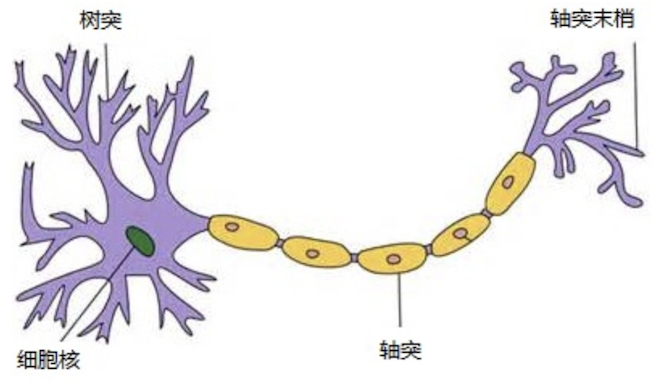

当电信号通过树突进入到细胞核时，***会逐渐聚集电荷。达到一定的电位后，细胞就会被激活***，通过轴突发出电信号。

所以对于神经网络，***当数值通过输入层进入神经元时，会进行加权求和（模拟电荷聚集）。只有当这个总和超过了特定的阈值（由 Bias 决定）时，激活函数才会让这个神经元输出非零的信号，从而将信息传递到下一层。***

神经网络是由多个神经元组成，构建神经网络就是在构建神经元。以下是神经网络中神经元的构建说明：

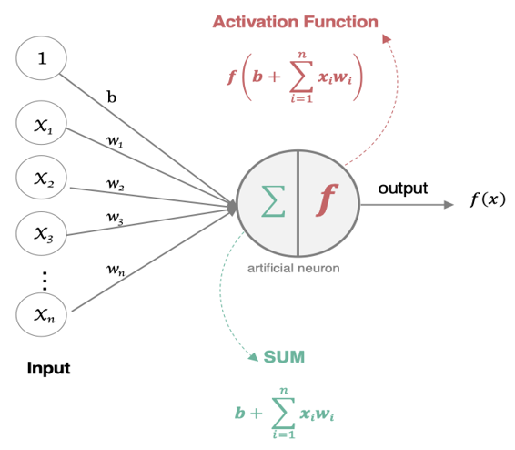

这个流程就像，来源不同树突(树突都会有不同的权重)的信息, 进行的加权计算, 输入到细胞中做加和，再通过激活函数输出细胞值。

同一层的多个神经元可以看作是通过并行计算来处理相同的输入数据，学习输入数据的不同特征。每个神经元可能会关注输入数据中的不同部分，从而捕捉到数据的不同属性。

接下来，我们使用多个神经元来构建神经网络，相邻层之间的神经元相互连接，并给每一个连接分配一个强度，如下图所示：

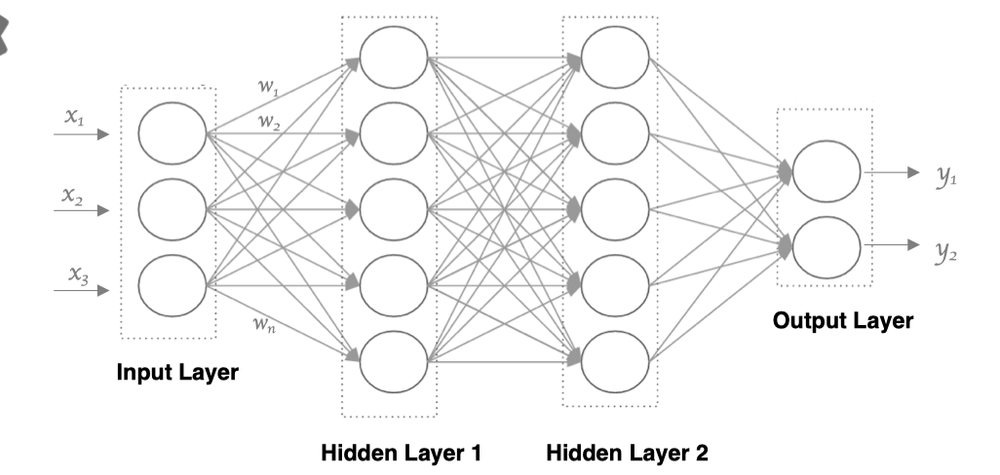

神经网络中信息只向一个方向移动，即从输入节点向前移动，通过隐藏节点，再向输出节点移动。其中的基本部分是:

1. **输入层（Input Layer）**: 即输入x的那一层（如图像、文本、声音等）。每个输入特征对应一个神经元。输入层将数据传递给下一层的神经元。
2. **输出层（Output Layer）**: 即输出y的那一层。输出层的神经元根据网络的任务（回归、分类等）生成最终的预测结果。
3. **隐藏层（Hidden Layers）**: 输入层和输出层之间都是隐藏层，神经网络的“深度”通常由隐藏层的数量决定。隐藏层的神经元通过加权和激活函数处理输入，并将结果传递到下一层。

==特点是：==

- 同一层的神经元之间没有连接
- 第N层的每个神经元和第N-1层的所有神经元相连（这就是Fully Connected的含义)，这就是**全连接神经网络（FCNN）**
- 全连接神经网络接收的样本数据是**==二维的==**，数据在每一层之间需要以二维的形式传递
- 第N-1层神经元的输出就是第N层神经元的输入
- 每个连接都有一个权重值（w系数和b系数）

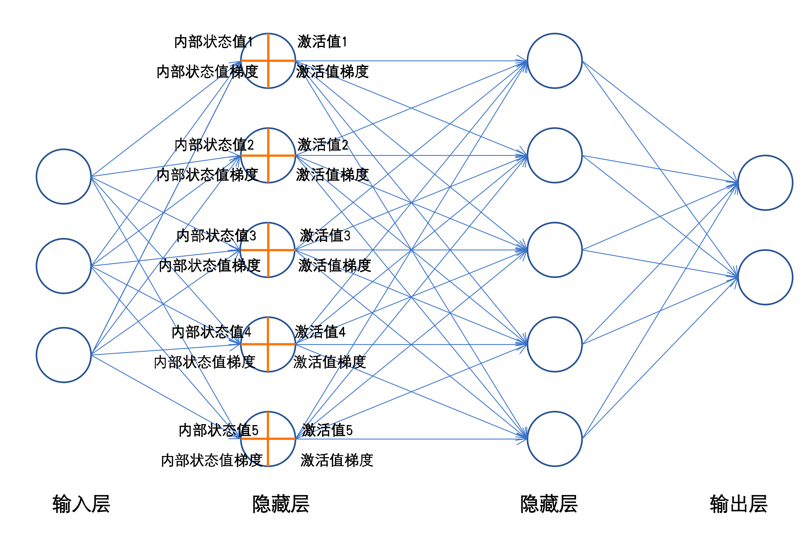

每一个神经元工作时，**前向传播**会产生两个值，**内部状态值（加权求和值）**和**激活值**；**反向传播**时会产生**激活值梯度**和**内部状态值梯度**。

- 内部状态值
  - 神经元或隐藏单元的内部存储值，它反映了当前神经元接收到的输入、历史信息以及网络内部的权重计算结果。
  - 每个输入$$x_i$$都有一个与之相乘的权重$$w_i$$，表示每个输入信号的重要性。
  - z=w⋅x+b
    - w：权重矩阵
    - x：输入值
    - b：偏置

- 激活值
  - 通过激活函数（如 ReLU、Sigmoid、Tanh）对内部状态值进行非线性变换后得到的结果。激活值决定了当前神经元的输出。
  - a=f(z)
    - f：激活函数
    - z：内部状态值

通过控制每个神经元的内部状态值、激活值的大小；每一层的内部状态值的方差、每一层的激活值的方差可让整个神经网络工作的更好。

所以下面两个小结，我们将要学习神经元的激活函数，神经元的权重初始化。

#### 激活函数

- 激活函数主要用来向神经网络中**加入非线性因素**，以解决线性模型表达能力不足的问题，它对神经网络有着极其重要的作用。我们的网络参数在更新时，使用的反向传播算法（BP），这就要求我们的**激活函数必须可微**。
- 通过给网络输出增加激活函数, 实现引入非线性因素, 使得网络模型可以逼近任意函数, 提升网络对复杂问题的拟合能力。

##### Sigmoid 激活函数  	 


公式  :    $f(x) =$ $\frac{1}{1 + e^{-x}}$

求导公式: 	$f'(x) = f(x)(1 - f(x))$		

推导如下：$\frac{d}{dx}f(x) = \frac{d}{dx} \left( \frac{1}{1 + e^{-x}} \right)$

​                                  $\begin{aligned}=f'(x) &= \frac{1}{1 + e^{-x}} \cdot \frac{e^{-x}}{1 + e^{-x}}\\&= f(x) \cdot \frac{(1 + e^{-x}) - 1}{1 + e^{-x}} \quad \text{(分子凑项)} \\ &= f(x) \cdot \left( \frac{1 + e^{-x}}{1 + e^{-x}} - \frac{1}{1 + e^{-x}} \right) \\ &= f(x) \cdot (1 - f(x)) \end{aligned}$

解决问题：

1. **关键点：** 如果网络输出**只有一个节点**，Sigmoid 输出 $0.8$，意味着有 $80\%$ 的概率是“是”，自然也就意味着有 $20\%$ 的概率是“否”。
2. **多标签场景（特殊）：** 如果你有**多个输出节点**都用 Sigmoid（比如一张图既有猫又有狗），每个节点是**独立**的。节点A说“像猫”的概率不影响节点B说“像狗”的概率。

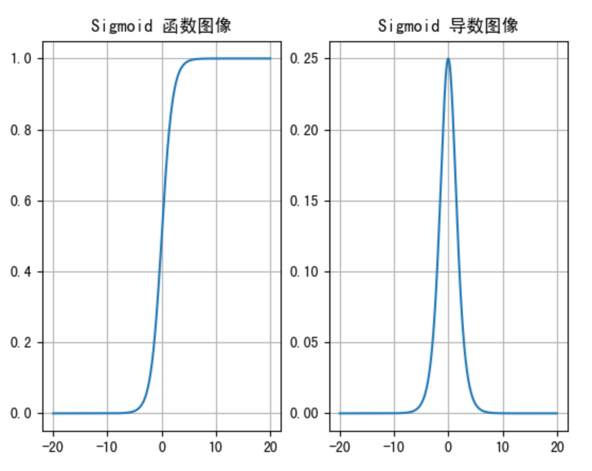

==**特点：**==

- 函数：sigmoid 函数可以将**任意的输入**映射到 **(0, 1)** 之间，中心点是0.5，大于0.5输入x是正的，小于0.5的都是负的。当输入的值大致在[-∞,-6]，[6,+∞]时，意味着输入任何值得到的激活值都是差不多的0 / 1.0
- 导数：当输入的值大致在[-∞,-6]，[6,+∞]意味着输入任何值得到的激活值都是差不多的（**没有效果**），sigmoid激活函数图像的**导数接近为 0**，在[-6,6]之间，**有效果**，尤其是在[-3,3]之间**效果明显**，导数范围是[0,0.25]。

- **sigmoid函数一般只用于二分类的输出层**, 如果神经网络隐藏层在**5层之内**也可以考虑使用sigmoid
- sigmoid激活值范围是[0, 1], **只有正信号**, 没有负信号, 模型只能学习到正信号

```python
# sigmoid激活值: torch.sigmoid(x)

import torch
import matplotlib.pyplot as plt

plt.rcParams['font.sans-serif'] = ['SimHei']  # 用来正常显示中文标签
plt.rcParams['axes.unicode_minus'] = False  # 用来正常显示负号
plt.switch_backend('TkAgg')

def dm01():
    # 创建x值, 线性模型输出值作为激活函数的输入值
    x = torch.linspace(-20, 20, 1000)
    # 计算激活值
    y = torch.sigmoid(input=x)
    # 创建画布对象和坐标轴对象
    _, axes = plt.subplots(1, 2)  # 一行两列, 绘制两个子图
    axes[0].plot(x, y)
    axes[0].grid()
    axes[0].set_title('sigmoid激活函数')

    # 创建x值,可以自动微分, 线性模型输出值作为激活函数的输入值
    x = torch.linspace(-20, 20, 1000, requires_grad=True)
    torch.sigmoid(input=x).sum().backward()
    axes[1].plot(x.detach().numpy(), x.grad) #为什么是x.grid之前不都是w.gird? 
    axes[1].grid()
    axes[1].set_title('sigmoid的倒数函数')
    plt.show()


if __name__ == '__main__':
    dm01()
```

这里的x是经过加权运算后的输入激活函数的值，y是经过激活函数后的值。

**解释**：为什么是x.grid之前不都是w.gird? 

在神经网络的深层结构中，梯度的流动是连贯的。假设一个简单的单层网络：

$$z = w \cdot x$$

$$y = \sigma(z)$$

当你调用 `backward()` 时，梯度实际上是这样流动的：

1. **先流过 Sigmoid**：计算 $\frac{\partial y}{\partial z}$（这正是你当前代码可视化的东西！即梯度存储到x.grid）。
2. **再流向** $w$：计算 $\frac{\partial y}{\partial w} = \frac{\partial y}{\partial z} \cdot x$ （这就是训练模型时存入 `w.grad` 的东西）。
3. **同时也流向** $x$：计算 $\frac{\partial y}{\partial x} = \frac{\partial y}{\partial z} \cdot w$。

**总结联系：** 你现在画的 `x.grad`（即 Sigmoid 的导数），其实就是**训练线性回归或神经网络时，梯度反向传播必须要经过的第一道关卡**。

- **训练时**：我们利用这个导数继续往后算，算出 `w.grad`

##### Tanh激活函数  	

Tanh (Hyperbolic Tangent) 读作 "tanch"，是双曲正切函数。在早期的神经网络中，它通常优于 Sigmoid 函数，因为它解决了“零中心”问题。

​	公式：$\tanh(x) = \frac{e^x - e^{-x}}{e^x + e^{-x}}$

​	导数：$\tanh'(x) = 1 - \tanh^2(x)$  

​	推导如下：

$  \begin{aligned} \tanh'(x) &= \frac{(e^x + e^{-x})(e^x + e^{-x}) - (e^x - e^{-x})(e^x - e^{-x})}{(e^x + e^{-x})^2} \\ &= \frac{(e^x + e^{-x})^2 - (e^x - e^{-x})^2}{(e^x + e^{-x})^2} \\ &= \frac{(e^x + e^{-x})^2}{(e^x + e^{-x})^2} - \frac{(e^x - e^{-x})^2}{(e^x + e^{-x})^2} \\ &= 1 - \left( \frac{e^x - e^{-x}}{e^x + e^{-x}} \right)^2 \\ &= 1 - \tanh^2(x) \end{aligned}$

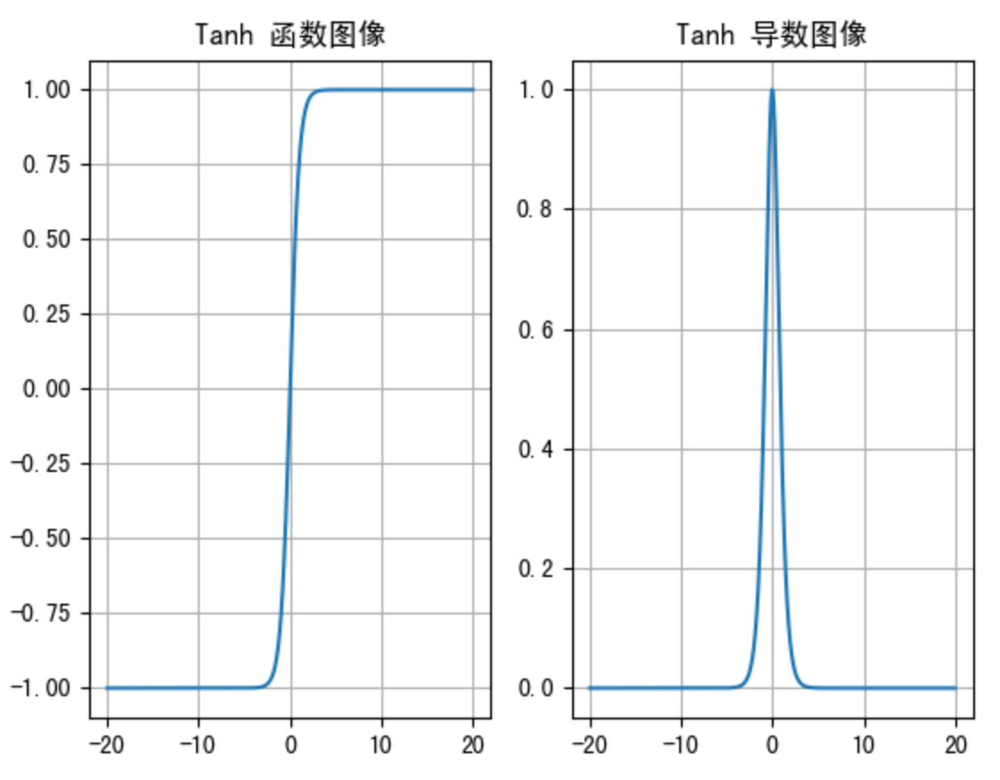

==**特点：**==

- Tanh函数将**输入映射到(-1, 1)之间**，既有正信号, 又有负信号, 激活值是以0对称, 模型可以学习到正负信号，图像以0为中心，激活值在0点对称。
- 若使用时可在**隐藏层使用Tanh函数**，不是优先选择, 浅层神经网络（少于5层隐藏层）可以使用，在**输出层使用sigmoid函数**。
- 加权求和值（函数输入值）在[-3,3]范围, 计算激活值时分布到[-1, 1], 否则激活值只能是-1或1

```python

import torch
import matplotlib.pyplot as plt

plt.rcParams['font.sans-serif'] = ['SimHei']  # 用来正常显示中文标签
plt.rcParams['axes.unicode_minus'] = False  # 用来正常显示负号
plt.switch_backend('TkAgg')

def dm01():
    # 创建x值, 线性模型输出值作为激活函数的输入值
    x = torch.linspace(-20, 20, 1000)
    # 计算激活值
    y = torch.tanh(input=x)
    # 创建画布对象和坐标轴对象
    _, axes = plt.subplots(1, 2)  # 一行两列, 绘制两个子图
    axes[0].plot(x, y)
    axes[0].grid()
    axes[0].set_title('Tanh激活函数')

    # 创建x值,可以自动微分, 线性模型输出值作为激活函数的输入值
    x = torch.linspace(-20, 20, 1000, requires_grad=True)
    torch.tanh(input=x).sum().backward()
    axes[1].plot(x.detach().numpy(), x.grad)
    axes[1].grid()
    axes[1].set_title('Tanh的导数函数')
    plt.show()


if __name__ == '__main__':
    dm01()
```

##### ReLU 激活函数

###### 1.基础ReLU（默认）

公式：$f(x) = \max(0, x)$  

​		 或者分段写:$f(x) = \begin{cases}  x & \text{if } x > 0 \\ 0 & \text{if } x \le 0  \end{cases}$

导数： $f'(x) = \begin{cases}  1 & \text{if } x > 0 \\ 0 & \text{if } x < 0  \end{cases}$

**$(注：在 x=0 处通常人为定义导数为 0)$**

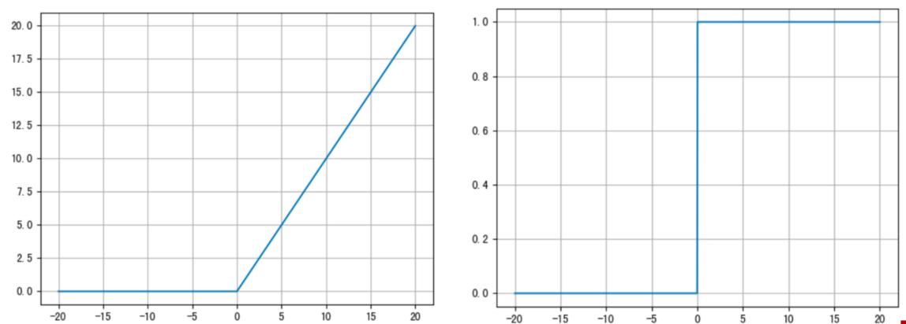

**==特点：==**

- ReLU激活值范围是[0, x], x是线性输出的正值, 只有正信号， 正区间导数恒为 1。
- ReLU激活函数导数值0或1, 如果线性输出大于0，导数为1,不会出现梯度消失情况, 模型收敛程度更快; 如果线性输出小于0, 神经元死亡, 防止过拟合(选择leaky relu或prelu)
- ReLU激活函数优先选择, 计算复杂度最小, 大于0，不存在梯度消失情况

```python

import torch
import matplotlib.pyplot as plt

plt.rcParams['font.sans-serif'] = ['SimHei']  # 用来正常显示中文标签
plt.rcParams['axes.unicode_minus'] = False  # 用来正常显示负号
plt.switch_backend('TkAgg')

def dm01():
    # 创建x值, 线性模型输出值作为激活函数的输入值
    x = torch.linspace(-20, 20, 1000)
    # 计算激活值
    y = torch.relu(input=x)
    # 创建画布对象和坐标轴对象
    _, axes = plt.subplots(1, 2)  # 一行两列, 绘制两个子图
    axes[0].plot(x, y)
    axes[0].grid()
    axes[0].set_title('ReLU激活函数')

    # 创建x值,可以自动微分, 线性模型输出值作为激活函数的输入值
    x = torch.linspace(-20, 20, 1000, requires_grad=True)
    torch.relu(input=x).sum().backward()
    axes[1].plot(x.detach().numpy(), x.grad)
    axes[1].grid()
    axes[1].set_title('ReLU的导数函数')
    plt.show()


if __name__ == '__main__':
    dm01()
```

###### 2.Leaky ReLU

公式 ：$f(x) = \max(\alpha x, x) \quad (\text{通常 } \alpha = 0.01)$

分段表示 ：$f(x) = \begin{cases}  x & \text{if } x > 0 \\ 0.01x & \text{if } x \le 0  \end{cases}$

导数 ： $f'(x) = \begin{cases}  1 & \text{if } x > 0 \\ 0.01 & \text{if } x \le 0  \end{cases}$

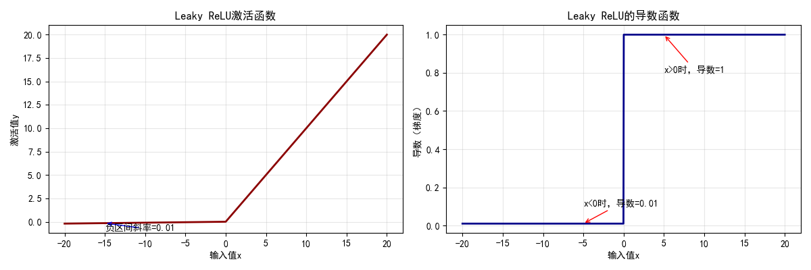

相比ReLU精进：它不强制负区间为 0，而是给一个很小的固定斜率（通常 $\alpha=0.01$）。

```python
import torch.nn.functional as F#Leaky ReLU在functional模块中
import torch
import matplotlib.pyplot as plt

plt.rcParams['font.sans-serif'] = ['SimHei']  # 用来正常显示中文标签
plt.rcParams['axes.unicode_minus'] = False  # 用来正常显示负号
plt.switch_backend('TkAgg')

def dm01():
    # 创建x值, 线性模型输出值作为激活函数的输入值
    x = torch.linspace(-20, 20, 1000)
    # 计算激活值
    y = F.leaky_relu(x, negative_slope=0.01)
    # 创建画布对象和坐标轴对象
    _, axes = plt.subplots(1, 2)  # 一行两列, 绘制两个子图
    axes[0].plot(x, y)
    axes[0].grid()
    axes[0].set_title('Leaky ReLU激活函数')

    # 创建x值,可以自动微分, 线性模型输出值作为激活函数的输入值
    x = torch.linspace(-20, 20, 1000, requires_grad=True)
    F.relu(input=x).sum().backward()
    axes[1].plot(x.detach().numpy(), x.grad)
    axes[1].grid()
    axes[1].set_title('Leaky ReLU的导数函数')
    plt.show()


if __name__ == '__main__':
    dm01()
```

###### 3.PReLU 

公式 ： $$f(x) = \begin{cases}  x & \text{if } x > 0 \\ \alpha_i x & \text{if } x \le 0  \end{cases}$$

其中 $\alpha_i$ 是第 $i$ 层或第 $i$ 个通道的参数，通过反向传播算法自动更新。

导数：$$f'(x) = \begin{cases}  1 & \text{if } x > 0 \\ \alpha_i & \text{if } x \le 0  \end{cases}$$

*(注：PReLU 还需要对参数* $\alpha$ *求导以便更新参数：*$\frac{\partial f}{\partial \alpha} = x \text{ (if } x \le 0 \text{), else } 0$*)*

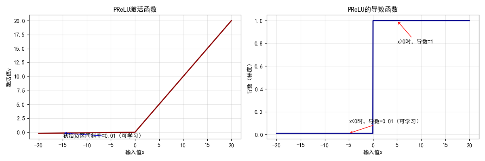

相比Leaky ReLU精进：“为什么负区间的斜率一定要是 0.01？PReLU 将负区间的斜率 $\alpha$ 作为一个**参数**放到网络里一起训练。网络会根据数据自己决定：“这一层我是应该像 ReLU 一样完全截断，还是应该像 Leaky ReLU 一样保留一点信息，或者保留很多信息？”

```python 
# sigmoid激活值: torch.sigmoid(x)
import torch.nn.functional as F
import torch
import matplotlib.pyplot as plt

plt.rcParams['font.sans-serif'] = ['SimHei']  # 用来正常显示中文标签
plt.rcParams['axes.unicode_minus'] = False  # 用来正常显示负号
plt.switch_backend('TkAgg')

def dm01():
    # 创建x值, 线性模型输出值作为激活函数的输入值
    x = torch.linspace(-20, 20, 1000)
    # 计算激活值
    y = F.prelu(x, torch.tensor(0.5))
    # 创建画布对象和坐标轴对象
    _, axes = plt.subplots(1, 2)  # 一行两列, 绘制两个子图
    axes[0].plot(x, y)
    axes[0].grid()
    axes[0].set_title('PReLU 激活函数')

    # 创建x值,可以自动微分, 线性模型输出值作为激活函数的输入值
    x = torch.linspace(-20, 20, 1000, requires_grad=True)
    F.prelu(input=x,weight=torch.tensor(0.5)).sum().backward()
    axes[1].plot(x.detach().numpy(), x.grad)
    axes[1].grid()
    axes[1].set_title('PReLU 的导数函数')
    plt.show()


if __name__ == '__main__':
    dm01()
```

##### softmax 激活函数

Softmax 是深度学习中处理**多分类问题 (Multi-class Classification)** 的标准输出层函数。不同于 ReLU 或 Sigmoid 单独处理每一个神经元，Softmax 关注的是整体，它将一组数值“归一化”为概率分布。

**多标签分类**：“多选题”一张照片里既有“狗”又有“树”还有“车”输出 N 个概率值，相互独立

公式 ： 对于第 $i$ 个类别的输出概率 $S_i$：

​																$S_i = \text{Softmax}(z_i) = \frac{e^{z_i}}{\sum_{j=1}^K e^{z_j}}$

导数 ： 

（引入克罗内克函数 (Kronecker delta) $\delta_{ij}$（当 $i=j$ 为 1，否则为 0））：

​																																$\frac{\partial S_i}{\partial z_j} = S_i (\delta_{ij} - S_j)$(雅可比矩阵)

Softmax 就是将网络输出的 logits 通过 softmax 函数，就映射成为(0,1)的值，而**这些值的累和为****1**（满足概率的性质），那么我们将它理解成概率，**选取概率最大（也就是值对应最大的）节点**，作为我们的**预测目标类别**。


```python
import torch

scores = torch.tensor([[ 0.06, 1.1, 0.05, 3.75],[1.3,0.2,0.5,0.005]])
# dim = 0,按行计算
probabilities = torch.softmax(scores, dim=0)
print("dim = 0",probabilities)
# dim = 1 按列计算
probabilities = torch.softmax(scores, dim=1)
print("dim = 1",probabilities)
#outputs:
dim = 0 tensor([[0.2244, 0.7109, 0.3894, 0.9769],
        [0.7756, 0.2891, 0.6106, 0.0231]])
dim = 1 tensor([[0.0223, 0.0631, 0.0221, 0.8926],
        [0.4864, 0.1619, 0.2185, 0.1332]])
```

##### 激活函数的选择方法

对于**隐藏层**:

1.优先选择ReLU激活函数

2.如果ReLu效果不好，那么尝试其他激活，如Leaky ReLu等。

3.如果你使用了ReLU， 需要注意一下Dead ReLU问题， 避免出现0梯度从而导致过多的神经元死亡。

4.少用使用sigmoid激活函数，可以尝试使用tanh激活函数,如果在浅层神经网络


对于**输出层**:

1.二分类问题选择sigmoid激活函数，**二分类**“是非题”判断邮件是否为垃圾邮件（是/否）输出 1 个概率值

2.多分类问题选择softmax激活函数

3.回归问题选择identity激活函数

总结图：

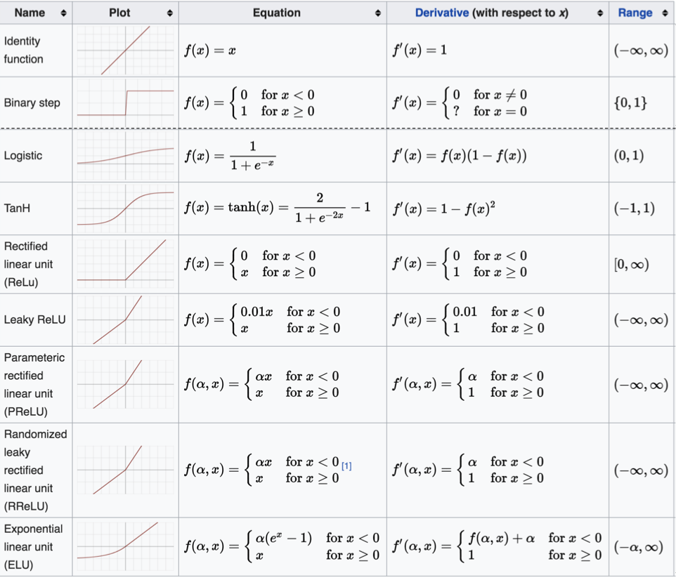

#### 参数初始化

我们在构建网络之后，网络中的参数是需要初始化的。我们需要初始化的参数主要有**权重**和**偏置**，**偏置一般初始化为0即可**，而对权重的初始化则会更加重要。

参数初始化的作用：

- **防止梯度消失或爆炸**：初始权重值过大或过小会导致梯度在反向传播中指数级增大或缩小。
- **提高收敛速度**：合理的初始化使得网络的激活值分布适中，有助于梯度高效更新。
- **保持对称性破除**：权重的初始化需要打破对称性，否则网络的学习能力会受到限制。

###### **常见参数初始化方法介绍**

- **随机初始化**

  - 均匀分布初始化：权重参数初始化从区间均匀随机取值，默认区间为（0，1）。可以设置为在(-$$1\over\sqrt{d}$$,$$1\over\sqrt{d}$$)均匀分布中生成当前神经元的权重，其中d为神经元的输入数量。

    

  - 正态分布初始化：随机初始化从均值为0，标准差是1的高斯分布中取样，使用一些很小的值对参数W进行初始化

  - **优点**：能有效打破对称性

  - **缺点**：随机选择范围不当可能导致梯度问题

  - **适用场景**：浅层网络或低复杂度模型。隐藏层1-3层，总层数不超过5层。

- **全0初始化**：将神经网络中的所有权重参数初始化为0

  - **优点**：实现简单
  - **缺点**：无法打破对称性，所有神经元更新方向相同，无法有效训练
  - **适用场景**：几乎不使用，仅用于偏置项的初始化

- **全1初始化**：将神经网络中的所有权重参数初始化为1

  - **优点**：实现简单
  - **缺点**
    - 无法打破对称性，所有神经元更新方向相同，无法有效训练
    - 会导致激活值在网络中呈指数增长，容易出现梯度爆炸
  - **适用场景**
    - 测试或调试：比如验证神经网络是否能正常前向传播和反向传播
    - 特殊模型结构：某些稀疏网络或特定的自定义网络中可能需要手动设置部分参数为1
    - 偏置初始化：偶尔可以将偏置初始化为小的正值（如 0.1），但很少用1作为偏置的初始值

- **固定值初始化**：将神经网络中的所有权重参数初始化为某个固定值

  - **优点**：实现简单
  - **缺点**
    - 无法打破对称性，所有神经元更新方向相同，无法有效训练
    - 初始权重过大或过小可能导致梯度爆炸或梯度消失
  - **适用场景**
    - 测试或调试

- **kaiming初始化**，也叫做**HE初始化**：专为ReLU和其变体设计，考虑到ReLU激活函数的特性，对输入维度进行缩放

  - HE初始化分为正态分布的HE初始化、均匀分布的HE初始化
    - 正态分布的he初始化
      - w权重值从均值为0, 标准差为std中随机采样，$std =$ $\sqrt{\frac{2}{fan\_in}}$
      - std值越大，w权重值离均值0分布相对较广，计算得到的内部状态值有较大的正值或负值
    - 均匀分布的he初始化
      - 它从[-limit，limit] 中的均匀分布中抽取样本, $limit=$ $\sqrt{\frac{6}{fan\_in}}$
    - `fan_in` 输入神经元的个数，**当前层**接受的**来自上一层**的神经元的数量。简单来说，就是当前层接收多少个输入
  - **优点**：适合 ReLU，能保持梯度稳定
  - **缺点**：对非 ReLU 激活函数效果一般
  - **适用场景**：深度网络(10层及以上)，使用 ReLU、Leaky ReLU 激活函数

- **xavier初始化**，也叫做**Glorot初始化**：根据网络输入和输出的维度自动选择权重范围，使输入和输出的方差相同

  - xavier初始化分为正态分布的xavier初始化、均匀分布的xavier初始化
    - 正态化的Xavier初始化
      - w权重值从均值为0, 标准差为std中随机采样，$std =$ $\sqrt{\frac{2}{fan\_in + fan\_out}}$
      - std值越小，w权重值离均值0分布相对集中，计算得到的内部状态值有较小的正值或负值
    - 均匀分布的Xavier初始化
      - [-limit，limit] 中的均匀分布中抽取样本, $limit =$ $\sqrt{\frac{6}{fan\_in + fan\_out}}$
    - fan_in 是输入神经元个数，**当前层**接受的**来自上一层**的神经元的数量。简单来说，就是当前层接收多少个输入
    - fan_out 是输出神经元个数，**当前层**输出的神经元的数量，也就是当前层会传递给**下一层**的神经元的数量。简单来说，就是当前层会产生多少个输出。
  - **优点**：适用于Sigmoid、Tanh 等激活函数，解决梯度消失问题
  - **缺点**：对 ReLU 等激活函数表现欠佳
  - **适用场景**：深度网络(10层及以上)，使用 Sigmoid 或 Tanh 激活函数

###### **选取规则**

- 激活函数的选择：根据激活函数的类型选择对应的初始化方法
  - **Sigmoid/Tanh/激活函数非ReLU**：优先使用==xavier== 初始化
  - **ReLU/Leaky ReLU/及其系列**：==kaiming== 初始化

- 神经网络模型的深度
  - **浅层网络：随机初始化即可**
  - **深层网络：需要考虑方差平衡，如 xavier 或 kaiming 初始化**

###### **代码展示**

​	

```python
import torch.nn as nn

#均匀随机分布
def demo01():
    linear = nn.Linear(5,3)
    nn.init.uniform_(linear.weight)
    nn.init.uniform_(linear.bias)
    print("#均匀随机分布",linear.weight.data)
    print("#均匀随机分布",linear.bias.data)
#固定初始化
def demo02():
    linear = nn.Linear(5,3)
    nn.init.constant_(linear.weight,3)
    nn.init.constant_(linear.bias,3)
    print("#固定初始化",linear.weight.data)
    print("固定初始化",linear.bias.data)
#全0初始化
def demo03():
    linear = nn.Linear(5,3)
    nn.init.zeros_(linear.weight)
    nn.init.zeros_(linear.bias)         #用的较多
    print("全0初始化",linear.weight.data)
    print("全0初始化",linear.bias.data)
#全1初始化
def demo04():
    linear = nn.Linear(5,3)
    nn.init.ones_(linear.weight)
    nn.init.ones_(linear.bias)
    print("全1初始化",linear.weight.data)
    print("全1初始化",linear.bias.data)
#正态分布初始化
def demo05():
    linear = nn.Linear(5,3)
    nn.init.normal_(linear.weight)
    nn.init.normal_(linear.bias)
    print("正态分布初始化",linear.weight.data)
    print("正态分布初始化",linear.bias.data)

#kaiming初始化
def demo06():
    linear = nn.Linear(5,3)
    nn.init.kaiming_normal_(linear.weight)
    #nn.init.kaiming_normal_(linear.bias)
    print("凯明正态分布初始化",linear.weight.data)
    #print("凯明正态分布初始化",linear.bias.data)
    nn.init.kaiming_uniform_(linear.weight)
    #nn.init.kaiming_uniform_(linear.bias)
    print("凯明随机分布初始化",linear.weight.data)
    #print("凯明随机分布初始化",linear.bias.data)
#xavier初始化
def demo07():
    linear = nn.Linear(5,3)
    nn.init.xavier_normal_(linear.weight)
    #nn.init.kaiming_normal_(linear.bias)
    print("xavier正态分布初始化",linear.weight.data)
    #print("凯明正态分布初始化",linear.bias.data)
    nn.init.xavier_uniform_(linear.weight)
    #nn.init.kaiming_uniform_(linear.bias)
    print("xavier随机分布初始化",linear.weight.data)
    #print("凯明随机分布初始化",linear.bias.data)


if __name__ == '__main__':
    demo01()
    demo02()
    demo03()
    demo04()
    demo05()
    demo06()
    demo07()
```

#### 神经网络搭建

在pytorch中定义深度神经网络其实就是层堆叠的过程，继承自nn.Module，实现两个方法：

- `__init__`方法中定义网络中的层结构，主要是全连接层，并进行初始化
- **forward方法**，在调用神经网络模型对象的时候，底层会自动调用该函数。该函数中为初始化定义的layer传入数据，进行前向传播等。

以写一道题的安排讲解搭建神经网络模型，我们假设固定如下：

- 第1个隐藏层：权重初始化采用标准化的xavier初始化 激活函数使用sigmoid

- 第2个隐藏层：权重初始化采用标准化的He初始化 激活函数采用relu

- out输出层线性层 假若多分类，采用softmax做数据归一化

  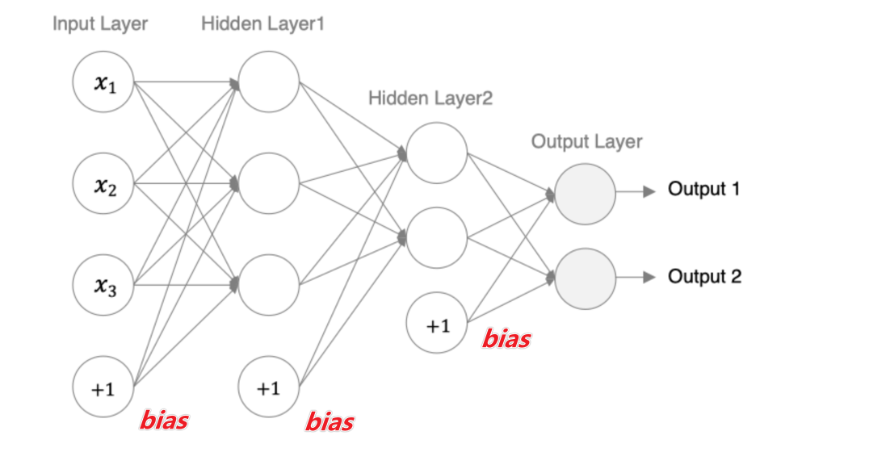

```python
import torch
import torch.nn as nn
from torchsummary import summary  #计算模型参数，查看模型结构


class ModelDemo(nn.Module):
    def __init__(self):
        super().__init__()
        #搭建神经网络
        #隐藏层1：输入特征数x ： 3 ，输出：3
        self.linear1 = nn.Linear(3,3)
        # 隐藏层2：输入特征数x ： 3 ，输出：2
        self.linear2 = nn.Linear(3,2)
        # 输出层：输入特征数x ： 2 ，输出：2
        self.output = nn.Linear(2, 2)
        #参数初始化
        nn.init.xavier_normal_(self.linear1.weight.data)
        nn.init.zeros_(self.linear1.bias.data)
        nn.init.kaiming_normal_(self.linear2.weight.data)
        nn.init.zeros_(self.linear2.bias.data)
    #前向传播
    def forward(self, x):
        #隐藏层1，加权+激活函数
        x = torch.sigmoid(self.linear1(x))
        #隐藏层2，加权+激活函数
        x = torch.relu(self.linear2(x))
        #输出层，加权+激活函数
        #dim = -1 按行计算
        x= torch.softmax(self.output(x),dim=-1)
        return x
#模型测试
def train():
    my_model = ModelDemo()
    #创建数据集样本，随机生成
    data  = torch.randn(size=(5,3))#这里的5（行）代表批次，共5批，列代表输入有三个数据x1,x2,x3
    print(f"是否可微分{data.requires_grad}")
    #调用神经网络模型进行模型训练
    output = my_model(data) #自动调用forward方法进行前向传播
    print(f"是否可微分：{output.requires_grad}") # True
   #参1：神经网络模型，参2，输入数据维度
    summary(my_model,input_size=(5,3))


if __name__ == '__main__':
    train()
```


### 损失函数

- 在深度学习中, 损失函数是用来==衡量模型参数质量的函数==, 衡量的方式**是比较网络输出（预测值）和真实输出（真实值）的差异。**

- 模型通过最小化损失函数的值来调整参数，使其输出更接近真实值。

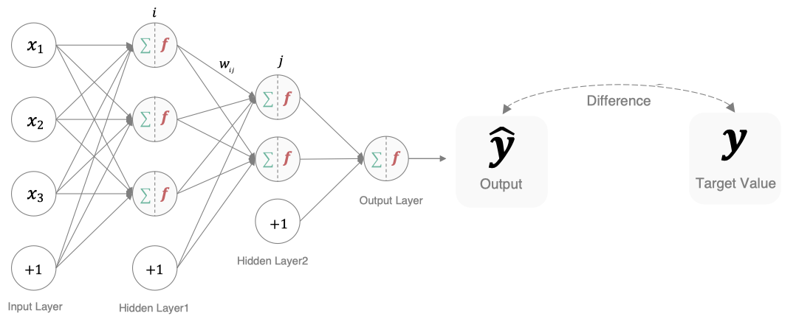

**损失函数作用：**

- **评估性能**：反映模型预测结果与目标值的匹配程度。
- **指导优化**：通过梯度下降等算法最小化损失函数，优化模型参数。

分类任务损失函数

> 在深度学习的**分类任务**中使用最多的是**交叉熵损失函数**，所以在这里我们着重介绍这种损失函数。
>
> | 场景             | 数值          | 概率 / 标记规则                   | 典型损失函数          |
> | ---------------- | ------------- | --------------------------------- | --------------------- |
> | 多分类           | 只能 1 个为 1 | 独热编码（每行 1 个 1，总和 = 1） | cross_entropy         |
> | 软标签（单分类） | 可能多个1     | 概率分布（总和 = 1，无绝对 1）    | mse_loss / 手动交叉熵 |
> | 多标签分类       | 可能多个1     | 二值标记（可多个 1，总和≠1）      | BCEWithLogitsLoss     |

#### 多分类任务损失函数

在多分类任务通常使用softmax将logits转换为概率的形式，所以多分类的交叉熵损失也叫做**softmax损失**，它的计算方法是：

$$\mathcal{L} = -\sum_{i=1}^{n} \mathbf{y}_i \log(S(f_\theta(\mathbf{x}_i)))$$

其中:

- $$y_i$$是样本x属于某一个类别的真实概率
- 而f(x)是样本属于某一类别的预测分数
- S是softmax激活函数，将属于某一类别的预测分数转换成概率
- L用来衡量真实值y和预测值f(x)之间差异性的损失结果

**细节**：

​			***CrossEntropyLoss = Softmax() + 损失计算 ，所以后续如果用这个损失函数，则输出层不用额外调用Softmax()激活函数了***

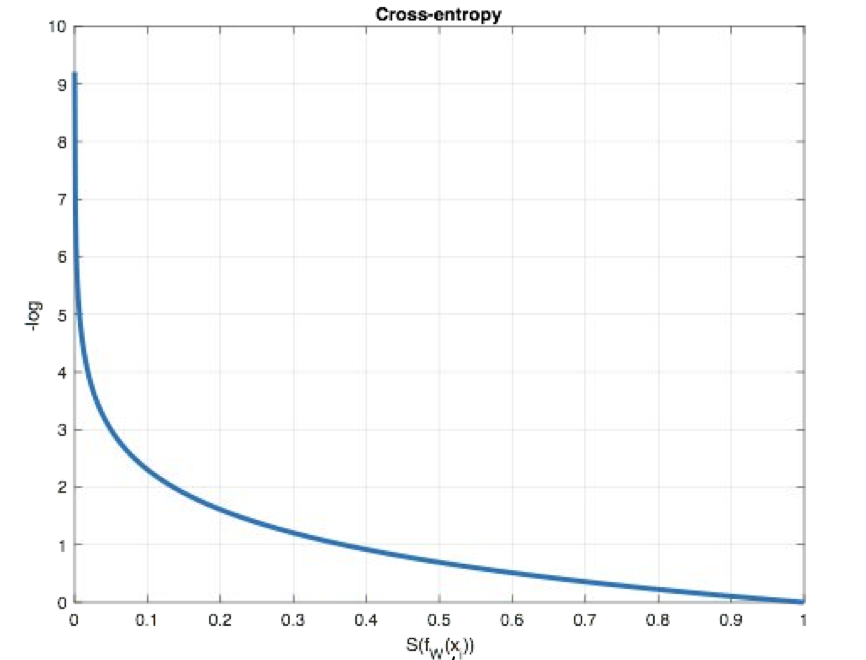

```python
import torch
import torch.nn as nn
# 分类损失函数：交叉熵损失使用nn.CrossEntropyLoss()实现。nn.CrossEntropyLoss()=softmax+损失计算
def demo01():
    """设置真实值: 可以是热编码后的结果也可以不进行热编码,无论是独热编码还是类别索引，
    本质都是对「硬标签（Hard Label）」的概率表达 —— 即：目标类别概率 = 1，"""
    #形式1：独热编码（One-Hot）
    #y_true = torch.tensor([[0,1,0],[0,0,1]],dtype=torch.float32)#使用torch.float32类型
    #形式2：类别索引（Label Index）
    y_true = torch.tensor([1,2])    #不能使用torch.float32类型
    y_pred = torch.tensor([[0.1,0.8,0.1],[0.7,0.2,0.1]],dtype=torch.float32,requires_grad=True)
    criterion = nn.CrossEntropyLoss()  #默认mean 平均损失值
    loss = criterion(y_pred,y_true)
    print(f"loss:{loss}")


if __name__ == '__main__':
    demo01()
```

#### 二分类任务损失函数

在处理二分类任务时，我们不再使用softmax激活函数，而是使用sigmoid激活函数，那损失函数也相应的进行调整，使用二分类的交叉熵损失函数：

$L = -y \log \hat{y} - (1 - y) \log(1 - \hat{y})$

其中:

- y是样本x属于某一个类别的真实概率

- 而$$\hat{y}$$是样本属于某一类别的预测概率

- L用来衡量真实值y与预测值$$\hat{y}$$之间差异性的损失结果。

**细节**：

​			***因为公式中没有包含Sigmoid激活函数，所以后续使用BCELoss的时候，还需要手动指定Sigmoid***

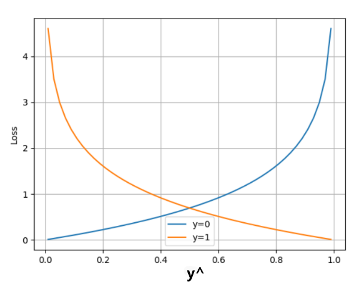

```python
import torch
import torch.nn as nn
def demo01():
    y_true = torch.tensor([0,1,0],dtype=torch.float)
    y_pred = torch.tensor([0.6901, 0.5459, 0.2469])
    criterion = nn.BCELoss()#默认mean 平均损失值
    loss = criterion(y_pred, y_true).detach().numpy()
    print(f"loss:{loss}")

if __name__ == '__main__':
    demo01()
```

#### 回归任务损失函数

- **mean absolute loss(MAE)**也被称为L1 Loss，是以绝对误差作为距离

  损失函数公式:$\mathcal{L} = \frac{1}{n} \sum_{i=1}^{n} |y_i - f_\theta(x_i)|$

  **细节**：***导数为-1或1, 0点位置不可导***

  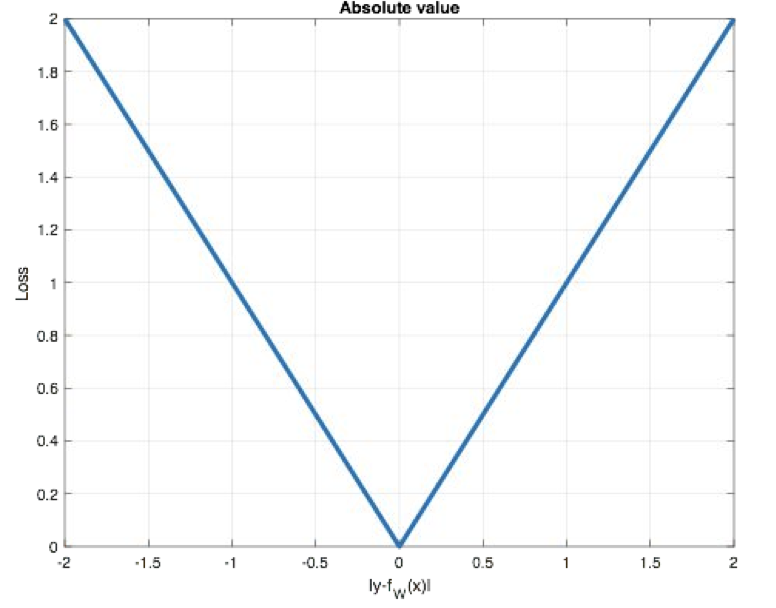

- **Mean Squared Loss/ Quadratic Loss(MSE loss)**也被称为L2 loss，或欧氏距离，它以误差的平方和的均值作为距离

​		损失函数公式:$\mathcal{L} = \frac{1}{n} \sum_{i=1}^{n} (y_i - f_\theta(x_i))^2$

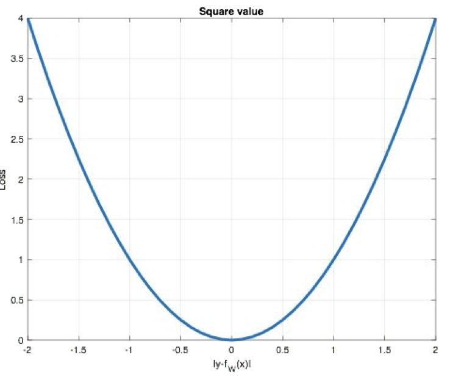

**细节**：***任意位置可导, 越接近底部, 导数越小, 符合梯度下降套路, 可以找到最小值***.

​			***数据集中有异常(噪声)样本, 影响结果, 误差放大, 容易产生梯度爆炸***

> smooth L1说的是光滑之后的L1，是一种结合了均方误差（MSE）和平均绝对误差（MAE）优点的损失函数。它在误差较小时表现得像 MSE，在误差较大时则更像 MAE。

Smooth L1损失函数如下式所示：$$\text{SmoothL1}(f(x), y) = \begin{cases} 0.5 (f(x) - y)^2 / \beta & \text{if } |f(x) - y| < \beta \\ |f(x) - y| - 0.5 * \beta & \text{otherwise} \end{cases}$$

一般简化板：$\text{smooth}_{L_1}(x) = \begin{cases} 0.5(f(x)-y)^2 & \text{if } |f(x)-y| < 1 \\ |f(x)-y| - 0.5 & \text{otherwise} \end{cases}$  将$β$固定为1

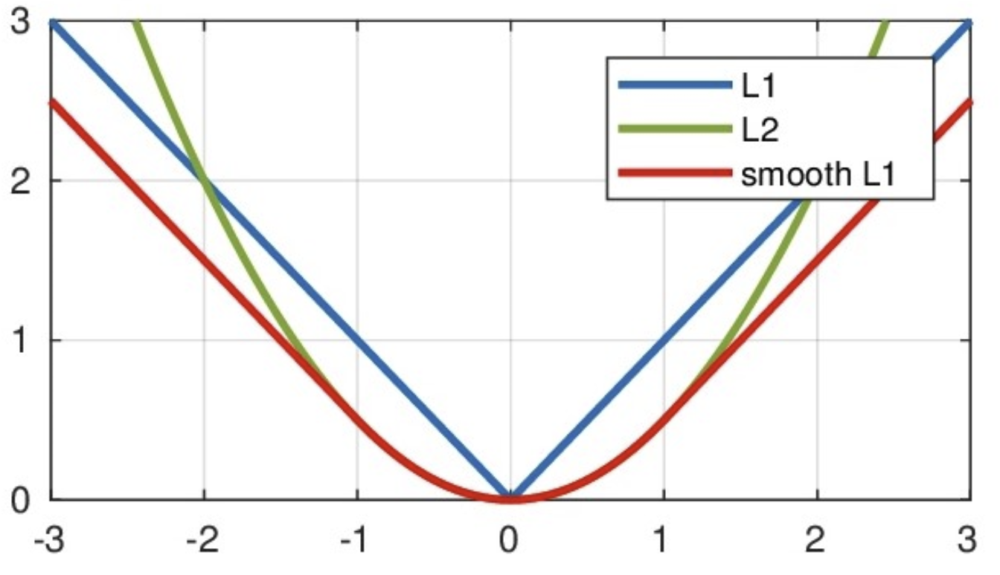

从上图中可以看出，该函数实际上就是一个分段函数：

1. 在[-1,1]之间实际上就是L2（MSELoss）损失，这样解决了L1的不光滑问题
2. 在[-1,1]区间外，实际上就是L1(MAELoss)损失，这样就解决了离群点梯度爆炸的问题
3. 不受异常值影响,不容易产生梯度爆炸,在任意***<u>位置可导</u>***,可以找到最小值

```python
import torch
import torch.nn as nn
#MAELoss
def demo01():
    y_true = torch.tensor([2,2,2],dtype=torch.float)
    y_pred = torch.tensor([1.3, 1.7, 2.0],requires_grad=True,dtype=torch.float)
    criterion = nn.L1Loss()   #均值方差
    loss = criterion(y_pred, y_true).detach().numpy()
    print(f"MAELoss:{loss}")
#MSELoss
def demo02():
    y_true = torch.tensor([2,2,2],dtype=torch.float)
    y_pred = torch.tensor([1.3, 1.7, 2.0],requires_grad=True,dtype=torch.float)
    criterion = nn.MSELoss()   #均值方差
    loss = criterion(y_pred, y_true).detach().numpy()
    print(f"MSELoss:{loss}")
#SmoothL1Loss
def demo03():
    y_true = torch.tensor([2, 2, 2], dtype=torch.float)
    y_pred = torch.tensor([1.3, 1.7, 2.0], requires_grad=True, dtype=torch.float)
    criterion = nn.SmoothL1Loss()  # 均值方差
    loss = criterion(y_pred, y_true).detach().numpy()
    print(f"SmoothL1Loss:{loss}")
if __name__ == '__main__':
    demo01()
    demo02()
    demo03()
#输出：
MAELoss:0.3333333432674408
MSELoss:0.19333334267139435
SmoothL1Loss:0.09666667133569717
```

| **特性**         | **Smooth L1 Loss**                 | **BCELoss / CrossEntropyLoss**         |
| ---------------- | ---------------------------------- | -------------------------------------- |
| **任务类型**     | **回归 (Regression)**              | **分类 (Classification)**              |
| **预测目标**     | **连续值**（如：坐标、温度、股价） | **离散类别**（如：猫、狗、数字）       |
| **输出含义**     | 具体的**数值尺寸**                 | 属于某个类别的**概率**                 |
| **对误差的理解** | 差了 0.1 就是 0.1 的物理距离       | 只要类别错了，哪怕概率只差 0.01 也是错 |

 在 CNN 目标检测中的“黄金搭档”

在像 YOLO 或 Faster R-CNN 这样的模型中，这两类损失函数通常是**同时使用**的：

1. **分类分支**：使用 **CrossEntropyLoss**。
   - 负责回答：“这个框里是猫还是狗？”
2. **回归分支**：使用 **Smooth L1 Loss**。
   - 负责回答：“这个框的具体坐标 $(x, y, w, h)$ 是多少？”

**总损失 (Total Loss) = $Loss_{分类}$ + $Loss_{回归}$**

### 神经网络优化方法

 多层神经网络的学习能力比单层网络强得多。想要训练多层网络，需要更强大的学习算法。误差反向传播算法（Back Propagation）是其中最杰出的代表，它是目前最成功的神经网络学习算法。现实任务使用神经网络时，大多是在使用 BP 算法进行训练，值得指出的是 BP 算法不仅可用于多层前馈神经网络，还可以用于其他类型的神经网络。通常说 BP 网络时，一般是指用 BP 算法训练的多层前馈神经网络。

这就需要了解两个概念：

1. **正向传播**：指的是数据通过网络从输入层到输出层的传递过程。这个过程的目的是计算网络的输出值（预测值），从而与目标值（真实值）比较以计算误差。
2. **反向传播**：指的是计算损失函数相对于网络中各参数（权重和偏置）的梯度，指导优化器更新参数，从而使神经网络的预测更接近目标值。

#### 梯度下降算法回顾

从数学角度来看，==**梯度的方向是函数增长速度最快的方向，那么梯度的反方向就是函数减少最快的方向**==，所以有

​					$w_{ij}^{new} = w_{ij}^{old} - \eta \frac{\partial E}{\partial w_{ij}}$

其中，η是学习率，如果学习率**太小**，那么每次训练之后得到的效果都太小，**增大训练的时间成本**。如果，学习率**太大**，那就有可能**直接跳过最优解**，进入无限的训练中。解决的方法就是，学习率也需要随着训练的进行而变化。

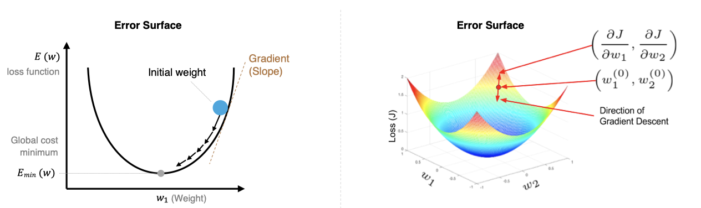

在上图中我们展示了一维和多维的损失函数，损失函数呈碗状。在训练过程中损失函数对权重的偏导数就是损失函数在该位置点的梯度。***我们可以看到，沿着负梯度方向移动，就可以到达损失函数底部，从而使损失函数最小化。这种利用损失函数的梯度迭代地寻找最小值的过程就是梯度下降的过程。***

**在进行模型训练时，有三个基础的概念：**

1. **Epoch**: 使用全部数据对模型进行以此完整训练，**训练轮数**
2. **Batch**: 使用训练集中的小部分样本对模型权重进行以此反向传播的参数更新，**每次训练每批次样本数量**
3. **Iteration**: 使用一个 Batch 数据对模型进行一次参数更新的过程，**每次训练批次数**

假设数据集有 50000 个训练样本，现在选择 Batch Size = 256 对模型进行训练。
				每个 Epoch 要训练的图片数量：50000 （个）
				训练集具有的 Batch 个数：50000/256+1=196（批）
				每个 Epoch 具有的 Iteration 个数：196 （个）
				10个 Epoch（轮） 具有的 Iteration 个数：1960    10（轮）*196（个/轮）

在深度学习中，**梯度下降的几种方式的根本区别就在于Batch Size不同**,如下表所示：

| **梯度下降方式**                      | **训练集大小 (Training Set Size)** | **批大小 (Batch Size)** | **批数量 (Number of Batches)** |
| ------------------------------------- | ---------------------------------- | ----------------------- | ------------------------------ |
| **BGD** (Batch Gradient Descent)      | $N$                                | $N$                     | $1$                            |
| **SGD** (Stochastic Gradient Descent) | $N$                                | $1$                     | $N$                            |
| **Mini-Batch** (小批量梯度下降)       | $N$                                | $B$                     | $N/B + 1$                      |

==$注：上表中 Mini-Batch 的 Batch 个数为 N / B + 1 是针对未整除的情况。整除则是 N / B。$==

> 利用**反向传播算法**对神经网络进行训练。该方法与**梯度下降算法**相结合，对网络中所有权重**计算损失函数的梯度**，并利用梯度值来**更新权值**以最小化损失函数。

反向传播概念

**前向传播**：指的是数据输入到神经网络中，逐层向前传输，一直运算到输出层为止。

**反向传播（Back Propagation）**：利用损失函数ERROR值，从后往前，结合梯度下降算法，依次求各个参数的偏导，并进行参数更新。


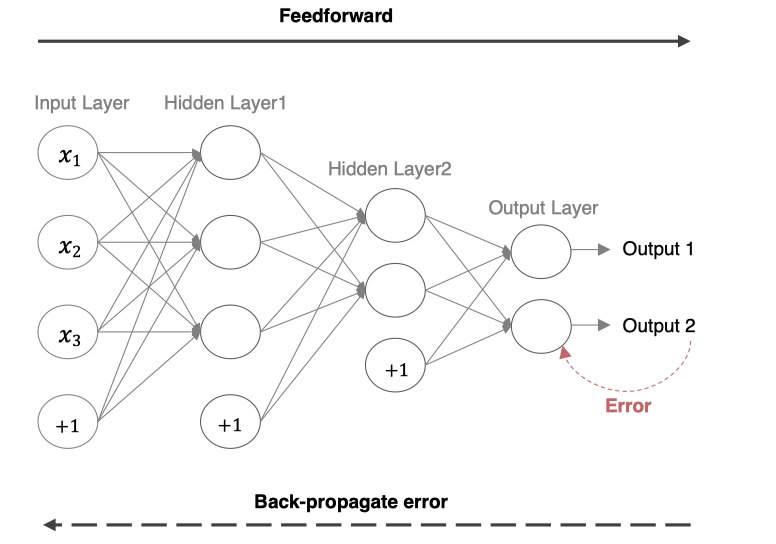

在网络的训练过程中经过前向传播后得到的最终结果跟训练样本的真实值总是存在一定误差，这个误差便是损失函数 ERROR。想要减小这个误差，**就用损失函数 ERROR，从后往前，依次求各个参数的偏导，这就是反向传播（Back Propagation）**。

推导演示如下：

**反向传播算法利用链式法则对神经网络中的各个节点的权重进行更新**。**（==本质是复合函数==，只不过如果用y = sigmoid((w5+b)，然后利用草船借箭（链式求导方式））**展开求导如下：

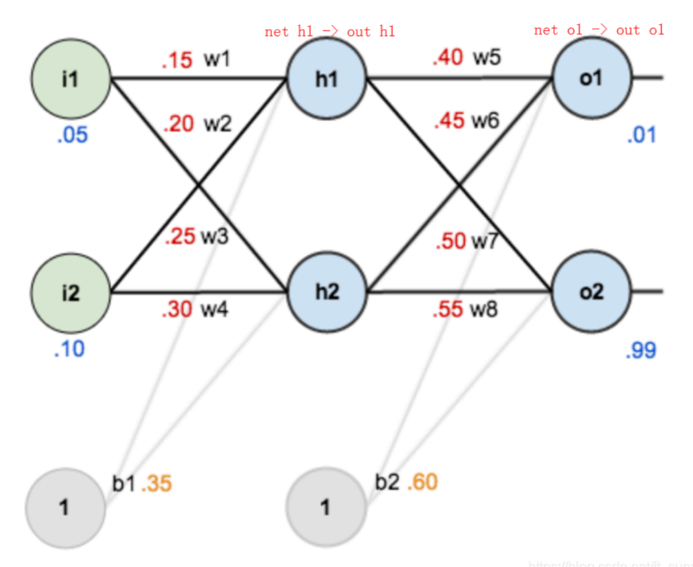

首先演示**前向传播**计算如下：


1. 隐藏层 h1 计算：


$$net_{h1} = w_1 * i_1 + w_2 * i_2 + b_1 * 1$$

$$net_{h1} = 0.15 * 0.05 + 0.2 * 0.1 + 0.35 * 1 = 0.3775$$

$$out_{h1} = \frac{1}{1+e^{-net_{h1}}} = \frac{1}{1+e^{-0.3775}} = 0.593269992$$

$$out_{h2} = 0.596884378$$

2.输出层 o1 计算：


$$net_{o1} = w_5 * out_{h1} + w_6 * out_{h2} + b_2 * 1$$

$$net_{o1} = 0.4 * 0.593269992 + 0.45 * 0.596884378 + 0.6 * 1 = 1.105905967$$

$$out_{o1} = \frac{1}{1+e^{-net_{o1}}} = \frac{1}{1+e^{-1.105905967}} = 0.75136507$$

$$out_{o2} = 0.772928465$$

3. 总误差计算：


$$E_{total} = \sum \frac{1}{2}(target - output)^2$$

$$E_{total} = E_{o1} + E_{o2} = 0.274811083 + 0.023560026 = 0.298371109$$


然后演示**反向传播**计算如下：


有$w_5/w_6/w_7/w_8$计算类似以$w5$求导演示：

​						$$\frac{\partial E_{total}}{\partial w_5} = \frac{\partial E_{total}}{\partial out_{o1}} * \frac{\partial out_{o1}}{\partial net_{o1}} * \frac{\partial net_{o1}}{\partial w_5}$$


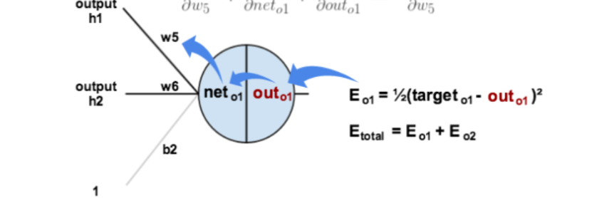


拆开计算如下：

$$E_{total} = \frac{1}{2}(target_{o1} - out_{o1})^2 + \frac{1}{2}(target_{o2} - out_{o2})^2$$

$$\frac{\partial E_{total}}{\partial out_{o1}} = 2 * \frac{1}{2}(target_{o1} - out_{o1})^{2-1} * -1 + 0$$

$$\frac{\partial E_{total}}{\partial out_{o1}} = -(target_{o1} - out_{o1}) = -(0.01 - 0.75136507) = 0.74136507$$

$$out_{o1} = \frac{1}{1+e^{-net_{o1}}}$$

$$\frac{\partial out_{o1}}{\partial net_{o1}} = out_{o1}(1 - out_{o1}) = 0.75136507(1 - 0.75136507) = 0.186815602$$

$$net_{o1} = w_5 * out_{h1} + w_6 * out_{h2} + b_2 * 1$$

$$\frac{\partial net_{o1}}{\partial w_5} = 1 * out_{h1} * w_5^{(1-1)} + 0 + 0 = out_{h1} = 0.593269992$$

$$\frac{\partial E_{total}}{\partial w_5} = 0.74136507 * 0.186815602 * 0.593269992 = 0.082167041$$

**梯度更新**：$$w_5^{+} = w_5 - \eta * \frac{\partial E_{total}}{\partial w_5} = 0.4 - 0.5 * 0.082167041 = 0.35891648$$

有$w_1/w_2/w_3/w_4$计算类似以$w_1$求导演示:

​					$$\frac{\partial E_{total}}{\partial w_1} = (\sum_{o} \frac{\partial E_{total}}{\partial out_o} * \frac{\partial out_o}{\partial net_o} * \frac{\partial net_o}{\partial out_{h1}}) * \frac{\partial out_{h1}}{\partial net_{h1}} * \frac{\partial net_{h1}}{\partial w_1}$$      （阐述：$w_1$是$h_1$的变量，h1又是$Eo_1$ 和$Eo_2$的变量，所以需要对$Eo_1$ 和$Eo_2$对w1求导）

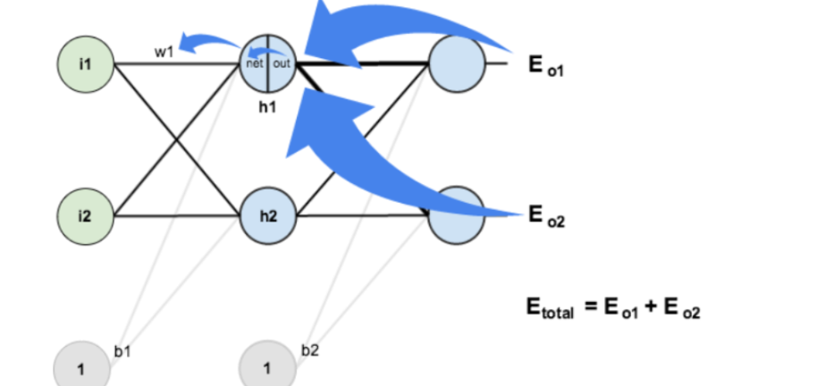

**梯度更新**：$$w_1^{+} = w_1 - \eta * \frac{\partial E_{total}}{\partial w_1} = 0.15 - 0.5 * 0.000438568 = 0.149780716$$

#### 梯度下降优化方式

梯度下降优化算法中，可能会碰到以下情况：

- 碰到平缓区域，梯度值较小，参数优化变慢
- 碰到 “鞍点” ，梯度为0，参数无法优化
- 碰到局部最小值，参数不是最优

对于这些问题, 出现了一些对梯度下降算法的优化方法，例如：**Momentum**、**AdaGrad**、**RMSprop**、**Adam** 等

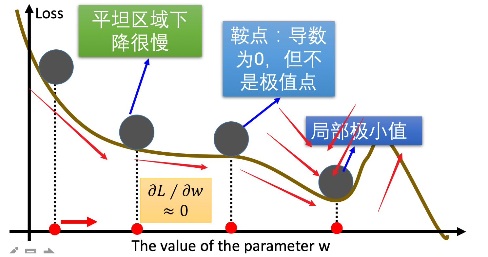

**由$于Wnew$ = $Wold$ - 学习率*梯度，左侧梯度<0  所以显示效果$Wnew$ > $Wold$即向正方向移动。右侧（极小值） 左侧梯度>0  所以显示效果$Wnew$ < $Wold$即向负方向移动。最终显示效果会掉坑里。**

#####  指数加权平均

我们最常见的

- 算数平均指的是将所有数加起来除以数的个数，每个数的权重是相同的。
- 指数加权平均指的是给每个数赋予不同的权重求得平均数。
- 移动平均数，指的是计算最近邻的 N 个数来获得平均数。

**指数移动加权平均**则是参考各数值，并且各数值的权重都不同，距离越远的数字对平均数计算的贡献就越小（权重较小），距离越近则对平均数的计算贡献就越大（权重越大）。

比如：明天气温怎么样，和昨天气温有很大关系，而和一个月前的气温关系就小一些。

计算公式可以用下面的式子来表示：

$$S_t = \begin{cases} Y_1, & t = 0 \\ \beta * S_{t-1} + (1 - \beta) * Y_t, & t > 0 \end{cases}$$

- $S_t$ 表示指数加权平均值;
- $Y_t$ 表示t时刻的值;
- β 调节权重系数，该值越大平均数越平缓。

***β一般设置为0.9，值越==大==，当前==梯度影响越小==，==指数加权平均影响越大==，==数据越平缓==。***

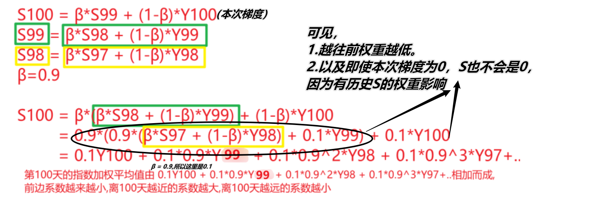

下面通过代码来看结果，随机产生 30 天的气温数据：

```python
import torch
import matplotlib.pyplot as plt
plt.rcParams['font.sans-serif'] = ['SimHei']  # 用来正常显示中文标签
plt.rcParams['axes.unicode_minus'] = False  # 用来正常显示负号
plt.switch_backend('TkAgg')
ELEMENT_NUMBER = 30


# 1. 实际平均温度
def test01():
    # 固定随机数种子
    torch.manual_seed(0)
    # 产生30天的随机温度
    temperature = torch.randn(size=[ELEMENT_NUMBER, ]) * 10
    print(temperature)
    # 绘制平均温度
    days = torch.arange(1, ELEMENT_NUMBER + 1, 1)
    plt.plot(days, temperature, color='r')
    plt.scatter(days, temperature)
    plt.show()


# 2. 指数加权平均温度
def test02(beta=0.9):
    # 固定随机数种子
    torch.manual_seed(0)
    # 产生30天的随机温度
    temperature = torch.randn(size=[ELEMENT_NUMBER, ]) * 10
    print(temperature)

    exp_weight_avg = []
    # idx从1开始
                                                                            # 定义一个温度列表（可迭代对象）
                                	                                        #temperature = [25.5, 26.8, 27.2]
                                                                            # 带索引遍历，索引从1开始
                                                                            #for idx, temp in enumerate(temperature, 1):
                                                                            #print(f"第 {idx} 个温度值：{temp}")
    for idx, temp in enumerate(temperature, 1):								#第 1 个温度值：25.5
																			#第 2 个温度值：26.8
        																	#第 3 个温度值：27.2
        # 第一个元素的 EWA 值等于自身
        if idx == 1:
            exp_weight_avg.append(temp)
            continue
        # 第二个元素的 EWA 值等于上一个 EWA 乘以 β + 当前气温乘以 (1-β)
        # idx-2：2-2=0，exp_weight_avg列表中第一个值的下标值
        new_temp = exp_weight_avg[idx - 2] * beta + (1 - beta) * temp
        exp_weight_avg.append(new_temp)

    days = torch.arange(1, ELEMENT_NUMBER + 1, 1)
    plt.plot(days, exp_weight_avg, color='r')
    plt.scatter(days, temperature)
    plt.show()


if __name__ == '__main__':
    test01()
    test02(0.5)
    test02(0.9)
```

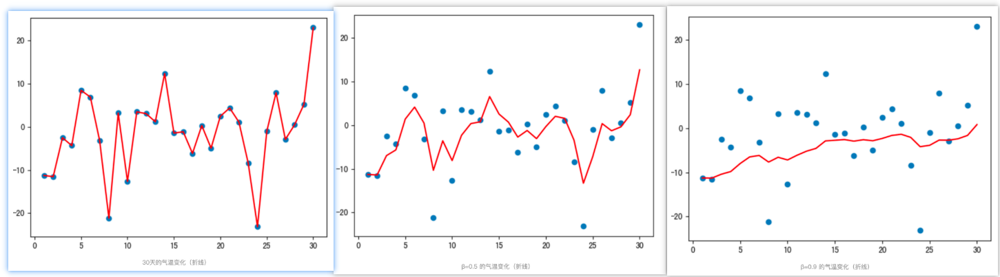

##### 动量算法Momentum

当梯度下降碰到 “峡谷” 、”平缓”、”鞍点” 区域时, 参数更新速度变慢。 Momentum 通过**指数加权平均法**，累计历史梯度值，进行参数更新，越近的梯度值对当前参数更新的重要性越大。

**梯度计算公式**：

​				$$s_t=βs_{t−1}+(1−β)g_t$$

**参数更新公式**：

​				$$w_t=w_{t−1}−ηs_t$$

- $s_t$是当前时刻指数加权平均梯度值

- $s_{t-1}$是历史指数加权平均梯度值

- $g_t$是当前时刻的梯度值

- β 是调节权重系数，通常取 0.9 或 0.99

- η是学习率

- $w_t$是当前时刻模型权重参数

```python
import torch
import torch.nn as nn
def demo():
    #初始化权重参数
    w = torch.tensor([1.0],requires_grad=True,dtype=torch.float32)
    criterion = (w ** 2 /2.0)
    optimizer = torch.optim.SGD(params=[w],lr=0.01,momentum=0.9)
    optimizer.zero_grad()
    criterion.sum().backward()
    optimizer.step()
    print(f'第1次: 梯度w.grad:{w.grad.numpy()} , 更新后的权重:{w.detach().numpy()}' )
    # 4 第2次更新 计算梯度，并对参数进行更
    # 使用更新后的参数机选输出结果
    loss = ((w ** 2) / 2.0).sum()
    optimizer.zero_grad()
    loss.backward()
    optimizer.step()
    print(f'第2次: 梯度w.grad:{w.grad.numpy()} , 更新后的权重:{w.detach().numpy()}' )


if __name__ == '__main__':
    demo()
```

##### AdaGrad

AdaGrad 通过对不同的参数分量使用不同的学习率，**AdaGrad 的学习率总体会逐渐减小**，这是因为 AdaGrad 认为：在起初时，我们距离最优目标仍较远，可以使用较大的学习率，加快训练速度，随着迭代次数的增加，学习率逐渐下降。

其计算步骤如下：

1. 初始化学习率 η、初始化参数w、小常数 σ = 1e-10

2. 初始化梯度累计变量 s = 0

3. 从训练集中采样 m 个样本的小批量，计算梯度$g_t$

4. **累积平方梯度**: $s_t$ = $s_{t-1}$ + $g_t$ ⊙ $g_t$，⊙ 表示各个分量相乘

5. 学习率 η 的计算公式如下：

   ​			η = $$η\over\sqrt{s_t}+σ$$

6. 权重参数更新公式如下：

   ​			$w_t$ = $$w_{t-1}$$ - $$η\over\sqrt{s_t}+σ$$ * $g_t$

```python
import torch
import torch.nn as nn
def demo():
    #初始化权重参数
    w = torch.tensor([1.0],requires_grad=True,dtype=torch.float32)
    criterion = (w ** 2 /2.0)
    optimizer = torch.optim.Adagrad(params=[w],lr=0.01)
    optimizer.zero_grad()
    criterion.sum().backward()
    optimizer.step()
    print(f'第1次: 梯度w.grad:{w.grad.numpy()} , 更新后的权重:{w.detach().numpy()}' )
    # 4 第2次更新 计算梯度，并对参数进行更
    # 使用更新后的参数机选输出结果
    loss = ((w ** 2) / 2.0).sum()
    optimizer.zero_grad()
    loss.backward()
    optimizer.step()
    print(f'第2次: 梯度w.grad:{w.grad.numpy()} , 更新后的权重:{w.detach().numpy()}' )


if __name__ == '__main__':
    demo()
```

#####  RMSProp

**RMSProp 优化算法是对 AdaGrad 的优化**。最主要的不同是，其使用**指数加权平均梯度**替换历史梯度的平方和。

其计算过程如下：

1. 初始化学习率 η、初始化权重参数w、小常数 σ = 1e-10

2. 初始化梯度累计变量 s = 0

3. 从训练集中采样 m 个样本的小批量，计算梯度 $g_t$

4. 使用指数加权平均累计历史梯度，⊙ 表示各个分量相乘，公式如下：

   ​			$s_t$ = β$s_{t-1}$ + (1-β)$g_t$⊙$g_t$

5. 学习率 η 的计算公式如下：

   ​			η = $η\over\sqrt{s_t}+σ$

6. 权重参数更新公式如下：

   ​			$w_t$ = $w_{t-1}$ - $η\over\sqrt{s_t}+σ$ * $g_t$

RMSProp 与 AdaGrad 最大的区别是对梯度的累积方式不同，对于每个梯度分量仍然使用不同的学习率。

**RMSProp 通过引入衰减系数β，控制历史梯度对历史梯度信息获取的多少**. 被证明在神经网络非凸条件下的优化更好，学习率衰减更加合理一些。

需要注意的是：AdaGrad 和 RMSProp 都是对于不同的参数分量使用不同的学习率，如果某个参数分量的梯度值较大，则对应的学习率就会较小，如果某个参数分量的梯度较小，则对应的学习率就会较大一些。

```python
import torch
import torch.nn as nn
def demo():
    #初始化权重参数
    w = torch.tensor([1.0],requires_grad=True,dtype=torch.float32)
    criterion = (w ** 2 /2.0)
    optimizer = torch.optim.RMSprop(params=[w],lr=0.01,alpha=0.9)
    optimizer.zero_grad()
    criterion.sum().backward()
    optimizer.step()
    print(f'第1次: 梯度w.grad:{w.grad.numpy()} , 更新后的权重:{w.detach().numpy()}' )
    # 4 第2次更新 计算梯度，并对参数进行更
    # 使用更新后的参数机选输出结果
    loss = ((w ** 2) / 2.0).sum()
    optimizer.zero_grad()
    loss.backward()
    optimizer.step()
    print(f'第2次: 梯度w.grad:{w.grad.numpy()} , 更新后的权重:{w.detach().numpy()}' )


if __name__ == '__main__':
    demo()
```

##### Adam

- Adam优化算法（Adaptive Moment Estimation，自适应矩估计）将 Momentum 和 RMSProp 算法结合在一起

  - 修正梯度: 使⽤梯度的指数加权平均 
  - 修正学习率: 使⽤梯度平⽅的指数加权平均

- **原理**：Adam 是结合了 **Momentum** 和 **RMSProp** 优化算法的优点的自适应学习率算法。它计算了梯度的一阶矩（平均值）和二阶矩（梯度的方差）的自适应估计，从而动态调整学习率。

- **梯度计算公式**：

  ​		$$m_t=β_1m_{t−1}+(1−β_1)g_t$$

  ​		$$s_t=β_2s_{t−1}+(1−β_2)gt^2$$

  ​		$$\hat{m_t}$$ = $$m_t\over1−β_1^t$$, $$\hat{s_t}$$=$$s_t\over1−β_2^t$$

- **权重参数更新公式**:

  ​		$$w_t$$ = $$w_{t−1}$$ − $$η\over\sqrt{\hat{s_t}}+ϵ$$$\hat{m_t}$

其中，$$m_t$$ 是梯度的一阶矩估计，$$s_t$$ 是梯度的二阶矩估计，$$ \hat{m_t}$$和 $$\hat{s_t}$$ 是偏差校正后的估计。

```python
import torch
import torch.nn as nn
def demo():
    #初始化权重参数
    w = torch.tensor([1.0],requires_grad=True,dtype=torch.float32)
    criterion = (w ** 2 /2.0)
    optimizer = torch.optim.Adam(params=[w],lr=0.01,betas=[0.9,0.999])
    optimizer.zero_grad()
    criterion.sum().backward()
    optimizer.step()
    print(f'第1次: 梯度w.grad:{w.grad.numpy()} , 更新后的权重:{w.detach().numpy()}' )
    # 4 第2次更新 计算梯度，并对参数进行更
    # 使用更新后的参数机选输出结果
    loss = ((w ** 2) / 2.0).sum()
    optimizer.zero_grad()
    loss.backward()
    optimizer.step()
    print(f'第2次: 梯度w.grad:{w.grad.numpy()} , 更新后的权重:{w.detach().numpy()}' )


if __name__ == '__main__':
    demo()
```

##### 总结

| **优化算法** | **优点**                                            | **缺点**                                               | **适用场景**                                         |
| ------------ | --------------------------------------------------- | ------------------------------------------------------ | ---------------------------------------------------- |
| **SGD**      | 简单、容易实现。                                    | 收敛速度较慢，容易震荡，特别是在复杂问题中。           | 用于简单任务，或者当数据特征分布相对稳定时。         |
| **Momentum** | 可以加速收敛，减少震荡，特别是在高曲率区域。        | 需要手动调整动量超参数，可能会在小步长训练中过度更新。 | 用于非平稳优化问题，尤其是深度学习中的应用。         |
| **AdaGrad**  | 自适应调整学习率，适用于稀疏数据。                  | 学习率会在训练过程中逐渐衰减，可能导致早期停滞。       | 适合稀疏数据，如 NLP 或推荐系统中的特征。            |
| **RMSProp**  | 解决了 AdaGrad 学习率过早衰减的问题，适应性强。     | 需要选择合适的超参数，更新可能会过于激进。             | 适用于动态问题、非平稳目标函数，如深度学习训练。     |
| **Adam**     | 结合了 Momentum 和 RMSProp 的优点，适应性强且稳定。 | 需要调节更多的超参数，训练过程中可能会产生较大波动。   | 广泛适用于各种深度学习任务，特别是非平稳和复杂问题。 |

- **简单任务和较小的模型**：SGD 或 Momentum

- **复杂任务或有大量数据**：Adam 是最常用的选择，因其在大部分任务上都表现优秀

- **需要处理稀疏数据或文本数据**：Adagrad 或 RMSProp

#### 学习率衰减策略

明明有了自适应梯度优化（Momentum\AdaGrad\RMSProp\Adam）为什么还需要手动调整学习率衰减？

**自适应梯度优化 (如 AdaGrad, RMSProp, Adam):** 属于微观/空间维度的调节。它们通过二阶动量解决的是“不同参数之间梯度不均匀”的问题（例如：**给平缓方向的参数加力，给陡峭方向的参数减速**）。

**学习率衰减 (LR Scheduler):** 属于**宏观/时间维度**的调节。它不关心具体的参数方向，只关心随着训练时间的推移，整体步长是否应该收缩。

A.仅有梯度优化存在的震荡问题 

在训练后期，损失函数的表面往往非常崎岖。这会导致模型在最优解附近**来回震荡 (Oscillation)**，甚至跳出最优解。

B. 提升模型的泛化能力

- **早期探索：** 训练初期保持大学习率，有助于模型产生足够的“能量”**跳出局部最小值或鞍点**，在更大的搜索空间寻找优质区域。
- **后期沉淀：** 训练后期通过衰减步长，强制模型在当前找到的优质区域进行**精细打磨**。

C. 自适应算法的“步长陷阱”

- RMSProp 等算法通过除以梯度平方和的平均值来调整。在训练后期，当梯度变得非常小时，分母也会变小，这可能导致步长意外放大，导致训练不稳定。
- 引入**学习率衰减**作为“第二道安全锁”，可以确保无论梯度如何变化，总步长在宏观上是稳步缩减的。

所以需要学习率优化是必要的，将**自适应梯度算法（RMSProp/Adam）**与**学习率衰减（LR Scheduler）**结合，它们共同保证了模型能够在复杂的高维空间中，既能“走得快”（**快速收敛**），又能“停得准”（**达到全局最优附近**）。

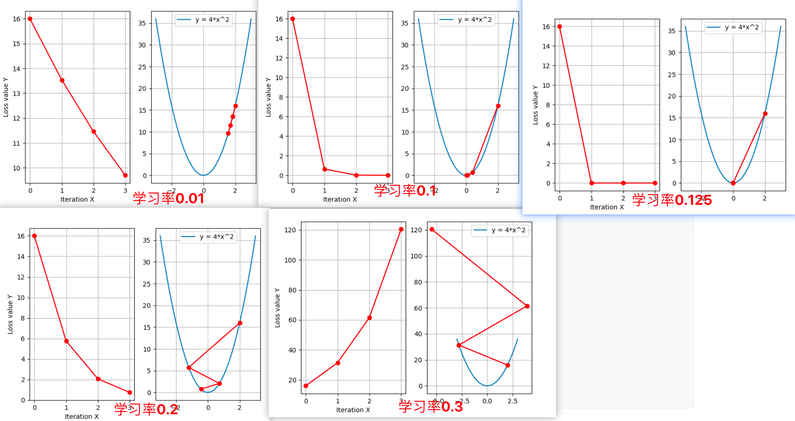

***采用较==小==的学习率，==梯度下降的速度慢==；采用较==大==的学习率，梯度下降太==快==越过了最小值点，==导致震荡==，甚至不收敛（梯度爆炸）***

##### 等间隔学习率衰减

实现原理：

```python
#   step_size：调整间隔数=50
#   gamma：调整系数=0.5
#   调整方式：lr = lr * gamma
```


```python
import torch
import torch.nn as nn
from torch import optim
import matplotlib.pyplot as plt
plt.rcParams['font.sans-serif'] = ['SimHei']  # 用来正常显示中文标签
plt.rcParams['axes.unicode_minus'] = False  # 用来正常显示负号
plt.switch_backend('TkAgg')
def demo():
    # 定义变量

    lr,epochs,iterations = 0.1,200,10
    y_true = torch.tensor([0])
    x = torch.tensor([1.0],dtype=torch.float32)
    w = torch.tensor([1.0],dtype=torch.float32,requires_grad=True)

    optimizer = optim.SGD([w],lr=lr,momentum=0.9)
    scheduler = optim.lr_scheduler.StepLR(optimizer,step_size=50,gamma=0.5)
    lr_list = []
    epochs_list = []
    for epoch in range(epochs):
        epochs_list.append(epoch)
        lr_list.append(scheduler.get_last_lr())
        for batch in range(iterations):
            y_pred = w*x
            loss = (y_pred-y_true)**2
            optimizer.zero_grad()
            loss.backward()
            optimizer.step()
        scheduler.step()#scheduler.step()：这是让学习率调度器计数。每调一次，它内部的计数器加 1。当计数器达到 step_size（50）时，它就会修改 optimizer 内部的 lr 变量。
    print(f'lr_list:{lr_list}')
    plt.plot(epochs_list,lr_list)
    plt.xlabel('epoch')
    plt.ylabel('Learning rate')
    plt.legend()
    plt.show()

if __name__ == '__main__':
    demo()
```

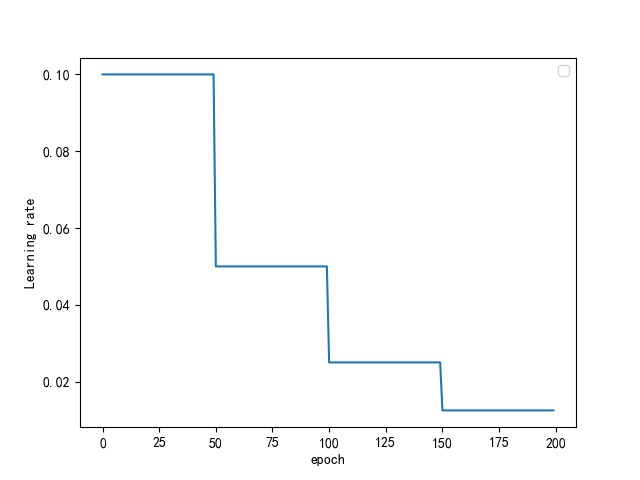

##### 指定间距学习率衰减

实现原理：

```python
# milestones：设定调整轮次:[50, 125, 160]
# gamma：调整系数
# 调整方式：lr = lr * gamma
optim.lr_scheduler.MultiStepLR(optimizer, milestones, gamma=0.1, last_epoch=-1)  
```


```python
import torch
import torch.nn as nn
from torch import optim
import matplotlib.pyplot as plt
plt.rcParams['font.sans-serif'] = ['SimHei']  # 用来正常显示中文标签
plt.rcParams['axes.unicode_minus'] = False  # 用来正常显示负号
plt.switch_backend('TkAgg')
def demo():
    # 定义变量

    lr,epochs,iterations = 0.1,200,10
    y_true = torch.tensor([0])
    x = torch.tensor([1.0],dtype=torch.float32)
    w = torch.tensor([1.0],dtype=torch.float32,requires_grad=True)
    milestones = [50,125,160]
    optimizer = optim.SGD([w],lr=lr,momentum=0.9)
    scheduler = optim.lr_scheduler.MultiStepLR(optimizer,milestones=milestones,gamma=0.5)
    lr_list = []
    epochs_list = []
    for epoch in range(epochs):
        epochs_list.append(epoch)
        lr_list.append(scheduler.get_last_lr())
        for batch in range(iterations):
            y_pred = w*x
            loss = (y_pred-y_true)**2
            optimizer.zero_grad()
            loss.backward()
            optimizer.step()
        scheduler.step()
    print(f'lr_list:{lr_list}')
    plt.plot(epochs_list,lr_list)
    plt.xlabel('epoch')
    plt.ylabel('Learning rate')
    plt.legend()
    plt.show()

if __name__ == '__main__':
    demo()
```

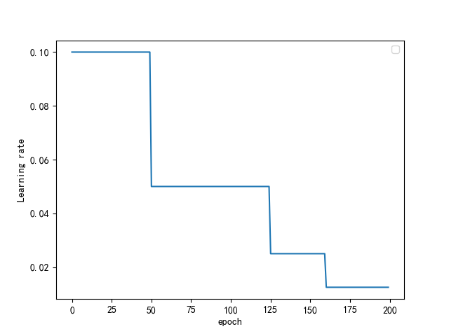

##### 指数学习率衰减

实现原理：

```python
# gamma：指数的底
# 调整方式
# lr= lr∗gamma^epoch
optim.lr_scheduler.ExponentialLR(optimizer, gamma)
```


```python
import torch
import torch.nn as nn
from torch import optim
import matplotlib.pyplot as plt
plt.rcParams['font.sans-serif'] = ['SimHei']  # 用来正常显示中文标签
plt.rcParams['axes.unicode_minus'] = False  # 用来正常显示负号
plt.switch_backend('TkAgg')
def demo():
    # 定义变量

    lr,epochs,iterations = 0.1,200,10
    y_true = torch.tensor([0])
    x = torch.tensor([1.0],dtype=torch.float32)
    w = torch.tensor([1.0],dtype=torch.float32,requires_grad=True)

    optimizer = optim.SGD([w],lr=lr,momentum=0.9)
    scheduler = optim.lr_scheduler.ExponentialLR(optimizer,gamma=0.95,)
    lr_list = []
    epochs_list = []
    for epoch in range(epochs):
        epochs_list.append(epoch)
        lr_list.append(scheduler.get_last_lr())
        for batch in range(iterations):
            y_pred = w*x
            loss = (y_pred-y_true)**2
            optimizer.zero_grad()
            loss.backward()
            optimizer.step()
        scheduler.step()
    print(f'lr_list:{lr_list}')
    plt.plot(epochs_list,lr_list)
    plt.xlabel('epoch')
    plt.ylabel('Learning rate')
    plt.legend()
    plt.show()

if __name__ == '__main__':
    demo()
```

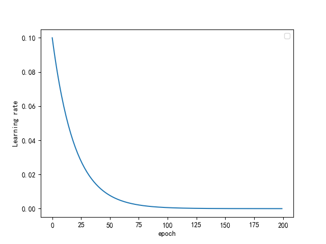

##### 小结

| 方法         | 等间隔学习率衰减 (Step Decay)    | 指定间隔学习率衰减 (Exponential Decay)     | 指数学习率衰减 (Exponential Moving Average Decay) |
| ------------ | -------------------------------- | ------------------------------------------ | ------------------------------------------------- |
| **衰减方式** | 固定步长衰减                     | 指定步长衰减                               | 平滑指数衰减，历史平均考虑                        |
| **实现难度** | 简单易实现                       | 相对简单，容易调整                         | 需要额外历史计算，较复杂                          |
| **适用场景** | 大型数据集、较为简单的任务       | 对训练平稳性要求较高的任务                 | 高精度训练，避免过快收敛                          |
| **优点**     | 直观，易于调试，适用于大批量数据 | 易于调试，稳定训练过程                     | 平滑且考虑历史更新，收敛稳定性较强                |
| **缺点**     | 学习率变化较大，可能跳过最优点   | 在某些情况下可能衰减过快，导致优化提前停滞 | 超参数调节较为复杂，可能需要更多的计算资源        |


#### 正则化

- 在设计机器学习算法时希望在新样本上的泛化能力强。许多机器学习算法都采用相关的策略来减小测试误差，这些策略被统称为正则化
- 神经网络强大的表示能力经常遇到过拟合，所以需要使用不同形式的正则化策略
- 目前在深度学习中使用较多的策略有范数惩罚，DropOut，特殊的网络层等，接下来我们对其进行详细的介绍

##### Dropout正则化

在训练深层神经网络时，由于模型参数较多，在数据量不足的情况下，很容易过拟合。Dropout（中文翻译成随机失活）是一个简单有效的正则化方法。

- 在训练过程中，Dropout的实现是**让神经元以超参数p（丢弃概率）的概率停止工作或者激活被置为0,未被置为0的进行缩放，缩放比例为1/(1-p)**。训练过程可以认为是对完整的神经网络的一些子集进行训练，每次基于输入数据只更新子网络的参数
- 在实际应用中，Dropout参数p的概率通常取值在**==0.2到0.5==**之间
  - 对于较小的模型或较复杂的任务，丢弃率可以选择0.3或更小
  - 对于非常深的网络，较大的丢弃率（如0.5或0.6）可能会有效防止过拟合
  - 实际应用中，通常会在全连接层（激活函数后）之后添加Dropout层

**进行缩放必要性**：

​				训练时，你丢弃了 $p$ 比例的神经元，剩下的神经元只占 $(1-p)$。如果不进行缩放，整个网络的输出信号强度会整体减弱。

Dropout既然是概率的失活，既然本来数据就少，失活数据不就更少了？
						每一次训练迭代，如果模型参数很多（深层网络），它有无数种方法可以完美拟合这几条数据，包括记住噪声,而Dropout处理后,由于失活的神经元不同，相同的输入数据会经过**完全不同的网络结构**，就不会出现神经元 A 发现神经元 B 学到了某个参数特征，它就偷懒只学 B 的补丁，导致多个神经元高度绑定，共同去拟合训练集里的特定噪声。所以，所以，**数据越少，反而越需要 Dropout 这种手段。** 因为数据少意味着“噪声”的影响会被放大，而 Dropout 正是滤除噪声、提升泛化能力的利器。

**==通常deopout放在激活函数之后==**

**==使用对象：仅在“训练模型”时起作用，测试时通常会关闭。==**

```python
import torch
import torch.nn as nn
def demo():

    t1 = torch.randn(size=(1,4)).float()#说明：都是假设的
    linear = nn.Linear(4,5) #说明：都是假设的
    #加权求和
    l1 = linear(t1)
    print(f"加权求和后的数据:{l1}")
    #激活函数
    output = torch.relu(l1)
    print(f"激活后的数据:{output}")
    #对激活的值进行随机失活Dropout处理，只有训练阶段才有，测试阶段没有
    dropout = nn.Dropout(p=0.4)
    d1 = dropout(output)
    print(f"随机失活的数据:{d1}")#未被失活的数据进行缩放，缩放比例是1/（1-p）
if __name__ == '__main__':
    demo()
#输出：
加权求和后的数据:tensor([[ 0.7326,  0.3852, -0.7300,  0.2966, -1.5299]],
       grad_fn=<AddmmBackward0>)
激活后的数据:tensor([[0.7326, 0.3852, 0.0000, 0.2966, 0.0000]], grad_fn=<ReluBackward0>)			#第2、5个这里的0因为Relu的原因max(0,x)
随机失活的数据:tensor([[1.2211, 0.6420, 0.0000, 0.0000, 0.0000]], grad_fn=<MulBackward0>)			#第4个这里的0因为dropout失活
																								#第1、2缩放2倍
```


##### 批量归一化

**批量归一化的作用：**

- **减少内部协方差偏移：**通过对每层的输入进行标准化，减少了输入数据分布的变化，从而加速了训练过程，并使得网络在训练过程中更加稳定。

- **加速训练：**
  - 在没有批量归一化的情况下，神经网络的训练通常会很慢，尤其是深度网络。因为在每层的训练过程中，输入数据的分布（特别是前几层）会不断变化，这会导致网络学习速度缓慢。
  - 批量归一化通过确保每层的输入数据在训练时分布稳定，有效减少了这种变化，从而加速了训练过程。

- **起到正则化作用：**批量归一化可以视作一种正则化方法，因为它引入了对训练样本的噪声（不同批次的统计信息不同，批次较小的均值和方差估计会更加不准确），使得模型不容易依赖特定的输入特征，从而起到一定的正则化效果，减少了对其他正则化技术（如Dropout）的需求。

- **提升泛化能力：**由于其正则化效果，批量归一化能帮助网络在测试集上取得更好的性能。

**==Batch Normalization 的使用步骤==：**

1. **在网络层后添加 BN 层：**

   - 通常，BN 层会添加在卷积层 (Conv2d) 或全连接层 (Linear) 之后，**==加权平均之后，激活函数之前==**。
   - 例如：***==Conv2d -> BN -> ReLU 或者 Linear -> BN -> ReLU。==***

   **==适用对象：训练和测试都要用==**

```python
import torch
import torch.nn as nn

"""
BatchNorm1d：主要应用于全连接层或处理一维数据的网络，例如文本处理。它接收形状为 (N, num_features) 的张量作为输入。
BatchNorm2d：主要应用于卷积神经网络，处理二维图像数据或特征图。它接收形状为 (N, C, H, W) 的张量作为输入。
BatchNorm3d：主要用于三维卷积神经网络 (3D CNN)，处理三维数据，例如视频或医学图像。它接收形状为 (N, C, D, H, W) 的张量作为输入。
"""
#BatchNorm2d定义函数处理二维数据
def demo01():
    # 创建测试样本, 假设是经过卷积层(Conv2d)处理后的特征图
    # (N, C, H, W): 一张图, 两个通道, 每个通道3行4列
    # 可以创建1个样本, 图像的BN是对每个通道的特征图(行列数据)进行标准化
    input_2d=torch.randn((1, 2, 3, 4))
    #创建批量归一化层（BN层）
    #参1，输入通道数。参2，噪声小常数，参3，动量值，用于计算移动平局统计量。参4，是否启用缩放和偏移,若为True，γ和β被使用，让BN层更加灵活。
    bn2d=  nn.BatchNorm2d(num_features=2,eps=1e-5,momentum=0.1,affine=True)
    output_2d=bn2d(input_2d)
    print(f'output_2d:{output_2d}')

#批量归一化层处理二维数据
def demo02():
    # 创建测试样本
    # 2个样本, 2个特征
    # 不能创建1个样本, 无法统计均值和方差
    input_1d = torch.randn((2,2))
    linear = nn.Linear(2, 4)
    l1 = linear(input_1d)
    bn1d = nn.BatchNorm1d(num_features=4, eps=1e-5, momentum=0.1, affine=True)
    output_1d = bn1d(l1)
    print(f'output_1d:{output_1d}')
if __name__ == '__main__':
    demo01()
    demo02()
```

解释：为什么demo01没用nn.Linear，但是demo02用了nn.Linear？

由于Conv2d -> BN -> ReLU 或者 Linear -> BN -> ReLU

- **`demo01` (BatchNorm2d)**： 你直接定义了 `input_2d = torch.randn((1, 2, 3, 4))`。 在 CNN 的逻辑里，这已经代表了**“经过卷积层处理后的结果”**。其中 `C=2` 就是卷积核提取出来的 2 个特征通道。由于你手动构造了符合卷积输出格式的 4 维张量，所以不需要再接一个 `Conv2d` 或 `Linear`，它可以直接喂给 `bn2d`。
- **`demo02` (BatchNorm1d)**： 你定义了 `input_1d = torch.randn((2, 2))`，然后接了一个 `Linear(2, 4)`。 这里你是在模拟**“全连接网络”**的典型流程。通常原始输入经过 `Linear` 层的加权求和后，特征维度会发生改变（从 2 变到了 4）。你之所以写 `Linear`，是为了产生那 **4 个特征属性**，好让后面的 `num_features=4` 的 BN 层有据可依。

### 卷积神经网络（CNN）

#### 图像基础


图像是人类视觉的基础，是自然景物的客观反映，是人类**认识世界和人类本身**的重要源泉。**“图”是物体反射或透射光的分布，“像“是人的视觉系统所接受的图在人脑中所形成的印象或认识**，[照片](https://baike.baidu.com/item/%E7%85%A7%E7%89%87/1465692?fromModule=lemma_inlink)、绘画、剪贴画、地图、书法作品、手写汉字、传真、卫星云图、影视画面、X光片、脑电图、[心电图](https://baike.baidu.com/item/%E5%BF%83%E7%94%B5%E5%9B%BE/399200?fromModule=lemma_inlink)等都是图像。

在计算机中，按照颜色和灰度的多少可以将图像分为四种基本类型。

- **二值图像**

  一幅二值图像的二维[矩阵](https://so.csdn.net/so/search?q=%E7%9F%A9%E9%98%B5&spm=1001.2101.3001.7020)仅由0、1两个值构成，**“0”代表黑色，“1”代白色**。由于每一像素（矩阵中每一元素）取值仅有0、1两种可能，所以计算机中二值图像的数据类型通常为1个二进制位。二值图像通常用于文字、线条图的扫描识别（OCR）和掩膜图像的存储。

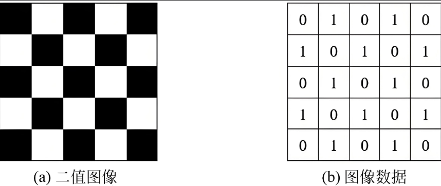


- **灰度图像**

  **灰度图像矩阵元素的取值范围通常为[0，255]**。因此其数据类型一般为**8位无符号整数的（int8）**，这就是人们经常提到的256灰度图像。**“0”表示纯黑色，“255”表示纯白色，中间的数字从小到大表示由黑到白的过渡色。**二值图像可以看成是灰度图像的一个特例。

- **索引图像**

  索引图像的文件结构比较复杂，除了**存放图像的二维矩阵**外，还包括一个称之为**颜色索引矩阵MAP的二维数组**。MAP的大小由存放图像的矩阵元素值域决定，如矩阵元素值域为[0，255]，则MAP矩阵的大小为256Ⅹ3，**用MAP=[RGB]表示**。**MAP中每一行的三个元素分别指定该行对应颜色的红、绿、蓝单色值，MAP中每一行对应图像矩阵像素的一个灰度值**，如某一像素的灰度值为64，则该像素就与MAP中的第64行建立了映射关系，该像素在屏幕上的实际颜色由第64行的[RGB]组合决定。也就是说，图像在屏幕上显示时，每一像素的颜色由存放在矩阵中该像素的灰度值作为索引通过检索颜色索引矩阵MAP得到。

- **真彩色RGB图像**     ***重点！***

RGB图像与索引图像一样都可以用来表示彩色图像。与索引图像一样，它分别用红（R）、绿（G）、蓝（B）三原色的组合来表示每个像素的颜色。但与索引图像不同的是，**RGB图像每一个像素的颜色值（由RGB三原色表示）直接存放在图像矩阵中**，由于每一像素的颜色需由R、G、B三个分量来表示，**M、N分别表示图像的行列数，三个M x N的二维矩阵分别表示各个像素的R、G、B三个颜色分量。**RGB图像的数据类型一般为8位无符号整形。**注意：通道的顺序是 BGR 而不是 RGB。**


| 图像类型     | 通道数           | 像素值范围       | 主要特点                                 | 常见用途                         |
| ------------ | ---------------- | ---------------- | ---------------------------------------- | -------------------------------- |
| **二值图像** | 1通道            | 0 或 1           | 每个像素只有黑与白两种值                 | 形态学操作、二值化、轮廓检测     |
| **灰度图像** | 1通道            | 0 到 255         | 每个像素表示灰度（亮度）                 | 图像预处理、物体检测、人脸识别   |
| **索引图像** | 1通道            | 0 到 255（索引） | 像素值为颜色表的索引，颜色表决定实际颜色 | 存储压缩、较少颜色的图像表示     |
| **RGB图像**  | 3通道（R、G、B） | 0 到 255         | 每个像素由红、绿、蓝三个通道组成         | 普通彩色图像显示、图像处理与分析 |

二值图 及 图片加载代码演示


```python
#读取图片，获取HWC
plt.imread("../image/star.jpg")
#基于HWC展示图片
plt.imshow(image)
#基于HWC，保存图片
plt.imsave("../image/star_copy.jpg",img1)
```


```python
import os

import torch
import torch.nn as nn
import matplotlib.pyplot as plt
import numpy as np
#import os

#二值图，每个像素0或者1
def demo1():
    #定义全黑图片,像素点越接近0越黑，接近255越亮
    #HWC  H:高度  W:宽度  C:通道数
    image = np.zeros((200,200,3))
    plt.figure("Black Image")  # 给窗口起个名字
    #绘制图片
    plt.imshow(image)
    #plt.show()
    #定义全白图片
    image2 = torch.full(size=(200,200,3),fill_value=255)
    plt.figure("White Image")  # 给窗口起个名字

    plt.imshow(image2)
    plt.show()
#定义函数，加载图片
def demo2():
    #1. 加载图片
    img1 = plt.imread("../image/star.jpg")
    print(img1.shape)
    print(f"img1 : {img1}")
    #2.保存图像 #参1，保存位置 参2，索要保存图片对象
    plt.imsave("../image/star_copy.jpg",img1)
    #展示图像
    plt.imshow(img1)
    plt.show()
if __name__ == '__main__':
    #demo1()
    demo2()
```


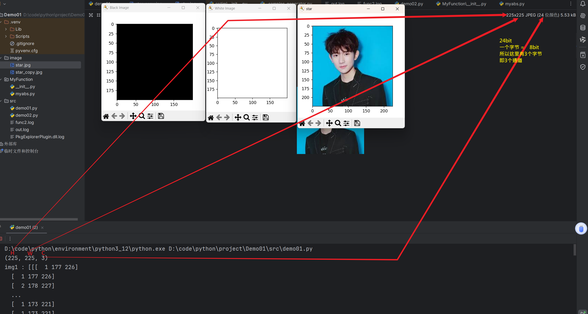


#### 卷积神经网络概述

**卷积神经网络是深度学习在计算机视觉领域的突破性成果，专门用于处理图像、视频、语音等数据的神经网络** 

在计算机视觉领域, 往往我们输入的图像都很大，使用全连接网络的话，计算的代价较高。另外图像也很难保留原有的特征，导致图像处理的准确率不高。

卷积神经网络（Convolutional Neural Network）是**含有卷积层的神经网络**。卷积层的**作用就是用来自动学习、提取图像的特征**。

CNN网络主要由三部分构成：**卷积层、池化层和全连接层**构成：

（1）卷积层负责提取图像中的局部特征 ，由**==局部加权平均+激活函数（通常是Relu）构成==**,其中，加权平均公式:

​		==**$y		= 		输入通道数*卷积核尺寸*卷积核数量 + 卷积核数量$**== 

（2）池化层用来大幅降低参数量级(降维),**==不做权重及激活函数==**

（3）全连接层类似人工神经网络的部分，用来输出想要的结果，由**==全局加权平均 + 激活函数==**。加权平均公式:

​		==$y = wx+b$==

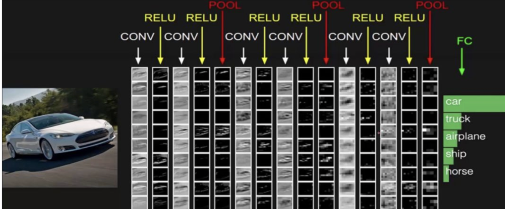


上图中CNN要做的事情是：给定一张图片，是车还是马未知，是什么车也未知，现在需要模型判断这张图片里具体是一个什么东西，总之输出一个结果：如果是车，那是什么车

- 最左边是
  - **数据输入层**：对数据做一些处理，比如去均值（各维度都减对应维度的均值，使得输入数据各个维度都中心化为0，避免数据过多偏差，影响训练效果）、归一化（把所有的数据都归一到同样的范围）、PCA等等。**CNN只对训练集做“去均值”这一步。**
- 中间是
  - **卷积层(CONV)**：线性乘积求和，提取图像中的局部特征
  - **激励层(RELU)**：ReLU激活函数,输入数据转换成输出数据
  - **池化层(POOL)**：取区域平均值或最大值，大幅降低参数量级(降维)
- 最右边是
  - 全连接层(FC)：**接收二维数据集**，输出CNN模型预测结果

##### **CNN中的经典算法/网络架构**

**LeNet-5:**作为最早的CNN架构之一，证明了CNN在图像识别任务上的有效性，为后续的CNN发展奠定了基础

- **卷积层:** 提取图像的边缘、角点等基本特征
- **池化层 (子采样层):** 降低特征图的维度，减少计算量，并提高模型对输入图像微小变化的鲁棒性
- **全连接层:** 将卷积层和池化层提取的特征进行组合，用于最终的分类

**AlexNet:**显著提升了ImageNet图像分类的准确率，证明了深度学习在计算机视觉领域的潜力，并推动了深度学习的快速发展

- **卷积层:** 使用更大的卷积核和更多的卷积核，提取更丰富的图像特征
- **ReLU激活函数:** 加速训练过程，并提高模型的性能
- **最大池化层:** 降低特征图的维度
- **Dropout层:** 防止过拟合
- **全连接层:** 用于最终的分类

**VGGNet:**探索了网络深度对性能的影响，证明了更深的网络可以提取更抽象和更具表达力的特征

- **卷积层:** 使用更小的卷积核 (3x3)，并堆叠多个卷积层，增加了网络的深度，提取更复杂的特征
- **最大池化层:** 降低特征图的维度
- **全连接层:** 用于最终的分类

**GoogLeNet (Inception):**提出了 Inception 模块，在提高性能的同时减少了计算量，为后续的网络架构设计提供了新的思路

- **Inception 模块:** 并行使用不同大小的卷积核和池化操作，然后将它们的输出连接起来，增加了网络的宽度，提高了网络的效率

**ResNet:**解决了深度网络训练困难的问题，使得可以训练更深的网络，从而显著提高了模型的性能

- **残差块 (Residual Block):** 引入跳跃连接 (Shortcut Connection)，允许梯度直接反向传播到浅层，解决了深度网络的梯度消失问题，使得训练非常深的网络成为可能

**DenseNet:**

- **密集块 (Dense Block):** 将每一层都与之前的所有层连接，特征重用更加充分，进一步提高了网络的性能和参数效率
- DenseNet通过密集连接（Dense Connectivity）在网络中各层之间建立了直接的连接，即每一层都接收前面所有层的输出作为输入。这种设计增强了特征传递和梯度流动，避免了梯度消失问题，并提高了信息的利用率


#### 卷积层


卷积层（Convolutional Layer）通过卷积操作**==提取输入数据中的特征==**（例如图像中的边缘、纹理、形状等）。

卷积层利用卷积核（滤波器）对输入进行处理，从而**==生成特征图==**（feature map），并且每个卷积层能够提取不同层次的特征，从低级特征（如边缘）到高级特征（如物体的形状）。

**卷积层的主要作用如下：**

- **特征提取**：卷积层的主要作用是从输入图像中提取低级特征（如边缘、角点、纹理等）。通过多个卷积层的堆叠，网络能够逐渐从低级特征到高级特征（如物体的形状、区域等）进行学习。
- **权重共享**：在卷积层中，同一个卷积核在整个输入图像上共享权重，这使得卷积层的参数数量大大减少，减少了计算量并提高了训练效率。
- **局部连接**：卷积层中的每个神经元仅与输入图像的一个小局部区域相连，这称为**局部感受野**，这种局部连接方式更符合图像的空间结构，有助于捕捉图像中的局部特征。
- **空间不变性**：由于卷积操作是局部的并且采用权重共享，卷积层在处理图像时具有**平移不变性**。也就是说，不论物体出现在图像的哪个位置，卷积层都能有效地检测到这些物体的特征。

##### 卷积计算


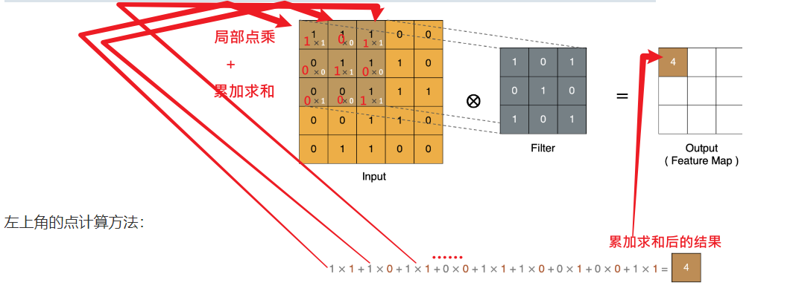

1. input 表示输入的图像

2. filter 表示卷积核, 也叫做滤波器(滤波矩阵)

   - 一组固定的权重，因为每个神经元的多个权重固定，所以又可以看做一个恒定的滤波器filter
   - 非严格意义上来讲，下图中红框框起来的部分便可以理解为一个滤波器，即带着**一组固定权重的神经元**。多个滤波器叠加便成了卷积层
   - **==一个卷积核就是一个神经元==**


3.input 经过 filter 得到输出为最右侧的图像，该图叫做特征图

那么, 它是如何进行计算的呢？**卷积运算本质上就是在滤波器和输入数据的==局部区域间做点积==。**

​	

##### Padding（填充）

通过上面的卷积计算过程，最终的特征图比原始**图像小很多**（**==原来input(5×5),经过与滤波器点乘后变成了 output(3×3)==**），如果想要保持经过卷积后的图像大小不变, 可以在**原图周围**添加 Padding 来实现。

Padding（填充）操作是一种用于==在输入特征图的边界周围添加额外像素（通常是零）==。

**Padding的主要作用：**

- **保持空间维度：**如果不使用 padding，每次卷积操作后**，特征图的尺寸都会缩小**。多次卷积后，特征图会变得非常小，可能会丢失重要的边缘信息。Padding可以帮助维持输出特征图的尺寸与输入相同或接近相同。
- **保留边缘信息：**图像边缘的像素在卷积过程中参与的**计算次数较少**，这意味着边缘信息在特征提取过程中容易丢失。Padding通过在边缘添加额外的像素，增加了边缘像素的参与度，从而更好地保留了边缘信息。
- **提高性能：**Padding有助于避免由于特征图尺寸快速缩小而导致的信息丢失，从而提高模型的性能，尤其是在处理较小的图像或需要进行多层卷积时。

**Padding的类型：**

- **Valid Padding (No Padding):** 不进行任何填充。卷积核只在输入图像的有效区域内滑动。输出尺寸会缩小。 
- **Same Padding:** 添加足够的填充，使得输出特征图的尺寸与输入相同。 
- **Full Padding:** 尽可能多地添加填充，使得卷积核的每个元素都至少在输入图像上滑动一次。输出尺寸会增大。

**Padding的选择：**取决于具体的应用场景和网络架构

- **Valid Padding:** 适用于不需要保持输出尺寸的场景，或者输入图像足够大，边缘信息丢失不重要的情况。
- **Same Padding:** 广泛应用于各种CNN架构中，因为它可以保持特征图的尺寸，方便网络设计和计算。
- **Full Padding:** 较少使用，因为它会增加计算量，并且可能会在边缘引入一些伪影。


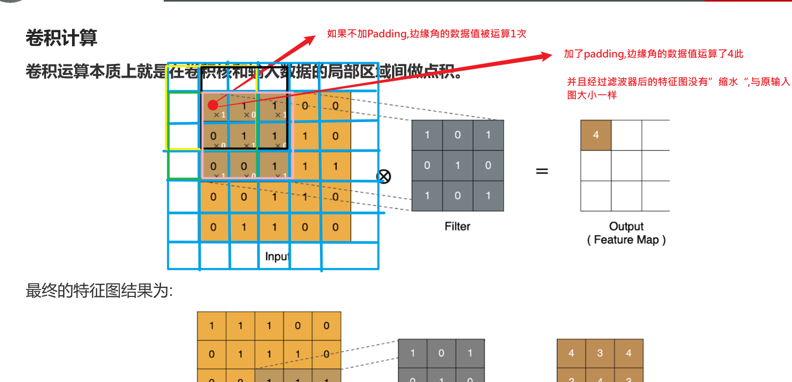


##### Stride（步长）


Stride（步长）指的是**卷积核在图像上滑动时的步伐大小**，即每次卷积时卷积核在图像中向右（或向下）移动的像素数。步长直接影响卷积操作后输出特征图的尺寸，以及计算量和模型的特征提取能力。

**Stride的作用:**

- **降低计算复杂度：**更大的步长意味着卷积核移动的次数更少，从而***减少了计算量***，并加快了训练和推理速度。
- **减1长越大，生成的特征图尺寸越小。这类似于池化的降维效果。
- **增大感受野：**虽然更大的步长会***减小特征图的尺寸***，但它同时也会***增大***每个神经元在输入数据上的***感受野***。这意味着每个神经元能够捕捉到更大范围的输入信息。

**Stride的选择：**取决于具体的应用场景和网络架构

- **Stride = 1:** 这是最常见的设置，尤其是在网络的早期层。它允许保留更多的空间细节。
- **Stride > 1:** 通常用于***减小特征图的尺寸和增大感受野***，例如在网络的后期层或需要进行快速降维时。 常见的设置包括 stride=2 或 stride=4。


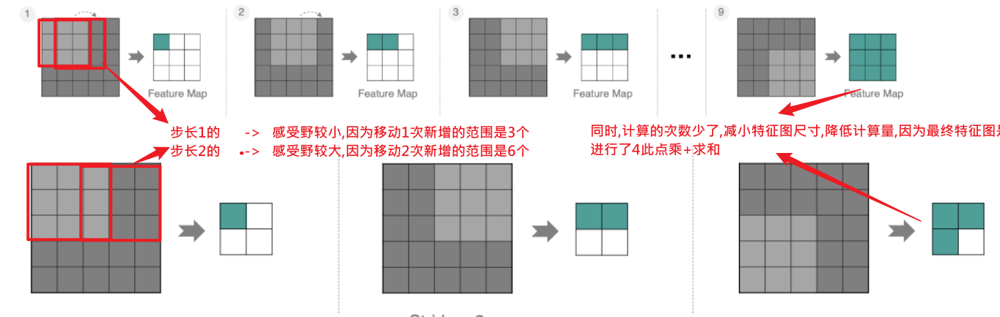


##### 多通道卷积计算

实际中的图像都是多个通道组成的，我们怎么计算卷积呢？


计算方法如下：

1. 当输入有多个通道(Channel), 例如 RGB 三个通道, 此时要求卷积核需要拥有相同的通道数（图像有多少通道，每个卷积核就有多少通道）.
2. 每个卷积核通道与对应的输入图像的各个通道进行卷积.
3. 将每个通道的卷积结果按位相加得到最终的特征图.


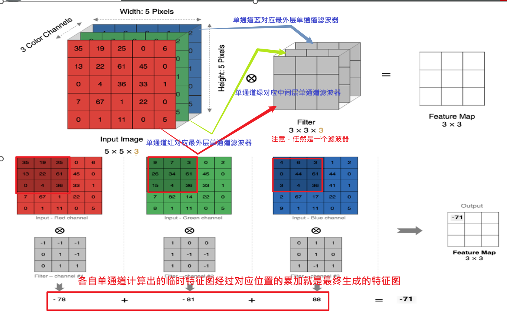


##### 多卷积核卷积计算

上面的例子里我们只使用一个卷积核进行特征提取, 实际对图像进行特征提取时, 我们需要使用多个卷积核进行特征提取. 这个多个卷积核可以理解为从不同到的视角、不同的角度对图像特征进行提取.

那么, 当使用多个卷积核时, 应该怎么进行特征提取呢?


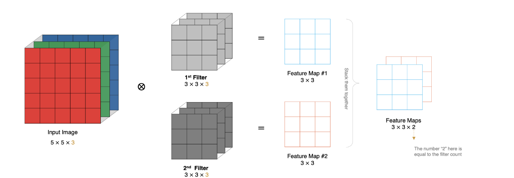


可以看到：

- 两个神经元，意味着有**两个滤波器**
- 数据窗口每次移动两个步长取3*3的局部数据，**即stride=2**
- zero**-padding**=1。输入数据由`5*5*3`变为`7*7*3`
- 左边是输入（**7\*7\*3**中，7*7代表图像的像素/长宽，3代表R、G、B 三个颜色通道）
- 中间部分是两个不同的滤波器Filter w0、Filter w1
- 最右边则是两个不同的输出


##### 特征图大小计算公式


设如下，输入图片大小是$W$，$H$，移动步长$S$，填充$Padding$，滤波器（自己规定的一般是方阵$F ×F$）大小为$F$,那么有特征图大小：


​			$$N_x = \frac{W - F + 2P}{S} + 1$$


​			$$N_y = \frac{H - F + 2P}{S} + 1$$


解出：特征图大小:	$(N_x,N_y)$	表示$N_x$行，$N_y$列


##### Pytorch卷积层API

```python
#参1：输入通道数，参2：输出通道数（卷积核个数），参数3：卷积核大小，参数4：步长，参数5：填充
conv = torch.nn.Conv2d(in_channels=3, out_channels=4, kernel_size=3, stride=2, padding=0)
```

```python
import torch
import matplotlib.pyplot as plt
import numpy as np
def demo01():
    img = plt.imread('../image/star.jpg')
    #print(img.shape)        #(225, 225, 3)HWC
    #把图像的形状从HWC -CHW,先把img分装成张量再转换维度
    img = torch.tensor(img, dtype=torch.float32).permute(2, 0, 1)
    #print(img.shape)   #torch.Size([3, 225, 225]) 转换成功CHW
    #因为这里只有1张图片，所以我们在这里给他增加一个维度，CHW -> (1,C,H,W)
    img = img.unsqueeze(dim=0)
    #print(img.shape)   #torch.Size([1, 3, 225, 225]) 转换成功(1,C,H,W)
    #现在可以创建卷积层对象，提取特征图
    #参1：输入通道数，参2：输出通道数（卷积核个数），参数3：卷积核大小，参数4：步长，参数5：填充
    conv = torch.nn.Conv2d(in_channels=3, out_channels=4, kernel_size=3, stride=2, padding=0)
    #具体卷积计算
    conv_img = conv(img)    #底层是特征图大小公式计算
    #print(conv_img.shape)  #特征图大小torch.Size([1, 4, 112, 112])
    #把上述图从CHW转换成HWC
    img =conv_img[0].permute(1, 2, 0)
    #print(img.shape)#torch.Size([112, 112, 4])转换成功HWC
    #可视化第一个通道的特征图
    feature1 = img[:, :, 0].detach().numpy()#第1个通道的(112, 112)图
    plt.figure("第一个通道")
    plt.imshow(feature1)
    feature2 = img[:, :, 1].detach().numpy()#第2个通道的(112, 112)图
    plt.figure("第二个通道")
    plt.imshow(feature2)
    feature3 = img[:, :, 2].detach().numpy()#第3个通道的(112, 112)图
    plt.figure("第三个通道")
    plt.imshow(feature3)
    feature4 = img[:, :, 3].detach().numpy()#第4个通道的(112, 112)图
    plt.figure("第四个通道")
    plt.imshow(feature4)
    plt.show()
if __name__ == '__main__':
    demo01()
```


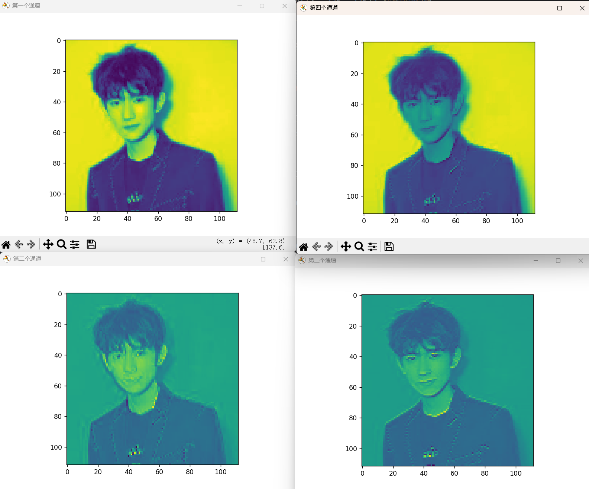

**显示图片需要的数据类型是numpy数据类型**

| **库**          | **是否支持 Tensor 直显** | **必备操作**                                      |
| --------------- | ------------------------ | ------------------------------------------------- |
| **Matplotlib**  | **支持** (仅限 CPU 张量) | 确保维度是 `(H, W, C)`                            |
| **OpenCV**      | **不支持**               | 必须转为 `numpy`                                  |
| **PIL (Image)** | **不支持**               | 必须转为 `numpy` 或使用 `transforms.ToPILImage()` |


#### 池化层


池化层（Pooling Layer）是用于**降低输入数据的空间维度**（例如图像的高度和宽度），**从而减少计算量**、减少内存消耗，并提高模型的鲁棒性。

**==池化层通常位于卷积层之后==**，它通过对卷积层输出的特征图进行下采样，保留最重要的特征信息，同时丢弃一些不重要的细节。

**池化层的主要作用如下:**

- **降维和计算量减少**：池化层通过减少特征图的尺寸，从而降低了计算量，特别是在多层网络中，随着层数的增加，池化能够显著减少计算资源的消耗。

- **提高鲁棒性**：池化操作可以使得特征对小的变换、平移和旋转变得更加不敏感。这样，模型在面对噪声或图像的轻微变化时，依然能够稳定工作。

- **防止过拟合**：通过池化减少了特征图的大小，减少了模型的复杂度，从而有助于防止过拟合，尤其是在较小的数据集上。

- **抽象特征**：通过池化层的操作，可以提取更为抽象和高层次的特征，使得网络能够学习到更具泛化能力的表示。


##### 池化层计算


- 最大池化(Max Pooling) ：通过池化窗口进行最大池化，**取窗口中的最大值作为输出**

- 平均池化(Avg Pooling) ：**取窗口内的所有值的均值作为输出**


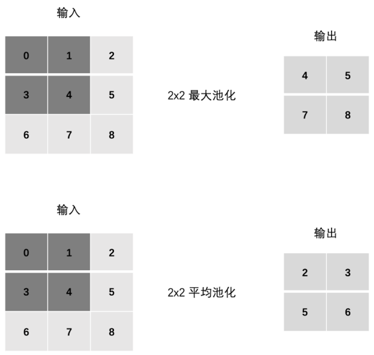


##### Padding（填充）

类似卷积层的原理

​		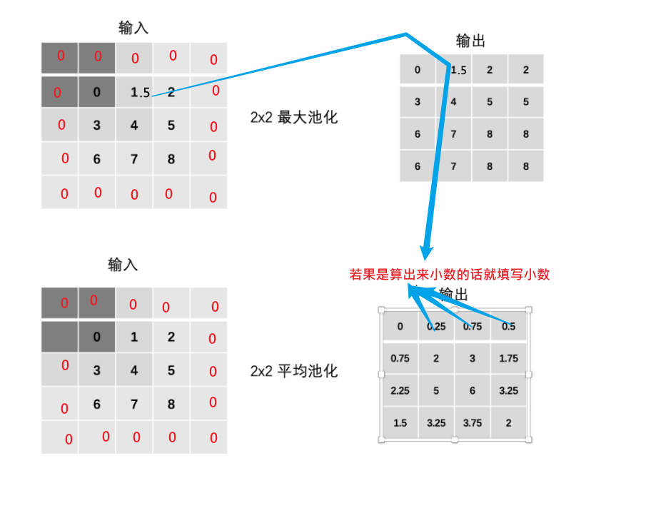

##### Stride(步长)


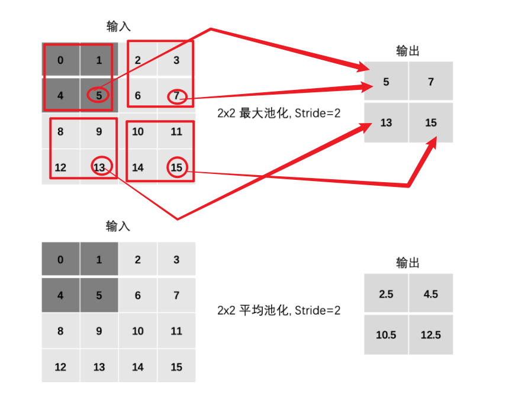


##### 多通道池化计算


​	在处理多通道输入数据时，池化层对每个输入通道分别池化，而不是像卷积层那样将各个通道的输入相加。这意味着==**池化层的输出和输入的通道数是相等**。==

**池化只在==宽高维度上池化==**，**==在通道上是不发生池化==**（池化前后，多少个通道还是多少个通道）


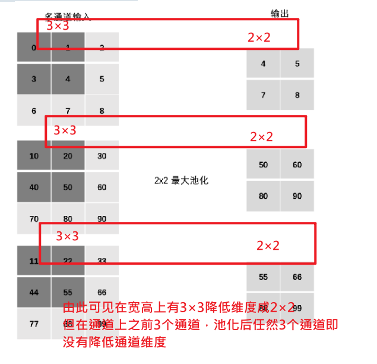


##### 池化API

```python
# 最大池化
nn.MaxPool2d(kernel_size=2, stride=2, padding=1)
# 平均池化
nn.AvgPool2d(kernel_size=2, stride=1, padding=0)
"""
```


```python
import torch
import matplotlib.pyplot as plt
import numpy as np
import torch.nn as nn
#单通道池化
def demo01():
    inputs = torch.tensor([[[0,1,2],[3,4,5],[6,7,8]]],dtype=torch.float32)
    #print(inputs.shape)#torch.Size([1, 3, 3]) CHW
    #创建最大池化层
    #参1：池化核（池化窗口）大小，参2：步长，参数3：填充
    pool1 = nn.MaxPool2d(kernel_size=2,stride=1,padding=0)
    output1 = pool1(inputs)
    #print(output1.shape)#torch.Size([1, 2, 2]) 			[1, 3, 3]->[1, 2, 2]实现降维
    #创建平均池化层
    pool2 = nn.AvgPool2d(kernel_size=2,stride=1,padding=0)
    output2 = pool2(inputs)
    #print(output2.shape)#torch.Size([1, 2, 2]) [1, 3, 3]->[1, 2, 2]同样实现降维
#多通道池化
def demo02():
    inputs = torch.tensor([[[0, 1, 2], [3, 4, 5], [6, 7, 8]],[[10, 20, 30], [40, 50, 60], [70, 80, 90]],[[11, 22, 33], [44, 55, 66], [77, 88, 99]]], dtype=torch.float32)
    print(inputs.shape)#torch.Size([3, 3, 3]) CHW
    # 创建最大池化层
    # 参1：池化核（池化窗口）大小，参2：步长，参数3：填充
    pool1 = nn.MaxPool2d(kernel_size=2, stride=1, padding=0)
    output1 = pool1(inputs)
    print(output1.shape)#torch.Size([3, 2, 2]) [3, 3, 3]->[3, 2, 2]实现降维
    # 创建平均池化层
    pool2 = nn.AvgPool2d(kernel_size=2, stride=1, padding=0)
    output2 = pool2(inputs)
    print(output2.shape)#torch.Size([3, 2, 2]) [3, 3, 3]->[3, 2, 2]同样实现降维
if __name__ == '__main__':
    demo01()
    demo02()
```


#### 图像分类案例


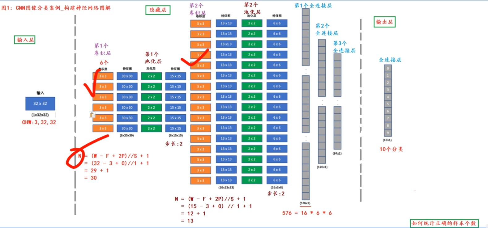


```python
import torch
import torch.nn as nn
from torchvision.datasets import CIFAR10
from torchvision.transforms import ToTensor  # pip install torchvision
#这里我们使用计算机视觉模块 torchvision自带的数据集CIFAR10，包含6w张（32，32，3）的图片，5w的训练集，1w的测试集，10个分类，每个分类6k张图片
import torch.optim as optim
from torch.utils.data import DataLoader
import time
import matplotlib.pyplot as plt
from torchsummary import summary
"""
操作步骤如下：
    1.准备数据集
    2.搭建卷积神经网络
    3.模型训练
    4.模型测试
卷积层：
    提取的图像的局部特征 -> 特征图(Feature Map)
池化层:
    降维
"""
# 每批次样本数
BATCH_SIZE = 8


#1.准备数据集
def create_dataset():
    #创建训练集
    #参1：数据集存放路径,参2：是否是训练集，参3：数据预处理->张量，参4：是否下载数据集(联网下载)
    train_dataset = CIFAR10(root='../image', train=True, transform=ToTensor(), download=False)
    #创建测试集
    test_dataset = CIFAR10(root='../image', train=False, transform=ToTensor(), download=False)
    #返回数据集
    return train_dataset, test_dataset
#2.搭建卷积神经网络
class ImageModel(nn.Module):
    #初始化
    def __init__(self):
        super().__init__()
        #搭建神经网络
        #第一个卷积层输入3通道，输出6通道，卷积核大小为3*3，步长为1，填充为0
        self.conv1 = nn.Conv2d(in_channels=3, out_channels=6, kernel_size=3, stride=1, padding=0)
        #第一个池化层窗口大小为2*2，步长为2
        self.pool1 = nn.MaxPool2d(kernel_size=2, stride=2)
        #第二个卷积层
        self.conv2 = nn.Conv2d(in_channels=6, out_channels=16, kernel_size=3, stride=1, padding=0)
        #第二个池化层
        self.pool2 = nn.MaxPool2d(kernel_size=2, stride=2,padding=0)
        #第一个隐藏层（全连接层）
        self.linear1 = nn.Linear(16*6*6, 120)
        #第二个隐藏层(全连接层)
        self.linear2 = nn.Linear(120, 84)
        #第三个隐藏层（全连接层） -> 输出层
        self.output = nn.Linear(84, 10)
        #使用dropout正则化
        self.dropout = nn.Dropout(p=0.5)
    #正向传播
    def forward(self, x):
        #第一层：卷积层1（加权求和）+激活函数+池化层1
        x = self.pool1(torch.relu(self.conv1(x)))
        #第二层：卷积层2（加权求和）+激活函数+池化层2
        x = self.pool2(torch.relu(self.conv2(x)))
        #第三层：将特征图拉平，即把二维特征图拉成一维向量 (8,16,6,6)    ->(8,576)  y_pred 的形状通常是 [Batch_Size, Num_Classes]
        x = x.reshape(x.size(0), -1)
        #第四层：第一个隐藏层（全连接层）+激活函数
        x = torch.relu(self.linear1(x))
        #激活函数后使用dropout正则化
        x = self.dropout(x)
        #第五层：第二个隐藏层（全连接层）+激活函数
        x = torch.relu(self.linear2(x))
        #激活函数后使用dropout正则化
        x = self.dropout(x)
        #第六层：第三个隐藏层（全连接层）输出层+激活函数
        x = self.output(x)  #在这里先不用softmax()因为后续用多分类交叉熵CrossEntropyLoss() = softmax+损失函数
        return x
#3.模型训练
def train(train_dataset):
    #创建数据加载器
    data_loader = DataLoader(train_dataset, batch_size=BATCH_SIZE, shuffle=True)
    #创建模型对象
    model = ImageModel()
    #创建损失函数对象
    criterion = nn.CrossEntropyLoss()#用多分类交叉熵CrossEntropyLoss() = softmax+损失函数
    #创建优化器对象
    optimizer = optim.Adam(model.parameters(), lr=0.001)
    #循环遍历epoch,开始每轮训练
    epochs = 10
    for epoch in range(epochs):
        #定义变量，记录总损失，总样本数据量，预测正确样本个数，训练（开始）时间
        total_loss,total_samples, total_correct, start_time = 0.0, 0, 0, time.time()
        #遍历数据加载器，获取到每批次的数据
        for x,y_true in data_loader:
            #切换训练模式
            model.train()
            #模型预测
            y_pred = model(x)
            #计算损失
            loss = criterion(y_pred, y_true)
            #梯度清零+反向传播+参数更新
            optimizer.zero_grad()
            loss.backward()
            optimizer.step()
            #统计预测正确的样本个数，argmax就是看张量最大值（概率大那么那个值就大）并返回对应索引，dim=-1按行去看，每次抽8个样例，即8行576列，经过最大值的argmax出来的数据变成1行8列，
            # 然后y_pred和y_true去比较。
            #判断语句给出Flase/True,经过sum()求和，得到一个数，这个数就是预测正确的样本个数。
            #比如y_pred=[1,2,3,4,5,6,7,8]而y_true[1,7,6,5,4,3,2,8]
            #对应判断语句[Flase,Flase,Flase,Flase,Flase,Flase,Flase,True]
            #经过sum计算后结果时2，也就是只有最后数据1、8预测值和真实值相等，那么预测正确的样本个数就是2
            total_correct += (torch.argmax(y_pred, dim=-1)==y_true).sum()
            #统计计算当前批次的损失值
            #loss.item()时当前批的平均损失,len(y_true)时当前批的样本数量的出来total_loss=>total_loss就会把当前轮所有批次的总损失计算出
            total_loss += loss.item() * len(y_true)
           #计算当前批次的总样本数
            total_samples += len(y_true)
        print(f"Epoch: {epoch+1},loss:{total_loss/total_samples:.5f},accuracy: {total_correct/total_samples:.2f},time:{time.time()-start_time:.2f}")
    #保存模型
    torch.save(model.state_dict(), "../model/image_model.pth")
def test(test_dataset):
    #创建测试集，数据加载器
    data_loader = DataLoader(test_dataset, batch_size=BATCH_SIZE, shuffle=False)
    #创建模型对象
    model = ImageModel()
    #加载模型参数，获取之前训练后的参数直接进行使用
    model.load_state_dict(torch.load("../model/image_model.pth"))
    #定义变量统计预测正确的样本个数，总样本个数
    total_correct, total_samples = 0, 0
    for x,y_true in data_loader:
        #切换测试模式
        model.eval()
        #模型预测
        y_pred = model(x)
        #因为训练模型时候使用了多分类交叉熵CrossEntropyLoss()，所以搭建神经网络时候没有用到softmax ()。在测试阶段，不需要用到softmax()
        #直接使用torch.argmax()我们只需要知道模型认为哪一类可能性最高（比如是“猫”还是“狗”），直接找最大值索引即可，跳过 Softmax 可以节省计算开销。
        total_correct += (torch.argmax(y_pred, dim=-1)==y_true).sum()
        #统计总样本个数
        total_samples += len(y_true)
    print(f"测试集准确率：{total_correct/total_samples:.2f}")
if __name__ == '__main__':
    train_dataset, test_dataset = create_dataset()
    #print(f"训练集数量：{train_dataset.data[111]}")#train_dataset.data 包含所有训练图片数据
    #print(f"测试集数量：{test_dataset.data.shape}")
    #print(f"数据集类别：{train_dataset.class_to_idx}")#数据集类别：{'airplane': 0, 'automobile': 1, 'bird': 2, 'cat': 3, 'deer': 4, 'dog': 5, 'frog': 6, 'horse': 7, 'ship': 8, 'truck': 9}
    #plt.figure(figsize=(2,2))#创建一个画布，宽2，高2
    #plt.imshow(train_dataset.data[111])#train_dataset.data[111] 返回单张图片的像素数据（形状为 (32, 32, 3)）
    #plt.title(train_dataset.targets[111])#显示图片的标签
    #plt.show()
    #model = ImageModel()
    #参1：模型，参2：输入数据形状，参3：批次大小
    #summary(model, (3, 32, 32),batch_size=BATCH_SIZE)
    #train(train_dataset)
    test(test_dataset)
```


在保存模型时候需要自行创建model文件


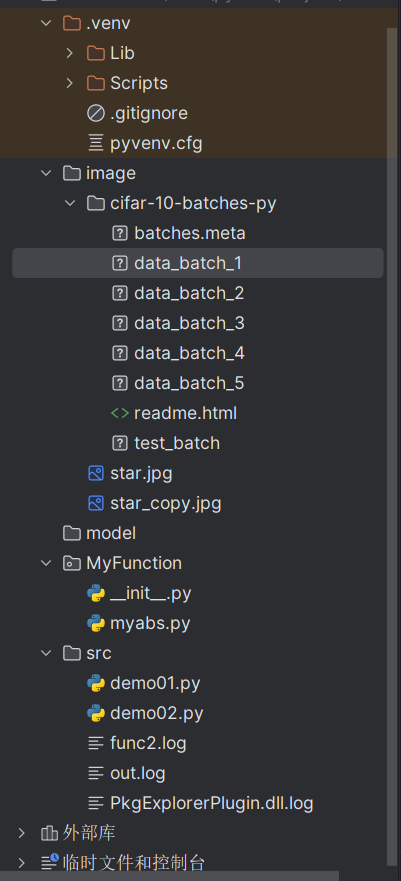

