# 3.4 Linux基础 与常用命令教程

```
学习资源：
		https://www.runoob.com/linux/linux-intro.html
		https://hackmd.io/@sysprog/linux-comic
		https://hackmd.io/@GDSC-CYCU/Linux-Git-WorkShop
		https://zhuanlan.zhihu.com/p/536994892
		https://mirrors.tuna.tsinghua.edu.cn/ubuntu-releases/22.04/
		https://rufus.ie/zh/
		https://www.cnblogs.com/luzhanshi/articles/19118891
```


## 3.4.1 教程引入

Linux（ `Linux is not Unix`） 是一种自由和开放源码的类 UNIX 操作系统，由 Linus Torvalds 于 1991 年发起。它遵循 GNU 通用公共许可证（GPL），赋予了开发者自由使用、查看底层源码、修改和再发布的权利。得益于这种强大的开源协作基因，业界衍生出了诸如 Debian（及其最著名的分支 Ubuntu）、Fedora 和 openSUSE 等主流发行版。


对于你目前主攻的深度学习与视觉机械臂抓取方向而言，Linux 不仅仅是一段计算机科普知识，更是必须掌握的底层开发基石。当前的机器人与 AI 领域高度依赖 Linux 生态，尤其是 Ubuntu 22.04 系统。无论是部署 PyTorch 等算法高效调用 GPU 算力、运行 ROS 2 (Humble) 进行复杂的节点通信，还是让系统精准挂载并控制底层的深度相机与机械臂硬件，Linux 都是最原生、最稳定的载体。

因此，本教程的学习目的非常明确：实用至上。面对庞杂的 Linux 系统，你不需要死记硬背所有指令，更无需成为专业的系统管理员。你的核心任务是将其作为得心应手的开发工具，重点掌握纯终端（Shell）下的目录导航、文件权限管理以及依赖包的环境配置。当你能抛开鼠标，在命令行的黑框中从容地搭建出自己的深度学习与机械臂控制环境时，这门工具就真正为你所用了。

## 3.4.2 简介

Linux 内核最初只是由芬兰人林纳斯·托瓦兹（Linus Torvalds）在赫尔辛基大学上学时出于个人爱好而编写的。

Linux 是一套免费使用和自由传播的类 Unix 操作系统，是一个基于 POSIX 和 UNIX 的多用户、多任务、支持多线程和多 CPU 的操作系统。

Linux 能运行主要的 UNIX 工具软件、应用程序和网络协议。它支持 32 位和 64 位硬件。Linux 继承了 Unix 以网络为核心的设计思想，是一个性能稳定的多用户网络操作系统。

### Linux 的发行版

Linux 的发行版说简单点就是将 Linux 内核与应用软件做一个打包。


### Linux 应用领域

今天各种场合都有使用各种 Linux 发行版，从嵌入式设备到超级计算机，并且在服务器领域确定了地位，通常服务器使用 LAMP（Linux + Apache + MySQL + PHP）或 LNMP（Linux + Nginx+ MySQL + PHP）组合。

目前 Linux 不仅在家庭与企业中使用，并且在政府中也很受欢迎。

- 巴西联邦政府由于支持 Linux 而世界闻名。
- 有新闻报道俄罗斯军队自己制造的 Linux 发布版的，做为 G.H.ost 项目已经取得成果。
- 印度的 Kerala 联邦计划在向全联邦的高中推广使用 Linux。
- 中华人民共和国为取得技术独立，在龙芯处理器中排他性地使用 Linux。
- 在西班牙的一些地区开发了自己的 Linux 发布版，并且在政府与教育领域广泛使用，如 Extremadura 地区的 gnuLinEx 和 Andalusia 地区的 Guadalinex。
- 葡萄牙开发了自己的 Linux 发行版 Caixa Mágica，并将其应用在 Magalhães 教育笔记本电脑及政府的 e-escola 教育计划中。
- 法国和德国同样开始逐步采用 Linux。

### Linux vs Windows

目前国内 Linux 更多的是应用于服务器上，而桌面操作系统更多使用的是 Windows。主要区别如下

| 比较     | Windows                                                      | Linux                                                        |
| :------- | :----------------------------------------------------------- | :----------------------------------------------------------- |
| 界面     | 界面统一，外壳程序固定所有 Windows 程序菜单几乎一致，快捷键也几乎相同 | 图形界面风格依发布版不同而不同，可能互不兼容。GNU/Linux 的终端机是从 UNIX 传承下来，基本命令和操作方法也几乎一致。 |
| 驱动程序 | 驱动程序丰富，版本更新频繁。默认安装程序里面一般包含有该版本发布时流行的硬件驱动程序，之后所出的新硬件驱动依赖于硬件厂商提供。对于一些老硬件，如果没有了原配的驱动有时很难支持。另外，有时硬件厂商未提供所需版本的 Windows 下的驱动，也会比较头痛。 | 由志愿者开发，由 Linux 核心开发小组发布，很多硬件厂商基于版权考虑并未提供驱动程序，尽管多数无需手动安装，但是涉及安装则相对复杂，使得新用户面对驱动程序问题（是否存在和安装方法）会一筹莫展。但是在开源开发模式下，许多老硬件尽管在Windows下很难支持的也容易找到驱动。HP、Intel、AMD 等硬件厂商逐步不同程度支持开源驱动，问题正在得到缓解。 |
| 使用     | 使用比较简单，容易入门。图形化界面对没有计算机背景知识的用户使用十分有利。 | 图形界面使用简单，容易入门。文字界面，需要学习才能掌握。     |
| 学习     | 系统构造复杂、变化频繁，且知识、技能淘汰快，深入学习困难。   | 系统构造简单、稳定，且知识、技能传承性好，深入学习相对容易。 |
| 软件     | 每一种特定功能可能都需要商业软件的支持，需要购买相应的授权。 | 大部分软件都可以自由获取，同样功能的软件选择较少。           |

## 3.4.3 Linux安装

在正式开始探索 Linux 之前，我们需要先在你的 Windows 电脑上搭建好运行环境。目前主流的安装方案共有三种：虚拟机、WSL（Windows 的 Linux 子系统）以及原生双系统。这三者在性能损耗和硬件调用权限上有着本质的区别。

**虚拟机**虽然安装简单且与原系统完全隔离，但它运行在一个相对封闭的虚拟层中，会带来明显的性能损耗。最关键的是，虚拟机极难高效地穿透到宿主机去调用真实的 GPU 算力和外部 USB 设备。考虑到你后续需要使用显卡进行深度学习加速，以及通过 USB 串口连接真实相机和机械臂，虚拟机方案会成为巨大的开发瓶颈，因此在此不作推荐。

相比之下，另外两种方案则完美契合了机器人与 AI 开发的不同阶段需求。**WSL** 是一种微软官方提供的轻量级融合方案，它允许你在不重启、不离开 Windows 桌面的情况下，以极低的性能损耗运行原生的 Ubuntu 系统，并且目前已经能够极好地支持 CUDA 显卡加速。它非常适合你进行前期的算法验证、深度学习模型测试以及 ROS 框架的纯软件学习。

而**双系统**则是将硬件性能和开发自由度发挥到极致的终极形态。它能为你提供最原生的 Linux 运行环境、最低的系统延迟，以及对底层硬件（显卡、深度相机数据流、电机驱动器）最直接、最高级别的访问权限。当你准备脱离纯模拟环境，开始联调真实的机械臂硬件时，双系统是无可替代的必经之路。

因此，接下来的教程我们将彻底摒弃虚拟机，重点围绕最具实战价值的 WSL 与双系统环境搭建展开。你可以根据自己当前的开发侧重点进行选择：

### WSL安装

**WSL（Windows Subsystem for Linux）** 是微软为 Windows 用户提供的一个子系统，它允许你在 Windows 上原生运行 Linux（不是虚拟机，不是双系统），直接使用 Bash、apt、gcc、Python、Node.js 等 Linux 工具。

**WSL 的版本区别**

| 特性             | WSL1                     | WSL2                            |
| :--------------- | :----------------------- | :------------------------------ |
| 内核架构         | 翻译系统调用（兼容层）   | 真正的 Linux 内核（轻量虚拟机） |
| 性能（文件访问） | Windows ↔ Linux 访问更快 | Linux ↔ Linux 内部访问更快      |
| 启动速度         | 更快                     | 略慢                            |
| Docker 支持      | 不支持                   | ✅ 完全支持                      |
| 系统资源占用     | 较少                     | 稍高                            |

推荐使用 **WSL2**，兼容性更强，功能更完整。

**前提条件**

- Windows 10 2004（或更高版本） / Windows 11
- 启用虚拟化（BIOS 中 VT-x 或 AMD-V 开启）

按如图操作进入命令行中：


在命令行输入：

```shell
wsl --install
```

该命令会自动：

- 启用 WSL 功能
- 安装 WSL2 内核
- 安装默认的 Ubuntu
- 设置为 WSL2

安装完后，重启一次系统即可！

**常用命令速查表**

| 命令                         | 说明                     |
| :--------------------------- | :----------------------- |
| `wsl`                        | 启动默认 Linux           |
| `wsl --list --verbose`       | 查看已安装的发行版和版本 |
| `wsl --set-version Ubuntu 2` | 设置 Ubuntu 使用 WSL2    |
| `wsl --install -d Debian`    | 安装指定发行版           |
| `wsl --shutdown`             | 关闭所有 WSL 实例        |
| `wsl -e bash`                | 以 Bash 启动 Linux Shell |

待后续补充更具体使用....

###  双系统安装

**安装准备**

进入清华大学开源软件镜像站即[清华源](https://mirrors.tuna.tsinghua.edu.cn/ubuntu-releases/22.04/)

选择如图版本进行下载，我们本次教程以Ubuntu22.04版本下载演示，如果需要下载20.04等其他版本，大体流程一致，参考教程更换版本即可。

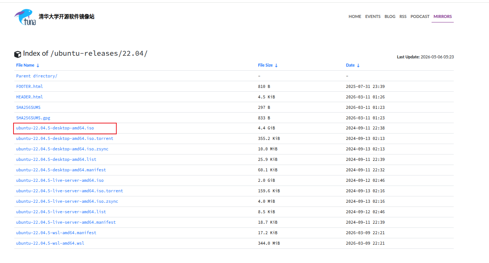

接着我们需要一个准备一个 8G 的U盘，以及下载系统盘制作工具, 制作启动盘。

工具推荐[Rufus](https://rufus.ie/zh/)，具体版本有如下区别，建议按图下载。


下载完，将你的U盘插入电脑，后按图配置后点击开始烧入。

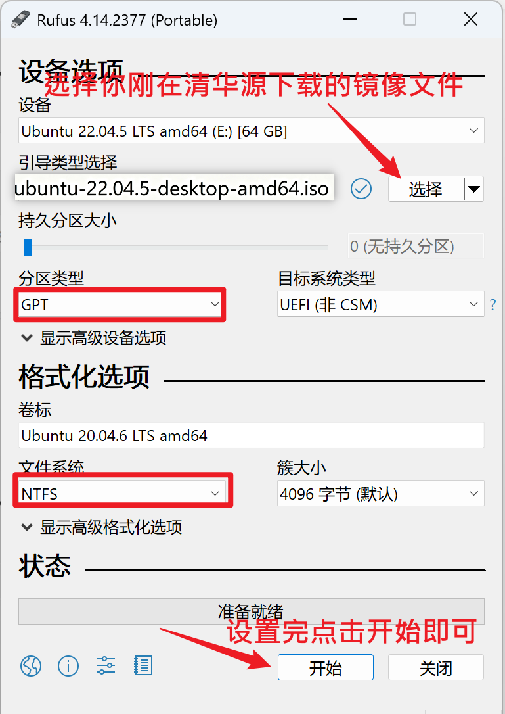

接着，我们准备 Ubuntu 需要的硬盘空间 ，右击`此电脑`，若是windos11电脑，右击后点`显示更多选项`，然后点击`管理`，找到`磁盘管理`，选择一个分区 右键选择`压缩卷`, 压缩出一部分空间 ( 注意, 压缩时 1G = 1024Mb )，根据自己需求压缩即可。


压缩完分区后，关闭电脑（此时不要拔掉U盘），再次开启，进入BIOS模式，选择带有 usb字样 或 自己U盘名 的启动项，等待一会儿， 然后就可以看到以下界面，按照图中教程进行即可。

这里使用英文介绍, 中文的位置与英文相同, 这里会给出中文的大致翻译在左边, 划到最下方, 选择中文 即可将系统默认语言变成中文,后面可以在设置中修改系统语言, 比较推荐使用英文, 使用中文可能会有一些乱码和错误, 但是初学者可以使用中文帮助认识选择 install ubuntu ( 安装Ubuntu )，点击Continue ( Quit 取消安装, Back 返回上一步, Continue 下一步 )


此时我们使用美国键盘布局【English（US）】，点击【Continue】

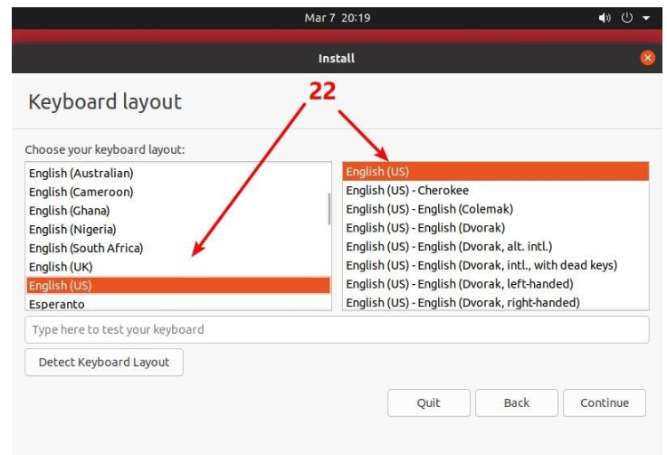

标准安装模式提供了一个功能齐全的Ubuntu环境。它包括了Ubuntu操作系统的所有标准软件，例如完整的桌面环境（通常是GNOME）、一系列预装的应用程序（如浏览器、办公软件、媒体播放器等），以及其他实用工具和服务。这种安装模式适合那些想要即刻获得一个准备就绪、功能丰富的系统的用户。而最小安装模式提供了一个精简的Ubuntu环境。它安装了基本的桌面环境和极少量的软件，通常只包括一个浏览器和基本的系统工具。这种模式适合那些希望自定义自己系统的用户，或者那些对系统资源有限制（如使用较老硬件）的用户。最小安装允许用户在安装后根据自己的需要安装额外的软件和应用程序。

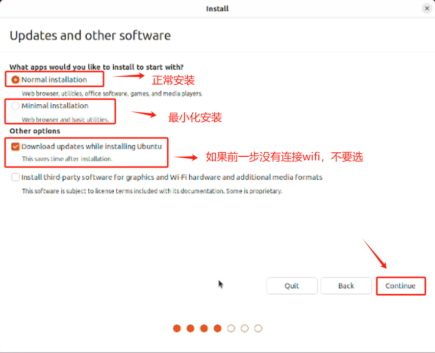

接下来进行系统分区，第一个是不清理硬盘直接安装 ( 不建议选择 )，第二个是清空整个硬盘, 再进行安装 ( 装单系统的才能选, 会将原有的Windows系统删除 )第三个是自定义安装 ( 双系统选择这个 )。

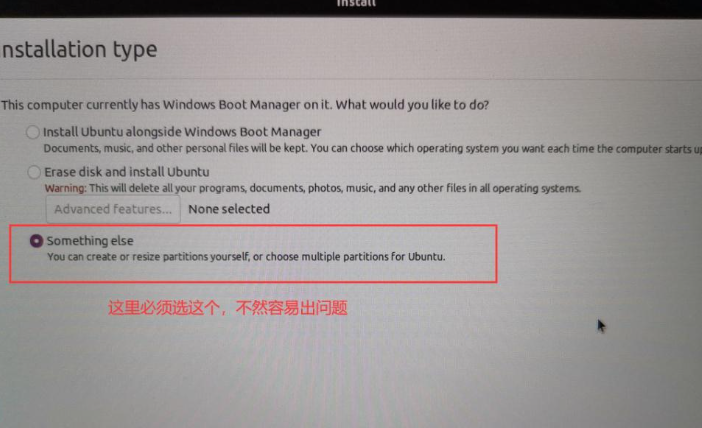

选择自定义安装需要配置分区大小，选择 free space 未分配空间，点击加号或鼠标右键， 新建分区。

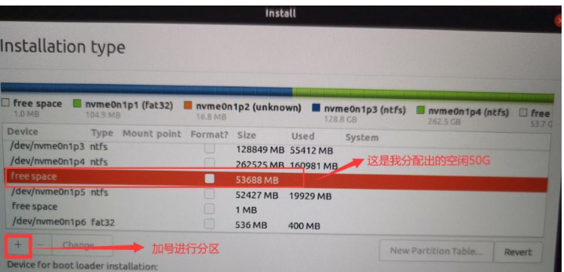

- Size：分区大小
- Type for the new partition ：分区模式 Primary ( 主分区 ) Logical ( 逻辑分区 )
- Location for the new partition： Beginning of this space ( 分区开始 ) End of this space ( 分区结束 )
- Use as：分区文件格式

- 还有一行是挂载点：/ , /boot

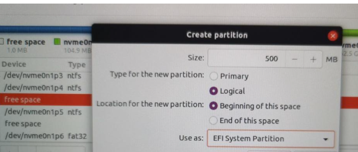

| 分区名        | 推荐大小     | 文件格式 | 挂载点 | 备注                                                         |
| ------------- | ------------ | -------- | ------ | ------------------------------------------------------------ |
| boot 分区     | 1G 左右      | Ext4     | /boot  | 有时候会提示未分配 EFI 分区 这时需要重新分配分区，把原本 /boot 的文件格式改为EFI，没有挂载点 |
| 虚拟内存 swap | 两倍物理内存 | swap     | 无     | 交换空间                                                     |
| 根目录 /      | 剩余空间     | Ext4     | /      |                                                              |

默认选择 逻辑分区 和 分区起始位置，根目录其实相当于 windows 的此电脑的地位，所有文件和程序都挂在 根目录之下，其他教程有让分出 /home（用户文件夹），/usr（用户程序），/tmp(临时文件) 分区，其实这些都在根目录之下，完全不需要再次划分。

若这块有迷惑，参考[更详细配置教程](https://www.cnblogs.com/luzhanshi/articles/19118891)。

然后选择地区，我们选择中国 地址会出现上海。


最后一步骤，用户信息配置。


安装完成后会出现 Restart Now 重启，此时就可以把 U盘 拔下来了，重启时, 还是需要手动进入 Bios 界面, 此时会出现 Ubuntu 选项，恭喜安装成功！

## 3.4.4 Linux内容教学

### 3.4.4.1 目录结构

登录系统后，在当前命令窗口下输入命令：

```
 ls / 
```

你会看到如下图所示:

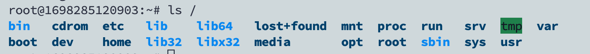

树状目录结构：


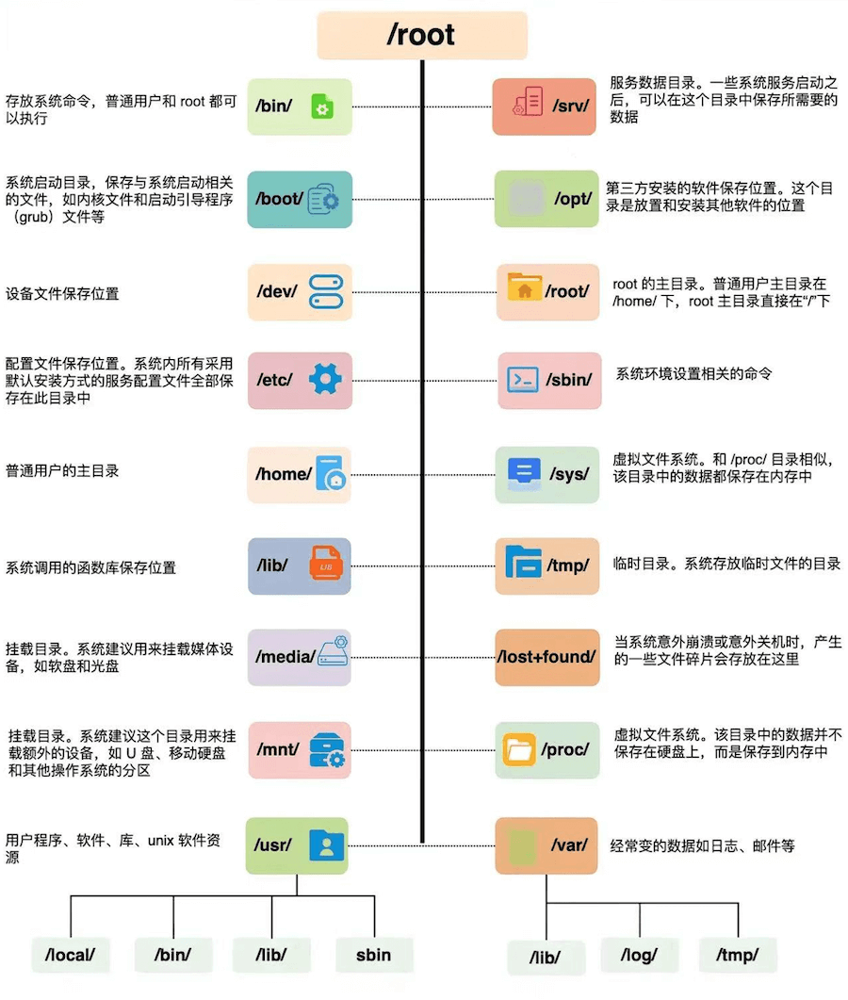

以下是对这些目录的解释：

| 目录               | 作用详解                                                     | 常见文件 / 示例                               |
| :----------------- | :----------------------------------------------------------- | :-------------------------------------------- |
| `/`                | 根文件系统，所有挂载点与路径的起点。包含系统必须的子目录与入口结构。 | 无具体数据文件，只有子目录结构。              |
| `/bin`             | 系统启动和单用户模式下必须的基础命令，所有用户可执行。       | `ls`, `cp`, `mv`, `rm`, `bash`                |
| `/sbin`            | 系统管理与维护命令，面向 root。                              | `fsck`, `reboot`, `shutdown`                  |
| `/usr`             | 用户级程序与库的主集合，包含大部分系统软件、文档与工具。     | `/usr/bin`, `/usr/lib`, `/usr/share`          |
| `/usr/bin`         | 常规用户程序的主要放置目录。                                 | `python3`, `vim`, `git`                       |
| `/usr/sbin`        | 管理工具的扩展集合。                                         | `useradd`, `apache2ctl`                       |
| `/usr/lib`         | `/usr` 内程序所依赖的动态库与模块。                          | 各类 `.so` 动态库                             |
| `/usr/local`       | 本机安装或编译软件的独立区域。                               | `/usr/local/bin`, `/usr/local/lib`            |
| `/lib` 或 `/lib64` | 系统启动核心库、动态链接器所在位置。                         | `libc.so.6`, `ld-linux.so`                    |
| `/etc`             | 系统级配置中心，统一存放所有服务和系统配置。                 | `passwd`, `group`, `fstab`, `ssh/sshd_config` |
| `/home`            | 普通用户的个人主目录集合。                                   | `/home/user/.bashrc`, `/home/user/Documents`  |
| `/root`            | root 用户的主目录。                                          | `/root/.ssh/`                                 |
| `/var`             | 频繁变化的数据：日志、缓存、数据库运行文件等。               | `/var/log`, `/var/lib`, `/var/cache`          |
| `/var/log`         | 所有系统与服务日志的集中位置。                               | `syslog`, `auth.log`, `kern.log`              |
| `/var/cache`       | 应用和包管理器缓存。                                         | `/var/cache/apt/`                             |
| `/var/lib`         | 服务的持久化状态数据。                                       | `mysql/`, `docker/`                           |
| `/tmp`             | 程序运行时的临时文件区，随时可清理。                         | 临时文件、socket 路径                         |
| `/boot`            | 启动所需文件：内核、initramfs、引导配置。                    | `vmlinuz-*`, `initrd.img`, `grub/grub.cfg`    |
| `/dev`             | 设备节点集合，文件即设备。                                   | `/dev/sda`, `/dev/null`, `/dev/tty0`          |
| `/proc`            | 由内核提供的虚拟文件系统，展示系统与进程的实时信息。         | `/proc/cpuinfo`, `/proc/<pid>/`               |
| `/sys`             | 设备、驱动、内核子系统的状态接口。                           | `/sys/class/net/`, `/sys/block/`              |
| `/mnt`             | 手动挂载的临时挂载点。                                       | `/mnt/usb`                                    |
| `/media`           | 自动挂载外接设备的默认位置。                                 | `/media/user/USB_DRIVE`                       |
| `/run`             | 运行时数据存放点，重启后清空。                               | `*.pid`, 运行状态 socket 文件                 |

在 Linux 中，下列目录属于系统关键区，误删或乱改都会直接破坏系统运行：

**/etc — 系统配置核心**

所有关键配置集中于此。任何错误修改都可能导致服务挂掉，甚至系统无法启动。

**/bin、/sbin、/usr/bin、/usr/sbin — 系统指令区**

系统预置命令的所在位置。

- **/bin、/usr/bin**：供普通用户使用的基础指令（如 `ls` 位于 `/bin/ls`）。
- **/sbin、/usr/sbin**：系统管理指令，主要由 root 使用。

**/var — 动态数据区**

系统运行时不断写入的数据都落在这里。
重点是 **/var/log**，各种服务日志全部存放此处；邮件、缓存、队列等内容也在此目录下维护。


### 3.4.4.2 处理目录及文件的常用命令

​	

| **命令 (Command)** | **英文全拼**         | **功能说明**                             |
| ------------------ | -------------------- | ---------------------------------------- |
| **`ls`**           | list files           | 列出当前目录下的文件及文件夹名称         |
| **`cd`**           | change directory     | 切换/进入目标目录                        |
| **`pwd`**          | print work directory | 显示当前所在的绝对路径目录               |
| **`mkdir`**        | make directory       | 创建一个新的文件夹（目录）               |
| **`rmdir`**        | remove directory     | 删除一个**空**的文件夹（目录）           |
| **`cp`**           | copy file            | 复制文件或文件夹到指定位置               |
| **`rm`**           | remove               | 删除文件或文件夹（注意：删除后极难恢复） |
| **`mv`**           | move file            | 移动文件/文件夹的位置，或用于**重命名**  |

你可以使用 **man [命令]** 来查看各个命令的使用文档，如 ：

```shell
man cp
```

进入后点`q`即可退出。

接下来的各种命令我以我的目录为例，进行操作。


#### 1. ls

在Linux系统当中， ls 命令可能是最常被运行的。

参数如下：

| **命令 / 参数组合** | **功能说明**                                                 | **实用场景 / 备注**                                          |
| ------------------- | ------------------------------------------------------------ | ------------------------------------------------------------ |
| **`ls`**            | 列出当前目录下的所有可见文件和文件夹                         | 最基础的查看命令。                                           |
| **`ls -a`**         | 列出全部文件，**包括隐藏文件**（以 `.` 开头的文件）          | **常用**。很多环境配置文件（如 `.bashrc`）都是隐藏的，必须加 `-a` 才能看到。 |
| **`ls -l`**         | 以长数据串形式列出文件，包含**属性、读写权限**、所有者、大小和修改时间 | **常用**。当你遇到“没有权限运行某脚本”的报错时，第一反应就是用它检查权限。（*注：在 Ubuntu 中通常可简写为 `ll`*） |
| **`ls -d`**         | 仅列出**目录本身**的属性信息，而不是列出它里面的内容         | **常用**。通常结合 `-l` 使用（`ls -ld 文件夹名`），用来检查某个特定文件夹本身的权限。 |

```shell
#看表面：只列出常规的文件和文件夹（如 README.md 等）。
(base) yy@yy-VivoBook-ASUSLaptop-X512FLC-V5000FL:~/My_Data/notebook$ ls
README.md  大纲.md  第一章——技巧篇  第三章——编程基础  第二章—所需软件及破解教程


#看全部：把隐藏文件（以 . 开头的，如 .git 版本库）也一并揪了出来。
(base) yy@yy-VivoBook-ASUSLaptop-X512FLC-V5000FL:~/My_Data/notebook$ ls -a
.   .git       大纲.md         第三章——编程基础
..  README.md  第一章——技巧篇  第二章—所需软件及破解教程


#指代自己：只输出一个 .，也就是告诉你“当前目录叫什么”（它不展示里面的东西），不单独使用，一般与ld结合使用。
(base) yy@yy-VivoBook-ASUSLaptop-X512FLC-V5000FL:~/My_Data/notebook$ ls -d
.

#查内部属性：详细列出文件夹里面每个东西的权限、大小和时间（开头 d 是文件夹，- 是普通文件）。
(base) yy@yy-VivoBook-ASUSLaptop-X512FLC-V5000FL:~/My_Data/notebook$ ls -l
total 44
-rw-rw-r-- 1 yy yy  1034 May  3 14:47 README.md
-rw-rw-r-- 1 yy yy 27909 May  3 14:23 大纲.md
drwxrwxr-x 2 yy yy  4096 May  6 09:26 第一章——技巧篇
drwxrwxr-x 3 yy yy  4096 May  6 11:13 第三章——编程基础
drwxrwxr-x 2 yy yy  4096 May  6 08:33 第二章—所需软件及破解教程


#查自身属性：不看里面，直接显示当前文件夹本身（.）的详细权限和信息。
(base) yy@yy-VivoBook-ASUSLaptop-X512FLC-V5000FL:~/My_Data/notebook$ ls -ld
drwxrwxr-x 6 yy yy 4096 May  6 09:25 .
```


#### 2.cd 

cd是`Change Directory`的缩写，这是用来**变换工作目录**的命令。

cd的语法格式：` cd [相对路径或绝对路径]`

```shell
#进入第一章——技巧篇目录
(base) yy@yy-VivoBook-ASUSLaptop-X512FLC-V5000FL:~/My_Data/notebook$ cd 第一章——技巧篇/


# 表示去到目前的上一级目录，亦即是 /root 的上一级目录的意思；
(base) yy@yy-VivoBook-ASUSLaptop-X512FLC-V5000FL:~/My_Data/notebook/第一章——技巧篇$ cd ..

# 表示回到自己的家目录，亦即是 /root 这个目录
(base) yy@yy-VivoBook-ASUSLaptop-X512FLC-V5000FL:~/My_Data/notebook$ cd ~

#使用绝对路径切换到 notebook 目录
(base) yy@yy-VivoBook-ASUSLaptop-X512FLC-V5000FL:~$ cd My_Data/notebook/
```


#### 3. pwd

pwd 是 `Print Working Directory` 的缩写，也就是显示目前所在目录的命令。

```shell
#显示当前目录的路径
(base) yy@yy-VivoBook-ASUSLaptop-X512FLC-V5000FL:~/My_Data/notebook$ pwd
/home/yy/My_Data/notebook
```

#### 4. mkdir

如果想要**创建**新的**目录**的话，可以使用mkdir 简称`make directory`。

语法：`mkdir <文件>`

参数如下：

| **参数选项** | **英文涵义**     | **功能说明**                                                 |
| ------------ | ---------------- | ------------------------------------------------------------ |
| **`-m`**     | mode (模式/权限) | 直接配置新建目录的权限，并制定跳过系统权限（771），免去 创建完必须用`chmod` 命令修改。 |
| **`-p`**     | parents (父目录) | 帮助你直接将所需要的目录（包含缺失的上一级父目录）递归创建起来！ |


```shell
#套娃建目录：使用 -p 参数，无视 temp1 是否存在，直接把父目录（temp1）和子目录（src）一次性递归创建出来。
(base) yy@yy-VivoBook-ASUSLaptop-X512FLC-V5000FL:~/My_Data/notebook$ mkdir -p temp1/src

#一步到位设权限：使用 -m 参数创建 temp2 文件夹，并强制赋予 711 权限（所有者拥有读写执行最高权限，其他人仅能进入）。
(base) yy@yy-VivoBook-ASUSLaptop-X512FLC-V5000FL:~/My_Data/notebook$ mkdir -m 711 temp2

#看表面：常规列出当前目录，可以看到刚刚新建的 temp1 和 temp2 已经存在了。
(base) yy@yy-VivoBook-ASUSLaptop-X512FLC-V5000FL:~/My_Data/notebook$ ls
README.md  temp2    第一章——技巧篇    第二章—所需软件及破解教程
temp1      大纲.md  第三章——编程基础

#查内部属性：重点观察权限差异。temp1 是系统默认权限 (drwxrwxr-x)，而 temp2 精准呈现了我们刚才赋予的 711 权限 (drwx--x--x)。
(base) yy@yy-VivoBook-ASUSLaptop-X512FLC-V5000FL:~/My_Data/notebook$ ls -l
total 52
-rw-rw-r-- 1 yy yy  1034 May  3 14:47 README.md
drwxrwxr-x 3 yy yy  4096 May  6 12:17 temp1
drwx--x--x 2 yy yy  4096 May  6 12:17 temp2
-rw-rw-r-- 1 yy yy 27909 May  3 14:23 大纲.md
drwxrwxr-x 2 yy yy  4096 May  6 09:26 第一章——技巧篇
drwxrwxr-x 3 yy yy  4096 May  6 12:04 第三章——编程基础
drwxrwxr-x 2 yy yy  4096 May  6 08:33 第二章—所需软件及破解教程

#切换目录：将当前工作路径移动到刚才建好的 temp1 文件夹内部。
(base) yy@yy-VivoBook-ASUSLaptop-X512FLC-V5000FL:~/My_Data/notebook$ cd temp1

#验证套娃结果：列出 temp1 里面的内容，证实刚才用 -p 命令附带创建的 src 子目录确实乖乖躺在里面。
(base) yy@yy-VivoBook-ASUSLaptop-X512FLC-V5000FL:~/My_Data/notebook/temp1$ ls
src
```

上面的权限部分，如果没有加上 -m 来强制配置属性，系统会使用默认属性。如果我们使用 -m ，如上例我们给予 -m 711 来给予新的目录 drwx--x--x 的权限。

#### 5. rmdir

如果想要删除**空的目录**，可以使用rmdir命令。

语法：`rmdir <文件夹>`

参数：

- **-p ：**从该目录起，一次删除多级空目录

```shell
#删除空目录：使用 rmdir 命令删除了名为 temp2 的文件夹（前提是它里面没有文件），并通过 ls 确认它已消失。
(base) yy@yy-VivoBook-ASUSLaptop-X512FLC-V5000FL:~/My_Data/notebook$ rmdir temp2
(base) yy@yy-VivoBook-ASUSLaptop-X512FLC-V5000FL:~/My_Data/notebook$ ls
README.md  大纲.md         第三章——编程基础
temp1      第一章——技巧篇  第二章—所需软件及破解教程

#精准打击子目录：直接通过路径指定，删除了 temp1 内部的 src 子文件夹。外层的 temp1 依然安全保留。
(base) yy@yy-VivoBook-ASUSLaptop-X512FLC-V5000FL:~/My_Data/notebook$ rmdir temp1/src/
(base) yy@yy-VivoBook-ASUSLaptop-X512FLC-V5000FL:~/My_Data/notebook$ ls
README.md  大纲.md         第三章——编程基础
temp1      第一章——技巧篇  第二章—所需软件及破解教程

#操作与验证状态：先用 mkdir -p 重新建好 temp1/src，紧接着又用 rmdir 把它删掉。最后切换进 temp1 目录并查看，发现没有任何输出，证实里面的 src 已经被彻底清空了。
(base) yy@yy-VivoBook-ASUSLaptop-X512FLC-V5000FL:~/My_Data/notebook$ mkdir -p temp1/src
(base) yy@yy-VivoBook-ASUSLaptop-X512FLC-V5000FL:~/My_Data/notebook$ rmdir temp1/src/
(base) yy@yy-VivoBook-ASUSLaptop-X512FLC-V5000FL:~/My_Data/notebook$ cd temp1/
(base) yy@yy-VivoBook-ASUSLaptop-X512FLC-V5000FL:~/My_Data/notebook/temp1$ ls
```

#### 6. cp

cp 即拷贝**文件和目录**。

语言：`cp <来源> <目的地>`  这里的路径可以是绝对路径也可以是相对路径。

参数如下：

| **参数选项** | **英文**            | **功能说明**                                                 |
| ------------ | ------------------- | ------------------------------------------------------------ |
| **`-a`**     | archive (归档/存档) | 把一个包含代码和数据集的复杂**文件夹完完全全、一模一样**地备份一份（包含权限、时间戳、快捷方式） |
| **`-i`**     | interactive (交互)  | 若目标文件已存在，覆盖前会先询问。                           |
| **`-p`**     | preserve (保留)     | 连同**文件**的属性（权限、用户、时间）一起复制。对象是文件而非文件夹。 |
| **`-r`**     | recursive (递归)    | 递归持续复制，用于目录（文件夹）的复制行为。                 |


```shell
#复制文件并重命名 来源使用相对路径，目的地使用相对路径
(base) yy@yy-VivoBook-ASUSLaptop-X512FLC-V5000FL:~/My_Data/notebook$ cp -i README.md READE.md
(base) yy@yy-VivoBook-ASUSLaptop-X512FLC-V5000FL:~/My_Data/notebook$ ls
READE.md   temp1    第一章——技巧篇    第二章—所需软件及破解教程
README.md  大纲.md  第三章——编程基础

#复制文件 来源使用相对路径，目的地使用绝对路径
(base) yy@yy-VivoBook-ASUSLaptop-X512FLC-V5000FL:~/My_Data/notebook$ cp -i README.md /home/yy/Documents

#复制文件夹
(base) yy@yy-VivoBook-ASUSLaptop-X512FLC-V5000FL:~/My_Data/notebook$ cp -r 第一 章——技巧篇/ /home/yy/Documents

#对于-a 和-p也就是复制只不过是连同权限和是时间等都复制，注意-a针对文件夹，-p针对文件。

```

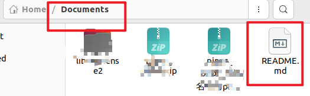

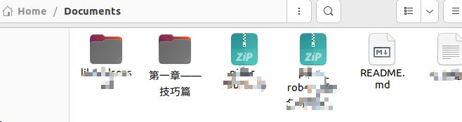


#### 7. rm

rm用于**移除文件或目录**。

语法格式：`rm <文件/文件夹>`

参数如下：

| **参数选项** | **英文涵义**       | **功能说明**                                                 |
| ------------ | ------------------ | ------------------------------------------------------------ |
| **`-f`**     | force (强制)       | 忽略不存在的文件，强制删除且不会出现任何警告信息。           |
| **`-i`**     | interactive (互动) | 互动模式，在真正执行删除前，会弹窗询问使用者是否确定该动作。 |
| **`-r`**     | recursive (递归)   | 递归持续删除，专门用于目录（文件夹）的删除行为。             |

代码就不做演示了，可参考之前的命令操作，独立实现。


#### 8. mv 

mv 用于**移动文件与目录**，或**修改名称**。

语法：`mv <来源> <目的地>`

参数如下：

| **参数选项** | **英文涵义 (助记)** | **功能说明**                                                 |
| ------------ | ------------------- | ------------------------------------------------------------ |
| **`-f`**     | force (强制)        | 强制模式，如果目标文件已经存在，不会询问而直接无情覆盖。     |
| **`-i`**     | interactive (互动)  | 互动模式，若目标文件已经存在，在覆盖前会先弹窗询问使用者动作。 |
| **`-u`**     | update (升级/更新)  | 智能模式，若目标文件已经存在，且“源文件”比“目标文件”**更新（修改时间更晚）**，才会执行覆盖升级。 |

```shell

# 准备工作：查看当前目录下的文件和文件夹
(base) yy@yy-VivoBook-ASUSLaptop-X512FLC-V5000FL:~/My_Data/notebook$ ls
README.md  大纲.md         第三章——编程基础
temp1      第一章——技巧篇  第二章—所需软件及破解教程

# 核心功能一：修改名称（重命名）

#重命名大纲.md 改名为 机械臂学习大纲.md  来源使用相对路径，目的地使用相对路径
(base) yy@yy-VivoBook-ASUSLaptop-X512FLC-V5000FL:~/My_Data/notebook$ mv 大纲.md  机械臂学习大纲.md
(base) yy@yy-VivoBook-ASUSLaptop-X512FLC-V5000FL:~/My_Data/notebook$ ls
README.md  机械臂学习大纲.md  第三章——编程基础
temp1      第一章——技巧篇     第二章—所需软件及破解教程

# 核心功能二：移动文件/目录
# 把 "README.md" 这个文件，扔进当前文件夹下的 "temp1" 文件夹里。
(base) yy@yy-VivoBook-ASUSLaptop-X512FLC-V5000FL:~/My_Data/notebook$ cp 机械臂学习大纲.md temp1/

# 验证一下，文件确实进去了：
(base) yy@yy-VivoBook-ASUSLaptop-X512FLC-V5000FL:~/My_Data/notebook$ cd temp1/
(base) yy@yy-VivoBook-ASUSLaptop-X512FLC-V5000FL:~/My_Data/notebook/temp1$ ls
机械臂学习大纲.md
#返回
(base) yy@yy-VivoBook-ASUSLaptop-X512FLC-V5000FL:~/My_Data/notebook/temp1$ cd ..

(base) yy@yy-VivoBook-ASUSLaptop-X512FLC-V5000FL:~/My_Data/notebook$ mv 机械臂学习大纲.md temp1/机械臂大纲重命名.md
#验证一下
(base) yy@yy-VivoBook-ASUSLaptop-X512FLC-V5000FL:~/My_Data/notebook/temp1$ ls
机械臂大纲重命名.md  机械臂学习大纲.md

```


### 3.4.4.3 文件查看常用指令

#### 1. cat

`cat` 用于连接文件并打印到标准输出设备上（常用于在终端内直接且快速地查看文件内容）。

语法：`cat [参数] <文件名>`

参数如下：

| **参数选项** | **英文涵义 (助记)** | **功能说明**                                                 |
| ------------ | ------------------- | ------------------------------------------------------------ |
| **`-n`**     | number (编号)       | 由 1 开始对所有输出的行数编号（查看报错对应的代码行数时非常有用）。 |
| **`-b`**     | number-nonblank     | 和 `-n` 相似，只不过对于空白行不进行编号。                   |

```shell
(base) yy@yy-VivoBook-ASUSLaptop-X512FLC-V5000FL:~/My_Data/notebook$ cat README.md 
机械臂智能抓取是机器人学、机器视觉、深度学习与工程系统集成的典型交叉方向。对于学习者而言，真正的难点并不只是理解单个概念，而是如何将相机采集、图像处理、目标识别、位姿估计、坐标变换、运动规划与机械执行串联为一个完整闭环。

本规划书结合学习者已有基础，围绕“编程基础 → 机器人学核心 → 机器视觉与相机系统 → ROS2 与 MoveIt2 工程落地 → 深度学习进阶 → 3D 点云与抓取网络 → 综合项目实施”构建系统路线。每个章节均给出学习内容、学习目标、学习价值、学习安排与资源建议，避免仅停留在概念堆叠或代码搬运层面。

本版本特别强调内容完整性。此前版本中部分学习模块存在表达压缩现象，例如 NumPy 学习条目中“向量化运算”“图像矩阵与张量基础”等内容曾被弱化。本最终版已统一恢复为完整表达，确保每一模块都可直接执行和验收。

--------------------------------------------------------------------------------------------------------------------------------

(base) yy@yy-VivoBook-ASUSLaptop-X512FLC-V5000FL:~/My_Data/notebook$ cat -n README.md 
     1	机械臂智能抓取是机器人学、机器视觉、深度学习与工程系统集成的典型交叉方向。对于学习者而言，真正的难点并不只是理解单个概念，而是如何将相机采集、图像处理、目标识别、位姿估计、坐标变换、运动规划与机械执行串联为一个完整闭环。
     2	
     3	本规划书结合学习者已有基础，围绕“编程基础 → 机器人学核心 → 机器视觉与相机系统 → ROS2 与 MoveIt2 工程落地 → 深度学习进阶 → 3D 点云与抓取网络 → 综合项目实施”构建系统路线。每个章节均给出学习内容、学习目标、学习价值、学习安排与资源建议，避免仅停留在概念堆叠或代码搬运层面。
     4	
     5	本版本特别强调内容完整性。此前版本中部分学习模块存在表达压缩现象，例如 NumPy 学习条目中“向量化运算”“图像矩阵与张量基础”等内容曾被弱化。本最终版已统一恢复为完整表达，确保每一模块都可直接执行和验收。


--------------------------------------------------------------------------------------------------------------------------------

(base) yy@yy-VivoBook-ASUSLaptop-X512FLC-V5000FL:~/My_Data/notebook$ cat -b README.md 
     1	机械臂智能抓取是机器人学、机器视觉、深度学习与工程系统集成的典型交叉方向。对于学习者而言，真正的难点并不只是理解单个概念，而是如何将相机采集、图像处理、目标识别、位姿估计、坐标变换、运动规划与机械执行串联为一个完整闭环。

     2	本规划书结合学习者已有基础，围绕“编程基础 → 机器人学核心 → 机器视觉与相机系统 → ROS2 与 MoveIt2 工程落地 → 深度学习进阶 → 3D 点云与抓取网络 → 综合项目实施”构建系统路线。每个章节均给出学习内容、学习目标、学习价值、学习安排与资源建议，避免仅停留在概念堆叠或代码搬运层面。

     3	本版本特别强调内容完整性。此前版本中部分学习模块存在表达压缩现象，例如 NumPy 学习条目中“向量化运算”“图像矩阵与张量基础”等内容曾被弱化。本最终版已统一恢复为完整表达，确保每一模块都可直接执行和验收。

```

#### 2. nano

`nano` 是一个简单直观的终端文本编辑器。在纯字符界面的 Linux 环境下，它能让你快速修改代码脚本或环境配置文件（对新手极其友好，比复杂的 `vim` 更容易上手）。

语法：`nano [参数] <文件名>`

参数如下：

| **参数选项** | **英文涵义 (助记)**     | **功能说明**                                                 |
| ------------ | ----------------------- | ------------------------------------------------------------ |
| **`-c`**     | constantshow (持续显示) | 在底部状态栏持续显示光标所在的行号、列号（编写或排错代码时强烈建议加上）。 |
| **`-m`**     | mouse (鼠标支持)        | 开启鼠标功能，允许你打破纯键盘限制，直接用鼠标点击来定位光标位置。 |


### 3.4.4.5 apt常用命令

apt（Advanced Packaging Tool）是一个在 Debian 和 Ubuntu 中的 Shell 前端软件包管理器，提供了查找、安装、升级、删除某一个、一组甚至全部软件包的命令，而且命令简洁而又好记。

注意：执行 `apt` 相关的系统级修改命令通常需要超级管理员权限，因此大多需要在命令前加上 `sudo`。

**apt 语法**

```
  apt [options] [command] [package ...]
```

- **options：**可选，选项包括 -h（帮助），-y（当安装过程提示选择全部为"yes"），-q（不显示安装的过程）等等。
- **command：**要进行的操作。
- **package**：安装的包名。

在安装任何新软件前，强烈建议养成以下标准操作习惯：

1. `sudo apt update`（拉取最新的软件源列表）
2. `sudo apt search <关键词>`（在列表里搜索确认包名是否正确）
3. `sudo apt install <包名>`（执行下载并安装）

**常用命令如下**

| **命令 (Command)**                 | **图片原功能说明**                       | **🤖 机械臂/开发实战指南与备注**                              |
| ---------------------------------- | ---------------------------------------- | ------------------------------------------------------------ |
| **`sudo apt update`**              | 列出所有可更新的软件清单                 | 它本身不安装东西，只是去服务器拉取“最新软件菜单”。每次安装新库前务必先执行。 |
| **`sudo apt upgrade`**             | 升级软件包                               | 按照刚拉取的“菜单”，把系统里所有能更新的软件统一升级。       |
| **`sudo apt search <关键词>`**     | 查找软件包                               | 比如你想装深度相机的库但不知道完整的包名，可以输入 `sudo apt search realsense` 让系统帮你找。 |
| **`sudo apt install <包名>`**      | 安装指定的软件                           | 例如安装 ROS 节点库：`sudo apt install ros-humble-desktop`。 |
| **`sudo apt install <包1> <包2>`** | 安装多个软件包                           | 一键安装多个环境依赖，包名之间用**空格隔开**。               |
| **`sudo apt autoremove`**          | 清理不再使用的依赖和库文件               | 深度学习经常装卸各种库，系统会产生很多废弃的“孤儿”依赖。用它能自动清理。 |
| **`sudo apt show <包名>`**         | 显示软件包具体信息（版本、大小、依赖等） | 用于检查某个特定算法库的具体版本号是否与你的项目要求冲突。   |
| **`apt list --installed`**         | 列出所有已安装的包                       | 查看你的系统中目前到底装了哪些大杂烩。                       |
| **`sudo apt purge <包名>`**        | 移除软件包及配置文件                     | 如果你把某个软件（比如 ROS）彻底搞崩溃了想重新来过，必须用它将软件和配置文件一并彻底销毁。 |


在熟练掌握基础命令后，可以通过以下特殊参数实现更精准的控制：

**技巧一：一键无脑更新连招** 对于 `sudo apt update` 和 `sudo apt upgrade` 可以用 `&&` 连起来一起使用表示先执行前者后执行后者，若前者失败后者也失败，最后加上 `-y` 跳过所有询问：

```
sudo apt update && sudo apt upgrade -y
```

**技巧二：只升级，不安装** 如果只想将某个已经存在的软件升级到最新版，但如果它还没安装，**不想**意外安装它，可以使用 `--only-upgrade` 参数：

```
sudo apt install <package_name> --only-upgrade
```

**技巧三：只安装，不升级** 如果我们想安装一个软件包，但如果这个软件已经存在了，为了保证环境稳定**不要去升级它**，可以使用 `--no-upgrade` 选项：

```
sudo apt install <package_name> --no-upgrade
```

**技巧四：安装指定的版本号** 在复现某些深度学习项目时，经常对版本有严格要求。如果需要设置指定版本，语法格式如下：

```
sudo apt install <package_name>=<version_number>
```

*(注：`package_name` 为包名，`version_number` 为具体的版本号)*


### 3.4.4.6 文件权限及chmod使用

权限分类如下：

| **用户类别 (角色)**             | **对应数字** | **积分拆解 (4-读, 2-写, 1-执行)**  | **字母表示** | **实际含义 (针对文件夹)**                                    |
| ------------------------------- | ------------ | ---------------------------------- | ------------ | ------------------------------------------------------------ |
| **所有者 (User)** *(你本人)*    | **7**        | 4 (读) + 2 (写) + 1 (执行)         | **`rwx`**    | **最高满分权限**：可以查看内容 (`ls`)、可以新建/删除文件、可以进入 (`cd`)。 |
| **所属组 (Group)** *(同组人员)* | **1**        | 0 (不给读) + 0 (不给写) + 1 (执行) | **`--x`**    | **限制权限**：只能进入 (`cd`)。不能查看里面有什么，也不能在里面建新东西。 |
| **其他人 (Others)** *(陌生人)*  | **1**        | 0 (不给读) + 0 (不给写) + 1 (执行) | **`--x`**    | **限制权限**：同上，仅允许进入 (`cd`)。                      |

chmod修改权限使用场景：

| **核心场景**   | **具体问题表现**                                             | **解决命令 (大招)**               | **核心目的**                               |
| -------------- | ------------------------------------------------------------ | --------------------------------- | ------------------------------------------ |
| **代码要运行** | 新写的 Python 或 ROS 安装脚本报错“Permission denied”（默认没腿跑不起来）。 | **`chmod +x 脚本名`**             | 赋予程序**执行 (x)** 权限                  |
| **外设要插拔** | 机械臂串口、深度相机连电脑后，代码报错“无法读写设备”。       | **`sudo chmod 777 /dev/ttyUSB0`** | 暴力打通物理硬件接口的**最高级别读写**权限 |
| **软件要打开** | 下载了 `.AppImage` 格式的免安装独立软件，双击毫无反应。      | **`chmod +x 软件名.AppImage`**    | 赋予独立软件**运行许可**                   |

#### 