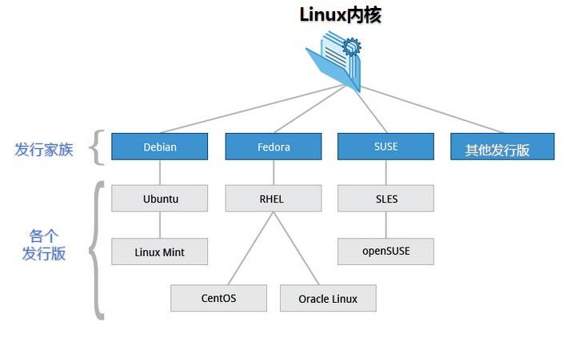
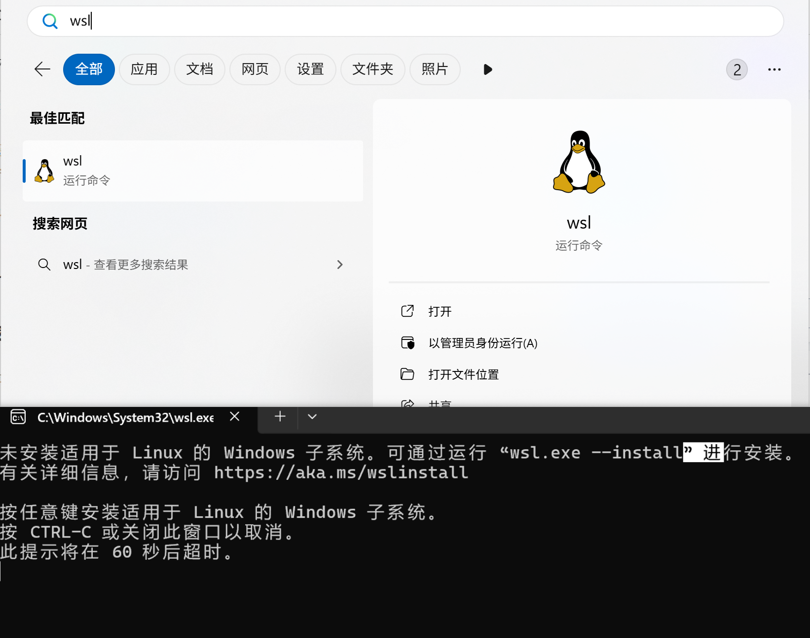
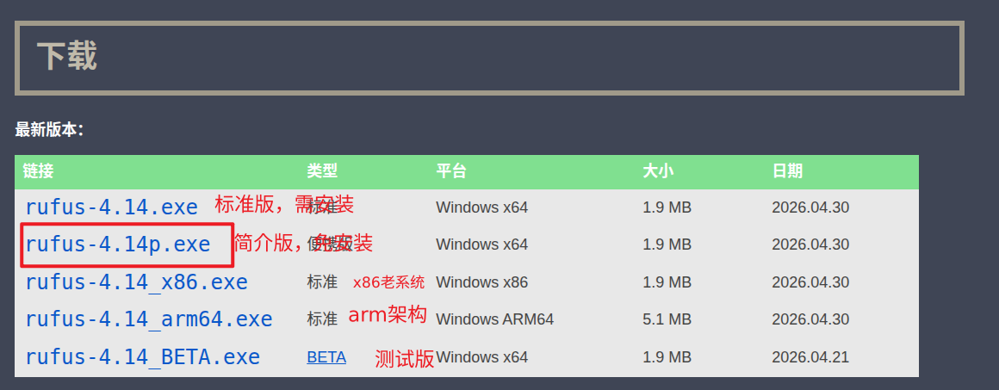
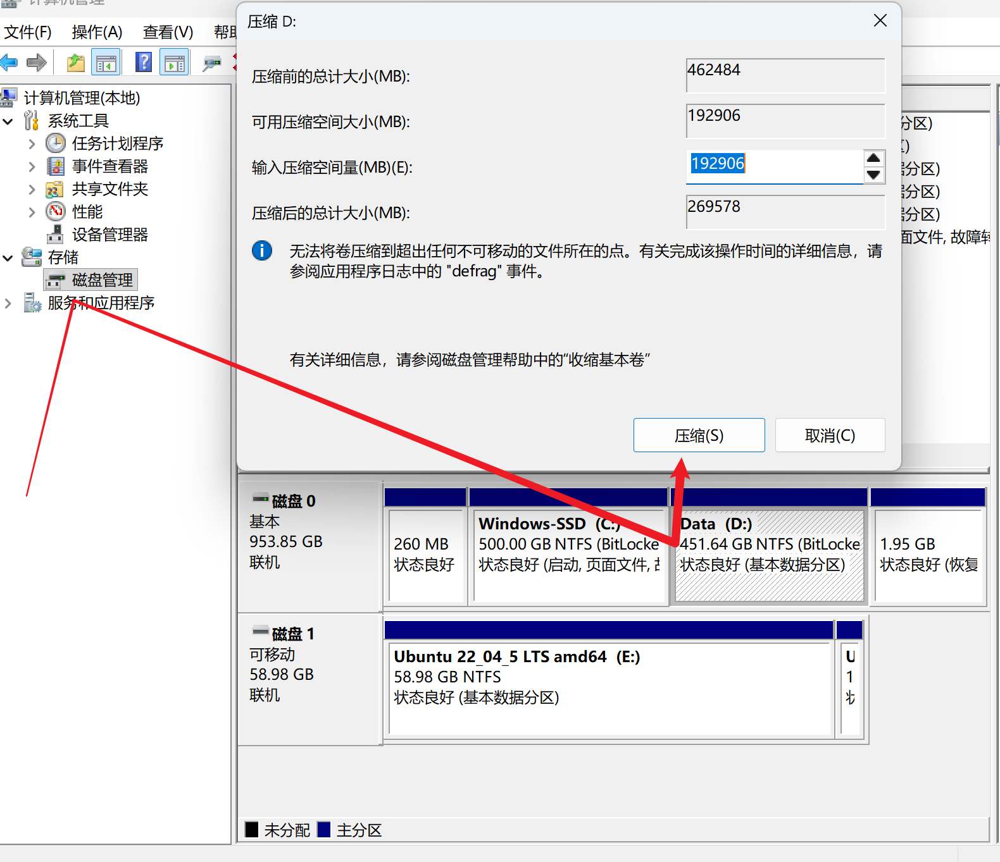
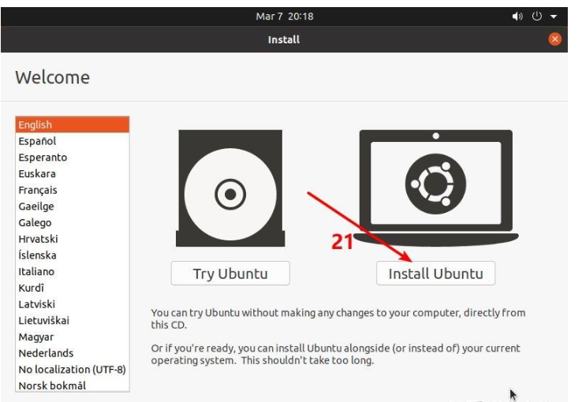
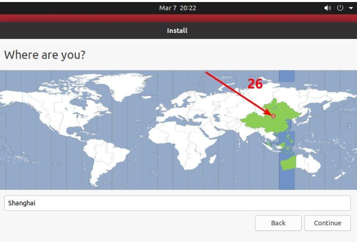
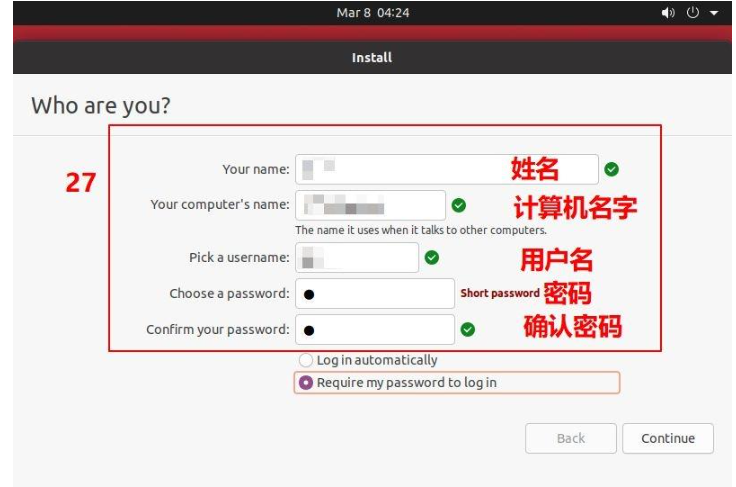
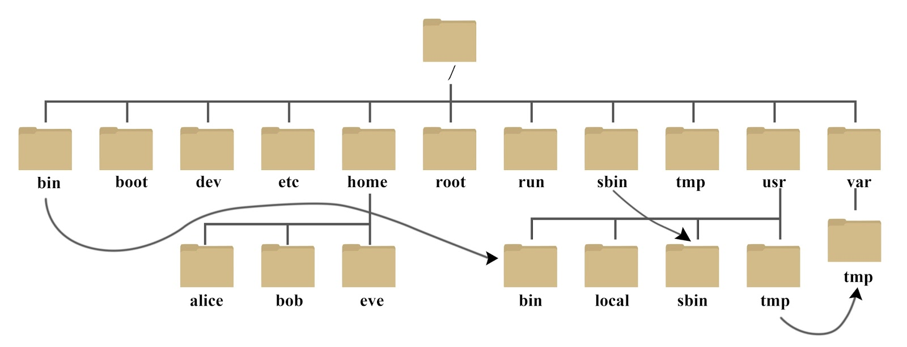

# 3.4 Linux基础 与常用命令教程

```
学习资源：
		https://www.runoob.com/linux/linux-intro.html
		https://hackmd.io/@sysprog/linux-comic
		https://hackmd.io/@GDSC-CYCU/Linux-Git-WorkShop
		https://zhuanlan.zhihu.com/p/536994892
		https://mirrors.tuna.tsinghua.edu.cn/ubuntu-releases/22.04/
		https://rufus.ie/zh/
		https://www.cnblogs.com/luzhanshi/articles/19118891
```


## 3.4.1 教程引入

Linux（ `Linux is not Unix`） 是一种自由和开放源码的类 UNIX 操作系统，由 Linus Torvalds 于 1991 年发起。它遵循 GNU 通用公共许可证（GPL），赋予了开发者自由使用、查看底层源码、修改和再发布的权利。得益于这种强大的开源协作基因，业界衍生出了诸如 Debian（及其最著名的分支 Ubuntu）、Fedora 和 openSUSE 等主流发行版。


对于你目前主攻的深度学习与视觉机械臂抓取方向而言，Linux 不仅仅是一段计算机科普知识，更是必须掌握的底层开发基石。当前的机器人与 AI 领域高度依赖 Linux 生态，尤其是 Ubuntu 22.04 系统。无论是部署 PyTorch 等算法高效调用 GPU 算力、运行 ROS 2 (Humble) 进行复杂的节点通信，还是让系统精准挂载并控制底层的深度相机与机械臂硬件，Linux 都是最原生、最稳定的载体。

因此，本教程的学习目的非常明确：实用至上。面对庞杂的 Linux 系统，你不需要死记硬背所有指令，更无需成为专业的系统管理员。你的核心任务是将其作为得心应手的开发工具，重点掌握纯终端（Shell）下的目录导航、文件权限管理以及依赖包的环境配置。当你能抛开鼠标，在命令行的黑框中从容地搭建出自己的深度学习与机械臂控制环境时，这门工具就真正为你所用了。

## 3.4.2 简介

Linux 内核最初只是由芬兰人林纳斯·托瓦兹（Linus Torvalds）在赫尔辛基大学上学时出于个人爱好而编写的。

Linux 是一套免费使用和自由传播的类 Unix 操作系统，是一个基于 POSIX 和 UNIX 的多用户、多任务、支持多线程和多 CPU 的操作系统。

Linux 能运行主要的 UNIX 工具软件、应用程序和网络协议。它支持 32 位和 64 位硬件。Linux 继承了 Unix 以网络为核心的设计思想，是一个性能稳定的多用户网络操作系统。

### Linux 的发行版

Linux 的发行版说简单点就是将 Linux 内核与应用软件做一个打包。



### Linux 应用领域

今天各种场合都有使用各种 Linux 发行版，从嵌入式设备到超级计算机，并且在服务器领域确定了地位，通常服务器使用 LAMP（Linux + Apache + MySQL + PHP）或 LNMP（Linux + Nginx+ MySQL + PHP）组合。

目前 Linux 不仅在家庭与企业中使用，并且在政府中也很受欢迎。

- 巴西联邦政府由于支持 Linux 而世界闻名。
- 有新闻报道俄罗斯军队自己制造的 Linux 发布版的，做为 G.H.ost 项目已经取得成果。
- 印度的 Kerala 联邦计划在向全联邦的高中推广使用 Linux。
- 中华人民共和国为取得技术独立，在龙芯处理器中排他性地使用 Linux。
- 在西班牙的一些地区开发了自己的 Linux 发布版，并且在政府与教育领域广泛使用，如 Extremadura 地区的 gnuLinEx 和 Andalusia 地区的 Guadalinex。
- 葡萄牙开发了自己的 Linux 发行版 Caixa Mágica，并将其应用在 Magalhães 教育笔记本电脑及政府的 e-escola 教育计划中。
- 法国和德国同样开始逐步采用 Linux。

### Linux vs Windows

目前国内 Linux 更多的是应用于服务器上，而桌面操作系统更多使用的是 Windows。主要区别如下

| 比较     | Windows                                                      | Linux                                                        |
| :------- | :----------------------------------------------------------- | :----------------------------------------------------------- |
| 界面     | 界面统一，外壳程序固定所有 Windows 程序菜单几乎一致，快捷键也几乎相同 | 图形界面风格依发布版不同而不同，可能互不兼容。GNU/Linux 的终端机是从 UNIX 传承下来，基本命令和操作方法也几乎一致。 |
| 驱动程序 | 驱动程序丰富，版本更新频繁。默认安装程序里面一般包含有该版本发布时流行的硬件驱动程序，之后所出的新硬件驱动依赖于硬件厂商提供。对于一些老硬件，如果没有了原配的驱动有时很难支持。另外，有时硬件厂商未提供所需版本的 Windows 下的驱动，也会比较头痛。 | 由志愿者开发，由 Linux 核心开发小组发布，很多硬件厂商基于版权考虑并未提供驱动程序，尽管多数无需手动安装，但是涉及安装则相对复杂，使得新用户面对驱动程序问题（是否存在和安装方法）会一筹莫展。但是在开源开发模式下，许多老硬件尽管在Windows下很难支持的也容易找到驱动。HP、Intel、AMD 等硬件厂商逐步不同程度支持开源驱动，问题正在得到缓解。 |
| 使用     | 使用比较简单，容易入门。图形化界面对没有计算机背景知识的用户使用十分有利。 | 图形界面使用简单，容易入门。文字界面，需要学习才能掌握。     |
| 学习     | 系统构造复杂、变化频繁，且知识、技能淘汰快，深入学习困难。   | 系统构造简单、稳定，且知识、技能传承性好，深入学习相对容易。 |
| 软件     | 每一种特定功能可能都需要商业软件的支持，需要购买相应的授权。 | 大部分软件都可以自由获取，同样功能的软件选择较少。           |

## 3.4.3 Linux安装

在正式开始探索 Linux 之前，我们需要先在你的 Windows 电脑上搭建好运行环境。目前主流的安装方案共有三种：虚拟机、WSL（Windows 的 Linux 子系统）以及原生双系统。这三者在性能损耗和硬件调用权限上有着本质的区别。

**虚拟机**虽然安装简单且与原系统完全隔离，但它运行在一个相对封闭的虚拟层中，会带来明显的性能损耗。最关键的是，虚拟机极难高效地穿透到宿主机去调用真实的 GPU 算力和外部 USB 设备。考虑到你后续需要使用显卡进行深度学习加速，以及通过 USB 串口连接真实相机和机械臂，虚拟机方案会成为巨大的开发瓶颈，因此在此不作推荐。

相比之下，另外两种方案则完美契合了机器人与 AI 开发的不同阶段需求。**WSL** 是一种微软官方提供的轻量级融合方案，它允许你在不重启、不离开 Windows 桌面的情况下，以极低的性能损耗运行原生的 Ubuntu 系统，并且目前已经能够极好地支持 CUDA 显卡加速。它非常适合你进行前期的算法验证、深度学习模型测试以及 ROS 框架的纯软件学习。

而**双系统**则是将硬件性能和开发自由度发挥到极致的终极形态。它能为你提供最原生的 Linux 运行环境、最低的系统延迟，以及对底层硬件（显卡、深度相机数据流、电机驱动器）最直接、最高级别的访问权限。当你准备脱离纯模拟环境，开始联调真实的机械臂硬件时，双系统是无可替代的必经之路。

因此，接下来的教程我们将彻底摒弃虚拟机，重点围绕最具实战价值的 WSL 与双系统环境搭建展开。你可以根据自己当前的开发侧重点进行选择：

### WSL安装

**WSL（Windows Subsystem for Linux）** 是微软为 Windows 用户提供的一个子系统，它允许你在 Windows 上原生运行 Linux（不是虚拟机，不是双系统），直接使用 Bash、apt、gcc、Python、Node.js 等 Linux 工具。

**WSL 的版本区别**

| 特性             | WSL1                     | WSL2                            |
| :--------------- | :----------------------- | :------------------------------ |
| 内核架构         | 翻译系统调用（兼容层）   | 真正的 Linux 内核（轻量虚拟机） |
| 性能（文件访问） | Windows ↔ Linux 访问更快 | Linux ↔ Linux 内部访问更快      |
| 启动速度         | 更快                     | 略慢                            |
| Docker 支持      | 不支持                   | ✅ 完全支持                      |
| 系统资源占用     | 较少                     | 稍高                            |

推荐使用 **WSL2**，兼容性更强，功能更完整。

**前提条件**

- Windows 10 2004（或更高版本） / Windows 11
- 启用虚拟化（BIOS 中 VT-x 或 AMD-V 开启）

按如图操作进入命令行中：



在命令行输入：

```shell
wsl --install
```

该命令会自动：

- 启用 WSL 功能
- 安装 WSL2 内核
- 安装默认的 Ubuntu
- 设置为 WSL2

安装完后，重启一次系统即可！

**常用命令速查表**

| 命令                         | 说明                     |
| :--------------------------- | :----------------------- |
| `wsl`                        | 启动默认 Linux           |
| `wsl --list --verbose`       | 查看已安装的发行版和版本 |
| `wsl --set-version Ubuntu 2` | 设置 Ubuntu 使用 WSL2    |
| `wsl --install -d Debian`    | 安装指定发行版           |
| `wsl --shutdown`             | 关闭所有 WSL 实例        |
| `wsl -e bash`                | 以 Bash 启动 Linux Shell |

待后续补充更具体使用....

###  双系统安装

**安装准备**

进入清华大学开源软件镜像站:https://mirrors.tuna.tsinghua.edu.cn/ubuntu-releases/22.04/

选择如图版本进行下载，我们本次教程以Ubuntu22.04版本下载演示，如果需要下载20.04等其他版本，大体流程一致，参考教程更换版本即可。


接着我们需要一个准备一个 8G 的U盘，以及下载系统盘制作工具, 制作启动盘。

工具推荐[Rufus](https://rufus.ie/zh/)，具体版本有如下区别，建议按图下载。




下载完，将你的U盘插入电脑，后按图配置后点击开始烧入。


接着，我们准备 Ubuntu 需要的硬盘空间 ，右击`此电脑`，若是windos11电脑，右击后点`显示更多选项`，然后点击`管理`，找到`磁盘管理`，选择一个分区 右键选择`压缩卷`, 压缩出一部分空间 ( 注意, 压缩时 1G = 1024Mb )，根据自己需求压缩即可。



压缩完分区后，关闭电脑（此时不要拔掉U盘），再次开启，进入BIOS模式，选择带有 usb字样 或 自己U盘名 的启动项，等待一会儿， 然后就可以看到以下界面，按照图中教程进行即可。

这里使用英文介绍, 中文的位置与英文相同, 这里会给出中文的大致翻译在左边, 划到最下方, 选择中文 即可将系统默认语言变成中文,后面可以在设置中修改系统语言, 比较推荐使用英文, 使用中文可能会有一些乱码和错误, 但是初学者可以使用中文帮助认识选择 install ubuntu ( 安装Ubuntu )，点击Continue ( Quit 取消安装, Back 返回上一步, Continue 下一步 )



此时我们使用美国键盘布局【English（US）】，点击【Continue】


标准安装模式提供了一个功能齐全的Ubuntu环境。它包括了Ubuntu操作系统的所有标准软件，例如完整的桌面环境（通常是GNOME）、一系列预装的应用程序（如浏览器、办公软件、媒体播放器等），以及其他实用工具和服务。这种安装模式适合那些想要即刻获得一个准备就绪、功能丰富的系统的用户。而最小安装模式提供了一个精简的Ubuntu环境。它安装了基本的桌面环境和极少量的软件，通常只包括一个浏览器和基本的系统工具。这种模式适合那些希望自定义自己系统的用户，或者那些对系统资源有限制（如使用较老硬件）的用户。最小安装允许用户在安装后根据自己的需要安装额外的软件和应用程序。


接下来进行系统分区，第一个是不清理硬盘直接安装 ( 不建议选择 )，第二个是清空整个硬盘, 再进行安装 ( 装单系统的才能选, 会将原有的Windows系统删除 )第三个是自定义安装 ( 双系统选择这个 )。


选择自定义安装需要配置分区大小，选择 free space 未分配空间，点击加号或鼠标右键， 新建分区。


- Size：分区大小
- Type for the new partition ：分区模式 Primary ( 主分区 ) Logical ( 逻辑分区 )
- Location for the new partition： Beginning of this space ( 分区开始 ) End of this space ( 分区结束 )
- Use as：分区文件格式

- 还有一行是挂载点：/ , /boot


| 分区名        | 推荐大小     | 文件格式 | 挂载点 | 备注                                                         |
| ------------- | ------------ | -------- | ------ | ------------------------------------------------------------ |
| boot 分区     | 1G 左右      | Ext4     | /boot  | 有时候会提示未分配 EFI 分区 这时需要重新分配分区，把原本 /boot 的文件格式改为EFI，没有挂载点 |
| 虚拟内存 swap | 两倍物理内存 | swap     | 无     | 交换空间                                                     |
| 根目录 /      | 剩余空间     | Ext4     | /      |                                                              |

默认选择 逻辑分区 和 分区起始位置，根目录其实相当于 windows 的此电脑的地位，所有文件和程序都挂在 根目录之下，其他教程有让分出 /home（用户文件夹），/usr（用户程序），/tmp(临时文件) 分区，其实这些都在根目录之下，完全不需要再次划分。

若这块有迷惑，参考[更详细配置教程](https://www.cnblogs.com/luzhanshi/articles/19118891)。

然后选择地区，我们选择中国 地址会出现上海。



最后一步骤，用户信息配置。



安装完成后会出现 Restart Now 重启，此时就可以把 U盘 拔下来了，重启时, 还是需要手动进入 Bios 界面, 此时会出现 Ubuntu 选项，恭喜安装成功！

## 3.4.4 Linux内容教学

### 3.4.4.1 目录结构

登录系统后，在当前命令窗口下输入命令：

```
 ls / 
```

你会看到如下图所示:


树状目录结构：




以下是对这些目录的解释：

| 目录               | 作用详解                                                     | 常见文件 / 示例                               |
| :----------------- | :----------------------------------------------------------- | :-------------------------------------------- |
| `/`                | 根文件系统，所有挂载点与路径的起点。包含系统必须的子目录与入口结构。 | 无具体数据文件，只有子目录结构。              |
| `/bin`             | 系统启动和单用户模式下必须的基础命令，所有用户可执行。       | `ls`, `cp`, `mv`, `rm`, `bash`                |
| `/sbin`            | 系统管理与维护命令，面向 root。                              | `fsck`, `reboot`, `shutdown`                  |
| `/usr`             | 用户级程序与库的主集合，包含大部分系统软件、文档与工具。     | `/usr/bin`, `/usr/lib`, `/usr/share`          |
| `/usr/bin`         | 常规用户程序的主要放置目录。                                 | `python3`, `vim`, `git`                       |
| `/usr/sbin`        | 管理工具的扩展集合。                                         | `useradd`, `apache2ctl`                       |
| `/usr/lib`         | `/usr` 内程序所依赖的动态库与模块。                          | 各类 `.so` 动态库                             |
| `/usr/local`       | 本机安装或编译软件的独立区域。                               | `/usr/local/bin`, `/usr/local/lib`            |
| `/lib` 或 `/lib64` | 系统启动核心库、动态链接器所在位置。                         | `libc.so.6`, `ld-linux.so`                    |
| `/etc`             | 系统级配置中心，统一存放所有服务和系统配置。                 | `passwd`, `group`, `fstab`, `ssh/sshd_config` |
| `/home`            | 普通用户的个人主目录集合。                                   | `/home/user/.bashrc`, `/home/user/Documents`  |
| `/root`            | root 用户的主目录。                                          | `/root/.ssh/`                                 |
| `/var`             | 频繁变化的数据：日志、缓存、数据库运行文件等。               | `/var/log`, `/var/lib`, `/var/cache`          |
| `/var/log`         | 所有系统与服务日志的集中位置。                               | `syslog`, `auth.log`, `kern.log`              |
| `/var/cache`       | 应用和包管理器缓存。                                         | `/var/cache/apt/`                             |
| `/var/lib`         | 服务的持久化状态数据。                                       | `mysql/`, `docker/`                           |
| `/tmp`             | 程序运行时的临时文件区，随时可清理。                         | 临时文件、socket 路径                         |
| `/boot`            | 启动所需文件：内核、initramfs、引导配置。                    | `vmlinuz-*`, `initrd.img`, `grub/grub.cfg`    |
| `/dev`             | 设备节点集合，文件即设备。                                   | `/dev/sda`, `/dev/null`, `/dev/tty0`          |
| `/proc`            | 由内核提供的虚拟文件系统，展示系统与进程的实时信息。         | `/proc/cpuinfo`, `/proc/<pid>/`               |
| `/sys`             | 设备、驱动、内核子系统的状态接口。                           | `/sys/class/net/`, `/sys/block/`              |
| `/mnt`             | 手动挂载的临时挂载点。                                       | `/mnt/usb`                                    |
| `/media`           | 自动挂载外接设备的默认位置。                                 | `/media/user/USB_DRIVE`                       |
| `/run`             | 运行时数据存放点，重启后清空。                               | `*.pid`, 运行状态 socket 文件                 |

在 Linux 中，下列目录属于系统关键区，误删或乱改都会直接破坏系统运行：

**/etc — 系统配置核心**

所有关键配置集中于此。任何错误修改都可能导致服务挂掉，甚至系统无法启动。

**/bin、/sbin、/usr/bin、/usr/sbin — 系统指令区**

系统预置命令的所在位置。

- **/bin、/usr/bin**：供普通用户使用的基础指令（如 `ls` 位于 `/bin/ls`）。
- **/sbin、/usr/sbin**：系统管理指令，主要由 root 使用。

**/var — 动态数据区**

系统运行时不断写入的数据都落在这里。
重点是 **/var/log**，各种服务日志全部存放此处；邮件、缓存、队列等内容也在此目录下维护。